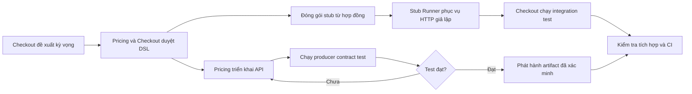
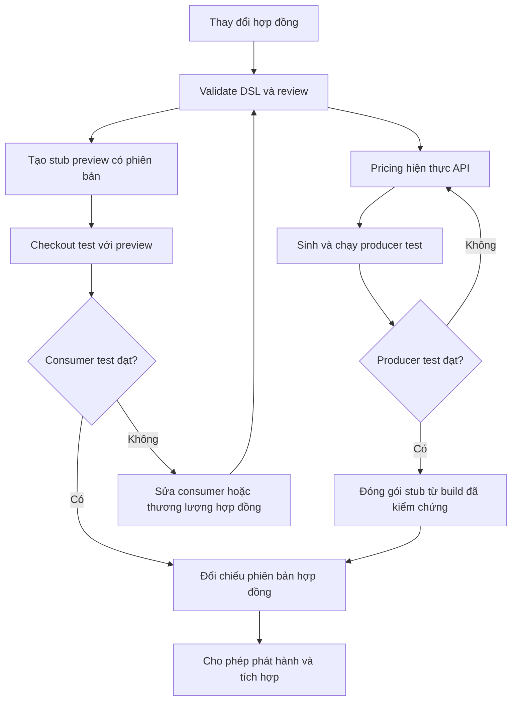

# Xử lý hợp đồng mới khi producer chưa triển khai xong

Trong kiến trúc microservices, một nhóm có thể cần gọi API của dịch vụ khác trước khi dịch vụ đó hoàn thành. Ví dụ, **Checkout** cần lấy giá sản phẩm từ **Pricing**, nhưng Pricing mới thống nhất yêu cầu nghiệp vụ và chưa có endpoint `GET /v1/prices/{sku}`. Nếu Checkout phải chờ Pricing chạy thật, hai nhóm sẽ phát triển tuần tự, tích hợp muộn và dễ phát hiện bất đồng khi đã sát ngày phát hành.

**Spring Cloud Contract** cho phép bắt đầu từ **hợp đồng về hành vi giao tiếp**: hai nhóm thống nhất request, response, mã lỗi và dữ liệu liên quan bằng Groovy hoặc YAML DSL; từ hợp đồng có thể tạo **stub** để consumer phát triển, đồng thời tạo **kiểm thử hợp đồng cho producer** khi implementation sẵn sàng. Cách làm này thường được gọi là *contract-first* trong quy trình *consumer-driven contract testing* (CDC).

Điểm mấu chốt: **consumer chạy thành công với stub chưa chứng minh producer thật tuân thủ hợp đồng**. Khi producer chưa triển khai xong, phải quản lý rõ trạng thái của hợp đồng, nguồn gốc stub và cổng kiểm tra trước khi phát hành API.

## 1. Xác định rõ phần nào đã có và phần nào chưa có

Giả sử Checkout cần hiển thị giá tại bước xác nhận đơn hàng:

| Thành phần | Trạng thái ban đầu | Nhu cầu |
|---|---|---|
| Checkout (consumer) | Đã có màn hình, chưa tích hợp Pricing | Gọi API và xử lý giá thành công hoặc lỗi |
| Pricing (producer) | Chưa hoàn thành controller/service | Nhận yêu cầu và trả dữ liệu theo cam kết |
| Hợp đồng | Chưa được thống nhất | Mô tả chính xác tương tác tại ranh giới HTTP |
| Stub | Chưa có | Giúp Checkout kiểm thử mà không cần Pricing chạy thật |
| Producer contract test | Có thể sinh từ hợp đồng, nhưng chưa thể vượt qua | Xác minh Pricing khi mã triển khai và dữ liệu kiểm thử sẵn sàng |

Với tình huống này, mục tiêu trước mắt là **chốt được kỳ vọng và kiểm thử consumer sớm**. Mục tiêu trước khi phát hành tích hợp là **chứng minh producer triển khai đúng kỳ vọng ấy**.

Những câu hỏi cần thống nhất trước khi viết DSL:

1. Consumer thực sự sử dụng những trường nào và chúng có kiểu dữ liệu gì?
2. Request cần method, path, header, quyền truy cập hay tham số gì?
3. Trường hợp thành công dùng mã HTTP và nội dung phản hồi nào?
4. Những tình huống lỗi nào làm thay đổi cách consumer xử lý, chẳng hạn `404` hay `503`?
5. Giá trị nào ổn định để đưa vào ví dụ, giá trị nào phải dùng matcher vì thay đổi theo thời gian?
6. Ai phê duyệt thay đổi hợp đồng và phiên bản stub nào được phép sử dụng trong CI?

Không cần mô tả toàn bộ database hoặc logic định giá nội bộ của Pricing. Hợp đồng tập trung vào **điều Checkout quan sát và phụ thuộc ở giao diện API**.

## 2. Thống nhất hợp đồng trước khi viết endpoint

Hai nhóm cùng xác nhận một kịch bản tối thiểu:

- `GET /v1/prices/SKU-42` với header `Accept: application/json`.
- Nếu có giá, trả `200 OK`, `Content-Type: application/json`, gồm `sku` (chuỗi), `currency` (mã tiền tệ) và `amount` (số nguyên, đơn vị VND trong ví dụ này).
- Nếu SKU không tồn tại, trả `404 Not Found` với cấu trúc lỗi đã thỏa thuận ở một hợp đồng riêng.
- Checkout sử dụng `currency` và `amount` để hiển thị, nên không được tự ý xóa hoặc đổi kiểu hai trường đó.

Ví dụ hợp đồng HTTP bằng **Groovy DSL**, lưu dưới tên như `shouldReturnPriceForKnownSku.groovy` trong thư mục hợp đồng mà build Spring Cloud Contract được cấu hình đọc:

```groovy
import org.springframework.cloud.contract.spec.Contract

Contract.make {
    description 'Pricing trả giá của SKU hợp lệ cho Checkout'

    request {
        method GET()
        url '/v1/prices/SKU-42'
        headers {
            header 'Accept', 'application/json'
        }
    }

    response {
        status OK()
        headers {
            contentType(applicationJson())
        }
        body(
            sku: 'SKU-42',
            currency: 'VND',
            amount: 150000
        )
    }
}
```

Cùng một kịch bản có thể biểu diễn bằng **YAML DSL**:

```yaml
description: Pricing trả giá của SKU hợp lệ cho Checkout
request:
  method: GET
  url: /v1/prices/SKU-42
  headers:
    Accept: application/json
response:
  status: 200
  headers:
    Content-Type: application/json
  body:
    sku: SKU-42
    currency: VND
    amount: 150000
```

**Chọn một định dạng làm nguồn hợp đồng chính** cho kịch bản trong dự án; hai đoạn trên là lựa chọn thay thế nhau, không cần đăng ký đồng thời vì sẽ tạo hai định nghĩa trùng lặp.

Giá trị `SKU-42` và `150000` là **fixture cố định** nhằm minh họa, không phải quy tắc rằng mọi SKU đều có giá đó. Trong dự án thật, nếu giá hoặc mã định danh là dữ liệu động, cần thiết kế dữ liệu test nhất quán và dùng **matcher** phù hợp để kiểm tra kiểu, định dạng hoặc miền giá trị. Matcher phải giữ các điều kiện mà Checkout thực sự cần; không nên nới lỏng đến mức chấp nhận sai tiền tệ hoặc sai kiểu `amount`.

### 2.1. Viết cả đường đi lỗi

Chỉ có phản hồi `200` dễ khiến consumer hoạt động tốt trong tình huống lý tưởng nhưng xử lý sai lúc sản phẩm không tồn tại. Hợp đồng khác có thể quy định:

```http
GET /v1/prices/UNKNOWN-SKU
Accept: application/json

HTTP/1.1 404 Not Found
Content-Type: application/json

{"code":"PRICE_NOT_FOUND","message":"Price not found"}
```

Đây là **minh họa về hành vi cần được hai nhóm đồng ý**, không phải phản hồi mặc định do Spring Cloud Contract tự tạo. Hãy chuyển tình huống này thành một file hợp đồng riêng, rồi bổ sung kiểm thử của Checkout cho cách hiển thị hoặc xử lý lỗi tương ứng. Nếu có xác thực, timeout, retry, header bắt buộc hay trao đổi thông điệp bất đồng bộ, cần thỏa thuận riêng phần có ảnh hưởng trực tiếp đến consumer.

## 3. Ai sở hữu hợp đồng khi producer chưa có code?

Có hai cách tổ chức thường dùng:

| Cách quản lý | Luồng thay đổi | Điểm cần lưu ý |
|---|---|---|
| **Hợp đồng nằm trong repository producer** | Consumer đề xuất pull request vào repo Pricing; phía Pricing rà soát và chấp nhận | Producer giữ quyền kiểm soát giao diện; consumer cần được tham gia review sớm |
| **Hợp đồng nằm trong repository riêng** | Hai nhóm review hợp đồng trong kho chung; build consumer/producer lấy cùng phiên bản hợp đồng | Phải kiểm soát phiên bản và bảo đảm producer thực sự lấy đúng hợp đồng đã duyệt |

Không có yêu cầu rằng controller phải tồn tại trước khi nhóm được **thảo luận hoặc chấp nhận** DSL. Tuy nhiên, không nên coi một hợp đồng do consumer tự viết và chưa được producer đồng ý là cam kết cuối cùng. Tối thiểu, mỗi thay đổi cần có chủ sở hữu, người chấp nhận, ví dụ dữ liệu và quy tắc xem xét tương thích.

Một tiến trình hữu ích:

1. **Consumer đề xuất** hành vi cần dùng, kèm kịch bản thành công và lỗi.
2. **Producer xác nhận tính khả thi**: path, schema, ý nghĩa dữ liệu, trường hợp biên và điều kiện về bảo mật.
3. **Hai nhóm chốt hợp đồng** tại một commit hoặc phiên bản xác định, mở đường cho consumer phát triển với stub.
4. **Producer hiện thực** endpoint, cấu hình dữ liệu test và chạy bài kiểm thử sinh từ cùng hợp đồng.
5. **CI kiểm tra và phát hành** bản stub/API đã xác minh, rồi mới coi thay đổi sẵn sàng tích hợp hoặc triển khai.

Nếu producer phản hồi rằng giá phải có `amountMinor` thay vì `amount`, cần sửa hợp đồng qua review rồi cập nhật consumer. Không nên âm thầm sửa stub để consumer test xanh trong khi producer triển khai theo một schema khác.

## 4. Cho consumer sử dụng stub trước khi producer hoàn thành

Spring Cloud Contract có thể **chuyển DSL thành mapping stub** để một stub server trả phản hồi đã định nghĩa, thường chạy qua **Stub Runner** sử dụng WireMock cho tương tác HTTP. Việc tạo stub không đòi hỏi endpoint Pricing đang chạy. Điều kiện là có một quy trình build hợp đồng/stub phù hợp và consumer truy cập được đúng stub artifact hoặc stub mappings đó.



### 4.1. Tạo stub sớm nhưng thể hiện đúng trạng thái

Khi producer chưa xong, nhóm có thể tách bước **tạo stub dùng để phát triển** khỏi bước **phát hành bản đã được producer xác minh**:

- Tạo một artifact stub *preview* từ hợp đồng được hai nhóm chấp thuận; lưu rõ commit, phiên bản và nguồn DSL. Có thể đóng gói bằng quy trình build hợp đồng riêng hoặc cấu hình plugin phù hợp để tạo mappings mà chưa phụ thuộc vào test producer chạy thành công.
- Cho consumer dùng stub preview trong nhánh phát triển hoặc pipeline kiểm thử sớm. Nếu dùng artifact repository, chọn tên/phiên bản trước phát hành riêng, có thể truy vết.
- Khi Pricing hoàn thành, chạy producer contract tests rồi phát hành stub gắn với build/phiên bản producer đã đạt kiểm tra. Chỉ từ thời điểm này mới có bằng chứng rằng triển khai producer đáp ứng hợp đồng được kiểm thử.

**Không lách cổng chất lượng bằng cách bỏ qua bài kiểm thử producer rồi tuyên bố bản stub đã được xác minh.** Bỏ qua test có thể chấp nhận trong một tác vụ tạo *stub preview* được gắn nhãn rõ ràng; nó không thay thế bước xác minh trước release.

### 4.2. Chạy Stub Runner ở phía consumer

Ví dụ cấu hình một bài kiểm thử Spring Boot của Checkout, giả sử artifact `com.example:pricing-service:1.0.0-SNAPSHOT:stubs` đã được cài trong Maven local repository và cổng `8085` đang rảnh:

```java
import org.springframework.boot.test.context.SpringBootTest;
import org.springframework.cloud.contract.stubrunner.spring.AutoConfigureStubRunner;
import org.springframework.cloud.contract.stubrunner.spring.StubRunnerProperties;

@SpringBootTest
@AutoConfigureStubRunner(
    ids = "com.example:pricing-service:1.0.0-SNAPSHOT:stubs:8085",
    stubsMode = StubRunnerProperties.StubsMode.LOCAL
)
class PricingClientContractTest {
    // Cấu hình HTTP client thực của Checkout gọi http://localhost:8085.
    // Kiểm tra phản hồi 200, dữ liệu và cách Checkout xử lý kết quả.
}
```

Đoạn mã trên chỉ thể hiện **cấu hình khởi chạy stub**, chưa phải bài test hoàn chỉnh. Trong dự án thật cần dependency Spring Cloud Contract Stub Runner tương thích với phiên bản Spring Boot, một phương thức `@Test`, các assertion và cấu hình client để gọi đúng địa chỉ server stub. Khi lấy artifact từ kho từ xa, cấu hình repository và `stubsMode` theo môi trường. Cổng cố định thuận tiện minh họa; môi trường chạy test song song nên dùng cổng động và lấy địa chỉ từ Stub Runner để tránh xung đột.

Bài test ở phía Checkout nên **đi qua adapter/client thật của ứng dụng**, chẳng hạn gọi `pricingClient.getPrice("SKU-42")`, rồi xác minh rằng `currency` và `amount` được parse đúng và dùng đúng trong nghiệp vụ. Chỉ gọi thẳng stub bằng một HTTP client không qua code Checkout có thể kiểm tra được mapping nhưng bỏ sót lỗi trong adapter thực tế.

Ví dụ kỳ vọng trong test, trình bày dạng giả mã vì tên lớp tùy dự án:

```text
given: Stub Runner đang phục vụ contract phiên bản đã chốt
when:  Checkout gọi pricingClient.getPrice("SKU-42")
then:  giá trả về có currency == "VND" và amount == 150000

given: SKU không có giá và stub trả 404 PRICE_NOT_FOUND
when:  Checkout gọi pricingClient.getPrice("UNKNOWN-SKU")
then:  Checkout xử lý tình huống không có giá theo quy tắc đã thống nhất
```

**Stub không mô phỏng toàn bộ hệ thống Pricing**: nó phản hồi theo các mapping đã định nghĩa. Nếu Checkout gọi sai path hoặc sử dụng đầu vào ngoài các kịch bản đã viết, stub có thể không tìm được mapping. Đó là tín hiệu cần bổ sung hoặc sửa hợp đồng, không phải lý do để thêm một phản hồi mặc định `200` cho mọi request.

## 5. Producer kiểm thử thế nào khi implementation còn thiếu?

Khi dùng Spring Cloud Contract ở producer, plugin dựa vào DSL để sinh **bài kiểm thử phía cung cấp**. Tùy phiên bản và cấu hình dự án, các bài test có thể dùng MockMvc, RestAssured hoặc cơ chế kiểm thử HTTP tương ứng. Nhóm cần cấu hình **test base class**, khởi động các thành phần cần thiết và tạo trạng thái dữ liệu sao cho request trong hợp đồng có kết quả dự kiến.

Với endpoint chưa được viết, bài test sinh ra có thể thất bại vì `404`, sai body, hoặc vì thiếu cấu hình cần thiết. Trong phát triển hướng kiểm thử, đó là **trạng thái đỏ có chủ đích** cho công việc chưa hoàn thành; nó không phải căn cứ để sửa hợp đồng cho khớp phản hồi sai hiện tại.

| Thời điểm | Consumer test với stub | Producer contract test | Ý nghĩa |
|---|---|---|---|
| Sau khi hợp đồng được duyệt, producer chưa có API | Có thể đạt | Chưa đạt hoặc chưa thể chạy đầy đủ | Consumer có thể phát triển, producer chưa được xác minh |
| Producer đã viết một phần | Có thể đạt | Có thể thất bại ở status, header, body hoặc setup | Cần hoàn thiện implementation và test fixture |
| Producer thực thi đúng hợp đồng | Đạt với stub đúng phiên bản | Đạt với implementation thật | Đủ điều kiện qua cổng kiểm tra hợp đồng |
| Hai bên cùng vượt qua kiểm tra nhưng workflow thật lỗi | Đạt | Đạt | Cần thêm integration/end-to-end test về dữ liệu, xác thực, mạng và quy trình nghiệp vụ |

Ví dụ Pricing đã triển khai endpoint nhưng trả:

```json
{
  "sku": "SKU-42",
  "currency": "VND",
  "price": 150000
}
```

Trong khi hợp đồng được duyệt yêu cầu trường `amount`, producer contract test phải phát hiện sai lệch tương ứng. Sửa đúng là đổi implementation về `amount`, hoặc thương lượng đổi hợp đồng cùng Checkout và cập nhật các bên phụ thuộc. **Không sửa test sinh ra bằng tay**, vì bước sinh lại sẽ ghi đè và lỗi tương thích vẫn còn.

Nếu không thể tạo test fixture có `SKU-42`, cần thiết lập dữ liệu kiểm thử hoặc chọn bộ dữ liệu cùng được thỏa thuận. Đừng làm test dựa vào một bản ghi ngẫu nhiên của môi trường dùng chung khiến kiểm thử không lặp lại được.

## 6. Thiết kế CI khi có giai đoạn producer còn dang dở

Cần phân biệt **CI hỗ trợ phát triển trước** và **CI quyết định cho phép phát hành**. Cả hai đều hữu ích, nhưng có mục tiêu khác nhau:

| Pipeline/giai đoạn | Kiểm tra chính | Cho phép khi producer chưa xong? |
|---|---|---|
| Review hợp đồng | DSL hợp lệ, trường bắt buộc, kịch bản lỗi, review từ hai nhóm | Có |
| Build stub preview | Chuyển hợp đồng đã duyệt thành mapping/artifact có phiên bản | Có, nếu ghi rõ chưa được xác minh với producer |
| Consumer CI | Chạy adapter/integration test của Checkout với stub preview đã ghim phiên bản | Có |
| Producer CI | Sinh/chạy test đối với implementation Pricing và fixture ổn định | Test có thể đỏ trong nhánh đang phát triển; phải xanh trước release |
| Release gate | Producer contract test đạt, consumer test đạt với stub tương ứng, artifact có thể truy vết | Không được bỏ qua |

Ví dụ luồng tối thiểu:



Khi producer chưa hoàn thành, không nhất thiết phải làm đỏ **mọi** pipeline của consumer: consumer được phép dùng stub preview để tiến hành công việc. Nhưng pipeline phát hành producer hoặc bản tích hợp cuối cùng phải chặn khi producer contract test chưa đạt. Nếu tách kho hợp đồng và kho mã, CI phải lưu **commit hợp đồng, phiên bản stub, commit producer và kết quả test** để đối chiếu được nguồn của artifact.

Một số quy tắc giúp kết quả tái lập:

- **Ghim phiên bản stub** được kiểm thử trong CI. Cú pháp chọn “bản mới nhất” như `+` có thể hữu ích khi thử nhanh nhưng dễ khiến một build hôm nay khác build ngày mai.
- **Không dùng stub cũ để kết luận về API mới**. Khi đổi hợp đồng, consumer phải chọn artifact tương ứng và producer phải kiểm thử cùng nội dung đó.
- **Không publish nhầm bản preview thành bản phát hành chính thức**. Đặt tên/phiên bản hoặc repository tách biệt và ghi nguồn gốc rõ ràng.
- **Không xóa kiểm thử đỏ để làm xanh build**. Phân loại test của công việc đang phát triển và giữ release gate bắt buộc.

## 7. Xử lý thay đổi trong lúc hai nhóm đang phát triển song song

Giả sử sau khi Checkout đã dùng stub một tuần, Pricing phát hiện `amount` có thể chứa phần thập phân. Đừng tự ý đổi `integer` thành `string` hay đổi cấu trúc phản hồi trên một nhánh mà Checkout không biết. Hãy đánh giá xem thay đổi có phá vỡ code consumer hay không, sửa hợp đồng qua review và chạy lại cả hai phía.

| Tình huống | Cách xử lý |
|---|---|
| Consumer cần thêm trường `discountAmount` | Đề xuất kịch bản mới, producer xác nhận cách tính rồi cập nhật contract/stub/test |
| Producer muốn đổi tên `amount` thành `price` | Kiểm tra consumer đang đọc `amount`; giữ tương thích hoặc thống nhất migration/version mới |
| Producer chưa hỗ trợ `404` như đã chốt | Giữ hợp đồng và test làm tiêu chí hoàn thành; bổ sung xử lý lỗi ở producer |
| Hợp đồng ban đầu hiểu sai đơn vị tiền | Sửa ý nghĩa/đơn vị bằng review; cập nhật cả test và mô tả, tránh chỉ đổi fixture |
| Producer test đạt nhưng consumer test vẫn lỗi | Xem địa chỉ stub, version, mapping đầu vào, logic adapter và kỳ vọng của consumer |

**Thêm trường thường dễ tương thích hơn xóa hoặc đổi kiểu trường đang dùng**, nhưng vẫn phải xem consumer có parse JSON quá nghiêm hoặc có quy tắc kiểm tra đặc thù hay không. Việc giữ tương thích luôn cần dựa trên các consumer thực tế và các hợp đồng còn hiệu lực.

Nếu một hợp đồng dự kiến bị hủy, hãy xác định consumer nào đang phụ thuộc, phiên bản nào còn dùng và thời điểm bỏ hỗ trợ. Với các nhóm phát hành lệch nhịp, có thể cần giữ cả hành vi cũ và mới trong một giai đoạn chuyển tiếp.

## 8. Những sai lầm phổ biến

**“Có stub nghĩa là API đã hoàn thành.”** Sai. Stub có thể được tạo ngay từ DSL khi producer chưa có implementation. Chỉ khi producer test chạy trên mã thật và đạt mới có bằng chứng producer giữ lời hứa ấy.

**“Consumer tự tạo stub theo ý mình là đủ.”** Chưa đủ. Stub do consumer tự đoán có thể khác thiết kế của producer. Hai bên cần cùng duyệt nguồn hợp đồng, nhất là trạng thái HTTP, điều kiện lỗi và ý nghĩa dữ liệu.

**“Producer test đỏ thì sửa DSL cho xanh.”** Sai nếu DSL phản ánh yêu cầu đã được hai nhóm thống nhất. Phải điều tra xem implementation sai, fixture sai hay kỳ vọng cần thương lượng lại; không thay đổi hợp đồng chỉ để che lỗi.

**“Chỉ cần test với stub là khỏi cần kiểm thử tích hợp.”** Sai. Stub không chứng minh kết nối mạng thật, quyền truy cập, cơ sở dữ liệu, hiệu năng hay các luồng kết hợp nhiều dịch vụ. Contract test bổ sung cho integration và end-to-end test.

**“Bỏ qua toàn bộ test khi backend còn thiếu sẽ tiết kiệm thời gian.”** Cách này khiến sai lệch chỉ xuất hiện khi tích hợp muộn. Hãy cho consumer kiểm thử với stub sớm, giữ producer contract test làm điều kiện bắt buộc trước release và theo dõi rõ phần chưa hoàn thành.

## 9. Bài thực hành: phát triển song song Checkout và Pricing

Thực hiện bài tập theo thứ tự, không cần có Pricing đang chạy ở những bước đầu:

1. Đóng vai consumer, viết kỳ vọng cho `GET /v1/prices/SKU-42` và `GET /v1/prices/UNKNOWN-SKU`. Xác định các trường, HTTP status và cách Checkout xử lý.
2. Đóng vai producer, review khả năng đáp ứng. Thống nhất một nguồn hợp đồng Groovy/YAML và lưu nó tại một commit xác định.
3. Tạo stub preview từ DSL theo cấu hình Spring Cloud Contract của dự án, cho Stub Runner phục vụ và viết kiểm thử dùng **client thực** của Checkout. Xác nhận hai kịch bản thành công/lỗi.
4. Viết endpoint Pricing trả về cấu trúc sai có chủ đích, ví dụ `price` thay vì `amount`. Sinh và chạy producer contract test, quan sát lý do thất bại.
5. Sửa Pricing để đúng contract, chuẩn bị dữ liệu ổn định, chạy lại producer contract test và kiểm tra đạt.
6. Tạo stub artifact từ build producer đã kiểm chứng, ghim phiên bản này trong CI của Checkout rồi chạy lại test.
7. Đổi `amount` thành chuỗi trong một nhánh thử nghiệm, xem bài kiểm thử nào phát hiện và giải thích liệu đây là thay đổi tương thích hay phá vỡ hợp đồng.

**Tiêu chí hoàn thành:** Có hợp đồng được hai phía chấp nhận, consumer test chạy được khi producer chưa hoàn thành, producer contract test phát hiện lỗi lệch schema, và chỉ khi producer sửa đúng thì pipeline phát hành được phép đi tiếp. Ghi rõ sự khác nhau giữa stub preview và stub được xác minh.

## 10. Câu hỏi tự kiểm tra

1. **Producer chưa có endpoint, đã viết được contract chưa?** Có. Hai nhóm có thể thống nhất DSL trước, sau đó dùng nó làm tiêu chí cho implementation.
2. **Vì sao consumer có thể chạy test mà không cần producer chạy thật?** Vì Stub Runner phục vụ các phản hồi mô phỏng dựa trên mapping sinh từ hợp đồng.
3. **Consumer test xanh với stub preview đã bảo đảm producer đúng chưa?** Chưa. Producer vẫn phải chạy các bài kiểm thử hợp đồng sinh ra trên implementation thật.
4. **Nếu producer trả `price` nhưng hợp đồng yêu cầu `amount`, nên sửa gì?** Điều tra và sửa implementation theo hợp đồng; chỉ sửa hợp đồng nếu hai nhóm chấp nhận thay đổi và cập nhật các consumer liên quan.
5. **Có nên dùng `+` để lấy stub mới nhất trong mọi CI không?** Không nên với pipeline cần tái lập. Hãy ghim phiên bản có thể truy vết.
6. **Bước nào chặn một API chưa triển khai xong đi vào release?** Producer contract test và cổng phát hành kiểm tra kết quả tương ứng với phiên bản hợp đồng đã duyệt.

## Kết luận

Khi producer chưa triển khai xong, **Spring Cloud Contract giúp hai nhóm chốt hành vi trước, tạo stub để consumer phát triển song song và biến hợp đồng thành kiểm thử bắt buộc của producer**. Một quy trình an toàn phân biệt rõ **hợp đồng đã thống nhất**, **stub dùng để phát triển** và **hành vi producer đã được kiểm chứng**. Nhờ kiểm soát phiên bản, chạy cả consumer test với Stub Runner lẫn producer contract test, và giữ release gate trong CI, nhóm có thể phát hiện khác biệt API sớm mà vẫn giữ đúng cam kết tương thích.
