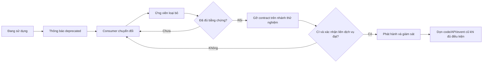
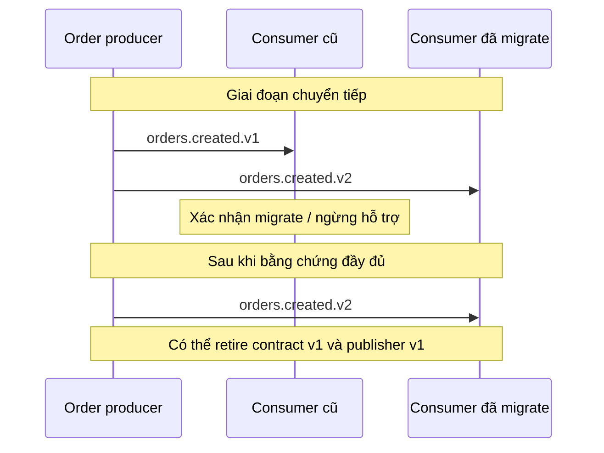
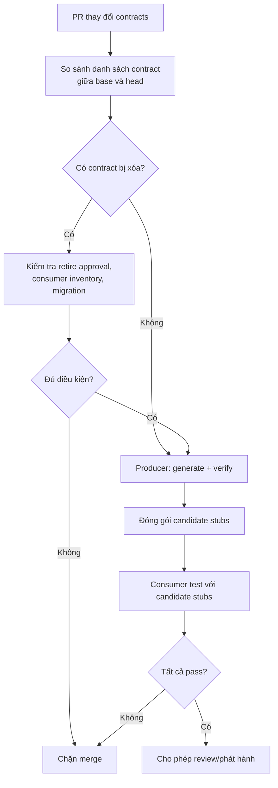

# Loại bỏ hợp đồng không còn consumer sử dụng trong Spring Cloud Contract

Trong **Spring Cloud Contract (SCC)**, hợp đồng (contract) diễn tả hành vi mà **producer** cam kết cung cấp cho **consumer**: HTTP method, URL, status, header, response body; hoặc destination, header và payload của thông điệp. Hợp đồng có thể được viết bằng **Groovy DSL hoặc YAML DSL**, rồi dùng để sinh test xác minh producer và đóng gói **stub** để consumer chạy với **Stub Runner**.

Khi một contract đã lỗi thời, việc xóa tệp định nghĩa không chỉ là dọn dẹp tài liệu. Nếu một consumer vẫn phụ thuộc vào hành vi ấy, việc xóa contract sẽ làm **mất một phép kiểm tra bảo vệ tương thích**. Ngược lại, giữ mãi các contract không ai dùng làm tăng chi phí duy trì test, stub và quy trình thay đổi API. Mục tiêu của bài là xác định **khi nào**, **dựa vào chứng cứ nào** và **theo thứ tự nào** có thể ngừng duy trì một contract mà vẫn kiểm soát rủi ro cho producer, consumer và CI.

Bài sử dụng một ví dụ xuyên suốt: `order-producer` từng phục vụ endpoint HTTP `GET /api/orders/1001/summary`; các consumer chuyển dần sang `GET /api/orders/1001`. Sau đó ta mở rộng cùng quy trình cho thông điệp `orders.created.v1` được thay bằng `orders.created.v2`.

## 1. Hiểu đúng đối tượng được loại bỏ

Có ít nhất bốn thứ khác nhau trong một hệ thống dùng Spring Cloud Contract:

| Đối tượng | Vai trò | Điều xảy ra khi loại bỏ |
| --- | --- | --- |
| Tệp contract Groovy/YAML | Nguồn mô tả hành vi để sinh test và stub | Build mới không còn sinh test/stub cho hành vi đó |
| Generated producer test | Kiểm chứng code producer đáp ứng contract | Mất cơ chế phát hiện producer phá vỡ hành vi đã cam kết |
| Stub mapping/message stub | Cho consumer mô phỏng producer | Stubs JAR mới không còn tình huống đã bị gỡ |
| Endpoint HTTP, publisher, topic hoặc subscription thật | Chức năng đang chạy trên hệ thống | Consumer còn sử dụng sẽ nhận lỗi thực tế hoặc không nhận được message |

**Xóa contract không tự động xóa endpoint hoặc topic**, và cũng không có nghĩa endpoint hoặc topic đó đã an toàn để xóa. SCC không tự biết toàn bộ consumer của một tổ chức, đặc biệt những consumer nằm ở repository khác, đối tác bên ngoài, batch job chạy theo lịch hoặc ứng dụng còn triển khai trên phiên bản cũ.

Ví dụ contract HTTP hiện tại ở producer:

```yaml
# src/test/resources/contracts/http/get_order_summary_legacy.yml
description: Lay tom tat don hang qua API cu
request:
  method: GET
  url: /api/orders/1001/summary
response:
  status: 200
  headers:
    Content-Type: application/json
  body:
    orderId: 1001
    total: 125000
```

Hợp đồng này hứa rằng lời gọi HTTP đã chỉ định có phản hồi JSON với `orderId` và `total`. Khi xóa tệp, test được sinh từ hợp đồng ấy và stub cho lời gọi tương ứng cũng sẽ biến mất khỏi **build tiếp theo**. Nhưng các bản `*-stubs.jar` **đã phát hành** thường vẫn tồn tại trong kho artifact; việc consumer tải được stub cũ không chứng minh rằng producer phiên bản mới vẫn hỗ trợ endpoint cũ.

> Nguyên tắc: Chỉ xóa một contract sau khi xác nhận hành vi đó không còn là cam kết cần duy trì cho bất kỳ consumer đang được hỗ trợ nào.

## 2. Vòng đời từ đang dùng đến nghỉ hưu

Một contract có thể đi qua các trạng thái quản trị sau. Đây là **trạng thái theo quy trình nhóm**, không phải các thuộc tính mặc định của YAML/Groovy DSL:



**Deprecated** có nghĩa nhóm đã công bố hướng thay thế và kế hoạch dừng hỗ trợ. **Unused** chỉ là nhận định dựa trên thông tin hiện có. **Retired** phải là quyết định đã được xác nhận, có phạm vi và thời điểm rõ ràng.

Không dùng số ngày cố định làm luật chung. Một API chỉ có traffic cuối quý có thể không xuất hiện trong log 30 ngày; một event có subscriber chạy lại sau sự cố cũng có thể không xuất hiện trong thời gian quan sát ngắn. Cửa sổ đánh giá cần bao trùm chu kỳ dùng dài nhất còn được cam kết, kể cả batch, triển khai từng đợt và cơ chế phục hồi.

## 3. Làm thế nào biết không còn consumer?

Không thể suy ra an toàn chỉ bằng việc tìm kiếm tên contract trong mã nguồn producer. Cần kết hợp **người sở hữu consumer**, **dấu vết sử dụng thực tế** và **kiểm chứng tự động**.

### 3.1. Lập danh mục consumer có thể bị ảnh hưởng

Từ API/event đang dự kiến loại bỏ, liệt kê mọi đường tiêu thụ được biết đến:

- Dịch vụ nội bộ gọi HTTP trực tiếp hoặc qua gateway.
- Frontend, ứng dụng mobile, SDK và phiên bản client cũ còn hỗ trợ.
- Batch job theo giờ/ngày/tháng/quý; công cụ vận hành chạy thủ công.
- Đối tác bên ngoài qua API key hoặc hệ thống tích hợp.
- Consumer của message queue, consumer group, connector, ETL hoặc hệ thống phát lại sự kiện.
- Test consumer đang pin phiên bản stub trước đây.

Dùng một bảng theo dõi có thể review:

| Consumer | Chủ sở hữu | Cách tiêu thụ | Đã chuyển sang hành vi mới? | Bằng chứng |
| --- | --- | --- | --- | --- |
| `billing-service` | Nhóm Billing | GET summary cũ | Đã | PR và bản deploy mới; traffic theo client-id |
| `reporting-job` | Nhóm Data | Job tổng hợp cuối tháng | Chưa xác nhận | Chưa có lần chạy sau ngày migrate |
| `partner-portal` | Đối tác X | HTTP API qua gateway | Đang chuyển | Xác nhận lịch nâng cấp và log gateway |

Ở ví dụ này, **chưa thể kết luận contract không còn consumer** vì `reporting-job` chưa trải qua một chu kỳ chạy mới và `partner-portal` vẫn đang chuyển đổi.

### 3.2. Thu thập bằng chứng theo nhiều nguồn

| Nguồn | Cho biết điều gì? | Giới hạn cần nhớ |
| --- | --- | --- |
| Code search ở các repository consumer | Có lời gọi HTTP, subscription hoặc DTO đang dùng contract cũ hay không | Có thể bỏ sót cấu hình runtime, SDK, đối tác, repo không truy cập được |
| Tracing, log gateway, access log hoặc metric HTTP | Những consumer nào thực sự gọi endpoint cũ trong thời gian quan sát | Không có request chưa chứng minh không có job định kỳ hoặc client đang tắt |
| Broker subscription, consumer group, lag, lịch sử publish | Consumer nào còn đọc thông điệp/topic cũ | Consumer có thể offline, replay hoặc dùng connector khác |
| Build/test CI consumer và cấu hình Stub Runner | Consumer nào kiểm thử với stubs JAR phiên bản nào | Consumer chưa có test hoặc vẫn dùng stubs cũ có thể bị bỏ sót |
| Xác nhận của owner và kế hoạch release | Consumer đã chuyển đổi, deploy, hoặc chính thức ngừng hỗ trợ chưa | Cần đối chiếu với thực tế triển khai |

Đối với HTTP, nếu hạ tầng cho phép, log **method + route chuẩn hóa + service/client-id + phiên bản client + thời điểm**. Không cần log dữ liệu nhạy cảm trong request body. Nếu không xác định được danh tính caller, quan sát “0 request” mang độ tin cậy thấp hơn xác nhận từ tất cả client owner.

Ví dụ câu hỏi giám sát có thể chuyển thành truy vấn trên nền tảng log của nhóm:

```text
Trong cửa sổ quan sát đã thống nhất:
- Có GET /api/orders/{id}/summary không?
- Ai gọi? Phiên bản ứng dụng hoặc credential nào?
- Có đợt rollout chưa hoàn tất hay client đang offline không?
- Có lịch batch/DR/replay nằm ngoài khoảng này không?
- Ai chịu trách nhiệm ký xác nhận không còn sử dụng?
```

Đối với messaging, “không có event được publish hôm nay” khác với “không còn subscriber”. Cần kiểm tra danh sách subscription/consumer group, lag, retention, retry topic, dead-letter queue và khả năng phát lại từ dữ liệu lịch sử. Một event quá cũ vẫn có thể được đọc khi phục hồi hệ thống.

### 3.3. Định nghĩa điều kiện thoát rõ ràng

Trước khi gỡ contract, nhóm nên có đủ các xác nhận sau:

1. **Phạm vi:** biết rõ contract, endpoint/topic, môi trường và các phiên bản producer bị ảnh hưởng.
2. **Chủ sở hữu:** có danh mục consumer và người xác nhận tương ứng, kể cả đối tác hoặc consumer không nằm cùng repository.
3. **Di chuyển:** consumer còn được hỗ trợ đã dùng API/message thay thế hoặc đã được chính thức cho ngừng hoạt động.
4. **Quan sát:** cửa sổ log/metric bao phủ chu kỳ sử dụng đã cam kết và không còn dấu vết tiêu thụ cũ chưa được giải thích.
5. **Kiểm chứng:** bài test với stubs của **phiên bản producer dự định phát hành** chạy đạt cho những consumer cần tiếp tục hỗ trợ.
6. **Phục hồi:** có kế hoạch rollback phiên bản producer và khôi phục contract/code nếu phát hiện consumer bỏ sót.

Nếu không thể xác định một consumer có còn được hỗ trợ hay không, nên giữ contract hoặc mở vấn đề cần quyết định với owner, thay vì xóa theo phỏng đoán.

## 4. Quy trình loại bỏ contract HTTP theo từng bước

Xét tình huống: endpoint cũ `GET /api/orders/{id}/summary` đã được thay thế bằng `GET /api/orders/{id}`. Việc chuyển đổi có thể làm thay đổi cả tên trường JSON, vì vậy không chỉ đổi URL; consumer còn cần cập nhật logic parse response.

### Bước 1 — Công bố deprecation và hướng di chuyển

Cập nhật tài liệu API và thông báo cho consumer:

```text
Hành vi cũ: GET /api/orders/{id}/summary
Hành vi thay thế: GET /api/orders/{id}
Ngày bắt đầu deprecation: ngày được nhóm phê duyệt
Ngày dự kiến ngừng hỗ trợ: sau cửa sổ chuyển đổi đã thỏa thuận
Yêu cầu consumer: cập nhật URL và mapping trường dữ liệu
Nguồn hỗ trợ: owner producer, hướng dẫn migrate, môi trường test
```

Nếu hệ thống áp dụng `Deprecation` hoặc `Sunset` header theo chuẩn và gateway hỗ trợ, có thể dùng để báo tín hiệu bổ sung; header **không thay thế** thông báo tới consumer hoặc bằng chứng họ đã di chuyển.

### Bước 2 — Đổi consumer và kiểm thử với contract mới

Giả sử consumer cũ gọi:

```java
OrderSummary summary = restTemplate.getForObject(
    producerBaseUrl + "/api/orders/{id}/summary",
    OrderSummary.class,
    orderId
);
```

Consumer mới chuyển sang:

```java
OrderDto order = restTemplate.getForObject(
    producerBaseUrl + "/api/orders/{id}",
    OrderDto.class,
    orderId
);

// Sử dụng trường hợp đồng mới quy định thay cho mapping legacy.
```

Hai lớp `OrderSummary` và `OrderDto` chỉ là DTO minh họa; mapping thực tế phụ thuộc response đã thỏa thuận ở contract mới. Nên triển khai và quan sát consumer mới trước khi gỡ sự bảo vệ cho API cũ.

Ở producer, cần có **contract mới** mô tả hành vi thay thế, chẳng hạn:

```yaml
# src/test/resources/contracts/http/get_order.yml
description: Lay thong tin don hang theo API moi
request:
  method: GET
  url: /api/orders/1001
response:
  status: 200
  headers:
    Content-Type: application/json
  body:
    id: 1001
    totalAmount: 125000
    status: CREATED
```

Chạy provider test sinh từ contract mới để chắc chắn producer thực hiện đúng API thay thế. Từ thời điểm này, các consumer nên dùng **stub mới** cho happy path và cả những trường hợp lỗi mà họ phụ thuộc vào (ví dụ `404`, validation, xác thực nếu có).

### Bước 3 — Tạo nhánh thử nghiệm xóa đúng contract cũ

Sau khi chứng cứ đủ mạnh, gỡ **chính xác** tệp contract không còn cam kết:

```bash
git rm src/test/resources/contracts/http/get_order_summary_legacy.yml
```

Nếu nhóm dùng Groovy DSL thay vì YAML, thao tác tương tự với `*.groovy`. Tránh xóa toàn bộ thư mục contract chỉ vì một endpoint đã nghỉ hưu; thư mục có thể chứa các ca `404`, quyền truy cập hoặc contract khác đang bảo vệ hành vi còn dùng.

Việc gỡ contract có thể làm giảm số test được sinh, nên **một build xanh chưa đủ xác nhận xóa an toàn**. Cần đọc kết quả build, so với tập contract còn hiệu lực và kết quả kiểm thử consumer.

### Bước 4 — Sinh test và stubs JAR mới trên producer

Với dự án Maven đã cấu hình `spring-cloud-contract-maven-plugin` và Contract Verifier:

```bash
mvn clean verify
mvn install
```

Lệnh `verify` chạy test được sinh theo cấu hình build; `install` đưa artifact, gồm stubs JAR nếu đã cấu hình đúng, vào Maven local repository. Trong CI, thay `install`/kho local bằng publish artifact candidate có tọa độ và version xác định.

Cần xác minh hai mặt:

- **Provider verification** vẫn tạo và chạy test cho các contract còn hiệu lực; việc test legacy biến mất là có chủ đích.
- **Stubs JAR mới** không chứa mapping HTTP legacy, vẫn chứa mapping của API mới và không bỏ nhầm những stub mà consumer khác sử dụng.

Artifact `order-producer-2.4.0-stubs.jar` là ví dụ cách đặt tên theo classifier `stubs`; tên và version thực tế phụ thuộc `groupId`, `artifactId`, version của dự án.

### Bước 5 — Cho consumer chạy với **candidate stubs**, không dùng bản cũ

Trong consumer test, Stub Runner tải stubs JAR theo tọa độ đã cấu hình, ví dụ:

```java
@SpringBootTest
@AutoConfigureStubRunner(
    ids = "com.example:order-producer:2.4.0:stubs:8085",
    stubsMode = StubRunnerProperties.StubsMode.LOCAL
)
class OrderConsumerContractTest {
    // Test client gọi GET /api/orders/1001 từ Stub Runner ở cổng 8085.
}
```

Ví dụ trên giả định artifact phiên bản `2.4.0` đã được `mvn install` trong local repository. Nếu CI lấy candidate từ Maven repository, cấu hình `REMOTE` và repository root tương ứng. Cần đảm bảo **đúng artifact vừa được sinh sau khi loại bỏ contract**, không dùng phiên bản cũ đang có trong cache.

Chạy consumer test với ít nhất hai kịch bản:

- Consumer đã migrate vẫn gọi endpoint mới, parse JSON mới và xử lý thành công.
- Một consumer test mô phỏng hành vi legacy (dùng để phát hiện phụ thuộc bị bỏ sót) sẽ không còn được Stub Runner mới phục vụ theo contract cũ. Điều này chỉ là dấu hiệu cần xem xét; nếu chưa chính thức cho phép breaking change thì không được coi lỗi ấy là hợp lệ.

Nếu consumer đang dùng production API cũ nhưng test vẫn pin stubs JAR cũ, CI có thể xanh dù runtime sẽ lỗi khi nâng producer. Vì vậy cần **liên kết version candidate producer và consumer verification**.

### Bước 6 — Quyết định phạm vi xóa code runtime

Có ba lựa chọn độc lập:

| Lựa chọn | Khi nào phù hợp | Hậu quả |
| --- | --- | --- |
| Gỡ contract, tạm giữ endpoint | Quy trình đã kết thúc cam kết kiểm thử nhưng cần thời gian dọn code | Endpoint còn chạy, song không còn contract test bảo vệ; cần lý do và hạn dọn dẹp rõ ràng |
| Gỡ contract và endpoint trong cùng đợt release | Đã xác nhận mọi consumer còn hỗ trợ đều di chuyển; có rollback | Runtime không phục vụ URL cũ; cần kiểm tra toàn bộ deployment |
| Giữ contract và endpoint cũ | Chưa có đủ bằng chứng hoặc có consumer vẫn cần | Tiếp tục bảo vệ tương thích, lên kế hoạch chuyển đổi |

Thông thường, nên **duy trì contract trong thời gian endpoint vẫn được hứa hỗ trợ**. Không bỏ test chỉ để rút ngắn CI khi consumer còn phụ thuộc.

### Bước 7 — Phát hành, theo dõi, hoàn tất

Sau khi thay đổi được duyệt, phát hành producer theo quy trình tổ chức và giám sát hành vi cũ/new:

- Lỗi `404`, `410`, `5xx` ở gateway hoặc client có tăng sau release không?
- Có client-id hoặc consumer group từng được xem là đã migrate xuất hiện trở lại không?
- Consumer test có đang chạy bằng stubs của đúng producer version chuẩn bị phát hành không?
- Có phản hồi từ owner hay đối tác cho biết họ vẫn còn đường gọi cũ không?

Chỉ đóng ticket retire khi có kết quả xác minh sau triển khai và bản ghi thay đổi: commit gỡ contract, phiên bản stubs, phiên bản producer, các consumer đã xác nhận và cách quay lại khi cần.

## 5. Khác biệt khi loại bỏ hợp đồng thông điệp

Với giao tiếp bất đồng bộ, consumer thường đăng ký một **destination/topic** và xử lý sự kiện theo schema. Ví dụ contract Groovy cho publisher cũ:

```groovy
import org.springframework.cloud.contract.spec.Contract

Contract.make {
    description 'Su kien tao don hang phien ban cu'
    label 'order_created_v1'

    input {
        triggeredBy('publishLegacyOrderCreated()')
    }

    outputMessage {
        sentTo('orders.created.v1')
        headers {
            messagingContentType(applicationJson())
        }
        body(
            orderId: 1001,
            status: 'CREATED'
        )
    }
}
```

Đối với loại hợp đồng này, producer verification test kiểm tra message mà producer phát qua message verifier theo cấu hình tích hợp. Stub Runner có thể kích hoạt message stub theo label `order_created_v1` để consumer test listener.

Khi chuyển sang `orders.created.v2`, chỉ loại bỏ contract `v1` sau khi xác minh:

1. Tất cả consumer group/subscription của `v1` đã chuyển hoặc được ngừng hỗ trợ chính thức.
2. Producer và consumer đã thống nhất **schema v2**, định dạng và ý nghĩa của từng trường; consumer test chạy được với message stub của v2.
3. Hệ thống không còn đường phụ thuộc qua retry, dead-letter, replay, event archive hoặc connector vốn chỉ hiểu payload v1.
4. Chính sách retention và lịch phục hồi đã được xét; consumer đang offline cũng nằm trong danh mục.
5. Có phương án xử lý khi phát hiện consumer cũ còn cần event hoặc bản ghi lịch sử.

Phân biệt ba bước: **gỡ message contract**, **ngừng phát message lên destination v1**, và **xóa topic/subscription v1 trên broker**. Ba hành động này có mức ảnh hưởng khác nhau, có thể diễn ra ở các lần phát hành khác nhau. Việc xóa topic cần đánh giá riêng khả năng mất thông điệp còn lưu hoặc ảnh hưởng công cụ vận hành. Đừng suy ra “không có message mới” là “không còn dữ liệu cần đọc”.

### Minh họa chuyển đổi message theo giai đoạn



Sơ đồ mô tả **dual-publish tạm thời**, chỉ phù hợp nếu đội triển khai chấp nhận chi phí và semantics gửi đôi. Phải thống nhất cơ chế chống xử lý trùng ở consumer khi họ chuyển từ v1 sang v2. Một lựa chọn khác là nâng cấp subscriber theo thứ tự và ngừng route cũ sau khi tất cả được xác nhận, nếu kiến trúc cho phép.

## 6. Thiết kế cổng CI để bảo vệ việc retire

Contract Verifier và Stub Runner phát huy hiệu quả khi các nhánh liên quan được chạy trong cùng chuỗi kiểm chứng. Tuy nhiên, **SCC không tự chặn thao tác xóa contract**: một contract bị gỡ đồng nghĩa không còn test được sinh từ chính contract đó. Vì thế pipeline nên có cả bước kiểm tra quyết định loại bỏ.



Ví dụ logic kiểm soát, **pseudocode** để chuyển thành GitHub Actions, GitLab CI hoặc Jenkins:

```text
on_pull_request:
  deleted_contracts = diff(base, head, "src/test/resources/contracts/")
  if deleted_contracts is not empty:
      require_review_from_contract_owners()
      require_retirement_record_for_each(deleted_contracts)
      require_consumer_migration_evidence()
  generate_and_run_provider_verification_tests()
  publish_candidate_stub_artifact_to_test_repository()
  run_supported_consumer_tests(candidate_stub_version)
  require_all_checks_green()
```

Một bản ghi retire tối thiểu có thể nằm trong issue/PR, không cần thêm trường không được hỗ trợ vào Spring Cloud Contract DSL:

```text
Contract: http/get_order_summary_legacy.yml
Hành vi: GET /api/orders/{id}/summary
API thay thế: GET /api/orders/{id}
Owner producer: Order Platform
Consumers đã kiểm tra: billing-service, reporting-job, partner-portal
Bằng chứng: PR migrate, bản deploy, quan sát traffic theo chu kỳ
Version candidate stubs: com.example:order-producer:2.4.0:stubs
Phê duyệt: producer owner + các consumer owner liên quan
Rollback: phục hồi controller, contract và artifact nếu cần
```

Các cổng CI cần lưu ý:

- **Kiểm tra số lượng và tập contract mong đợi.** Khi một contract bị gỡ, ghi nhận sự thay đổi có chủ đích; không chấp nhận việc lặng lẽ mất hàng loạt test.
- **Tách unit test và consumer verification.** Producer build pass chưa bảo đảm consumer hợp lệ khi dùng candidate stub.
- **Pin version stubs khi kiểm thử.** Dùng version cụ thể hoặc định danh artifact bất biến; tránh phụ thuộc vào bản mới nhất không kiểm soát.
- **Bảo vệ các contract còn hiệu lực.** Không sửa matcher/expectation theo hướng nới lỏng vô căn cứ chỉ để test pass.
- **Kiểm tra deploy ngoài CI.** Build dùng stub chỉ là mô phỏng; cần quan sát runtime sau khi phát hành.

## 7. Rollback khi phát hiện consumer bị bỏ sót

Giả sử sau khi gỡ contract và endpoint cũ, một batch job hàng quý bất ngờ gọi `GET /api/orders/1001/summary` rồi nhận lỗi. Cách ứng phó phụ thuộc phần nào đã bị loại bỏ:

| Đã thay đổi | Điều cần khôi phục |
| --- | --- |
| Chỉ xóa contract, endpoint vẫn chạy | Khôi phục tệp contract, sinh lại test/stub cho build sau |
| Xóa contract và code endpoint | Khôi phục cả code runtime, contract, test và phát hành phiên bản producer phù hợp |
| Ngừng phát message v1 | Khôi phục publisher/route v1 nếu còn consumer được hỗ trợ, kiểm tra tính trùng lặp dữ liệu |
| Xóa topic/bản ghi broker | Phải đánh giá khả năng khôi phục dữ liệu từ backup/replay; khôi phục contract không phục hồi dữ liệu đã mất |

Không chỉnh sửa đè một stubs JAR đã phát hành với cùng version nếu repository cần artifact bất biến. Phát hành một phiên bản sửa lỗi mới, hoặc rollback producer theo cơ chế deploy của nhóm, và cập nhật kiểm chứng consumer. Lưu lại consumer bị bỏ sót để hoàn thiện danh mục và độ dài cửa sổ quan sát ở lần retire tiếp theo.

Rollback contract cũng **không tự động phục hồi hành vi runtime**; hai phần phải khớp nhau thì provider verification mới có ý nghĩa.

## 8. Những sai lầm thường gặp

**“Không có request trong 7 ngày, xóa được rồi.”** Không xét job theo tháng, thiết bị lâu không cập nhật hoặc traffic đi qua gateway khác. Kết hợp cửa sổ quan sát và xác nhận owner.

**“Tôi xóa contract, `mvn verify` vẫn xanh.”** Test đã biến mất nên không còn phép kiểm tra để fail. Bổ sung diff gate và consumer verification.

**“Consumer test xanh với Stub Runner nên không còn phụ thuộc.”** Test có thể đang dùng stubs JAR phiên bản cũ. Kiểm tra tọa độ artifact và candidate version thực sự được tải.

**“Đã xóa contract thì xóa luôn endpoint.”** Code runtime và hợp đồng có vòng đời riêng; thứ tự dừng hỗ trợ phải dựa trên cam kết tương thích.

**“Không còn subscriber online nên xóa event topic.”** Consumer offline, DLQ, retry, lưu trữ lịch sử hoặc job replay có thể vẫn cần dữ liệu. Kiểm tra retention và kế hoạch hồi phục.

**“Chỉ cần chuyển một consumer mẫu.”** Contract có thể đang phục vụ nhiều consumer. Một consumer đi xong không đại diện cho tất cả.

**“Chỉnh response mới và đánh dấu API cũ tương thích.”** Cần kiểm tra field rename, kiểu dữ liệu, enum, status code và lỗi theo yêu cầu thực của consumer. Việc thêm trường đôi khi tương thích, nhưng đổi tên hoặc xóa trường mà consumer còn đọc là rủi ro trực tiếp.

## 9. Bài tập thực hành có thể tự kiểm chứng

Tạo nhánh thử nghiệm trong dự án `order-producer` đã thiết lập Spring Cloud Contract và một dự án `order-consumer` có Stub Runner:

1. **Tạo hai contract HTTP:** `get_order_summary_legacy.yml` cho endpoint cũ và `get_order.yml` cho endpoint mới. Build producer và xác nhận cả hai generated tests chạy.
2. **Viết consumer test legacy:** gọi `GET /api/orders/1001/summary` bằng Stub Runner, kiểm tra `orderId` và `total`. Ghi lại version stubs dùng trong test.
3. **Chuyển consumer sang endpoint mới:** đổi request và DTO sang `GET /api/orders/1001`; dùng candidate stubs để kiểm thử. Thêm assertion cho response theo contract mới.
4. **Lập bảng chứng cứ retire:** giả định có một consumer batch chạy cuối tháng. Hãy quyết định cần quan sát thêm gì trước khi coi contract legacy là unused.
5. **Thử gỡ đúng contract cũ:** xem danh sách generated tests và mapping trong stubs JAR sau build. Xác minh test cho endpoint mới còn nguyên.
6. **Chạy lại consumer tests:** cố tình dùng một consumer test legacy với candidate stubs để quan sát lỗi phụ thuộc; sau đó dùng test đã migrate và xác nhận pass.
7. **Mở rộng sang messaging:** viết contract `orders.created.v1` và `v2`; liệt kê kiểm tra cần có trước khi gỡ v1, gồm consumer group, DLQ, retention và replay.
8. **Viết một cổng CI giả lập:** nếu PR có tệp contract bị xóa mà chưa có bản ghi xác nhận consumer, CI phải yêu cầu kiểm tra trước khi merge.

Bảng tự đánh giá:

| Tiêu chí | Minh chứng hoàn thành |
| --- | --- |
| Hiểu phạm vi thay đổi | Nêu rõ khác biệt giữa xóa contract, xóa stub mới và xóa API/event runtime |
| Xác minh consumer không còn dùng | Có danh mục owner, chứng cứ usage, chu kỳ quan sát và migration |
| Bảo toàn contract mới | Generated provider tests và stub mappings còn lại chạy/được sinh đúng |
| Kiểm chứng consumer | Stub Runner dùng candidate artifact; client mới chạy đạt |
| Kiểm soát CI | Thay đổi xóa contract yêu cầu bằng chứng và review |
| Phục hồi khi sai giả định | Có phương án rollback code runtime và contract phù hợp |

**Kết luận:** một contract thực sự sẵn sàng được loại bỏ khi tổ chức đã xác nhận các consumer còn được hỗ trợ **không còn phụ thuộc** vào hành vi cũ, contract mới đã có bài kiểm chứng thay thế, CI kiểm tra phiên bản stubs dự kiến phát hành, và có phương án khôi phục rõ ràng. Khi đó việc xóa tệp Groovy/YAML là bước kỹ thuật cuối trong một quyết định về **vòng đời hợp đồng**, không phải bằng chứng đầu tiên rằng giao diện cũ đã hết người dùng.
