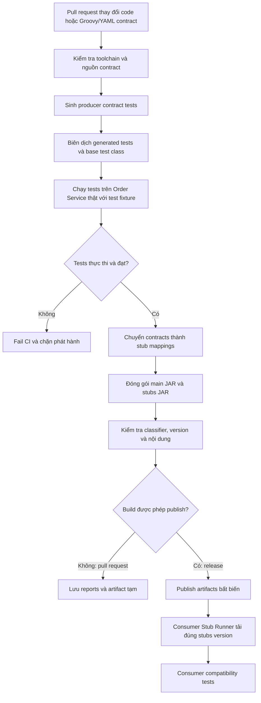

# Pipeline producer: kiểm tra hợp đồng, sinh test và xác minh

Khi một producer sửa API hoặc định dạng thông điệp, điều quan trọng không chỉ là mã Java vẫn biên dịch được. Một thay đổi nhỏ như bỏ trường `totalAmount`, đổi `200 OK` thành `202 Accepted` hoặc phát event sang destination khác có thể khiến consumer đang chạy ngừng hoạt động. **Pipeline producer** phải kiểm tra những thay đổi này *trước khi phát hành*, bằng cách biến các hợp đồng đã thỏa thuận thành **kiểm thử thực thi trên implementation thật**.

Trong lộ trình **SPRING_CLOUD_CONTRACT**, nhóm sử dụng **Spring Cloud Contract** để định nghĩa hành vi HTTP hoặc messaging bằng **Groovy/YAML DSL**, sinh producer tests, đóng gói stubs, dùng **Stub Runner** ở phía consumer và tích hợp **CI/CD** để phát hiện thay đổi API không tương thích. Bài học thuộc chương **CI/CD**, với chủ đề **Pipeline producer: kiểm tra hợp đồng, sinh test và xác minh**. Trọng tâm là thiết kế một pipeline có **thứ tự rõ**, **bằng chứng kiểm thử**, **release gate**, **artifact provenance** và **khả năng tái lập**.

Sau bài này, bạn có thể phân biệt generation với verification, cấu hình luồng Maven/Gradle phù hợp, kiểm tra generated tests và stubs JAR, tách đường chạy pull request với đường phát hành, xây dựng CI mẫu, và chẩn đoán các trường hợp **build xanh nhưng hợp đồng không hề được xác minh**.

## 1. Mục tiêu của producer pipeline

Giả sử **Order Service** là producer có hai consumer:

- **Checkout Service** gọi HTTP `GET /api/orders/ORDER-42` để lấy trạng thái thanh toán.
- **Billing Service** nhận message `ORDER_PAID` để tạo hóa đơn.

Nhóm muốn sửa Order Service, nhưng không muốn Checkout/Billing hỏng vì API hoặc event đã thay đổi ngoài dự kiến.

Một producer pipeline đáng tin cậy cần trả lời:

1. Có **hợp đồng nguồn** nào được producer công bố và phải hỗ trợ?
2. Groovy/YAML DSL có được plugin nhận diện và parse thành công không?
3. Plugin đã **sinh producer tests** cho những hợp đồng dự kiến chưa?
4. Tests đó có **biên dịch, thực thi trên producer implementation thật**, và đạt không?
5. Cấu hình test base, fixture, database, HTTP adapter và message binder có đúng không?
6. Các stub mappings và stubs artifact có được tạo từ **cùng bộ hợp đồng** không?
7. Stubs artifact có **classifier, version và nội dung** đúng không?
8. Có bằng chứng tests đã chạy, thay vì bị skip hoặc chạy `0 tests` không?
9. Artifact phát hành có thể truy vết về producer commit, contract source và test report không?
10. Consumer có thể sử dụng đúng stubs version qua Stub Runner để phát hiện breaking changes không?

Pipeline là **chuỗi bằng chứng**, không chỉ là một lệnh `mvn package`.

### 1.1. Sơ đồ producer CI/CD



Để đơn giản, sơ đồ đặt việc chuyển mappings sau producer verification. **Trong Maven/Gradle lifecycle thực**, generator, converter, test runner và packaging có thể được gắn vào những pha cụ thể theo plugin version; pipeline vẫn phải bảo đảm **không publish artifact được coi là verified trước khi producer tests thực sự đạt**.

## 2. Phân biệt năm bước dễ bị nhầm

| Bước | Điều thực hiện | Bằng chứng cần kiểm tra |
|---|---|---|
| **Contract discovery/validation** | Tìm và parse Groovy/YAML DSL | Danh sách contracts, không lỗi cú pháp, không thiếu nguồn |
| **Generate tests** | Sinh JUnit/Spock test source phía producer | Generated files và test class/method dự kiến |
| **Verify producer** | Chạy generated tests trên implementation | Test report có số lượng test thực thi, không skip, kết quả đạt |
| **Generate/package stubs** | Chuyển DSL thành mappings và đóng gói artifact | `-stubs.jar` có contracts/mappings và đúng classifier |
| **Publish** | Đưa artifact lên Maven/Git repository theo chính sách | Coordinates, checksum, commit/build ID, quyền truy cập |

**Sinh test ≠ chạy test.** Có thể tồn tại hàng chục generated Java test classes nhưng Maven Surefire không chọn chạy do tên class không khớp, plugin không được kích hoạt, test framework thiếu engine hoặc CI đặt `-DskipTests`.

**Đóng gói stub ≠ xác minh producer.** WireMock mappings có thể được sinh từ DSL ngay cả khi Order Service implementation không trả đúng response. Consumer test qua Stub Runner chỉ chứng minh client xử lý **stub mẫu**, chưa phải producer implementation đúng.

### 2.1. Vì sao thứ tự có ý nghĩa?

Một release artifact an toàn nên thỏa các điều kiện:

```text
Source contracts được xác định
          +
Generated producer tests tồn tại
          +
Producer tests thực thi và đạt
          +
Stub mappings được tạo từ đúng contracts
          +
Stubs artifact đúng version/classifier
          =
Ứng viên phát hành đã được kiểm chứng trong phạm vi contracts
```

Ngay cả khi các điều kiện đó đạt, vẫn cần integration, security, performance và consumer-specific tests phù hợp. Contract verification bảo vệ **những cam kết đã mô tả**, không bao phủ toàn bộ nghiệp vụ hay hạ tầng.

## 3. Trước khi viết pipeline: xác định phạm vi kiểm chứng

Với Order Service:

```text
order-service/
├── pom.xml
├── src/
│   ├── main/java/com/example/order/
│   │   ├── OrderServiceApplication.java
│   │   └── OrderController.java
│   └── test/
│       ├── java/com/example/order/contract/
│       │   ├── OrderContractTestBase.java
│       │   └── OrderContractFixture.java
│       └── resources/contracts/
│           ├── checkout-service/
│           │   ├── get_paid_order_200.groovy
│           │   └── get_missing_order_404.yml
│           └── billing-service/
│               └── order_paid_event.groovy
└── target/                  # Chỉ xuất hiện sau khi Maven build
```

Đây là layout **minh họa** cho Maven. Project Gradle thường sử dụng `src/contractTest/resources/contracts` hoặc đường dẫn do Gradle plugin cấu hình, cần đối chiếu theo phiên bản.

### 3.1. Quy tắc sở hữu

- **Producer và consumer** thỏa thuận hành vi contract.
- **Producer** chịu trách nhiệm để implementation của mình đáp ứng contract.
- **Contract Verifier** sinh producer tests từ DSL.
- **Test base** và fixtures do nhóm producer viết, không phải plugin tự tạo.
- **CI** thực thi tests và giữ bằng chứng.
- **Artifact repository** lưu main artifact và stubs artifact.
- **Consumer** dùng Stub Runner với đúng artifact/version và kiểm tra client/handler thật.

Không giao trách nhiệm verify producer cho Stub Runner consumer tests. Hai nhóm kiểm thử có phạm vi khác nhau.

### 3.2. Các thông tin cần ghim

| Thông tin | Ví dụ | Lý do |
|---|---|---|
| JDK | JDK 17, nếu release train hỗ trợ | Generated Java/tests cần môi trường tương thích |
| Maven Wrapper | `./mvnw` từ repository | Local và CI cùng toolchain |
| Spring Boot | Phiên bản được chọn theo support matrix | Quy định Spring TestContext và dependencies |
| Spring Cloud | Release train tương thích | Không trộn các thế hệ module |
| Spring Cloud Contract | Phiên bản plugin và verifier tương thích | DSL, generated tests và mappings có thể đổi |
| Contract source revision | Commit SHA hoặc artifact version | Biết bộ contracts được verify |
| Producer artifact version | `1.4.0` | Truy vết release |
| Stubs classifier | `stubs` | Consumer resolve đúng artifact |
| Test infrastructure | DB/broker image version | Fixture và message verification lặp lại được |

Không copy một version cụ thể trong bài học rồi giả định tương thích mọi ứng dụng. **Kiểm tra Spring Boot/Cloud/Contract compatibility** trước khi áp dụng POM hoặc Gradle configuration.

## 4. Groovy contract cho HTTP thành công

Checkout cần đọc đơn hàng đã thanh toán:

```http
GET /api/orders/ORDER-42
Accept: application/json
```

Kỳ vọng:

```http
HTTP/1.1 200 OK
Content-Type: application/json

{"id":"ORDER-42","status":"PAID","totalAmount":125000}
```

Một file `src/test/resources/contracts/checkout-service/get_paid_order_200.groovy`:

```groovy
import org.springframework.cloud.contract.spec.Contract

Contract.make {
    name 'checkout_get_paid_order_200'

    request {
        method GET()
        url '/api/orders/ORDER-42'
        headers {
            header 'Accept', 'application/json'
        }
    }

    response {
        status OK()
        headers {
            contentType(applicationJson())
        }
        body(
            id: 'ORDER-42',
            status: 'PAID',
            totalAmount: 125000
        )
    }
}
```

Đây là contract phía producer **phải xác minh**:

- Method/path đúng.
- `Accept` và response `Content-Type` như cam kết.
- HTTP `200`.
- JSON có `id`, `status` và `totalAmount` theo kỳ vọng.
- Fixture `ORDER-42` tồn tại ở trạng thái `PAID`.

Nếu producer sửa implementation để trả `status=CANCELLED` hoặc bỏ `totalAmount`, generated tests cần phát hiện **nếu assertions bảo vệ những trường đó thực sự được sinh và chạy**.

## 5. YAML contract cho HTTP lỗi

Checkout cần phân biệt “không tìm thấy đơn” với network failure hoặc lỗi WireMock không có mapping.

File `src/test/resources/contracts/checkout-service/get_missing_order_404.yml`:

```yaml
name: checkout_get_missing_order_404
description: Trả lỗi nghiệp vụ khi không có đơn hàng
request:
  method: GET
  url: /api/orders/ORDER-MISSING
  headers:
    Accept: application/json
response:
  status: 404
  headers:
    Content-Type: application/json
  body:
    code: ORDER_NOT_FOUND
    message: Order not found
```

Cần seed/cleanup để `ORDER-MISSING` chắc chắn không tồn tại. Nếu một WireMock server trả `404` vì request không khớp mapping, đó **không phải** bằng chứng producer đã trả body `ORDER_NOT_FOUND` theo contract.

**Không duplicate cùng một kịch bản bằng cả Groovy và YAML** nếu không có chủ đích. Mỗi contract nên có một tên kịch bản ổn định, đủ phân biệt request matcher khi chúng cùng nằm trong stubs artifact.

## 6. Message contract: pipeline phải xác minh producer phát event

Order Service còn phát sự kiện cho Billing:

```groovy
import org.springframework.cloud.contract.spec.Contract

Contract.make {
    name 'billing_order_paid_v1'
    label 'billing_order_paid_event_v1'

    input {
        triggeredBy('publishOrderPaid()')
    }

    outputMessage {
        sentTo('orders.events')
        headers {
            header('contentType', 'application/json')
            header('eventType', 'ORDER_PAID')
        }
        body(
            eventId: 'EVENT-42',
            eventType: 'ORDER_PAID',
            orderId: 'ORDER-42',
            totalAmount: 125000
        )
    }
}
```

Ở **producer verification**:

1. Generated test gọi hook `publishOrderPaid()` do base test cung cấp.
2. Hook kích hoạt **nghiệp vụ Order Service thật**, không chỉ tự dựng message mẫu.
3. Test messaging infrastructure ghi nhận output đã phát.
4. Assertions kiểm tra destination, headers và body theo contract.
5. Test fail nếu producer thay đổi `eventType` hoặc `sentTo` trái cam kết.

Cần Spring Cloud Stream/Integration/binder/test broker tương thích với **version và loại messaging** đã chọn. `testMode=MOCKMVC` cho HTTP không tự cấu hình Kafka/RabbitMQ. Nếu project có HTTP và messaging contracts, có thể cần `baseClassMappings` hoặc tổ chức test base riêng theo nhóm hợp đồng.

### 6.1. Consumer-side message trigger không thay thế producer test

Khi Billing dùng Stub Runner kích hoạt label `billing_order_paid_event_v1`, nó nhận **message mẫu từ stubs**; Order Service thật không được gọi. Vì vậy consumer message test xanh không chứng minh producer thật phát event đúng destination/header.

Pipeline producer phải chạy message verification trên implementation, còn CI consumer có thể chạy Stub Runner để bảo vệ Billing listener/deserialize/side effect.

## 7. Maven: khai báo Contract Verifier và plugin

Trong một Maven producer, các phần cơ bản thường gồm **test dependencies**, **plugin** và **base test class**.

Mẫu **POM fragment**:

```xml
<properties>
    <spring-cloud-contract.version>CONTRACT_VERSION_PHU_HOP</spring-cloud-contract.version>
</properties>

<dependencyManagement>
    <dependencies>
        <dependency>
            <groupId>org.springframework.cloud</groupId>
            <artifactId>spring-cloud-contract-dependencies</artifactId>
            <version>${spring-cloud-contract.version}</version>
            <type>pom</type>
            <scope>import</scope>
        </dependency>
    </dependencies>
</dependencyManagement>

<dependencies>
    <dependency>
        <groupId>org.springframework.boot</groupId>
        <artifactId>spring-boot-starter-test</artifactId>
        <scope>test</scope>
    </dependency>
    <dependency>
        <groupId>org.springframework.cloud</groupId>
        <artifactId>spring-cloud-starter-contract-verifier</artifactId>
        <scope>test</scope>
    </dependency>
</dependencies>

<build>
    <plugins>
        <plugin>
            <groupId>org.springframework.cloud</groupId>
            <artifactId>spring-cloud-contract-maven-plugin</artifactId>
            <version>${spring-cloud-contract.version}</version>
            <extensions>true</extensions>
            <configuration>
                <baseClassForTests>
                    com.example.order.contract.OrderContractTestBase
                </baseClassForTests>
                <testMode>MOCKMVC</testMode>
                <testFramework>JUNIT5</testFramework>
                <failOnNoContracts>true</failOnNoContracts>
            </configuration>
        </plugin>
    </plugins>
</build>
```

**Đây là fragment**, không phải `pom.xml` hoàn chỉnh; producer còn cần groupId/artifactId/version, parent/BOM Spring Boot/Cloud, dependencies runtime, repositories và plugin configuration khác. Thay `CONTRACT_VERSION_PHU_HOP` bằng version có thật và phù hợp với Boot/Cloud release train đã chọn.

Các điểm phải hiểu:

- `spring-cloud-starter-contract-verifier` cung cấp test-side integration.
- `spring-cloud-contract-maven-plugin` cung cấp goals generate/convert/package.
- `<extensions>true</extensions>` xuất hiện trong cấu hình Maven plugin chính thức phổ biến.
- `baseClassForTests` là **FQN** class mà generated tests sẽ kế thừa.
- `testMode=MOCKMVC` phù hợp với Spring MVC/MockMvc setup ở ví dụ; không copy cho WebFlux-only app.
- `testFramework=JUNIT5` nên khớp phiên bản plugin/test runtime.
- `failOnNoContracts=true` giúp fail khi producer kỳ vọng có contracts nhưng không phát hiện hợp đồng nào, theo khả năng plugin version hỗ trợ.

**Không chỉ đặt plugin trong `pluginManagement` rồi nghĩ nó đã được kích hoạt ở producer module.** Trong multi-module build, plugin cần xuất hiện trong `build/plugins` của module thực sự sở hữu contracts, hoặc được kích hoạt qua cơ chế kế thừa/lifecycle đã kiểm chứng.

## 8. Base test class: phần producer phải tự xây dựng

Plugin sinh test methods, nhưng **không thể biết trước** dự án cần database nào, security test token nào, mock external system nào hoặc cách seed fixtures.

Một base class minh họa cho Spring MVC:

```java
package com.example.order.contract;

import io.restassured.module.mockmvc.RestAssuredMockMvc;
import org.junit.jupiter.api.BeforeEach;
import org.springframework.beans.factory.annotation.Autowired;
import org.springframework.boot.test.autoconfigure.web.servlet.AutoConfigureMockMvc;
import org.springframework.boot.test.context.SpringBootTest;
import org.springframework.test.web.servlet.MockMvc;

@SpringBootTest
@AutoConfigureMockMvc
public abstract class OrderContractTestBase {

    @Autowired
    MockMvc mockMvc;

    @Autowired
    OrderContractFixture fixture;

    @BeforeEach
    void prepareContractFixture() {
        fixture.resetTestState();
        fixture.insertPaidOrder("ORDER-42", 125000);
        fixture.ensureOrderDoesNotExist("ORDER-MISSING");

        RestAssuredMockMvc.mockMvc(mockMvc);
    }
}
```

**`OrderContractFixture` là helper do ứng dụng cung cấp**, cần tự triển khai. Ví dụ không thể compile nguyên xi nếu không có class, các repository và test database tương ứng.

### 8.1. Điều kiện để fixture đúng

- Dữ liệu `ORDER-42` luôn được seed có trạng thái `PAID`.
- `ORDER-MISSING` không tồn tại trước test.
- Không phụ thuộc thứ tự chạy của tests.
- Không dùng dữ liệu ngẫu nhiên nếu assertions chưa điều khiển giá trị đó.
- Tách test database khỏi môi trường production.
- Nếu có transaction, hiểu ranh giới transaction giữa test/HTTP handler.
- Nếu dùng Testcontainers, ghim image và startup/lifecycle phù hợp.
- Nếu chạy nhiều jobs song song, cô lập database/schema/ports.
- Với messaging, dùng broker/test binder được cấu hình đúng và reset message state.

### 8.2. Base test class sai sẽ gây lỗi gì?

| Sai cấu hình | Biểu hiện |
|---|---|
| FQN `baseClassForTests` không tồn tại | Generated tests không compile |
| Dùng MockMvc base cho test mode `EXPLICIT` | Test không có đúng HTTP server/client setup |
| Dùng MockMvc cho WebFlux-only producer mà không có MVC support | Test context hoặc adapter lỗi |
| Không seed fixture | `200` contract nhận `404` |
| Seed data dùng chung và không reset | Tests pass riêng nhưng fail khi chạy suite |
| Thiếu security test setup | `401` hoặc `403` ngoài dự kiến |
| Hook message `publishOrderPaid()` không có | Generated messaging test compile/run lỗi |
| Hook chỉ phát message giả từ test thay vì production code path | Có nguy cơ test xanh sai |

Với các contracts thuộc những loại khác nhau, hãy tách base classes hoặc mappings **theo khả năng plugin version hỗ trợ**. Mục tiêu là generated tests kiểm tra đúng producer, không phải chỉ khởi tạo mock responses khớp DSL.

## 9. Maven goals và vị trí trong lifecycle

Theo tài liệu Maven plugin của Spring Cloud Contract, có những goals chính:

| Goal | Vai trò | Quan hệ với CI |
|---|---|---|
| `generateTests` | Sinh producer verification tests từ contracts | Đảm bảo test source xuất hiện |
| `convert` | Chuyển DSL thành WireMock mappings | Đảm bảo mappings khớp contract |
| `generateStubs` | Đóng gói converted mappings/contracts thành stubs JAR | Đảm bảo classifier artifact có nội dung |
| `help` | Tra cứu goals, tham số/plugin version | Hữu ích khi debugging |
| `run` | Chạy stubs để thử nghiệm | Không thay thế producer verification |
| `pushStubsToScm` | Đẩy stubs theo SCM workflow cấu hình | Chỉ dùng khi tổ chức thực sự áp dụng SCM publication |

Trong một số dòng plugin được tài liệu mô tả, `generateTests` gắn với pha Maven **`generate-test-sources`**, `generateStubs` gắn với **`package`** và `generateStubs` cần kết quả của `convert`. Phải kiểm tra binding/executions ở **plugin version đang dùng**; không thêm executions trùng khi lifecycle đã tự gắn các goals.

### 9.1. Pipeline Maven producer tối thiểu

Trong dự án đã cấu hình plugin và dependencies:

```bash
./mvnw -version
./mvnw -B -ntp clean verify
```

`-B` bật batch mode, `-ntp` giảm output tiến độ download để CI logs dễ đọc. `clean verify` đi qua Maven lifecycle cần thiết; plugin phải được cấu hình đúng để generated tests được compile và chạy.

Khi cần phát hành vào Maven repository, sử dụng `deploy` theo quyền/phase release:

```bash
./mvnw -B -ntp deploy
```

`deploy` cũng đi qua các pha trước đó trong Maven lifecycle; do đó có thể chạy tests lại. Trong một release job, chọn chiến lược tái sử dụng artifact đã verification hoặc chạy lại lifecycle sao cho **artifact được publish đúng là sản phẩm của build đã vượt tests**, không tạo và publish một bộ stubs từ source khác.

### 9.2. Goal generation không đồng nghĩa verification

Lệnh:

```bash
./mvnw org.springframework.cloud:spring-cloud-contract-maven-plugin:generateTests
```

có thể dùng để kiểm tra bước sinh test. Nhưng nó **chưa thực thi các JUnit assertions**. Với producer pipeline, release gate phải yêu cầu các test reports thể hiện generated tests đã được thực thi và đạt.

## 10. Kiểm tra generated test source thực tế

Generated tests trong Maven plugin phổ biến xuất hiện dưới đường dẫn:

```text
target/generated-test-sources/contracts/
```

Trong Gradle plugin, output thường được đặt dưới `build/generated-test-sources/contractTest/` hoặc đường dẫn được cấu hình theo phiên bản.

**Không sửa generated source bằng tay.** Nếu test sai, sửa contract DSL, base test, plugin config hoặc producer implementation rồi sinh lại. Các file generated sẽ bị ghi đè ở lần build sau.

### 10.1. Kiểm tra đúng điều gì?

1. Có generated source files không?
2. Có generated test cho `checkout_get_paid_order_200`?
3. Có generated test cho `checkout_get_missing_order_404`?
4. Có messaging test cho `billing_order_paid_v1`?
5. Mỗi test có kế thừa đúng base class không?
6. Test mode có dùng đúng MockMvc/server/WebTestClient không?
7. Assertions có bảo vệ HTTP status, headers, body và message destination/type như contract không?
8. Mã sinh có được đưa vào test compile/test task không?

Tên class/method generated có thể được đặt theo **thư mục và tên contract**; không nên đòi tên class đúng literal ở mọi version mà không nhìn source thật.

### 10.2. Dùng `find` và `jar` trong môi trường Linux CI

Ví dụ diagnostic commands:

```bash
find target/generated-test-sources/contracts \
  -type f -name '*.java' -print

find target/surefire-reports \
  -type f -name 'TEST-*.xml' -print

jar tf target/order-service-1.4.0-stubs.jar
```

Các path và tên JAR là ví dụ cho producer `order-service:1.4.0`; nếu dùng Spock/Groovy generated tests hoặc plugin output khác, cần đổi phần kiểm tra cho phù hợp.

**Có generated file không bảo đảm test đã chạy.** Phải xem Surefire/Failsafe reports thực tế.

## 11. Kiểm tra Maven Surefire/Failsafe reports

Một pipeline có thể xanh dù không chạy contract test nào, nếu test engine, naming pattern hoặc skip flags sai.

Các báo cáo phổ biến:

```text
target/
└── surefire-reports/
    ├── TEST-com.example.order.SomeTest.xml
    └── com.example.order.SomeTest.txt
```

Nếu generated tests được chạy bằng Failsafe thay vì Surefire, báo cáo thường nằm ở `target/failsafe-reports/`. **Không mặc định** chỉ một thư mục luôn chứa mọi test trong mọi dự án.

### 11.1. Những số liệu cần xác nhận

| Kiểm tra | Kỳ vọng |
|---|---|
| Generated contract test classes | Có các lớp/kịch bản đúng |
| Tổng tests thực thi | Lớn hơn 0 và không thấp hơn dự kiến |
| Failures/errors | 0 đối với release ứng viên |
| Skipped contract tests | Không có case quan trọng bị skip |
| Contract coverage | Bao phủ những contracts mà producer công bố |
| Test framework | JUnit 5/Spock engine đúng |
| Generated source root | Được thêm vào test compilation |
| Test report artifact | Được lưu trên CI để điều tra |

Nếu output có `Tests run: 0`, **không coi đó là producer verification PASS**. Có thể plugin không nhận contract, test class naming không khớp Surefire, thiếu JUnit Engine hoặc một Maven profile vô tình exclude generated tests.

### 11.2. Chặn `skipTests` và `maven.test.skip` trong release

Các flags như:

```text
-DskipTests
-Dmaven.test.skip=true
-Dspring.cloud.contract.verifier.skip=true
```

có thể bỏ qua test execution hoặc generation theo plugin/version. Không dùng chúng trong bước **phát hành verified stubs**. Nếu một tác vụ CI chỉ muốn kiểm tra compile nhanh, hãy đặt tên là **build/lint job**, không gắn nhãn `producer contract verification`.

### 11.3. `failOnNoContracts` không thay báo cáo test

Trong một số phiên bản Maven plugin, `failOnNoContracts` mặc định là `true`. Điều đó giúp fail nếu không tìm thấy contracts ở bước plugin liên quan, nhưng **chỉ có ý nghĩa khi plugin/goal thực sự chạy**.

Pipeline vẫn cần xác minh:

- Plugin được kích hoạt tại producer module.
- Source directory đúng.
- Generated tests thực thi.
- Expected tests không bị ignore/skip.
- Không có Maven profile làm rỗng toàn bộ test set.

Với một producer có cả HTTP/messaging contracts, cũng cần quan sát **số test cho từng nhóm**, không chỉ một tổng số.

## 12. Phân biệt lỗi contract với lỗi fixture/hạ tầng

Khi contract verification fail, không phải tất cả đều là breaking changes.

| Triệu chứng | Khả năng | Hướng chẩn đoán |
|---|---|---|
| `200` contract nhận `404` | Order fixture không tồn tại hoặc route sai | Seed test DB, kiểm tra path/handler |
| `403` bất ngờ | Security filter/test token sai | Test security context |
| `503` do dependency test chưa chạy | Upstream mock/broker/container lỗi | Test infrastructure readiness |
| Generated test không compile | Sai baseClass FQN/import/dependency | Test classpath/generated source |
| Payload khác contract | Producer implementation đổi schema | So contract và response thật |
| Event không xuất hiện | Hook chưa chạy hoặc broker/binder không sẵn | Message producer test setup |
| Event sang destination sai | Routing config đổi | Contract outputMessage.sentTo |
| Test chạy riêng pass, chạy suite fail | Shared DB/cache/broker state | Reset và isolation |
| Chỉ CI fail | Toolchain/version khác, port conflict | Ghim JDK/Maven/images, dynamic port |
| Mọi request Stub Runner `404` ở consumer | Sai GAV/classifier hoặc request matcher | Kiểm tra stubs JAR/mapping/port |

**Không thay contract theo lỗi tình cờ của hạ tầng**. Hãy phân loại nguyên nhân rồi sửa đúng tầng. Tuy nhiên, cũng không dùng "flaky" làm lý do bỏ qua một thay đổi phá vỡ API.

## 13. Convert DSL và kiểm tra stubs JAR

Khi producer tests đạt, plugin có thể chuyển contracts thành **HTTP stub mappings** và đóng gói stubs artifact. Một Maven producer `com.example:order-service:1.4.0` có thể tạo:

```text
target/
├── order-service-1.4.0.jar
└── order-service-1.4.0-stubs.jar
```

Main JAR và stubs JAR **không hoán đổi cho nhau**.

- Main JAR: mã chạy Order Service.
- Stubs JAR: generated mappings và hợp đồng để consumer dùng qua Stub Runner.
- Classifier `stubs`: chỉ biến thể artifact; version vẫn là `1.4.0`.
- Không tự đổi tên main JAR thành `-stubs.jar` rồi coi là artifact stubs.

Một layout minh họa:

```text
order-service-1.4.0-stubs.jar
└── META-INF/
    └── com.example/
        └── order-service/
            └── 1.4.0/
                ├── contracts/
                │   ├── checkout-service/
                │   │   ├── get_paid_order_200.groovy
                │   │   └── get_missing_order_404.yml
                │   └── billing-service/
                │       └── order_paid_event.groovy
                └── mappings/
                    └── checkout-service/
                        ├── checkout_get_paid_order_200.json
                        └── checkout_get_missing_order_404.json
```

**Đây là sơ đồ**, không phải cấu trúc byte-for-byte được đảm bảo ở mọi phiên bản Spring Cloud Contract. Một message-only contract có thể không tạo HTTP mapping JSON; đừng coi mọi message contract thiếu mapping HTTP là lỗi.

### 13.1. Các phép kiểm tra archive

```bash
jar tf target/order-service-1.4.0-stubs.jar
```

Khi consumer cần HTTP stubs, nên xác nhận:

- Archive có `mappings`/response body resources phù hợp.
- Có mapping cho `200` và `404` đã thỏa thuận.
- Archive giữ cấu trúc consumer directories nếu dùng `stubsPerConsumer`.
- Message contracts và labels cần thiết còn trong artifact.
- Artifact classifier/version đúng với build.
- Không chứa secret, bearer token thật hoặc dữ liệu khách hàng thật.

Lệnh `jar tf` chỉ xem danh sách entries; muốn biết JSON mapping đúng cần xem generated mapping phù hợp, hoặc chạy một **stub smoke test** trong môi trường tạm.

## 14. Pipeline pull request và pipeline release khác nhau

Không phải mọi PR đều nên publish artifacts ra kho releases. Có thể chia:

| Pipeline | Trigger | Bắt buộc | Đầu ra |
|---|---|---|---|
| **PR validation** | Pull request/mở merge request | Generate + verify producer tests, package/check stubs | Reports, feedback, artifact tạm |
| **Main branch CI** | Merge vào nhánh chính | Chạy lại verification, lưu artifacts theo chính sách | Build có provenance |
| **Release** | Tag hoặc lệnh phát hành được phép | Verification bắt buộc + artifact inspection + publish | Maven release và stubs classifier |
| **Consumer CI** | Consumer thay đổi hoặc producer stubs mới | Stub Runner chạy consumer tests với version mục tiêu | Compatibility matrix |
| **Nightly/compatibility** | Lịch định kỳ | Ma trận nhiều producer/consumer versions nếu cần | Regression report |

**Secrets để deploy** chỉ nên có ở job/step release có quyền, không phải mọi PR từ contributor hoặc fork. Điều này giảm nguy cơ lộ credentials qua script build không đáng tin cậy.

### 14.1. Gating logic

Một quy tắc rõ:

```text
PR:
  contract generation PASS
  + producer verification PASS
  + reports hiện diện
  + stubs artifact sanity PASS
  => PR có thể được xét merge

Release:
  toàn bộ các kiểm tra của PR trên source/revision được phát hành
  + version/tag consistency PASS
  + artifact provenance PASS
  + quyền deploy hợp lệ
  => publish main JAR và stubs JAR
```

Điều kiện merge/release cụ thể tùy chính sách tổ chức, nhưng không nên có một nhánh “skip verification rồi publish verified stubs” không được kiểm soát.

## 15. GitHub Actions mẫu cho producer Maven

Ví dụ workflow dành cho **một producer Maven module ở root**, POM version `1.4.0`, JDK 17, Spring Boot/Spring Cloud Contract **đã được chọn tương thích**. Các version của GitHub Actions và JDK dưới đây là ví dụ; hãy ghim version/hash theo chính sách bảo mật supply chain của tổ chức.

File minh họa: `.github/workflows/order-producer-contracts.yml`

```yaml
name: Order producer contract verification

on:
  pull_request:
  push:
    branches: [main]
    tags: ['v*']

permissions:
  contents: read

jobs:
  producer-contracts:
    runs-on: ubuntu-latest
    steps:
      - name: Checkout source
        uses: actions/checkout@v4

      - name: Setup Java and Maven repository credentials
        uses: actions/setup-java@v4
        with:
          distribution: temurin
          java-version: '17'
          cache: maven
          server-id: company-releases
          server-username: MAVEN_USERNAME
          server-password: MAVEN_PASSWORD

      - name: Show toolchain
        run: ./mvnw -version

      - name: Generate, run producer tests and package
        run: ./mvnw -B -ntp clean verify

      - name: Check generated tests and stubs archive
        shell: bash
        run: |
          test -d target/generated-test-sources/contracts
          test -d target/surefire-reports
          find target/generated-test-sources/contracts -type f \
            \( -name '*.java' -o -name '*.groovy' \) \
            -print -quit | grep -q .
          find target/surefire-reports -type f \
            -name 'TEST-*.xml' -print -quit | grep -q .
          test -f target/order-service-1.4.0-stubs.jar
          jar tf target/order-service-1.4.0-stubs.jar \
            | grep -q 'mappings/'

      - name: Upload verification reports
        if: always()
        uses: actions/upload-artifact@v4
        with:
          name: producer-contract-reports
          path: |
            target/surefire-reports/
            target/failsafe-reports/
          if-no-files-found: warn

      - name: Check release tag matches POM version
        if: startsWith(github.ref, 'refs/tags/v')
        shell: bash
        run: |
          pom_version="$(./mvnw -q -ntp help:evaluate \
            -Dexpression=project.version -DforceStdout)"
          test "v${pom_version}" = "${GITHUB_REF_NAME}"

      - name: Deploy verified producer and stubs artifacts
        if: startsWith(github.ref, 'refs/tags/v')
        env:
          MAVEN_USERNAME: ${{ secrets.MAVEN_DEPLOY_USERNAME }}
          MAVEN_PASSWORD: ${{ secrets.MAVEN_DEPLOY_PASSWORD }}
        run: ./mvnw -B -ntp deploy
```

**Đọc kỹ trước khi áp dụng:**

1. Đoạn YAML giả định producer project ở **repository root**; multi-module cần đổi working directory và output paths.
2. Bản `1.4.0` trong tên JAR là ví dụ. Nếu POM dùng phiên bản khác, phải đổi bước archive check hoặc tạo cơ chế đọc POM version chính xác.
3. `setup-java` có khả năng tạo Maven settings entry với `server-id` và tên biến môi trường; `distributionManagement.repository.id` trong POM phải tương ứng.
4. Secrets chỉ được đưa vào **step deploy**, không phải steps chạy trên PR.
5. `./mvnw deploy` **chạy lại phần Maven lifecycle cần thiết** và có thể chạy tests lần nữa; không thêm `-DskipTests` chỉ để rút thời gian khi release artifact được coi là verified.
6. Hai bước `find` và `jar tf` là **sanity checks**, chưa phân tích số tests thực thi/skip trong XML và chưa xác minh mappings cụ thể. Release pipeline nghiêm ngặt nên có bước kiểm tra XML/test counts và các HTTP/message contract cases dự kiến.
7. `pom_version` phải đồng nhất với tag; phần example dùng `v1.4.0` cho artifact `1.4.0`.
8. `on:` trong GitHub Actions workflow là định nghĩa trigger của hệ thống GitHub, không liên quan Contract Verifier.
9. `cache: maven` chỉ cache dependencies để tăng tốc; **không thay thế artifact repository** hoặc bằng chứng build vừa verify.
10. Các hành động third-party hoặc môi trường runner có thể thay đổi; với hệ thống có yêu cầu bảo mật cao, nên pin GitHub Actions theo commit SHA được kiểm duyệt.

Đây là **template minh họa**. Nó cần repository Maven, Spring Cloud Contract plugin, base test class, Maven Wrapper, distributionManagement, secrets và CI permissions thực sự được cấu hình trước khi chạy.

### 15.1. Vì sao `verify` không tự publish?

`verify` chạy Maven lifecycle đến bước verification; nó **không đồng nghĩa `deploy`**. Việc publish phải là một bước release có điều kiện. Một pipeline tốt không mặc định publish stubs từ một PR chưa được review.

### 15.2. GitHub Actions job có thể được chia như thế nào?

Nếu hệ thống nhiều module hoặc test cần lâu hơn:

- Job **static/contract source check**: parse, kiểm tra naming/policy.
- Job **producer verification**: generate và chạy tests, lưu reports.
- Job **artifact package validation**: mở archive, chạy smoke test.
- Job **publish**: chỉ sau các job bắt buộc đạt và đúng revision.
- Job **consumer compatibility**: dùng stubs vừa publish hoặc artifact tạm đã xác minh.

Khi chia jobs, cần giữ **build identity**. Không được lấy artifact sản xuất từ một commit khác với commit đã pass tests.

## 16. GitLab CI hoặc Jenkins: nguyên tắc không đổi

Cùng một pipeline có thể triển khai bằng GitLab CI, Jenkins, Azure DevOps hoặc hệ thống khác. Không có yêu cầu phải dùng GitHub Actions.

Ví dụ **GitLab CI khung tối giản** chỉ cho verify:

```yaml
stages:
  - verify

producer_contract_verify:
  stage: verify
  image: maven:3.9-eclipse-temurin-17
  script:
    - mvn -B -ntp clean verify
  artifacts:
    when: always
    reports:
      junit:
        - target/surefire-reports/TEST-*.xml
    paths:
      - target/surefire-reports/
      - target/failsafe-reports/
```

Đây là mẫu **không bao gồm publish** và dùng Maven CLI trong image thay vì project Maven Wrapper. Khi triển khai, cần bổ sung image version/commit pinning, Maven settings, private artifact repo, database/broker test services, multi-module paths và release job có credentials đúng quyền.

Jenkins có thể sử dụng `sh './mvnw -B -ntp clean verify'` và `junit 'target/surefire-reports/TEST-*.xml'`, nhưng câu lệnh đơn lẻ cũng không thay thế kiểm tra generated test counts hoặc artifact provenance.

## 17. Gradle producer pipeline: cùng mục đích, task khác

Spring Cloud Contract cũng có **Gradle plugin**. Tên tasks và vị trí source/output khác Maven, ví dụ các dòng plugin thường có:

- `generateContractTests`: sinh producer verification tests.
- `generateClientStubs`: chuyển hợp đồng thành mappings cho consumer.
- `verifierStubsJar`: đóng gói stubs artifact.
- `contractTest`: chạy generated contract tests theo source set/plugin configuration.

Một workflow minh họa sau khi project đã cấu hình plugin đúng:

```bash
./gradlew --version
./gradlew clean check
./gradlew verifierStubsJar
```

**Không giả định `check` của mọi Gradle project đều phụ thuộc `contractTest`.** Phải kiểm tra Gradle task graph, source set, test report và cách task/plugin version gắn vào lifecycle. `verifierStubsJar` có thể phụ thuộc generation/mappings nhưng **không tự chứng minh producer contract tests đã được chạy** trong mọi cấu hình.

Nếu dùng Kotlin DSL thay Groovy Gradle DSL, syntax plugin/source set cũng thay đổi. Dù dùng công cụ nào, release gate vẫn phải dựa trên **test execution** và artifact được đóng gói từ cùng revision.

## 18. Multi-module và monorepo: chỉ chạy đúng producer

Giả sử Maven reactor:

```text
commerce-platform/
├── pom.xml
├── order-service/
│   ├── pom.xml
│   └── src/test/resources/contracts/
├── checkout-service/
│   └── pom.xml
└── common-model/
    └── pom.xml
```

Producer pipeline có thể dùng:

```bash
./mvnw -B -ntp -pl order-service -am clean verify
```

Ở đây:

- `-pl order-service` chọn module Order Service.
- `-am` dựng các reactor dependencies mà module cần.
- Generated tests và Surefire reports cần được kiểm tra ở **`order-service/target`**, không phải chỉ ở root.
- Khi publish chỉ một module, cần cấu hình deploy/permissions rõ để tránh phát hành module ngoài dự kiến.
- Parent `pluginManagement` có thể quản lý version, nhưng không được khiến mọi module không sở hữu contracts vô tình chạy Contract Verifier.

Nếu producer lấy contracts từ artifact/repository bên ngoài, CI cần ghim **contract source revision/version** và ghi lại trong build metadata. Không để pipeline lấy branch Git thay đổi không kiểm soát rồi publish stubs version cố định mà không biết đã verify nguồn nào.

## 19. Message producer pipeline cần test infrastructure riêng

HTTP MockMvc tests có thể không cần broker, nhưng message verification có thể cần Spring Cloud Stream test binder, RabbitMQ/Kafka test container hoặc adapter phù hợp.

Một pipeline messaging cần:

1. Chạy test broker/test binder với version được hỗ trợ.
2. Đảm bảo base class có hook `publishOrderPaid()`.
3. Cấu hình destination, producer binding và serialization.
4. Sinh và chạy message contract tests.
5. Assert headers, destination và body theo contract.
6. Dọn topic/queue hoặc dùng namespace/group riêng giữa jobs.
7. Chỉ đóng gói message stubs từ bộ hợp đồng đã verify.

**Message-only contract có thể không có HTTP mapping JSON**. Khi kiểm tra stubs JAR, không dùng tiêu chí “phải có WireMock mappings” cho mọi loại producer. Với producer có cả HTTP và messaging, có thể kiểm tra **mỗi nhóm** theo tiêu chí phù hợp.

### 19.1. Tránh false positive

Nếu hook `publishOrderPaid()` chỉ gọi một mock emitter được viết riêng cho test thay vì business producer code path, generated test có thể xanh mà implementation thật không bao giờ phát event. Cần kiểm tra phạm vi producer test và cách hook đi qua code thật hoặc integration adapter được thỏa thuận.

Broker test có thể mất kết nối hoặc consumer đọc nhầm event cũ; vì vậy cần correlation ID, test fixtures độc lập và deadline rõ ràng.

## 20. Artifact publication: không phát hành stubs “chưa kiểm chứng”

Giả sử producer build tạo:

```text
com.example:order-service:1.4.0
com.example:order-service:1.4.0:stubs
```

Đây là hai Maven artifacts liên quan:

| Artifact | Chứa gì? | Ai sử dụng? |
|---|---|---|
| Main `order-service-1.4.0.jar` | Order Service implementation | Deployment/runtime |
| `order-service-1.4.0-stubs.jar` | Contracts và mappings/message samples | Stub Runner consumer tests |

### 20.1. GAV, classifier và version

Stubs artifact thường có:

```text
groupId    = com.example
artifactId = order-service
version    = 1.4.0
classifier = stubs
extension  = jar
```

`stubs` là classifier, không phải artifactId mới; `jar` là extension. Trong Stub Runner notation:

```text
com.example:order-service:1.4.0:stubs:8085
```

số `8085` là **cổng WireMock stub server**, không phải thành phần Maven artifact identity.

### 20.2. Release và SNAPSHOT

- Release `1.4.0` nên được xem là **bất biến**; không overwrite nội dung cùng coordinates.
- SNAPSHOT `1.5.0-SNAPSHOT` có thể được build nhiều lần; phải ghi resolved timestamp/build revision khi debug.
- Không dùng một version “latest” không kiểm soát cho release compatibility gate.
- Trước khi publish, kiểm tra version/tag/POM cùng hướng về **một producer revision**.
- Publish vào repository có chính sách quyền và credentials riêng; không lưu token trong POM/source.

### 20.3. Provenance tối thiểu

Một bản ghi CI hữu ích:

```text
module           = order-service
producerVersion  = 1.4.0
producerCommit   = <commit-sha>
contractsSource  = <contract-revision>
pluginVersion    = <spring-cloud-contract-version>
verification     = PASS
generatedTests   = <expected-count>
executedTests    = <actual-count>
skippedTests     = 0
stubsClassifier  = stubs
stubsArtifact    = com.example:order-service:1.4.0:stubs
```

Đây là **metadata đề xuất**, không phải định dạng Maven tự sinh. Có thể lưu trong CI manifest/build attestation tùy policy. Không tự điền `verification=PASS` chỉ vì file JAR tồn tại.

## 21. Tạo release gate dựa trên bằng chứng, không dựa trên tên bước

Một check tên là “Run contract tests” chưa có nghĩa contract tests đã chạy. Một release gate tốt xét:

| Điều kiện | Nếu thất bại thì sao? |
|---|---|
| Có contracts nguồn cần verify | Fail nếu số hợp đồng không như kỳ vọng |
| Generator nhận đúng contract files | Fail nếu lỗi parse hoặc không sinh test |
| Generated tests compile | Fail nếu base class/dependency/test mode sai |
| Producer tests thực sự chạy | Fail nếu 0 tests hoặc toàn bộ skipped |
| Producer assertions đạt | Fail nếu status/header/body/event sai |
| Mappings/stubs được tạo | Fail nếu artifact thiếu phần cần thiết |
| Artifact GAV/version/classifier đúng | Fail nếu publish nhầm variant |
| Test report/provenance có mặt | Fail hoặc giữ build pending theo policy |
| Secrets/repository permissions hợp lệ | Fail closed, không bypass verification |
| Consumer compatibility được yêu cầu | Chặn rollout nếu ma trận bắt buộc không đạt |

### 21.1. Kiểm tra số test “không bằng 0” vẫn chưa đủ

Một module có 100 unit tests và **0 generated contract tests** vẫn có thể có Surefire report cùng `tests>0`. Do đó cần liên hệ **danh sách contracts dự kiến** với **generated test class/method names** hoặc report groups thực tế.

Chiến lược có thể gồm:

- Kiểm tra thư mục generated tests không rỗng.
- Kiểm tra có generated test cho một tập contract bắt buộc.
- Xác minh test classes được Surefire/Failsafe chọn chạy.
- Đọc XML và fail nếu các test tương ứng `skipped`.
- Với contract inventory được quản lý, so số kịch bản dự kiến và thực thi.
- Không dùng một file báo cáo mẫu của unit test để coi là contract verification.

Thực thi cơ chế này bằng script/tool mà repository tự sở hữu và version control; **không cần mọi project có cùng cấu trúc generated class name**.

### 21.2. Kiểm tra đúng điều gì sau một breaking change chủ đích?

Trên một nhánh thử nghiệm:

1. Sửa controller v1 từ `200` thành `202`.
2. Giữ contract `200` như cũ.
3. Chạy producer verification.
4. Xác nhận **generated test cụ thể thất bại**.
5. Khôi phục controller, chạy lại và xác nhận pass.

Tương tự, có thể thử bỏ `Location`, đổi JSON field type, hoặc đổi message destination. Nếu test vẫn xanh, cần xem assertion/generator/test runner, **không đơn giản nới hợp đồng để test pass**.

## 22. Có nên đưa consumer tests vào producer pipeline?

Consumer tests và producer tests có mục đích khác nhau:

- Producer contract tests: implementation producer có đáp ứng contracts không?
- Consumer Stub Runner tests: consumer client/handler có xử lý stubs đúng không?
- Integration tests: các hệ thống thật tương tác với nhau, bao gồm broker, auth, database.

Với một nhóm consumer nhỏ, producer release pipeline có thể chạy **downstream compatibility suite** của các consumer bắt buộc trước rollout. Với nhiều consumer độc lập, có thể dùng:

1. **Publish verified stubs vào staging/pre-release repository**.
2. Trigger consumer CI jobs với đúng artifact version.
3. Thu thập status theo consumer/service.
4. Chỉ promote/release khi những consumers thuộc support policy đạt.

Đừng để producer PR phụ thuộc tất cả consumer tests thế giới không giới hạn. Tạo **danh sách consumers quan trọng**, compatibility policy và timeout rõ. Khi còn chưa kết nối được consumer CI, ít nhất producer pipeline phải bảo đảm producer verification đạt và artifact có provenance; **không giả định tất cả consumer đã tương thích**.

## 23. Những tình huống dễ làm pipeline xanh sai

| Tình huống | Vì sao nguy hiểm? | Cách phòng tránh |
|---|---|---|
| `-DskipTests` trong release | Artifact publish mà producer chưa verify | Cấm skip trong release job |
| `Tests run: 0` | Không có bằng chứng contract tests | Check generated và executed count |
| Plugin chỉ nằm trong `pluginManagement` | Goals không thực sự chạy ở producer module | Kiểm tra effective POM |
| `failOnNoContracts` bị vô hiệu | Sai source directory vẫn xanh | Bật policy fail, kiểm tra generated output |
| Generated tests bị Surefire exclude | Source có nhưng assertions không chạy | Kiểm tra test runner/report |
| Fixture mock trả đúng DSL dù implementation sai | Test verify mock thay vì producer | Dùng test base qua code path thật |
| Main JAR bị đổi tên thành stubs JAR | Không có mappings/contracts | Kiểm tra archive và classifier |
| Maven deploy từ revision khác verify | Release chưa được test | Build provenance và source identity |
| SNAPSHOT bị overwrite không truy vết | Consumer lúc dùng stub cũ, lúc mới | Ghim resolved version/commit |
| Consumer vẫn dùng stubs v1 khi producer v2 | Test xanh trên hợp đồng cũ | Test target version dự kiến deploy |
| Chỉ HTTP tests chạy, message tests bị bỏ | Event breaking change không được phát hiện | Separate message verification gate |
| Multi-module thiếu `-pl` hoặc target path | CI kiểm tra nhầm module | Module-specific source/report/artifact check |
| Parallel jobs dùng chung DB/broker | Flaky và false positives | Isolate fixtures/namespace |
| Release secret có sẵn trong PR | Supply-chain risk | Giới hạn secret ở publish job/step |
| PR kiểm thử bằng latest dependency | Build không tái lập | Ghim BOM/plugin/stub versions |
| JUnit test fail nhưng workflow `continue-on-error` | Job vẫn thành công | Không cho phép bỏ qua gate quan trọng |

### 23.1. Một số câu hỏi khi pipeline thất bại

Nếu `mvn verify` fail, hỏi:

1. Toolchain/BOM/plugin version có tương thích không?
2. Contract DSL có parse được không?
3. Plugin có quét đúng `contractsDirectory` không?
4. Generated tests có nằm trong source root đúng không?
5. Base class có compile và setup đúng HTTP/messaging adapter không?
6. Fixture có dữ liệu và không phụ thuộc thứ tự không?
7. Implementation trả status/header/body/message như contract không?
8. Surefire/Failsafe có chạy đúng generated classes không?
9. Mappings có được convert/đóng gói đúng không?
10. Pipeline có đang dùng artifact/source cũ từ cache không?

Đừng sửa controller, contract và plugin cùng lúc theo suy đoán. Đi từng tầng để xác định nguyên nhân.

## 24. Bài thực hành: xây producer pipeline cho Order Service

**Bối cảnh:** producer có HTTP contracts cho Checkout và message contract cho Billing. Mục tiêu là biến mọi thay đổi ảnh hưởng hợp đồng thành tín hiệu CI rõ ràng.

### Giai đoạn A — tạo contract sources

1. Viết Groovy contract `checkout_get_paid_order_200`.
2. Viết YAML contract `checkout_get_missing_order_404`.
3. Viết Groovy message contract `billing_order_paid_v1`.
4. Đặt contracts vào source directory được plugin cấu hình.
5. Kiểm tra tên unique, request matchers và label/destination.

### Giai đoạn B — producer test base và fixtures

1. Tạo `OrderContractTestBase` cho HTTP MockMvc.
2. Seed `ORDER-42` có trạng thái `PAID` và `totalAmount=125000`.
3. Bảo đảm `ORDER-MISSING` vắng mặt.
4. Tạo message base/hook `publishOrderPaid()` qua business implementation thật.
5. Cấu hình broker/test binder phù hợp và dọn message state.
6. Không sử dụng DB/broker production.

### Giai đoạn C — Maven verification

1. Thêm Spring Cloud Contract Verifier test dependency.
2. Khai báo Maven plugin trong `build/plugins` và chọn version hợp lệ.
3. Cấu hình base class/test mode phù hợp.
4. Chạy `./mvnw -B -ntp clean verify`.
5. Kiểm tra generated tests và Surefire/Failsafe reports.
6. Đảm bảo không có generated test bị skip ngoài dự kiến.

### Giai đoạn D — negative/mutation checks

1. Cố tình trả `status=CANCELLED` cho `ORDER-42`.
2. Chạy generated tests và xác nhận contract `PAID` fail.
3. Khôi phục implementation.
4. Cố tình đổi message `ORDER_PAID` thành `ORDER_CANCELLED`.
5. Xác nhận producer message verification fail.
6. Khôi phục và chạy suite đạt.

### Giai đoạn E — package và inspect stubs

1. Đóng gói `order-service-1.4.0-stubs.jar`.
2. Dùng `jar tf` kiểm tra contracts và HTTP mappings.
3. Kiểm tra classifier `stubs` và version `1.4.0`.
4. Dùng một Stub Runner smoke test cho `200`/`404` khi cần.
5. Kiểm tra message label có mặt theo artifact/layout được plugin hỗ trợ.
6. Bảo đảm không chứa credentials hoặc PII thật.

### Giai đoạn F — CI/CD

1. Tạo PR workflow chạy verification.
2. Lưu test reports dù test fail.
3. Đặt gate kiểm tra generated test count và archive contents.
4. Thêm release workflow chỉ publish từ tag/revision được phép.
5. Không bật `skipTests` trong release.
6. Ghi artifact coordinates, producer commit và contract revision.
7. Consumer Stub Runner tests dùng đúng version đã verify.
8. Chặn rollout nếu compatibility matrix quan trọng không đạt.

**Tiêu chí hoàn thành:** từ một contract bị vi phạm, producer pipeline phải **fail có nguyên nhân rõ**; sau khi sửa, generated tests phải chạy và pass, stubs artifact đúng version/classifier được tạo, và việc publish chỉ xảy ra sau các gates bắt buộc.

## 25. Checklist producer CI/CD

- [ ] Repository có contracts đã review và được plugin nhận diện.
- [ ] Toolchain JDK/Maven/Gradle và Spring Boot/Cloud/Contract versions được ghim.
- [ ] Plugin được kích hoạt ở đúng producer module.
- [ ] Base test class phù hợp HTTP/messaging stack.
- [ ] Generated tests có mặt, không bị sinh ra ở source root sai.
- [ ] Generated tests **thực sự chạy**, không bị Surefire/Failsafe bỏ sót.
- [ ] Có policy fail nếu không tìm thấy contracts ngoài dự kiến.
- [ ] Test fixtures độc lập, không dùng production DB/broker.
- [ ] HTTP status, headers và body được contract bảo vệ.
- [ ] Message destination, headers và body được kiểm chứng khi cần.
- [ ] Test reports có số lượng executed/failed/skipped rõ ràng.
- [ ] `-DskipTests` và skip flags không xuất hiện trong verified release job.
- [ ] Main JAR và stubs JAR được tạo từ cùng producer revision.
- [ ] Stubs archive có nội dung phù hợp, classifier `stubs` và đúng version.
- [ ] Artifact release không bị overwrite cùng coordinates.
- [ ] Maven repository credentials được cấp tối thiểu theo job release.
- [ ] PR workflow không được quyền publish release.
- [ ] Consumer compatibility tests dùng stubs artifact target version.
- [ ] Artifact provenance có producer commit, contract revision và build ID.
- [ ] Có test mutation đảm bảo một breaking change thật gây fail.
- [ ] Đã xác định rollback/deprecation policy cho thay đổi không tương thích.

## 26. Câu hỏi tự kiểm tra

1. **Producer CI khác consumer CI ở đâu?** Producer CI xác minh implementation thật đáp ứng contracts; consumer CI kiểm tra client/handler với stubs.
2. **`generateTests` có đồng nghĩa test đã chạy không?** Không, chỉ sinh source.
3. **`convert` làm gì?** Chuyển contracts thành stub mappings.
4. **`generateStubs` làm gì?** Đóng gói stubs artifact từ mappings/contracts theo plugin.
5. **Vì sao stubs JAR tồn tại chưa đủ để publish?** Generated producer tests có thể chưa chạy.
6. **`baseClassForTests` dùng để làm gì?** Chỉ định FQN base class cho generated tests.
7. **Vì sao cần fixture?** Producer test cần dữ liệu và môi trường có thể tái hiện.
8. **`MOCKMVC` phù hợp với trường hợp nào?** Spring MVC với MockMvc test setup tương ứng.
9. **Generated tests Maven thường ở đâu?** Một path như `target/generated-test-sources/contracts` theo plugin version.
10. **`Tests run: 0` có được xem là pass contract verification không?** Không.
11. **Vì sao phải kiểm tra báo cáo Surefire/Failsafe?** Xác nhận test thực thi và kết quả.
12. **`failOnNoContracts` giúp gì?** Có thể fail khi plugin không tìm thấy contracts theo cấu hình/version.
13. **`-DskipTests` có nên dùng trong release verified stubs?** Không.
14. **Main JAR khác stubs JAR thế nào?** Một chứa ứng dụng, một chứa stubs cho consumer.
15. **Classifier stubs có phải artifactId mới không?** Không.
16. **Port `8085` trong Stub Runner ids thuộc artifact identity không?** Không.
17. **Vì sao phải ghim stubs version?** Để biết bộ hợp đồng nào được test và tái hiện lỗi.
18. **Producer message tests cần gì ngoài DSL?** Hook nghiệp vụ, verifier/binder/broker và fixture.
19. **Stub Runner trigger label có chạy producer thật không?** Không.
20. **PR pipeline có nên có credentials deploy release không?** Thường không; chỉ release job được phép.
21. **Nếu tests report có unit tests nhưng không có contract tests thì sao?** Không coi đã verify; kiểm tra generated/runner coverage.
22. **Vì sao cần artifact provenance?** Để liên hệ stubs với commit, contracts và test result.
23. **Maven `verify` có tự publish remote không?** Không; phát hành thường qua `deploy` hoặc quy trình riêng.
24. **Làm sao chứng minh assertion có giá trị?** Cố ý làm sai implementation và xác nhận test fail.
25. **Khi nào cần chạy consumer compatibility matrix?** Khi có nhiều phiên bản/consumer hoặc thay đổi có nguy cơ breaking.

## 27. Tài liệu tham khảo và giới hạn phiên bản

Các nguồn chính thức để kiểm tra cấu hình theo đúng Spring Cloud Contract release train:

- [Spring Cloud Contract — Getting Started](https://docs.spring.io/spring-cloud-contract/reference/)
- [Spring Cloud Contract — Maven Project](https://docs.spring.io/spring-cloud-contract/reference/maven-project.html)
- [Spring Cloud Contract Maven Plugin — Goals](https://docs.spring.io/spring-cloud-contract/docs/current/spring-cloud-contract-maven-plugin/plugin-info.html)
- [Spring Cloud Contract Maven Plugin — generateTests Goal](https://docs.spring.io/spring-cloud-contract/docs/current/spring-cloud-contract-maven-plugin/generateTests-mojo.html)
- [Spring Cloud Contract Maven Plugin — generateStubs Goal](https://docs.spring.io/spring-cloud-contract/docs/current/spring-cloud-contract-maven-plugin/generateStubs-mojo.html)
- [Spring Cloud Contract — Gradle Project](https://docs.spring.io/spring-cloud-contract/reference/gradle-project.html)
- [Spring Cloud Contract — Stub Runner](https://docs.spring.io/spring-cloud-contract/reference/project-features-stubrunner/stub-runner-core.html)
- [GitHub Actions — Workflow Syntax](https://docs.github.com/en/actions/reference/workflows-and-actions/workflow-syntax)

Các pages `docs/current` và `reference` có thể trỏ tới các release khác nhau. **Không trộn tự do ví dụ 4.x và 5.x**; cần đối chiếu thông số plugin, source/output directories, JDK/Boot/Cloud matrix và task graph ở chính version đang dùng.

Ví dụ CI trên dùng `actions/checkout@v4`, `actions/setup-java@v4` và `actions/upload-artifact@v4` như những dependency minh họa; khi đưa vào tổ chức thật, kiểm tra version/action SHA, permissions và secret policies hiện hành. Bài này là hướng dẫn quy trình, không phải báo cáo đã chạy build trên một dự án cụ thể.

## Kết luận

**Pipeline producer đúng không dừng ở việc kiểm tra cú pháp Groovy/YAML hoặc sinh ra stubs JAR.** Nó phải chứng minh **hợp đồng đã được đọc**, **generated producer tests được biên dịch và thực thi**, **Order Service implementation thực đáp ứng HTTP/message expectations**, và **stubs artifact được đóng gói/phát hành từ cùng build đã vượt verification**.

Một CI/CD pipeline có thể tái hiện cần ghim toolchain, giữ fixtures độc lập, đọc báo cáo test thay vì chỉ nhìn `BUILD SUCCESS`, kiểm tra contents/classifier/version của stubs JAR, giới hạn quyền publish, ghi provenance và chạy consumer compatibility tests bằng **Stub Runner** khi yêu cầu. Nhờ vậy, những thay đổi API hoặc thông điệp không tương thích được phát hiện sớm, trước khi ảnh hưởng đến Checkout, Billing hoặc các consumer khác trong hệ thống.
