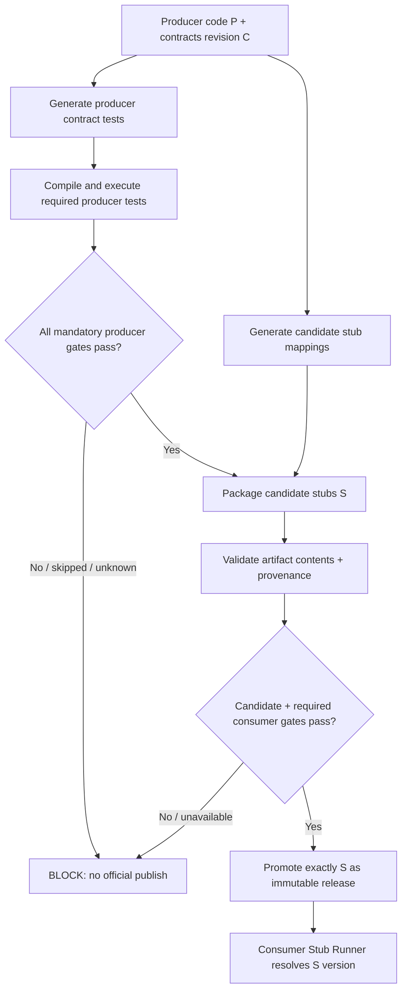
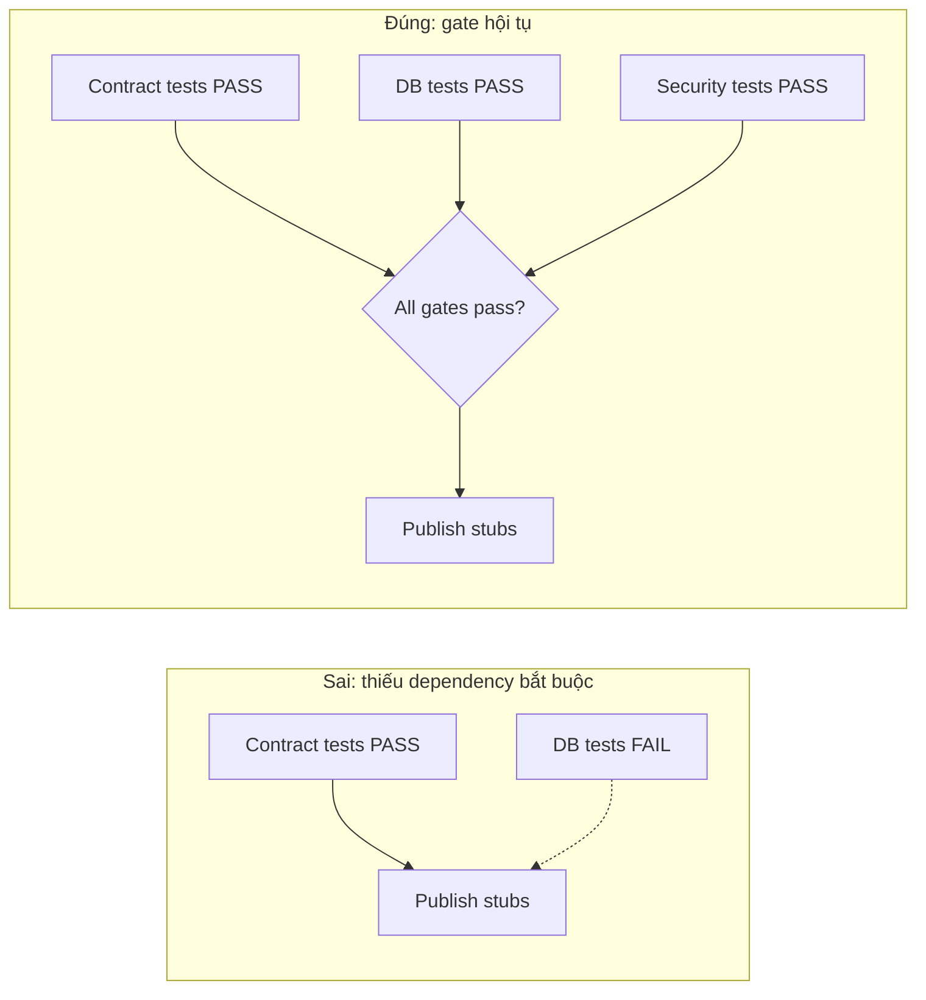
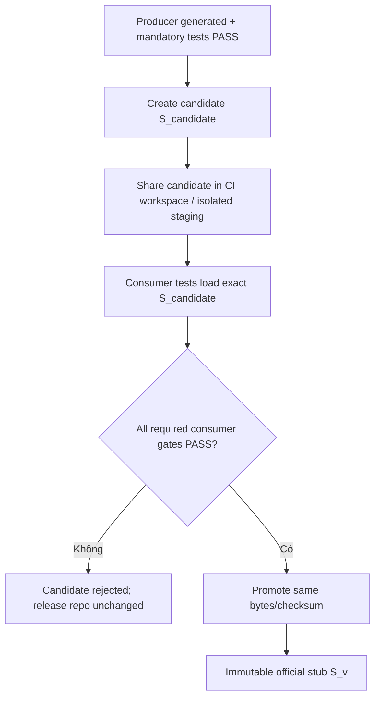

# Chỉ công bố stub sau khi toàn bộ kiểm thử bắt buộc đạt

Một pipeline **Spring Cloud Contract** có thể sinh ra file `inventory-service-1.4.2-stubs.jar` rất sớm, ngay cả khi mã producer chưa đáp ứng hợp đồng hoặc một số bài kiểm thử chưa hề được thực thi. Nếu quy trình CI/CD tự động đẩy file đó lên kho artifact công khai cho các nhóm consumer, `OrderService` có thể chạy Stub Runner với một lời hứa mà `InventoryService` thật không thực hiện được. Khi ấy consumer test xanh nhưng bản phát hành lại phá vỡ tích hợp.

Nguyên tắc của bài là: **chỉ công bố phiên bản stub chính thức sau khi tất cả cổng kiểm thử bắt buộc dành cho phiên bản đó đã chạy và đạt**. Không chỉ “có file JAR”, không chỉ “build xanh”, cũng không chỉ “contract DSL hợp lệ”. Cần chứng minh các tests thực thi trên **đúng revision producer**, với **đúng tập contract**, rồi công bố **chính artifact đã được kiểm** hoặc artifact tái tạo bằng quy trình được kiểm soát.

Bài thuộc chương **CI/CD** của module **SPRING_CLOUD_CONTRACT**. Phạm vi module là kiểm thử hợp đồng producer–consumer bằng **Groovy/YAML DSL**, sinh producer tests, đóng gói stub, dùng **Stub Runner** và tích hợp CI nhằm phát hiện thay đổi API hoặc message không tương thích. Chúng ta sẽ dùng `InventoryService` là producer, `OrderService` là consumer, cùng kho Maven artifact nội bộ để minh họa; các tên, phiên bản và địa chỉ đều là dữ liệu giả định.

Sau bài học, bạn có thể:

- Phân biệt **generate**, **verify**, **package**, **publish** và **deploy**.
- Xác định và áp dụng danh sách kiểm thử bắt buộc theo rủi ro của producer release.
- Thiết kế **release gate fail-closed**: một điều kiện fail, skipped hoặc không có kết quả thì không publish.
- Chứng minh generated contract tests được **sinh, phát hiện và thực thi**, tránh “0 tests, build success”.
- Kiểm stub JAR có đúng mappings, contracts, classifier, version và nguồn gốc.
- Thiết kế CI cho Maven hoặc Gradle không chạy publish trước các bài test cần thiết.
- Dùng stub candidate để consumer kiểm tương thích trước khi **promote** thành bản release bất biến.
- Khóa Git commit, contract revision, checksum và quyền ghi artifact repository.
- Xử lý tình huống flaky tests, cache, SNAPSHOT, release rollback và pipeline bị cấu hình lách gate.

## 1. Năm hành động khác nhau trong vòng đời stub

| Hành động | Đầu ra chính | Có đủ điều kiện công bố chính thức? |
| --- | --- | --- |
| **Generate tests** | Mã Java/Groovy producer tests từ contract | Chưa; code chỉ mới được sinh |
| **Generate stubs** | WireMock mappings/message contract definitions | Chưa; chưa xác minh implementation |
| **Run verification** | Test reports, trạng thái pass/fail/skip | Cần thiết nhưng chưa đủ nếu thiếu các gate khác |
| **Package** | File `*-stubs.jar` có version/classifier | Chưa; file có thể được đóng gói dù tests fail hoặc không chạy |
| **Publish/promote** | Artifact chính thức trong repository cho consumer tải | **Chỉ sau khi tất cả gate bắt buộc đạt** |

**Deploy producer** là bước khác với **publish stub**. Một stub release được phát hành không có nghĩa container/cluster đã triển khai đúng producer version ấy. Consumer tests dựa vào stubs bảo vệ giao diện đã thỏa thuận; smoke/integration tests ở môi trường triển khai vẫn cần kiểm phiên bản runtime và những rủi ro ngoài contract.

### Một thứ tự logic, không nhất thiết là thứ tự thực thi của mọi Gradle/Maven task



Ta có thể **sinh** stub trước hoặc song song với generated tests để tiết kiệm thời gian. Điều không được thay đổi là: **không có đường publish chính thức nào vượt qua các cổng kiểm tra bắt buộc**.

## 2. Một trường hợp nguy hiểm: stub đúng hợp đồng, producer sai

Producer và consumer đã thống nhất:

```http
POST /api/v1/reservations HTTP/1.1
Content-Type: application/json

{"sku":"SKU-001","quantity":2}
```

Đầu ra hợp đồng:

```http
HTTP/1.1 201 Created
Content-Type: application/json

{"reservationId":"RES-701","status":"HELD"}
```

Groovy DSL:

```groovy
import org.springframework.cloud.contract.spec.Contract

Contract.make {
    name 'create_reservation_success'
    description 'OrderService cần reservation ID để tiếp tục checkout'

    request {
        method 'POST'
        url '/api/v1/reservations'
        headers {
            contentType(applicationJson())
        }
        body([
            sku     : 'SKU-001',
            quantity: 2
        ])
    }

    response {
        status 201
        headers {
            contentType(applicationJson())
        }
        body([
            reservationId: $(consumer('RES-701'),
                             producer(regex('RES-[0-9]+'))),
            status       : 'HELD'
        ])
    }
}
```

`consumer('RES-701')` là giá trị response mẫu cho stub, còn `producer(regex('RES-[0-9]+'))` là điều kiện generated producer test kiểm đối với ID thực tế. `status=HELD` và HTTP `201` là các kỳ vọng cố định.

Giả sử code producer đã bị sửa thành trả `200` và `status=PENDING`. Công cụ sinh stub vẫn có thể tạo mapping trả `201 HELD` **chỉ dựa trên DSL**. Consumer test với mapping đó có thể pass, nhưng nếu generated producer tests chạy trên code thật, chúng phải phát hiện khác biệt.

Đó là lý do **stub generation không phải một quality gate**. Trước khi publish, kết quả cần thu thập là **test execution pass**, không phải dòng log “Generated stubs”.

### Ví dụ YAML DSL cho nhánh lỗi riêng

```yaml
name: create_reservation_insufficient_stock
description: Consumer phải xử lý lỗi thiếu tồn kho
request:
  method: POST
  url: /api/v1/reservations
  headers:
    Content-Type: application/json
  body:
    sku: SKU-EMPTY
    quantity: 2
response:
  status: 409
  headers:
    Content-Type: application/json
  body:
    code: INSUFFICIENT_STOCK
```

Đây là **kịch bản khác** với Groovy success, không phải cùng contract được viết hai lần. Nếu `409` là cam kết bắt buộc, nó phải được generator tìm thấy và generated test phải thật sự chạy. Hai tests pass không chứng minh mọi SKU/quantity, transaction hoặc concurrency đều đúng; phần test bắt buộc cần được chọn theo rủi ro nghiệp vụ.

## 3. Thế nào là “toàn bộ kiểm thử bắt buộc”?

Không có một danh sách test cố định cho mọi dịch vụ. “Bắt buộc” là **chính sách release được xác định trước** bởi nhóm sở hữu producer, consumer và platform, dựa trên giao diện đang hỗ trợ cùng hậu quả của lỗi.

Một ma trận đề xuất:

| Gate | Nội dung | Bắt buộc khi nào? | Bằng chứng cần lưu |
| --- | --- | --- | --- |
| **G1 — DSL discovery** | Đúng tập Groovy/YAML contracts được tìm thấy | Mọi release có contracts | Số file/contracts và source revision |
| **G2 — Producer contract tests** | Generated tests biên dịch, chạy và pass | Mọi release có verified stubs | JUnit results, executed/failed/skipped |
| **G3 — Unit tests** | Quy tắc nghiệp vụ quan trọng không bị phá | Nếu thuộc baseline release policy | Test report đúng module |
| **G4 — Integration tests** | DB, auth, external adapters, event transport | Khi phạm vi producer phụ thuộc các lớp này | Báo cáo test và môi trường |
| **G5 — Stub artifact validation** | JAR có mappings/contracts, version, classifier, body files đúng | Mọi stub release | Manifest/checksum và nội dung JAR |
| **G6 — Consumer compatibility** | Code consumer thật dùng candidate stub đúng | Với consumer/release pairs phải hỗ trợ | Consumer suite + resolved stub version |
| **G7 — Security/schema checks** | Auth/authorization và schema quan trọng | Khi rủi ro hoặc policy quy định | Test/policy reports |
| **G8 — Release provenance** | Producer/contract/test/artifact từ cùng revision được phép | Mọi release chính thức | Git SHA, contract SHA, build ID, digest |

**Bắt buộc** không có nghĩa tất cả E2E, load, performance, security scans phải chạy trong mọi PR của mọi dịch vụ. Nhưng nếu một gate được quy định là bắt buộc cho release đang xét, **không được âm thầm bỏ qua nó để publish**. Nếu cần thay đổi policy, phải có phê duyệt riêng, truy vết được, không phải chỉ sửa `if` trong CI.

### Một định nghĩa có thể kiểm được

Ví dụ dự án quy định:

```text
Release inventory-service:
  required:
    - generated producer HTTP/message contract tests
    - unit tests
    - database integration tests
    - security tests for reservation endpoints
    - stub jar content/provenance validation
    - OrderService compatibility suite
    - CheckoutService compatibility suite
  conditional:
    - broker retry/DLQ test if message wiring changed
    - load test if concurrency/latency path changed
```

Đây là **ma trận minh họa**, không phải định dạng config tự động mà Spring Cloud Contract hiểu. CI phải chuyển danh sách này thành job/task dependencies và status checks cụ thể.

## 4. Fail-closed: không có PASS thì không có quyền publish

Một release gate có thể biểu diễn bằng công thức:

\[
\text{ALLOW\_PUBLISH} =
\text{APPROVED\_REVISION}
\land \text{ALL\_REQUIRED\_GATES\_PASS}
\land \text{ARTIFACT\_PROVENANCE\_MATCH}.
\]

Ở đây `ALL_REQUIRED_GATES_PASS` nghĩa là mỗi gate **đã chạy đầy đủ, có kết quả PASS và không có skipped ngoài policy**. Các trạng thái `FAIL`, `CANCELLED`, `TIMED_OUT`, `NOT_RUN` và `UNKNOWN` đều **không** cho phép công bố.

| Trạng thái gate | Publish stub release? | Cách xử lý |
| --- | --- | --- |
| `PASS`, report hợp lệ | Có thể, nếu các gate khác cùng pass | Tiếp tục |
| `FAIL` | Không | Sửa rồi chạy lại |
| `SKIPPED` trái policy | Không | Khôi phục test hoặc xin thay đổi policy được duyệt |
| `NOT_RUN` / bị exclude | Không | Sửa task graph/CI workflow |
| `CANCELLED` / timeout | Không | Chạy lại một build rõ revision |
| `UNKNOWN` / mất artifact report | Không | Khôi phục bằng chứng và xác minh |
| `FLAKY` sau retry | Theo policy; nên coi là tín hiệu cần xử lý | Lưu cả lần fail, không xóa dấu vết |

### Không dùng “chỉ cần một trong các job xanh”

Giả sử có ba job: `contract-test`, `integration-test`, `publish-stubs`. Nếu `publish-stubs` chỉ phụ thuộc `contract-test` mà không phụ thuộc `integration-test`, release có thể lên kho dù integration test fail.



Không dựa vào thứ tự xuất hiện của các step trên giao diện CI. **Dependency graph** và điều kiện chạy mới quyết định có đường vượt gate hay không.

## 5. Đừng lẫn “0 tests” với “tất cả tests đều pass”

Một lỗi nguy hiểm hơn test fail là **test không chạy nhưng pipeline vẫn xanh**.

Nguyên nhân thường gặp:

- Contract source được đặt sai đường dẫn.
- Plugin Contract Verifier không được áp dụng ở producer module.
- Generated test có nhưng runner không phát hiện lớp/phương thức.
- Maven Surefire/Failsafe hoặc Gradle `contractTest` bị skip.
- Build gọi `test` nhưng contract tests nằm trong source set/task khác.
- Task được exclude bằng `-x contractTest` hoặc test filtering.
- Monorepo chỉ chạy producer A, bỏ producer B.
- CI lấy report của build trước hoặc report unit tests thay vì generated tests.

**Ba điều kiện phải kiểm riêng:**

1. **Discovered:** đúng tập contract source được nhận diện.
2. **Generated:** test source được sinh từ những contract đó.
3. **Executed:** các tests ấy được biên dịch, thực thi và pass trên implementation cần bảo vệ.

Số file `*.groovy` hoặc một JAR `*-stubs.jar` không chứng minh (3). Một test report `Tests run: 0, Failures: 0` cũng không phải PASS cho contract gate.

### Kiểm report và số lượng test

Trong Maven/Gradle, cần đọc kết quả từ công cụ chạy test:

```text
contract_source_count:  14
generated_contract_tests:  14
executed_contract_tests: 14
failed: 0
skipped: 0
gate: PASS
```

Các số trên chỉ là **ví dụ**. Tỷ lệ file-to-test không phải lúc nào đúng 1:1: một Groovy file có thể chứa nhiều contracts hoặc generator có chiến lược gộp test khác nhau. Phải định nghĩa **expected cases** theo dự án thay vì cứng nhắc cho rằng số file phải bằng số test.

Khi có test bị đánh dấu disabled/ignored theo chủ đích, nó chỉ được loại khỏi yêu cầu nếu **policy đã được phê duyệt và ghi nhận lý do**. Không coi toàn bộ skipped tests là PASS chỉ vì runner trả exit code 0.

## 6. Phạm vi producer verification phải là mã cần phát hành

Generated test pass chỉ có ý nghĩa nếu base class và test mode kiểm đúng ranh giới. Ví dụ với producer Spring MVC, base class có thể dùng:

```java
package com.example.inventory;

import io.restassured.module.mockmvc.RestAssuredMockMvc;
import org.junit.jupiter.api.BeforeEach;
import org.springframework.beans.factory.annotation.Autowired;
import org.springframework.boot.test.context.SpringBootTest;
import org.springframework.web.context.WebApplicationContext;

@SpringBootTest
public abstract class ContractVerifierBase {

    @Autowired
    WebApplicationContext context;

    @BeforeEach
    void setup() {
        RestAssuredMockMvc.webAppContextSetup(context);
    }
}
```

Đây là mẫu Spring MVC/MockMvc; với WebFlux hoặc message contracts phải chọn test mode, adapter và base class phù hợp phiên bản. **Đừng mock chính controller/producer behavior** để trả fixture mà contract cần xác minh. Có thể mock dependency ngoài boundary nếu chính sách cho phép, nhưng phải ghi rõ giới hạn: test ấy chưa xác minh DB/broker thật.

### Phân biệt các loại fixture

Một generated test có thể fail vì thiếu SKU test data dù implementation đúng, hoặc pass với mock trả sẵn response dù implementation sai. Vì vậy gate phải có:

- Fixture ổn định, cô lập và có thể tái tạo.
- Input/boundary cases đại diện rủi ro.
- Setup không vô tình vô hiệu hóa authorization/validation mà contract tuyên bố bảo vệ.
- Assertions đủ chặt (ví dụ status `201`, `status=HELD`, ID theo format).
- Kết quả run gắn chính xác với producer commit đang định publish.

Nếu test fail, điều tra nguyên nhân thay vì nới matcher hoặc disable test chỉ để unblock. Nếu yêu cầu contract thật sự đổi, cần review và verify lại từ cùng contract revision mới.

## 7. Maven: `verify` và `deploy` không cùng ý nghĩa

Spring Cloud Contract Maven plugin có thể được dùng để sinh producer tests và stubs; Maven lifecycle xử lý biên dịch, kiểm thử, đóng gói rồi mới tới `install`/`deploy` khi các plugins được cấu hình đúng.

Một producer Maven có phần cấu hình **minh họa**:

```xml
<build>
  <plugins>
    <plugin>
      <groupId>org.springframework.cloud</groupId>
      <artifactId>spring-cloud-contract-maven-plugin</artifactId>
      <version>VERSION_COMPATIBLE_WITH_PROJECT</version>
      <extensions>true</extensions>
      <configuration>
        <testFramework>JUNIT5</testFramework>
        <testMode>MOCKMVC</testMode>
        <baseClassForTests>
          com.example.inventory.ContractVerifierBase
        </baseClassForTests>
      </configuration>
    </plugin>
  </plugins>
</build>
```

Đây **không phải POM hoàn chỉnh**. Phiên bản plugin phải tương thích với Spring Boot/Spring Cloud/JDK của dự án; thêm các dependencies test cần thiết và quản lý version qua BOM/cấu hình hiện có. `MOCKMVC` chỉ phù hợp với producer Spring MVC.

Với build đã hoàn thiện:

```bash
# Sinh/biên dịch/chạy tests và tạo outputs theo Maven lifecycle:
mvn -B -ntp clean verify

# Chạy Maven lifecycle tới deploy nếu cấu hình repository/credentials đúng:
mvn -B -ntp clean deploy
```

`mvn deploy` thông thường sẽ chạy các pha lifecycle trước `deploy`, **nhưng** điều đó không có nghĩa mọi test cần thiết đã được nối đúng hoặc không bị skip. Nếu job bật `-DskipTests`, `-Dmaven.test.skip=true`, excludes, profile không đầy đủ hay cấu hình khác, Maven vẫn có thể tới pha deploy mà thiếu bằng chứng bắt buộc.

### Một lỗ hổng trong kịch bản “verify job → deploy job”

Giả sử:

1. Job A checkout commit `P100` và `mvn clean verify` pass.
2. Job B checkout branch `main` ở thời điểm khác, nhận commit `P101`.
3. Job B chạy `mvn deploy -DskipTests`.

Artifact `P101` đã bị **công bố dưới bằng chứng test của `P100`**. Dù cả hai cùng tên version, chúng không phải cùng đầu vào.

Hai hướng an toàn:

- **Verify lại ở publish job** từ **cùng immutable commit/tag** và không bỏ test; kiểm report/gate trước khi thật sự upload.
- **Promote artifact đã verify** từ CI/staging storage sang release repository, dùng checksum/digest để bảo đảm không build lại nội dung khác.

Đừng dùng `-DskipTests` như một “tối ưu” mặc định. Nếu tổ chức cho phép bỏ chạy lại test trong bước promote, bước đó phải **không build lại** mà chỉ di chuyển/chứng thực **chính bytes đã được kiểm**.

### Phân biệt Maven tests ở nhiều plugins

| Loại | Plugin/task thường gặp | Điều cần xác minh |
| --- | --- | --- |
| Unit và generated producer tests | Maven Surefire | Test discovery, reports và số executed |
| Integration tests có hậu tố phù hợp | Maven Failsafe | `integration-test` + `verify` được thực thi đúng |
| Contract generation | Spring Cloud Contract Maven plugin | Contracts được tìm thấy và test sources sinh ra |
| Stub packaging | Cấu hình Spring Cloud Contract/assembly/attached artifact | `stubs` classifier đúng, artifact có mappings |
| Publish | Maven Deploy plugin hoặc repository publisher | Chỉ chạy khi các gate đạt |

Không suy rằng chỉ cần có Surefire report là **Failsafe integration tests** đã chạy. Với dự án dùng JUnit naming conventions hoặc custom profiles, CI phải thu cả hai tập báo cáo đúng module.

## 8. Gradle: `verifierStubsJar` không phải bằng chứng verification

Spring Cloud Contract Gradle plugin thường cung cấp những tasks như:

```text
generateContractTests
contractTest
generateClientStubs
copyContracts
verifierStubsJar
```

`generateContractTests` sinh source; `contractTest` thực thi producer tests nếu task/source set được cấu hình đúng; `generateClientStubs` và `verifierStubsJar` tạo output phục vụ Stub Runner. Chạy `verifierStubsJar` thành công **không mặc nhiên chứng minh** `contractTest` đã chạy và pass.

Một producer Gradle có thể cấu hình gate rõ:

```groovy
// Mảnh build.gradle minh họa, giả định đã áp dụng
// Spring Cloud Contract và maven-publish plugins.
tasks.named('check') {
    dependsOn(tasks.named('contractTest'))
}

tasks.named('publish') {
    dependsOn(tasks.named('check'))
    dependsOn(tasks.named('verifierStubsJar'))
}
```

**Ý nghĩa:** gọi `publish` trong build này yêu cầu Gradle hoàn thành `check` và `verifierStubsJar`. Nếu `check` fail, Gradle thông thường không chạy phụ thuộc phía sau để publish, **trừ khi** build/task/custom script có logic bỏ qua lỗi hoặc publisher được gọi qua một đường khác.

Đoạn này **chưa phải release gate hoàn chỉnh**: nó không tự biết test count, test coverage, consumer compatibility, security scan hoặc checksum. Nếu có custom publication task hay plugin khác không phụ thuộc `publish`, phải nối **đúng mọi entrypoint công bố artifact** với gate hoặc chặn quyền publish ở hạ tầng.

### Đừng dùng `finalizedBy` để ép publish

Ví dụ phản mẫu:

```groovy
// ANTI-PATTERN: finalizer không phải gate thành công.
tasks.named('check') {
    finalizedBy(tasks.named('publish'))
}
```

Finalizer có mục đích dọn dẹp hoặc chạy bước kết thúc; nó có thể được lên lịch ngay cả khi task được finalise thất bại. Vì vậy **không dùng `finalizedBy(publish)` để đảm bảo “chỉ publish khi test pass”**.

Tương tự, khi gọi Gradle với `--continue`, một số tasks độc lập có thể tiếp tục sau khi task khác fail. Muốn an toàn, publication **phải phụ thuộc trực tiếp/gián tiếp vào gate**, chứ không chỉ xuất hiện sau nó trên command line.

### Lệnh quan sát

```bash
# Xem các tasks và xác minh task names của phiên bản đang dùng:
./gradlew tasks --all

# Mô phỏng task graph, tìm đường publish trước khi chạy thật:
./gradlew publish --dry-run

# Chạy verification ở producer:
./gradlew clean check
```

`--dry-run` chỉ cho biết tác vụ dự kiến, **không chứng minh kết quả kiểm thử**. Khi dùng Gradle multi-module, dùng task path đầy đủ như `:inventory-service:contractTest` và `:inventory-service:publish` để tránh publish nhầm module.

### Source set riêng và test discovery

Một số phiên bản Spring Cloud Contract Gradle plugin dùng `contractTest` source set; generated tests không nhất thiết chạy khi chỉ gọi `test`. Vì thế hãy xem plugin có thực sự nối `contractTest` vào `check` hay chưa. Ngoài ra cần `useJUnitPlatform()` nếu sử dụng JUnit 5:

```groovy
tasks.named('contractTest', Test) {
    useJUnitPlatform()
    testLogging {
        events 'passed', 'failed', 'skipped'
    }
}
```

Không thể dựa vào đoạn `useJUnitPlatform()` để tự suy test count khác 0; cần cổng kiểm số executed tests trong báo cáo hoặc test task result.

## 9. Artifact validation: file `*-stubs.jar` có chứa gì?

Sau khi producer verification pass, CI phải kiểm **artifact sắp publish**, không chỉ kiểm tên file.

Ví dụ Maven:

```bash
jar tf target/inventory-service-1.4.2-stubs.jar
```

Ví dụ Gradle:

```bash
jar tf build/libs/inventory-service-1.4.2-stubs.jar
```

Đường dẫn là minh họa; cần lấy vị trí thực tế từ Maven `target` hoặc Gradle `build/libs`, phụ thuộc packaging config.

Với Spring Cloud Contract, stub artifact HTTP thông dụng có thể chứa:

```text
META-INF/
  com.example/
    inventory-service/
      1.4.2/
        mappings/
          create_reservation_success.json
          create_reservation_insufficient_stock.json
        contracts/
          create-reservation-success.groovy
          create-reservation-insufficient-stock.yml
```

Đây là **bố cục tham khảo**, không bảo đảm giống mọi Spring Cloud Contract version/custom packaging. Với message contracts, các contract definitions có thể được Stub Runner sử dụng qua messaging adapter thay vì WireMock HTTP mappings.

### Những phép kiểm cần có

| Kiểm tra | Phát hiện lỗi gì? |
| --- | --- |
| Có artifact `stubs` với đúng group/artifact/version | Tránh consumer tải nhầm JAR producer |
| JAR không rỗng, mở/đọc được | Tránh publish file hỏng |
| Có expected mappings/contracts | Tránh bỏ sót contract hoặc dùng artifact stale |
| Có `__files` nếu mapping dùng `bodyFileName` | Tránh stub trả response lỗi |
| Mappings match đúng request và response | Tránh lỗi generator/packaging hoặc manual override |
| Artifact chứa đúng consumer subfolder nếu lọc theo consumer | Tránh `stubsPerConsumer` không nạp được mappings |
| SHA-256/checksum được lưu | Truy vết cùng version có cùng bytes hay không |
| Test với Stub Runner sạch pass | Xác minh runtime nạp được artifact chứ không chỉ file tồn tại |

**Một JAR có đầy đủ file vẫn có thể sai**: JSON mapping syntax không hợp lệ, body file bị thiếu, một fallback mapping chồng lấn, hoặc WireMock runtime dùng version không hỗ trợ matcher. Vì vậy nên có ít nhất một smoke/consumer test từ **artifact cuối cùng**.

### Kiểm checksum

```bash
sha256sum target/inventory-service-1.4.2-stubs.jar
```

Trên PowerShell dùng `Get-FileHash` với `SHA256`. Checksum giúp đối chiếu nội dung giữa bước verify, staging và release; nó không tự thay thế artifact signing, repository access controls hoặc provenance chứng thực khi tổ chức yêu cầu.

## 10. Candidate stubs, release stubs và bài toán thứ tự kiểm consumer

Một câu hỏi thực tế: **làm sao chạy consumer compatibility tests trước khi publish release stub**, nếu consumer test cần tải stub qua Stub Runner?

Câu trả lời là phân biệt **candidate artifact chỉ dùng nội bộ pipeline** với **published release artifact mà người dùng/consumer teams được phép phụ thuộc**.



Có ba cách phân phối candidate **không cần phát hành chính thức**:

1. **CI artifact handoff:** truyền JAR giữa jobs bằng artifact store tạm, consumer job cài nó vào local test repository trước khi Stub Runner chạy.
2. **Staging repository có quyền giới hạn:** publish candidate vào namespace/version mang dấu pre-release, không quảng bá là stable; consumer test resolve đúng tọa độ và checksum, rồi promote những bytes đã kiểm.
3. **Shared build workspace:** trong một integration pipeline đa-module, candidate JAR có sẵn trên filesystem hoặc Maven local của job test.

Nếu dùng staging repository, cần chính sách retention, quyền truy cập và quy tắc phân biệt candidate với release để không cho production consumer vô tình tải bản chưa xác minh.

### Tại sao không “publish stable rồi kiểm consumer sau”?

Nếu việc publish stable được coi là cam kết đã kiểm và consumer systems tự động nâng phiên bản, khi consumer gate fail, artifact đã phát hành có thể được sử dụng ngoài ý muốn. Xóa hoặc ghi đè release sau đó lại phá tính bất biến.

Với chính sách “chỉ công bố sau mọi gate”, hãy kiểm **candidate** trước, sau đó **promote** chính candidate thành release. Một pipeline có thể không yêu cầu consumer suites trong gate producer tùy tổ chức, nhưng khi chúng đã được quy định là bắt buộc, phải thỏa trước publication.

## 11. Consumer compatibility test cần gọi mã consumer thật

Một Stub Runner test kiểu:

```java
import org.springframework.boot.test.context.SpringBootTest;
import org.springframework.cloud.contract.stubrunner.spring.AutoConfigureStubRunner;
import org.springframework.cloud.contract.stubrunner.spring.StubRunnerProperties;

@SpringBootTest(properties = {
    "inventory.base-url=http://localhost:8090"
})
@AutoConfigureStubRunner(
    ids = "com.example:inventory-service:1.4.2:stubs:8090",
    stubsMode = StubRunnerProperties.StubsMode.LOCAL
)
class OrderConsumerContractTest {
    // Test thực tế gọi OrderCheckoutService và InventoryClient của OrderService.
}
```

Ví dụ giả định JAR candidate `1.4.2:stubs` đã được đưa vào Maven local của job, cổng 8090 khả dụng và dependencies đúng với phiên bản Spring Cloud Contract đang dùng.

Một phép thử **chỉ gọi WireMock trực tiếp** bằng curl/RestAssured là stub smoke test, chưa chứng minh client của `OrderService` hoạt động đúng. Consumer compatibility gate cần:

1. Khởi chạy **mã consumer thật** (HTTP client/service adapter).
2. Dùng base URL dẫn đến **đúng Stub Runner instance/port**.
3. Gửi request từ consumer code, không tạo request giả chỉ trong test harness.
4. Assert response đã deserialize và business outcome/side effects đúng.
5. Kiểm WireMock request journal/verify đúng method, path, body/header.
6. Chạy các nhánh lỗi quan trọng, ví dụ `409`, chứ không chỉ happy path.

Khi Stub Runner dùng `StubsMode.REMOTE`, phải chắc chắn repositoryRoot chỉ tới đúng candidate repository. Nếu dùng `LOCAL`, job phải cài/nhập đúng artifact vào local repository, tránh cache từ bản cũ.

### Kiểm consumer hiện tại và consumer cũ

Nếu producer phát hành version mới nhưng vẫn tuyên bố hỗ trợ `OrderService 2.7` và `2.8`, gate có thể cần chạy cả hai suites với candidate `inventory-service:1.4.2:stubs`. Việc `OrderService 2.8` pass không bảo đảm consumer 2.7 cũng chấp nhận JSON/enum/status mới.

Nên chọn **ma trận cặp phiên bản** dựa trên các phiên bản đang deploy, cửa sổ backward compatibility và kế hoạch rolling upgrade — không tự động yêu cầu mọi combination từng tồn tại.

## 12. Một release pipeline cần các điểm dừng không thể lách

Quy tắc tổ chức nên tách:

| Lớp kiểm soát | Chức năng |
| --- | --- |
| **Build/task graph** | Publication task phụ thuộc đúng verification tasks |
| **CI job dependencies** | Job publish chỉ chạy sau mọi job bắt buộc thành công |
| **Branch/tag protection** | Chỉ release từ revision đã review, không từ PR tùy ý |
| **Repository permissions** | Credential publish chỉ cấp cho job release |
| **Artifact immutability** | Không overwrite release artifact dù có lỗ hổng ở CI |
| **Provenance/attestation** | Truy ra build, contracts và kết quả kiểm thử |

Một lỗi ở một tầng không nên đủ để ai cũng có thể đẩy stub chưa kiểm lên kho release.

**Ví dụ:** job `verify` fail nhưng một job `publish` có credentials riêng và chạy với `if: always()` vẫn upload artifact. Cần sửa cả **điều kiện CI** lẫn **quyền publish** để tránh PR hoặc job khác vượt gate.

## 13. GitHub Actions: bố trí jobs theo dependency, không chỉ thứ tự hiển thị

Mô hình gồm:

```text
verify-producer ----+
                   +--> verify-consumers --> release-publish
validate-artifact -+
```

Trong thực tế, `validate-artifact` phải dùng **candidate JAR từ cùng build** chứ không tự download `latest`. Job `release-publish` chỉ chạy khi tất cả jobs bắt buộc có kết quả thành công và release được phép.

Một workflow **minh họa logic điều phối**, trong đó các script `ci/*.sh` là thành phần **phải do dự án viết và review**:

```yaml
name: Verify and release contract stubs

on:
  push:
    branches: [main]
    tags: ["v*"]
  pull_request:

permissions:
  contents: read

jobs:
  producer-gates:
    runs-on: ubuntu-latest
    steps:
      - uses: actions/checkout@v4
      - uses: actions/setup-java@v4
        with:
          distribution: temurin
          java-version: "21"
          cache: maven
      - name: Producer tests and candidate package
        run: mvn -B -ntp clean verify
      - name: Reject 0 tests, skipped contracts and missing mappings
        run: ./ci/check-producer-gates.sh
      - name: Upload candidate, not public release
        uses: actions/upload-artifact@v4
        with:
          name: inventory-candidate
          path: target/*-stubs.jar
          if-no-files-found: error

  consumer-gates:
    needs: [producer-gates]
    runs-on: ubuntu-latest
    steps:
      - uses: actions/checkout@v4
      - uses: actions/setup-java@v4
        with:
          distribution: temurin
          java-version: "21"
      - uses: actions/download-artifact@v4
        with:
          name: inventory-candidate
          path: candidate/
      - name: Check candidate SHA and consumer compatibility
        run: ./ci/test-consumers-with-candidate.sh candidate/

  release-publish:
    needs: [producer-gates, consumer-gates]
    if: startsWith(github.ref, 'refs/tags/v')
    runs-on: ubuntu-latest
    environment: production-artifacts
    steps:
      - uses: actions/checkout@v4
      - uses: actions/download-artifact@v4
        with:
          name: inventory-candidate
          path: candidate/
      - name: Promote verified candidate without rebuilding
        run: ./ci/promote-verified-candidate.sh candidate/
```

**Không copy workflow này rồi coi là bảo đảm release tự động hoạt động.** Nó cố ý dùng ba scripts **chưa được cung cấp**, với giao diện rõ ràng nhưng cần được triển khai:

- `check-producer-gates.sh` phải đọc test reports của đúng module, xác nhận required suites có test và pass, kiểm `*-stubs.jar` chứa mappings/contracts, lưu commit + checksums.
- `test-consumers-with-candidate.sh` phải xác minh digest candidate, đưa artifact vào nguồn Stub Runner, gọi consumer suites thực và fail nếu một suite bắt buộc không đạt.
- `promote-verified-candidate.sh` chỉ được upload **chính JAR đã kiểm** cùng metadata/version chuẩn; không build lại hoặc dùng wildcard chọn nhầm artifact.

Workflow còn cần bảo đảm candidate đi kèm checksum/manifest và paths đúng nếu là **multi-module**. Khoảng thời gian giữa các jobs không được làm thay đổi Git SHA hoặc nội dung artifact; `actions/download-artifact` nhận artifacts trong cùng workflow run, còn bước checkout theo cùng event commit.

### Hạn chế và hardening cần bổ sung

- `permissions: contents: read` là quyền mặc định chỉ đọc; **credentials ghi artifact repository** phải nằm trong môi trường release được bảo vệ và không có ở PR job.
- Tag `v*` không tự bảo đảm một tag được duyệt. Cần **protected tags**, release approval và policy nguồn commit.
- `on: pull_request` chỉ nên verify; `release-publish` bị chặn bởi điều kiện tag.
- Script test cần tách job phụ nếu producer/consumer nằm ở **hai repositories**; lúc đó dùng artifact handoff/dispatch đã xác thực, không tải artifact `latest`.
- Publication script phải từ chối nếu release coordinates đã tồn tại và **không ghi đè**.
- Nếu consumer gate không có kết quả do timeout/service outage, **fail closed** thay vì chấp nhận `UNKNOWN`.

### Một điểm kỹ thuật nhỏ nhưng quan trọng

Trong YAML của GitHub Actions, `on` là khóa đặc biệt được nền tảng xử lý như workflow triggers. Đừng tự kiểm cấu trúc file này bằng một YAML parser đời cũ có semantics Boolean không phù hợp rồi kết luận workflow bị lỗi cú pháp; hãy dùng công cụ kiểm workflow và môi trường CI thật.

## 14. Cổng kiểm thử nên đánh giá kết quả, không chỉ exit code

Exit code của `mvn verify` hoặc `gradlew check` quan trọng, nhưng không đủ nếu build có tests bị disable, source set chưa được gọi hoặc những báo cáo bắt buộc không được sinh.

Một release gate có thể được thiết kế theo **thuật toán khái niệm**:

```text
expected_contracts = load_reviewed_contract_inventory(revision C)
assert expected_contracts is not empty

generation_report = load_generation_evidence()
assert generation_report.includes_all_required(expected_contracts)

for suite in mandatory_suites:
    report = load_report_from_current_run(suite)
    assert report exists
    assert report.executed > 0 or suite.explicitly_allows_zero
    assert report.failures == 0
    assert report.errors == 0
    assert report.skipped <= suite.approved_skip_limit
    assert suite.job_status == SUCCESS

candidate = read_candidate_stub_artifact()
assert candidate.exists and candidate.valid_jar
assert candidate.contains_required_contracts_and_mappings()
assert candidate.revision == verified_contract_revision
assert candidate.producer_commit == verified_producer_commit

for consumer in mandatory_consumers:
    assert consumer.tested_candidate_digest == candidate.sha256
    assert consumer.compatibility_job_status == SUCCESS

ALLOW_PUBLISH = true
```

Đây là **pseudo-code giải thích chính sách**, không phải chương trình có sẵn có thể chạy. Mỗi CI hệ thống cần adapter để lấy danh sách contract, JUnit reports, job statuses, manifest/digest và policy skip; quan trọng là phải **đọc dữ liệu của chính workflow run hiện tại**.

### Đừng đặt điều kiện đơn giản “có XML thì PASS”

Một file `TEST-ContractVerifier.xml` từ build trước có thể còn nằm trong workspace hoặc cache, trong khi lần build hiện tại không chạy test. Nếu gate chỉ kiểm sự tồn tại, nó sẽ pass sai.

Giải pháp:

- Sử dụng clean workspace hoặc xóa report output trước khi chạy tests.
- Lấy report từ test task/job hiện tại, không trộn với cache không có provenance.
- Đối chiếu test suite names với danh sách bắt buộc.
- Kiểm số test **executed**, failures, errors, skipped.
- Kiểm test runner thực sự chạy trên đúng producer commit.
- Khi không phân tích được report, chọn `UNKNOWN/BLOCK` thay vì giả định pass.

## 15. Các cấu hình CI dễ vô tình làm lách gate

| Cấu hình/anti-pattern | Vì sao nguy hiểm | Cách thay thế |
| --- | --- | --- |
| `continue-on-error: true` ở step test | Job có thể tiếp tục hoặc báo thành công dù test fail | Không cho phép ở mandatory gate |
| `if: always()` trên publish step | Publish có thể chạy sau failure | Dùng `needs` và điều kiện success + approval |
| Gradle `finalizedBy(publish)` | Finalizer không biểu diễn chỉ chạy khi thành công | Dùng dependency và release gate rõ |
| Shell `mvn test; echo done` | Exit code lệnh cuối che thất bại nếu không kiểm | Shell strict mode hoặc kiểm exit code |
| `mvn deploy -DskipTests` | Skip mà không có verified-artifact promotion | Chạy lại tests hoặc promote đúng bytes đã verify |
| `gradle publish -x contractTest` | Có thể bypass verification | Chặn ở task graph/CI/repository permissions |
| Publish job chỉ `needs: build` | Build không nhất thiết bao gồm integration/security/consumer tests | Phụ thuộc tất cả required job gates |
| Lấy stubs version `+`/`latest` | Consumer test hai lần có thể dùng hai versions | Pin version và digest |
| Publish artifact dưới release version đã tồn tại | Ghi đè nội dung, mất khả năng tái lập | Release repository immutable |
| `if: failure()` đăng ký bản lỗi để “debug” vào release repo | Artifact chưa verified bị trộn với stable | Dùng CI artifact/staging namespace riêng |

### `if: always()` vẫn hữu ích cho việc nào?

Cho **báo cáo và dọn dẹp**, không cho công bố release:

```yaml
- name: Upload test reports for diagnosis
  if: always()
  uses: actions/upload-artifact@v4
  with:
    name: test-reports
    path: target/surefire-reports/
```

Ngay cả khi test fail, report cần được giữ để điều tra. Nhưng artifact này là **test report nội bộ**, không phải stable `*-stubs.jar` đã publish. Có thể upload candidate stub dưới dạng CI artifact để debug; phải phân biệt rõ với public/release publication.

### Điều kiện publication ở job riêng

```yaml
release-publish:
  needs: [producer-gates, consumer-gates, security-gates]
  if: startsWith(github.ref, 'refs/tags/v')
  environment: production-artifacts
```

Đoạn này là **mảnh workflow**, chưa có các steps và job definitions. Với GitHub Actions, job có `needs` thông thường không chạy nếu một dependency fail hoặc skipped, trừ khi người viết chủ động thêm logic điều kiện khác. Vẫn cần bảo vệ tag/environment và chỉ cấp credentials cho job đúng.

## 16. Kiểm thử bị flaky: không xóa dấu vết để xuất bản

Một test tích hợp broker đôi khi fail vì môi trường không ổn định. Lặp lại test rồi chỉ công bố kết quả pass cuối có thể che regression thực hoặc khiến policy không minh bạch.

Quy trình xử lý nên xác định trước:

1. Phân loại lỗi: code behavior, fixture, timeout, resource exhaustion, broker/network hoặc test isolation.
2. Lưu kết quả **cả lần fail lẫn lần retry** trong CI record.
3. Chỉ retry có giới hạn, với cùng commit, contract revision và candidate artifact.
4. Nếu retry pass nhưng policy yêu cầu mọi lần đều pass, gate vẫn block hoặc cần phê duyệt ngoại lệ được truy vết.
5. Sửa nguyên nhân flaky; không tăng timeout vô hạn hoặc disable assertion quan trọng.
6. Khi cần quarantine một test, ghi rõ owner, lý do, expiration date và test thay thế/độ rủi ro được chấp nhận.

**Không phải mọi retry đều sai.** Retry có giới hạn là kỹ thuật phù hợp cho infrastructure transient failure; điều nguy hiểm là **coi “cuối cùng xanh” đồng nghĩa chưa từng có vấn đề**, rồi phát hành mà không theo đúng policy.

### Gate phụ thuộc vào dịch vụ ngoài không khả dụng

Ví dụ consumer compatibility job không thể tải candidate từ artifact staging do repository outage. Khi đó:

- Không tự đổi `REMOTE` sang `LOCAL` để dùng một stub cũ không xác định.
- Không đánh dấu consumer gate PASS khi chưa chạy.
- Cho pipeline dừng ở `BLOCKED/UNKNOWN`.
- Chạy lại sau khi service hồi phục, giữ revision/digest cố định.

Mục tiêu là **fail closed và tái lập**, không tìm mọi cách để có màu xanh.

## 17. Release không được đảo thứ tự khi có thay đổi breaking

Giả sử InventoryService v1.5 thêm `expiresAt` và đổi trạng thái `HELD` thành `HELD_PENDING_REVIEW` trong một số trường hợp. OrderService v2.8 chưa hiểu enum mới.

Một candidate stub từ contract mới có thể giúp **phát hiện breaking change sớm**, nhưng không thể tự suy mọi consumer đều an toàn. Cần đánh giá những cặp version thực sự có thể gặp nhau khi rollout:

| Consumer/Producer | Inventory 1.4 | Inventory 1.5 |
| --- | --- | --- |
| Order 2.8 đang deploy | Baseline cần xác nhận | **Gate backward compatibility** |
| Order 2.9 candidate | Gate nếu consumer deploy trước producer | **Gate mục tiêu** |

Quy trình phát hành có thể chọn:

1. Duy trì output cũ trong Inventory 1.5, thêm field mới nhưng không đổi semantic cũ; kiểm Order 2.8 với candidate.
2. Sau đó nâng Order 2.9, kiểm cả cặp nếu rolling upgrade có thể gặp Inventory 1.4.
3. Chỉ sau khi consumer cũ biến mất mới loại bỏ contract/field cũ trong một release có chính sách breaking tương ứng.

**Không có test cho một cặp phiên bản thì phải ghi `NOT_TESTED`**, không tự điền `PASS`. Stub release gate tốt hơn khi nó biết các phiên bản được hỗ trợ và những consumers đang còn deploy.

## 18. Multi-module monorepo: tất cả producer modules liên quan phải có bằng chứng

Giả sử monorepo có:

```text
services/
├── inventory-service/
├── pricing-service/
└── order-service/
```

Nếu một release bundle sẽ đồng thời publish stubs của Inventory và Pricing, CI không thể chỉ kiểm Inventory rồi cho phép publish cả hai.

| Module | Required tests | Stub artifact | Quyết định |
| --- | --- | --- | --- |
| Inventory | Producer contract + DB + Order consumer tests | `inventory-service:1.4.2:stubs` | Publish nếu tất cả pass |
| Pricing | Producer contract + tax integration + Order consumer tests | `pricing-service:2.1.0:stubs` | Publish nếu tất cả pass |

Nếu chính sách là **atomic release bundle**, một module fail phải chặn cả bundle. Nếu mỗi producer phát hành độc lập, có thể chỉ chặn module fail. Quan trọng là policy được định nghĩa trước, không thay đổi linh hoạt theo màu của build.

### Định danh task chính xác

```bash
# Gradle multi-module: đích rõ module.
./gradlew :inventory-service:contractTest
./gradlew :pricing-service:contractTest
./gradlew :inventory-service:check
./gradlew :pricing-service:check
```

Đừng chỉ báo “tổng cộng 25 tests pass” nếu Inventory có 25 tests còn Pricing có 0 do cấu hình sai. Báo cáo phải phân theo **module/revision/gate**.

## 19. Reuse test outputs có điều kiện, không mặc định tái build

Một release pipeline thường có nhiều jobs hoặc môi trường. Có hai mô hình hợp lệ:

### Mô hình A — build một lần, kiểm và promote cùng artifact

```text
Checkout exact commit
  -> Generate + test
  -> Package candidate
  -> Validate candidate + digest
  -> Consumer suites use same candidate
  -> Promote same digest to immutable release
```

**Ưu điểm:** bảo đảm bytes đã kiểm được công bố. **Thách thức:** phải quản lý artifact handoff, chữ ký/checksum, quyền của candidate store và upload/promote tin cậy.

### Mô hình B — tái build có xác minh

```text
Release job checkout exact immutable commit
  -> Resolve exact contracts revision/dependencies
  -> Regenerate + rerun all mandatory tests
  -> Rebuild artifact
  -> Validate candidate + digest
  -> Publish
```

**Ưu điểm:** có thể dùng Maven/Gradle lifecycle quen thuộc. **Thách thức:** cần đảm bảo test ở release job thực sự chạy, không bị skip; nếu producer/consumer tests chỉ chạy ở một job khác thì phải kiểm mọi đầu vào và artifacts được liên kết đúng.

Không dùng “build thành công từ cùng branch” làm bằng chứng hai mô hình tương đương. Branch có thể dịch chuyển; dependencies SNAPSHOT có thể đổi; Gradle/Maven cache có thể tạo khác biệt. Nên sử dụng immutable commit SHA, artifact version và dependency locks theo chính sách dự án.

## 20. Release version, SNAPSHOT và tính bất biến

| Loại artifact | Ví dụ | Cách dùng phù hợp |
| --- | --- | --- |
| Local candidate | `inventory-service:1.4.3-candidate.57:stubs` | Thử trong pipeline riêng, không cam kết stable |
| Snapshot | `inventory-service:1.4.3-SNAPSHOT:stubs` | Tích hợp phát triển, có thể thay đổi qua các lần upload |
| Immutable release | `inventory-service:1.4.3:stubs` | Consumer release tests và production-compatible contract consumption |

Với SNAPSHOT, **cùng chuỗi version có thể resolve thành bytes khác nhau** theo thời điểm/caching policy. Nếu dùng snapshot ở một gate quan trọng, cần ghi resolved version/timestamp và checksum. Đối với release, repository nên từ chối overwrite cùng coordinates để tránh làm sai bằng chứng test trước đó.

### Không xóa bản release lỗi để “sửa lịch sử”

Nếu phát hiện stub artifact chính thức không tương thích sau khi publish:

1. Không ghi đè JAR release với nội dung khác mà giữ nguyên version.
2. Đánh dấu release có vấn đề/deprecated theo cơ chế repository và chính sách tổ chức.
3. Tạo version mới sau khi sửa producer/contract và chạy lại toàn bộ mandatory gates.
4. Hướng dẫn consumers pin version an toàn.
5. Điều tra vì sao publish gate cho phép artifact không đạt; thêm regression/negative control.

Xóa artifact có thể làm hỏng khả năng tái lập các builds cũ. Retention/yank policy cần có chủ đích, không xử lý theo cảm tính trong lúc sự cố.

## 21. Quyền bảo mật và supply chain của bước publish

Ngay cả một pipeline với dependencies đúng vẫn có thể bị bỏ qua nếu credentials phát hành nằm trên máy developer hoặc trong mọi PR job.

Các lớp kiểm soát thiết thực:

- **Least privilege:** chỉ release job có token được phép upload release.
- **Protected branch/tag:** phát hành từ commit đã review, không từ branch tùy ý.
- **Approval/environment protection:** cần phê duyệt nếu policy yêu cầu.
- **Immutable repository policy:** từ chối ghi đè release versions.
- **Secrets isolation:** không ghi repository username/token vào `pom.xml`, `build.gradle`, contract YAML hay logs.
- **Integrity:** checksum/digest và, khi cần, chữ ký/attestation của artifact.
- **Build provenance:** record Git SHA producer, contract revision, dependency/toolchain và CI run.
- **Untrusted PR boundary:** không cho mã từ PR không tin cậy đọc release credentials chỉ vì pipeline đang chạy tests.

Maven `settings.xml` server credentials hoặc Gradle publishing credentials nên được cấp bằng secret store của CI. Việc có credentials không phải là bằng chứng gate pass; quyền upload chỉ được bật **sau** khi gate ra quyết định cho phép.

### Một nguồn dữ liệu provenance gợi ý

```yaml
producer:
  coordinates: com.example:inventory-service:1.4.2
  gitCommit: REPLACE_WITH_REAL_PRODUCER_SHA
contracts:
  revision: REPLACE_WITH_REAL_CONTRACT_SHA
  artifact: com.example.contracts:inventory-contracts:2.3.0
verification:
  runId: REPLACE_WITH_REAL_CI_RUN_ID
  contractTestsExecuted: 14
  contractTestsFailed: 0
  contractTestsSkipped: 0
  databaseIntegration: PASS
  securityGate: PASS
  requiredConsumers:
    order-service: PASS
    checkout-service: PASS
stub:
  coordinates: com.example:inventory-service:1.4.2:stubs
  sha256: REPLACE_WITH_REAL_SHA256
  released: true
```

Đây là **minh họa manifest do tổ chức tự định nghĩa**, không phải schema mặc định của Spring Cloud Contract. Số 14 và các chữ PASS ở đây chỉ ví dụ; chỉ lấy số test, SHA, revision và kết quả thật từ pipeline khi tạo báo cáo release.

## 22. Hợp đồng messaging: gate phải kiểm đúng adapter và broker khi cần

Spring Cloud Contract còn hỗ trợ message contracts cho các kịch bản producer phát hoặc nhận sự kiện. Một Groovy contract minh họa:

```groovy
import org.springframework.cloud.contract.spec.Contract

Contract.make {
    name 'reservation_confirmed_event'
    label 'reservation_confirmed'
    input {
        triggeredBy('publishReservationConfirmed()')
    }
    outputMessage {
        sentTo('reservationEvents')
        body([
            reservationId: 'RES-701',
            status: 'CONFIRMED'
        ])
        headers {
            messagingContentType(applicationJson())
            header('eventType', 'reservation.confirmed')
        }
    }
}
```

Đây là mẫu cho adapter messaging phù hợp phiên bản; `publishReservationConfirmed()` phải tồn tại trong producer test base. `reservationEvents` có thể là Spring Integration channel, không tự động là RabbitMQ exchange hoặc Kafka topic.

**Điều mà generated messaging test có thể chứng minh:** payload/header/destination đã được quan sát qua adapter test theo contract. **Điều nó không mặc nhiên chứng minh:** broker đang chạy đúng exchange/binding/topic, event không mất sau transaction rollback, consumer idempotent khi redelivery, ack/nack hoặc DLQ đúng.

Nếu một thay đổi release đụng tới message routing/broker reliability, policy có thể quy định **broker integration tests là bắt buộc**. Khi đó:

- Không publish message stubs chỉ vì test in-memory pass.
- Kiểm generated tests thực sự được chạy với đúng messaging adapter.
- Với consumer tests, `StubTrigger.trigger(...)` trả `true` chưa phải bằng chứng listener xử lý xong; assert state/side effect.
- Nếu broker integration gate timeout hoặc fail, policy fail-closed áp dụng như HTTP.

### Ví dụ ma trận gate theo giao diện thay đổi

| Thay đổi | Tests bắt buộc đề xuất |
| --- | --- |
| Sửa status/body HTTP `201` | Producer HTTP contracts + consumer compatibility |
| Đổi header authorization | HTTP contracts + security integration |
| Đổi DB transaction của reservation | Producer contracts + DB/state integration |
| Đổi Kafka topic hoặc RabbitMQ routing key | Messaging contracts + broker integration + consumer listener test |
| Đổi retry/idempotency | Contract behavior + retry/duplicate/integration tests |
| Chỉ chỉnh mô tả không đổi behavior | Parse/validate docs/contracts theo policy; không nhất thiết load test |

Đây là **policy mẫu**, cần điều chỉnh theo rủi ro. Không thể yêu cầu mọi trường hợp phải chạy cùng một loại test rồi bỏ qua những rủi ro riêng của từng thay đổi.

## 23. Khi producer và consumer ở hai repositories

Một producer release có thể cần xác nhận tương thích với consumers do các nhóm khác quản lý. Khi đó `consumer-gates` có thể cần chạy ở **repository khác** với quyền truy cập, mạng và toolchain riêng.

Có hai cách tổ chức phổ biến:

1. **Producer pipeline điều phối:** producer tạo candidate stub, trao artifact có digest cho consumer CI, đợi results và chỉ publish release nếu toàn bộ required consumers pass.
2. **Compatibility pipeline chung:** một pipeline trung tâm lấy producer revision và các consumer revisions được pin, tạo candidate, chạy tests rồi công bố/promotion bằng một release approver.

Điểm khó không nằm ở tên nền tảng CI mà ở **chứng cứ xuyên repository**:

| Thành phần | Cần cố định |
| --- | --- |
| Producer checkout | Full Git SHA |
| Contract source | Git SHA hoặc immutable contracts artifact |
| Candidate stub | Exact bytes/digest |
| Consumer checkout | Version/Git SHA cho từng required consumer |
| Consumer test run | Run ID/status/report gắn candidate digest |
| Promotion | Chỉ upload digest đã được tất cả required jobs chấp nhận |

Nếu consumer CI tự tải `inventory-service:latest:stubs` trong khi producer CI chờ test candidate `1.4.2-rc.57`, **PASS của consumer không chứng minh candidate đó đã được thử**. Đây là lỗi liên kết bằng chứng, dù cả hai pipeline đều xanh.

### Tránh deadlock do phụ thuộc vòng

Nếu producer policy nói “phải publish release stub để consumer tests chạy”, còn consumer policy nói “phải chạy consumer tests trước khi producer publish release”, quy trình bị vòng.

**Dùng candidate distribution trước promotion** sẽ giải quyết: consumer có thể tải artifact *tạm* hoặc local từ CI, nhưng bản stable chỉ xuất hiện khi kết quả đã được chấp thuận. Artifact candidate không được dùng như bản release chính thức.

## 24. Quyết định phát hành phải ghi cả phạm vi và ngoại lệ

Thay vì chỉ ghi:

> Stub published: SUCCESS

Một release record có ý nghĩa hơn:

> `InventoryService 1.4.2` (commit `P142`) đã được xác minh với contracts revision `C230`; 14 generated HTTP/message tests được thực thi, 0 failures/skips. Unit, DB integration, security và các consumer suites `OrderService 2.8` / `CheckoutService 1.7` cùng pass trên candidate digest `D142`. Stub `com.example:inventory-service:1.4.2:stubs` được promote từ đúng digest `D142`. Chưa kiểm được broker behavior khi mất kết nối kéo dài; release policy yêu cầu bước theo dõi vận hành riêng nếu tính năng này đổi.

Đây là một **bản ghi minh họa**, không phải kết quả của một build thực. Cần điền dữ liệu thực cho từng release.

Nếu một mandatory gate chưa có report hoặc fail, nên ghi:

> `BLOCKED: CheckoutService compatibility gate NOT_RUN`. Chưa có quyền publish stub stable; candidate được giữ trong CI storage phục vụ điều tra.

Khi tổ chức cho phép ngoại lệ có kiểm soát, cần ghi người phê duyệt, lý do, phạm vi, hạn hết hiệu lực và phương án giảm thiểu. Không biến một exception thành ngầm định “bỏ qua mọi lần sau”.

## 25. Chẩn đoán khi stub đã được công bố dù tests không đạt

| Triệu chứng | Nguyên nhân thường gặp | Cách tìm và sửa |
| --- | --- | --- |
| Contract test fail nhưng JAR vẫn được publish | Publish job không phụ thuộc contract gate | Kiểm `needs`/task graph và repository permissions |
| Test báo `0 tests` nhưng build xanh | Sai source directory, plugin không apply hoặc JUnit không discover | Kiểm generated test sources + executed report |
| Unit tests pass, integration tests chưa chạy | CI chỉ gọi `test`, không gọi `verify`/`check` đủ | Xác định tasks/phases bắt buộc và reports |
| Release job chạy dù `verify` fail | `if: always()` hoặc `continue-on-error` | Dùng success dependency và chặn permission |
| `gradlew publish` chạy trước `contractTest` | Không có dependency giữa publication và check | Nối `dependsOn` hoặc external gate |
| `mvn deploy` publish với tests skipped | Flag skip/profile/exclude | Cấm skip ở release hoặc promote verified bytes |
| Artifact version đúng nhưng mappings cũ | Build cache/staging artifact stale | Kiểm source revision và SHA-256 |
| Consumer test dùng stub khác candidate | Resolve `latest`, local Maven cache hoặc wrong repository | Pin coordinates và candidate digest |
| Có mapping nhưng WireMock trả 404 mặc định | Mapping không nạp hoặc không match | Kiểm JAR contents, `/__admin/mappings` và body |
| Consumer test chỉ gọi WireMock trực tiếp | Không chạy client/service consumer thật | Gọi code thật và verify request journal |
| Broker test bị bỏ nhưng message stub vẫn publish | Gate conditional không áp đúng thay đổi | Điều chỉnh release policy và job dependency |
| Pipeline xanh dù report XML thiếu | Gate kiểm exit code/file tồn tại, không kiểm suite/count | Parse reports của chính run, fail khi UNKNOWN |
| Publish bị lặp thành hai version khác nhau | Jobs checkout branch đang di chuyển | Pin Git SHA, digest, immutable artifact |
| Release coordinates đã tồn tại | Repository cho overwrite hoặc version collision | Chặn overwrite và bump version |
| Test flaky sau retry thành công bị coi 100% xanh | Không lưu attempt đầu/không có policy retry | Lưu lịch sử retry và đánh giá theo policy |
| Tag chưa bảo vệ có quyền publish | Bất kỳ ai có quyền tạo tag chạy release | Protected tags/environment/least privilege |
| Release pass nhưng production sai API | Image/runtime version khác verified build | Deployment digest và smoke test |

### Quy trình kiểm tra một sự cố publish nhầm

1. **Tạm chặn publication tiếp theo** nếu có khả năng lặp lỗi.
2. Xác định artifact coordinates, checksum, publish run và Git SHA.
3. Đọc dependency graph: job/task nào đã cấp quyền chạy publish?
4. Tìm test reports của cùng run; kiểm test count, failures, skips và missing suites.
5. Đối chiếu candidate artifact với release artifact đã upload.
6. Nếu artifact đã được consumer dùng, thông báo affected consumers và hỗ trợ pin version an toàn.
7. Sửa gate/permission/repository policy và thêm test cho tình huống vượt gate.
8. Tạo **version mới** đã verify; không upload đè release cũ để che lịch sử.

Đừng làm mất chứng cứ bằng cách xóa artifact/logs trước khi lưu thông tin điều tra theo quy định của tổ chức.

## 26. Kiểm tra độ nhạy của gate bằng tình huống cố ý thất bại

Một release pipeline chỉ đáng tin nếu nó **từ chối công bố** khi một điều kiện quan trọng bị phá. Có thể thực hiện trên branch/namespace thử nghiệm, không dùng kho release production.

| Phép thử phản chứng | Kết quả mong đợi |
| --- | --- |
| Producer trả `200` thay vì `201` contract | Generated producer test fail, publish không chạy |
| Làm DSL source directory trống | Gate “missing contracts/0 tests” fail |
| Skip toàn bộ contract tests | Gate phát hiện skipped/not-run, không publish |
| Làm DB integration test fail | Publish bị chặn nếu DB test là mandatory |
| Tắt consumer compatibility job | Publish bị chặn nếu consumer job mandatory |
| Sửa một byte trong candidate sau consumer tests | Digest mismatch, promotion bị chặn |
| Giữ cùng version nhưng đổi nội dung release | Repository từ chối overwrite |
| Đưa `if: always()` vào publish step trong nhánh thử | Policy/review kiểm ra đường publish không an toàn |
| Stub JAR thiếu mapping `409` | Artifact validation/smoke test fail |
| Consumer test chỉ gọi WireMock trực tiếp | Gate review/negative-control phát hiện thiếu consumer-path evidence |

**Thực hiện các phép thử này trong môi trường cô lập** và không cấp credentials release thật cho branch thử. Mục tiêu là **kiểm chính cổng kiểm soát**, không tạo artifact hỏng có thể đến tay người sử dụng.

## 27. Checklist trước khi công bố một phiên bản stub

- [ ] Đã xác định producer/consumer hiện được hỗ trợ và danh sách gates bắt buộc.
- [ ] Source commit producer cố định; contract revision được pin.
- [ ] Contract DSL Groovy/YAML được đọc đúng và không còn kịch bản bắt buộc bị bỏ sót.
- [ ] Generated producer tests được sinh **và thực thi** trên implementation thật.
- [ ] Không có test count bằng 0 hoặc skipped trái release policy.
- [ ] Unit tests, integration tests, security tests bắt buộc đạt.
- [ ] Nếu thay đổi message/broker, các broker/consumer messaging gates cần thiết đạt.
- [ ] Consumer compatibility suites cần thiết chạy trên **chính candidate artifact**.
- [ ] Consumer tests dùng client/service thật và kiểm request/message delivery, không chỉ stub smoke test.
- [ ] Stub JAR chứa mappings/contracts/body files với layout phù hợp Stub Runner.
- [ ] Artifact version/classifier và checksum được kiểm, không lấy JAR stale.
- [ ] Candidate có provenance link tới producer Git SHA và contract revision.
- [ ] Không có `continue-on-error`, `always()` hoặc skip flags mở đường vượt gate.
- [ ] Publish job phụ thuộc **tất cả** required jobs, không chỉ một job `build`.
- [ ] Maven/Gradle publication tasks gắn verification đúng, có kiểm test reports.
- [ ] CI chỉ cho release job được bảo vệ truy cập publish credentials.
- [ ] Kho artifact stable từ chối ghi đè version đã phát hành.
- [ ] Không publish khi test/report/job status là `NOT_RUN`, `UNKNOWN` hoặc `CANCELLED`.
- [ ] Snapshot/candidate khác biệt rõ với stable artifact.
- [ ] Bước promote upload **đúng bytes/digest đã kiểm**, không build lại bí mật.
- [ ] Release record lưu revision, test evidence, artifact checksum và các ngoại lệ được phê duyệt.
- [ ] Deployment smoke test/rollout kiểm image và runtime version nếu có triển khai producer.

### Bài tập thực hành

Bạn quản lý `InventoryService` đang chuẩn bị phát hành `1.4.2`. `OrderService` dùng Stub Runner và cần endpoint:

```text
POST /api/v1/reservations
  Request:  {"sku":"SKU-001","quantity":2}
  Response: 201 {"reservationId":"RES-701","status":"HELD"}

POST /api/v1/reservations
  Request:  {"sku":"SKU-EMPTY","quantity":2}
  Response: 409 {"code":"INSUFFICIENT_STOCK"}
```

**Các bước thực hiện:**

1. Viết Groovy contract cho `201 HELD` và YAML contract cho `409 INSUFFICIENT_STOCK`, tránh để matcher thành công nuốt luôn SKU hết hàng.
2. Chọn danh sách mandatory suites: generated producer contracts, unit, DB integration, security và OrderService compatibility; ghi rõ vì sao chúng bắt buộc.
3. Với producer Maven, cấu hình Contract Verifier plugin, chạy `mvn -B -ntp clean verify`; tìm generated test report và artifact stubs.
4. Nếu producer dùng Gradle, chạy `contractTest`/`check` và `verifierStubsJar` theo task graph của module; giải thích vì sao `verifierStubsJar` pass không đủ.
5. Tạo cổng kiểm report phát hiện 0 executed contract tests và skipped ngoài policy.
6. Cố ý đổi implementation trả `200` hoặc `PENDING`; chứng minh release publish không chạy.
7. Tạo một candidate stubs JAR có classifier `stubs`; kiểm contents bằng `jar tf` và SHA-256.
8. Cho OrderService CI dùng Stub Runner tải **đúng candidate version/digest**; gọi client/service thật và kiểm WireMock journal cùng business outcome.
9. Thiết kế workflow với jobs `producer-gates`, `consumer-gates`, `release-publish`; đặt dependencies sao cho mọi mandatory gate phải pass.
10. Cố tình đặt `continue-on-error` ở một test step; giải thích vì sao nó phá nghĩa của cổng và sửa lại.
11. Mô phỏng `contractTest` bị skip và `verifierStubsJar` vẫn tạo JAR; kiểm report gate chặn publish.
12. Mô phỏng JAR bị thay đổi sau consumer tests; kiểm digest gate từ chối promotion.
13. Chọn một chiến lược bảo vệ tag/branch và cách cấp credentials chỉ cho release job.
14. Giải thích khi nào cần dùng candidate staging repository, khi nào có thể chỉ dùng artifact handoff trong CI.
15. Tạo một release manifest gồm producer SHA, contract SHA, test counts, consumer results, stub coordinates và checksum.
16. Mô phỏng một thay đổi RabbitMQ routing key; xác định thêm broker integration tests vào mandatory gates theo policy.
17. Lập kế hoạch rollback hoặc version mới nếu đã lỡ công bố một artifact sai; không ghi đè bản stable cũ.
18. Trình bày cách kiểm pipeline “fail closed” khi mất báo cáo test, timeout hoặc candidate repository tạm không khả dụng.

**Tiêu chí hoàn thành:** khi một artifact `*-stubs.jar` xuất hiện trong kho release, bạn trả lời được **producer commit nào**, **contract revision nào**, **bộ test bắt buộc nào đã thực sự chạy**, **consumer nào đã kiểm chính candidate nào**, và **checksum nào chứng minh artifact được công bố chính là artifact đã kiểm**. Nếu không trả lời được một trong các câu này, chưa đủ bằng chứng để công bố stub chính thức.

## Tài liệu tham khảo

- [Spring Cloud Contract — Reference](https://docs.spring.io/spring-cloud-contract/reference/): tổng quan Contract Verifier, stub generation, Stub Runner và CI.
- [Spring Cloud Contract — Maven Project](https://docs.spring.io/spring-cloud-contract/reference/maven-project.html): plugin Maven, generated tests, contract locations và stub packaging.
- [Spring Cloud Contract — Gradle Project](https://docs.spring.io/spring-cloud-contract/reference/gradle-project.html): `generateContractTests`, `contractTest`, `generateClientStubs`, `verifierStubsJar` và publication.
- [Spring Cloud Contract — Stub Runner](https://docs.spring.io/spring-cloud-contract/reference/project-features-stubrunner.html): cách consumer sử dụng stubs artifact theo version.
- [Spring Cloud Contract — Messaging](https://docs.spring.io/spring-cloud-contract/reference/project-features-messaging.html): verifier adapters, messaging contracts và StubTrigger.
- [Apache Maven — Build Lifecycle](https://maven.apache.org/guides/introduction/introduction-to-the-lifecycle.html): test, verify, install, deploy và quan hệ giữa các phases.
- [Gradle — Maven Publish Plugin](https://docs.gradle.org/current/userguide/publishing_maven.html): Maven publications và publishing tasks.
- [Gradle — Test Task](https://docs.gradle.org/current/dsl/org.gradle.api.tasks.testing.Test.html): JUnit Platform, test execution và reporting.
- [GitHub Actions — Workflow Syntax](https://docs.github.com/en/actions/reference/workflows-and-actions/workflow-syntax): `needs`, `if`, environments và job dependencies.
- [GitHub Actions — Security Hardening](https://docs.github.com/en/actions/security-for-github-actions/security-guides/security-hardening-for-github-actions): secrets, permissions và untrusted workflows.
- [WireMock — Request Matching](https://wiremock.org/docs/request-matching/): HTTP stub matcher và mapping overlap.
- [Semantic Versioning](https://semver.org/): quy ước versioning cho thay đổi tương thích và breaking changes.
