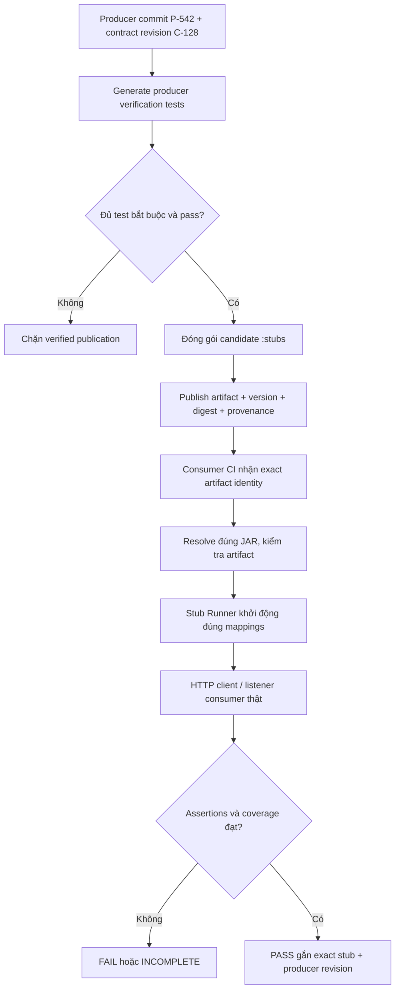
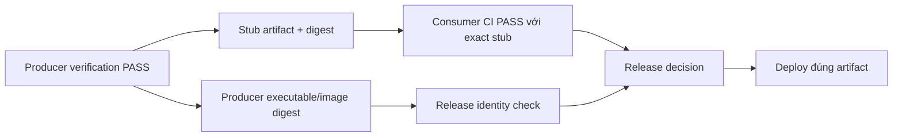

# Pipeline consumer dùng đúng phiên bản stub cần kiểm chứng

## 1. Bài toán: CI xanh nhưng đã kiểm thử nhầm producer

**Spring Cloud Contract** giúp producer và consumer thống nhất hành vi **HTTP** hoặc **thông điệp** qua Groovy/YAML DSL. Producer sinh và chạy **contract verification tests**, đóng gói **stub**; consumer dùng **Stub Runner** để thử request, deserialization, xử lý lỗi hoặc message listener; pipeline **CI/CD** kết nối các bằng chứng ấy để phát hiện thay đổi API không tương thích.

Một lỗi đặc biệt nguy hiểm xuất hiện ở bước chọn **phiên bản stub**:

- `order-service` chuẩn bị triển khai bản **1.7.0**, bổ sung field `state` và vô tình bỏ field `status`.
- `checkout-service` phiên bản **3.2** vẫn deserialize response theo `status`.
- Consumer CI dùng `order-service:1.6.0:stubs` từ cache Maven local và báo **PASS**.
- Release pipeline nhìn thấy dấu xanh nhưng **chưa từng chạy Checkout 3.2 với stub của producer 1.7.0**.

Kết quả consumer CI không sai với đầu vào nó đã dùng; **sai nằm ở kết luận**: “consumer pass với stub 1.6.0” bị hiểu thành “consumer tương thích với producer 1.7.0”.

> **Quy tắc quan trọng nhất:** Trước khi diễn giải kết quả consumer test, phải xác định được **stub artifact thực sự được tải**, **producer build/revision mà nó đại diện**, **trạng thái producer verification** và **phiên bản producer cần kiểm chứng trong lần chạy CI này**.

Bài này tập trung vào **pipeline consumer chọn đúng phiên bản stub**. Sau bài học, bạn có thể:

1. Phân biệt **producer version**, **contract revision**, **stubs artifact version** và **binary/image digest**.
2. Chọn stub theo **mục tiêu kiểm thử**: version đang triển khai, release candidate hay ma trận consumer còn hỗ trợ.
3. Thiết kế handshake producer CI → artifact repository → consumer CI với **version bất biến và provenance**.
4. Cấu hình Stub Runner ở chế độ LOCAL/REMOTE/CLASSPATH, tránh hard-code version cũ và cache không kiểm soát.
5. Đưa kiểm tra **đúng stub, đúng test, đúng phiên bản** thành release gate có thể kiểm toán.
6. Xử lý những ca CI xanh giả vì lấy nhầm artifact, mapping, classifier hoặc phiên bản.

## 2. Một phiên bản stub được xác định bằng những gì?

Trong nhiều dự án dùng Maven-compatible artifact repository, Spring Cloud Contract Stub Runner nhận tọa độ theo dạng phổ biến:

```text
groupId:artifactId:version:classifier:port
```

Ví dụ:

```text
com.example:order-service:1.7.0-rc2:stubs:9090
```

| Phần | Ví dụ | Cần kiểm chứng |
| --- | --- | --- |
| `groupId` | `com.example` | Đúng namespace do producer sở hữu |
| `artifactId` | `order-service` | Đúng producer mà consumer thực sự gọi |
| `version` | `1.7.0-rc2` | Đúng candidate/release mà pipeline đang đánh giá |
| `classifier` | `stubs` | Chọn **stub JAR**, không phải executable JAR hoặc contracts JAR |
| `port` | `9090` | Cổng WireMock để consumer client gọi, **không phải một phần Maven artifact** |

Nếu pipeline chỉ lưu `1.7.0-rc2` mà thiếu `groupId`, `artifactId` hay `classifier`, có thể resolve nhầm artifact. Nếu cùng version bị ghi đè, tọa độ Maven giống nhau **vẫn chưa xác định duy nhất nội dung bytes**. Vì vậy các release quan trọng còn cần **digest**, **build ID** và thông tin nguồn.

### Contract, stubs và producer binary là ba thứ khác nhau

```text
Git contract source C-128   ──┬──> generated producer tests
                              └──> generated stubs mappings
Git producer source P-542  ───────> executable/image order-service 1.7.0-rc2
Generated stubs mappings  ────────> order-service 1.7.0-rc2:stubs

Checkout consumer CKO-322 ────────> Stub Runner đọc :stubs và chạy client tests
```

Một **contracts artifact** (nếu DSL đặt ở kho riêng) có thể chứa source `.groovy`/`.yml`. Một **stubs artifact** chứa dữ liệu HTTP/messaging dùng ở consumer tests. Chúng không thay thế nhau.

**Không nhầm:** `Spring Cloud Contract version` (phiên bản thư viện/plugin) **không phải** `order-service artifact version`. Hai giá trị có thể hoàn toàn khác nhau và phải được quản lý tương thích theo dependency BOM/build configuration.

## 3. “Đúng phiên bản” phụ thuộc mục tiêu của lượt CI

Một pipeline consumer có thể được kích hoạt vì các nguyên nhân khác nhau:

| Loại chạy | Producer version cần dùng | Vì sao |
| --- | --- | --- |
| **Consumer PR** | Producer release đang được hỗ trợ hoặc version consumer sẽ gọi | Phát hiện client mới có làm hỏng giao tiếp đang vận hành không |
| **Producer candidate** | Stubs sinh từ **chính producer candidate** đang đánh giá | Phát hiện breaking change trước khi release producer |
| **Producer đã phát hành** | Stubs của release version **đã xác minh** | Kiểm tra thay đổi consumer trước production |
| **Migration nhiều versions** | Một ma trận các producer versions còn hiện diện | Kiểm tra canary, rollback và client rollout chậm |
| **Experiment/candidate contract** | Candidate stub riêng, có nhãn chưa verified nếu cần | Feedback sớm, **chưa là bằng chứng release** |

Không nên dùng một cấu hình mặc định kiểu `latest` cho mọi mục tiêu. Một consumer PR có thể muốn chọn **bản producer đang phục vụ**; producer release gate phải chọn **bản sắp phát hành**. Nếu dùng cùng một phiên bản cũ cho cả hai, CI sẽ bỏ sót breaking changes ở bản mới.

### Ba câu hỏi trước khi bắt đầu test

1. **Chúng ta muốn chứng minh tương thích với producer nào?** Ví dụ `order-service 1.7.0-rc2`, không phải chỉ “order-service”.
2. **Ai cung cấp tọa độ artifact đó?** Có manifest/test report từ producer pipeline, hay một người tự điền version?
3. **Nếu resolve thất bại thì pipeline làm gì?** **Fail**, không tự động lùi về `1.6.0` hoặc tìm `latest` mà không báo.

Một nguyên tắc điều phối tốt là: **producer release pipeline truyền identity của candidate stub cho consumer pipeline**; consumer pipeline dùng identity ấy và trả kết quả gắn với đúng artifact, thay vì tự suy từ tên branch.

## 4. Đường đi bằng chứng cần giữ nguyên



| Mắt xích | Nếu bỏ qua | Hậu quả |
| --- | --- | --- |
| Contract source | Không biết contract nào được sinh | Producer và stub có thể khác lời hứa |
| Producer verification | Chỉ có DSL/stub nhưng không kiểm tra implementation | Consumer pass không chứng minh producer đúng |
| Artifact identity | Không có version/digest | CI có thể tải bản cũ |
| Stub resolution | Không biết JAR thực được nạp | Mapping có thể không đại diện candidate |
| Consumer assertions | Chỉ có Stub Runner khởi động | Không biết client có xử lý đúng không |
| Release provenance | Deployed image khác bản tested | Kết luận CI không gắn với production |

**Một dấu `BUILD SUCCESS` không thay thế bảng chứng cứ này.** Cần biết các test nào đã thực thi, artifact nào đã được lấy và producer build nào đã được kiểm chứng.

## 5. Producer CI: chỉ xuất bản stub “đã xác minh” sau khi chạy test

Một source contract Groovy minh họa:

```groovy
import org.springframework.cloud.contract.spec.Contract

Contract.make {
    description 'Checkout đọc đơn hàng đã xác nhận'
    request {
        method GET()
        url '/api/orders/42'
        headers {
            accept(applicationJson())
        }
    }
    response {
        status OK()
        headers {
            contentType(applicationJson())
        }
        body([
            orderId: 'ord-42',
            status: 'CONFIRMED'
        ])
    }
}
```

Khi producer thay `status` thành `state`, **generated producer test** cần phát hiện nếu response contract vẫn ràng buộc `status`. Nếu test chưa chạy mà đã publish stubs, consumer sẽ chỉ nhận `status` từ mapping giả lập, không biết implementation mới có sai không.

### Pipeline Maven mẫu

Khi producer **đã cấu hình** `spring-cloud-contract-maven-plugin`, test base class và lifecycle:

```bash
./mvnw -B clean verify
# Chỉ sau khi test pass và artifact đã được attach đúng:
./mvnw -B deploy
```

Lệnh `deploy` có thể bao gồm lại các pha lifecycle liên quan; phải kiểm tra build config cụ thể. Nếu plugin chưa attach classifier `stubs` hoặc generated tests không được runner nhận diện, việc Maven trả exit code 0 chưa đủ để coi stubs là verified.

### Pipeline Gradle mẫu

```bash
./gradlew clean contractTest
# Chỉ sau khi test report và contract inventory đạt yêu cầu:
./gradlew verifierStubsJar
# Sau đó gọi đúng publish task của publication đã cấu hình.
```

Tên tasks/task dependencies phụ thuộc phiên bản Gradle plugin và cấu hình multi-module. Không suy rằng `verifierStubsJar` tự buộc `contractTest` phải pass; **CI release gate cần được kiểm tra tường minh**. Phải kiểm tra số generated tests thực sự chạy, không chỉ có generated source files.

### Điều kiện producer gate nên có

- Contract input đúng source revision, không bị lọc mất kịch bản quan trọng.
- Generated producer tests **được compile, execute, pass**, các test cần thiết không bị skipped.
- HTTP/messaging base class đi qua đúng producer implementation đã định kiểm tra.
- Stubs JAR tạo từ **cùng contract revision** và chỉ được đánh dấu `VERIFIED` sau khi producer test đạt.
- Tọa độ Maven, build ID và digest của stub được lưu cùng test report.
- Producer binary/image dùng để deploy được liên kết với producer source/build đã verify.

Nếu muốn consumer thử contract chưa triển khai, có thể phát hành **candidate/unverified stubs** trong namespace/kênh tách biệt; không nên quảng bá chúng là “đã được producer xác minh”.

## 6. Truyền stub identity bằng manifest có provenance

Để consumer CI không phải tự đoán `1.7.0-rc2` từ tên Git branch, producer CI có thể công bố **manifest** đi kèm artifact. Ví dụ:

```yaml
producer:
  service: order-service
  sourceRevision: P-542
  artifactVersion: 1.7.0-rc2
  imageDigest: "<computed-producer-image-digest>"
contracts:
  revision: C-128
  requiredScenarioCount: 12
verification:
  status: PASS
  testsExecuted: 12
  testsFailed: 0
  testsSkipped: 0
stubs:
  groupId: com.example
  artifactId: order-service
  version: 1.7.0-rc2
  classifier: stubs
  sha256: "<computed-stubs-jar-sha256>"
  repository: "https://repo.example.org/maven-releases"
```

**Đây là schema manifest do nhóm tự đề xuất**, không phải file Spring Cloud Contract tự sinh. Những revision, digest và số test trong ví dụ là giả định. Trong CI thật, các field phải được tạo từ build/test report/artifact đã phát hành; nếu không có digest hoặc test report, đánh dấu `UNKNOWN`/`INCOMPLETE` thay vì bịa giá trị.

### Producer cần công bố những gì?

| Trường | Vì sao quan trọng |
| --- | --- |
| `sourceRevision` | Xác định đúng code producer đã được test |
| `contracts.revision` | Xác định đúng nội dung Groovy/YAML được dùng để generate |
| `verification.status` + số test | Phân biệt “pass” với “không hề chạy” |
| `groupId/artifactId/version/classifier` | Consumer có thể resolve đúng JAR |
| `sha256` | Phát hiện cùng tọa độ nhưng bytes khác |
| `repository` | Tránh lấy nhầm từ local/private/public registry |
| `imageDigest` | Phục vụ đối chiếu artifact producer sẽ triển khai |

Nếu contracts nằm **cùng Git repo producer**, hai revision có thể bằng nhau. Nếu contracts ở **repository riêng**, chúng có thể khác nhau; việc hai tên version không giống nhau **không tự coi là lỗi** nếu có bản ghi liên kết và producer verification tương ứng.

### Không coi manifest là bằng chứng duy nhất

Manifest có thể bị tạo sai hoặc copy từ build trước. Với release quan trọng, nên liên kết tới **test reports**, build job ID, artifact repository metadata, checksum và quyền publish hạn chế. Nếu producer verification `FAIL` nhưng manifest ghi `PASS` vì script cũ không kiểm tra exit code, consumer pipeline không nên dựa độc quyền vào text tự khai ấy.

## 7. Chọn nơi tải: LOCAL, REMOTE và CLASSPATH

`StubRunnerProperties.StubsMode` quyết định cách Stub Runner tìm stub:

| Mode | Nguồn | Tình huống thích hợp | Rủi ro với version |
| --- | --- | --- | --- |
| `LOCAL` | Maven local repository | Developer chạy producer rồi consumer cùng máy; CI cài artifact theo job | Có thể dùng JAR **cũ** còn nằm trong cache local |
| `REMOTE` | Maven-compatible artifact repository | Consumer CI độc lập với producer CI; release/candidate version đã publish | Sai registry, quyền, version, cache hoặc mutable artifact |
| `CLASSPATH` | Mapping/resources được đưa vào test classpath | Demo hoặc consumer test đóng gói fixture cùng test | Có thể chứa dữ liệu **không phải** stub được producer candidate xác minh |

### LOCAL không có nghĩa “mới nhất”

Chạy producer `./mvnw install` hôm trước rồi hôm nay checkout producer commit mới **không làm JAR local tự cập nhật**. `LOCAL` chỉ nói Stub Runner sẽ tìm artifact **ở đâu**, không xác thực nó có tương ứng commit đang kiểm tra hay không.

Nếu một pipeline tạo cả producer và consumer trong cùng job, có thể chọn LOCAL nhưng phải:

1. Build producer ở source revision mục tiêu.
2. Chạy đầy đủ producer verification trước khi install stubs artifact.
3. Install artifact **đúng version** vào local repository được cô lập cho job.
4. Consumer test dùng đúng tọa độ vừa install.
5. Đọc test report và xác nhận không có fallback sang artifact từ job trước.

### REMOTE là lựa chọn phổ biến cho CI nhiều repository

Với REMOTE, consumer CI dùng URL registry được quản lý và version do producer pipeline truyền. Không nên để `repositoryRoot` tự nhảy sang một mirror khác khi không resolve được artifact, trừ khi mirror và provenance đã được kiểm soát.

Đối với các phiên bản Spring Cloud Contract hỗ trợ property tương ứng, cấu hình thường dùng `stubrunner.ids`, `stubrunner.stubs-mode` và `stubrunner.repository-root`. Nếu dùng annotation `@AutoConfigureStubRunner` với các thuộc tính trực tiếp, cần tránh giá trị hard-code **ghi đè** cấu hình từ CI. Hãy thử một smoke test để xác minh thứ tự ưu tiên property/annotation trong version dự án đang dùng.

### CLASSPATH không tự tương đương verified producer artifact

Nếu team copy JSON mapping vào `src/test/resources` và chạy classpath mode, test có thể rất nhanh và ổn định. Nhưng nếu chúng không đến từ **contract đã verify trên producer release candidate**, kết quả chỉ chứng minh consumer xử lý fixture đó. Cần giữ ranh giới rõ giữa **mock fixture** và **verified producer stub**.

## 8. Cấu hình @AutoConfigureStubRunner cho bài lab với version cố định

Một consumer Spring Boot có thể khởi động Stub Runner bằng annotation:

```java
import org.junit.jupiter.api.Test;
import org.springframework.beans.factory.annotation.Autowired;
import org.springframework.boot.test.context.SpringBootTest;
import org.springframework.cloud.contract.stubrunner.StubRunnerProperties;
import org.springframework.cloud.contract.stubrunner.spring.AutoConfigureStubRunner;

import static org.assertj.core.api.Assertions.assertThat;

@SpringBootTest(properties =
    "clients.orders.base-url=http://localhost:9090")
@AutoConfigureStubRunner(
    ids = "com.example:order-service:1.7.0-rc2:stubs:9090",
    stubsMode = StubRunnerProperties.StubsMode.LOCAL
)
class CheckoutConsumerContractTest {

    @Autowired
    OrderClient orderClient;

    @Test
    void readsConfirmedOrderFromProducerCandidateStub() {
        OrderDto order = orderClient.getById("42");
        assertThat(order.status()).isEqualTo("CONFIRMED");
    }
}
```

`OrderClient` và `OrderDto` là **kiểu ứng dụng minh họa**, không phải các class của Spring Cloud Contract. Phải có bean client thật gọi HTTP và DTO phù hợp. Property `clients.orders.base-url` là property **ứng dụng consumer tự định nghĩa** để hướng client tới WireMock, không phải key mặc định của Stub Runner.

Kịch bản ở đây có ý nghĩa nếu producer đã publish stub cho `GET /api/orders/42` và test gọi đúng mapping. Nếu consumer vẫn gọi `http://order-service:8080`, việc Stub Runner khởi động thành công không chứng minh client đang được test với stub.

### Vì sao bản lab không nên copy nguyên vào pipeline release?

Annotation trên **hard-code 1.7.0-rc2**. Sau khi producer phát hành 1.7.0 hoặc 1.8.0, test vẫn có thể chạy trên stub 1.7.0-rc2. Trong CI thật, nên có **nguồn cấu hình version được inject từ artifact manifest/producer release event** thay vì sửa chuỗi Java ở từng lần chạy.

Nếu dùng một tập hợp cố định các producer versions để kiểm chứng rollback, có thể giữ nhiều job/variant gắn version tường minh. Nhưng khi mục tiêu là candidate mới theo mỗi release, hard-code version trong test source là một rủi ro drift.

## 9. Đưa version vào test bằng cấu hình CI thay vì sửa source

Một thiết kế có thể sử dụng cấu hình ngoài của Stub Runner. Với một số nhánh Spring Cloud Contract, `@AutoConfigureStubRunner` cho phép kích hoạt auto-configuration, còn các giá trị `stubrunner.*` lấy từ Spring environment:

```java
import org.springframework.boot.test.context.SpringBootTest;
import org.springframework.cloud.contract.stubrunner.spring.AutoConfigureStubRunner;

@SpringBootTest(properties =
    "clients.orders.base-url=http://localhost:9090")
@AutoConfigureStubRunner
class CheckoutConsumerContractTest {
    // Inject OrderClient; chạy test/assertions như ở mục 8.
}
```

Một profile `application-contract-test.yml` minh họa:

```yaml
stubrunner:
  ids:
    - "com.example:order-service:1.7.0-rc2:stubs:9090"
  stubs-mode: REMOTE
  repository-root: "https://repo.example.org/maven-releases"
clients:
  orders:
    base-url: "http://localhost:9090"
```

Đây là **giá trị ví dụ**; file cấu hình chỉ được nạp khi profile/test context tương ứng đang hoạt động. Trong thực tế CI, `ids` và `repository-root` nên đến từ **biến cấu hình được kiểm soát**, không nên mặc định giữ version candidate cố định trong YAML. Tên, cách bind và **thứ tự ưu tiên giữa annotation và property** cần đối chiếu phiên bản SCC và xác minh bằng một test nhỏ.

### Một cách truyền bằng JVM system properties

Trong môi trường mà Stub Runner hỗ trợ các property trên, một lệnh minh họa:

```bash
STUB_VERSION="1.7.0-rc2"
STUB_REPOSITORY="https://repo.example.org/maven-releases"

./mvnw -B verify \
  "-Dstubrunner.ids=com.example:order-service:${STUB_VERSION}:stubs:9090" \
  "-Dstubrunner.stubs-mode=REMOTE" \
  "-Dstubrunner.repository-root=${STUB_REPOSITORY}"
```

**Quan trọng:** `-D` trên Maven có thể trở thành Maven user properties, rồi Spring test context nhìn thấy theo cách plugin/test runner được cấu hình; đối với một dự án cụ thể cần kiểm tra những giá trị ấy thật sự đi vào `Spring Environment` của test JVM. Không chỉ dựa vào lệnh trông đúng. Với Gradle, phải bảo đảm system properties từ Gradle process được chuyển vào `Test` task, thay vì giả định `-D` của Gradle CLI luôn được chuyển qua forked test JVM.

Một cách ít mơ hồ cho Gradle là cấu hình `contractConsumerTest` hoặc `test` task truyền properties vào test JVM:

```groovy
tasks.named('test', Test) {
    systemProperty(
        'stubrunner.ids',
        providers.gradleProperty('contractStubIds').get()
    )
    systemProperty('stubrunner.stubs-mode', 'REMOTE')
    systemProperty(
        'stubrunner.repository-root',
        providers.gradleProperty('contractStubRepository').get()
    )
}
```

Ví dụ này **yêu cầu hai Gradle properties** tồn tại; nếu không, `get()` làm task configuration fail, phù hợp với nguyên tắc **fail closed** khi thiếu phiên bản cần test. Trong project có nhiều test tasks, hãy áp dụng cho task consumer integration test thật sự, không nhất thiết cho toàn bộ unit test. Đồng thời xác minh cách Spring Boot nạp profile và property này với phiên bản SCC đang dùng.

### Không đặt phiên bản mặc định nguy hiểm

Một thiết kế như:

```text
STUB_VERSION=${STUB_VERSION:-1.6.0}
```

có thể gây **false positive**: producer candidate 1.7.0 không truyền version thì pipeline lặng lẽ quay về 1.6.0 và báo xanh. Với release gate, **thiếu version phải fail**, không nên fallback về phiên bản cũ. Trong ví dụ này, cú pháp trên là cú pháp Bash shell minh họa, không phải property Spring Cloud Contract.
có thể gây **false positive**: producer candidate 1.7.0 không truyền version thì pipeline lặng lẽ quay về 1.6.0 và báo xanh. Với release gate, **thiếu version phải fail**, không nên fallback về phiên bản cũ. Trong ví dụ này, cú pháp trên là cú pháp Bash shell minh họa, không phải property Spring Cloud Contract.

## 10. Ví dụ GitHub Actions: chọn đúng version và kiểm tra checksum trước khi test

Ví dụ sau minh họa một **consumer CI job được kích hoạt với producer candidate version và SHA-256 từ producer pipeline**. Mục đích là:

1. Nhận version/digest **bắt buộc** từ bên điều phối release.
2. Tải stubs JAR với **tọa độ chính xác** từ registry được cấu hình.
3. **So checksum** của JAR với digest mong đợi.
4. Chạy Stub Runner ở chế độ `LOCAL` trên chính JAR đã kiểm tra.
5. Lưu test reports để release gate quyết định.

```yaml
name: Consumer contract compatibility

on:
  workflow_dispatch:
    inputs:
      stub_version:
        description: "Verified producer candidate version"
        required: true
        type: string
      stub_sha256:
        description: "Expected SHA-256 of stubs JAR"
        required: true
        type: string

jobs:
  verify-consumer:
    runs-on: ubuntu-latest
    steps:
      - uses: actions/checkout@v4
      - uses: actions/setup-java@v4
        with:
          distribution: temurin
          java-version: "21"
          cache: maven

      - name: Resolve exact stubs artifact
        env:
          STUB_VERSION: ${{ inputs.stub_version }}
          STUB_SHA256: ${{ inputs.stub_sha256 }}
        run: |
          set -euo pipefail
          test -n "$STUB_VERSION"
          test -n "$STUB_SHA256"
          ./mvnw -B dependency:get \
            "-Dartifact=com.example:order-service:${STUB_VERSION}:jar:stubs" \
            "-DremoteRepositories=contractRepo::default::https://repo.example.org/maven-releases" \
            "-Dtransitive=false"
          jar="$HOME/.m2/repository/com/example/order-service/${STUB_VERSION}/order-service-${STUB_VERSION}-stubs.jar"
          test -f "$jar"
          actual="$(sha256sum "$jar" | cut -d ' ' -f 1)"
          test "$actual" = "$STUB_SHA256"

      - name: Run consumer tests against verified local JAR
        env:
          STUB_VERSION: ${{ inputs.stub_version }}
        run: |
          set -euo pipefail
          ./mvnw -B verify \
            "-Dstubrunner.ids=com.example:order-service:${STUB_VERSION}:stubs:9090" \
            "-Dstubrunner.stubs-mode=LOCAL"

      - name: Preserve JUnit reports
        if: always()
        uses: actions/upload-artifact@v4
        with:
          name: consumer-test-reports
          path: |
            target/surefire-reports/
            target/failsafe-reports/
          if-no-files-found: warn
```

**Đây là workflow minh họa**, phải chỉnh với build/repository thực tế. Nó giả định:

- Maven có goal `dependency:get` khả dụng và plugin/test lifecycle phù hợp.
- Repository URL trong ví dụ được thay bằng registry thật; nếu registry riêng cần credentials trong **Maven settings/secret store**, không hard-code token.
- `./mvnw verify` thực sự chạy consumer contract tests, không chỉ unit tests. Nếu test nằm trong một Maven module khác, phải chọn đúng module/goal.
- `@AutoConfigureStubRunner` nhận `stubrunner.ids` và `stubrunner.stubs-mode` từ môi trường test ở phiên bản SCC đang sử dụng; cần chạy smoke test xác nhận.
- SHA-256 và version **được lấy từ manifest producer đã verify**, không do người dùng tùy ý nhập vào trong release gate tự động.
- Nếu checkout consumer version cũ, workflow cần checkout **đúng commit/tag** của consumer được hỗ trợ, không mặc định nhánh mới nhất.

Với quy trình release tự động, producer có thể kích hoạt `workflow_dispatch`/`workflow_call` hoặc cơ chế sự kiện tương đương và truyền metadata qua kênh được kiểm soát. **Không xem input trực tiếp do bất kỳ người nào nhập là chứng thực producer verification đã pass**. Release gate cần đối chiếu với nguồn manifest/test report đáng tin.

### Vì sao tải trước rồi chạy LOCAL?

Trong ví dụ này, job kiểm tra digest trên một JAR ở Maven local repository, sau đó chạy Stub Runner `LOCAL` trên cùng tọa độ. Điều đó giảm rủi ro test **tự tải từ registry khác** sau khi checksum đã kiểm tra. Nếu job dùng `REMOTE` trực tiếp, cần cơ chế kiểm chứng **bytes thật mà Stub Runner đã resolve**, thay vì chỉ so checksum của một file không được sử dụng.

### Một cảnh báo về cache

`actions/setup-java` có thể cache Maven dependencies. Nếu registry cho phép ghi đè release artifact cùng version, Maven có thể giữ JAR cũ. **Bước so SHA-256 ở trên giúp phát hiện bytes không khớp manifest**, nhưng vẫn cần repository **immutable** để tránh chuyện producer và consumer lấy khác bản. Không sửa lỗi checksum bằng cách tắt bước so hoặc cho phép fallback sang version khác.

### Bước CI còn thiếu nếu áp dụng nghiêm ngặt

Workflow mẫu lưu JUnit report, nhưng chưa kiểm tra **số test executed**, **danh sách required scenarios** và **provenance của producer image**. Trong hệ thống thật, thêm một quality-gate step đọc report/test inventory trước khi kết luận `PASS`; nếu report không tồn tại hoặc có **0 consumer contract tests**, phải fail. Đây là trách nhiệm của pipeline, không phải hành vi mặc định khi upload artifact.

## 11. Pipeline nhiều consumer: chọn đúng phiên bản cho từng ô

Một producer thường có nhiều consumer còn được hỗ trợ, hoặc một consumer phải chạy với nhiều producer versions trong thời gian canary/rollback. Không nên coi một job với `order-service:1.7.0-rc2:stubs` là đại diện cho toàn bộ ma trận.

Ví dụ compatibility matrix:

| Consumer version | Producer 1.6.0 (đang deploy) | Producer 1.7.0-rc2 (candidate) | Vì sao chạy |
| --- | --- | --- | --- |
| Checkout 3.2 | PASS | **FAIL** nếu mất `status` | Consumer cũ còn hỗ trợ |
| Checkout 3.3 | PASS | PASS | Consumer mới hỗ trợ hai bản |
| Reporting 2.7 | PASS | NOT_RUN | Batch consumer chưa hoàn tất gate |
| Mobile Gateway 4.0 | NOT_REQUIRED nếu không route tới 1.6 | PASS | Client chỉ dùng API v2 |

**Ma trận này là ví dụ**, không phải kết quả thật. `NOT_RUN` khác `NOT_REQUIRED`. Nếu Reporting 2.7 vẫn được hỗ trợ và cần đi qua producer 1.7, ô chưa chạy phải được báo **INCOMPLETE**, không tính là pass.

### Đầu vào của mỗi job cần có

```text
producerArtifactVersion
producerSourceRevision
stubsArtifactCoordinates
stubsArtifactDigest
contractSourceRevision
consumerService
consumerVersionOrGitRevision
requiredScenarioIds
expectedTestRunner
```

Không cần tất cả là environment variable; chúng có thể nằm trong release manifest, versioned matrix hoặc orchestrator. Nhưng khi nhìn kết quả, phải biết **bản nào đã được test với bản nào**.

### Tránh test mọi kết hợp một cách máy móc

Nếu hệ thống có 30 producer versions và 20 consumer versions, chạy 600 tổ hợp trên mọi PR có thể không thực tế. Có thể chọn tập hợp dựa trên **support policy**, version hiện còn deploy, rollback horizon và vùng rủi ro:

- Mỗi producer candidate với **mọi consumer version còn được hỗ trợ** sẽ thực sự gọi nó.
- Consumer PR với producer hiện deploy và producer candidate sắp ra mắt nếu được yêu cầu.
- Ma trận mở rộng cho release/canary, thay đổi schema lớn hoặc migrations.
- Những tổ hợp **không thể xảy ra** phải ghi `NOT_REQUIRED` theo căn cứ routing/deployment, không đơn giản bỏ qua.

Kết quả là một ma trận **có thể giải thích**, không phải một con số test count lớn nhưng thiếu kịch bản cần bảo vệ.

## 12. Không nhầm version của stub với version của API và consumer

Ba trục khác nhau thường xuất hiện trong cùng một log:

```text
Order API version:      /v2/api/orders
Producer JAR version:   order-service:1.7.0-rc2
Stubs JAR version:      order-service:1.7.0-rc2:stubs
Consumer app version:   checkout-service:3.2.4
```

`/v2` có thể là **version của giao diện HTTP**, không đồng nghĩa producer artifact phải mang số 2.0. Một producer bản 1.7 có thể phục vụ cả `/v1` và `/v2`. Consumer 3.2 có thể dùng API v1 trong khi consumer 4.0 dùng v2.

Nếu pipeline suy `stub version = consumer version` hoặc `stub version = API path version`, nó có thể tải sai artifact. Nên lấy **producer stub version từ producer release manifest**, còn **consumer version từ deployment/support inventory**.

### Kiểm thử migration không nhất thiết cùng một stub

Một consumer chuẩn bị chuyển từ `order-service 1.6` sang `1.7` cần ít nhất:

1. Test consumer hiện tại với **producer stub 1.6** để có baseline.
2. Test cùng consumer với **candidate stub 1.7** để phát hiện khác biệt.
3. Nếu có khác biệt, chạy producer verification và quyết định backward-compatible fix hoặc migration có version.

Nếu không giữ hai kết quả riêng, test xanh với 1.6 có thể che failure với 1.7; ngược lại một candidate stub chưa verified có thể tạo báo động giả về production.

## 13. Kiểm tra test đã thực sự gọi đúng stub

Stub Runner khởi động được chưa đủ. Consumer HTTP client còn phải gọi đúng host, port và path:

```text
Producer candidate stub:
  com.example:order-service:1.7.0-rc2:stubs:9090

Consumer property:
  clients.orders.base-url = http://localhost:9090

Actual request:
  GET http://localhost:9090/api/orders/42
```

Khi test trả **HTTP 404**, cần phân biệt:

| 404 nào? | Nguyên nhân | Điều cần assert |
| --- | --- | --- |
| **Business 404** | Mapping `GET /api/orders/999` chủ động trả `ORDER_NOT_FOUND` | HTTP 404 **và** JSON `code` |
| **Unmatched WireMock 404** | URL/method/query/header/body không match | Không coi là business success; xem request journal |
| **404 từ dịch vụ thật khác** | Client không trỏ tới WireMock mà đang gọi môi trường khác | Xác minh actual destination và test profile |

Để điều tra, kiểm tra **request thực tế**, mapping đã nạp, artifact/version/digest. Một consumer test chỉ assert `status == 404` có thể pass giả nếu không biết 404 đến từ đâu.

### Cổng động và test chạy song song

Cổng `9090` tiện trong lab nhưng có thể bị chiếm khi các job chạy song song trên cùng worker. Stub Runner hỗ trợ cơ chế port động/tra cứu port ở những phiên bản phù hợp; nếu chọn cách đó, HTTP client phải nhận đúng port được Stub Runner cấp trong test lifecycle. **Không giữ base URL hard-code sang 9090 khi server đã đổi port động.**

### Nếu test consumer sử dụng messaging

Với event contract như `OrderConfirmed`, Stub Runner có thể dùng `StubTrigger` để phát message mẫu qua adapter được hỗ trợ. Khi ấy “đúng stub” còn gồm:

- Artifact chứa message contract và đúng `label`;
- Destination/binding phù hợp Spring Cloud Stream, Integration, AMQP, Kafka hoặc adapter khác;
- Consumer listener thật được đăng ký trước khi trigger;
- Assertion kiểm tra side effect của listener, **không chỉ `trigger() == true`**;
- Producer messaging verification đã chạy trên candidate revision.

Stub messaging test không tự chứng minh broker delivery, ordering, duplicate/ack hoặc transaction/outbox; cần integration tests nếu các đặc tính ấy là yêu cầu nghiệp vụ.

## 14. Fail closed: những điều kiện buộc consumer pipeline dừng lại

Với release gate, kết quả **không thể xác minh** khác với **đã tương thích**. Một quy ước báo cáo:

| Trạng thái | Ý nghĩa | Có thể tự động cho release? |
| --- | --- | --- |
| **PASS** | Đúng artifact đã kiểm chứng, test bắt buộc đã chạy và pass | Có thể, sau các gate khác |
| **FAIL** | Test thực thi và phát hiện sai khác | Không |
| **NOT_RUN** | Test chưa chạy/không có report | Không |
| **INCOMPLETE** | Thiếu checksum, provenance, artifact hoặc kịch bản bắt buộc | Không |
| **SKIPPED** | Test tồn tại nhưng không thực thi vì filter/disabled | Cần policy ngoại lệ, không mặc nhiên |
| **CANDIDATE_ONLY** | Dùng stub chưa được producer verify để feedback sớm | Không dùng làm release compatibility PASS |
| **NOT_REQUIRED** | Một tổ hợp được support policy xác nhận không cần kiểm tra | Không phải PASS; phải ghi căn cứ |

Các trạng thái này là **quy ước CI**, không phải enum mặc định của Spring Cloud Contract.

### Các điểm dừng cụ thể

1. **Không nhận được version** từ producer release manifest → fail, không fallback.
2. **Không resolve được `group:artifact:version:stubs`** → fail, không tự thử tọa độ khác.
3. **Digest thực tế khác digest manifest** → fail, điều tra mutable artifact/cache hoặc sai repository.
4. **Không có producer verification PASS ở đúng revision** → đánh dấu thiếu bằng chứng release.
5. **Stub Runner nạp sai mapping hoặc HTTP client gọi sai port** → fail.
6. **Không có consumer contract test nào thực thi** → fail nếu job này bắt buộc.
7. **Bị thiếu kịch bản required** dù có test khác chạy → fail/INCOMPLETE.
8. **Consumer contract assertion fail** → fail, không che bằng broad matcher hoặc sửa stub JAR thủ công.
9. **Job test bị hủy/timeout** → NOT_RUN/INCOMPLETE theo policy, không biến thành PASS.

### Bộ lọc test có thể làm báo cáo giả

Nếu developer chỉ chạy:

```bash
./mvnw -B -Dtest=CheckoutHappyPathTest test
```

thì việc test này pass **không** có nghĩa các test error, pagination, authentication hoặc message listener đã chạy. Gradle `--tests` cũng có rủi ro tương tự. Khi release, phải chạy tập required mà inventory đã định và kiểm tra test report.

### Stub 404 do mismatch không thể dùng thay contract lỗi

Một test muốn xác minh consumer xử lý `ORDER_NOT_FOUND` nhưng chỉ assert HTTP 404 sẽ có thể pass ngay cả khi mapping cho `GET /api/orders/999` bị thiếu. Nên assert **body.code**, content type và logic error mapping; khi cần debug, xem WireMock unmatched request journal trong môi trường test được phép. Đây là một ví dụ tại sao “test có chạy” vẫn cần “test kiểm tra đúng điều cần chứng minh”.

## 15. Cache, snapshot và artifact có thể bị ghi đè

Cache giảm thời gian build nhưng cũng có thể gây **stale stub**. Phân tích theo loại:

| Trường hợp | Điều có thể xảy ra | Cách kiểm soát |
| --- | --- | --- |
| Maven `~/.m2` dùng chung nhiều jobs | JAR cũ còn tồn tại với cùng version | Cô lập local repo theo job hoặc kiểm tra digest |
| Gradle dependency cache | Dependency metadata/artifact bị cache | Pin artifact/revision, xem dependency resolution, checksum |
| `-SNAPSHOT` bị publish lại | Cùng logical version có nhiều timestamp/builds | Ghi timestamped artifact/digest cụ thể |
| `latest` / version range | Hôm nay và ngày mai resolve khác version | Chọn version chính xác cho release |
| Release repo cho ghi đè version | Hai JAR khác nhau cùng tọa độ | Immutable publication + checksum/provenance |
| Mirror/public repo ưu tiên sai | Tải artifact namespace giống nhưng sai nguồn | Kiểm soát repository order, ownership, checksum |
| Docker image tag bị dùng lại | Deploy bản khác với code đã verify | Pin image digest, không chỉ tag |

### Vì sao `-U` hoặc “clear cache” không phải chính sách release?

Maven `-U` có thể yêu cầu kiểm tra cập nhật snapshots, nhưng **không biến mutable version thành immutable** và không chứng minh artifact đến từ build producer đã pass. Xóa cache đôi khi giúp điều tra, nhưng biện pháp bền vững là **version bất biến**, **digest** và manifest liên kết producer verification.

### Một chiến lược cache hợp lý

- Có thể cache **tool/dependency phổ thông** theo cơ chế CI.
- Stubs artifact đã verify nên dùng **tọa độ bất biến**, có checksum để kiểm tra.
- Khi phát hành candidate, dùng version/build ID không trùng với bản cũ.
- Nếu một artifact cần được lấy từ registry riêng, tách namespace/repository để tránh nhầm các nguồn.
- Nếu checksum fail, **báo lỗi** và điều tra; không tự ghi đè giá trị expected checksum bằng file vừa tải.

## 16. Bảo mật và quyền truy cập registry trong consumer CI

Stub là dữ liệu test, nhưng artifact repository và CI credentials vẫn là tài nguyên có quyền truy cập. Khi consumer job tải từ registry:

- Dùng tài khoản **read-only** để lấy stubs artifact; consumer không cần quyền publish/overwrite.
- Đặt token/password trong **CI secret store**, Maven `settings.xml`/Gradle credentials, không commit vào `application-test.yml`, code hoặc workflow.
- Dùng HTTPS/endpoint registry tin cậy và cấu hình chứng thực phù hợp với môi trường nội bộ.
- Không in `Authorization` headers hay URL nhúng credential vào log khi debug download lỗi 401/403.
- Phân quyền producer CI để chỉ publish artifact cho namespace producer sở hữu.
- Tránh đưa token thật, email/địa chỉ cá nhân, dữ liệu giao dịch production vào contract/stubs fixture.
- Giữ manifest/digest ở kho có integrity/permissions phù hợp; không cho một pull request không tin cậy tự thay “expected SHA-256” rồi kết luận candidate verified.

### PR từ fork và quyền secrets

Một consumer CI chạy cho pull request từ fork có thể **không được cấp registry secrets** theo chính sách nền tảng. Khi đó test remote stub không chạy được; phải báo **NOT_RUN/INCOMPLETE** cho mục tiêu release hoặc dùng một bộ public/synthetic stub được phê duyệt để feedback sớm. Không mở quyền ghi registry hoặc đưa token vào repository chỉ để biến job xanh.

### Nhớ phân biệt nguồn dữ liệu

Manifest do producer CI công bố thường chứa sourceRevision, tested artifact ID và checksum. **Không tin một file manifest bất kỳ do contributor sửa** nếu release gate cần bằng chứng xác minh độc lập. Có thể cần ký artifact/attestation hoặc xác thực metadata build, tùy mức rủi ro tổ chức.

## 17. Chẩn đoán các sự cố tải nhầm phiên bản stub

| Triệu chứng | Nguyên nhân có thể | Kiểm tra đầu tiên |
| --- | --- | --- |
| Consumer PASS nhưng producer vừa đổi response | Consumer đang dùng **stub cũ** | In tọa độ/digest artifact đã tải, so candidate manifest |
| Stub Runner báo không tìm thấy artifact | Sai group/artifact/version/classifier | Kiểm tra registry publication, repository URL |
| Local chạy, CI báo 404 khi resolve artifact | LOCAL có artifact cũ nhưng REMOTE chưa publish | Kiểm tra publication của producer candidate |
| Registry 401/403 | Token thiếu/hết hạn/không đủ quyền | Maven/Gradle credentials, CI secrets |
| SHA-256 mismatch | Cache cũ, artifact bị ghi đè hoặc sai repo | So local file bytes với producer digest |
| Stub Runner khởi động nhưng client lỗi connection | Port URL/client khác port stub | Đối chiếu effective base URL và `ids` |
| WireMock trả 404 | Mapping không tồn tại, request matcher không thỏa | Xem actual HTTP request, mappings và version |
| Stub Runner tải 1.6 dù CI muốn 1.7 | Annotation hard-code, property precedence, profile cũ | Kiểm tra effective configuration/runtime logs |
| CI báo 0 tests | Test runner/source set/filter sai | JUnit reports, Surefire/Failsafe, Gradle tasks |
| Maven `verify` pass nhưng consumer IT không chạy | Failsafe chưa được nối, tên test không match | Plugin test lifecycle và report |
| Producer verification FAIL, consumer PASS | Stub mô phỏng vẫn đúng; producer code sai | Đọc producer assertion, chặn release |
| Producer PASS, consumer 3.2 fail với 1.7 | Breaking change hoặc consumer strict deserializer | So contract và DTO/client version 3.2 |
| Consumer messaging trigger trả true, listener không xử lý | Sai adapter/destination hoặc thiếu assertion | Kiểm tra side effect của listener |
| CI test 1.7 nhưng deploy image tag 1.8 | Release artifact khác bản đã verify | So image digest và build provenance |
| Một consumer còn hỗ trợ bị thiếu trong matrix | Inventory/trigger chưa có | Xem versioned support policy |

### Quy trình điều tra từ ngoài vào trong

```text
1. MỤC TIÊU: producer version nào cần xác minh?
2. IDENTITY: exact group/artifact/version/classifier/digest?
3. NGUỒN: producer code + contract revision + verification report?
4. RESOLUTION: Stub Runner thật sự nạp file nào?
5. ROUTING: HTTP client/listener có đi vào đúng stub?
6. ASSERTIONS: test có kiểm tra behavior consumer thật?
7. COVERAGE: những scenarios/consumer versions bắt buộc đều đã chạy?
8. DEPLOY: artifact production có phải bản đã verify?
```

Đừng sửa producer controller chỉ vì consumer nhận 404 từ WireMock; trước tiên xác định request có match đúng stub không. Và đừng đổi contract chỉ để consumer pass với một artifact không đại diện producer candidate.

## 18. Bài thực hành: phát hành Order Service 1.7 mà không kiểm thử nhầm 1.6

### Bối cảnh

Producer `order-service` có hai release candidates:

| Artifact | Producer implementation | Producer verification | Ghi chú |
| --- | --- | --- | --- |
| `1.6.0` | Response có `status` | PASS | Release đang triển khai |
| `1.7.0-rc1` | Đổi `status` thành `state` | FAIL với contract cũ | Candidate chưa tương thích |
| `1.7.0-rc2` | Giữ `status` và thêm `state` | PASS theo contract cần thiết | Candidate đang chờ consumer tests |

Consumer:

- `checkout-service 3.2` cần `status = CONFIRMED`.
- `reporting-service 2.7` cần HTTP 404 cùng `code = ORDER_NOT_FOUND`.
- `mobile-gateway 4.0` cần `state` trên API v2.

Giả sử producer pipeline cho `1.7.0-rc2` phát hành stubs artifact:

```text
com.example:order-service:1.7.0-rc2:stubs
Producer revision: P-542
Contract revision: C-128
Verification: PASS, 12 executed, 0 failed
SHA-256: <from-producer-build>
```

### Phần A — Chọn version cần test

Hãy đánh giá ba lựa chọn trong Checkout 3.2 CI:

1. `com.example:order-service:1.6.0:stubs`
2. `com.example:order-service:1.7.0-rc1:stubs`
3. `com.example:order-service:1.7.0-rc2:stubs`

**Đáp án:** Nếu mục tiêu là **release gate cho 1.7.0-rc2**, lựa chọn **(3)** mới có ý nghĩa. (1) là baseline release cũ. (2) là candidate producer verification đang FAIL, chỉ thích hợp để điều tra hoặc feedback, không phải bằng chứng release tương thích. Cần xác nhận artifact (3) có đúng source/digest và test report đã pass.

### Phần B — Kiểm chứng response và API lỗi

Producer contract mẫu cho Checkout 3.2:

```yaml
description: Checkout 3.2 đọc trạng thái đơn
request:
  method: GET
  url: /api/orders/42
  headers:
    Accept: application/json
response:
  status: 200
  headers:
    Content-Type: application/json
  body:
    orderId: "ord-42"
    status: "CONFIRMED"
```

Contract khác cho Reporting 2.7:

```yaml
description: Reporting 2.7 xử lý đơn hàng không tồn tại
request:
  method: GET
  url: /api/orders/999
response:
  status: 404
  headers:
    Content-Type: application/json
  body:
    code: "ORDER_NOT_FOUND"
```

Mỗi consumer phải dùng HTTP client của **phiên bản consumer tương ứng**, kết nối Stub Runner đã nạp `1.7.0-rc2:stubs`. Checkout assert `status`, Reporting assert cả status và error `code`. Nếu WireMock trả 404 do unmatched request, Reporting **không được đánh dấu pass**.

### Phần C — Tạo pipeline versioned

Thiết kế job nhận đầu vào:

```text
STUB_GROUP=com.example
STUB_ARTIFACT=order-service
STUB_VERSION=1.7.0-rc2
STUB_CLASSIFIER=stubs
STUB_SHA256=<from-producer-manifest>
PRODUCER_REVISION=P-542
CONTRACT_REVISION=C-128
```

Thực hiện:

1. Kiểm tra không có input bắt buộc nào rỗng.
2. Tải artifact chính xác từ registry kiểm soát; dùng secret read-only nếu cần.
3. So SHA-256 với digest producer đã cung cấp.
4. Nạp artifact qua Stub Runner ở mode được chọn.
5. Chạy assertions của consumer, lấy executed/fail/skipped test count.
6. Đính kèm producer revision, contract revision, stub identity/digest và consumer revision vào report.

Không cho phép một giá trị default `1.6.0` khi thiếu `STUB_VERSION`. Nếu artifact `1.7.0-rc2` không có trong registry, pipeline phải **FAIL/INCOMPLETE**, không thử `1.6.0` cho đến khi xanh.

### Phần D — Cố tình tạo lỗi và dự đoán kết quả

| Mutation | Kết quả mong đợi |
| --- | --- |
| Bỏ truyền `STUB_VERSION` | Job dừng trước khi test, báo missing input |
| Đổi version sang `1.6.0` trong release gate 1.7 | Identity gate phát hiện sai candidate; không coi là PASS của 1.7 |
| Giữ version nhưng đổi expected SHA-256 | Digest gate fail |
| Đổi `Content-Type` client sang `text/plain` khi contract yêu cầu JSON | Request matcher không match hoặc client test fail |
| Xóa `status` trong producer 1.7.0-rc2 | Producer contract verification fail |
| Chạy consumer với stale stub 1.6 | Consumer có thể pass; không chứng minh 1.7 |
| Đổi `/api/orders/999` thành `/api/order/999` | Không match business 404; test error code phải fail |
| Tắt/skip toàn bộ consumer contract tests | Execution gate fail vì 0 required tests |
| Producer và consumer đúng nhưng registry bị 403 | Job không được báo PASS; cần sửa quyền |
| Reporting 2.7 CI không chạy | Matrix tổng hợp `INCOMPLETE`, không phải PASS |

### Phần E — Viết báo cáo tương thích

Một báo cáo **giả định sau khi job thực sự chạy**:

```text
Producer target: order-service 1.7.0-rc2 (P-542)
Contracts revision: C-128
Producer verification: PASS (12 executed, 0 failed)
Exact stubs: com.example:order-service:1.7.0-rc2:stubs
Stub digest check: PASS
Checkout 3.2 consumer contract tests: PASS (3 executed)
Reporting 2.7 consumer contract tests: NOT_RUN
Mobile 4.0 consumer contract tests: PASS (2 executed)
Release compatibility evidence: INCOMPLETE
```

**Giải thích:** Dù Checkout và Mobile pass, Reporting còn trong tập hỗ trợ nhưng chưa được chạy; không thể tuyên bố “mọi consumer còn được hỗ trợ tương thích với producer 1.7.0-rc2”. Nếu tổ chức phê duyệt ngoại lệ, phải ghi owner, rủi ro và thời hạn xử lý, không đổi `NOT_RUN` thành `PASS`.

### Mở rộng bài tập

Producer deploy theo canary: 10% traffic đến 1.7.0-rc2, phần còn lại đến 1.6.0. Mobile 4.0 chỉ hỗ trợ API v2 có trong 1.7. Bạn sẽ làm gì?

- Test Mobile với **cả hai** producer versions nếu nó có thể gặp cả hai.
- Hoặc đảm bảo Mobile chỉ được route tới 1.7, có feature flag/rollback strategy được kiểm tra.
- Tránh rollout Mobile 4.0 ra toàn hệ thống trước khi producer v2 sẵn sàng ở mọi vùng cần phục vụ.

Với trường hợp yêu cầu broker hoặc database, bổ sung integration tests; contract compatibility chỉ bảo vệ những giao diện được mô tả.

## 19. Cổng release: từ producer stub đến artifact thật triển khai

Một điều kiện cần nữa sau consumer CI là **artifact producer được triển khai phải là bản đã qua verification**. Nếu test dùng code `P-542` nhưng image deploy được build từ `P-550` chưa verify, không được dùng test P-542 như bằng chứng chắc chắn cho P-550.



### Các điều kiện release tối thiểu

- Producer verification pass trên code/source phù hợp version target.
- Stubs artifact đã được sinh từ hợp đồng **cùng revision** và có provenance.
- Consumer suite của **mọi version còn được hỗ trợ theo policy** đã chạy với candidate stub, hoặc có ngoại lệ được chấp thuận rõ ràng.
- Artifact checksum được xác minh khi resolve từ registry.
- Test reports ghi rõ **executed/fail/skipped** và scenario coverage, không chỉ job exit code.
- Deployed producer artifact/image khớp phiên bản/digest được release gate đánh giá.
- Lỗi ngoài contract (auth, broker routing, DB commit, idempotency, timeout) được test ở các lớp thích hợp.

### Cách diễn đạt kết luận có thể kiểm toán

Nên nói:

> Producer `order-service 1.7.0-rc2` tại revision `P-542` đã pass producer contract tests từ `C-128`; `checkout-service 3.2` và những consumer versions được liệt kê đã pass với stubs JAR có digest `D`. Kết luận áp dụng cho **các kịch bản đã thực thi** và **artifact đã xác minh**.

Không nói:

> Toàn bộ hệ thống chắc chắn tương thích vì Stub Runner trả 200 và pipeline có dấu xanh.

Đây là khác biệt giữa **bằng chứng gắn phiên bản** và **suy diễn quá mức từ một test**.

## 20. Checklist pipeline consumer dùng đúng phiên bản stub

- [ ] Có xác định **mục tiêu**: producer đang deploy, producer candidate hay ma trận rollback.
- [ ] Producer pipeline công bố **exact artifact coordinates** gồm group/artifact/version/classifier.
- [ ] Có nguồn đáng tin cho producer source revision và contract revision được verify.
- [ ] Generated producer tests đã thực sự chạy/pass trên đúng revision; không có 0 required tests.
- [ ] Stubs artifact được publish chỉ sau gate producer, hoặc có nhãn candidate/unverified rõ ràng.
- [ ] Registry và publication có version bất biến/kiểm soát SNAPSHOT phù hợp.
- [ ] Consumer CI nhận version/digest **từ producer manifest/release orchestration**, không tự đoán từ tên branch.
- [ ] Không có fallback âm thầm về bản stub cũ hoặc version `latest` cho release gate.
- [ ] `LOCAL`, `REMOTE`, `CLASSPATH` được chọn có chủ đích; biết rõ Stub Runner sẽ lấy artifact ở đâu.
- [ ] Artifact được resolve đúng repo, classifier `stubs` và checksum như kỳ vọng.
- [ ] Nếu có cache Maven/Gradle, bản tải thực tế được kiểm tra để tránh stale artifact.
- [ ] Cấu hình annotation/property của Stub Runner không hard-code một version khác với CI.
- [ ] HTTP client hoặc message listener **thật của consumer** chạy với đúng stub host/port/destination.
- [ ] Consumer tests kiểm tra status, headers, body/error code và side effects quan trọng; không chỉ assert stub server khởi động.
- [ ] Test runner đã thực thi đủ **required consumer contract tests**, không có 0 tests hoặc skipped bất ngờ.
- [ ] Mỗi result record gắn **consumer version/revision** và **producer candidate version/digest**.
- [ ] Compatibility matrix báo rõ PASS, FAIL, NOT_RUN, SKIPPED, NOT_REQUIRED và INCOMPLETE.
- [ ] Rollout/canary/rollback đã được đánh giá cho các tổ hợp producer–consumer có thể xảy ra.
- [ ] Producer executable/image dùng deploy được đối chiếu với artifact đã verify.
- [ ] Các secrets registry được bảo vệ, consumer CI chỉ có quyền đọc cần thiết.
- [ ] Failure về thiếu version, checksum mismatch, artifact 404/403 hoặc thiếu test đều **chặn release**, không tự sửa expected inputs.

## 21. Tự kiểm tra kiến thức và tài liệu đối chiếu

| Câu hỏi | Câu trả lời ngắn |
| --- | --- |
| Consumer pass với stub 1.6.0 có chứng minh producer 1.7.0 không? | **Không**, cần stub từ 1.7.0 đã verify và test đúng consumer |
| Maven version giống nhau có nghĩa bytes giống nhau? | Không nếu snapshot/release bị ghi đè; cần checksum và immutable policy |
| `@AutoConfigureStubRunner` khởi động thì consumer test đã có giá trị? | Chưa; client phải gọi stub và có assertion thực tế |
| LOCAL với một JAR từ hôm trước có chắc đại diện commit hôm nay không? | Không; cần provenance/build tương ứng |
| Nếu thiếu `STUB_VERSION` thì nên fallback bản stable? | **Không** trong release candidate gate; phải fail |
| Một consumer test chưa chạy có tính PASS không? | Không, phải báo NOT_RUN/INCOMPLETE |
| Producer verification và consumer Stub Runner thay thế nhau? | Không; chúng kiểm tra hai phía khác nhau |
| Có cần chạy mọi tổ hợp versions từng tồn tại? | Không; cần tổ hợp **còn được hỗ trợ và có thể thực sự xảy ra** |
| Artifact deploy khác image đã verify thì sao? | Release evidence không còn gắn chắc với artifact mục tiêu |

Khi triển khai thật, đối chiếu tài liệu **đúng phiên bản** Spring Cloud Contract đang được khóa:

- [Spring Cloud Contract — Reference](https://docs.spring.io/spring-cloud-contract/reference/): tổng quan producer verification, stubs và Stub Runner.
- [Spring Cloud Contract — Stub Runner](https://docs.spring.io/spring-cloud-contract/reference/project-features-stubrunner.html): artifact resolution, chế độ tải, annotation/property và HTTP/messaging stubs.
- [Spring Cloud Contract — Maven Project](https://docs.spring.io/spring-cloud-contract/reference/maven-project.html) và [Gradle Project](https://docs.spring.io/spring-cloud-contract/reference/gradle-project.html): generate tests, đóng gói/publish artifact và lifecycle.

URL tài liệu có thể đổi theo nhánh; không sao chép một cấu hình thuộc version khác mà không xác minh bằng một smoke test. Đây là hướng dẫn học tập, không phải khẳng định các cấu hình CI minh họa đã được chạy trong workspace.

**Ghi nhớ:** Pipeline consumer chỉ có ý nghĩa khi **đúng consumer version đang được kiểm tra**, **đúng producer candidate**, **đúng stubs artifact đã verify**, **đúng checksum**, **đúng mapping/destination** và **đủ assertions được thực thi**. Spring Cloud Contract giúp sinh tests và stubs từ Groovy/YAML DSL; còn CI/CD phải giữ liên kết **producer source + contract revision → verified stubs → consumer test result → release artifact**. Một kết quả xanh với **stub sai phiên bản** không phải bằng chứng tương thích cho producer sắp phát hành.
