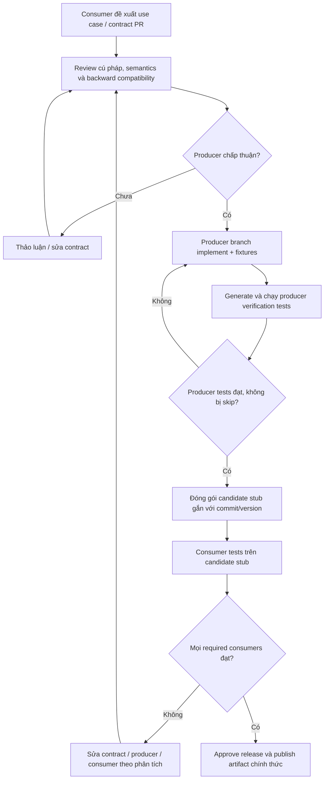
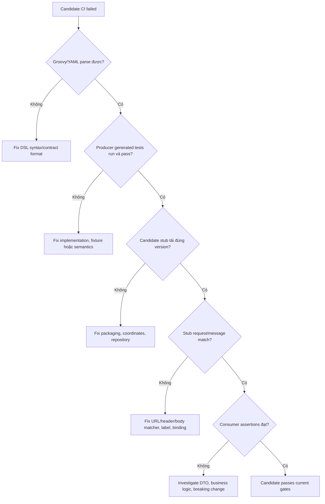

# Kiểm thử đề xuất thay đổi trước khi producer phát hành

## 1. Vì sao phải kiểm thử ngay khi thay đổi còn là đề xuất?

Trong **Spring Cloud Contract** (module `SPRING_CLOUD_CONTRACT`), các nhóm mô tả tương tác **HTTP** hoặc **thông điệp** bằng **Groovy/YAML DSL**. Từ hợp đồng, producer có thể sinh kiểm thử để chứng minh ứng dụng thật đáp ứng hành vi; công cụ cũng tạo stub để consumer chạy qua **Stub Runner**. Khi đưa các bước đó vào **CI/CD**, nhóm có thể phát hiện thay đổi API không tương thích **trước khi producer phát hành**.

Điểm thời gian rất quan trọng: nếu producer đã triển khai một thay đổi làm hỏng consumer rồi mới phát hiện khi consumer lên production, việc xử lý thường phức tạp hơn rất nhiều so với sửa hợp đồng hoặc implementation ngay trong pull request (PR).

Ví dụ, Inventory Producer dự kiến đổi response:

```json
{
  "sku": "SKU-001",
  "available": true,
  "quantityAvailable": 12
}
```

thành:

```json
{
  "sku": "SKU-001",
  "availability": "IN_STOCK",
  "quantityAvailable": "12"
}
```

Nếu Checkout Consumer hiện dùng `available` kiểu boolean và `quantityAvailable` kiểu số, producer vừa **xóa một trường** và **đổi kiểu dữ liệu**. Một số unit test riêng của producer vẫn có thể đạt, nhưng consumer thật có thể không deserialize được hoặc quyết định đặt hàng sai.

**Mục tiêu của kiểm thử đề xuất** là trả lời ba câu hỏi trước khi release:

1. **Hợp đồng được đề xuất có đúng và được các bên chấp nhận không?**
2. **Producer candidate có thực sự đáp ứng hợp đồng đó không?**
3. **Các consumer được hỗ trợ có chạy đúng với stub của candidate ấy không?**

Bài học này trình bày một pipeline theo nguyên tắc **proposal → producer verification → candidate stub → consumer compatibility → release decision**, có cổng chặn, chứng cứ và cách xử lý khi chưa thống nhất hành vi.

### Kết quả học tập

Sau bài này, bạn có thể:

- Thiết kế quy trình PR giúp consumer đề xuất hợp đồng và producer rà soát trước release.
- Phân biệt **stub đề xuất chưa được xác minh** và **candidate stub đã qua producer verification**.
- Sinh, chạy và kiểm đếm generated producer tests bằng Maven; chuyển HTTP contracts thành WireMock mappings.
- Chạy consumer tests trên **mã client/handler thật** với Stub Runner dùng đúng candidate version.
- Dựng ma trận tương thích cho nhiều consumer/branch còn hỗ trợ.
- Sử dụng `inProgress` một cách có kiểm soát mà không làm CI release “xanh giả”.
- Thiết lập các cổng chặn phát hành, lưu dấu vết artifact và xử lý thất bại.
- Tổ chức CI tránh phát hành artifact/secret từ PR chưa được tin cậy.

## 2. Ba trạng thái khác nhau của một bản thay đổi

| Trạng thái | Ai tạo? | Bằng chứng đã có | Điều **chưa** được khẳng định |
| --- | --- | --- | --- |
| **Proposed contract** | Consumer hoặc producer đưa vào PR | Use case và DSL thể hiện kỳ vọng, có thể sinh stub thử | Producer thật đã đáp ứng |
| **Verified candidate** | Producer CI sau khi review/implement | Generated producer tests chạy đạt, candidate stub có provenance | Mọi consumer và production đã tương thích |
| **Released contract/stub** | Release workflow được phê duyệt | Producer gate và consumer compatibility gate đạt, artifact được publish chính thức | Tất cả tình huống vận hành/production đã được bao phủ |

Trong một thay đổi phức tạp, consumer có thể dùng stub từ **proposed contract** để viết mã sớm. Điều này có giá trị cho thiết kế và phát triển song song, nhưng **không được xem là chứng cứ producer đã hoàn thiện tính năng**.

### 2.1. Sơ đồ thời điểm kiểm chứng



Mỗi mũi tên là một bước của **quy trình đề xuất**; cách các tổ chức dùng merge queue, branch protection hoặc release train có thể khác nhau. Không bắt buộc tất cả jobs chạy trong một repository, nhưng phải giữ **cùng contract revision và candidate build** xuyên suốt kết quả kiểm thử.

## 3. Đề xuất cần kèm bằng chứng gì?

Một PR kiểu “đổi field JSON” không đủ để producer và consumer quyết định an toàn. Nên có:

| Thành phần | Ví dụ |
| --- | --- |
| Consumer có nhu cầu | Checkout Service, Inventory Dashboard |
| Producer sẽ thay đổi | Inventory Service |
| Hành vi cần | `GET /api/inventory/{sku}` trả thông tin khả dụng |
| Phạm vi thay đổi | Thêm `reservedQuantity`, giữ `available` và `quantityAvailable` |
| Kỳ vọng request/response | Groovy/YAML contract với một ví dụ cụ thể |
| Nhánh cần bảo vệ | Có hàng, hết hàng, SKU không tồn tại |
| Tác động tương thích | Consumer hiện đọc những trường và kiểu gì? |
| Producer owner | Người chấp nhận semantics, fixture và implementation |
| Consumer owners | Những nhóm cần test với bản candidate |
| Test evidence | Đề xuất có thể sinh stub thử; producer verification còn pending |
| Release intent | Breaking hay non-breaking; có cần rollout song song? |

Trong PR, hãy ghi rõ trạng thái `PROPOSED / VERIFIED / RELEASED` theo cơ chế của nhóm, tránh một dấu tick CI có thể khiến người khác hiểu nhầm hợp đồng đã được producer đáp ứng.

### 3.1. Ưu tiên thay đổi nhỏ, có tình huống đối chứng

Thay vì PR vừa đổi `GET`, vừa đổi topic message và cách xác thực, hãy tách theo mục tiêu. Một thay đổi có thể được bảo vệ bằng các trường hợp:

- `SKU-001`: có hàng, `200`, `available=true`.
- `SKU-002`: hết hàng, `200`, `available=false`.
- `SKU-MISSING`: không tồn tại, `404` với `code=SKU_NOT_FOUND`.

Những tình huống này giúp phát hiện bug **luôn trả true**, **gọi sai SKU** hoặc **dùng `404` do WireMock không match** thay vì lỗi nghiệp vụ thật.

## 4. Hợp đồng được đề xuất cho API HTTP

Giả sử nhóm Checkout đề xuất giữ nguyên ba field đang sử dụng nhưng thêm một trường mới tùy chọn. Producer có thể kiểm tra tính khả thi và semantics trước khi chấp thuận.

### 4.1. Groovy DSL: có hàng

File `src/test/resources/contracts/inventory/get_inventory_available.groovy`:

```groovy
import org.springframework.cloud.contract.spec.Contract

Contract.make {
    name 'get_inventory_available'
    description 'Checkout kiểm tra SKU có thể đặt'

    request {
        method GET()
        url '/api/inventory/SKU-001'
        headers {
            header 'Accept': 'application/json'
        }
    }

    response {
        status 200
        headers {
            contentType(applicationJson())
        }
        body([
            sku              : 'SKU-001',
            available        : true,
            quantityAvailable: 12,
            reservedQuantity : 3
        ])
    }
}
```

**Giải thích:**

- Request có method, URL và header cụ thể; producer test cần fixture `SKU-001`.
- Response dùng `quantityAvailable` là **số**, không phải chuỗi `"12"`.
- `reservedQuantity` là trường **mới**; hai bên phải thống nhất nó có thể vắng mặt/null không và ý nghĩa “đã giữ” là gì.
- Thêm field vào contract không tự chứng minh tương thích: một consumer có deserializer nghiêm ngặt có thể từ chối trường lạ.

### 4.2. YAML DSL: SKU không tồn tại

File `src/test/resources/contracts/inventory/get_inventory_not_found.yml`:

```yaml
name: get_inventory_not_found
description: SKU không tồn tại được phân biệt với hết hàng
request:
  method: GET
  url: /api/inventory/SKU-MISSING
  headers:
    Accept: application/json
response:
  status: 404
  headers:
    Content-Type: application/json
  body:
    code: SKU_NOT_FOUND
```

Đây là kịch bản riêng, không phải “bất kỳ URL không khớp đều xem là `SKU_NOT_FOUND`”. Khi consumer test nhánh lỗi, nên assert đúng **business code**, tránh đạt nhờ WireMock mặc định trả `404` vì **thiếu mapping**.

### 4.3. Hợp đồng hết hàng và vấn đề mapping chồng lấp

Với SKU tồn tại nhưng quantity bằng 0:

```json
{
  "sku": "SKU-002",
  "available": false,
  "quantityAvailable": 0,
  "reservedQuantity": 5
}
```

Consumer nên có hợp đồng/test đối chứng cho response đó. Không dùng một matcher URL quá rộng như `/api/inventory/.*` với response `available=true` nếu producer thực sự phân biệt tình huống hết hàng và không tồn tại.

**Các thư mục/tên file khác nhau không tự làm WireMock phân biệt hai request giống nhau.** Producer phải thiết kế request matcher/fixture và response logic nhất quán.

## 5. Kiểm tra đề xuất trước khi code producer hoàn thiện

Đây là nhánh **phát triển sớm**, chỉ dành cho consumer thử kỳ vọng:

1. Consumer tạo Groovy/YAML contract và consumer test.
2. Contract được parse/lint; có thể chuyển thành mapping hoặc sinh stub tại runtime.
3. Consumer dùng stub đề xuất để phát triển client/DTO, kiểm thử xử lý nghiệp vụ.
4. Kết quả được ghi `PROPOSAL_VALIDATED / PRODUCER_UNVERIFIED`.
5. Producer review và implement sau khi đạt đồng thuận.

Tài liệu Spring Cloud Contract mô tả khả năng **sinh stub tại runtime** hoặc sử dụng contract **in progress** cho trường hợp consumer cần phát triển trước producer.

### 5.1. `inProgress` là gì?

Một hợp đồng Groovy có thể khai báo:

```groovy
import org.springframework.cloud.contract.spec.Contract

Contract.make {
    inProgress()
    name 'inventory_status_proposal'

    request {
        method GET()
        url '/api/inventory/SKU-NEW'
    }
    response {
        status 200
        headers {
            contentType(applicationJson())
        }
        body([sku: 'SKU-NEW', available: true])
    }
}
```

YAML DSL có thể viết:

```yaml
name: inventory_status_proposal
inProgress: true
request:
  method: GET
  url: /api/inventory/SKU-NEW
response:
  status: 200
  headers:
    Content-Type: application/json
  body:
    sku: SKU-NEW
    available: true
```

**Khác biệt quyết định:** contract đánh dấu `inProgress` **có thể tạo stub** cho consumer nhưng **không sinh producer verification test** cho hợp đồng ấy. Vì vậy consumer test với stub này có thể xanh dù producer chưa hỗ trợ endpoint. Không gộp nó vào bằng chứng producer verification.

### 5.2. Gate `failOnInProgress`

Với Maven producer plugin ở môi trường phát hành, có thể cấu hình:

```xml
<configuration>
  <failOnInProgress>true</failOnInProgress>
  <failOnNoContracts>true</failOnNoContracts>
</configuration>
```

Các tùy chọn được Spring Cloud Contract hỗ trợ theo phiên bản plugin; tài liệu các phiên bản gần đây ghi mặc định `failOnInProgress=true` nhằm tránh false positives. Có thể có môi trường phát triển cần **cấu hình cho phép** hợp đồng chưa hoàn thiện, nhưng **release gate phải chặn** khi contract còn `inProgress`.

**Không nên dùng `ignored()` hoặc tùy chọn skip để che một producer test đang fail.** Việc đó xóa bằng chứng thay vì khắc phục vấn đề.

### 5.3. Sinh stub tại runtime không phải chứng nhận phát hành

Một cơ chế thử nghiệm được tài liệu mô tả là bật `generateStubs=true` cho Stub Runner trong cấu hình thích hợp. Nó có thể tạo mapping từ hợp đồng nguồn để consumer thử sớm. Kết quả vẫn thuộc **đề xuất chưa được producer xác minh**, trừ khi sau đó producer đã chạy generated tests trên chính contract revision ấy.

Vì vậy, báo cáo CI nên phân biệt:

```text
Contract syntax: PASS
Local proposal stub: AVAILABLE
Consumer test against proposal: PASS
Producer implementation verification: NOT YET PASSED
Release readiness: BLOCKED
```

Đừng đặt tên một job chỉ tạo proposed stubs là `contract-release-verified` hoặc dùng trạng thái của job đó để cho phép publish.

## 6. Producer phải kiểm thử thay đổi trên mã thật

Khi producer chấp thuận đề xuất, một nhánh PR/candidate cần chạy **generated producer tests** trên ứng dụng thật cùng fixture có thể tái lập.

### 6.1. Ví dụ base test class với Spring MVC + MockMvc

Giả sử producer là Spring Boot MVC, dùng JUnit 5:

```java
package com.example.inventory.contract;

import io.restassured.module.mockmvc.RestAssuredMockMvc;
import org.junit.jupiter.api.BeforeEach;
import org.springframework.beans.factory.annotation.Autowired;
import org.springframework.boot.test.autoconfigure.web.servlet.AutoConfigureMockMvc;
import org.springframework.boot.test.context.SpringBootTest;
import org.springframework.test.web.servlet.MockMvc;

@SpringBootTest
@AutoConfigureMockMvc
public abstract class InventoryContractBase {

    @Autowired
    private MockMvc mockMvc;

    @Autowired
    private InventoryContractFixtures fixtures;

    @BeforeEach
    protected void prepare() {
        fixtures.reset();
        fixtures.setQuantities("SKU-001", 12, 3);
        fixtures.setQuantities("SKU-002", 0, 5);
        fixtures.ensureMissing("SKU-MISSING");
        RestAssuredMockMvc.mockMvc(mockMvc);
    }
}
```

`InventoryContractFixtures`, `setQuantities` và `ensureMissing` là helper **do dự án tự hiện thực**, không phải API có sẵn của Spring Cloud Contract. Trong ví dụ, `setQuantities(sku, quantityAvailable, reservedQuantity)` chuẩn bị đúng hai số lượng được hợp đồng công bố; ứng dụng thật phải áp dụng quy tắc tồn kho của chính mình. Mục đích là tạo trạng thái xác định để **controller/service thật** trả response; không mock toàn bộ controller rồi khẳng định producer đã implement API.

### 6.2. Maven plugin và dependencies

Trong producer có Spring Boot parent và dependency management tương thích:

```xml
<dependencies>
  <dependency>
    <groupId>org.springframework.boot</groupId>
    <artifactId>spring-boot-starter-test</artifactId>
    <scope>test</scope>
  </dependency>
  <dependency>
    <groupId>org.springframework.cloud</groupId>
    <artifactId>spring-cloud-starter-contract-verifier</artifactId>
    <scope>test</scope>
  </dependency>
</dependencies>

<build>
  <plugins>
    <plugin>
      <groupId>org.springframework.cloud</groupId>
      <artifactId>spring-cloud-contract-maven-plugin</artifactId>
      <version>REPLACE_WITH_COMPATIBLE_VERSION</version>
      <extensions>true</extensions>
      <configuration>
        <testFramework>JUNIT5</testFramework>
        <testMode>MOCKMVC</testMode>
        <baseClassForTests>
          com.example.inventory.contract.InventoryContractBase
        </baseClassForTests>
        <failOnNoContracts>true</failOnNoContracts>
        <failOnInProgress>true</failOnInProgress>
      </configuration>
    </plugin>
  </plugins>
</build>
```

`REPLACE_WITH_COMPATIBLE_VERSION` là **placeholder** cần thay bằng bản Spring Cloud Contract tương thích với Spring Boot/Cloud/JDK. Đây là POM fragment minh họa, chưa phải `pom.xml` đầy đủ. Dự án dùng WebFlux hoặc test mode khác cần base class tương ứng.

### 6.3. Maven goal khác lifecycle

| Goal / phase | Ý nghĩa | Gate cần quan sát |
| --- | --- | --- |
| `spring-cloud-contract:generateTests` | Tạo Java producer tests từ DSL | Có generated test source cho kịch bản mới |
| `spring-cloud-contract:convert` | Tạo WireMock HTTP mappings | Mapping đúng method, URL, matcher, response |
| `spring-cloud-contract:generateStubs` | Đóng gói stub sau bước convert | Artifact chứa contracts và HTTP mappings |
| `mvn test` | Chạy tests qua runner được cấu hình | Generated tests **đã thực thi và đạt** |
| `mvn verify` | Thực thi lifecycle đến verify | Không có gate quan trọng nào bị bỏ qua |
| `mvn install` | Cài artifact vào Maven local repository | Candidate có đúng tọa độ/classifier |
| `mvn deploy` | Publish theo Maven distribution configuration | **Chỉ chạy ở nhánh/workflow được phép** |

Theo tài liệu Maven plugin, `generateTests` gắn với `generate-test-sources`, `convert` với `process-test-resources`, `generateStubs` với `package`. **Sinh test không đồng nghĩa chạy test**; `package` cũng không chứng minh một suite Failsafe được cấu hình ở `verify` đã đạt.

### 6.4. Lệnh candidate verification

```bash
# Chạy trong producer branch đã chứa implementation và contract đề xuất.
./mvnw -B -ntp clean verify

# Chỉ khi đã đạt, kiểm tra stub được sinh:
jar tf target/inventory-producer-1.9.0-pr123-stubs.jar
```

Lệnh thứ hai giả định version của producer đang là `1.9.0-pr123` và plugin thực sự tạo artifact theo tên này; hãy kiểm tra output của build. Không sử dụng lệnh `mvn deploy -DskipTests` chỉ để nhanh chóng đưa một artifact chưa được xác minh lên kho phát hành.

### 6.5. Bằng chứng không thể thiếu

- Contracts root được quét đúng; không có hợp đồng mới nào bị bỏ qua.
- Generated producer test cho `SKU-001`, `SKU-002`, `SKU-MISSING` xuất hiện.
- Reports ghi **test run/pass/fail/skip**, không chỉ có source.
- Fixture đúng nhánh; không có test đạt do mock controller trả hằng.
- HTTP mappings sinh ra đúng request và response.
- Không có hợp đồng `inProgress`/`ignored` không được phê duyệt trong release candidate.
- Stub artifact có classifier `stubs`, version gắn với candidate, provenance rõ.

## 7. Đóng gói candidate stub mà chưa phát hành release

Producer tests đạt là điều kiện cần. Bước kế tiếp là tạo **candidate artifact** phục vụ consumer compatibility tests nhưng **không được phát hành như stable release**.

### 7.1. Hai cách chuyển candidate sang consumer CI

| Cách | Mô tả | Điều cần bảo vệ |
| --- | --- | --- |
| **CI build artifact** | Lưu file `-stubs.jar` từ producer job, chuyển sang consumer job | Không trộn version/build khác; xác minh checksum |
| **Kho snapshot/candidate riêng** | Publish bản `1.9.0-pr123-<sha>` hoặc tọa độ duy nhất | Repo test chỉ cho phép những tác nhân được cấp quyền; release repository chưa đổi |

**Bản PR nên có version duy nhất**, ví dụ `1.9.0-pr123-a1b2c3`, để tránh hai commit khác nhau dùng một tọa độ và khiến cache trả stub cũ. `<sha>` ở đây là ký hiệu mô tả; pipeline thật nên lấy short commit SHA hoặc build ID đã được hệ thống CI cung cấp.

Nếu dùng local Maven repository của cùng một CI job, có thể chạy `install` sau producer verification và consumer test dùng `StubsMode.LOCAL`. `install` chỉ cài vào **repository local của runner**, không tự phát hành lên kho remote.

### 7.2. Vì sao không publish trực tiếp lên releases?

Nếu mỗi PR publish vào `maven-releases`:

- Artifact chưa được reviewer chấp nhận có thể bị consumer khác tải nhầm.
- Có nguy cơ ghi đè release cùng version hoặc làm rối provenance.
- CI từ PR chưa tin cậy có thể được cấp credential publish quá rộng.
- Consumer compatibility tests có thể đang chạy trên bản chưa được producer xác minh.

**Quy tắc:** job kiểm thử PR chỉ có quyền **đọc** dependencies và lưu artifact nội bộ của CI. Chỉ workflow phát hành đã được bảo vệ mới có quyền publish release.

### 7.3. Cấu trúc stub JAR phải đúng

Ví dụ:

```text
inventory-producer-1.9.0-pr123-stubs.jar
└── META-INF/
    └── com.example/
        └── inventory-producer/
            └── 1.9.0-pr123/
                ├── contracts/
                │   └── inventory/
                │       ├── get_inventory_available.groovy
                │       └── get_inventory_not_found.yml
                └── mappings/
                    └── inventory/
                        └── <generated-http-mappings>.json
```

Đây là **cấu trúc minh họa**; các tên JSON thực tế do converter quyết định. Khi mở JAR bằng `jar tf`, cần kiểm tra hợp đồng, mapping HTTP, đúng version và các tài nguyên body mà mappings tham chiếu (nếu có). Với messaging, contract/metadata có thể quan trọng mà không nhất thiết sinh ra một WireMock HTTP JSON tương ứng.

### 7.4. Provenance gắn với kết quả test

Một bản ghi candidate hữu ích:

```yaml
candidate:
  producer: inventory-producer
  commit: a1b2c3d4
  pullRequest: 123
  version: 1.9.0-pr123
  classifier: stubs
  sourceContractsRevision: a1b2c3d4
  producerVerification: PASSED
  generatedContractTestsRun: 3
  artifactSha256: COMPUTE_FROM_REAL_FILE
  publication: CI_ARTIFACT_ONLY
```

Đây là **metadata minh họa cho báo cáo CI**, không phải YAML DSL hợp đồng. `COMPUTE_FROM_REAL_FILE` phải được thay bằng digest thật khi sử dụng; không dùng placeholder làm checksum kiểm chứng.

Nếu producer CI kiểm thử commit A nhưng publish JAR được build lại từ commit B, kết quả test **không bảo đảm** artifact B khớp. Khi qua nhiều jobs, truyền **chính artifact đã được xác minh**, hoặc có bước rebuild tái lập với provenance/attestation phù hợp.

## 8. Consumer test phải dùng đúng candidate artifact

Một thay đổi được producer xác minh vẫn có thể làm hỏng consumer hiện tại. Vì vậy cần chạy **mã consumer thật** với Stub Runner đã nạp đúng version ứng viên.

### 8.1. Ví dụ consumer JUnit 5

```java
import org.junit.jupiter.api.Test;
import org.springframework.beans.factory.annotation.Autowired;
import org.springframework.boot.test.context.SpringBootTest;
import org.springframework.cloud.contract.stubrunner.StubRunnerProperties;
import org.springframework.cloud.contract.stubrunner.spring.AutoConfigureStubRunner;

import static org.assertj.core.api.Assertions.assertThat;
import static org.assertj.core.api.Assertions.assertThatThrownBy;

@SpringBootTest(properties = {
    "clients.inventory.base-url=http://localhost:8090"
})
@AutoConfigureStubRunner(
    ids = "com.example:inventory-producer:1.9.0-pr123:stubs:8090",
    stubsMode = StubRunnerProperties.StubsMode.LOCAL
)
class CheckoutInventoryCompatibilityTest {

    @Autowired
    private CheckoutAvailabilityService checkoutAvailabilityService;

    @Test
    void availableSkuCanBeOrdered() {
        AvailabilityView view = checkoutAvailabilityService.check("SKU-001");

        assertThat(view.sku()).isEqualTo("SKU-001");
        assertThat(view.canOrder()).isTrue();
    }

    @Test
    void outOfStockSkuCannotBeOrdered() {
        AvailabilityView view = checkoutAvailabilityService.check("SKU-002");

        assertThat(view.canOrder()).isFalse();
    }

    @Test
    void missingSkuIsReportedAsDomainError() {
        assertThatThrownBy(() ->
            checkoutAvailabilityService.check("SKU-MISSING")
        ).isInstanceOf(SkuNotFoundException.class);
    }
}
```

`CheckoutAvailabilityService`, `AvailabilityView` và `SkuNotFoundException` là API minh họa **do consumer ứng dụng tự định nghĩa**. Test phải đi qua HTTP client thật của consumer; không mock chính client rồi coi đó là contract compatibility test. Ví dụ dùng port cố định cho dễ đọc, nhưng CI chạy song song nên cân nhắc port động và `StubFinder`.

**Đặc biệt:** ID của Stub Runner là `com.example:inventory-producer:1.9.0-pr123:stubs:8090`. Nếu producer build candidate `1.9.0-pr124` nhưng consumer vẫn tải `1.9.0-pr123`, kết quả PASS không áp dụng cho bản vừa thay đổi.

### 8.2. Cần cài stub vào Maven local repository cho consumer

Nếu hai module build trong cùng môi trường và producer POM có đúng version ứng viên:

```bash
# Producer: chạy xác minh và cài candidate vào Maven local repo.
./mvnw -B -ntp -pl inventory-producer -am clean install

# Consumer: cùng runner hoặc cùng local Maven repository đã được kiểm soát.
./mvnw -B -ntp -pl checkout-consumer -am verify
```

Lệnh là ví dụ cho **Maven reactor có hai modules** và `./mvnw` ở repository root. Trước khi chạy, cần:

1. Producer `pom.xml` phát hành đúng version `1.9.0-pr123` (khớp annotation).
2. Maven plugin tạo và attach classifier `stubs`.
3. `clean install` chạy các producer verification gates bắt buộc, không skip.
4. Consumer dùng `LOCAL` để tải artifact vừa cài từ Maven local repository của runner.
5. Consumer test thực thi và assert các nhánh được công bố.

Nếu producer và consumer nằm ở hai repository khác nhau, hãy chuyển candidate JAR qua **CI artifact hoặc kho candidate**, không giả định hai jobs có chung `~/.m2`. Không tạo dependency động kiểu `+` để “tự lấy bản mới nhất” rồi coi kết quả có thể tái lập.

### 8.3. Smoke test khác consumer compatibility test

| Test | Câu hỏi mà nó trả lời |
| --- | --- |
| `curl` vào WireMock trả JSON đúng | Mapping stub đã được nạp và phục vụ HTTP chưa? |
| Consumer HTTP client deserialize JSON thành DTO | Contract có hợp với code client thật không? |
| Consumer service tính `canOrder` | Quy tắc nghiệp vụ sau khi đọc API có đúng không? |
| Consumer xử lý `404 SKU_NOT_FOUND` | Nhánh lỗi theo hợp đồng có được nhận biết không? |

**Chỉ gọi trực tiếp stub và assert lại fixture JSON chưa đủ**. Bài test cần kiểm tra code consumer thực sự sử dụng dữ liệu producer công bố.

## 9. Kiểm thử tương thích cho nhiều consumer

Một producer có thể phục vụ nhiều consumer khác nhau. Nếu chỉ chạy Checkout `main`, một release branch của Catalog hoặc Mobile Gateway vẫn có thể bị hỏng.

### 9.1. Ma trận kiểm thử theo phiên bản

| Consumer | Branch/version còn hỗ trợ | Stub producer hiện tại | Candidate `1.9.0-pr123` | Quyết định |
| --- | --- | --- | --- | --- |
| Checkout `main` | Có | PASS | PASS | Có thể tiếp tục |
| Catalog `main` | Có | PASS | FAIL: enum mới | **Block hoặc làm rõ migration** |
| Mobile Gateway `release/lts` | Có | PASS | Chưa chạy | **Chưa đủ bằng chứng** |
| Data Analytics `main` | Có | PASS | PASS | Có thể tiếp tục |

Đây là **ma trận giả định**. Không lấy một dòng PASS của consumer A thay cho kết quả của consumer B.

### 9.2. Quy tắc chọn các consumer cần test

Nên kiểm kê:

- Các consumer đã đăng ký sử dụng API/event.
- Những branch/release còn được tổ chức hỗ trợ.
- Các clients dùng serializer/deserializer nghiêm ngặt.
- Các API paths/error codes mới hoặc bị thay đổi.
- Messaging consumers có phụ thuộc label, destination và content type.
- Những consumer dùng standalone Stub Runner ngoài Java.

Khi không thể chạy toàn bộ suite ngay trong PR, có thể dùng mô hình **gating tiers**:

| Tầng | Nội dung | Hành động |
| --- | --- | --- |
| PR fast gate | Producer generated tests, contract lint, consumers trọng yếu | Chặn merge sớm |
| Pre-release full gate | Tất cả supported consumers được chỉ định, compatibility matrix | Chặn publish |
| Post-release observation | Theo dõi triển khai, phản hồi consumer và backward compatibility | Không thay cho hai gate đầu |

Nếu một consumer còn hỗ trợ **không có kết quả**, cần ghi `NOT_TESTED`. Không tự đánh dấu nó `PASS`. Chính sách waiver nếu có phải do owner chịu trách nhiệm chấp thuận, ghi hạn và rủi ro, không tự bỏ test.

### 9.3. Phát hiện thay đổi “thêm field” không tương thích

Trong ví dụ Inventory, producer chỉ thêm `reservedQuantity`. Một consumer dùng DTO Jackson với unknown-field policy nghiêm ngặt có thể thất bại dù producer test đạt. Chạy **consumer test với candidate** phát hiện điều mà producer verification đơn lẻ không thể đảm bảo.

Tương tự, thay đổi enum `IN_STOCK`, thời gian theo múi giờ, kiểu `quantityAvailable` hoặc cách biểu diễn `null` có thể được producer chấp nhận nhưng consumer không parse được.

## 10. Kiểm thử đề xuất cho messaging contracts

Với message, thay đổi có thể nằm ở **event type, header, content type, destination, payload hoặc nhãn stub**.

### 10.1. Ví dụ hợp đồng message đề xuất

```groovy
import org.springframework.cloud.contract.spec.Contract

Contract.make {
    name 'inventory_reserved_event'
    label 'inventory_reserved'

    input {
        triggeredBy('publishInventoryReserved()')
    }

    outputMessage {
        sentTo('inventory.events')
        body([
            eventType     : 'INVENTORY_RESERVED',
            reservationId : 'res-1001',
            productId     : 'SKU-001',
            quantity      : 2
        ])
        headers {
            header('eventType', 'INVENTORY_RESERVED')
            messagingContentType(applicationJson())
        }
    }
}
```

`publishInventoryReserved()` là helper **producer phải tự hiện thực** trong base test để kích hoạt hành vi phát message thật. `label 'inventory_reserved'` hỗ trợ kích hoạt stub ở consumer test khi messaging integration có sẵn.

### 10.2. Consumer test message phải kiểm tra tác động

Ví dụ ý tưởng với Stub Runner, Awaitility và handler consumer:

```java
// Precondition: read model chưa có reservation.
readModel.deleteByReservationId("res-1001");
assertThat(readModel.exists("res-1001")).isFalse();

// Kích hoạt message mẫu từ stub artifact candidate.
assertThat(stubTrigger.trigger("inventory_reserved")).isTrue();

// Oracle: handler thật phải cập nhật trạng thái bất đồng bộ.
await().atMost(Duration.ofSeconds(5)).untilAsserted(() -> {
    var reserved = readModel.findById("res-1001");
    assertThat(reserved).isPresent();
    assertThat(reserved.get().quantity()).isEqualTo(2);
});
```

Đây là **snippet minh họa**, không phải file Java hoàn chỉnh. `readModel`/`stubTrigger` là các thành phần phải được inject trong consumer test; cần cấu hình messaging test binder/broker tương thích. Không seed sẵn bản ghi `res-1001` rồi chỉ assert nó có tồn tại, vì test có thể PASS dù handler không chạy.

### 10.3. Không nhầm “có message stub” với producer đã gửi event

Messaging contract có thể sinh stub sớm nhưng producer test vẫn chưa chạy. Với message, gate producer cần kiểm chứng **destination + headers + body** từ hành vi producer; gate consumer cần chứng minh **handler thật** xử lý được event. Hai mặt bổ sung, không thay nhau.

Ngoài ra, stub không tự chứng minh exactly-once, thứ tự giao hàng, retry hoặc bảo mật broker. Những khả năng đó cần bài kiểm thử tích hợp phù hợp với transport thật.

## 11. Ví dụ workflow CI cho Maven multi-module

Giả sử một repository minh họa:

```text
commerce/
  pom.xml
  mvnw
  .mvn/
  inventory-producer/
    pom.xml
    src/test/resources/contracts/inventory/...
  checkout-consumer/
    pom.xml
    src/test/java/.../CheckoutInventoryCompatibilityTest.java
```

Trong **ví dụ được ghim version** này, cả producer candidate POM và consumer test đã dùng đúng `1.9.0-pr123`. Plugin/build dependencies đã được cấu hình như các phần trước, runner có JDK phù hợp và local Maven repository trống khi bắt đầu.

### 11.1. GitHub Actions ví dụ cho PR

```yaml
name: Candidate contract compatibility

on:
  pull_request:
    branches: [main]

permissions:
  contents: read

jobs:
  verify-candidate:
    runs-on: ubuntu-latest
    timeout-minutes: 25
    steps:
      - name: Checkout PR revision
        uses: actions/checkout@v4

      - name: Set up JDK
        uses: actions/setup-java@v4
        with:
          distribution: temurin
          java-version: '17'
          cache: maven

      - name: Verify producer and install candidate locally
        run: ./mvnw -B -ntp -pl inventory-producer -am clean install

      - name: Verify consumer against candidate
        run: ./mvnw -B -ntp -pl checkout-consumer -am verify

      - name: Upload test reports for review
        if: always()
        uses: actions/upload-artifact@v4
        with:
          name: candidate-test-reports
          path: |
            inventory-producer/target/surefire-reports/
            checkout-consumer/target/surefire-reports/
          if-no-files-found: warn
```

**Đây là workflow minh họa, không tự chạy được với mọi repository.** Cần điều chỉnh tên modules, Maven profiles, runner/JDK, Surefire/Failsafe reports, candidate version, test config và strategy multi-consumer. Nó không có `deploy` và không được cấp quyền publish release.

Điểm cần xác minh:

1. `inventory-producer` POM thực sự có version `1.9.0-pr123`.
2. Producer test đã chạy, không bị bỏ qua, không có contract `inProgress`.
3. Plugin tạo và attach đúng `-stubs.jar` vào `mvn install`.
4. `CheckoutInventoryCompatibilityTest` yêu cầu **chính** version `1.9.0-pr123` và mode `LOCAL`.
5. Consumer test thực hiện HTTP call tới Stub Runner, không dùng mock hoặc server ngoài.
6. Nếu Failsafe chạy integration tests ở `verify`, report và cổng chặn tương ứng đều được kiểm tra.

Đối với các PR từ fork hoặc code không tin cậy, **không cấp deploy credentials** và không dùng workflow có quyền ghi bí mật để thực thi code của PR. Nên pin GitHub Actions bằng commit SHA trong pipeline nhạy cảm; `@v4` chỉ là dạng tên version dễ đọc của ví dụ.

### 11.2. Trường hợp producer và consumer ở hai repositories

Workflow cần tách thành những job:

```text
Producer candidate job
  -> checkout exact proposed producer commit
  -> run contract generator + producer tests
  -> package candidate stub JAR
  -> store CI artifact with SHA-256 and source revision

Consumer compatibility job(s)
  -> checkout supported consumer revision(s)
  -> download EXACT candidate artifact
  -> verify checksum/provenance
  -> install stub in isolated Maven local repo or use candidate repository
  -> set Stub Runner IDs to EXACT candidate coordinates
  -> run actual consumer tests
  -> report results against producer candidate SHA

Release approval job
  -> require producer PASS + required consumer PASS
  -> confirm review, version, no inProgress and no skip flags
  -> allow protected publication workflow
```

Không giả định GitHub Actions jobs có chung `~/.m2` hoặc output `target`. Phải **truyền artifact có kiểm chứng** hoặc tải từ kho candidate phù hợp. Nếu dùng repository ngoài tổ chức, sử dụng quyền read-only cho consumer job và tuyệt đối không đưa credentials sản xuất vào PR không tin cậy.

### 11.3. Tránh build lại artifact không được kiểm chứng

Một sai lầm:

```text
Job A -> commit X -> producer tests PASS -> stub.jar A
Job B -> commit Y -> rebuild and publish -> stub.jar B
Release ticket -> cites tests from Job A
```

Đây là **đứt chuỗi bằng chứng**. Job B cần publish artifact có provenance từ Job A, hoặc có quy trình rebuild tái lập và xác minh nội dung đủ mạnh. Không báo “candidate đã được producer verified” khi kiểm thử và phát hành thực ra dùng hai revision khác nhau.

## 12. Phân biệt cổng CI theo loại rủi ro

| Gate | Những kiểm tra bắt buộc | Nếu fail |
| --- | --- | --- |
| **Contract syntax** | Groovy/YAML parse thành công, tên không trùng, contracts root đúng | Chặn PR |
| **Contract semantics** | Producer/API owner review method, status, schema, error code, auth và ý nghĩa field | Chặn chấp thuận |
| **Producer verification** | Generated producer tests được thực thi, fixture đúng, không còn `inProgress` | Chặn publish |
| **Stub packaging** | JAR version/classifier và mappings/definitions đúng | Chặn consumer candidate gate |
| **Consumer compatibility** | Required consumers/branches xử lý candidate qua Stub Runner | Chặn publish hoặc cần quyết định waiver |
| **Security** | Không có secret/PII thật, không cấp deploy token cho PR code | Chặn |
| **Provenance** | Test run và artifact candidate cùng commit/version/digest | Chặn |
| **Release policy** | Approval, rollout và rollback plan cho breaking changes | Chặn phát hành |

### 12.1. Trường hợp nào được merge nhưng chưa release?

Có thể có PR chứa **proposal contract** được nhóm đồng ý về thiết kế nhưng implementation chưa hoàn thiện. Tổ chức có thể cho merge vào một branch phát triển hoặc kho đề xuất, **nhưng phải tách rõ**:

- Chưa đạt gate producer verification thì **không phát hành stable stub/API**.
- Consumer tests với stub đề xuất không chứng minh API đã có thật.
- Nếu dùng `inProgress` trong quá trình phát triển, release gate phải báo block cho đến khi được giải quyết.
- Không đổi `failOnInProgress=false` trong release chỉ để pipeline xanh.

Một quy trình có nhánh “accepted design, pending implementation” là hợp lệ nếu trạng thái được công bố rõ và không được đánh tráo thành production readiness.

### 12.2. Ngược lại, producer tests PASS chưa đủ

Generated producer tests xác minh producer theo **những contract đã chọn**. Chúng không kiểm tra mọi consumer còn dùng API đó. Ví dụ producer xóa field `available` và cập nhật contract mới khiến producer tests PASS, nhưng Checkout v1 vẫn yêu cầu field cũ. Chỉ consumer compatibility gate hoặc kiểm tra backward compatibility phù hợp mới phát hiện việc này.

## 13. So sánh contract gốc với contract đề xuất

Không phải mọi thay đổi là breaking. Tuy nhiên, **đánh giá dựa trên consumer thực tế**, không chỉ dựa vào cảm giác “thêm field chắc không sao”.

### 13.1. Ma trận nguy cơ khi review diff

| Thay đổi proposal | Nguy cơ | Test cần thêm trước release |
| --- | --- | --- |
| Thêm field JSON tùy chọn | Consumer strict schema có thể fail | Consumer deserialization/behavior test |
| Xóa `available` | Consumer cũ mất field | Regression trên supported consumer versions |
| Đổi `quantityAvailable` từ number sang string | DTO/so sánh số có thể hỏng | Test loại dữ liệu, negative case |
| Đổi `200` thành `204` | Consumer không còn JSON | Test status/empty body |
| Đổi `404 SKU_NOT_FOUND` thành `200 []` | Error handling thay đổi | Domain error tests |
| Đổi URL/path | Client cũ gọi endpoint không tồn tại | Routing compatibility tests |
| Đổi `Content-Type` hoặc encoding | Deserializer/handler có thể fail | Raw headers + client parsing tests |
| Đổi message destination | Handler không nhận event | Messaging binding tests |
| Đổi label của messaging contract | StubTrigger của consumer test không tìm thấy nhãn | Stub Runner message trigger tests |
| Chỉ thêm error example cho hành vi đang có | Ít nguy cơ runtime nhưng có thêm nghĩa vụ | Producer error fixture + consumer negative test |

### 13.2. Các loại quyết định review

| Kết luận | Ý nghĩa | Tiếp theo |
| --- | --- | --- |
| `ACCEPT_NON_BREAKING` | Không phá consumer được hỗ trợ theo bằng chứng hiện có | Producer/consumer gates, release thông thường |
| `ACCEPT_WITH_MIGRATION` | Có breaking risk nhưng có kế hoạch chuyển tiếp | Test ma trận cũ/mới, rollout có kiểm soát |
| `REQUEST_CHANGES` | Contract không đúng semantics/kiểu/error behavior | Sửa DSL/implementation và chạy lại |
| `DEFER` | Chưa đủ dependency hoặc business decision | Giữ proposal ở trạng thái chờ |
| `REJECT` | Trái security/domain policy hoặc có API phù hợp khác | Ghi lý do, không publish candidate |

Đây là **nhãn quy trình gợi ý**, không phải trạng thái tích hợp sẵn của Spring Cloud Contract.

## 14. Khi consumer test thất bại: sửa đúng tầng

Đừng sửa expected response cho khớp với bất cứ thứ gì producer đang trả; đầu tiên cần xác định sự sai lệch nằm ở đâu.



### 14.1. Test consumer chỉ assert fixture

Ví dụ kém:

```java
String expected = "{\"sku\":\"SKU-001\",\"available\":true}";
assertThat(expected).contains("\"available\":true");
```

Test này sẽ luôn PASS mà không gọi consumer code. Kể cả một smoke test `curl` trực tiếp tới WireMock cũng chỉ chứng minh mapping được nạp, không chứng minh mã Checkout xử lý đúng. **Consumer compatibility test phải chạy client/handler thật và assert tác động nghiệp vụ.**

### 14.2. WireMock `404` no-match khác business `404`

Nếu consumer gọi `GET /api/inventory/SKU-MISSING` và assert duy nhất `status=404`, test có thể xanh dù thiếu contract lỗi: WireMock trả `404` khi không có mapping. Hãy assert thêm `{"code":"SKU_NOT_FOUND"}` hoặc domain exception đã ánh xạ chính xác từ body, và kiểm tra generated mapping nhánh lỗi.

### 14.3. Một consumer chưa test không phải PASS

Nếu release candidate ảnh hưởng Mobile Gateway nhưng không thể khởi chạy consumer test suite do hạ tầng, trạng thái nên là `NOT_TESTED / BLOCKED`, không phải `GREEN`. Nếu chính sách cho phép waiver, phải có owner, lý do, hạn, phạm vi và biện pháp kiểm soát thay thế được ghi nhận.

## 15. Kiểm thử dữ liệu động và tránh “stub quá rộng”

Khi API có ID/timestamp sinh động, có thể dùng matcher trong Groovy/YAML DSL để phân biệt **giá trị mẫu** và **ràng buộc**. Tuy nhiên, không nên dùng regex `.*` cho mọi field chỉ để người viết consumer test dễ gửi request.

### 15.1. Thực tế request và response có những vai trò khác nhau

Đối với HTTP request từ consumer, mapping stub thường cần chấp nhận **dữ liệu consumer gửi đúng ràng buộc**, còn generated producer test sử dụng **giá trị mẫu cụ thể**. Đối với HTTP response, producer test có thể dùng matcher để kiểm tra dữ liệu động, còn stub gửi một response mẫu phù hợp cho consumer.

Ví dụ ID đơn có dạng `ord-1234` có thể cần:

- Regex hợp lệ cho ID thuộc format đã công bố.
- Sample ổn định để producer fixture dựng được.
- Test nhánh `404` không bị regex của `200` nhận nhầm.
- Không bỏ qua kiểu và giá trị của status, amount, currency.

### 15.2. Khi nào cần nhiều contract?

Nếu API có các nhánh khác hành vi:

```text
GET /api/orders/ord-1001   -> 200
GET /api/orders/ord-2002   -> 200, status PAID
GET /api/orders/ord-missing -> 404 ORDER_NOT_FOUND
```

Một contract regex `GET /api/orders/.* → 200` không phải sự thay thế đúng cho cả ba. Producer PR nên có **kịch bản đối chứng** theo những quyết định mà consumer sử dụng.

## 16. Governance: ai quyết định được phát hành?

Một release gate là quyết định **liên nhóm**, không chỉ phụ thuộc vào trạng thái build của producer.

| Vai trò | Bằng chứng/approval cần cung cấp |
| --- | --- |
| Consumer đề xuất | Use case, contract diff, test thực tế, nhu cầu tương thích |
| Producer/API owner | Semantics và implementation được chấp thuận |
| Producer CI | Generated tests run/pass, candidate artifact/provenance |
| Consumer owners | Kết quả compatibility hoặc waiver theo chính sách |
| Security/data owner nếu cần | Không rò rỉ secret/PII, auth/tenant policy được đáp ứng |
| Release owner | Versioning, rollout, rollback và publication gate |

### 16.1. Chặn publish khi thiếu bằng chứng

Các tình huống phải **block**:

1. Producer test fail, chưa chạy hoặc bị skip.
2. Hợp đồng phát hành còn `inProgress` hoặc bị `ignored` trái chính sách.
3. Thay đổi DSL không được producer/domain owner phê duyệt.
4. Stub JAR thiếu HTTP mappings hoặc messaging definitions quan trọng.
5. Consumer tests đang dùng artifact cũ, khác version candidate.
6. Required consumer branch fail hoặc chưa được chạy mà không có waiver hợp lệ.
7. Artifact candidate không liên kết được tới commit đã test.
8. PR job cần quyền publish secrets hoặc đang cố đẩy artifact vào releases.
9. Có hành vi breaking chưa có migration/rollout plan.

### 16.2. Không dùng deletion để ép migration

Nếu consumer LTS còn dùng stub `1.8.0`, producer không nên xóa artifact cũ ngay khi candidate `1.9.0` đạt. Cần xác nhận consumer còn được hỗ trợ, cửa sổ rollback và chính sách giữ version; việc xóa stub cũ có thể làm hỏng rebuild/hotfix CI dù API production vẫn chạy được.

## 17. Case study: thay đổi trường inventory qua hai bản PR

### 17.1. Bản PR đầu tiên

Producer muốn đổi:

```text
Before: available: true, quantityAvailable: 12
After:  availability: "IN_STOCK", quantityAvailable: "12"
```

Producer cập nhật hợp đồng theo dữ liệu mới và generated tests PASS. Nhưng Checkout Consumer v2.1 dùng record:

```java
record InventoryDto(String sku, boolean available, int quantityAvailable) {}
```

Consumer candidate test FAIL khi thiếu boolean `available` hoặc kiểu `quantityAvailable` không tương thích. Vì consumer v2.1 còn hỗ trợ, đề xuất này chưa đủ điều kiện release theo backward-compatibility policy.

### 17.2. Phương án đã thương lượng

Producer quyết định giữ field cũ, thêm field mới **tùy chọn**:

```json
{
  "sku": "SKU-001",
  "available": true,
  "quantityAvailable": 12,
  "availability": "IN_STOCK"
}
```

Tuy nhiên, producer vẫn phải chạy consumer tests vì một DTO cấu hình **fail on unknown fields** có thể từ chối `availability` dù các trường cũ giữ nguyên. Nếu cần, hai nhóm chọn schema/versioning rõ hoặc tách response bằng media type/version mới.

### 17.3. Bằng chứng release candidate

```text
Contract review: APPROVED
Producer generated tests: 3 run, 3 pass, 0 skipped
In-progress contracts: 0
Candidate: com.example:inventory-producer:1.9.0-pr123:stubs
Artifact source commit: a1b2c3d4
Checkout v2.1: PASS
Catalog main: PASS
Mobile Gateway LTS: PASS
Security/provenance: PASS
Release approval: READY
```

Các dòng trên là **báo cáo minh họa**, không phải log của một pipeline đã được chạy. Điều cốt lõi là quyết định release dựa trên **đủ bằng chứng và đúng revision**, không chỉ một ô xanh từ Maven.

## 18. Bài tập thực hành: thiết kế pre-release gate cho Payments API

### 18.1. Bối cảnh

Payments Producer có API:

```text
POST /api/payments
  201 {paymentId, status: "PENDING"}
  400 {code: "INVALID_AMOUNT"}
```

Producer đang đề xuất thêm:

```text
POST /api/payments
  201 {paymentId, status: "AUTHORIZED", currency}
  400 {code: "INVALID_AMOUNT"}
  409 {code: "DUPLICATE_PAYMENT"}
```

Consumer **Checkout** vẫn hiểu `PENDING`. Consumer **Settlement** đang chờ event `PAYMENT_AUTHORIZED`. Đội ngũ có hai PR khác nhau và muốn phát hành nhanh.

### 18.2. Nhiệm vụ người học

1. Xác định trường/trạng thái nào có thể phá tương thích với Checkout.
2. Viết Groovy hoặc YAML contract `POST /api/payments -> 201` cho tình huống mới.
3. Viết contract lỗi riêng `409 DUPLICATE_PAYMENT`, phân biệt request/fixture để không chồng lấp với `201`.
4. Đề xuất ít nhất hai fixture: request hợp lệ và duplicate idempotency key.
5. Viết producer base test setup cần thiết để generated tests chạy trên code thật.
6. Chỉ ra vì sao `generateTests` chạy thành công chưa đủ cho publish.
7. Thiết kế Stub Runner consumer tests trên Checkout cũ và Checkout mới.
8. Với Settlement, viết messaging contract có `label`, `outputMessage`, `sentTo`, body và headers phù hợp.
9. Tạo ma trận kết quả theo các consumer được hỗ trợ, gồm branch LTS.
10. Thiết kế candidate version và cách truyền artifact giữa producer/consumer CI.
11. Xác định ít nhất năm cổng chặn trước release.
12. Viết một quyết định cuối: `ACCEPT`, `ACCEPT_WITH_MIGRATION` hoặc `REQUEST_CHANGES` cùng lý do.

### 18.3. Groovy hợp đồng mẫu cho nhánh mới

```groovy
import org.springframework.cloud.contract.spec.Contract

Contract.make {
    name 'authorize_payment_success'

    request {
        method POST()
        url '/api/payments'
        headers {
            contentType(applicationJson())
            header 'Idempotency-Key': 'pay-request-1001'
        }
        body([
            orderId : 'ord-1001',
            amount  : 125000,
            currency: 'VND'
        ])
    }

    response {
        status 201
        headers {
            contentType(applicationJson())
        }
        body([
            paymentId: 'pay-1001',
            status   : 'AUTHORIZED',
            currency : 'VND'
        ])
    }
}
```

Producer test cần fixture/payment state để request `pay-request-1001` được authorize. Với nhánh duplicate, dùng **ID/idempotency key hoặc trạng thái được sắp đặt rõ** để generated tests lặp lại không phụ thuộc thứ tự thực thi.

### 18.4. Bảng đánh giá bài làm

| Câu hỏi | Kết quả cần chứng minh |
| --- | --- |
| Contract được review bởi ai? | Consumer owner + Payments API owner |
| Có response nhánh lỗi rõ? | Có `400` và `409` theo semantics đã chấp thuận |
| Producer tests được chạy? | Có report ghi test cases/pass/fail/skip |
| Consumer dùng đúng candidate? | IDs/version/checksum khớp |
| Checkout cũ có chấp nhận `AUTHORIZED`? | Có test thực tế hoặc migration plan |
| Settlement handler xử lý event mới? | Có message consumer test và assertion tác động |
| Có contracts `inProgress` trong release? | Không |
| Có deploy secret trong PR? | Không |
| Có version/rollback plan? | Có |

### 18.5. Câu hỏi tự kiểm tra

**Câu 1.** Consumer tạo stub từ hợp đồng mới và test PASS có nghĩa producer đã hỗ trợ contract chưa?

**Đáp án:** Chưa. Stub đề xuất có thể được sinh khi producer chưa implement; cần generated producer tests thực sự chạy và đạt.

**Câu 2.** `inProgress()` khác `ignored()` ở điểm quan trọng nào trong Spring Cloud Contract?

**Đáp án:** Với `inProgress`, công cụ có thể sinh stub nhưng không sinh producer test cho hợp đồng đó. Đây là chế độ cho phát triển sớm, **không phải bằng chứng sẵn sàng phát hành**. `ignored` là cơ chế bỏ qua hợp đồng trong kiểm thử theo cấu hình, không nên dùng để lách gate.

**Câu 3.** Chạy `./mvnw clean verify` PASS có luôn chứng minh mọi consumer tương thích không?

**Đáp án:** Không. Nó xác minh producer theo những hợp đồng được thực thi; phải chạy các consumer còn hỗ trợ với candidate stub version.

**Câu 4.** Vì sao không dùng `: + :stubs` hoặc version động trong release gate?

**Đáp án:** Tọa độ có thể resolve sang bản khác giữa hai lần build; kết quả không còn chứng minh đúng candidate được dự định phát hành.

**Câu 5.** Tại sao `201` của stub có thể chưa chứng minh giao dịch thanh toán đã thành công?

**Đáp án:** Stub chỉ trả response mẫu; nó không tự chạy PSP/gateway thật hoặc ghi nhận transaction production. Producer verification và những test tích hợp/vận hành phù hợp vẫn cần thiết.

**Câu 6.** Một consumer quan trọng chưa chạy do CI outage thì nên ghi trạng thái gì?

**Đáp án:** `NOT_TESTED/BLOCKED`, trừ khi đã có cơ chế waiver với owner, lý do, hạn và rủi ro được phê duyệt.

## 19. Checklist trước khi producer phát hành

### Trước khi nhận proposal

- [ ] Consumer use case và ý nghĩa API/message rõ, có producer owner.
- [ ] Groovy/YAML contract đúng cú pháp, đúng thư mục và không trùng matcher nguy hiểm.
- [ ] Những nhánh thành công/thất bại quan trọng có fixture.
- [ ] Đã đánh giá breaking changes với các consumer/branches còn hỗ trợ.
- [ ] PR ghi rõ đâu là **đề xuất** và đâu là **hành vi đã xác minh**.

### Producer verification

- [ ] Maven/Gradle plugin đúng phiên bản và contracts root được quét.
- [ ] Generated producer tests thực sự **chạy**, không chỉ sinh source.
- [ ] Test counts và các trường hợp bắt buộc hiện trong report.
- [ ] Base test class khởi tạo producer thật và fixture ổn định.
- [ ] Không có `inProgress`/`ignored` trái chính sách hoặc skip flags che lỗi.
- [ ] Mappings HTTP/message definitions phản ánh đúng hợp đồng.
- [ ] Candidate stub có classifier/version/provenance liên kết với commit đã test.

### Consumer compatibility

- [ ] Consumer tải **đúng** candidate artifact, không dùng bản release cũ/cache khác.
- [ ] HTTP client/handler consumer thật được chạy với Stub Runner.
- [ ] Assert nghiệp vụ chứ không chỉ kiểm tra fixture JSON.
- [ ] Nhánh `404` được phân biệt với WireMock no-match.
- [ ] Messaging label/destination/schema và asynchronous side effects được test khi có.
- [ ] Ma trận supported consumers/branches đầy đủ; `NOT_TESTED` không bị coi là PASS.

### Quyết định phát hành

- [ ] Security/PII review và secret policy đạt.
- [ ] Không có release credentials trong PR runner không tin cậy.
- [ ] Producer và consumer owners đã review theo chính sách.
- [ ] Artifact sắp publish chính là artifact đã được verify hoặc có provenance tái lập phù hợp.
- [ ] Breaking changes có migration, rollout và rollback plan.
- [ ] Release stable repository chỉ được cập nhật từ workflow được bảo vệ.
- [ ] Không xóa stub version cũ khi LTS/hotfix consumer vẫn cần.

### Tài liệu tham khảo

- [Spring Cloud Contract — Consumer-Driven Contracts Step-by-Step](https://docs.spring.io/spring-cloud-contract/reference/getting-started/cdc.html): consumer đề xuất, producer review và verification theo quy trình CDC.
- [Spring Cloud Contract — Contracts in Progress](https://docs.spring.io/spring-cloud-contract/reference/project-features-contract/common-top-elements.html): `inProgress`, `ignored` và rủi ro tạo stub khi producer chưa implement.
- [Spring Cloud Contract — Generating Stubs at Runtime](https://docs.spring.io/spring-cloud-contract/reference/project-features-stubrunner/stub-runner-generate-stubs-at-runtime.html): phương án consumer dùng stub đề xuất trước khi producer hoàn thiện.
- [Spring Cloud Contract Maven Plugin — Goals](https://docs.spring.io/spring-cloud-contract/docs/current/spring-cloud-contract-maven-plugin/plugin-info.html): `generateTests`, `convert` và `generateStubs`.
- [Spring Cloud Contract — Maven Project](https://docs.spring.io/spring-cloud-contract/reference/maven-project.html): producer base tests, plugin và Maven lifecycle.
- [Spring Cloud Contract — Stub Runner Core](https://docs.spring.io/spring-cloud-contract/reference/project-features-stubrunner/stub-runner-core.html): `CLASSPATH`/`LOCAL`/`REMOTE` và artifact coordinates.
- [GitHub Actions — Security hardening](https://docs.github.com/en/actions/security-for-github-actions/security-guides/security-hardening-for-github-actions): quyền workflow, secrets và thực thi code từ pull request.

**Ghi nhớ:** kiểm thử một **đề xuất thay đổi** khác với kiểm thử một **release đã xuất bản**. Consumer có thể dùng stub đề xuất để phát triển sớm, nhưng chỉ **producer verification** mới chứng minh producer candidate đáp ứng hợp đồng; chỉ **consumer compatibility tests** mới chứng minh các consumer được hỗ trợ xử lý được candidate đó. Muốn phát hành an toàn, CI phải liên kết đúng commit–contract–artifact–test report, chặn mọi kết quả xanh giả và chỉ trao quyền publish cho workflow phát hành đã được phê duyệt.
