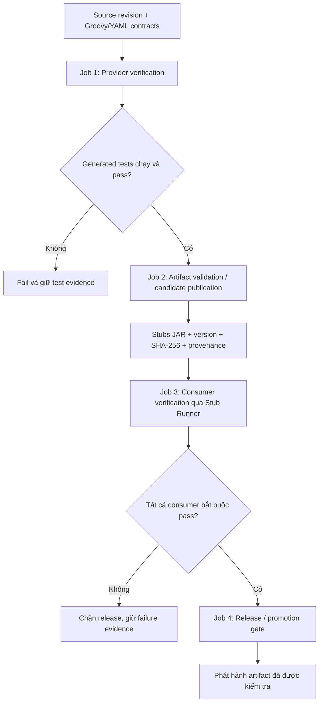
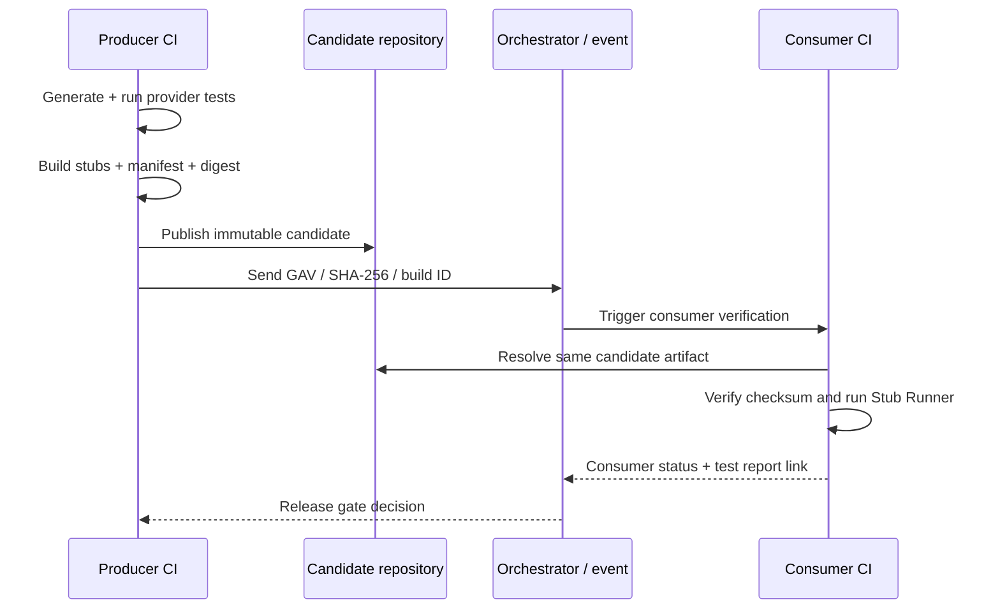
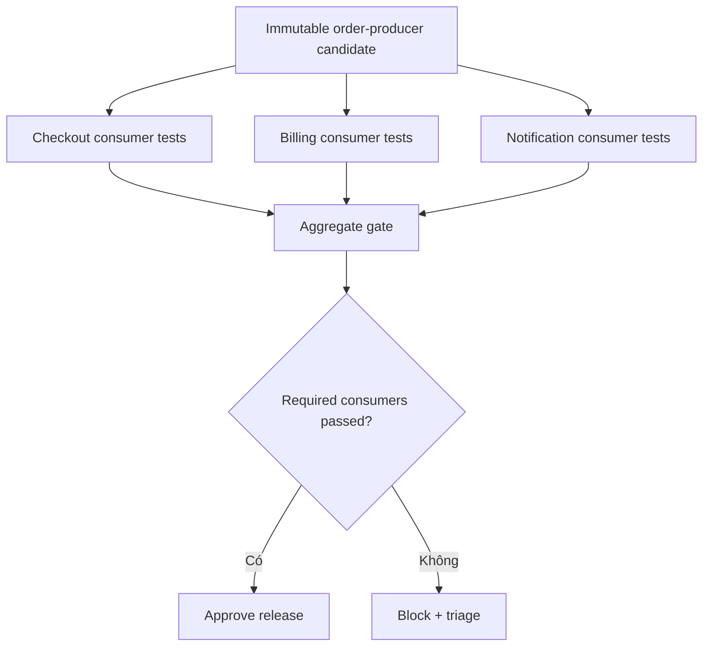

# Chia job và lưu bằng chứng từ test đến artifact trong CI/CD Spring Cloud Contract

**Spring Cloud Contract (SCC)** giúp producer và consumer kiểm tra tính tương thích giao diện HTTP hoặc thông điệp. Producer định nghĩa contract bằng **Groovy/YAML DSL**, sinh và chạy provider verification tests, đóng gói **stubs JAR**. Consumer dùng **Stub Runner**, thường kết hợp **WireMock** cho HTTP, để kiểm tra client hoặc listener thật của mình với những stub đã công bố.

Trong CI/CD, các bước này thường chạy ở **những job khác nhau**, thậm chí thuộc các repository, tài khoản hoặc máy chạy khác nhau. Khi đó, câu hỏi không chỉ là *“có job nào xanh?”* mà là:

> **Producer test nào đã xác minh artifact nào, artifact đó được chuyển qua các job ra sao, và consumer test đã thực sự dùng chính artifact đã xác minh hay chưa?**

Nếu job provider test dùng commit A, job publish tạo lại JAR từ commit B, còn job consumer vô tình tải phiên bản cũ C từ Maven cache, ba kết quả xanh **không tạo thành một bằng chứng tương thích thống nhất**.

Bài thuộc chương **CI/CD**, với chủ đề **Chia job và lưu bằng chứng từ test đến artifact**, hướng dẫn thiết kế task graph, lưu test reports, quản lý candidate artifacts, đối chiếu checksum và provenance, kiểm thử nhiều consumer, fail-fast, bảo mật secrets và chiến lược truy vết khi pipeline thất bại.

Ví dụ xuyên suốt gồm `order-producer` cung cấp `GET /api/orders/1001` và sự kiện `OrderCreated`, còn `checkout-consumer` kiểm thử qua Stub Runner.

## 1. Mục tiêu: một chuỗi bằng chứng, không phải nhiều đèn xanh rời rạc

Một pipeline lý tưởng phải trả lời được những câu hỏi sau:

1. **Nguồn:** Contract và producer implementation thuộc commit nào?
2. **Kiểm thử phía producer:** Generated tests nào đã được sinh và chạy? Kết quả, số lượng, số skipped?
3. **Artifact:** File stubs JAR có classifier, version và checksum nào? Có chứa mapping đúng không?
4. **Chuyển giao:** Job tiếp theo nhận **đúng file** vừa được kiểm tra hay tự build lại?
5. **Phân phối:** Candidate stubs ở artifact store nào? Có cho ghi đè không?
6. **Kiểm thử consumer:** Stub Runner resolve **đúng candidate** hay một release cũ?
7. **Kết quả:** Những consumer nào đã pass/fail với candidate đó?
8. **Quyết định phát hành:** Có thực sự chặn release khi bất kỳ cổng bắt buộc nào thất bại không?

Một workflow chỉ có:

```text
producer-build = SUCCESS
consumer-test = SUCCESS
publish = SUCCESS
```

chưa đủ để chứng minh thứ tự và tính nhất quán của artifact. Cần biết **job phụ thuộc job nào**, **dữ liệu nào được chuyển** và **bằng chứng nào được giữ lại**.

### 1.1. Vì sao phải chia job?

Một job làm tất cả vẫn có thể phù hợp với dự án nhỏ. Nhưng khi hệ thống tăng quy mô, tách job giúp:

- Chạy unit/integration tests và consumer suites theo **tài nguyên riêng**.
- Có **quyền truy cập tối thiểu**: job kiểm thử không cần token publish.
- Chạy nhiều consumer **song song** sau khi cùng một artifact được phát hành.
- Giữ lại reports ngay cả khi một stage sau thất bại.
- Dễ chạy lại riêng bước consumer verification với **candidate cố định**.
- Đặt release approval sau các cổng chất lượng.
- Phân biệt nguyên nhân lỗi contract, packaging, resolution, consumer và deploy.

**Tách job có lợi khi có ranh giới trách nhiệm rõ.** Chia quá nhiều job nhưng không truyền được artifact/provenance có thể làm pipeline khó debug hơn.

## 2. Năm lớp trong chuỗi kiểm thử hợp đồng

Một thiết kế cơ bản:



Đây là **mô hình dependency và trách nhiệm**, không phải khẳng định Maven/Gradle/SCC tự đăng ký toàn bộ các job này. CI platform phải định nghĩa các ràng buộc bằng `needs`, `dependencies`, `stages` hoặc cơ chế tương đương.

| Lớp | Đầu vào chính | Đầu ra/bằng chứng |
| --- | --- | --- |
| Source | Git commit, contract revision, toolchain | Commit SHA và cấu hình build |
| Provider verify | Code producer + contracts | Generated test report, số tests, status |
| Artifact package | Source/build đã được verify | Stubs JAR, manifest, hash, mappings |
| Consumer verify | Consumer commit + đúng candidate artifact | Consumer reports, request/listener assertions |
| Release gate | Tất cả kết quả và artifact identity | Quyết định publish/promote, audit trail |

**Không đánh đồng “job chạy thành công” với “job đã tạo đúng bằng chứng”**. Một test job không phát hiện bất kỳ test nào vẫn có thể kết thúc bằng mã 0 tùy framework/config.

## 3. Phân biệt job, step, task và artifact

Những thuật ngữ thường bị dùng lẫn:

**CI job:** đơn vị thực thi có runner, quyền, môi trường và các bước riêng. Các job có thể chạy song song hoặc theo dependency.

**Step:** một hành động bên trong job, ví dụ checkout, chạy Maven, tải artifact, kiểm tra checksum.

**Build task/goal:** thao tác do công cụ build quản lý, như Gradle `contractTest` hoặc Maven plugin goals. Một CI job có thể gọi nhiều task.

**Artifact:** file được giữ lại hoặc phân phối: stubs JAR, test reports, manifest, logs hay release bundle.

**Cache:** dữ liệu tái sử dụng để tăng tốc, như `~/.m2` hoặc Gradle caches. Cache **không phải bằng chứng** cùng một build artifact; nó có thể chứa bản cũ.

**Evidence/provenance:** thông tin truy vết việc gì đã chạy trên nguồn nào, tạo ra bytes nào và kết quả ra sao.

Ví dụ:

```text
Job: provider-verification
  Step: setup JDK
  Step: ./mvnw clean verify
    Maven phase/test goals: generate, compile, run tests
  Step: upload Surefire/Failsafe XML reports
  Step: upload candidate stubs JAR + SHA-256

Job: consumer-verification
  Step: download exact candidate artifact
  Step: verify hash / install or resolve artifact
  Step: run consumer tests via Stub Runner
  Step: upload JUnit XML and test logs
```

### 3.1. File tồn tại không có nghĩa đã được dùng

Một stubs JAR nằm trong thư mục job consumer **không chứng minh** Stub Runner đã tải và khởi chạy file đó. Bài test còn cần cấu hình `ids`/repository/classifier, log resolved artifact và HTTP client/listener trỏ tới stub thực.

Ngược lại, Stub Runner có thể khởi động thành công từ Maven local cache **dù job chưa download candidate**. Nếu không khóa version và kiểm tra provenance, CI sẽ có kết quả “xanh giả”.

## 4. Chia job theo trách nhiệm và quyền truy cập

Một DAG (directed acyclic graph) có thể gồm:

| Job | Phụ thuộc | Trách nhiệm | Có token publish? |
| --- | --- | --- | --- |
| `validate-contracts` | Source checkout | Parse/validate DSL và quy ước | Không |
| `producer-verify` | `validate-contracts` | Generate + run provider tests | Không |
| `artifact-prepare` | `producer-verify` | Kiểm tra JAR, digest và manifest | Không cần |
| `publish-candidate` | `artifact-prepare` | Publish immutable candidate | Có, scope tối thiểu |
| `consumer-checkout` | `publish-candidate` | Consumer dùng candidate Stub Runner | Thường chỉ cần quyền đọc |
| `consumer-billing` | `publish-candidate` | Consumer khác dùng cùng candidate | Thường chỉ cần quyền đọc |
| `release-gate` | Các consumer bắt buộc | Review/approval/promote | Có, scope và approval riêng |

Đây là **phương án chia đủ chi tiết**, không phải số job tối thiểu bắt buộc.

### 4.1. Job xác minh không cần quyền phát hành

Job provider verification thường phải chạy test code từ một pull request. Cấp cho nó quyền ghi trực tiếp vào release repository có thể tạo rủi ro supply-chain. Một thiết kế an toàn hơn là:

1. Test chạy trong runner ít quyền, không có release credentials.
2. Job artifact chuẩn bị một candidate bundle với metadata.
3. Job publish riêng chỉ thực thi khi các kiểm tra cần thiết pass.
4. Release job có approval và token riêng, không trộn với job chạy mã PR không tin cậy.

### 4.2. Không tạo dependency vòng tròn

Ví dụ sai:

```text
producer-test waits for publish
publish waits for consumer-test
consumer-test waits for publish
```

Muốn consumer dùng candidate artifact, phải có cách **chuyển artifact vào test** trước khi release cuối. Có thể dùng CI run artifacts, local installation, repository candidate hoặc kho tạm chuyên biệt. **Candidate publication** khác **production release**.

## 5. Bước producer: từ Groovy/YAML contract đến generated test

Contract ví dụ của `order-producer`:

```groovy
import org.springframework.cloud.contract.spec.Contract

Contract.make {
    description 'GET đơn hàng 1001 trả schema ổn định'

    request {
        method GET()
        url '/api/orders/1001'
        headers {
            header('Accept', 'application/json')
        }
    }

    response {
        status OK()
        headers {
            contentType(applicationJson())
        }
        body(
            id: 1001,
            status: 'CREATED',
            currency: 'VND'
        )
    }
}
```

YAML DSL tương đương:

```yaml
description: "GET đơn hàng 1001 trả schema ổn định"
request:
  method: GET
  url: /api/orders/1001
  headers:
    Accept: application/json
response:
  status: 200
  headers:
    Content-Type: application/json
  body:
    id: 1001
    status: CREATED
    currency: VND
```

**Trong build thực tế chỉ chọn một bản Groovy hoặc YAML cho cùng kịch bản**, tránh sinh test/mapping trùng nhau.

Sau khi cấu hình SCC Maven plugin, verifier dependencies và base class phù hợp, job producer có thể chạy:

```bash
./mvnw -B -ntp clean verify
```

Với Gradle, task thường gặp trong một số phiên bản là `generateContractTests` và `contractTest`, hoặc task test tương ứng được plugin nối vào lifecycle. Job phải xác minh **task thực sự chạy**, không suy luận từ tên.

### 5.1. Những gì provider verification chứng minh

- Generated tests thực sự được chạy trên implementation producer.
- HTTP status, response headers và body phù hợp những contract cases được khai báo.
- Với message contracts, verifier phù hợp kiểm tra input/output message theo test setup.
- Producer không vi phạm các matcher/assertions hiện hành trong phạm vi test.

Nó **không** chứng minh mọi consumer xử lý được schema mới, không chạy hết mọi lỗi mạng, không bảo đảm hiệu năng hoặc broker delivery semantics.

## 6. Chống cổng xanh giả: 0 tests và skip tests

Đây là cổng quan trọng nhất trước khi publish candidate.

Một số lỗi cấu hình vẫn có thể cho `BUILD SUCCESS`:

- SCC plugin chưa được apply vào module có contracts.
- Contract directory sai, không có file nào được quét.
- Generated tests sinh ra nhưng test engine không discover.
- Maven Surefire/Failsafe hoặc Gradle test task bị skip.
- Pipeline dùng `-DskipTests`, `-Dmaven.test.skip=true` hoặc `-x contractTest`.
- Unit tests chạy nhưng generated provider tests không chạy.
- Một module có test thành công khiến nhóm hiểu nhầm module contract cũng đã chạy.
- Task generation pass nhưng generated test class chưa được biên dịch/thực thi.

### 6.1. Gate nên kiểm tra số lượng thực thi

Ở module có hợp đồng, pipeline cần biết:

```text
contractFilesDiscovered > 0
generatedProviderTests > 0
providerTestsExecuted > 0
providerTestsFailed == 0
providerTestsSkipped == 0  # nếu policy yêu cầu không được skip
```

Những điều này là **điều kiện logic minh họa**, không phải các biến SCC tự xuất. Cách đếm thực tế phụ thuộc Maven Surefire/Failsafe, Gradle test reports hoặc tooling của dự án.

Ví dụ một test đã chạy và pass đáng tin hơn hàng trăm source files được sinh nhưng không có execution report.

### 6.2. Báo cáo JUnit XML và HTML

Với Maven, test reports thường xuất hiện trong các thư mục như:

```text
target/surefire-reports/
target/failsafe-reports/
```

Với Gradle:

```text
build/test-results/test/
build/reports/tests/test/
```

Đường dẫn có thể thay đổi khi dùng task/test suite khác như `contractTest`. **Không hardcode một thư mục duy nhất và kết luận test không tồn tại nếu plugin dùng nơi khác**.

Một bộ bằng chứng tối thiểu cần:

- Test suite names.
- Count of tests, failures, errors, skipped.
- Timestamps/durations phù hợp.
- Producer source revision.
- Log cho generated test setup và lỗi nếu có.
- Link tới contract/revision dùng trong build.

### 6.3. Thử phá có chủ đích

Thay implementation producer để `GET /api/orders/1001` trả `PAID` trong khi contract vẫn yêu cầu `CREATED`. **Provider job phải fail**. Nếu vẫn pass, cần xem generation, test discovery, base class hoặc nguồn contract.

Đây là cách kiểm tra rằng **pipeline thật sự bảo vệ hành vi**, không chỉ khởi động JVM thành công.

## 7. Artifact sau provider job: gói cả file lẫn bằng chứng

Một candidate bundle tối thiểu:

```text
candidate-bundle/
  order-producer-2.4.0-rc.7-stubs.jar
  stubs.sha256
  candidate-manifest.yml
  producer-test-report/
    TEST-....xml
  provenance/
    source-commit.txt
    build-id.txt
    toolchain.txt
```

Tên và bố cục trên là **quy ước ví dụ**, không phải layout bắt buộc của Spring Cloud Contract.

### 7.1. Không chỉ giữ mỗi file JAR

Nếu chỉ upload `*-stubs.jar`, người vận hành khó trả lời:

- File này sinh từ commit nào?
- Provider tests có thật sự chạy không?
- Nó có classifier `stubs` hay chỉ được đặt tên giống vậy?
- SHA-256 là gì?
- Có mapping cho endpoint mới không?
- Job consumer nào đã kiểm tra nó?
- Có thay đổi build tool/contract plugin version không?

Đó là lý do **manifest + test reports + artifact bytes** cần được coi là một chuỗi chứng cứ.

### 7.2. Tên artifact truyền giữa job khác Maven classifier

CI có thể upload một bundle với tên `order-stubs-candidate`, nhưng tên đó **không phải Maven classifier**. Classifier là `stubs` trong GAV/type/classifier khi file được install/publish/resolve.

```text
CI artifact name: order-stubs-candidate
Maven artifact:   com.example:order-producer:2.4.0-rc.7:jar:stubs
File:             order-producer-2.4.0-rc.7-stubs.jar
```

Không dựa vào tên CI upload artifact để khẳng định Stub Runner đã resolve đúng tọa độ Maven.

## 8. Ba phương án chuyển artifact giữa các job

| Cách chuyển | Ví dụ | Ưu điểm | Rủi ro/cần kiểm soát |
| --- | --- | --- | --- |
| CI run artifacts | Upload/download trong cùng workflow | Gọn, không cần publish repository public | Chỉ dùng trong phạm vi/tồn tại theo retention CI |
| Maven/Gradle local install | Chuyển file rồi cài vào local repository của consumer runner | Dễ dùng Stub Runner LOCAL | Runner khác không chia sẻ `~/.m2` tự động |
| Immutable candidate repository | Publish stubs JAR tới kho Maven test rồi consumer resolve REMOTE | Phù hợp nhiều repository/team | Quyền publish, no-redeploy, version và checksum |
| Build lại ở consumer job | Checkout producer rồi rebuild stubs | Có thể tự chứa trong một số tình huống | **Không bảo đảm cùng bytes/commit** nếu thiếu kiểm soát |

**Ưu tiên truyền đúng artifact đã được verify**, không tự tạo bản khác khi bước consumer bắt đầu.

### 8.1. Job khác nhau thường có filesystem khác nhau

Nếu `provider-verify` chạy trên runner A, còn `consumer-verify` trên runner B, file:

```text
/home/runner/work/order-producer/target/order-producer-stubs.jar
```

không tự xuất hiện ở runner B. CI cần **upload/download**, repository hoặc shared artifact service. Không dùng `needs` chỉ để điều phối thứ tự rồi kỳ vọng filesystem tự được chia sẻ.

### 8.2. Cache không thay thế artifact transfer

Maven cache giúp tải dependencies nhanh hơn nhưng không phải một cơ chế truyền candidate artifact có nguồn gốc xác định. Một cache key rộng có thể khiến consumer dùng stubs JAR từ một run cũ. Cần pin version duy nhất, kiểm tra hash và truyền candidate rõ ràng.

## 9. Checksum và provenance: bằng chứng file không bị đổi giữa jobs

Tính SHA-256 cho file JAR:

```bash
sha256sum order-producer-2.4.0-rc.7-stubs.jar
```

Một file `stubs.sha256` được tạo cùng file:

```bash
sha256sum order-producer-2.4.0-rc.7-stubs.jar > stubs.sha256
```

Ở job sau:

```bash
sha256sum -c stubs.sha256
```

Điều này chứng minh file tương ứng với digest đã ghi. **Tuy nhiên, nếu JAR và hash cùng bị người không tin cậy thay đổi**, hai giá trị vẫn có thể khớp. Vì vậy manifest/hash phải đến từ **job CI đã được bảo vệ**, hoặc có ký số/attestation và quyền truy cập thích hợp.

### 9.1. Hash giúp giải quyết lỗi gì?

| Tình huống | Tín hiệu từ hash |
| --- | --- |
| File JAR bị hỏng khi truyền | Mismatch |
| Consumer tải sai artifact cùng tên | Mismatch nếu expected từ producer CI |
| Repository bị overwrite một release cố định | Mismatch |
| Job publish rebuild JAR khác bytes | Mismatch |
| Producer tạo artifact sai nội dung nhưng hash đã được ghi đúng | Hash vẫn khớp; cần provider tests và content inspection |
| Consumer dùng artifact version khác nhưng trùng nội dung bytes | Hash có thể trùng; vẫn phải kiểm tra coordinate/version |

**Không dùng checksum thay cho generated provider verification**. Integrity và correctness là hai tầng khác nhau.

### 9.2. Đừng giả định cùng source luôn cho JAR bytes giống

Timestamps, archive metadata, plugin/version hoặc môi trường build có thể làm output khác bytes. Nếu một job dựng lại JAR từ cùng commit, phải kiểm tra digest; nếu khác, không gọi bản rebuild là “chính artifact đã được test”.

Đối với pipeline có thể, chọn **build once, verify, transfer exact bytes, then publish/promote**.

## 10. Manifest: nối source commit, test report và classifier

Một file `candidate-manifest.yml` **do CI định nghĩa**, không phải YAML DSL hợp đồng Spring Cloud Contract:

```yaml
manifestVersion: 1
service: order-producer
source:
  repository: git://example/order-producer
  commit: REPLACE_WITH_FULL_PRODUCER_COMMIT_SHA
  contractRevision: REPLACE_WITH_CONTRACT_COMMIT_SHA
build:
  ciRunId: producer-run-107
  jdk: "21"
  sccPluginVersion: REPLACE_WITH_SCC_VERSION
  providerVerification:
    status: PASSED
    executed: REPLACE_WITH_REAL_TEST_COUNT
    failed: 0
    skipped: 0
artifact:
  repositoryId: maven-candidates
  groupId: com.example
  artifactId: order-producer
  version: 2.4.0-rc.7
  type: jar
  classifier: stubs
  filename: order-producer-2.4.0-rc.7-stubs.jar
  sha256: REPLACE_WITH_FULL_SHA256
consumerVerification:
  required:
    - checkout-consumer
    - billing-consumer
  resultsLocation: REPLACE_WITH_CI_REPORT_LOCATION
```

Các trường `REPLACE_WITH...` là **chỗ cần điền từ CI thực**, không phải dữ liệu đã được kiểm chứng. Không thể đặt `providerVerification.status: PASSED` bằng một hằng số vô điều kiện và xem đó là bằng chứng. Hãy tính từ kết quả test thực thi.

### 10.1. Manifest phải là đầu ra, không phải một lời tuyên bố suông

Job nên:

1. Lấy commit SHA từ checkout thực.
2. Lấy version/classifier từ artifact mà Maven/Gradle vừa tạo.
3. Kiểm tra provider test reports và số tests.
4. Tính hash từ file JAR cuối.
5. Ghi job URL/build ID để truy vết.
6. Upload manifest vào nơi có quyền bảo vệ.
7. Cho consumer job đối chiếu manifest với file đã tải.

Nếu consumer chỉ biết tên artifact nhưng không biết nguồn commit, khó phân biệt regression từ thay đổi code và sai nguồn stub.

## 11. Ví dụ workflow GitHub Actions: chia job và lưu reports

Ví dụ sau minh họa **cách dùng `needs` và upload/download artifacts trong một workflow**. Giả định:

- Repository có `order-producer/` và `checkout-consumer/`.
- Maven Wrapper `./mvnw` ở root, các module được cấu hình đủ dependencies.
- SCC plugin sinh và package stubs JAR trong lifecycle `verify`.
- Candidate version đã được thiết lập trong producer POM và **duy nhất** cho build.
- Consumer test có cấu hình đọc Stub Runner properties từ JVM/System properties.
- Ví dụ này **không bao gồm bước publish tới Maven remote**; nó truyền JAR nội bộ rồi cài vào local repository của consumer job.

Các điều kiện trên phải được kiểm tra và điều chỉnh cho dự án thật; workflow không phải cấu hình copy-paste sẵn chạy ở mọi hệ thống.

```yaml
name: Contract compatibility
on:
  pull_request:
  workflow_dispatch:

jobs:
  producer-verify:
    runs-on: ubuntu-latest
    steps:
      - name: Checkout
        uses: actions/checkout@v4

      - name: Setup Java
        uses: actions/setup-java@v4
        with:
          distribution: temurin
          java-version: "21"
          cache: maven

      - name: Verify producer
        run: ./mvnw -B -ntp -pl order-producer -am clean verify

      - name: Preserve test reports even on failure
        if: always()
        uses: actions/upload-artifact@v4
        with:
          name: producer-test-reports
          path: |
            order-producer/target/surefire-reports/
            order-producer/target/failsafe-reports/
          if-no-files-found: warn

      - name: Prepare candidate bundle
        shell: bash
        run: |
          mkdir -p candidate
          VERSION=$(./mvnw -q -pl order-producer \
            help:evaluate -Dexpression=project.version -DforceStdout)
          printf '%s\n' "$VERSION" > candidate/version.txt
          test -n "$VERSION"

          JAR="order-producer/target/order-producer-$VERSION-stubs.jar"
          test -f "$JAR"
          cp "$JAR" candidate/
          (
            cd candidate
            sha256sum "order-producer-$VERSION-stubs.jar" \
              > stubs.sha256
          )
          git rev-parse HEAD > candidate/producer-commit.txt

      - name: Upload candidate bytes
        uses: actions/upload-artifact@v4
        with:
          name: verified-order-stubs
          path: candidate/
          if-no-files-found: error

  consumer-verify:
    needs: producer-verify
    runs-on: ubuntu-latest
    steps:
      - uses: actions/checkout@v4

      - uses: actions/setup-java@v4
        with:
          distribution: temurin
          java-version: "21"
          cache: maven

      - name: Download exact candidate bundle
        uses: actions/download-artifact@v4
        with:
          name: verified-order-stubs
          path: candidate/

      - name: Validate transferred bytes
        shell: bash
        run: |
          cd candidate
          sha256sum -c stubs.sha256

      - name: Install stubs into this runner's Maven local repo
        shell: bash
        run: |
          VERSION=$(cat candidate/version.txt)
          ./mvnw -B -ntp install:install-file \
            -Dfile="candidate/order-producer-$VERSION-stubs.jar" \
            -DgroupId=com.example \
            -DartifactId=order-producer \
            -Dversion="$VERSION" \
            -Dpackaging=jar \
            -Dclassifier=stubs \
            -DgeneratePom=true

      - name: Run consumer tests against local candidate
        shell: bash
        run: |
          VERSION=$(cat candidate/version.txt)
          ./mvnw -B -ntp -pl checkout-consumer test \
            -Dspring.cloud.contract.stubrunner.ids="com.example:order-producer:$VERSION:stubs:8085" \
            -Dspring.cloud.contract.stubrunner.stubs-mode=LOCAL

      - name: Preserve consumer reports
        if: always()
        uses: actions/upload-artifact@v4
        with:
          name: consumer-test-reports
          path: |
            checkout-consumer/target/surefire-reports/
            checkout-consumer/target/failsafe-reports/
          if-no-files-found: warn
```

### 11.1. Workflow này minh họa những điều gì?

- `producer-verify` chạy verification và chỉ upload candidate sau khi bước kiểm chứng trước đó pass.
- `consumer-verify` có `needs: producer-verify` nên chỉ bắt đầu khi upstream thành công theo policy mặc định của workflow.
- `actions/upload-artifact` và `download-artifact` chuyển file giữa hai runner.
- `sha256sum -c` phát hiện thay đổi bytes trong quá trình chuyển (với giả định bundle/hash đến từ nguồn đã được bảo vệ).
- `install:install-file` đưa stubs JAR vào Maven local repo của **runner consumer**, không phải runner producer.
- Consumer test được truyền candidate `ids` và `stubs-mode=LOCAL`.
- Test reports được upload bằng `if: always()` để còn bằng chứng khi test thất bại.

### 11.2. Những điều cần hoàn thiện trước khi dùng thật

Ví dụ chưa tự kiểm tra **số generated provider tests > 0**. Cần một bước đọc XML reports có kiểm soát và fail nếu module contract tạo zero tests hoặc tất cả bị skip.

Ngoài ra:

- Xác minh plugin thật sự tạo JAR ở tên/path đang tính. Một số project đổi `finalName` hoặc packaging layout.
- Kiểm tra `help:evaluate` trả version thuần theo môi trường Maven hiện tại.
- Đảm bảo file `pom.xml` của producer có version tương ứng candidate đã chốt.
- Đảm bảo consumer test thực sự đọc và áp dụng properties, không bị annotation hardcode khác ghi đè.
- Kiểm tra việc Maven install classifier đơn lẻ với generated POM phù hợp cơ chế Stub Runner/dependency resolution của phiên bản đang dùng; nếu không, chuyển sang install/deploy artifact theo POM đúng của producer.
- Khi consumer job dùng multi-module build, bổ sung `-am` hoặc install dependencies nội bộ nếu cần.
- Đảm bảo artifact mang version cố định và không bị cache cũ cùng coordinate.
- Kiểm soát quyền và hành vi khi workflow chạy từ fork PR.
- Nếu pipeline cần release thật, thêm job repository candidate/promotion **có secrets và approval riêng**.

**Đây là bài học về cơ chế truyền bằng chứng**, không phải tuyên bố tất cả chi tiết Maven/SCC đều giống nhau giữa các dự án.

## 12. Stub Runner: phải dùng đúng bản candidate vừa chuyển

Một consumer Spring Boot test có thể cấu hình Stub Runner:

```java
import org.springframework.boot.test.context.SpringBootTest;
import org.springframework.cloud.contract.stubrunner.spring.AutoConfigureStubRunner;

@SpringBootTest(properties = {
    "order.api.base-url=http://localhost:8085"
})
@AutoConfigureStubRunner
class CheckoutConsumerContractTest {
    // Stub Runner nhận ids và stubs-mode từ môi trường test.
    // Inject OrderClient thật, gọi GET /api/orders/1001.
    // Assert id=1001, status=CREATED, currency=VND.
}
```

Ví dụ trên giả định Spring environment nhận:

```text
spring.cloud.contract.stubrunner.ids=com.example:order-producer:2.4.0-rc.7:stubs:8085
spring.cloud.contract.stubrunner.stubs-mode=LOCAL
```

Nếu dự án dùng `@AutoConfigureStubRunner(ids=..., stubsMode=...)` hardcode trong annotation, cần bảo đảm **không vô tình ghi đè candidate version** mà CI truyền qua properties.

### 12.1. Một test chỉ khởi động Stub Runner là chưa đủ

Test phải:

1. Gọi **client thật** của consumer, không chỉ một `HttpClient` tạm viết riêng.
2. Gửi request phù hợp contract tới stub URL.
3. Assert response DTO/logic và error handling thực sự phụ thuộc.
4. Xác minh request đã đến stub server khi cần debug.
5. Có test cho các kịch bản lỗi quan trọng được thỏa thuận.

Một pipeline có thể xanh vì Stub Runner start thành công nhưng mọi unit test của consumer không hề gọi producer stub. Điều đó không phải consumer compatibility verification.

### 12.2. LOCAL và REMOTE thay đổi phương thức lấy artifact, không đổi mục tiêu

- **LOCAL:** artifact đã được install vào Maven local repo của runner hiện tại.
- **REMOTE:** Stub Runner resolve candidate từ Maven-compatible repository có URL/quyền truy cập phù hợp.

Với REMOTE, job cần ghi `repositoryRoot`, resolved GAV/classifier, checksum và version. Không dùng dynamic `+` trong cổng cần tái lập candidate cụ thể.

## 13. Chia job khi producer và consumer ở hai repository

Khi nhóm producer và consumer có CI độc lập, một GitHub Actions `needs` chỉ điều phối các job **trong cùng workflow**, không tự tạo dependency trên một workflow của repository khác.

Một kiến trúc nhiều repository:



Điểm quan trọng là **thông điệp giữa CI pipelines phải chứa tọa độ artifact đã chốt**, chứ không chỉ “đã có bản mới” hoặc “hãy dùng latest”.

### 13.1. Ví dụ payload sự kiện candidate

```json
{
  "producer": "order-producer",
  "producerCommit": "REPLACE_WITH_FULL_COMMIT_SHA",
  "providerBuildId": "producer-run-107",
  "artifact": {
    "groupId": "com.example",
    "artifactId": "order-producer",
    "version": "2.4.0-rc.7",
    "classifier": "stubs",
    "type": "jar",
    "sha256": "REPLACE_WITH_TRUSTED_SHA256",
    "repositoryId": "maven-candidates"
  }
}
```

Payload này là **mô hình tích hợp**, không phải schema built-in của Spring Cloud Contract. Consumer CI phải xác thực nguồn sự kiện, nhận input, đối chiếu artifact và xuất kết quả gắn với cùng `producerBuildId`.

### 13.2. Trả kết quả về đúng producer build

Một consumer job chạy chậm có thể hoàn thành sau khi producer có candidate mới. Nếu chỉ gửi `PASS` mà không có artifact version/build ID, orchestrator có thể gán kết quả của candidate A cho candidate B.

Kết quả nên mang:

```text
producerCommit
artifactVersion
artifactSha256
consumerCommit
consumerTestJobId
testStatus
testReportUrl
```

Release gate chỉ chấp nhận kết quả **cùng candidate identity** được yêu cầu.

## 14. Nhiều consumer: chạy matrix song song và tổng hợp kết quả

Một producer thường phục vụ nhiều consumer:

```text
order-producer
  ├── checkout-consumer
  ├── billing-consumer
  └── notification-consumer
```

Các consumer có thể chạy song song trên **cùng một candidate stubs artifact**, sau đó một gate tổng hợp:



### 14.1. “Required” phải được thống nhất

Không phải mọi consumer lịch sử đều có thể chạy test trong mỗi PR. Cần phân loại:

- **Required gate:** consumer quan trọng mà thay đổi producer có thể ảnh hưởng.
- **Advisory:** chạy và thông báo nhưng không chặn khi có lý do đã chấp thuận.
- **Unknown/unmaintained:** cần chính sách ownership và deprecation; không mặc định bỏ qua vĩnh viễn.

Không âm thầm chuyển một consumer failing từ required thành advisory chỉ để release nhanh. Quyết định thay đổi gate cần owner và lý do có thể truy vết.

### 14.2. Tách báo cáo theo từng consumer

Manifest kết quả có thể gồm:

| Consumer | Commit | Stub version/hash | Kết quả | Report |
| --- | --- | --- | --- | --- |
| Checkout | `c1...` | `2.4.0-rc.7 / H1` | PASS | Link CI |
| Billing | `c2...` | `2.4.0-rc.7 / H1` | FAIL | Link CI |
| Notification | `c3...` | `2.4.0-rc.7 / H1` | PASS | Link CI |

Trong ví dụ, **release phải bị chặn nếu Billing thuộc required gate**. Không tính `2/3 PASS` là “phần lớn tương thích” nếu chính sách yêu cầu tất cả.

### 14.3. Consumer contract test khác kiểm thử broker đầy đủ

Với `notification-consumer`, message stub qua `StubTrigger` có thể giúp test listener xử lý `OrderCreated`, nhưng không tự xác minh Kafka offsets, RabbitMQ ack/nack, retry, DLQ hay transaction. Những job hạ tầng đó cần được thiết kế riêng khi thuộc release criteria.

## 15. Quản lý báo cáo khi job thất bại

Nguyên tắc quan trọng: **job fail vẫn phải lưu bằng chứng phù hợp**.

Nếu test fail, một số step tiếp theo bị bỏ qua theo cơ chế CI mặc định. Hãy đặt bước upload logs/reports với điều kiện kiểu `always()` hoặc equivalent của platform, **nhưng không đổi kết quả job thành PASS**.

### 15.1. Ba loại đầu ra khác nhau khi thất bại

| Job thất bại tại | Bằng chứng có thể còn | Cách xử lý |
| --- | --- | --- |
| Checkout/dependency resolve | Dependency logs, source revision | Upload error log, không tạo giả test report |
| Contract generation | Plugin logs, input DSL | Giữ log và commit/contract file reference |
| Test compile | Compiler errors, generated sources nếu có | Giữ compilation log/source path |
| Provider test assertion | JUnit XML, stack trace, request/response | Upload reports và chặn candidate publish |
| Stubs packaging | Build log, file listing, manifest partial | Fail artifact gate, không upload JAR rỗng như bản đúng |
| Candidate resolution | Coordinates, repo/HTTP status, checksum error | Fail consumer job trước khi chạy assertions |
| Consumer assertion | JUnit XML, WireMock request journal | Giữ report và chặn release |
| Release publish | Deploy logs, previous verified digest | Triage repo/permissions; không rebuild không kiểm soát |

### 15.2. Không dùng “continue-on-error” để biến gate thành optional

Một CI step có thể được cấu hình cho phép lỗi mà job vẫn tiếp tục. Điều này có thể phù hợp để **thu thêm dữ liệu**, nhưng release gate phải dựa vào **kết quả thực** và không bị “xanh giả”.

Nếu provider contract test fail mà pipeline vẫn publish stubs nhờ `continue-on-error: true` và không có gate bổ sung, quy trình đã mất ý nghĩa contract verification.

### 15.3. Báo cáo có thể nhạy cảm

Test logs/request journals đôi khi chứa token, email, địa chỉ hoặc payload khách hàng. Trước khi upload evidence:

- Dùng fixture tổng hợp, không dùng PII thật.
- Redact secrets và headers nhạy cảm.
- Hạn chế quyền xem CI artifacts.
- Đặt retention theo chính sách bảo mật.
- Không in token Maven repository hoặc credentials trong error logs.

Lưu nhiều bằng chứng hơn không đồng nghĩa được phép lưu dữ liệu nhạy cảm bừa bãi.

## 16. Artifact retention và khả năng tái lập

Một CI run có thể giữ artifact vài ngày hoặc vài tuần; Maven candidate repository có thể giữ lâu hơn. Cần phân biệt:

| Nơi lưu | Dùng để | Giới hạn thường gặp |
| --- | --- | --- |
| CI run artifact store | Chuyển job, tải reports trong cùng pipeline | Retention policy và quyền truy cập |
| Maven candidate repository | Resolve stubs từ nhiều repo/job | Chính sách immutability, cache, repository auth |
| Maven release repository | Phân phối bản phát hành | Không nên cho overwrite |
| Provenance store | Lưu build ID, commit, digest, approvals | Phải bảo vệ khỏi sửa lén |
| Issue/PR links | Truy vết quyết định và lỗi | Có thể mất tính đầy đủ khi logs hết hạn |

Nếu cần tái hiện lỗi sau sáu tháng, nhưng JAR và test reports đã bị xóa sau bảy ngày, việc pin tọa độ thôi không bảo đảm replay.

### 16.1. Chính sách retention tối thiểu

Một quy tắc tổ chức có thể là:

- Candidate chưa merge: giữ theo vòng đời PR và khoảng thời gian điều tra.
- Release artifact: giữ ít nhất trong vòng đời consumer hỗ trợ.
- Provider/consumer test reports: giữ đủ lâu để audit regression.
- Manifest/digest/approval: giữ cùng release record.
- Secrets và dữ liệu nhạy cảm: **không** lưu nguyên trạng chỉ để kéo dài retention.

Các mốc cụ thể phụ thuộc quy định công ty; không có số ngày mặc định duy nhất của SCC.

## 17. Build once, verify, transfer, promote: tránh rebuild không kiểm soát

Một anti-pattern:

```text
Job A:
  checkout producer commit P1
  mvn clean verify
  JAR hash = H1
  provider tests PASS

Job B:
  checkout latest main commit P2
  mvn clean deploy
  JAR hash = H2
  publish artifact

Job C:
  consumer tests use H2, nhưng report claim provider verified H1
```

Đây là **đứt chuỗi bằng chứng**. Provider verification của H1 không tự động là verification cho H2.

Một quy trình đúng hơn:

```text
Job A: build producer from fixed commit P1
       run provider verification and produce candidate H1

Job B: validate H1 + immutable coordinates
       publish/promote exact candidate H1

Job C: resolve H1 (verify hash)
       run consumer contract tests

Job D: release decision for P1/H1 only
```

### 17.1. Maven packaging xảy ra ở phase nào?

Trong Maven lifecycle tiêu chuẩn, `package` xảy ra **trước** `verify`. Vì vậy stubs JAR có thể đã được tạo trong job `mvn verify` trước khi mọi check kết thúc. Điều quan trọng là **không cho phép publish đáng tin khi verification chưa pass**, không nhất thiết là cấm tạo file trước test.

### 17.2. Khi buộc phải rebuild

Nếu pipeline cần đổi version từ `2.4.0-rc.7` sang `2.4.0` và phải tạo JAR mới, bytes có thể khác do metadata. Khi đó cần:

- Ghi nhận đây là **artifact mới**, không giả vờ là H1.
- Tính digest và nguồn build mới.
- Chạy những verification phù hợp trên release artifact.
- Nếu có thể, chạy lại consumer tests với chính release candidate mới.
- Lưu quan hệ giữa candidate H1 và release H2.

## 18. Bảo mật CI: quyền publish, fork PR và artifact poisoning

Pipeline hợp đồng chạy code từ repository và đôi khi từ pull request chưa được tin cậy. Nếu job test có credentials đủ để publish vào repository phát hành, một thay đổi độc hại hoặc sai cấu hình có thể ảnh hưởng chuỗi cung ứng.

Các nguyên tắc:

1. **Least privilege:** chỉ job publish cần write access.
2. **Branch/approval protection:** stage release có policy chấp thuận riêng.
3. **Immutable candidate versions:** cấm redeploy cùng GAV/classifier.
4. **Secret isolation:** không đưa token vào job chạy code PR từ nguồn chưa tin cậy.
5. **Artifact provenance:** kiểm tra hash và nguồn của input tải giữa jobs.
6. **Pin tooling phù hợp:** ghi/cố định plugin version, JDK, Maven/Gradle và actions/container versions theo chính sách.
7. **Trust boundary:** job có secrets không mặc định chạy script/artifact từ PR chưa qua review.
8. **Audit logs:** lưu ai đã publish, từ run nào, version/hash nào.

### 18.1. Cache poisoning khác artifact transfer

Một cache dependency dùng chung có thể chứa file lỗi/sai nguồn. Dùng artifact upload/download từ đúng job và đối chiếu digest sẽ giúp giảm sai lệch. Với release-critical checks, cần cấu hình cache key/scoping hoặc local repository isolation phù hợp.

### 18.2. Không lấy secret từ metadata do PR tự sửa

Nếu PR có thể thay tên repositoryRoot hoặc đường dẫn deploy, một token publish có thể bị gửi tới endpoint ngoài ý muốn. Cấu hình publish target nên nằm trong **protected environment/repository settings**, không được lấy trực tiếp từ dữ liệu chưa được xác minh.

## 19. Retry khi lỗi CI infrastructure: tránh nhầm với lỗi contract

Không phải mọi job fail đều là API incompatibility.

| Lỗi | Phân loại ban đầu | Cách phản ứng |
| --- | --- | --- |
| Provider assertion: expected 200, got 500 | Contract/provider failure | Sửa producer/fixture/contract phù hợp |
| Consumer JSON parse field bị đổi | Compatibility failure | Phối hợp producer-consumer |
| Maven repository trả 503 | Infrastructure/repository | Retry có giới hạn; không sửa API contract |
| Download artifact timeout | CI infrastructure | Retry download, giữ candidate version |
| Checksum mismatch | Integrity/provenance issue | **Fail cứng**, không âm thầm chấp nhận |
| Test flaky do port collision | Test environment | Cô lập ports/runners |
| Stub Runner resolve sai classifier | Configuration | Sửa GAV/classifier/repository |
| Job 0 tests nhưng thành công | Quality gate defect | Fail test count gate |
| Consumer test fail khi broker redelivery | Integration behavior | Triage broker/listener, không mặc nhiên lỗi HTTP stub |

**Không tự động retry cả một consumer test nhiều lần đến khi xanh rồi lấy lần xanh cuối** nếu kết quả đỏ đầu tiên có thể là lỗi tương thích thật. Retry ở tầng download/repository có thể hợp lý; retry business assertions cần chính sách flakiness minh bạch.

### 19.1. Nếu re-run một job

Khi chạy lại, giữ nguyên:

- Source commits và candidate artifact version/digest.
- Cấu hình tests và toolchain trong giới hạn cần thiết.
- Danh sách required consumers.
- Test data/fixtures hoặc snapshot hợp lệ.

Nếu re-run dùng “latest” và lấy artifact khác, kết quả mới **không còn là xác minh lại cùng ca kiểm thử**.

## 20. Messaging trong CI: artifact giống nhau chưa đủ

Một `OrderCreated` contract có thể là:

```groovy
import org.springframework.cloud.contract.spec.Contract

Contract.make {
    description 'OrderCreated v1 được phát khi tạo đơn'
    label 'order_created_v1'

    input {
        triggeredBy('publishOrderCreated()')
    }

    outputMessage {
        sentTo('orders.created')
        headers {
            messagingContentType(applicationJson())
        }
        body(
            eventId: 'EVT-1001',
            eventType: 'OrderCreated',
            schemaVersion: 1,
            orderId: 'ORD-1001'
        )
    }
}
```

Job producer cần generated provider verification cho message; job consumer có thể dùng Stub Runner/`StubTrigger` với test binder/transport tương thích và assert listener xử lý message mẫu.

### 20.1. Tách contract-message tests khỏi broker integration tests

| Job/test | Bằng chứng chính |
| --- | --- |
| Message contract verification | Payload, headers/destination theo contract |
| Consumer StubTrigger test | Listener đọc và xử lý event mẫu |
| Kafka/RabbitMQ integration | Ack/nack, redelivery, DLQ, partitions, ordering |
| Database/outbox integration | Transaction, duplicate prevention, side effects |
| End-to-end environment | Routing/configuration qua nhiều dịch vụ |

**Một stubs JAR bất biến không tự chứng minh broker delivery semantics**. Nếu event retry/DLQ hoặc transactional outbox là release criteria, có job riêng với broker/DB thực tế hoặc Testcontainers phù hợp.

### 20.2. Báo cáo job messaging cần thêm metadata nào?

Ngoài artifact identity, có thể ghi:

- Contract label.
- Logical destination.
- Schema version.
- Test binder/broker type và version.
- Listener/consumer application revision.
- Assertion về side effects, không chỉ “trigger trả về”.
- Retry/duplicate policy ở những job có scope đó.

## 21. Dashboard kết quả: làm sao đọc đúng một release gate?

Một bảng tổng hợp hữu ích:

| Hạng mục | Trạng thái | Bằng chứng | Ghi chú |
| --- | --- | --- | --- |
| Contract parse/generate | PASS | Generation log | Số contract thực |
| Provider HTTP verification | PASS | JUnit XML | Không có test bị skip |
| Producer messaging verification | PASS | JUnit XML | Test binder phù hợp |
| Stubs packaging | PASS | JAR + manifest | Có mappings |
| Artifact SHA-256 | PASS | Trusted hash | Khớp giữa jobs |
| Candidate publish | PASS | Repository GAV | No-redeploy |
| Checkout consumer | PASS | Test report | Dùng candidate H1 |
| Billing consumer | FAIL | Test report | Field currency sai |
| Notification consumer | PASS | Test report | Listener assertion |
| Release decision | **BLOCKED** | Gate evaluation | Billing là required |

Ở đây, mặc dù hầu hết các job pass, release vẫn **bị chặn** nếu Billing là required. Không nên dùng một tổng phần trăm PASS để che failure của contract-critical consumer.

### 21.1. State tối thiểu của một gate

Một gate có thể trả:

- **PASS:** đủ kết quả required và cùng artifact identity.
- **FAIL:** có test/verification required thất bại.
- **INCOMPLETE:** thiếu report, job bị cancel, timed out hoặc artifact không thể resolve.
- **NOT_APPLICABLE/WAIVED:** chỉ khi chính sách cho phép, có owner và lý do ghi lại.

**INCOMPLETE không phải PASS.** Nếu required consumer CI không chạy do sự cố hạ tầng, không thể coi “không có lỗi” là tương thích.

## 22. Runbook: từ test lỗi tới đúng artifact

Khi có báo cáo “consumer fail sau khi producer thay contract”, đi theo thứ tự:

```text
1. Xác định producer commit và candidate build ID.
2. Lấy stubs GAV/type/classifier và repository source.
3. Tính/kiểm tra SHA-256 artifact tại producer và consumer.
4. Xem producer generated test count, status, skipped.
5. Xác minh JAR có mapping cho request/message đang lỗi.
6. Xem Stub Runner ids, mode, repositoryRoot và resolved version.
7. Xác minh consumer HTTP client/listener thật đi qua stub.
8. So sánh request method/path/query/headers/body với mapping.
9. Đọc consumer assertion, request journal và test report.
10. Phân biệt breaking contract, sai fixture, lỗi môi trường.
11. Nếu cần re-run, giữ nguyên source + artifact hash.
12. Ghi resolution và liên kết fix với producer/consumer PR.
```

### 22.1. Các triệu chứng và điểm kiểm tra

| Triệu chứng | Nơi kiểm tra trước |
| --- | --- |
| Producer build xanh nhưng không có stubs | Packaging plugin/task outputs |
| Stubs JAR có nhưng không có mapping | Contract source directory và generated mappings |
| Provider test không có trong report | Plugin/test engine/test discovery |
| Consumer Stub Runner không resolve | Repository, version, classifier và permissions |
| Consumer nhận HTTP 404 từ WireMock | Request match, unmatched vs contract 404 |
| Dữ liệu consumer khác candidate | Cache, hash, GAV, artifact source |
| Chỉ CI fail | Ports, clock, shared state, JDK, network |
| Publish thành công dù test fail | Job dependencies, condition và secrets boundary |
| Re-run xanh nhưng bản trước đỏ | Input có đổi? Random state? Flaky test? |
| Artifact reports hết hạn | Retention policy và provenance store |

### 22.2. Quan sát cả negative evidence

Không chỉ lưu “các test đã chạy”. Cũng cần ghi:

- Có contract nào không được sinh test?
- Có task nào bị skip?
- Có consumer required nào chưa chạy?
- Có artifact classifier nào thiếu?
- Có test report nào không upload được?
- Có candidate bị lấy từ repository khác expected?
- Có warnings về authentication, deprecated config hoặc mismatched version không?

Những lỗ hổng này thường giải thích vì sao một pipeline xanh nhưng release thực tế bị hỏng.

## 23. Bài thực hành: thiết kế và kiểm tra một pipeline có thể truy vết

Chuẩn bị `order-producer`, `checkout-consumer`, một CI platform và một kho artifact test (hoặc chỉ dùng upload/download trong cùng workflow).

1. **Viết hợp đồng:** Tạo Groovy hoặc YAML cho `GET /api/orders/1001` trả 200 JSON.
2. **Provider verification:** Cấu hình plugin SCC và chạy generated tests với implementation.
3. **Kiểm tra test count:** Nếu xóa contract hoặc skip tests, gate phải báo thiếu chứng cứ.
4. **Đóng gói stubs:** Tạo JAR classifier `stubs` và kiểm tra mappings bằng `jar tf`.
5. **Lập manifest:** Ghi producer commit, JDK/SCC version, test count, GAV/classifier và SHA-256.
6. **Upload artifact:** Tách job producer và consumer bằng CI upload/download, không dùng chung giả định filesystem.
7. **Verify digest:** Job consumer so sánh bytes với manifest producer.
8. **LOCAL mode:** Install đúng candidate JAR vào Maven local repo của consumer runner.
9. **Consumer test:** Gọi client thật và assert DTO `CREATED`, error mapping khi cần.
10. **Giữ reports khi thất bại:** Dùng `always()` hoặc tương đương cho upload JUnit XML.
11. **Chặn publish:** Cố tình đổi producer trả `PAID`; đảm bảo không có candidate “đã verify” được phát hành.
12. **Sai classifier:** Đặt Stub Runner tìm `tests` thay vì `stubs`; job phải fail và report rõ.
13. **Sai version:** Cho consumer dùng bản cũ; gate kiểm tra manifest phải phát hiện mismatch.
14. **Multi-repository:** Nếu có, truyền candidate coordinate qua event/orchestrator và đợi consumer report gắn đúng build ID.
15. **Parallel consumers:** Thêm một consumer Billing và thử cho nó fail; release gate bắt buộc chặn.
16. **Cache:** Thử worker có Maven cache cũ; dùng unique version/sha để xác định sai nguồn.
17. **Re-run:** Chạy lại từ manifest và source revisions cố định, không chọn latest.
18. **Evidence retention:** Đặt chính sách giữ test reports, JAR và provenance đủ thời gian hỗ trợ.
19. **Review secrets:** Đảm bảo job PR không có release token, publish chỉ trong protected environment.
20. **Tổng kết:** Vẽ lại chuỗi `test → JAR → hash → consumer test → release` với mỗi link có nguồn bằng chứng.

### 23.1. Bảng tự đánh giá

| Năng lực | Bằng chứng đạt |
| --- | --- |
| Tách job | Có `needs` hoặc dependency rõ giữa verify, artifact, consumer và release |
| Phân biệt task/job | Biết Maven/Gradle tasks nằm trong CI job nào |
| Provider verification | Generated tests thực sự chạy, không phải chỉ generate |
| Chống false green | Phát hiện zero tests và skips |
| Candidate artifact | GAV/type/classifier/version rõ |
| Truyền file | Consumer nhận cùng JAR thay vì rebuild |
| Kiểm tra bytes | SHA-256 match từ producer CI |
| Consumer verification | Stub Runner gọi được client/listener thật |
| Multi-consumer | Gate tổng hợp required consumers đúng candidate |
| Fail evidence | Reports vẫn được giữ khi job test fail |
| Bảo mật | Token publish chỉ có ở job được bảo vệ |
| Reproducibility | Có manifest đủ để tái hiện cùng phiên bản |
| Release | Không publish khi thiếu hoặc thất bại required gates |

## 24. Kết luận: một artifact phải có một câu chuyện kiểm thử đầy đủ

Trong Spring Cloud Contract, **chia job CI/CD** không chỉ giúp pipeline nhanh hoặc dễ quản lý hơn. Mục tiêu quan trọng hơn là tạo **chuỗi bằng chứng liên tục**:

**Hợp đồng đã chấp thuận → generated provider tests đã thực thi → stubs JAR được đóng gói từ đúng source → artifact được định danh bằng version/classifier/hash → Stub Runner của consumer tải đúng bản → consumer assertions pass → release gate chấp thuận.**

Hãy nhớ:

- **Job xanh không đủ:** cần số test, kết quả và bằng chứng artifact.
- **File JAR không đủ:** cần metadata, checksum và nguồn build.
- **`needs` không chuyển file:** phải dùng artifact store hoặc repository.
- **Cache không phải nguồn chân lý:** candidate cần phiên bản và hash xác định.
- **Consumer pass với bản cũ không đủ:** phải chạy candidate đúng version.
- **Upload reports lúc fail không biến fail thành pass:** gate vẫn phải chặn release.
- **Publish phải có quyền riêng:** không trao release credentials cho mọi job test.
- **Re-run phải giữ nguyên input:** đừng đổi candidate trong lúc điều tra.

Khi thiết kế pipeline theo những nguyên tắc ấy, nhóm có thể không chỉ nói *“kiểm thử hợp đồng đã chạy”*, mà còn **chứng minh producer và consumer đã kiểm tra chính artifact nào, vào phiên bản nào, với kết quả nào và tại sao artifact đó đủ điều kiện phát hành**.
