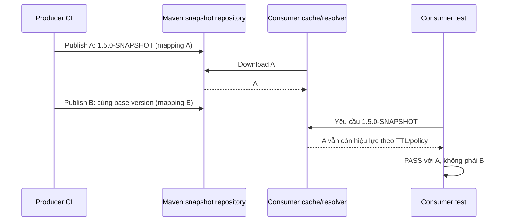
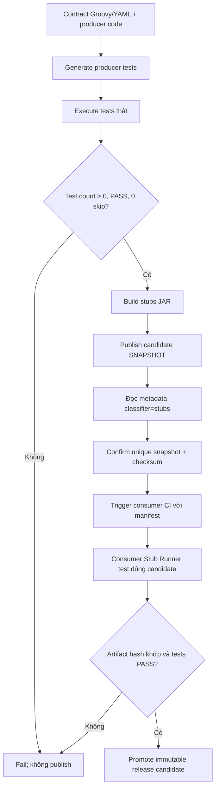

# Cache dependency mà vẫn kiểm soát tính mới của SNAPSHOT

> **Chương:** CI/CD  
> **Module:** Spring Cloud Contract (`SPRING_CLOUD_CONTRACT`) — kiểm thử hợp đồng giữa producer và consumer bằng Groovy/YAML DSL cho HTTP hoặc thông điệp, sinh test phía producer, phát hành stub, dùng Stub Runner và tích hợp CI nhằm phát hiện thay đổi API không tương thích.

## Mục tiêu học tập

Sau bài này, bạn có thể:

1. Giải thích **vì sao cần cache dependency** trong CI nhưng cũng cần kiểm soát **đúng phiên bản SNAPSHOT** của producer và stub JAR mà consumer đang dùng.
2. Phân biệt Maven base version `1.5.0-SNAPSHOT` với **timestamped/unique snapshot** (ví dụ `1.5.0-20261124.051500-7`) và hiểu vai trò của `maven-metadata.xml`.
3. Nhận diện các lớp cache độc lập: Maven local repository, Gradle dependency cache, CI cache action, artifact repository proxy, Spring Cloud Contract **Stub Runner Aether resolver**, Gradle task/build cache.
4. Sử dụng Maven `<updatePolicy>` và `mvn -U`, Gradle `cacheChangingModulesFor(...)` và `--refresh-dependencies` **đúng phạm vi**, không nhầm cờ của một công cụ với hành vi bộ tải khác.
5. Cấu hình Stub Runner dùng `REMOTE` và tọa độ `group:artifact:version:stubs`, hiểu khi nào `LOCAL` hoặc `CLASSPATH` có thể khiến test tiêu thụ dữ liệu cũ.
6. Thiết kế chính sách **cache ổn định cho release dependencies** và **freshness riêng cho candidate SNAPSHOT**, tránh xóa toàn bộ cache không cần thiết.
7. Xác minh **artifact thực tế được lấy từ đâu, timestamp/build number nào, checksum nào, commit producer nào**, không chỉ dựa vào việc test PASS.
8. Tổ chức producer verification → publish candidate → xác minh artifact đã sẵn sàng → consumer compatibility tests → promote/release với quality gates rõ ràng.
9. Chẩn đoán test xanh với stub cũ, negative cache, proxy metadata cũ, runner offline, cache hit và sai đường dẫn repository.
10. Ưu tiên **candidate artifacts bất biến** khi cần tái lập kết quả phát hành, sử dụng SNAPSHOT một cách có kiểm soát trong quá trình phát triển.

## 1. Tình huống: producer đã sửa API, consumer vẫn xanh vì stub cũ

Giả sử hai nhóm có pipeline tách biệt:

- `inventory-service` (producer): công bố HTTP contract và `inventory-service-*-stubs.jar`.
- `checkout-service` (consumer): dùng Stub Runner để kiểm thử HTTP client với stubs đó.

Producer đang phát hành bản:

```text
com.example:inventory-service:1.5.0-SNAPSHOT:stubs
```

Ở lần publish A, contract mô tả:

```json
{
  "sku": "SKU-001",
  "available": true,
  "quantity": 4
}
```

Ngày hôm sau, producer thay đổi implementation hoặc contract; bản publish B có thêm `warehouse` hoặc đã sửa lỗi `quantity`. Producer CI verify và upload **một SNAPSHOT mới với cùng base version**.

Nhưng consumer CI vẫn dùng cache từ publish A. Mặc dù người phát triển đọc mã producer mới và mong consumer test B, test thực tế chỉ gọi WireMock nạp mapping A. Consumer test có thể vẫn xanh, nhưng **không kiểm tra contract mới nhất**.



**Vấn đề không nhất thiết nằm ở Spring Cloud Contract.** Consumer đã kiểm thử đúng những gì stub A nói, nhưng **pipeline không có bằng chứng stub A là candidate mà release đang muốn xét**.

### 1.1. Hai mục tiêu đều quan trọng

| Mục tiêu | Nếu làm không tốt | Điều cần kiểm soát |
| --- | --- | --- |
| **Tốc độ** | Mỗi job tải lại hàng trăm release dependencies | Cache release dependencies/Gradle/Maven local có chính sách |
| **Tính mới** | Consumer kiểm tra stub SNAPSHOT cũ | Metadata freshness, candidate resolution, checksum/provenance |
| **Tái lập** | Cùng tên `-SNAPSHOT` hôm nay và ngày mai trỏ nội dung khác | Ghi resolved unique snapshot hoặc dùng candidate version bất biến |
| **Bảo mật** | Cache/repository bị thay bằng artifact không mong muốn | Repository allowlist, checksums, quyền ghi, secrets |
| **Chất lượng** | Stub mới chưa được producer verify mà đã publish | Producer verification và test report gate |

Không nên giải quyết bằng cách **tắt toàn bộ cache vĩnh viễn**: điều đó làm CI chậm nhưng vẫn không bảo đảm artifact đúng nếu repository hoặc URL sai. Cần xác minh **đúng candidate**.

## 2. SNAPSHOT thực sự là gì?

Trong hệ Maven, `1.5.0-SNAPSHOT` là **base version có thể thay đổi**. Repository Maven hỗ trợ *unique snapshots* có thể lưu các lần deploy dưới tên chứa timestamp và số lần build:

```text
Base version:
  1.5.0-SNAPSHOT

Hai lần publish (giá trị minh họa):
  1.5.0-20261124.045000-6
  1.5.0-20261124.051500-7
```

Một stub artifact có classifier `stubs` và type `jar` có thể có tên vật lý:

```text
inventory-service-1.5.0-20261124.051500-7-stubs.jar
```

Trong khi dependency được khai báo là:

```text
com.example:inventory-service:1.5.0-SNAPSHOT:stubs
```

### 2.1. maven-metadata.xml chọn unique snapshot nào

Ở Maven-compatible repository, metadata dưới đường dẫn:

```text
com/example/inventory-service/1.5.0-SNAPSHOT/maven-metadata.xml
```

có thể chứa các trường tương tự:

```xml
<metadata>
  <groupId>com.example</groupId>
  <artifactId>inventory-service</artifactId>
  <version>1.5.0-SNAPSHOT</version>
  <versioning>
    <snapshot>
      <timestamp>20261124.051500</timestamp>
      <buildNumber>7</buildNumber>
    </snapshot>
    <lastUpdated>20261124051500</lastUpdated>
    <snapshotVersions>
      <snapshotVersion>
        <classifier>stubs</classifier>
        <extension>jar</extension>
        <value>1.5.0-20261124.051500-7</value>
        <updated>20261124051500</updated>
      </snapshotVersion>
    </snapshotVersions>
  </versioning>
</metadata>
```

**Đây là metadata minh họa**, không phải response được tải từ repository thật. Repository thực có thể chứa các `snapshotVersion` khác cho POM, main JAR và các classifier khác.

Với Stub Runner, **classifier `stubs` rất quan trọng**. Kiểm tra metadata của **`classifier=stubs, extension=jar`**, đừng chỉ xem phiên bản main JAR. Nếu producer publish main JAR mà quên stubs classifier, metadata không chứng minh đã có stubs mới.

### 2.2. Mutable base version và unique snapshot không đồng nghĩa với release bất biến

Maven cho phép nhiều unique snapshots tương ứng cùng base version. Nhưng một dependency khai báo `1.5.0-SNAPSHOT` thường được resolver quyết định phiên bản cụ thể theo metadata/policy.

Do đó, `1.5.0-SNAPSHOT` **không phải một khóa nội dung bất biến**. Nếu cần tái lập chính xác một lần kiểm thử, phải lưu được một trong các bằng chứng:

- Timestamped unique snapshot đã resolve.
- SHA-256 của JAR thực sự được sử dụng.
- Commit/build producer và artifact provenance liên kết checksum.
- Hoặc tốt hơn cho release candidate: version/build ID **bất biến**, ví dụ `1.5.0-rc.7`, không ghi đè.

Một `-SNAPSHOT` có cùng tên hợp lý ở giai đoạn phát triển; **không nên là chứng cứ duy nhất** để phát hành chính thức.

## 3. Sáu lớp cache có thể làm kết quả khác nhau

| Lớp | Nơi thường lưu | Cache cái gì? | Cách kiểm soát |
| --- | --- | --- | --- |
| **Maven local** | `~/.m2/repository` hoặc custom `maven.repo.local` | POM, JAR, metadata của artifact Maven | `updatePolicy`, `mvn -U`, repository đúng, kiểm tra tọa độ |
| **Gradle dependency cache** | `$GRADLE_USER_HOME/caches/modules-2` | Module metadata, artifacts, kết quả chọn version | `cacheChangingModulesFor`, `--refresh-dependencies` |
| **Stub Runner resolver** | Bộ tải Aether/Maven và vùng lưu cục bộ của nó theo cấu hình | Stub JAR được yêu cầu khi test khởi động | `stubsMode`, `repositoryRoot`, tọa độ, log resolution, xác minh artifact |
| **CI cache action/image layer** | Cache của runner/container | Thư mục Maven/Gradle, tool dependencies | Cache key, restore policy, bảo vệ secret |
| **Repository proxy/CDN** | Nexus/Artifactory proxy hoặc trung gian mạng | Maven metadata, artifact, kết quả 404 | TTL/policy của repository và quyền publish |
| **Gradle build/task cache** | Build outputs/test outputs | Kết quả task, compiled classes/test outputs | `--rerun-tasks`, `--no-build-cache` khi cần chạy mới |

**Cảnh báo trọng tâm:** các lớp này không thể thay cho nhau. Một cờ Gradle chỉ điều chỉnh **Gradle dependency resolution** không thể tự ép Aether downloader nằm bên trong Stub Runner phải tải lại JAR. Tương tự `mvn -U` làm Maven CLI kiểm tra SNAPSHOT theo policy, nhưng **không đủ để chứng minh** một Stub Runner runtime resolver độc lập đã chọn đúng stub candidate.

### 3.1. Build cache khác dependency cache

- **Dependency cache:** tái sử dụng artifact bên ngoài như thư viện, POM, stub dependency.
- **Build/task cache:** tái sử dụng kết quả công việc Gradle như compilation/test output.
- **Test state cache:** context/server/singleton có thể giữ WireMock mappings hoặc state nếu tái sử dụng trong cùng process.

Ví dụ `./gradlew clean test --refresh-dependencies` kiểm tra lại dependencies nhưng không có nghĩa test chắc chắn chạy nếu task graph/filter/skip cấu hình sai; `--rerun-tasks` được dùng riêng khi muốn yêu cầu Gradle chạy lại tasks. Cả hai **không** thay thế kiểm tra JUnit reports và artifact thực tải.

### 3.2. Local là của runner nào?

Nếu producer CI runner A chạy:

```bash
mvn install
```

thì artifact được cài vào local repository của **runner A**. Consumer CI runner B không tự thấy JAR ấy. Khi CI tách máy/container, cần một kho `REMOTE` hoặc cơ chế chuyển artifact.

Ngược lại, khi developer vừa `mvn install` bản cũ, một consumer test dùng `LOCAL` có thể cố tình hoặc vô tình lấy bản cũ dù repository remote đã có snapshot mới.

### 3.3. Offline không tạo tính mới

- Maven `-o` sử dụng dữ liệu offline.
- Gradle `--offline` dùng cache đang có và không hỏi remote.
- Stub Runner `CLASSPATH` dùng mapping đóng gói trong test classpath.

Các chế độ này **hữu ích cho tái lập offline** khi đã khóa và xác minh artifacts, nhưng **không** bảo đảm có candidate mới nhất trên repository.

## 4. Maven: updatePolicy cho SNAPSHOT

Maven cho phép cấu hình chính sách kiểm tra mới của snapshot repository theo `<snapshots><updatePolicy>...`.

| Giá trị | Ý nghĩa |
| --- | --- |
| `always` | Thử kiểm tra cập nhật ở mỗi lần cần resolve theo Maven policy |
| `daily` | Kiểm tra theo ngày; thường là mặc định |
| `interval:X` | Kiểm tra theo chu kỳ X phút, ví dụ `interval:10` |
| `never` | Không chủ động kiểm tra cập nhật theo chính sách |

Một cấu hình **consumer POM hoặc Maven settings profile** minh họa:

```xml
<repositories>
  <repository>
    <id>company-stubs-snapshots</id>
    <url>https://repo.example.org/repository/stubs-snapshots/</url>
    <releases>
      <enabled>false</enabled>
    </releases>
    <snapshots>
      <enabled>true</enabled>
      <updatePolicy>always</updatePolicy>
      <checksumPolicy>fail</checksumPolicy>
    </snapshots>
  </repository>
</repositories>
```

`repo.example.org` là **địa chỉ giả**. Dự án thật phải thay bằng repository công ty đã cấp quyền. `checksumPolicy=fail` yêu cầu Maven kiểm tra checksum có hiệu lực theo khả năng repository; nó **không** thay thế chữ ký, kiểm soát access hoặc kiểm chứng provenance.

**Lưu ý:** nếu môi trường dùng mirror qua Maven `settings.xml`, đích thực tế có thể là mirror/proxy khác với URL khai báo trong POM. Khi debug luôn xem **effective settings, mirror, repository IDs và logs resolution**.

### 4.1. Maven CLI -U

Lệnh:

```bash
mvn -B -U clean verify
```

- `-B`: non-interactive/batch mode.
- `-U` (hoặc `--update-snapshots`): yêu cầu Maven kiểm tra missing releases và cập nhật SNAPSHOT từ remote.
- `clean verify`: chạy Maven lifecycle dự án, bao gồm tests đã cấu hình.

`-U` **không bắt repository mới xuất hiện nếu chưa được cấu hình** và không sửa credentials sai. Nếu remote repository chưa có candidate B, chạy `-U` vẫn không thể lấy B.

Khi chạy consumer tests với Stub Runner, **phải kiểm tra riêng runtime stub resolution**. Stub Runner có Aether-based downloader riêng trong test JVM; do đó không kết luận `mvn -U` buộc Stub Runner chọn B chỉ vì Maven CLI được gọi với `-U`.

### 4.2. Lệnh làm SNAPSHOT khó cập nhật

```bash
mvn -o verify
mvn -nsu verify
```

- `-o` là offline.
- `-nsu` yêu cầu không cập nhật snapshots trong Maven CLI.

Các lệnh này không phù hợp với một **freshness gate cần candidate mới từ remote**. Chúng có thể phù hợp khi muốn kiểm thử bằng artifact đã khóa/lưu local, nhưng khi đó cần nói rõ **đang kiểm thử bản nào**.

### 4.3. Không cấu hình updatePolicy=always cho mọi nơi vô điều kiện

Khi pipeline chạy hàng trăm modules, metadata requests cho mọi SNAPSHOT ở mỗi job có thể tạo tải lớn. Một chính sách hợp lý:

- **Development branch:** `daily` hoặc `interval:10` tùy nhịp feedback.
- **Candidate compatibility job:** kiểm tra mới nhất có chủ đích trước khi test, đồng thời ghi resolved artifact.
- **Release job:** ưu tiên **immutable candidate/release version**, không để version di động làm thay đổi kết quả giữa các lần chạy.
- **Những dependencies đã release:** pin version và tận dụng cache bình thường.

## 5. Gradle: changing module khác dynamic version

Trong Gradle, `1.5.0-SNAPSHOT` được xem là **changing module**. Gradle thường cache module metadata/artifact changing trong **24 giờ** theo mặc định; sau thời gian ấy mới kiểm tra lại nếu không có cách buộc refresh khác.

Một version như `1.+` là **dynamic version**, được cache theo cơ chế **khác**. Chúng đều có TTL mặc định thường là 24 giờ, nhưng là hai lựa chọn khác nhau.

| Loại | Ví dụ | Cơ chế |
| --- | --- | --- |
| **Fixed release** | `1.5.0` | Thông thường bất biến; cache bình thường |
| **Changing SNAPSHOT** | `1.5.0-SNAPSHOT` | `cacheChangingModulesFor` |
| **Dynamic selector** | `1.+` | `cacheDynamicVersionsFor` |
| **Dynamic SNAPSHOT selection** | Một selector tìm latest snapshot | Cần xem cả metadata resolution và artifact changing |
| **Non-SNAPSHOT but republished** | `1.5.0` bị ghi đè trái policy | Phải tránh; nếu buộc dùng changing cần explicit flag, nhưng là anti-pattern |

### 5.1. Giảm TTL khi thật sự cần

Fragment `build.gradle` (Groovy DSL):

```groovy
configurations.configureEach {
    resolutionStrategy {
        // Snapshot/changing modules: kiểm tra lại sau 10 phút.
        cacheChangingModulesFor 10, 'minutes'

        // Dynamic selector như 1.+: chọn lại version sau 30 phút.
        cacheDynamicVersionsFor 30, 'minutes'
    }
}
```

Trong ví dụ này, chính sách áp dụng cho **mọi configuration**. Với dự án lớn, nên giới hạn ở những configurations dùng candidate dependencies; không cần đặt TTL ngắn cho mọi dependency.

Kotlin DSL tương đương:

```kotlin
configurations.configureEach {
    resolutionStrategy {
        cacheChangingModulesFor(10, "minutes")
        cacheDynamicVersionsFor(30, "minutes")
    }
}
```

### 5.2. Khai báo dependency stubs nếu thực sự resolve bằng Gradle

Một ví dụ **Gradle dependency resolution** của stub JAR:

```groovy
repositories {
    maven {
        url = uri('https://repo.example.org/repository/stubs-snapshots/')
        mavenContent {
            snapshotsOnly()
        }
    }
}

dependencies {
    testImplementation(
        'com.example:inventory-service:1.5.0-SNAPSHOT:stubs@jar'
    )
}
```

Gradle nhận `-SNAPSHOT` là changing; không cần ghi `changing = true` chỉ vì suffix `-SNAPSHOT`. Với dependency không mang `-SNAPSHOT` nhưng được phép thay đổi (trường hợp hiếm và không khuyến khích), có thể khai báo `changing = true`.

**Ranh giới quan trọng:** đoạn `testImplementation(...)` là **Gradle resolve dependency**. Nếu application test dùng `@AutoConfigureStubRunner` và để **Stub Runner tự tải artifact vào lúc test chạy**, thì Gradle không phải bộ tải stubs ấy. `cacheChangingModulesFor` **không chắc điều khiển Stub Runner Aether downloader**.

### 5.3. Force refresh trong Gradle

```bash
./gradlew test --refresh-dependencies --console=plain
```

Lệnh này buộc Gradle **kiểm tra lại dependency metadata/artifacts theo cơ chế resolution của Gradle**. Nó **không có nghĩa tải mọi JAR lại từ đầu**: nếu checksums/metadata vẫn như cũ, Gradle có thể sử dụng artifact đã cache.

Khi cần chạy lại test task mới, có thể thêm:

```bash
./gradlew clean test \
  --refresh-dependencies \
  --rerun-tasks \
  --console=plain
```

Cần kiểm tra đúng task: khi producer dùng Spring Cloud Contract Gradle plugin, generated verification tests thường chạy trong `contractTest`, không phải `test`; khi consumer dùng test suite khác, phải gọi đúng test task của consumer.

### 5.4. --offline và Gradle dependency locking

```bash
./gradlew test --offline
```

`--offline` chỉ dùng dữ liệu đã có trong cache; đây **không phải freshness gate**. Nếu muốn **tái lập artifact cụ thể** hơn là dùng latest SNAPSHOT, ưu tiên version bất biến, dependency locking, checksum/provenance và repository policy phù hợp.

**Không kỳ vọng dependency lock cố định nội dung của cùng base `-SNAPSHOT` đã bị publish lại.** Locking thường giải quyết **version selection**, trong khi changing module vẫn có thể đổi **bytes** với cùng version. Muốn cố định bytes cần checksum/verified provenance hoặc immutable artifact.

## 6. Stub Runner: không nhầm build cache với stub downloader

Spring Cloud Contract Stub Runner có thể lấy stubs qua:

- `CLASSPATH`: scan mappings trên classpath.
- `LOCAL`: dùng local Maven repository/storage.
- `REMOTE`: tải từ remote repository (ví dụ Nexus/Artifactory) qua Aether-based solution.

Ví dụ consumer test lấy stubs SNAPSHOT:

```java
@SpringBootTest
@AutoConfigureStubRunner(
    ids = "com.example:inventory-service:1.5.0-SNAPSHOT:stubs",
    stubsMode = StubRunnerProperties.StubsMode.REMOTE,
    repositoryRoot =
        "https://repo.example.org/repository/stubs-snapshots/"
)
class CheckoutInventorySnapshotTest {

    @Autowired
    StubFinder stubFinder;

    @Test
    void checkoutCanReadStockFromSelectedStub() {
        URL stubUrl = stubFinder.findStubUrl(
            "com.example", "inventory-service"
        );

        InventoryClient client = new InventoryClient(stubUrl);
        InventoryClient.Stock result = client.fetch("SKU-001");

        assertEquals("SKU-001", result.sku());
        assertEquals(4, result.quantity());
    }
}
```

**Snippet minh họa:** cần imports, dependencies Spring Boot/Stub Runner, `InventoryClient` thật với constructor nhận `URL`, và exception handling theo project. `REMOTE` yêu cầu repository URL và credentials đúng. Không nên dùng placeholder URL trong project thật.

### 6.1. Điều cần xác minh khi test khởi động

Không chỉ nhìn assertion PASS. Hãy xác minh:

1. `Stub Runner` thực sự đã dùng `REMOTE`, không phải `CLASSPATH` hoặc `LOCAL` do một cấu hình override.
2. `repositoryRoot` là repository chứa SNAPSHOT mới, không phải releases hoặc một mirror cũ.
3. `ids` có **groupId, artifactId, base version, classifier `stubs`** chính xác.
4. Log resolver cho biết artifact được tìm thấy/tải và WireMock server đã khởi động.
5. Mapping mới nhất có trong JAR được nạp, đặc biệt những contract đã thay đổi.
6. JAR đó tương ứng **timestamped snapshot/checksum/producer build** mà pipeline đang đánh giá.

Nếu bạn chỉ thấy `findStubUrl(...)` trả URL, điều đó xác nhận **có stub server chạy**, chưa xác nhận **artifact đúng candidate**.

### 6.2. Vì sao -U không đủ chứng minh Stub Runner tươi mới?

`mvn -U` là option của **Maven CLI**. Còn Stub Runner gọi **Aether downloader trong test JVM**, có cơ chế repository và local caching riêng theo cấu hình môi trường.

Ví dụ:

```text
mvn -U verify
  ├── Maven CLI giải quyết dependencies cho build (có -U)
  └── JUnit test khởi động Stub Runner
        └── Aether resolver tải/chọn stubs
```

Hai bước có thể dùng chung một local repository hoặc metadata theo cấu hình, nhưng **không được giả định** rằng flag của bước một đã đổi mọi caching behavior của bước hai.

Cách kiểm soát mạnh hơn:

- Publish **unique candidate version** hoặc ghi unique SNAPSHOT/chính xác checksum.
- Cho Stub Runner tải từ `REMOTE` với repository xác định.
- Log và verify **artifact thật** đã được resolver chọn, không chỉ base version.
- Tách CI cache khi cần chẩn đoán, hoặc dùng runner sạch ở compatibility gate quan trọng.
- Fail nếu artifact khác với candidate mà producer CI đã công bố.

### 6.3. Cạm bẫy của phiên bản động

Một cách cấu hình thường thấy:

```text
com.example:inventory-service:+:stubs
```

`+` có nghĩa Stub Runner có thể chọn bản "latest" theo những artifact nó tìm thấy. Điều đó hữu ích khi muốn thử compatibility với phiên bản mới nhất, nhưng **không tái lập được** và có thể chọn release thay vì SNAPSHOT theo metadata/policy.

**Không trộn mục tiêu "luôn latest" với "kiểm thử đúng candidate build B".** Nếu cần B, hãy yêu cầu B cụ thể và xác minh B.

## 7. Chiến lược cache ba tầng: nhanh, mới, tái lập

Thay vì dùng cùng một chính sách cho toàn bộ pipeline, phân tách theo mục tiêu.

| Nhịp | Dependency ổn định | SNAPSHOT stubs | Bằng chứng cần |
| --- | --- | --- | --- |
| **Dev local** | Cache bình thường | TTL phù hợp hoặc refresh khi cần | Log repo/version; test nhanh |
| **PR producer** | Cache bình thường | Verify implementation và sinh candidate | Producer tests executed PASS |
| **PR consumer** | Cache bình thường | Có thể pin stable stubs; candidate run riêng | Consumer test report + artifact |
| **Candidate compatibility** | Cache release dependencies | Resolve candidate mới/immutable | Commit, GAV, SHA-256, case count |
| **Release promotion** | Cache bình thường | **Không dùng mutable base SNAPSHOT như bằng chứng duy nhất** | Immutable artifact, provenance |
| **Nightly latest** | Cache bình thường | Có thể cập nhật thường xuyên | Báo cáo phiên bản thực resolve |

### 7.1. Cache key không thay freshness gate

CI có thể cache Maven/Gradle thư mục giữa các jobs, giúp build nhanh. Tuy nhiên:

- Cache key theo hash `pom.xml`/`build.gradle` **không đổi** chỉ vì producer vừa publish một SNAPSHOT mới.
- Nếu snapshot metadata còn trong cache, consumer có thể lấy bản cũ theo TTL.
- Nếu cache action không khôi phục thư mục ấy, Aether/Gradle có thể vẫn thấy proxy repository metadata cũ.
- Một cache miss không bảo đảm candidate B đã được upload/xuất hiện đúng repository.
- Một cache hit không tự là lỗi nếu quality gate vẫn xác minh checksum của artifact mong muốn.

**Chọn cache key để tối ưu chi phí**, chọn **provenance + candidate verification** để bảo đảm correctness. Đó là hai quyết định khác nhau.

### 7.2. Không xóa toàn bộ ~/.m2 hay ~/.gradle mỗi lần

Ví dụ anti-pattern:

```bash
# Tránh dùng thường xuyên trong CI:
rm -rf ~/.m2/repository
rm -rf ~/.gradle/caches
```

Xóa toàn bộ cache khiến CI phải tải lại mọi dependency, tăng tải repository và không sửa được:

- Sai repository root.
- Sai classifier.
- Artifact B chưa được publish.
- Proxy metadata đang stale.
- Test đang dùng `CLASSPATH`.
- Producer verification bị skip.

**Nếu cần chẩn đoán**, có thể dùng **fresh ephemeral runner/local repository riêng** để thử một job, hoặc xóa **đúng một artifact path test-owned** sau khi kiểm tra cẩn thận. Không xóa cache dùng chung của máy phát triển/CI workers đang chạy.

## 8. Bước quan trọng nhất: xác minh đúng SNAPSHOT đã resolve

Giả sử producer CI publish một candidate:

```yaml
producer:
  service: inventory-service
  gitCommit: "a1b2c3d4"
  baseVersion: "1.5.0-SNAPSHOT"
  uniqueSnapshot: "1.5.0-20261124.051500-7"
  classifier: "stubs"
  extension: "jar"
  sha256: "<sha256-of-published-stubs-jar>"
  contractTestsExecuted: 12
  contractTestsFailed: 0
  contractTestsSkipped: 0
```

Đây là **manifest do CI/team tự định nghĩa**; Spring Cloud Contract không tự sinh đúng cấu trúc này. Trong pipeline thật, giá trị phải lấy từ source/reports/artifact repository.

Consumer CI cần đối chiếu:

```text
Expected candidate:
  com.example:inventory-service:1.5.0-20261124.051500-7:stubs
  sha256 = X
  producer commit = a1b2c3d4

Observed:
  Artifact được Stub Runner/test JVM dùng
  sha256 = Y
  mappings/contract revision = ?
```

Nếu `X != Y`, test **không được coi là đã kiểm tra candidate**, kể cả khi mọi assertions PASS.

### 8.1. Tại sao cần checksum thay vì chỉ nhìn timestamp?

Timestamped unique snapshot giúp phân biệt những lần publish ở repository, nhưng:

- Một proxy có thể hiển thị metadata mới trong khi artifact tải từ nguồn khác.
- Có thể có nhiều classifiers cùng base version, nhưng chỉ stub JAR chưa được cập nhật.
- Trong CI, ai đó có thể trỏ đến repository sai hoặc dùng một file local cùng tên.
- Log có thể chỉ ghi `1.5.0-SNAPSHOT`, không phơi rõ unique physical version.

**Checksum gắn với bytes**. Nếu producer ghi checksum B và consumer ghi checksum A, bạn có bằng chứng cụ thể rằng hai job dùng artifact khác nhau.

Checksum **không tự chứng minh tính hợp lệ/trust**; nó phải được liên kết với producer CI identity, source commit và repository đã tin cậy.

### 8.2. Làm thế nào lấy checksum?

Trên môi trường thực có file JAR được tải có thể dùng các tiện ích sẵn có để tính SHA-256, ví dụ lệnh hệ điều hành hoặc artifact checksum service của repository. Với môi trường Linux:

```bash
sha256sum inventory-service-1.5.0-20261124.051500-7-stubs.jar
```

**Đường dẫn trên là ví dụ**, chỉ chạy khi đúng file đã được xác định là artifact được test tải. Việc tính hash cho một file `stubs.jar` khác nằm trong workspace không chứng minh WireMock đã nạp file ấy.

Nếu Stub Runner không công khai trực tiếp đường dẫn artifact trong API bạn dùng, bổ sung **lớp download/copy có kiểm soát** trước test hoặc kiểm tra resolver logs + local repository path và nguồn artifact. Với pipeline quan trọng, một lựa chọn dễ audit là chuẩn hóa **candidate JAR immutable** rồi đưa chính file đó vào consumer test runtime.

### 8.3. Kiểm tra nội dung mapping khi version trông đúng

Một stub JAR có thể có tọa độ đúng nhưng thiếu một contract mapping vì producer build config sai. Hãy kiểm tra:

- `META-INF/.../mappings` và `contracts` theo layout plugin.
- Có mapping cho scenario mới thay đổi.
- Header/status/body matchers của WireMock đúng contract.
- Label/destination khi là messaging.
- Nguồn contract thực sự được producer verification xử lý.

Không cần dump toàn bộ fixture vào log CI; chỉ lưu số mapping, tên scenario và manifest không nhạy cảm.

## 9. Producer pipeline: publish phải đến sau verification

Một candidate SNAPSHOT không nên được publish chỉ vì Gradle/Maven đã **sinh** WireMock mappings.



### 9.1. Maven producer

Với Spring Cloud Contract Maven plugin, producer có thể chạy:

```bash
# Cần plugin/producer base class/test suite được cấu hình.
mvn -B clean verify

# Phát hành sau quality gates của CI;
# deploy chạy Maven lifecycle theo cấu hình project.
mvn -B deploy
```

**Đừng dùng `-DskipTests` hoặc `maven.test.skip`** trong job publish "verified stubs". Với contract có `inProgress`, cần kiểm soát `failOnInProgress` và đúng chính sách release; một in-progress stub không phải lời hứa đã được producer xác minh.

### 9.2. Gradle producer

Với plugin Gradle, generated producer verification thường có `contractTest` trong source set riêng:

```bash
./gradlew clean build --console=plain

# Chỉ sau khi producer verification / gate PASS:
./gradlew publish --console=plain
```

Cần cấu hình `maven-publish` cho `verifierStubsJar`. Hai lệnh trên mô tả **thứ tự**, không tự bảo đảm một người gọi thẳng `publish` sẽ luôn chạy `contractTest`; CI/build graph phải định nghĩa gate đúng.

### 9.3. Không chạy consumer trước khi artifact có thể resolve

Repository có thể cần thời gian để hiển thị SNAPSHOT mới qua metadata/proxy. Nếu consumer job khởi động ngay sau publish, nó có thể đọc:

- Metadata cũ → chọn A.
- Metadata mới nhưng stub JAR chưa xuất hiện → 404.
- Artifact đúng nhưng permission/credentials chưa được cập nhật → 401/403.

**Bước availability gate** nên kiểm tra classifier `stubs`, unique snapshot và checksum của **đúng candidate** trước khi trigger consumer tests. Dùng bounded retry với timeout cụ thể, fail nếu quá hạn; không âm thầm fallback sang artifact cũ.

## 10. Consumer CI: freshness gate trước khi Stub Runner test

Một **pseudocode pipeline** có thể mô tả chính sách, không ràng buộc vào GitHub Actions/GitLab/Jenkins:

```yaml
jobs:
  producer_verify:
    command: "mvn -B clean verify"
    require:
      contract_tests_executed: "> 0"
      contract_test_failures: 0
      skipped_required_contract_tests: 0

  publish_snapshot:
    needs: [producer_verify]
    output:
      base_version: "1.5.0-SNAPSHOT"
      resolved_unique_snapshot: "<from-repository-metadata>"
      stub_sha256: "<actual-sha256>"
      producer_commit: "<commit>"

  verify_candidate_available:
    needs: [publish_snapshot]
    checks:
      classifier: "stubs"
      extension: "jar"
      repository: "snapshots"
      checksum_matches: true
      retry_until_timeout: true

  consumer_contract:
    needs: [verify_candidate_available]
    cache:
      stable_dependencies: true
      mutable_candidate_validated: true
    tests:
      stub_runner_mode: "REMOTE"
      stub_version: "<candidate>"
      require_resolved_sha256_match: true
      require_test_count_positive: true
      require_failures_zero: true

  promote:
    needs: [consumer_contract]
    require_candidate_provenance_match: true
```

Đây là **YAML mô tả ý định**, không phải cú pháp chạy trực tiếp trên một CI vendor. Team cần hiện thực các `checks` bằng repository API/script/plugin thích hợp.

### 10.1. Không lấy latest SNAPSHOT từ một cache key

Một cache key theo ngày hoặc theo `pom.xml` không đủ để định danh candidate. Để biết "fresh", phải kiểm tra **metadata và artifact**. Cache có thể được giữ để tăng tốc download, nhưng freshness gate phải fail nếu checksum không khớp.

### 10.2. Nếu đang dùng Maven consumer

```bash
mvn -B -U verify
```

Kết hợp với **Stub Runner REMOTE + artifact verification**. `-U` hữu ích cho Maven dependency checks nhưng vẫn cần xác minh Stub Runner runtime đã chọn đúng candidate.

### 10.3. Nếu đang dùng Gradle consumer

```bash
./gradlew clean test \
  --refresh-dependencies \
  --rerun-tasks \
  --console=plain
```

Nếu Stub Runner **tự tải stubs** lúc test chạy, thêm `--refresh-dependencies` chỉ kiểm tra Gradle dependencies; **không bỏ bước verify stub artifact**. Nếu test nằm trong task khác như `integrationTest`, thay `test` bằng đúng task.

## 11. Release candidate bất biến: cách đơn giản hóa bằng chứng

SNAPSHOT rất tiện cho tích hợp liên tục, nhưng nó thay đổi theo thời gian. Khi release gate cần tái lập, cân nhắc tạo một **candidate version bất biến**:

```text
Mutable development snapshot:
  com.example:inventory-service:1.5.0-SNAPSHOT:stubs

Immutable candidate (chính sách của team):
  com.example:inventory-service:1.5.0-rc.7:stubs

Stable release:
  com.example:inventory-service:1.5.0:stubs
```

Tùy artifact repository, các version `-rc.7` có thể được xử lý như release artifacts thay vì snapshot. Cần cấu hình publication/repositories phù hợp và **cấm overwrite**.

### 11.1. Ưu điểm

- Mỗi CI job yêu cầu **một tọa độ cố định**.
- Maven/Gradle cache có thể được tận dụng mà không lo nội dung đổi dưới cùng version.
- Consumer rerun kiểm tra lại đúng artifact cũ khi cần debug.
- Dễ gắn producer commit, checksums, SBOM/provenance và test report.
- Rollback/compatibility giữa producer và consumer dễ theo dõi.

### 11.2. Không nhầm artifact version với API version

Một `inventory-service:1.5.0-rc.7:stubs` có thể chứa cả contracts cho `/api/v1` và `/api/v2`. Version artifact định danh build, còn version API định danh giao diện công khai.

Điều kiện để candidate được gọi verified:

- Producer code của đúng commit đã pass generated contract tests.
- Stub artifact sinh từ đúng source revision.
- Không có required tests skipped.
- Candidate checksum/provenance được ghi nhận.
- Consumer compatibility tests dùng **chính candidate đó**.

### 11.3. Khi nào vẫn dùng SNAPSHOT?

- Development branch cần feedback liên tục giữa các team.
- Nightly job kiểm tra producer candidate mới nhất.
- Thử nghiệm thay đổi contract trước khi ổn định.
- Pipeline có availability gate, checksum và logs đủ để xác minh unique snapshot.

**Không dùng SNAPSHOT mutable đơn lẻ làm chứng cứ cuối cho production release** nếu pipeline không lưu được chính xác bytes và commit đã test.

## 12. Những lỗi phổ biến trong pipeline SNAPSHOT

| Triệu chứng | Nguyên nhân khả dĩ | Cách điều tra |
| --- | --- | --- |
| Consumer PASS dù producer sửa contract | Stub A từ cache, test không dùng B | So resolved artifact, metadata, checksum |
| `mvn -U` rồi test vẫn dùng A | Stub Runner runtime resolver khác Maven CLI hoặc proxy stale | Xem Stub Runner mode/repository và artifact thực nạp |
| `--refresh-dependencies` không đổi stubs | Stub Runner tự tải qua Aether, Gradle không tải stub | Tách two resolvers, verify candidate |
| Gradle không kiểm tra snapshot trong ngày | Changing module TTL mặc định | Giảm `cacheChangingModulesFor` hoặc refresh có chủ đích |
| Maven không kiểm tra snapshot | `updatePolicy=daily`, `-nsu` hoặc offline | Kiểm tra settings/mirror, `-U` khi phù hợp |
| Stub Runner không tìm artifact | Sai GAV/classifier, repo root, auth, artifact chưa publish | Kiểm tra metadata classifier `stubs` |
| Repository có B nhưng CI thấy A | Proxy metadata stale/negative cache | Query đúng repo URL, kiểm tra TTL, invalidation theo policy |
| Mapping mới không xuất hiện | Producer publish main JAR nhưng quên stubs classifier | Kiểm tra `snapshotVersions` và JAR contents |
| Consumer lấy `+` và PASS nhầm | Latest selector chọn artifact không mong đợi | Pin candidate và ghi resolved unique version |
| Re-run một job ra kết quả khác | Mutable SNAPSHOT được publish thêm một lần | Dùng immutable candidate khi cần tái lập |
| CI offline vẫn xanh | Test dùng cache có sẵn, không kiểm tra remote | Ghi rõ offline mode; không coi là freshness gate |
| Cache key thay rồi vẫn stale | Repo/proxy metadata cũ hoặc Stub Runner LOCAL | Xem đúng lớp đang lưu bản cũ |
| Xóa toàn bộ cache khiến CI rất chậm | Chữa triệu chứng bằng cách phá mọi cache | Cache ổn định, chỉ refresh candidate |
| Test xanh với 0 contract tests | Plugin/test runner bỏ qua verifier | Report/test count gate của producer |
| SNAPSHOT B là provisional/inProgress | Stub được sinh nhưng producer chưa verify | Phân biệt provisional với verified, không promote |
| Hash đúng nhưng behavior sai | Contract thiếu invariant/producer mock sai | Review DSL, generated assertions và integration tests |

### 12.1. Phân biệt ba loại 404

Khi test gặp 404, tìm nó xảy ra ở đâu:

1. **Repository trả 404:** artifact hoặc metadata không tìm thấy.
2. **Stub Runner trả 404 qua WireMock:** stub server chạy nhưng request client không khớp mapping.
3. **Producer thật trả 404:** behavior thực trong producer/staging; có thể là một error contract hợp lệ.

Ba lỗi này yêu cầu cách sửa khác nhau. Không sửa HTTP contract khi nguyên nhân là repository chưa publish stub.

### 12.2. Tránh "cập nhật cache bằng cách xóa random directory"

Nếu cần tách lỗi:

- Chạy **một job chẩn đoán** với local Maven/Gradle cache riêng.
- Log repository/mirror và unique snapshot từ metadata.
- Tải đúng artifact candidate và so SHA-256.
- Chạy consumer test với chính candidate, không fallback.
- Đối chiếu kết quả với job sử dụng cache.

Không xóa thư mục cache production/shared runner khi chưa xác nhận đường dẫn và quyền sở hữu.

## 13. Kiểm chứng producer và consumer theo đúng contract

Snapshot freshness là điều kiện **phân phối artifact**, không thay thế tính đúng của hợp đồng.

Một contract HTTP YAML cho producer:

```yaml
name: stock_available
request:
  method: GET
  url: /api/stock/SKU-001
  headers:
    Accept: application/json
response:
  status: 200
  headers:
    Content-Type: application/json
  body:
    sku: SKU-001
    available: true
    quantity: 4
```

Groovy DSL tương đương:

```groovy
org.springframework.cloud.contract.spec.Contract.make {
    name 'stock_available'
    request {
        method 'GET'
        url '/api/stock/SKU-001'
        headers {
            header 'Accept': 'application/json'
        }
    }
    response {
        status 200
        headers {
            contentType(applicationJson())
        }
        body(
            sku: 'SKU-001',
            available: true,
            quantity: 4
        )
    }
}
```

**Chọn một DSL cho cùng interaction trong build.** Nếu đặt cả hai, có thể tạo generated tests/mappings trùng.

### 13.1. Producer contract verification

Producer test phải gọi **controller/service thật** trong phạm vi test và assert response theo contract. Nếu producer đổi `quantity = 4` thành `quantity = 0`, generated test phải FAIL.

Nếu chưa có producer verification PASS, dù stub JAR mới có checksum đúng thì **chưa thể gọi artifact là verified**.

### 13.2. Consumer Stub Runner verification

Consumer test phải gọi **client/handler thật** với Stub Runner, không chỉ assert server giả trả `200`. Với checkout, có thể assert cả việc số lượng 2 được phép, 5 không được phép dựa trên response `quantity = 4`.

Tuy nhiên, nếu Stub Runner dùng snapshot A thay vì B, những assertions này **chỉ bảo vệ A**. Do đó **quality gate kết hợp** cần:

```text
Producer verification PASS
AND
Candidate artifact đã publish / SHA-256 đúng
AND
Consumer Stub Runner tải đúng candidate
AND
Consumer assertions PASS
```

Không có điều kiện nào có thể được bỏ đi chỉ vì build tổng báo SUCCESS.

## 14. Messaging SNAPSHOT cũng có vấn đề tương tự

Với contract phát `OrderAccepted`:

```yaml
name: order_accepted
label: order_accepted
input:
  triggeredBy: publishOrderAccepted()
outputMessage:
  sentTo: orders.events
  headers:
    contentType: application/json
  body:
    eventType: OrderAccepted
    schemaVersion: 1
    orderId: ORD-1001
    amount: 240000
    currency: VND
```

Producer verification kiểm tra message đã phát theo contract. Consumer Stub Runner có thể kích hoạt event theo `label`, nhưng chỉ khi có **messaging adapter/binder** thích hợp; nó không tự dựng Kafka/RabbitMQ/JMS broker.

Nếu producer publish SNAPSHOT B đổi `amount` thành `total`, consumer test với SNAPSHOT A vẫn nhận `amount` và có thể xanh giả. Đó là **drift artifact giống hệt HTTP**, thậm chí nguy hiểm hơn nếu topic có event v1 còn trong backlog.

Để kiểm soát:

- Pin và verify đúng stubs artifact candidate.
- Ghi schema/event version, destination, label trong manifest.
- Chạy consumer listener thật với event candidate.
- Duy trì contract/handler cho event cũ trong migration window.
- Có broker integration tests khi serialization, routing, offset/ACK/retry quan trọng.

## 15. Bài tập thực hành

**Bài 1 — Phân tích timeline.** Producer publish `1.5.0-SNAPSHOT` A, consumer tải A, producer publish B nhưng trong vòng 24 giờ Gradle vẫn cache changing dependency. Giải thích vì sao consumer có thể PASS với A và cách xác nhận artifact thực tải.

**Bài 2 — Maven metadata.** Từ `maven-metadata.xml` ở mục 2, tìm unique version tương ứng `classifier=stubs` và `extension=jar`. Vì sao chỉ kiểm tra timestamp của main JAR là chưa đủ?

**Bài 3 — Maven update policy.** Cấu hình repository cho phép snapshot với `updatePolicy=interval:10`. Phân biệt hành vi với `always`, `daily` và `never`. Khi nào dùng `mvn -U`?

**Bài 4 — Gradle cache.** Viết Groovy DSL đặt `cacheChangingModulesFor(10, "minutes")` và `cacheDynamicVersionsFor(30, "minutes")`. Giải thích hai cơ chế khác nhau thế nào.

**Bài 5 — Ranh giới resolver.** Consumer `@AutoConfigureStubRunner` dùng `REMOTE` còn Gradle `testImplementation` không chứa stubs JAR. Vì sao chạy `./gradlew --refresh-dependencies test` không tự chứng minh Stub Runner đã tải B?

**Bài 6 — LOCAL vs REMOTE.** Producer CI cài stubs A bằng `mvn install` vào runner A; remote repo có B. Consumer CI ở runner B dùng `LOCAL`. Nó có chắc tải A hay B không? Cần thay đổi gì để chạy với B có chủ đích?

**Bài 7 — Cache key.** CI restore cache `~/.m2` theo hash `pom.xml`, nhưng producer publish B mà không đổi consumer POM. Tại sao hash key không thay và cache hit không phải bằng chứng freshness?

**Bài 8 — Quality gate.** Viết giả mã pipeline producer verify → publish SNAPSHOT → kiểm tra metadata `stubs` → so SHA-256 → consumer tests → promote. Ở những điểm nào phải fail thay vì fallback A?

**Bài 9 — Tính tái lập.** Một tuần sau, base `1.5.0-SNAPSHOT` trỏ C thay vì B. Làm sao rerun consumer compatibility test đã dùng B? Đề xuất unique snapshot/checksum hoặc immutable candidate.

**Bài 10 — Lỗi 404.** Phân biệt repository 404, WireMock 404 và producer 404; cho một ví dụ mỗi loại và cách điều tra phù hợp.

**Bài 11 — Messaging.** Producer thay `amount` thành `total` trong event `OrderAccepted` và publish B. Consumer vẫn nhận A từ cache. Thêm những checks nào bảo đảm test dùng event schema B?

**Bài 12 — Chính sách cache.** Đề xuất policy cho PR, candidate release, nightly và production release: lúc nào giữ cache ổn định, lúc nào refresh SNAPSHOT, khi nào buộc version immutable.

### Gợi ý đáp án

1. Changing module có TTL, A còn trong cache; kiểm tra unique snapshot và SHA-256 thực nạp.
2. Chọn `snapshotVersion` có `classifier=stubs`, `extension=jar` và `value=1.5.0-20261124.051500-7`.
3. `interval:10` kiểm tra theo 10 phút; `-U` yêu cầu Maven CLI kiểm tra snapshots ngay; không thay Stub Runner runtime verifier.
4. Changing module là bytes/metadata của một version có thể đổi; dynamic version là quyết định chọn version từ selector như `1.+`.
5. Gradle refresh chỉ áp dụng dependencies do Gradle resolve; Stub Runner dùng Aether downloader riêng.
6. `LOCAL` chỉ dùng local storage của runner B; có thể thiếu hoặc chứa bất kỳ bản nào đã cài trước. Dùng `REMOTE` và verify candidate B.
7. Consumer POM không đổi, nên key không đổi; metadata/artifact correctness phải được kiểm tra riêng.
8. Fail khi producer tests không PASS, classifier thiếu, hash sai, consumer tests fail hoặc artifact khác candidate.
9. Lưu artifact bytes/hash hoặc dùng immutable candidate version, không chỉ base `-SNAPSHOT`.
10. Repository 404 là artifact thiếu; WireMock 404 là mapping không match; producer 404 có thể là một API error contract.
11. Pin/verify checksum B, kiểm tra mappings/label/payload schemaVersion, chạy handler consumer và broker integration khi cần.
12. Release deps luôn cache bình thường; candidate có freshness + provenance; release dùng version bất biến.

## 16. Checklist áp dụng vào CI/CD

**Producer publish:**

- [ ] Producer Contract Verifier generated tests đã thực thi và PASS?
- [ ] Không có 0 test hoặc required tests skipped?
- [ ] Stub JAR có đúng classifier `stubs`, đúng contract revision?
- [ ] Publish hoàn tất và metadata chỉ tới đúng unique SNAPSHOT?
- [ ] Có SHA-256, producer commit và CI build ID?
- [ ] Repository cho phép snapshots và có permissions/secrets phù hợp?

**Consumer resolution:**

- [ ] Dùng đúng `stubsMode`: `REMOTE`, `LOCAL` hay `CLASSPATH` theo mục tiêu?
- [ ] `repositoryRoot` là URL snapshot repository đúng?
- [ ] `ids` có version/classifier rõ ràng, không dùng `+` ngoài chủ đích?
- [ ] CI biết base version lẫn unique snapshot/checksum thực tải?
- [ ] Hash artifact dùng trong tests khớp producer manifest?
- [ ] Không có silent fallback sang bản cũ khi candidate thiếu?
- [ ] Stub Runner đã nạp những mappings/event labels cần thiết?

**Cache và test gates:**

- [ ] Maven updatePolicy/`-U` hoặc Gradle changing TTL đã được chọn đúng phạm vi?
- [ ] Không nhầm Maven CLI/Gradle cache với Stub Runner Aether?
- [ ] Cache key chỉ tối ưu tốc độ, không được dùng thay artifact verification?
- [ ] Khi cần kiểm chứng mới, test task có thực thi và có JUnit reports?
- [ ] Không xóa toàn bộ cache shared runner theo thói quen?
- [ ] Candidate availability được kiểm tra bằng bounded retry?
- [ ] Release promotion dùng artifact bất biến hoặc checksum/provenance đã khóa?

## 17. Tổng kết

**Cache dependency và tính mới của SNAPSHOT là hai vấn đề cần giải quyết bằng hai cơ chế khác nhau.** Maven/Gradle/CI caches giúp build nhanh, nhưng `1.5.0-SNAPSHOT` là một **base version thay đổi theo thời gian**. Metadata `maven-metadata.xml` cho biết unique snapshot được publish theo classifier/extension; TTL và update policies quyết định lúc nào resolver kiểm tra lại.

Với **Maven**, `<updatePolicy>` và `-U` kiểm soát việc Maven CLI kiểm tra SNAPSHOT. Với **Gradle**, SNAPSHOT là changing module, dùng `cacheChangingModulesFor` hoặc `--refresh-dependencies` khi cần. Với **Spring Cloud Contract Stub Runner**, hãy chú ý **Aether downloader riêng**: lệnh refresh của build tool không thay thế việc xác minh stub artifact thực sự được tải và dùng trong test.

Một CI đáng tin giữ cache cho dependencies ổn định, **đối chiếu unique candidate/checksum với producer commit**, kiểm tra producer verification thực sự PASS, chỉ chạy consumer compatibility với đúng artifact và **promote immutable candidate** khi phát hành. Như vậy, tốc độ CI không đánh đổi khả năng phát hiện API breaking changes.

## Tài liệu tham khảo

- [Apache Maven — Settings Reference](https://maven.apache.org/settings.html) — `repositories`, `snapshots`, `updatePolicy` và `checksumPolicy`.
- [Apache Maven — Maven CLI Options](https://maven.apache.org/ref/3.9.8/maven-embedder/cli.html) — `-U/--update-snapshots`, `-nsu` và `-o`.
- [Apache Maven — Repository Metadata Model](https://maven.apache.org/ref/3-LATEST/maven-repository-metadata/repository-metadata.html) — `timestamp`, `buildNumber` và `snapshotVersions` theo classifier/extension.
- [Gradle — Dependency Caching](https://docs.gradle.org/current/userguide/dependency_caching.html) — changing modules, dynamic versions, cache TTL, `--refresh-dependencies` và `--offline`.
- [Gradle — ResolutionStrategy](https://docs.gradle.org/current/javadoc/org/gradle/api/artifacts/ResolutionStrategy.html) — `cacheChangingModulesFor` và `cacheDynamicVersionsFor`.
- [Gradle — Common Caching Problems](https://docs.gradle.org/current/userguide/common_caching_problems.html) — tác động của mutable dependencies và lời khuyên không republish immutable releases.
- [Spring Cloud Contract — Stub Runner Core](https://docs.spring.io/spring-cloud-contract/reference/project-features-stubrunner/stub-runner-core.html) — `REMOTE`, `LOCAL`, `CLASSPATH` và Aether downloader.
- [Spring Cloud Contract — Stub Runner Common Properties](https://docs.spring.io/spring-cloud-contract/reference/project-features-stubrunner/stub-runner-common.html) — `repositoryRoot`, `ids`, classifier và port.
- [Spring Cloud Contract — Generating Stubs at Runtime](https://docs.spring.io/spring-cloud-contract/reference/project-features-stubrunner/stub-runner-generate-stubs-at-runtime.html) — `inProgress` và phân biệt stubs chưa được producer verification.
- [Spring Cloud Contract — Gradle Project](https://docs.spring.io/spring-cloud-contract/reference/gradle-project.html) — `contractTest`, `generateClientStubs`, `verifierStubsJar` và publication.
