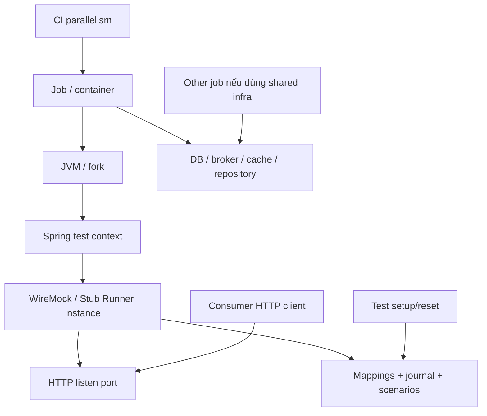
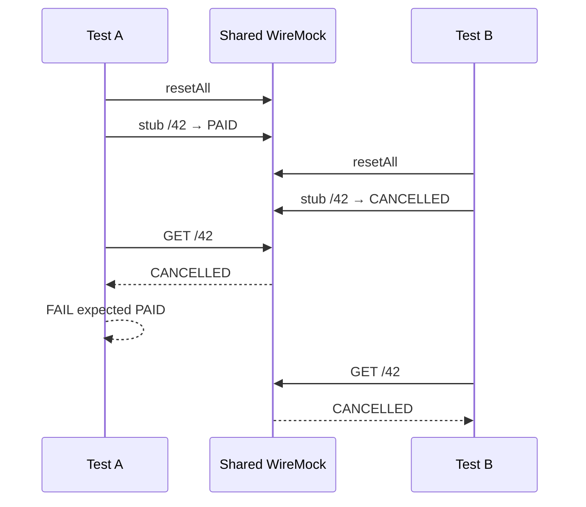
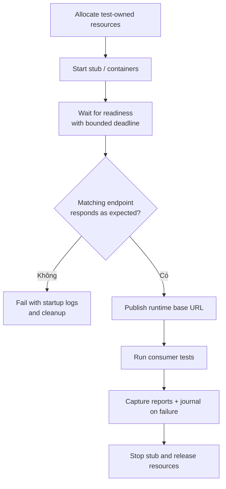

# Chạy song song và tránh xung đột cổng hoặc trạng thái stub

## 1. Vì sao CI/CD chạy song song dễ làm contract tests thất thường?

**Spring Cloud Contract** hỗ trợ định nghĩa hợp đồng HTTP hoặc thông điệp bằng **Groovy/YAML DSL**, sinh test phía producer, đóng gói và phát hành stub, rồi để consumer dùng **Stub Runner** kiểm thử với giao diện mô phỏng. Khi tích hợp CI/CD, các test ấy thường phải chạy nhanh, có thể chạy đồng thời trên nhiều thread, JVM, module hoặc job.

Chạy song song đem lại lợi ích rõ ràng: rút ngắn thời gian chờ phản hồi từ pipeline. Nhưng nếu các test cùng điều khiển một tài nguyên dùng chung, báo cáo sẽ có những lỗi khó tái hiện:

- Hai WireMock servers đều muốn bind `localhost:8080`, dẫn tới `Address already in use`.
- Hai tests dùng cùng WireMock server và cùng `/api/orders/42` nhưng đăng ký **hai response khác nhau**.
- Test A gọi `resetAll()` khi test B đang gửi request, khiến B nhận unmatched `404`.
- Test A đổi **scenario state** từ `Started` sang `PaymentCompleted`, khiến test B không còn thấy response đầu tiên.
- Test A xóa request journal sau khi test B gửi request, khiến assertion `verify(1, ...)` của B sai.
- Hai jobs dùng chung database, broker hoặc cache; một job dọn dữ liệu của job kia.
- Consumer resolve artifact phiên bản động khác với lần chạy trước, rồi mọi người đổ lỗi cho song song.

Một sai lầm phổ biến là cho rằng chỉ cần đổi sang **random port** là xong. Random port giải quyết **tranh chấp cổng**, nhưng **không** giải quyết race condition trên mappings, scenario, request journal, Spring application context hoặc tài nguyên bên ngoài.

**Mục tiêu bài:** thiết kế một topology test có thể chạy song song một cách xác định; cấp cổng đúng cho WireMock/Stub Runner; quản lý vòng đời và trạng thái stub; quyết định khi nào nên cô lập, khi nào phải chạy tuần tự; và triển khai quality gate trên CI để phân biệt lỗi hợp đồng với lỗi hạ tầng test.

## 2. Hai trục độc lập: cổng mạng và trạng thái logic

### 2.1. Cổng là tài nguyên của process/network namespace

Một server HTTP muốn nhận request phải bind một địa chỉ `host:port`. Hai tiến trình cố bind cùng interface và port trong **cùng network namespace** thường xung đột. Ví dụ:

```text
CI worker host
  Test suite A: WireMock → 127.0.0.1:8090
  Test suite B: WireMock → 127.0.0.1:8090  # xung đột
```

Nếu cả hai yêu cầu `port=0`, hệ điều hành có thể cấp hai số khác nhau:

```text
CI worker host
  Test suite A: WireMock → 127.0.0.1:52731
  Test suite B: WireMock → 127.0.0.1:54102
```

Số cổng trên chỉ là **ví dụ**; không nên assert rằng số đó phải khác nhau giữa hai lần chạy tuần tự. Điều quan trọng là **mỗi server đang sống có socket khả dụng**, và consumer được cấp **đúng địa chỉ sau khi bind**.

### 2.2. Trạng thái stub là tài nguyên của server instance

Trong WireMock, state thường gồm:

| Loại trạng thái | Dữ liệu | Hậu quả khi nhiều test dùng chung |
|---|---|---|
| **Stub mappings** | Quy tắc request → response | Mapping thêm/xóa/override làm request khớp sai |
| **Request journal** | Danh sách request đã nhận | `verify(...)` đếm thừa/thiếu request |
| **Scenario state** | Bước hiện tại của quy trình có trạng thái | Test bắt đầu ở bước do test khác tạo |
| **Global settings** | Transformer, priority, file root, delay... | Một test thay config làm test khác thay đổi |
| **Fixture/body files** | Payload file hoặc template data | Sửa file chung gây response lệch |
| **Client configuration** | Base URL đã chốt trong HTTP client | Client gọi port cũ hoặc server khác |

**Phân biệt quan trọng:** dùng hai port khác nhau **chưa chắc** là hai server/state độc lập nếu test logic và harness tham chiếu sai instance. Ngược lại, hai tests trên cùng WireMock server luôn chia sẻ ít nhất một phần state server, dù chúng gọi hai endpoint khác nhau.

### 2.3. Sơ đồ phạm vi cô lập



Đặt ranh giới isolation **theo tài nguyên thực sự thay đổi**. Nếu mỗi job có container/server riêng và state riêng, chạy đồng thời thường ít rủi ro. Nếu hai methods chia sẻ một context/instance và can thiệp mappings, random port không đủ.

## 3. Tái hiện lỗi: cùng một cổng cố định

Ví dụ hai test classes cùng khai báo:

```java
@SpringBootTest
@AutoConfigureWireMock(port = 8090)
class CheckoutContractTestA {
    // ...
}

@SpringBootTest
@AutoConfigureWireMock(port = 8090)
class CheckoutContractTestB {
    // ...
}
```

Nếu Spring Test cache làm hai class dùng chung một context thì có thể **không** khởi động hai WireMock instances; trường hợp đó lại tạo **nguy cơ chia sẻ state**. Nếu chúng khởi động **hai contexts/server instances đồng thời** trong cùng namespace, server thứ hai có thể gặp lỗi bind.

Thông báo điển hình:

```text
java.net.BindException: Address already in use
Failed to start WireMock server on port 8090
```

Đừng “sửa” bằng cách đổi test A sang `8091` và test B sang `8092` rồi tiếp tục hardcode cho từng test trong CI. Cách đó tạo **danh sách cổng cố định** ngày càng lớn, vẫn có nguy cơ xung đột với tiến trình khác và khó scale thêm suites.

Một cách đúng hơn thường là: **để server yêu cầu port 0, lấy port thực tế và đưa URL ấy vào consumer test configuration**.

## 4. `@AutoConfigureWireMock(port = 0)` và base URL động

Spring Cloud Contract WireMock tích hợp với Spring Boot test qua `@AutoConfigureWireMock`. Với `port = 0`, WireMock yêu cầu một cổng khả dụng và có thể công bố giá trị đã chọn qua Spring property `wiremock.server.port`.

### 4.1. Cấu hình consumer đọc base URL

Giả sử consumer sử dụng `clients.orders.base-url`, thay vì hardcode `http://localhost:8090`:

```yaml
# Ví dụ cấu hình runtime ứng dụng.
clients:
  orders:
    base-url: https://orders.example.internal
```

Trong test, dùng placeholder để đặt giá trị trước lúc HTTP client bean được khởi tạo:

```java
import org.springframework.boot.test.context.SpringBootTest;
import org.springframework.cloud.contract.wiremock.AutoConfigureWireMock;
import org.springframework.test.context.TestPropertySource;

@SpringBootTest
@AutoConfigureWireMock(port = 0)
@TestPropertySource(properties = {
    "clients.orders.base-url=http://localhost:${wiremock.server.port}"
})
class CheckoutContractTest {
    // Spring tạo client với base URL của stub thực tế.
}
```

Đoạn trên là cấu hình **minh họa**: để chạy cần dependency `spring-cloud-contract-wiremock` phù hợp, Spring Boot test context và consumer client thật nhận property trên. Nó **không** tự tạo assertion hoặc HTTP client.

### 4.2. Test qua chính HTTP client của consumer

Ví dụ một client sử dụng Spring `RestClient` (Spring Framework 6.1+):

```java
package com.example.checkout;

import org.springframework.beans.factory.annotation.Value;
import org.springframework.stereotype.Component;
import org.springframework.web.client.RestClient;

@Component
public class OrderClient {
    private final RestClient restClient;

    public OrderClient(RestClient.Builder builder,
            @Value("${clients.orders.base-url}") String baseUrl) {
        this.restClient = builder.baseUrl(baseUrl).build();
    }

    public OrderDto getById(long id) {
        return restClient.get()
            .uri("/api/orders/{id}", id)
            .retrieve()
            .body(OrderDto.class);
    }
}
```

```java
public record OrderDto(long id, String state, String currency) {}
```

Test nên đăng ký mapping và assert hành vi:

```java
import com.github.tomakehurst.wiremock.WireMockServer;
import org.junit.jupiter.api.Test;
import org.springframework.beans.factory.annotation.Autowired;

import static com.github.tomakehurst.wiremock.client.WireMock.*;
import static org.assertj.core.api.Assertions.assertThat;

// Các member minh họa nằm trong CheckoutContractTest ở trên.
@Autowired WireMockServer wireMockServer;
@Autowired OrderClient orderClient;

@Test
void paidOrderIsReadable() {
    wireMockServer.stubFor(get(urlEqualTo("/api/orders/42"))
        .willReturn(aResponse()
            .withStatus(200)
            .withHeader("Content-Type", "application/json")
            .withBody("{\"id\":42,\"state\":\"PAID\",\"currency\":\"VND\"}")));

    OrderDto order = orderClient.getById(42L);

    assertThat(order.id()).isEqualTo(42L);
    assertThat(order.state()).isEqualTo("PAID");
    wireMockServer.verify(1,
        getRequestedFor(urlEqualTo("/api/orders/42")));
}
```

**Đọc đúng ví dụ:** Các trường và method ở đoạn cuối là **trích đoạn nằm bên trong test class**, không phải các declaration top-level Java. Khi dùng `@AutoConfigureWireMock`, tích hợp thường cung cấp `WireMockServer` bean cho test, nhưng cần kiểm tra version/annotation/configuration đang sử dụng.

### 4.3. Port 0 không phải địa chỉ để gọi

```text
Sai:  http://localhost:0/api/orders/42
Đúng: http://localhost:<port WireMock thực tế>/api/orders/42
```

Hãy phân biệt `server.port` của **ứng dụng Spring Boot đang test** và `wiremock.server.port` của WireMock. `@SpringBootTest(webEnvironment=RANDOM_PORT)` chỉ làm cổng của ứng dụng được chọn ngẫu nhiên; nó **không** tự thay base URL mà consumer dùng để gọi producer stub.

## 5. Stub Runner: cổng động cho artifact đã phát hành

Trong Spring Cloud Contract, consumer không nhất thiết tự viết WireMock mappings. Producer có thể dùng Groovy/YAML contract để sinh và phát hành `-stubs.jar`; consumer dùng **Stub Runner** khởi động mappings của đúng artifact/version.

Ví dụ:

```java
import org.junit.jupiter.api.Test;
import org.springframework.boot.test.context.SpringBootTest;
import org.springframework.cloud.contract.stubrunner.StubRunnerProperties;
import org.springframework.cloud.contract.stubrunner.spring.AutoConfigureStubRunner;
import org.springframework.cloud.contract.stubrunner.spring.StubRunnerPort;

import static org.assertj.core.api.Assertions.assertThat;

@SpringBootTest
@AutoConfigureStubRunner(
    ids = "com.example:order-service:1.4.0:stubs",
    stubsMode = StubRunnerProperties.StubsMode.LOCAL
)
class CheckoutWithProducerStubsTest {

    @StubRunnerPort("com.example:order-service")
    int stubPort;

    @Test
    void consumerHandlesPaidOrder() {
        // OrderClient(String baseUrl) là constructor minh họa
        // của client thực tế do ứng dụng consumer cung cấp.
        OrderClient client = new OrderClient(
            "http://localhost:" + stubPort);
        OrderDto order = client.getById(42L);
        assertThat(order.state()).isEqualTo("PAID");
    }
}
```

**Lưu ý:** class `OrderClient(String)` trong ví dụ này được giả định có constructor nhận base URL; nếu ứng dụng đã dùng bean `OrderClient` qua DI, phải đưa URL runtime vào bean theo cơ chế phù hợp trước lúc khởi tạo hoặc tạo một factory test dùng **cùng code HTTP client**. Không copy hai đoạn ví dụ client khác constructor ở mục 4 và 5 vào cùng project mà không điều chỉnh.

`@StubRunnerPort` lấy cổng của **đúng stub producer**. Không lấy `wiremock.server.port` của một server WireMock khác để suy ra cổng Stub Runner.

Khi cần nhiều stubs:

```java
@AutoConfigureStubRunner(
    ids = {
        "com.example:order-service:1.4.0:stubs",
        "com.example:payment-service:2.1.0:stubs"
    },
    stubsMode = StubRunnerProperties.StubsMode.LOCAL
)
class CheckoutWithTwoStubsTest {
    @StubRunnerPort("com.example:order-service")
    int orderPort;

    @StubRunnerPort("com.example:payment-service")
    int paymentPort;
}
```

**Không** đoán server đầu tiên luôn là order-service hoặc dùng một port chung cho hai client. Nếu Stub Runner khởi động nhiều HTTP stub servers, mỗi upstream phải có **base URL của đúng artifact**.

### 5.1. LOCAL, REMOTE và phiên bản stub

`LOCAL` giả định artifact `group:artifact:version:stubs` đã có trong local Maven repository trên **máy chạy test**. `REMOTE` cần repository URL và xác thực phù hợp để resolve artifact từ xa; một CI job khác máy/container không tự thấy local repository của producer.

Trong CI chạy song song, nên:

- **Pin version** như `1.4.0` cho release gate; tránh `+` trôi theo thời gian nếu cần tái lập.
- Ghi lại **resolved artifact version**, classifier và repository khi test fail.
- Chỉ publish stubs sau khi producer generated contract tests thật sự chạy và đạt.
- Tránh hai jobs đồng thời ghi đè cùng release artifact hoặc cùng thư mục local cache dùng chung không có quy tắc.

Random port bảo vệ socket; pin artifact bảo vệ **nguồn hành vi của stub**. Hai biện pháp bổ sung nhau.

## 6. Cô lập ở cấp nào là đủ?

Mức cô lập phải tương xứng với việc test thay đổi:

| Phạm vi | Mức cô lập | Giá thành | Khi phù hợp |
|---|---|---|---|
| **Per test method** | Mỗi method có server/fixture riêng | Cao hơn | Scenario state phức tạp, các tests ghi đè mappings |
| **Per test class/context** | Một server cho class; methods chạy tuần tự hoặc có state partition | Vừa phải | Bộ test cùng cấu hình, reset có kiểm soát |
| **Per Maven/Gradle fork** | Mỗi JVM có các server và globals riêng | Tăng CPU/RAM | Static state hoặc test framework khó cô lập theo method |
| **Per CI job/container** | Network namespace, stub server, DB/broker có phạm vi job | Tốn resource nhưng rõ ràng | Pipeline matrix song song, test tích hợp nhiều dịch vụ |
| **Shared global stub** | Nhiều suites dùng cùng server | Rẻ lúc khởi động | Chỉ phù hợp khi không mutate state, có quy ước ownership và giới hạn concurrency |

**Server riêng** là lựa chọn dễ lý giải nhất khi tests cùng thêm/xóa mappings hoặc dùng scenario. Nhưng không nhất thiết dựng một JVM mới cho mọi method. Đối với bộ tests **chỉ đọc** mappings tĩnh và không assert request counts toàn cục, có thể chia sẻ một instance nếu đã chứng minh không có ràng buộc ngầm.

### 6.1. Không phải mọi thứ “singleton” đều có phạm vi global

- Một `static` trong Java là **trong JVM/classloader**, không tự chia sẻ xuyên process.
- Một bean `@Singleton` trong Spring context được chia sẻ giữa những tests tái sử dụng **cùng context**.
- WireMock request journal thuộc **server instance**.
- Database/broker/cache bên ngoài có thể dùng chung **nhiều JVM và CI jobs** nếu trỏ cùng endpoint.
- Docker containers có network namespace riêng, nhưng cùng truy cập một managed database vẫn có thể làm bẩn dữ liệu của nhau.

Đừng đặt isolation boundary dựa trên tên class; hãy nhìn tài nguyên **được tạo ở đâu, ai giữ nó và khi nào nó được dọn**.

## 7. Reset mappings, request journal và scenario có khác nhau không?

Có. Việc “reset WireMock” không phải một thao tác có ý nghĩa duy nhất.

| Loại state | Điều cần xóa | Điều không nên vô tình xóa |
|---|---|---|
| Request journal | Lịch sử HTTP requests | Mappings tĩnh cần để test hoạt động |
| Scenario state | Trạng thái chuyển bước của scenario | Mappings và files của scenario |
| Dynamic mappings | Mappings do method tạo tạm | Mappings từ artifact hoặc test khác |
| All state | Mappings + journal + scenarios theo API/version | Chỉ dùng khi test sở hữu độc quyền instance |

### 7.1. Reset request journal khi mappings được dùng chung

Ví dụ test kiểm tra số requests cần làm sạch lịch sử trước test:

```java
import com.github.tomakehurst.wiremock.WireMockServer;
import org.junit.jupiter.api.BeforeEach;
import org.springframework.beans.factory.annotation.Autowired;

class RequestJournalExample {

    @Autowired WireMockServer wireMockServer;

    @BeforeEach
    void clearPreviousRequests() {
        wireMockServer.resetRequests();
        // Không xóa mappings đã nạp.
    }
}
```

**Điều kiện:** không có method khác **đang dùng cùng server** trong lúc reset. Nếu hai methods chạy song song, method A gọi `resetRequests()` có thể xóa request của B ngay trước khi B `verify(1, ...)`. Reset riêng journal chỉ giải quyết **rò rỉ giữa tests tuần tự**, không biến một server chia sẻ thành an toàn cho tests đồng thời.

### 7.2. `resetAll()` có thể phá mapping do artifact nạp

```java
@BeforeEach
void resetServerWhenThisTestOwnsIt() {
    wireMockServer.resetAll();
    // Sau đó đăng ký đầy đủ mappings cần dùng cho riêng test này.
}
```

Nếu `resetAll()` xóa mappings mà Stub Runner nạp từ `-stubs.jar`, test sau có thể gặp unmatched `404`. **Không gọi reset-all tràn lan trên một Stub Runner server dùng chung**, trừ khi harness có cơ chế nạp lại/reset về baseline đã được xác minh.

Với WireMock trực tiếp, nếu mỗi test sở hữu server riêng hoặc chạy tuần tự và tự đăng ký toàn bộ mappings, `resetAll()` có thể phù hợp. Nếu mappings được load sẵn, cân nhắc reset request journal/scenarios riêng hoặc **khởi tạo lại instance** theo test scope.

### 7.3. Scenario state cần reset theo semantics của scenario

Một scenario có trạng thái `Started` → `Paid` → `Refunded`. Nếu method B bắt đầu khi method A đã chuyển sang `Paid`, response B có thể không còn là response của bước đầu.

Tùy phiên bản WireMock, có API reset scenarios riêng. Nhưng **reset trong `@AfterEach` chưa đủ** khi methods chạy đồng thời: A và B có thể chạm vào cùng state **trước khi** một trong hai được teardown.

**Hướng thiết kế ưu tiên:**

1. Mỗi scenario test có **instance riêng**; hoặc
2. Gán tên scenario riêng theo test invocation nếu mappings/fixture cho phép; hoặc
3. Chạy tuần tự với một resource lock cho shared server và bảo đảm setup/teardown rõ ràng.

Không tạo scenario khác biệt chỉ bằng một biến ngẫu nhiên trong body nếu request matcher vẫn không phân biệt được chúng.

## 8. Lập lịch song song có thể che lỗi, không làm lỗi biến mất

Giả sử:

```text
Test A:
  resetAll()
  stub GET /api/orders/42 -> PAID
  GET /api/orders/42
  assert PAID

Test B:
  resetAll()
  stub GET /api/orders/42 -> CANCELLED
  GET /api/orders/42
  assert CANCELLED
```

Khi chạy tuần tự: cả hai có thể pass. Khi chạy đồng thời:



Test A fail **không phải** vì Spring Cloud Contract sinh sai DSL, mà vì cả hai test đang **cạnh tranh cùng mutable state**. Không chỉnh contract thành “chấp nhận cả PAID và CANCELLED” để làm test xanh. Cách sửa là cô lập stub instances/fixtures hoặc serialize những tests thực sự dùng chung state.

## 9. Nguyên tắc vàng khi tăng parallelism

Chỉ tăng mức song song sau khi trả lời:

1. **Ai sở hữu server?** Một test class, test suite, CI job hay environment dùng chung?
2. **Có mappings động không?** Nếu có, ai được reset hoặc override?
3. **Có assertion request count không?** Nếu có, journal của ai đang được đếm?
4. **Có scenario không?** Trạng thái có phân vùng theo test ID không?
5. **Consumer nhận base URL bằng cách nào?** Có đọc nhầm port của server trước không?
6. **Có tài nguyên ngoại vi dùng chung không?** DB, broker, Redis, file temp, HTTP proxy?
7. **Artifact version có cố định không?** Có thể tái hiện cùng payload hay không?
8. **Khi test fail, có đủ log để xác định nó gọi server nào?**

Một nguyên tắc thiết kế dễ thực hiện là: **“Mỗi tài nguyên mutable phải có chủ sở hữu, phạm vi và quy tắc cleanup rõ ràng.”**

## 10. JUnit 5: song song có kiểm soát bằng `@Execution` và `@ResourceLock`

Trong một dự án JUnit Jupiter, test execution có thể được cấu hình song song. Ví dụ file cấu hình test runtime:

```properties
# Ví dụ: src/test/resources/junit-platform.properties
junit.jupiter.execution.parallel.enabled=true
junit.jupiter.execution.parallel.mode.default=concurrent
junit.jupiter.execution.parallel.mode.classes.default=concurrent
junit.jupiter.execution.parallel.config.strategy=fixed
junit.jupiter.execution.parallel.config.fixed.parallelism=4
```

**Cảnh báo:** đây là cấu hình minh họa có tính ảnh hưởng toàn bộ JUnit Platform test plan. Nó có thể khiến nhiều class/method vốn trước đây chạy tuần tự chạy đồng thời. Trước khi bật trong CI, xác minh những tests sử dụng WireMock, Spring context, database, system properties và message broker đều có chính sách isolation.

### 10.1. Dùng `@ResourceLock` khi buộc phải chia sẻ stub

Ví dụ hai test classes dùng **cùng một instance** WireMock hoặc cùng một cổng cố định mà chưa thể tách:

```java
import org.junit.jupiter.api.Test;
import org.junit.jupiter.api.parallel.Execution;
import org.junit.jupiter.api.parallel.ExecutionMode;
import org.junit.jupiter.api.parallel.ResourceAccessMode;
import org.junit.jupiter.api.parallel.ResourceLock;

@Execution(ExecutionMode.CONCURRENT)
@ResourceLock(
    value = "shared-order-wiremock",
    mode = ResourceAccessMode.READ_WRITE
)
class PaidOrderStubTest {
    @Test
    void shouldReadPaidOrder() {
        // Setup mapping, gọi consumer, assert, cleanup.
    }
}
```

Class khác dùng cùng server **cũng phải khai báo cùng resource lock key**:

```java
@Execution(ExecutionMode.CONCURRENT)
@ResourceLock(
    value = "shared-order-wiremock",
    mode = ResourceAccessMode.READ_WRITE
)
class CancelledOrderStubTest {
    @Test
    void shouldReadCancelledOrder() {
        // Không được chạy cạnh tranh với PaidOrderStubTest.
    }
}
```

`@ResourceLock` giúp JUnit phối hợp lịch chạy **trong phạm vi test engine/test plan được quản lý**. Nó **không phải mutex xuyên JVM, Maven forks, Docker containers hoặc CI jobs**. Nếu hai process độc lập cùng sửa một WireMock server từ xa, đặt annotation này trong mỗi codebase **không đủ**.

**Ưu tiên cô lập thay vì khóa toàn bộ** khi có thể: một server độc lập cho mỗi test class có state mutation sẽ cho phép chạy song song thật sự; resource lock chỉ là phương án có chủ đích cho tài nguyên dùng chung không dễ tách.

### 10.2. `@Execution(SAME_THREAD)` không khóa các class khác

Ví dụ:

```java
@Execution(ExecutionMode.SAME_THREAD)
class OrderScenarioTest {
    // Các phương thức trong class được điều phối tuần tự
    // theo chính sách của JUnit Jupiter.
}
```

Điều này hữu ích cho **các method thuộc class**, nhưng không chứng minh những class khác trong cùng JVM không thể chạy đồng thời và chạm vào shared server. Cần kết hợp isolation/resource locks đúng phạm vi hoặc tắt parallelism của nhóm test chia sẻ state.

### 10.3. Test instance lifecycle không phải stub isolation

Mặc định, nhiều test frameworks tạo một test class instance cho mỗi method, nhưng Spring context và WireMock server có thể vẫn được chia sẻ. Chuyển từ `@TestInstance(PER_CLASS)` sang `PER_METHOD` **không tự cấp server độc lập**.

Khi review một class, hãy hỏi: test object, Spring context, WireMockServer, request journal, scenario state và DB fixture **có thật sự thuộc cùng phạm vi không?**

## 11. Spring Test context cache: server có thể sống lâu hơn một test

Spring Test có cơ chế **cache application context** giữa các test classes có cấu hình tương thích. Điều này giúp tiết kiệm thời gian khởi động, nhưng có tác động quan trọng tới stub:

- Hai classes có thể dùng cùng `WireMockServer` bean dù chúng có hai file test riêng.
- Một client bean có thể giữ **base URL được đọc một lần** khi context khởi tạo.
- `@BeforeEach` chỉ chạy sau khi context đã được dựng; đổi một biến Java tại thời điểm đó **không đổi** base URL đã được chốt trong client.
- Mapping/journal/scenario có thể cần được reset nếu context giữ server qua nhiều methods/classes.
- Khi một test tự gọi `server.stop()` nhưng Spring context cache vẫn giữ client hoặc bean liên quan, class khác có thể gọi tới **port đã đóng**.

### 11.1. Có nên đánh dấu `@DirtiesContext` cho mọi test?

`@DirtiesContext` yêu cầu Spring coi context là bẩn và tạo lại khi phù hợp. Điều này có thể giảm ảnh hưởng chéo **do shared Spring context**, nhưng:

1. Tăng đáng kể thời gian CI khi có nhiều integration tests.
2. Không dọn database/broker/Redis bên ngoài trừ khi test infrastructure có cơ chế riêng.
3. Không khắc phục trường hợp consumer trỏ tới một **shared remote WireMock server** nằm ngoài context.
4. Không bảo đảm an toàn nếu hai test contexts đồng thời mutate cùng một tài nguyên ngoài JVM.

Ưu tiên **thiết kế isolation và lifecycle đúng**. Chỉ dùng `@DirtiesContext` có chủ đích khi cấu hình/bean thật sự không thể chia sẻ, và theo dõi chi phí startup.

### 11.2. Quy tắc cho client Spring-managed

Nếu client của consumer được tạo bằng:

```java
@Value("${clients.orders.base-url}")
String baseUrl;
```

thì giá trị phải được đăng ký **trước lúc bean cần nó**, ví dụ qua `@TestPropertySource` với `wiremock.server.port` hoặc cơ chế đăng ký dynamic property phù hợp. Một test bắt đầu chạy mới đi set `System.setProperty("clients.orders.base-url", ...)` có thể quá muộn và còn **đụng global process state** của test khác.

Đặc biệt, không đổi system properties toàn JVM từ nhiều test classes chạy song song nếu không dùng isolation/resource lock có hiệu lực trong cùng JVM.

## 12. Maven: phân biệt parallel modules, forks và JUnit methods

Maven có nhiều mức song song không đồng nghĩa:

| Mức | Ví dụ | Điều có thể được chạy đồng thời |
|---|---|---|
| **Reactor modules** | `mvn -T 2 clean verify` | Các Maven modules được phép build song song |
| **Surefire forked JVMs** | `<forkCount>2</forkCount>` | Nhiều JVM chạy tests |
| **JUnit Jupiter parallel** | `junit.jupiter.execution.parallel.enabled=true` | Methods/classes trong một JVM |
| **CI matrix** | Nhiều jobs | Nhiều môi trường build có thể cùng lúc |

Một project có thể bật **nhiều mức cùng lúc**, làm số lượng WireMock servers tăng mạnh. Ví dụ có ba modules, mỗi module hai forks, mỗi fork bốn test threads: không nên tự suy ra chỉ có bốn tests đang chạy trên toàn host.

### 12.1. Surefire forks

Đoạn POM ví dụ:

```xml
<plugin>
    <groupId>org.apache.maven.plugins</groupId>
    <artifactId>maven-surefire-plugin</artifactId>
    <version>REPLACE_WITH_COMPATIBLE_VERSION</version>
    <configuration>
        <forkCount>2</forkCount>
        <reuseForks>true</reuseForks>
    </configuration>
</plugin>
```

`REPLACE_WITH_COMPATIBLE_VERSION` là placeholder, không phải phiên bản thật. Dùng forks có thể tách **static Java state**, nhưng **không tự tách** localhost fixed port, remote WireMock, database hoặc broker. Nếu hai forks cùng yêu cầu `8090`, chúng vẫn xung đột.

Nếu giới hạn RAM/CPU của runner quá thấp, tăng forks có thể khiến Spring Test contexts/Netty/Gradle daemons cạnh tranh tài nguyên, tạo timeout; không mặc định song song càng nhiều càng nhanh.

### 12.2. Maven reactor song song với Spring Cloud Contract

```bash
# Ví dụ: build hai module cùng lúc khi dependency graph cho phép.
mvn -T 2 -B -ntp clean verify
```

Mỗi module producer phải có **contract source và base class đúng module**. Generated tests của producer cần **được thực thi và đạt**, chứ không chỉ compile trong một module khác. Khi các Maven modules cùng xuất ra shared temporary directory hoặc dùng cùng port, chúng có thể xung đột ngay cả khi Maven dependency graph hợp lệ.

### 12.3. Không dùng skip flags để che flakiness

```bash
# Không dùng làm producer contract verification gate:
mvn clean package -DskipTests
```

Build có thể đóng gói stub artifact nhưng không chạy generated producer tests. Nếu tăng parallelism làm tests thất bại, phải **sửa isolation, readiness hoặc concurrency**, không bỏ test rồi publish artifact như thể contract đã được xác minh.

## 13. Gradle và test workers: ranh giới vẫn là tài nguyên thực

Với dự án dùng Gradle, một cấu hình minh họa cho test JVM workers:

```kotlin
tasks.test {
    useJUnitPlatform()
    maxParallelForks = 2
}
```

Cấu hình trên điều khiển số **test process forks** của Gradle, không thay thế cơ chế parallel methods của JUnit Jupiter. Nếu JUnit parallelism cũng bật, có thể có nhiều tests đồng thời bên trong mỗi fork.

Lưu ý vận hành:

- Mỗi fork có Java static state riêng.
- Các forks vẫn chia sẻ host ports nếu cùng network namespace.
- Nếu dùng Testcontainers, container IDs/ports và resource cleanup phải thuộc phạm vi phù hợp.
- Những tests cùng truy cập một managed database/broker ngoài JVM vẫn có thể tranh state.
- Gradle tasks khác nhau có thể chạy song song; kiểm tra đường dẫn output/file root không dùng chung.

Đây là **ví dụ cấu hình**, không phải yêu cầu chạy Gradle trong nhiệm vụ viết bài này. Maven/Gradle khác nhau ở cơ chế scheduling, nhưng nguyên tắc **port động + state ownership + cleanup** giữ nguyên.

## 14. Docker/Compose: host port khác container port

Trong Docker, nhiều containers có thể cùng lắng nghe **cổng 8080 bên trong mỗi container** vì mỗi container có namespace mạng riêng. Xung đột thường xuất hiện khi bạn publish cả hai ra **cùng host port**:

```yaml
# Ví dụ dễ xung đột khi cùng host/runner có hai stacks:
services:
  order-stub:
    image: wiremock/wiremock:REPLACE_WITH_PINNED_VERSION
    ports:
      - "127.0.0.1:8090:8080"
```

Hai CI jobs cùng chạy trên một shared runner và cùng publish `127.0.0.1:8090` có thể tranh cổng.

### 14.1. Ưu tiên network nội bộ nếu consumer cũng chạy trong Compose

```yaml
# Ví dụ một stack dùng service DNS, không publish host port.
services:
  order-stub:
    image: wiremock/wiremock:REPLACE_WITH_PINNED_VERSION
    volumes:
      - ./wiremock-root:/home/wiremock:ro
  checkout-tests:
    image: checkout-test-runner:REPLACE_WITH_PINNED_VERSION
    depends_on:
      - order-stub
    environment:
      ORDERS_BASE_URL: http://order-stub:8080
```

Những image tags `REPLACE_WITH_PINNED_VERSION` là placeholder phải thay bằng bản/digest đã xác minh. Ví dụ chỉ mô tả topology, không phải một image runner thực sự đã build.

Khi hai containers thuộc cùng Compose network, `checkout-tests` gọi **`http://order-stub:8080`**. `localhost` bên trong `checkout-tests` trỏ về **chính container checkout-tests**, không trỏ sang `order-stub`.

Không publish host port khi **không có consumer từ ngoài network cần gọi**. Cách này giảm xung đột và hạn chế phơi WireMock/Admin API ra ngoài.

### 14.2. `depends_on` không thay readiness

Trong một Compose file cơ bản, `depends_on` tạo quan hệ khởi động/thứ tự service, nhưng **không bảo đảm mapping đã nạp và endpoint stub đã sẵn sàng**. Consumer CI cần readiness probe có deadline, kiểm tra request mẫu có response đúng, hoặc điều kiện healthcheck phù hợp.

Một probe minh họa:

```bash
curl --fail --silent --show-error \
  -H "Accept: application/json" \
  http://order-stub:8080/api/orders/42
```

Lệnh chỉ chạy được từ nơi **resolve được hostname `order-stub`**, ví dụ container cùng network. Nó kiểm tra status thành công theo quy tắc curl; một readiness gate chặt nên kiểm tra **response body/schema** chứ không chỉ socket mở.

### 14.3. Tránh xung đột giữa nhiều Compose stacks

Nếu nhiều jobs chạy trên cùng Docker daemon, cần **project name và resource scope riêng** để tránh container/network/volume của job này ghi đè job khác. Khi dùng job-scoped project name:

- Không đặt cố định cùng `container_name` cho mọi job.
- Không mount cùng thư mục fixture writable nếu tests chỉnh nó.
- Không chia sẻ stateful named volumes vô tình.
- Thu hồi services/volumes **của đúng job** sau test, kể cả khi pipeline thất bại.

Một tên project duy nhất giúp tách tài nguyên Compose, nhưng nếu các jobs **đều publish host port 8090**, xung đột vẫn xảy ra. Cần phối hợp cả **network scope và port strategy**.

## 15. Database, broker, cache: cổng ngẫu nhiên không chữa side effects

Spring Cloud Contract producer verification và consumer integration tests có thể phụ thuộc dữ liệu ngoài stub:

| Tài nguyên | Trường hợp race | Biện pháp |
|---|---|---|
| **Database** | Hai tests cùng seed order `42`, một test xóa của test kia | DB/schema/container riêng, khóa tài nguyên hoặc test data riêng |
| **Kafka/RabbitMQ** | Cùng topic/queue, một consumer đọc message của test khác | Consumer group/queue/namespace riêng, correlation ID, container riêng nếu phù hợp |
| **Redis/cache** | Hai tests dùng cùng key `order:42` | Key prefix theo test/job hoặc cache instance riêng |
| **Filesystem** | Mọi test ghi `./tmp/response.json` | Temp directory riêng cho method/job |
| **System properties** | Một test đổi `user.timezone`, test khác parse date | Không mutate globals trong parallel tests; dùng scoped config/lock |
| **Mock singletons** | Một test reset stub/mock khi test khác gọi | Bean/context riêng hoặc serialize shared state |
| **WireMock server** | `resetAll` hoặc scenario state bị tranh | Instance riêng hoặc đồng bộ theo server |

### 15.1. Test data ID duy nhất chưa đủ nếu stub mapping tĩnh

Tạo `orderId` ngẫu nhiên cho mỗi test giúp database không trùng, nhưng nếu WireMock chỉ có:

```json
{
  "request": {
    "method": "GET",
    "urlPath": "/api/orders/42"
  },
  "response": {
    "status": 200,
    "jsonBody": {"id": 42, "state": "PAID"}
  }
}
```

thì request `/api/orders/123` không tự khớp. Nếu cần dữ liệu động, phải có **mapping/templating/matcher có chủ đích**, hoặc cấp một stub server riêng được setup cho ID cụ thể. Không thay bừa regex để mọi path đều trả `42`, vì consumer test sẽ mất khả năng phát hiện request sai.

### 15.2. Messaging contract và song song

Ví dụ hợp đồng `OrderPaid` phát vào `orders.paid`. Nếu hai tests có cùng consumer group hoặc cùng queue, một test có thể nhận message do test kia tạo. Cần:

1. Dùng unique correlation/event IDs để lọc message đúng.
2. Cô lập queue/topic/consumer group theo job khi adapter cho phép.
3. Xác định điều kiện chờ message hoàn tất bằng timeout có giới hạn.
4. Dọn dữ liệu **thuộc job** thay vì purge toàn bộ topic chung.
5. Kiểm tra số message/correlation thay vì chỉ “có ít nhất một message”.

**Stub Runner HTTP không tự biến thành message broker**. Với messaging, cần test binder, message verifier, adapter hoặc broker test environment phù hợp; nguyên tắc state isolation vẫn áp dụng.

## 16. Readiness và cleanup: hai điều kiện thường bị bỏ sót

Chạy song song làm thay đổi **thời điểm** mà server startup hoặc teardown; tốc độ của CI worker không cố định. Một test có thể fail không phải do contract sai mà vì consumer gửi request **trước khi Stub Runner/WireMock sẵn sàng**.

### 16.1. Đợi điều kiện sẵn sàng, không đợi thời gian đoán trước

Đừng dùng:

```text
start WireMock
Thread.sleep(2000)
run consumer tests
```

Hai giây có thể thừa trên máy khỏe và vẫn thiếu trên CI bị tải cao. Một trình tự đáng tin:



**Readiness** không chỉ là process sống: một Stub Runner server có thể mở cổng nhưng chưa resolve được artifact hoặc chưa nạp mapping. Kiểm tra bằng **request đại diện** và assert status/body quan trọng nếu đó là endpoint dành cho probe; tránh probe làm thay đổi scenario state mà test sau phụ thuộc.

### 16.2. HTTP test cần đợi đúng lời gọi hoàn tất

Với WebClient/reactive consumer:

```java
import java.time.Duration;
import reactor.test.StepVerifier;

StepVerifier.create(orderReactiveClient.getById(42L))
    .assertNext(order ->
        assertThat(order.state()).isEqualTo("PAID"))
    .expectComplete()
    .verify(Duration.ofSeconds(5));
```

Đây là trích đoạn từ một JUnit test đã có client/stub phù hợp. Chỉ tạo `Mono` mà không subscribe sẽ **không bảo đảm gửi HTTP**, còn gọi `subscribe(...)` rồi kết thúc method có thể khiến assertion chạy sau khi test kết thúc. `StepVerifier.verify(Duration)` subscribe và chờ tín hiệu hoàn tất/lỗi có giới hạn.

Đối với API có **retry**, một subscription có thể tạo nhiều HTTP requests; assertions về request count phải phản ánh chính sách retry. Đối với SSE/stream được thiết kế chạy liên tục, không được chờ `onComplete` vô hạn mà cần một điều kiện cancel/giới hạn số event phù hợp.

### 16.3. Cleanup phải chạy cả khi test fail

Nếu test tự tạo WireMock server, cần stop đúng instance sau khi scope test kết thúc. Nếu dùng JUnit resource manager/extension, ưu tiên để extension quản lý startup/shutdown; nếu tự quản lý, sử dụng lifecycle tương ứng và tránh stop server **trong khi class/test khác còn dùng**.

Ví dụ dùng `try/finally` ở một test harness đồng bộ:

```java
WireMockServer server = new WireMockServer(
    WireMockConfiguration.wireMockConfig().dynamicPort());

server.start();
try {
    String baseUrl = server.baseUrl();
    // Đăng ký mapping và chạy consumer test bằng baseUrl.
} finally {
    server.stop();
}
```

Đoạn trên giả định có imports và một harness Java/JUnit phù hợp; không phải nguyên test class đầy đủ. Khi dùng Spring Test context cache, **đừng tự stop một bean WireMock do Spring/extension sở hữu** nếu lifecycle của nó được chia sẻ với class khác.

Với container CI, cần một bước cleanup ở mức job/orchestrator khi test thất bại hoặc job bị hủy. Lưu startup logs, request journal và test reports **trước khi** xóa container nếu cần điều tra.

## 17. Một chiến lược chạy song song an toàn trên CI

Đối với hệ thống có `order-service` producer và `checkout-service` consumer, workflow đề xuất:

### 17.1. Pipeline phía producer

```text
Producer CI:
  1. Chọn đúng contract source Groovy/YAML theo version commit.
  2. Sinh generated producer tests và stub mappings.
  3. Cấp fixture, DB/broker test-scoped nếu cần.
  4. Chạy contract tests có mức parallelism được phép:
       - random HTTP ports;
       - server/scenario isolation;
       - test data namespaces riêng.
  5. Kiểm tra generated test classes thực sự executed > 0,
     không skipped, failures/errors = 0.
  6. Đóng gói đúng -stubs.jar và kiểm tra mappings/body.
  7. Publish version mới chỉ sau verification.
```

### 17.2. Pipeline phía consumer

```text
Consumer CI:
  1. Pin com.example:order-service:1.4.0:stubs.
  2. Resolve từ đúng artifact source (LOCAL hoặc REMOTE).
  3. Mỗi job/fork cần thiết có stub instance riêng,
     WireMock chọn port động.
  4. Inject base URL đã được bind vào HTTP client thật.
  5. Chạy tests cho 200, 404, validation, retry khi có.
  6. Quan sát request journal/scenario đúng phạm vi.
  7. Archive reports + resolved coordinates + failure logs.
  8. Cleanup containers/servers theo job ownership.
```

### 17.3. Chạy ma trận song song phải có ownership theo job

Ví dụ **workflow CI dạng pseudocode**, không bị ràng buộc vào một hệ thống CI cụ thể:

```yaml
producer:
  build_and_verify:
    contract_source: producer_commit
    tests: generated_producer_contract_tests
    require_executed_tests: true
    fail_on_skipped_contract_tests: true
    isolate_database_and_message_resources: true
    publish_stubs_only_after_success: true

consumer:
  compatibility_matrix:
    stub_coordinate: "com.example:order-service:1.4.0:stubs"
    parallel_jobs:
      - job: checkout-http
        own_wiremock_server: true
        use_dynamic_port: true
        assert: "HTTP client + checkout behavior"
      - job: notification-message
        own_message_test_environment: true
        assert: "listener + message schema"
    archive:
      - test_reports
      - resolved_stub_metadata
      - stub_logs_on_failure
```

Đây là **tài liệu thiết kế**, không phải YAML có thể dán trực tiếp vào GitHub Actions/GitLab CI/Jenkins rồi chạy. Khi chuyển sang cú pháp thực của CI provider, cần cấu hình runner/image, credentials, bước resolve stubs, cache, lệnh build và cleanup.

Nếu mỗi matrix job chạy trên **hosted isolated runner**, khả năng tranh host port giữa jobs thấp hơn, nhưng **không thể loại bỏ** xung đột với remote DB/broker, artifact repository hoặc stub server chung. Nếu jobs chạy trên **self-hosted runner chia sẻ Docker daemon/host**, phải đảm bảo cả port allocation và tên project/container là riêng.

### 17.4. Khi nào chạy tuần tự là lựa chọn đúng?

Không phải mọi bộ test đều cần được ép chạy đồng thời. Có thể tạm chạy tuần tự khi:

- Một legacy test suite dùng server WireMock chung có nhiều mappings/scenarios thay đổi.
- Một fake service có mutable singleton không thể cô lập trong thời gian ngắn.
- Một hệ thống bên ngoài chỉ cấp một test tenant, một queue hoặc một phần tài nguyên dùng chung.

Điều quan trọng là **đánh dấu rõ lý do tuần tự**, có owner và kế hoạch giảm coupling. Chạy tuần tự để đạt tính đúng đắn là hợp lý; **coi test flaky là “bình thường khi parallel”** thì không.

## 18. Tín hiệu và báo cáo để phân biệt lỗi hợp đồng với lỗi isolation

Khi một test fail ở CI nhưng pass local, cần thu bằng chứng:

| Thông tin | Vì sao hữu ích |
|---|---|
| Job ID/fork/test class/method | Tìm test nào chạy cùng thời điểm |
| Stub group/artifact/version/classifier | Xác nhận test dùng đúng hợp đồng |
| Stub runtime base URL/port | Phát hiện client gọi nhầm server |
| Request method/path/query/headers quan trọng | So với WireMock matching |
| Stub mapping ID/scenario state | Xem mapping nào trả response |
| Request journal có giới hạn | Phân biệt chưa gửi, gửi lặp, bị xóa giữa test |
| Startup/teardown timestamps | Tìm race lúc server chưa ready hoặc đã stop |
| Test data namespace/tenant | Tìm xung đột DB/broker/cache |
| Maven/Gradle workers và JUnit parallel config | Biết thực tế có bao nhiêu test chạy đồng thời |
| Generated producer test reports | Đảm bảo producer code đã được xác minh |

**Không ghi secrets hoặc dữ liệu nhạy cảm vào log.** Với request bodies chứa token hoặc thông tin khách hàng, dùng fixture giả và redaction theo chính sách.

### 18.1. Lỗi `404` phải được phân loại

Có hai kiểu `404` dễ nhầm:

1. **Unmatched WireMock request**: không có mapping nào nhận method/path/query/header/body của request thực tế.
2. **Business response**: mapping chủ ý trả `404` với JSON như `{"code":"ORDER_NOT_FOUND"}`.

Nếu test chỉ assert status `404`, một client gọi nhầm `/api/order/42` thay vì `/api/orders/42` có thể nhận unmatched 404 rồi báo pass giả. Nên assert **error schema và business code** mà contract cam kết.

### 18.2. Request count phải được kiểm chứng đúng lúc

Ví dụ:

```java
// Sau khi HTTP exchange đã hoàn tất:
wireMockServer.verify(
    1,
    getRequestedFor(urlEqualTo("/api/orders/42")));
```

Điều này đáng tin nếu request journal thuộc **riêng test** hoặc ít nhất không bị test khác thay đổi khi assertion chạy. Khi consumer có retry, số request mong đợi có thể lớn hơn 1; đừng khóa một request nếu application policy chủ ý retry.

Với test reactive, phải chờ `Mono/Flux` terminal signal trước khi kiểm tra journal. Với messaging, cần chờ event có correlation ID mong đợi trong timeout và phân biệt event của các tests.

### 18.3. Đừng retry test tự động mà không lưu failure

CI có thể hỗ trợ rerun failed tests. Retry có thể hữu ích để phân loại flakiness, nhưng:

- Nếu lần đầu fail vì `Address already in use` rồi retry pass, **race vẫn tồn tại**.
- Nếu một retry pass vì scenario state đã thay đổi, test không còn tự chứa.
- Không nên coi rerun pass là bằng chứng release gate tốt ngang với first-run pass nếu tổ chức muốn zero-flakiness.

Ghi nhận **first failure**, nguyên nhân và mức ảnh hưởng; sửa isolation thay vì xóa báo cáo lỗi đầu tiên.

## 19. Ma trận sự cố thường gặp khi chạy song song

| Triệu chứng | Nguyên nhân khả dĩ | Cách khắc phục ưu tiên |
|---|---|---|
| `BindException: Address already in use` | Cổng cố định bị chiếm | Port động, port allocation hoặc namespace độc lập |
| Cả hai tests nhận response của test B | Hai tests override cùng mapping | WireMock instance riêng hoặc serialize resource |
| Test A `verify(1)` báo 0 sau khi B chạy | B reset request journal | Không dùng shared journal khi parallel |
| Scenario bắt đầu ở trạng thái sai | State của test trước còn tồn tại | Reset khi tuần tự hoặc instance riêng |
| Stub Runner trả unmatched `404` sau test khác | Test khác gọi `resetAll()` | Không reset mappings chung; cô lập server |
| Spring client gọi cổng của context trước | Context cache, URL được chốt sớm | URL dynamic trước bean creation, scope context |
| Cổng khác mỗi run nhưng test vẫn fail | Client không lấy port runtime | Log/check actual base URL |
| Container không gọi được `localhost:8090` | Sai network namespace/host mapping | Dùng service DNS/internal port phù hợp |
| Hai Compose jobs tạo trùng containers | Project/container name dùng chung | Project-scoped names và cleanup |
| Một test nhận message của test khác | Queue/topic/consumer group dùng chung | Namespace/correlation/consumer group riêng |
| Database fixture mất giữa test | Test khác xóa/truncate dữ liệu chung | Per-job DB/schema/test IDs |
| `@ResourceLock` vẫn không ngăn xung đột | Hai forks/jobs khác JVM | Process/job isolation hoặc external lock phù hợp |
| Suite chậm khi tăng forks | Memory/CPU contention, nhiều Spring contexts | Giảm parallelism, đo bottleneck |
| Stub trả payload khác hôm qua | `+`, SNAPSHOT, cache hoặc artifact overwrite | Pin immutable version/checksum |
| Test pass sau rerun | Race về timing/state | Lưu first-run failure, sửa isolation |
| Build xanh với `0` generated tests | Filters/skip flags, generator không chạy | CI gate kiểm tra generated reports |

### 19.1. Quy trình chẩn đoán tám bước

1. **Xác định lỗi thuộc giai đoạn nào:** bind, readiness, request match, assertion, teardown hay artifact resolution.
2. **Xác định test instance:** job ID, fork, thread/class/method.
3. **Xác định stub instance:** WireMock trực tiếp hay Stub Runner, base URL và port thực tế.
4. **Xác định state:** mappings, request journal, scenario và fixture trong scope nào.
5. **Kiểm tra lời gọi thật:** request đã gửi chưa, có retry hoặc nhiều subscriptions không.
6. **Kiểm tra thời điểm:** test khác có reset/stop cùng server khi request đang đi không.
7. **Kiểm tra source contract:** artifact version đúng, producer generated tests đã chạy và đạt.
8. **Sửa scope và test lại:** cô lập hoặc serial hóa tài nguyên, chạy suite nhiều lần và lưu evidence.

Khi có log “WireMock trả `404`”, đừng sửa ngay regex hoặc expected status trong hợp đồng. Trước hết chứng minh **consumer đã gọi đúng stub server, đúng artifact và đúng thời điểm**.

## 20. Bài thực hành: hai consumer tests chạy song song bị nhiễm trạng thái

**Bối cảnh:** nhóm checkout có hai kịch bản dùng cùng WireMock server:

```text
Test A: GET /api/orders/42 -> 200, state=PAID
Test B: GET /api/orders/42 -> 200, state=CANCELLED

Setup mỗi test:
  resetAll()
  đăng ký mapping cho /api/orders/42

JUnit Jupiter:
  parallel.enabled=true
  parallel.mode.default=concurrent
```

Khi chạy test A và B riêng lẻ đều xanh. Khi chạy cả suite song song, A đôi khi nhận `CANCELLED`; ngoài ra, hai Maven forks có lúc gặp `Address already in use` tại `8090`.

### 20.1. Nhiệm vụ

1. **Giải thích hai nguyên nhân độc lập**: cổng cố định tranh chấp giữa các servers, và mapping mutable bị test khác ghi đè trong cùng server.
2. Thay `@AutoConfigureWireMock(port=8090)` bằng cổng động hoặc cấp instance riêng có quy tắc port allocation; kiểm tra consumer client nhận đúng `wiremock.server.port`.
3. Kiểm tra xem A/B **có thực sự chia sẻ Spring context/WireMock instance không**; không suy luận từ việc chúng ở hai class khác.
4. Ưu tiên cấp **hai server độc lập** cho A/B. Nếu chưa thể, dùng một `@ResourceLock` cùng key và chạy các tests liên quan tuần tự **trong cùng JUnit engine**.
5. Không dùng `resetAll()` ở B khi A đang thực hiện request; thay bằng teardown/setup có scope đúng.
6. Nếu muốn assert request counts, dùng request journal riêng hoặc serialize thao tác reset/verify.
7. Thử bật JUnit parallel và Maven `forkCount=2`; xác định vì sao `@ResourceLock` không ngăn tranh chấp giữa hai forks nếu vẫn dùng chung server bên ngoài.
8. Đưa tests vào hai containers/jobs riêng; để consumer container dùng hostname service thay vì `localhost` của container khác.
9. Với stub artifact của producer, pin `com.example:order-service:1.4.0:stubs`. Đừng giải thích khác biệt response bằng artifact `+` chưa biết version.
10. Thêm log gồm job/fork, resolved stub artifact, base URL, request journal và test result; chạy đầy đủ suite nhiều lần để phát hiện race.
11. Xác minh producer generated tests chạy và đạt trước khi consumer CI dùng stub mới; không bỏ qua verification để giảm thời gian pipeline.

### 20.2. Ma trận thử nghiệm

| Thiết lập | Kết quả cần quan sát |
|---|---|
| Shared server + `resetAll` + parallel | Có thể race về mappings |
| Hai servers riêng nhưng cùng fixed port | Có thể bind fail |
| Hai servers riêng + dynamic ports | Giảm hai loại xung đột nếu state thật sự tách biệt |
| Shared server + `@ResourceLock` cùng engine | Tuần tự hóa tests tuân thủ lock |
| Shared server + hai Maven forks | JUnit lock một JVM không đủ |
| Docker jobs riêng + remote DB chung | Ports có thể ổn, database vẫn race |
| Cổng động nhưng client hardcode `8090` | Client gọi sai server |
| Stub Runner với version `+` | Có thể khác artifact, khó tái lập |

### 20.3. Câu hỏi tự đánh giá

| Câu hỏi | Đáp án |
|---|---|
| `port=0` có làm request journal độc lập cho mỗi test method không? | **Không** |
| Hai tests dùng cùng WireMock instance có thể cùng resetAll an toàn khi concurrent không? | **Không**, nếu đang phụ thuộc mappings |
| `@ResourceLock` có khóa các CI jobs trên hai máy không? | **Không** |
| Spring context cache có thể khiến hai classes dùng chung WireMock không? | **Có**, tùy cấu hình |
| `@DirtiesContext` có tự dọn managed database dùng chung không? | **Không** |
| Hai containers cùng dùng cổng 8080 nội bộ có nhất thiết xung đột không? | **Không**, nếu network namespace độc lập |
| `depends_on` có chứng minh mapping đã load xong chưa? | **Không mặc nhiên** |
| Consumer reactive chỉ tạo `Mono` có chắc gửi HTTP không? | **Không**, cần subscribe |
| Stub JAR được tạo có chứng minh producer tests đạt chưa? | **Không** |
| Test pass sau retry có chứng minh đã hết race không? | **Không** |

## 21. Checklist CI/CD khi chạy contract tests song song

- [ ] Đã xác định concurrency ở mức **CI jobs, Maven/Gradle forks, JUnit methods/classes**.
- [ ] Stub server có **resource owner/scope** rõ ràng, không bị test khác dừng bất ngờ.
- [ ] Không hardcode cổng chung khi nhiều servers cùng network namespace; dùng port động/isolated network.
- [ ] Consumer client nhận **đúng URL runtime** của WireMock/Stub Runner trước khi được tạo.
- [ ] Đã phân biệt `server.port` của ứng dụng với `wiremock.server.port` và `@StubRunnerPort`.
- [ ] Mapping động không bị hai tests đồng thời override; nếu có, cô lập server hoặc serialize.
- [ ] Request journal được reset đúng phạm vi; không xóa request của test khác đang chạy.
- [ ] Scenario state có namespace riêng hoặc test chạy tuần tự khi dùng chung instance.
- [ ] Không gọi `resetAll()` trên shared Stub Runner khi chưa xác định cách nạp lại mappings.
- [ ] Spring context cache và lifecycle stub/client không giữ URL cũ sau khi server bị stop.
- [ ] Nếu dùng `@ResourceLock`, hiểu rõ nó chỉ quản lý concurrency trong phạm vi JUnit phù hợp.
- [ ] Với Maven forks/Gradle workers, các globals trong JVM được tách nhưng tài nguyên ngoài JVM vẫn phải cô lập.
- [ ] Docker/Compose có project/container/volume riêng theo job; tránh host port cố định trùng nhau.
- [ ] Consumer container dùng network hostname và **container port** phù hợp; không gọi `localhost` của container khác.
- [ ] Readiness được kiểm tra bằng endpoint có ý nghĩa và deadline, không dựa vào fixed sleep.
- [ ] DB/schema, broker, cache, temp files và test data được phân vùng hoặc lock phù hợp.
- [ ] Reactive/async test thực sự chờ completion/message trong timeout; không kết thúc trước lời gọi.
- [ ] Stub artifact được pin version/classifier và log resolved coordinates khi cần điều tra.
- [ ] Generated producer tests **thực thi và đạt** trước khi phát hành stub, không chỉ generate/build success.
- [ ] Consumer tests dùng client/listener thật và assert behavior cùng response/error schema.
- [ ] Khi fail, lưu logs, request journal và test report; không che flakiness bằng rerun hoặc skip.
- [ ] Cleanup dừng servers/containers đúng phạm vi kể cả khi test fail hoặc job bị hủy.
- [ ] Chỉ tăng parallelism sau khi đo chi phí CPU/RAM và xác minh các tests ổn định.

**Ghi nhớ:** Để Spring Cloud Contract chạy ổn định trên CI/CD song song, cần giải quyết **hai bài toán khác nhau**: **cổng động/cấp phát đúng** cho WireMock hoặc Stub Runner và **cô lập mutable state** của mappings, request journal, scenarios, context, database/broker. Mỗi test phải gọi đúng stub artifact/version, chờ kết quả có ý nghĩa, còn producer CI phải thực thi generated contract tests trước khi publish. **Tăng song song sau khi bảo đảm isolation** mới giúp pipeline nhanh hơn mà vẫn giữ được khả năng phát hiện API không tương thích.
