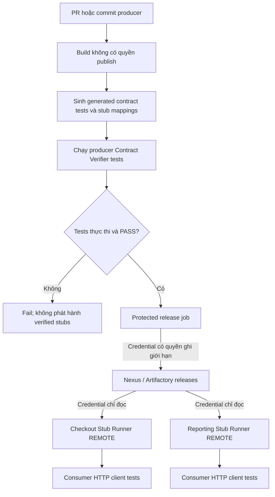

# Bảo vệ credential kho artifact và quyền công bố

## 1. Vì sao bảo mật kho artifact quan trọng với Spring Cloud Contract?

Giả sử `Payment Service` là **producer**, công bố các HTTP contract bằng Groovy/YAML DSL. Build của producer sử dụng **Spring Cloud Contract Verifier** để sinh và chạy test trên implementation thật, sau đó đóng gói artifact:

```text
com.example:payment-service:1.2.0:stubs
```

`Checkout Service` và `Reporting Service` là **consumer**. Hai nhóm tải stub artifact đó qua **Stub Runner** từ kho Maven-compatible nội bộ như Nexus hoặc Artifactory, rồi thử HTTP client mà không cần Payment Service thật đang chạy.

Để làm việc này, CI có thể cần **credential đọc** để tải stub và **credential ghi** để publish artifact. Nếu cấu hình sai, các tình huống nguy hiểm có thể xảy ra:

- Một pipeline pull request chưa được tin cậy lấy được token có quyền publish.
- Một job consumer có credential ghi và vô tình thay thế stub của producer.
- Một bản `payment-service-1.2.0-stubs.jar` chưa chạy producer verification vẫn được công bố như artifact đã xác minh.
- Token bị ghi vào console log, artifact, Docker image hoặc file `settings.xml` được commit.
- Một người có quyền ghi đè release artifact khiến cùng version nhưng nội dung JAR khác nhau giữa hai lần kiểm thử.
- CI tải stub từ repository sai hoặc từ một endpoint không đáng tin cậy.

Bài học thuộc chương **CI/CD** của module **Spring Cloud Contract**, tập trung vào bảo mật chuỗi **source contract → producer verification → stub artifact → artifact repository → consumer test**.

Sau bài này, bạn có thể:

1. Phân biệt quyền **đọc**, **publish** và **quản trị** kho artifact.
2. Thiết kế tài khoản dịch vụ và token theo nguyên tắc **least privilege**.
3. Cấu hình Maven `settings.xml`, `distributionManagement` và Gradle `maven-publish` mà không ghi credential vào source code.
4. Cấp quyền đọc phù hợp cho Stub Runner `REMOTE`.
5. Bảo vệ secrets trước pull request không tin cậy, log, fork và Docker containers.
6. Thiết lập các **CI gates** để chỉ công bố stub sau khi producer verification đạt.
7. Giảm rủi ro ghi đè artifact, dependency confusion, lộ credential và phát hành nhầm version.
8. Xử lý lỗi `401`, `403`, `404` và kiểm tra hoạt động audit/rotation.

## 2. Ranh giới tin cậy trong quy trình phát hành stub



Điểm quan trọng:

- **Build/verification job** có thể chỉ cần quyền đọc dependencies, không cần token ghi.
- **Release/publish job** chỉ chạy từ nguồn đáng tin, sau khi đã xác minh commit hoặc artifact cụ thể.
- **Consumer CI** chỉ cần quyền tải `-stubs.jar` và các artifact phụ thuộc cần thiết.
- **Quyền quản trị repository** không nên được đưa vào bất kỳ job build thông thường nào.

**Có thể tách hai job nhưng phải liên kết đúng đối tượng được kiểm chứng.** Nếu job verify xây commit A nhưng job publish lấy lại branch mutable trỏ sang commit B, gate không còn ý nghĩa. Cần pin commit SHA, dùng artifact immutable từ job verify hoặc chạy lại verification trên đúng source trước publish.

## 3. Lập ma trận quyền trước khi tạo credential

Một bản ma trận quyền tối thiểu:

| Danh tính | Đọc release stubs | Đọc snapshot stubs | Publish release | Publish snapshot | Quản trị repository |
| --- | --- | --- | --- | --- | --- |
| Developer local (thông thường) | Có | Theo nhu cầu | Không | Theo chính sách | Không |
| Consumer CI / Stub Runner | Có | Nếu được phép kiểm thử pre-release | Không | Không | Không |
| Producer PR verification | Chỉ những repo/dependency cần thiết | Theo nhu cầu | Không | Không | Không |
| Producer release bot | Theo nhu cầu | Theo nhu cầu | **Có, repo/group được chỉ định** | Theo chính sách | Không |
| Producer snapshot bot | Theo nhu cầu | Có | Không | **Có, repo snapshot được chỉ định** | Không |
| Artifact repository administrator | Theo vai trò quản trị | Theo vai trò quản trị | Theo vai trò quản trị | Theo vai trò quản trị | Có |

Đây là **mô hình đề xuất**. Cách cấu hình permission cụ thể khác nhau giữa Nexus, Artifactory hoặc Maven-compatible repository của tổ chức.

### 3.1. Phân quyền theo đường dẫn và chức năng

Nếu repository hỗ trợ permission theo namespace hoặc đường dẫn, tài khoản publish của Payment Service chỉ nên ghi vào vùng tương ứng với:

```text
com/example/payment-service/**
```

Tránh cấp quyền `deploy`, `delete` hoặc `overwrite` cho toàn bộ kho `com/example/**` khi producer chỉ cần công bố một module. Consumer chỉ cần khả năng **read/download**; không cần `delete`, `create`, `redeploy`, `promote`.

**Không đồng nhất tài khoản đọc và ghi:** một token có thể chạy được cả consumer test lẫn release, nhưng việc dùng chung khiến một CI bị xâm nhập có thể sửa artifact phục vụ những pipeline khác.

### 3.2. Ưu tiên danh tính ngắn hạn

Khi nền tảng hỗ trợ, ưu tiên **workload identity/OIDC hoặc token ngắn hạn** được cấp riêng cho release job. Nếu phải dùng token tĩnh:

1. Tạo **service account** thay vì lấy mật khẩu cá nhân của developer.
2. Chỉ cho phép repository và thao tác cần thiết.
3. Lưu trong secret manager của CI, không commit.
4. Có ngày hết hạn, quy trình xoay vòng và thu hồi.
5. Ghi nhận owner của token, pipeline đang dùng và phương án khôi phục khi hết hạn.

OIDC chỉ hữu ích khi **repository/identity broker thật sự hỗ trợ đổi identity token thành quyền phù hợp**. Không đặt `id-token: write` vào workflow rồi giả định Nexus/Artifactory tự chấp nhận mọi GitHub OIDC token.

## 4. GAV, classifier và quyền publish artifact nào?

Với Spring Cloud Contract, một producer thường công bố:

```text
groupId     = com.example
artifactId  = payment-service
version     = 1.2.0
classifier  = stubs
extension   = jar
```

Kho Maven chuẩn có thể chứa:

```text
com/example/payment-service/1.2.0/
  payment-service-1.2.0.pom
  payment-service-1.2.0.jar
  payment-service-1.2.0-stubs.jar
```

`payment-service-1.2.0.jar` là artifact ứng dụng; `payment-service-1.2.0-stubs.jar` chứa các stub mappings/contract resources được đóng gói theo cấu hình build.

**Quyền publish của pipeline không nên rộng hơn nhu cầu**: nếu producer chỉ được phép công bố group/module của mình, phải hạn chế tại repository hoặc credential scope; không dựa vào `groupId` trong POM như một hàng rào bảo mật. `groupId` là tọa độ, không phải authentication.

Một lệnh build có thể **ghi cả POM, JAR ứng dụng và stubs classifier** nếu publication đã cấu hình như vậy. Hãy hiểu artifacts thực tế được deploy để tránh vô tình ghi đè mô-đun khác hoặc publish một stub JAR chưa xác minh.

## 5. Maven: để URL repository trong POM, secret trong settings riêng

Maven thường tách:

- `pom.xml`: khai báo `distributionManagement` (địa chỉ **đích publish**) và cấu hình plugin.
- `settings.xml`: giữ thông tin **authentication** theo `server.id`.
- CI secret store/environment: cung cấp username/token tại runtime.

### 5.1. `distributionManagement` không chứa mật khẩu

Trong POM của `Payment Service`:

```xml
<distributionManagement>
    <repository>
        <id>internal-releases</id>
        <url>https://repo.example.test/repository/maven-releases/</url>
    </repository>
    <snapshotRepository>
        <id>internal-snapshots</id>
        <url>https://repo.example.test/repository/maven-snapshots/</url>
    </snapshotRepository>
</distributionManagement>
```

Đây là fragment của POM, chưa phải POM hoàn chỉnh. Domain `repo.example.test` chỉ mang tính minh họa. Khi publish version release như `1.2.0`, Maven dùng repository release; phiên bản `1.3.0-SNAPSHOT` thường dùng snapshot repository.

**Không thêm `<username>`/`<password>` trực tiếp vào POM hoặc URL.** POM là file source có thể bị sao chép và công bố cùng artifact.

### 5.2. `settings.xml`: ID phải khớp

Ví dụ `settings.xml` **không commit**, do CI tạo vào vùng tạm hoặc cung cấp qua file secret:

```xml
<settings xmlns="http://maven.apache.org/SETTINGS/1.2.0">
    <servers>
        <server>
            <id>internal-releases</id>
            <username>${env.MAVEN_REPO_USER}</username>
            <password>${env.MAVEN_REPO_TOKEN}</password>
        </server>
        <server>
            <id>internal-snapshots</id>
            <username>${env.MAVEN_REPO_USER}</username>
            <password>${env.MAVEN_REPO_TOKEN}</password>
        </server>
    </servers>
</settings>
```

Trong một số thiết lập, Maven có thể interpolate biến môi trường `${env.MAVEN_REPO_USER}` và `${env.MAVEN_REPO_TOKEN}` tại runtime. Hãy kiểm tra cơ chế interpolation trong phiên bản Maven/CI thực tế; một lựa chọn khác là **CI secret file** chứa settings đã cấu hình với quyền truy cập hạn chế.

Lưu ý:

1. Giá trị `<id>internal-releases</id>` trong settings phải khớp `distributionManagement.repository.id`.
2. Không lấy credential publish rồi dùng nó ở consumer tests hoặc PR build.
3. Có thể tách hai service accounts/token cho release và snapshot khi chính sách yêu cầu.
4. Giữ file settings ngoài repository; cấp quyền file phù hợp và xóa file tạm sau job.
5. Maven password encryption/master password là một lớp bảo vệ tại máy, **không thay thế secret manager và least privilege**; mật khẩu mã hóa vẫn có thể bị sử dụng nếu môi trường có khóa giải mã.

### 5.3. Một đường chạy Maven an toàn

Ví dụ tại producer đã cấu hình Spring Cloud Contract Maven plugin:

```bash
# Job verify: không cần credential GHI.
./mvnw -B -ntp clean verify

# Job release được bảo vệ, chạy trên đúng commit đã verify.
# Không dùng -DskipTests để bỏ producer verification.
./mvnw -B -ntp -s /path/to/ci-settings.xml deploy
```

Các lệnh minh họa để chạy **trong dự án thật**, không phải lệnh được thực thi lúc biên soạn bài. Maven `deploy` chạy lifecycle thông thường nhưng flags/profile và cấu hình plugin có thể bỏ qua tests. CI phải kiểm tra **generated contract tests thực sự được chạy**, không chỉ exit code 0 từ bước publish.

**Không in nội dung `settings.xml` đã resolve hoặc môi trường chứa token ra log.** Cẩn trọng với `-X`/debug, `help:effective-settings`, command-line `-Dpassword=...` và shell tracing.

## 6. Gradle: `maven-publish` với credential tự động và tối thiểu

Với producer dùng Gradle, plugin `maven-publish` có thể công bố cả application JAR và `verifierStubsJar` của Spring Cloud Contract nếu task đó tồn tại trong phiên bản plugin đang dùng.

Một ví dụ **fragment `build.gradle` Groovy DSL**:

```groovy
plugins {
    id 'java'
    id 'maven-publish'
    id 'org.springframework.cloud.contract' version '<compatible-scc-version>'
}

group = 'com.example'
version = '1.2.0'

publishing {
    publications {
        maven(MavenPublication) {
            from components.java
            artifact(tasks.named('verifierStubsJar'))
        }
    }
    repositories {
        maven {
            name = 'artifactRepository'
            url = uri('https://repo.example.test/repository/maven-releases/')
            credentials(PasswordCredentials)
        }
    }
}
```

Ở Gradle hỗ trợ cấu hình credentials kiểu này, tên repository `artifactRepository` giúp Gradle tìm các project properties:

```text
artifactRepositoryUsername
artifactRepositoryPassword
```

Trong môi trường CI, có thể cung cấp chúng bằng **environment variables của Gradle project properties**:

```text
ORG_GRADLE_PROJECT_artifactRepositoryUsername=<CI_SECRET_USERNAME>
ORG_GRADLE_PROJECT_artifactRepositoryPassword=<CI_SECRET_TOKEN>
```

Đây chỉ là **tên biến và placeholders**, không phải giá trị credential. Các biến này phải được inject từ secret store vào **release job** được bảo vệ. Không đặt giá trị thật trong `gradle.properties` được commit, trong `build.gradle` hoặc trên command line `-P...=secret` dễ lọt vào log/process list.

**Ưu điểm của cấu hình typed credentials:** Gradle chỉ yêu cầu credentials khi task cần chúng được thực thi theo cơ chế plugin; các tác vụ build/test không có lý do phải có publish credentials.

### 6.1. Cung cấp secret bằng Provider API khi cần

Một lựa chọn khác, phù hợp khi credential không dùng tên project property mặc định:

```groovy
publishing {
    repositories {
        maven {
            name = 'internalReleases'
            url = uri('https://repo.example.test/repository/maven-releases/')
            credentials {
                username = providers.environmentVariable('MAVEN_REPO_USER').orNull
                password = providers.environmentVariable('MAVEN_REPO_TOKEN').orNull
            }
        }
    }
}
```

Đoạn này đọc từ môi trường khi Gradle cấu hình publication; nếu build environment cần configuration cache hoặc nguyên tắc không resolve secret ở configuration phase, hãy chọn cách plugin/Gradle version hỗ trợ tốt nhất. **Không bao giờ `println` credential, stringify properties hoặc đưa token vào task output**.

### 6.2. Thực thi và kiểm tra publication

```bash
# Verify trên producer thật.
./gradlew clean check

# Chỉ trên protected release job sau verify.
./gradlew publish
```

`publish` **không mặc nhiên phụ thuộc `check`**. Nếu tách jobs, bảo đảm job publish chỉ có thể chạy sau kết quả verification cho **cùng commit và cùng bộ contract**. Nếu dùng artifact từ job verify, không tái sinh stub từ source mutable không được ghim.

Gradle publication cần kiểm tra classifier `stubs` thực sự được attach. Đổi repository credential không sửa được vấn đề build quên đóng gói `-stubs.jar`.

## 7. Stub Runner REMOTE: chỉ cần quyền đọc

Phía Checkout có thể tải artifact đã công bố:

```yaml
spring:
  cloud:
    contract:
      stubrunner:
        stubs-mode: REMOTE
        repository-root: "https://repo.example.test/repository/maven-releases/"
        ids:
          - "com.example:payment-service:1.2.0:stubs:8091"
        username: "${STUB_REPO_READ_USER}"
        password: "${STUB_REPO_READ_TOKEN}"
```

`STUB_REPO_READ_USER` và `STUB_REPO_READ_TOKEN` phải là **credentials chỉ đọc**. Nếu repository cho phép tải artifact public trong mạng test, có thể không cần credential; không gắn token chỉ vì muốn “giữ thống nhất” khi không cần.

Phân biệt:

| Cấu hình | Ý nghĩa |
| --- | --- |
| `stubrunner.repository-root` | Nơi tải artifact Maven-compatible |
| `stubrunner.username/password` | Xác thực **với repository** khi tải |
| `stubrunner.ids` | Producer group/artifact/version/classifier/port |
| `payment.client.base-url` | Nơi HTTP client consumer gọi **WireMock stub server** |

Ví dụ consumer HTTP client trỏ tới `http://localhost:8091` trong test cùng host. **Credential để tải JAR không phải bearer token dành cho `GET /api/payments/42`**, và Stub Runner không tự xác minh JWT hay mTLS của Payment Service thật.

### 7.1. Những khác biệt theo runtime

Nếu consumer test chạy trong Docker/Kubernetes, phải biết nó đang dùng **local repository, network và secret store của container nào**. `localhost:8091` trong consumer container không tự trỏ tới Stub Runner chạy trong container khác; dùng hostname/network phù hợp.

Không mount thư mục home chứa toàn bộ `~/.m2/settings.xml`, SSH keys và tokens vào container chia sẻ chỉ để tải một stub JAR. Ưu tiên secret read-only hoặc repository client credential hạn chế.

## 8. CI pull request không đáng tin: không cấp publish token

Nhánh pull request có thể chứa mã do người khác chỉnh sửa, bao gồm `pom.xml`, `build.gradle`, scripts, tests hoặc các GitHub Actions workflow files. Nếu job chạy mã đó cùng biến `MAVEN_REPO_TOKEN` có quyền publish, tác nhân độc hại có thể cố in/đẩy token ra ngoài hoặc sửa artifact.

**Nguyên tắc: code chưa được duyệt không được chạy trong cùng trust boundary với publish credential.**

Quy tắc tối thiểu:

- PR verification chỉ nhận quyền đọc cần thiết; không được dùng credential có thể deploy/delete/overwrite.
- Tách **release workflow/job** với nhánh được bảo vệ và tag/release policy rõ ràng.
- Giới hạn người được tạo tag, sửa workflow release, thay đổi environment protection rules.
- Dùng protected environment và **approval** nếu quy trình tổ chức cần.
- Không dùng `pull_request_target` để checkout rồi chạy mã PR không đáng tin cùng secrets; loại workflow này đòi threat modeling đặc biệt.
- Không cho fork PR quyền ghi vào artifact repository hoặc shared cache có thể ảnh hưởng job đáng tin.
- Quyền của CI job (`contents: read`, artifact upload, package write) phải được cấp theo nhiệm vụ, không dùng quyền quản trị toàn diện.

### 8.1. Vì sao “secrets được mask trong log” chưa đủ?

Masking chủ yếu che chuỗi biết trước trong output; mã độc vẫn có thể:

- Mã hóa, chia nhỏ hoặc biến đổi token để vượt masking.
- Gửi token qua outbound HTTP request.
- Ghi secrets vào artifact, test report hoặc file tạo ra.
- Dùng token trực tiếp để publish artifact giả mà không cần tiết lộ chuỗi.

Do đó, **không trao token cho job không đáng tin** quan trọng hơn bất kỳ kỹ thuật che log nào.

## 9. Ví dụ GitHub Actions: verify và publish tách quyền

Workflow minh họa cho Maven producer. Giả định repository đã có Maven Wrapper, Spring Cloud Contract Maven plugin, test base class, `distributionManagement` và cấu hình secrets đầy đủ.

```yaml
name: payment-contract-release

on:
  pull_request:
  push:
    tags:
      - 'v*'

permissions:
  contents: read

jobs:
  verify:
    runs-on: ubuntu-latest
    steps:
      - uses: actions/checkout@v4
      - uses: actions/setup-java@v4
        with:
          distribution: temurin
          java-version: '21'
      - name: Verify producer contracts
        run: ./mvnw -B -ntp clean verify

  publish:
    needs: verify
    if: github.event_name == 'push' && startsWith(github.ref, 'refs/tags/v')
    runs-on: ubuntu-latest
    environment: artifact-release
    steps:
      - uses: actions/checkout@v4
      - uses: actions/setup-java@v4
        with:
          distribution: temurin
          java-version: '21'
      - name: Publish verified producer and stubs
        env:
          MAVEN_REPO_USER: ${{ secrets.MAVEN_DEPLOY_USER }}
          MAVEN_REPO_TOKEN: ${{ secrets.MAVEN_DEPLOY_TOKEN }}
        run: ./mvnw -B -ntp -s .ci/settings.xml deploy
```

**Đây là mẫu tham khảo, không phải workflow dùng ngay cho production.** Các bước `actions/checkout@v4`, `setup-java@v4`, Java 21 và `.ci/settings.xml` phải phù hợp repo thực tế; `.ci/settings.xml` trong ví dụ **chỉ nên là template không chứa secrets**, dùng interpolation từ environment hoặc file settings được tạo bởi CI. Không bao giờ commit credentials thật.

Ý nghĩa của các lớp bảo vệ:

1. `permissions: contents: read` giới hạn quyền GitHub token mặc định của workflow này.
2. `verify` không nhận `MAVEN_DEPLOY_TOKEN`, kể cả khi chạy từ PR.
3. `publish` chỉ chạy cho sự kiện `push` tag có dạng `v*`, sau khi job `verify` pass.
4. `environment: artifact-release` có thể được cấu hình với **required reviewers** và restrictions từ GitHub Settings.
5. Username/token được inject **chỉ trong step publish** từ secret store.
6. Maven `deploy` chạy trên code của tag và thực thi lifecycle phù hợp; pipeline phải xác minh generated contract tests không bị skip.

**Cần làm thêm trước khi dùng thật:** bảo vệ tags và quyền sửa workflow; giới hạn outbound network; pin actions theo commit SHA khi chính sách supply chain yêu cầu; ràng buộc Maven dependencies/repositories; bảo đảm cùng commit/contract revision giữa jobs. Nếu chỉ bảo vệ branch mà cho mọi người tạo tag tùy ý, gate release vẫn có lỗ hổng.

### 9.1. Nếu nguồn dependency private khiến PR cần token đọc?

Có thể cho job PR dùng một **read-only token** tách biệt, giới hạn repository và thời hạn, nếu threat model cho phép. Với PR từ fork chưa tin cậy, không nên tự ý đưa private-repository token vào job chạy mã PR. Có thể dùng mirror phụ trợ với quyền đọc thích hợp, tách phần xác minh an toàn hoặc yêu cầu một reviewer đáng tin kích hoạt workflow được bảo vệ. **Không giải quyết bằng cách nâng quyền token PR lên publisher**.

### 9.2. Tránh lỗ hổng giữa verify và publish

Nếu hai jobs tự resolve version động `+` hoặc `SNAPSHOT` hoặc tải contracts từ branch mutable, kết quả có thể khác nhau dù cùng commit. Cần pin version/revision, ghi resolved dependencies và bảo đảm publication gắn với **đúng source đã verify**.

Một mô hình chặt hơn là job verify tạo artifact kèm checksum và provenance, job publish chỉ upload **chính artifact bất biến đó** mà không chạy lại build. Nếu sử dụng Maven/Gradle deploy thông thường trong release job, phải bảo đảm nó cũng chạy verification và sử dụng đúng nguồn/version.

## 10. Gates bắt buộc trước khi công bố stub artifact

CI cần phân biệt ít nhất năm cổng:

| Gate | Cần kiểm tra | Nếu fail |
| --- | --- | --- |
| **Source gate** | Commit/tag và nguồn contract đã được review/chấp nhận | Không release |
| **Producer verification gate** | Generated tests chạy trên implementation thật; số lượng test hợp lý | Không publish verified stubs |
| **Package gate** | Có `-stubs.jar`, đúng GAV, classifier, mappings/metadata | Không publish |
| **Authorization gate** | Caller/job có quyền ghi đúng repository và release policy | Reject, điều tra quyền |
| **Consumer compatibility gate** | Stub version mới được consumer tests sử dụng và xử lý đúng | Chặn/hoãn rollout theo chính sách |

Một build “xanh” nhưng **contract tests bị skip** không đủ điều kiện publish. Một token có quyền ghi cũng không nên được dùng để bỏ qua contract verification.

### 10.1. Một ví dụ kiểm tra hiệu lực gate

Producer sửa field `paymentId` thành `transactionId` nhưng chưa cập nhật contract đã được Checkout chấp nhận. Generated producer tests phải phát hiện response thực không còn `paymentId`.

Hành vi pipeline mong muốn:

```text
Producer code thay đổi
    -> generateContractTests / verify
    -> assertion fail
    -> build fail
    -> KHÔNG publish payment-service-1.3.0-stubs.jar
```

Nếu sửa contract để test pass mà chưa được Checkout review, lỗi chuyển thành **vi phạm quy trình chấp nhận contract**. Gate kỹ thuật phải đi cùng quyền duyệt PR và quản trị phiên bản.

### 10.2. Không nhất thiết publish từ mọi PR

PR verification có thể tạo stub JAR như **build output tạm** cho kiểm thử riêng nhưng không được công bố vào release repository. Nếu cần preview cho consumer, sử dụng repository/cấu trúc preview cô lập, artifact version độc nhất, retention ngắn và quyền đọc/ghi riêng. Không đặt preview artifacts cạnh release immutable dưới cùng version.

## 11. Release bất biến và phòng tránh ghi đè artifact

Một điều kiện quan trọng của kiểm thử hợp đồng là:

```text
com.example:payment-service:1.2.0:stubs
```

phải trỏ đến **cùng nội dung đã được kiểm chứng**, nếu consumer và CI cần khả năng tái lập.

Nếu ai đó ghi đè `payment-service-1.2.0-stubs.jar`, hai nhóm có thể chạy cùng version nhưng nhận JSON response khác nhau. Điều này làm phá hỏng việc truy vết lỗi và có thể che giấu hành vi gian lận.

Chính sách nên có:

- **Không cho redeploy/overwrite release** trên Nexus/Artifactory nếu repository hỗ trợ.
- Tách releases và snapshots, giới hạn quyền và retention khác nhau.
- Một pipeline/tag tạo một release version duy nhất; tránh race giữa hai jobs cùng version.
- Ghi producer commit, contract revision, artifact hash và test report tương ứng.
- Nếu cần sửa artifact phát hành lỗi, **tạo version mới** thay vì ghi đè byte của version cũ.

### 11.1. SNAPSHOT không có đặc tính bất biến giống release

`1.3.0-SNAPSHOT` thường phục vụ tích hợp trước phát hành và có thể được publish nhiều lần. Khi debug, ghi lại resolved snapshot/timestamp hoặc checksum, không chỉ tên version. **Không để consumer release CI phụ thuộc snapshot mutable** nếu yêu cầu có thể tái lập.

### 11.2. Checksums, signatures và provenance

Checksum giúp phát hiện tệp khác byte hoặc hỏng trong vận chuyển, nhưng **hash một artifact giả vẫn có thể đúng** nếu nguồn phát hành bị chiếm quyền. Để tăng độ tin cậy có thể dùng:

1. Repository TLS và chính sách nguồn tải đáng tin cậy.
2. Release approval và quyền publish giới hạn.
3. Artifact signing/attestation nếu hệ thống hỗ trợ và có cơ chế xác minh.
4. Provenance gắn commit, build workflow, contract revision và verification results.
5. Audit logs của repository và CI.

Không tuyên bố chỉ cần `SHA-256` là thay thế được kiểm soát quyền ghi hoặc provenance.

## 12. Ngăn dependency confusion và tải artifact từ nguồn sai

Tên artifact trùng hoặc resolver được cấu hình thiếu chặt có thể khiến CI tải package từ nguồn không mong muốn, đặc biệt khi trộn public/private repositories.

Các biện pháp:

- Dùng **groupId nội bộ** được kiểm soát và repository routing/mirror hợp lý.
- Với private artifacts, cấu hình repository nội bộ rõ ràng, tránh fallback public không mong muốn.
- Pin versions; hạn chế `+`, dynamic ranges hoặc snapshot ở release CI.
- Xác nhận repository URL trong `stubrunner.repository-root` là HTTPS với certificate hợp lệ.
- Không dùng `--insecure`, `-k`, tắt certificate verification hoặc chấp nhận mọi TLS certificate chỉ để “chạy được CI”.
- Nếu dùng corporate CA, cấu hình trust store đúng thay vì tắt xác minh TLS.
- Hạn chế plugin/dependency repositories theo chính sách tổ chức.

Trong Spring Cloud Contract, **một JAR stub giả mạo có thể khiến consumer test xanh với hành vi không đúng**. Vì vậy trust của Maven artifact repository và trust của contract source/release pipeline đều quan trọng.

## 13. Bảo vệ log, cache, artifact và file tạm

Secrets có thể rò rỉ ngoài source code:

| Kênh | Rủi ro | Biện pháp |
| --- | --- | --- |
| Console logs | `echo $TOKEN`, debug HTTP, build flags | Không in secrets; masking chỉ là lớp phụ |
| `settings.xml` tạm | File bị lưu làm build artifact hoặc nằm lại trên runner | Quyền file hạn chế, dọn sau job |
| Gradle `gradle.properties` | File cấu hình credentials bị commit | Secret store hoặc environment variables được inject |
| Docker image layers | Token bị đưa bằng Dockerfile `ARG`/`ENV` | Dùng runtime secrets hoặc build secret mount phù hợp |
| CI artifact/test report | Token bị ghi vào output, XML report, crash dump | Redact, hạn chế artifact upload và retention |
| Maven/Gradle caches | Có thể chứa artifact/mapping nhạy cảm | Bảo vệ cache, không lưu dữ liệu thực vào fixture |
| Process list | Secret nằm trong CLI `-Dpassword=...` | Tránh secret trực tiếp trên command line |
| Remote cache | Output bị đọc hoặc ghi bởi jobs khác | Phân quyền, tránh cho untrusted PR ghi cache dùng chung |

### 13.1. Docker/Compose và secret injection

Nếu chạy Stub Runner Boot độc lập bằng Docker trong CI, nó chỉ cần credential **đọc** nếu repository private. Không bake token publisher vào image, không mount nguyên home của developer và không publish control API của Stub Runner Boot lên mạng không tin cậy.

Đối với platform hỗ trợ secret files (Docker/Kubernetes/CI), có thể mount một cấu hình chỉ đọc tại runtime thay vì nhúng trong image. Tên property và cơ chế nạp secrets của image phải được kiểm tra theo phiên bản; đừng suy rằng mọi image tự đọc `/run/secrets/*` mà không cấu hình.

### 13.2. Không đưa dữ liệu thật vào hợp đồng

Groovy/YAML contracts và stub mappings có thể được đóng gói vào JAR và được nhiều consumer tải. Dữ liệu `request.body`/`response.body` phải là fixture giả hoặc đã được ẩn danh; không chứa access token thật, thông tin thẻ thanh toán hoặc PII. Dù repository có authentication, quyền đọc có thể rộng hơn quyền truy cập dữ liệu production.

## 14. Xoay vòng token và xử lý khi credential bị lộ

Một token tĩnh sẽ có lúc cần đổi. Một kế hoạch rotation tối thiểu:

1. Xác định service account/token owner và những jobs đang dùng.
2. Tạo token mới có **cùng hoặc hẹp hơn scope**.
3. Cập nhật CI secret manager; không sửa token trong POM hoặc Git.
4. Thử job verify/consumer download hoặc release có kiểm soát bằng credential mới.
5. Thu hồi token cũ và kiểm tra không còn job phụ thuộc.
6. Theo dõi `401`, `403`, audit logs và publication anomalies.

Nếu nghi lộ credential:

- **Thu hồi/khóa** token bị lộ càng sớm càng tốt.
- Kiểm tra audit logs của artifact repository, CI, Git và external network access.
- Xem có release artifact, POM, plugin artifact hoặc stub JAR bị ghi đè/phát hành trái phép không.
- Cấp token mới với phạm vi thu hẹp; kiểm tra và tái phát hành version mới nếu artifact bị ảnh hưởng.
- Xử lý dữ liệu đã lộ trong log/artifact theo chính sách tổ chức; chỉ xóa một commit mới không tự xóa được toàn bộ lịch sử rò rỉ.

**Không kiểm tra “token có bị lộ không” bằng cách in thử token.** Dùng một request đọc/publish có kiểm soát và chỉ quan sát status/permission, không đưa credential vào output.

## 15. Audit: ai đã công bố bản stub nào, khi nào?

Mỗi artifact phát hành nên có hồ sơ tối thiểu:

| Thuộc tính audit | Ví dụ |
| --- | --- |
| Maven coordinates | `com.example:payment-service:1.2.0:stubs` |
| Producer commit | Commit SHA được release job checkout |
| Contract revision | Commit/revision của Groovy/YAML DSL |
| Build workflow | Release pipeline run ID |
| Verification evidence | Test report + số tests thực thi |
| Published by | Service account của producer release |
| Repository | Internal release repository |
| Hash/provenance | SHA-256/attestation nếu được tổ chức hỗ trợ |
| Consumers tested | Checkout/Reporting và stub version tương ứng |

Không log plaintext credentials trong audit records. Tập trung vào **identity, action, artifact coordinates, timestamps, kết quả**.

Một nghi vấn cần có khả năng trả lời: “Ai đã publish `payment-service:1.2.0:stubs`, build nào tạo file này, và source contract nào được verify trước đó?” Nếu không trả lời được, khả năng điều tra sai khác producer–consumer yếu dù CI hiện đang xanh.

## 16. Chẩn đoán lỗi xác thực khác lỗi hợp đồng

| Triệu chứng | Nguyên nhân có thể | Hướng điều tra an toàn |
| --- | --- | --- |
| Maven `deploy` trả `401` | Sai username/token, token hết hạn hoặc ID credentials không khớp | Kiểm tra `distributionManagement.id` và `settings.servers.id`, token scope; không in token |
| Maven `deploy` trả `403` | Identity hợp lệ nhưng thiếu quyền ghi | Kiểm tra publish role và target repository |
| Deploy release bị từ chối overwrite | Repository immutable release policy | Tạo version mới, không mở quyền redeploy để “chữa cháy” |
| Gradle publish thiếu credentials | Properties/env không được cấp cho release job | Kiểm tra tên `artifactRepositoryUsername/Password` và secret binding |
| Stub Runner `REMOTE` trả `401` | Consumer read token không đúng/hết hạn | Dùng identity chỉ đọc, kiểm tra URL và auth |
| Stub Runner `REMOTE` trả `403` | Có token nhưng không có quyền đọc artifact/version | Kiểm tra repository path permission |
| Stub Runner `REMOTE` trả `404` | GAV/classifier/version không tồn tại, URL sai hoặc repository ẩn existence | Kiểm tra metadata, URL Maven layout và artifact publication |
| Artifact tải được nhưng WireMock trả `404` | Request không match hoặc stub mô phỏng lỗi nghiệp vụ | Kiểm tra actual request và mapping, không sửa credential |
| PR job có quyền publish | Secret scope/workflow conditions sai | Loại publish token khỏi PR, bảo vệ release trigger/environment |
| Cùng version tải ra hai byte khác nhau | Release bị overwrite, snapshot mutable hoặc mirror/cache không nhất quán | Kiểm tra resolved source, checksum, audit |
| Producer tests bị skip nhưng publish vẫn chạy | Release gate không ràng buộc verification | Chặn publication và xác nhận test execution |
| Sau rotation toàn bộ CI fail | Token mới thiếu role hoặc secret chưa cập nhật hết | Kiểm tra dependency map và permissions |

### 16.1. Ba lớp `404` phải phân biệt

1. **Repository 404:** không có `payment-service-1.2.0-stubs.jar` tại Maven coordinates. Kiểm tra publish, version và repository.
2. **WireMock unmatched 404:** artifact đã tải, nhưng request không khớp mapping (URL/method/header/body). Kiểm tra request journal.
3. **Business 404:** contract chủ đích quy định `PAYMENT_NOT_FOUND`, WireMock trả `404` cùng body lỗi nghiệp vụ.

Sửa credential đọc repository không giải quyết request URL sai; sửa mapping không giải quyết `403` ở Nexus.

### 16.2. Không phân biệt lỗi bằng cách bật debug không kiểm soát

Log cấp debug có thể tiết lộ Authorization header, token, basic auth hoặc đường dẫn credential file. Khi cần debug:

- Dùng môi trường test cô lập và account có scope hẹp.
- Tắt hoặc redact logging của headers/authentication.
- Chỉ thu thập status code, repository path, artifact coordinates và failure reason không nhạy cảm.
- Dọn log tạm, giới hạn quyền đọc và retention.

## 17. Bài thực hành: thiết kế quyền cho Payment và Checkout

**Bối cảnh:** `Payment Service` sử dụng Spring Cloud Contract, phát hành stub HTTP từ các hợp đồng:

```text
src/test/resources/contracts/
  checkout-service/payment_paid.groovy
  reporting-service/payment_report.yml
```

Artifact:

```text
com.example:payment-service:1.2.0:stubs
```

Kho artifact nội bộ:

```text
https://repo.example.test/repository/maven-releases/
```

Các thành phần cần truy cập: producer PR job, producer release job, Checkout Stub Runner, Reporting Stub Runner và repository administrator.

### 17.1. Yêu cầu

1. Chia các job/identity thành quyền **read**, **publish** và **admin**.
2. Giải thích vì sao release token không được truyền vào PR verification.
3. Viết fragment Maven `distributionManagement` và nêu tên `settings.xml` server ID cần trùng.
4. Viết cấu hình `Stub Runner REMOTE` cho Checkout với credential chỉ đọc và stub port `8091`.
5. Đề xuất thứ tự CI `verify → package → publish → consumer test`.
6. Nêu cách chặn ghi đè `payment-service:1.2.0:stubs`.
7. Nếu Maven deploy nhận `403` trong khi consumer tải được stub, nguyên nhân phù hợp nhất là gì?
8. Nếu publisher token bị lộ trong CI log, cần thực hiện những bước nào?

### 17.2. Gợi ý thiết kế quyền

| Thành phần | Quyền phù hợp |
| --- | --- |
| Producer PR job | Read dependencies/contracts cần thiết, không publish |
| Producer release job | Write chỉ trong group/repository Payment Service |
| Checkout Stub Runner | Read stubs artifact, không write |
| Reporting Stub Runner | Read stubs artifact, không write |
| Repository administrator | Quyền admin riêng, không inject vào build |

### 17.3. Gợi ý cấu hình Checkout Stub Runner

```yaml
spring:
  application:
    name: checkout-service
  cloud:
    contract:
      stubrunner:
        stubs-mode: REMOTE
        repository-root: "https://repo.example.test/repository/maven-releases/"
        ids:
          - "com.example:payment-service:1.2.0:stubs:8091"
        username: "${STUB_REPO_READ_USER}"
        password: "${STUB_REPO_READ_TOKEN}"
        stubs-per-consumer: true
```

Config trên chỉ tải/lọc stub theo consumer và mở HTTP server tại port đã khai báo; `CheckoutClient` phải thực sự gọi `http://localhost:8091` (hoặc địa chỉ tương ứng trong mạng CI). Các file hợp đồng cần giữ cấu trúc thư mục theo consumer để `stubs-per-consumer` có tác dụng. Với app `spring.application.name=checkout-service`, không nhất thiết phải override `consumerName`.

### 17.4. Gợi ý trả lời lỗi quyền

Nếu producer deploy nhận `403` nhưng consumer vẫn tải được stub, khả năng cao **publisher identity thiếu quyền ghi hoặc target repository không cho ghi**. Quyền read của consumer không chứng minh publisher được phép deploy. Không nên nâng quyền của consumer để giải quyết lỗi này.

Nếu token lộ: thu hồi/rotate ngay, đánh giá phạm vi quyền, rà soát audit logs và versions đã publish, xử lý log/artifact bị lộ, rồi cập nhật secret manager và xác minh các jobs liên quan. Không chỉ thay tên biến secret và coi đã an toàn.

## 18. Checklist bảo vệ credential và quyền công bố

- Đã tách **producer PR**, **producer release** và **consumer Stub Runner** thành trust boundaries rõ ràng?
- Consumer chỉ có quyền **read/download**, không được publish/overwrite/delete?
- Publisher chỉ có quyền ghi đúng repository và namespace producer của mình?
- Không dùng admin credentials trong Maven/Gradle build hoặc Stub Runner?
- Ưu tiên token ngắn hạn/workload identity khi có hỗ trợ; nếu dùng token tĩnh đã có rotation/expiry?
- Maven `distributionManagement.repository.id` có khớp `settings.servers.id` mà **không** hard-code password?
- Gradle `maven-publish` có lấy credentials từ secret store/Gradle project properties đúng cách?
- Không có secrets trong POM, `build.gradle`, Git, Dockerfile, test report, logs hay stub mappings?
- Release workflow chỉ chạy từ protected source/tag và protected environment cần thiết?
- PR/fork chưa tin cậy không thể chạy code với credential publish?
- Producer verification đã **thực sự chạy** trên đúng commit/contract revision trước khi publish?
- Stub artifact có đúng GAV/classifier, được kiểm tra nội dung và không bị ghi đè dưới release version cũ?
- Repository sử dụng HTTPS/TLS đúng; không tắt certificate verification chỉ để truy cập được?
- Có quy trình đối chiếu audit logs, checksum/provenance và thu hồi token khi nghi ngờ rò rỉ?
- Consumer CI ghi lại version stub đã tải và chạy test qua Stub Runner, không tự tin chỉ vì JAR tải thành công?

**Tài liệu chính thức để đối chiếu theo phiên bản:**

- [Spring Cloud Contract — Reference](https://docs.spring.io/spring-cloud-contract/reference/).
- [Spring Cloud Contract — Stub Runner](https://docs.spring.io/spring-cloud-contract/reference/project-features-stubrunner.html).
- [Spring Cloud Contract — Publishing Stubs as JARs](https://docs.spring.io/spring-cloud-contract/reference/project-features-stubrunner/stub-runner-publishing-stubs-as-jars.html).
- [Maven — Settings Reference](https://maven.apache.org/settings.html).
- [Maven — Deploy Plugin](https://maven.apache.org/plugins/maven-deploy-plugin/).
- [Gradle — Maven Publish Plugin](https://docs.gradle.org/current/userguide/publishing_maven.html).
- [Gradle — Handling Credentials](https://docs.gradle.org/current/userguide/declaring_repositories.html#sec:handling_credentials).
- [GitHub Actions — Using Secrets](https://docs.github.com/en/actions/security-for-github-actions/security-guides/using-secrets-in-github-actions).

**Ghi nhớ:** Trong Spring Cloud Contract, **credential của kho artifact không phải chi tiết cấu hình phụ** mà là một phần của chuỗi tin cậy: producer chỉ được công bố `-stubs.jar` sau khi chạy Contract Verifier trên implementation thật; consumer chỉ cần quyền đọc artifact đúng version để dùng Stub Runner. Hãy tách quyền **read/publish/admin**, giữ secret ngoài source và log, bảo vệ release khỏi PR không tin cậy, ghim version và áp dụng chính sách release bất biến. Một artifact tải được hoặc một test dùng stub xanh không tự chứng minh producer hiện tại tương thích; quyền công bố phải đi cùng verification, provenance và audit.
