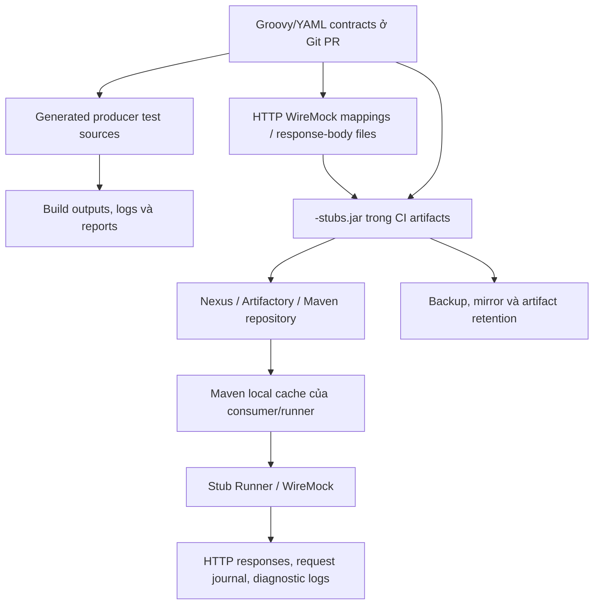
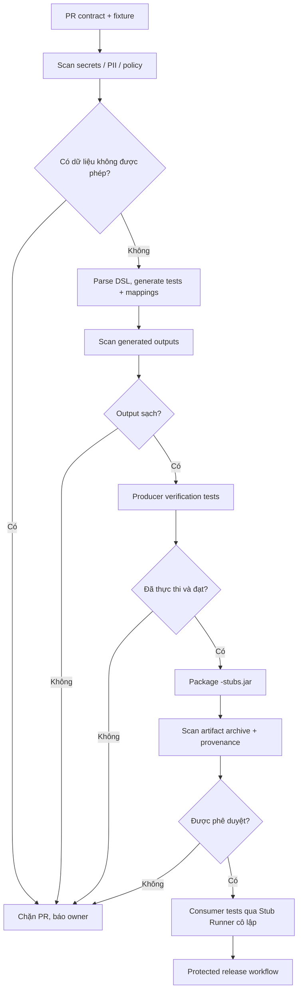
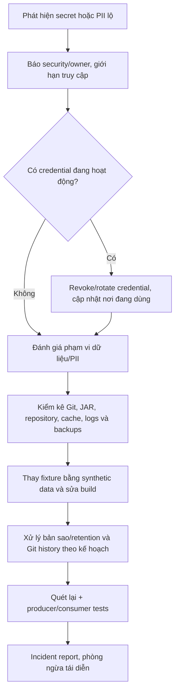

# Tránh ghi Secret hoặc dữ liệu cá nhân vào hợp đồng

## 1. Vì sao bảo mật dữ liệu trong hợp đồng là vấn đề thực tế?

Trong module **SPRING_CLOUD_CONTRACT**, Spring Cloud Contract giúp **producer** và **consumer** thống nhất hành vi HTTP hoặc thông điệp bằng **Groovy/YAML DSL**, sinh kiểm thử phía producer, phát hành stub theo phiên bản và chạy **Stub Runner** trong CI để phát hiện thay đổi API không tương thích.

Một file hợp đồng không chỉ tồn tại trong repository nguồn. Nó có thể được:

- Sinh thành **Java/JUnit tests** và tài nguyên của producer.
- Chuyển thành **WireMock JSON mappings** để mô phỏng HTTP.
- Đóng vào **JAR classifier `stubs`** cùng dữ liệu ví dụ.
- Tải về **Maven repository cache** của nhiều dự án, runner và máy phát triển.
- Nạp vào **Stub Runner** hoặc **Standalone Stub Runner Boot**.
- Xuất hiện trong **logs, request journal, test reports, build artifacts** và bản sao lưu.

Nếu hợp đồng chứa một **API key thật**, access token, mật khẩu, private key hoặc thông tin khách hàng thật, việc bảo vệ mỗi tệp `.groovy` không còn đủ. Giá trị nhạy cảm có thể đã lan sang các output và nơi lưu trữ khác, kể cả sau khi ai đó xóa dòng chứa dữ liệu khỏi commit mới nhất.

**Nguyên tắc cốt lõi:** *Hợp đồng là đặc tả hành vi để kiểm thử và chia sẻ; không phải kho bí mật hay kho dữ liệu khách hàng.* Sử dụng **fixture tổng hợp, không định danh người thật**, mô tả **định dạng và quy tắc bằng matcher**, và cấp secret cần thiết cho các bài kiểm thử xác thực thông qua **cơ chế runtime an toàn** thay vì ghi vào DSL.

### Mục tiêu bài học

Sau bài này, bạn có thể:

1. Phân biệt **secret**, **dữ liệu cá nhân** và **dữ liệu thử nghiệm tổng hợp**.
2. Chỉ ra vị trí dữ liệu có thể bị sao chép từ contracts đến generated tests, stub JAR và CI.
3. Viết hợp đồng Groovy/YAML HTTP và message dùng fixture an toàn nhưng vẫn có ý nghĩa.
4. Không nhầm một header `Authorization` trong stub với kiểm tra xác thực thật.
5. Dùng matcher, dữ liệu mẫu và test configuration mà không vô tình đóng gói secret vào artifact.
6. Thiết kế bước kiểm tra bảo mật cho PR, producer verification, stub packaging và consumer CI.
7. Ứng phó đúng khi secret hoặc dữ liệu cá nhân đã xuất hiện trong Git, artifact repository hay logs.

## 2. Phân loại dữ liệu trước khi viết DSL

| Loại dữ liệu | Ví dụ | Có được đặt nguyên văn trong contract chia sẻ không? | Cách xử lý |
| --- | --- | --- | --- |
| **Secret đang hoạt động** | API key, OAuth access/refresh token, JWT thật, password, private key | **Không** | Secret manager, credential tạm, revoke/rotate nếu lộ |
| **Thông tin phiên** | Session cookie, CSRF token thật, authorization code | **Không** | Giá trị giả hoặc test security context được kiểm soát |
| **Dữ liệu cá nhân trực tiếp** | Tên, email, số điện thoại, địa chỉ người thật | **Không đưa dữ liệu thật** | Synthetic fixtures, giá trị giả rõ ràng |
| **Dữ liệu cá nhân gián tiếp** | Customer ID liên kết tới hệ thống thật, device ID, IP cá nhân | Không mặc định an toàn | Thay bằng ID giả, đánh giá khả năng liên kết ngược |
| **Dữ liệu nhạy cảm theo nghiệp vụ** | Hồ sơ y tế, tài chính, nội dung giao dịch thật | Không copy từ production | Dữ liệu tổng hợp theo schema/biên giá trị |
| **Thông tin nội bộ nhạy cảm** | Internal hostname, topology, repository credential | Hạn chế theo phân loại | Endpoint ví dụ `example.invalid`, không ghi thông tin xác thực |
| **Fixture tổng hợp** | `cust-test-1001`, `tester@example.test` | Thường có thể dùng sau rà soát | Giá trị ổn định, không ánh xạ về người thật |
| **Public schema/format** | `status=CREATED`, kiểu `quantity=2`, JSON field names | Có, khi API cho phép công bố | Duy trì độ chính xác hợp đồng |

Một chuỗi trông “ẩn danh” không tự động an toàn. Ví dụ, thay tên khách hàng bằng ID từ production vẫn có thể cho phép liên kết về người thật khi đối chiếu với bảng khác. Hash email không có salt hoặc dùng phép biến đổi đơn giản cũng **không đồng nghĩa dữ liệu đã được ẩn danh không thể đảo ngược**.

### 2.1. Quy tắc nhận diện secret

Hãy tự hỏi:

- Giá trị này có thể **xác thực** hoặc **cấp quyền** cho một hệ thống thật không?
- Có thể dùng để **giải mã**, **ký**, **gửi request có đặc quyền** hoặc truy cập tài nguyên thật không?
- Nó có ngày hết hạn nhưng **hiện vẫn có hiệu lực** không?
- Dù được gắn nhãn “test”, nó có được chấp nhận bởi môi trường staging/production hoặc broker dùng chung không?

Nếu câu trả lời có thể là “có”, **không ghi giá trị vào contract, stub mapping, ảnh chụp màn hình hay log CI**. Chữ “test” trong tên biến hoặc key không biến một credential thật thành dữ liệu an toàn.

### 2.2. Quy tắc nhận diện dữ liệu cá nhân

Một dữ liệu cần xem xét bảo vệ khi có thể nhận diện trực tiếp hoặc gián tiếp một người, kể cả qua kết hợp nhiều trường. Ví dụ email, số điện thoại, ID khách hàng, tọa độ, ngày sinh, địa chỉ và chuỗi giao dịch.

Mục đích hợp đồng thường chỉ cần biết:

- Field `email` **có kiểu chuỗi** và đúng định dạng.
- Field `customerRef` tồn tại và có format đã công bố.
- Field `amount` là một số trong phạm vi nghiệp vụ.
- Header yêu cầu có mặt, không cần mang một credential có hiệu lực.

Nếu một giá trị mẫu tổng hợp thể hiện được trường hợp cần bảo vệ, **không có lý do sử dụng dữ liệu người thật**.

## 3. Sơ đồ đường đi của dữ liệu nhạy cảm



**Điểm nguy hiểm:** có khi chỉ một file contract được sửa nhưng **nhiều bản sao** của một secret đã được tạo ra trong toàn bộ chuỗi.

| Tầng | Đường rò rỉ điển hình | Biện pháp ngăn ngừa |
| --- | --- | --- |
| Git và PR | Diff, commit history, review comments, fork/clones | Không commit dữ liệu thật; secret scanning trước merge |
| Generated tests | Java literal chứa token/email đã lấy từ DSL | Kiểm tra `target/generated-test-sources` và build logs |
| WireMock mapping | Matcher/body chứa header hoặc payload nhạy cảm | Dùng synthetic sample; kiểm tra mapping trước packaging |
| Stub JAR | Dữ liệu nhạy cảm được đóng gói và chia sẻ rộng | Scan **bên trong** artifact, dùng repository ACL |
| Artifact repository | Lưu trữ lâu, có proxy/mirror, nhiều người được tải | Quyền read cần thiết, retention, audit và revoke |
| Stub Runner | Trả lại data mẫu hoặc cho xem mapping qua admin API | Chỉ chạy trong mạng thử nghiệm được kiểm soát |
| Request journal/logs | Ghi nguyên `Authorization`, `Cookie`, body request | Mask/redact, vô hiệu hóa hoặc giới hạn journal khi phù hợp |
| CI artifacts | Reports, upload logs, debug archives | Dùng artifact retention ngắn và kiểm soát quyền |
| Backup | Giữ bản đã từng chứa secret sau khi Git sửa | Quy trình xử lý bản sao/retention sau incident |

**Không chỉ scan thư mục `src/test/resources/contracts`.** Nếu generator hoặc builder chèn fixture vào nguồn sinh ra/mapping, cần kiểm tra **đầu ra** trước khi phát hành.

## 4. Anti-pattern: dán request production vào hợp đồng

Một lỗi phổ biến: developer copy request/response từ gateway log rồi paste nguyên vào DSL để “đúng thực tế”.

### 4.1. Ví dụ KHÔNG ĐƯỢC LÀM

Đoạn sau dùng toàn bộ **placeholder không có giá trị truy cập**, nhưng thể hiện kiểu lỗi:

```groovy
import org.springframework.cloud.contract.spec.Contract

Contract.make {
    name 'create_order_bad_example'
    request {
        method POST()
        url '/api/orders'
        headers {
            contentType(applicationJson())
            header 'Authorization': 'Bearer <REAL_PRODUCTION_ACCESS_TOKEN>'
            header 'Cookie': 'SESSION=<REAL_SESSION_COOKIE>'
        }
        body([
            customerId: '<ACTUAL_CUSTOMER_ID>',
            email     : '<ACTUAL_PERSON_EMAIL>',
            address   : '<ACTUAL_DELIVERY_ADDRESS>'
        ])
    }
    response {
        status 201
        body([orderId: '<REAL_ORDER_ID>'])
    }
}
```

**Đây là phản ví dụ, không phải contract dùng để chạy**: các chuỗi trong ngoặc góc chỉ mô tả loại dữ liệu không được đặt vào file. Nếu thay placeholders bằng giá trị thật:

1. Người có quyền đọc Git có thể nhìn thấy chúng.
2. Build có thể đưa chúng vào generated test/mapping.
3. Stub JAR có thể phân phối chúng cho các consumer.
4. Request logging có thể sao chép chúng tiếp.
5. Xóa dòng ở commit mới **không xóa commit cũ, artifact đã publish và các cache**.

### 4.2. Vì sao `.gitignore` không cứu được trường hợp này?

`.gitignore` giúp hạn chế file **chưa được Git track** bị thêm vào một cách vô ý; nó không xóa nội dung đã commit và không bảo vệ secret **nằm trực tiếp trong file contract đang được track**.

Tương tự, đặt repository ở chế độ private chỉ giới hạn một số người truy cập; điều đó không biến việc copy dữ liệu khách hàng thật vào contract thành một thực hành an toàn.

## 5. Hợp đồng HTTP an toàn với fixture tổng hợp

Giả sử Orders Producer công bố API tạo đơn:

```http
POST /api/orders HTTP/1.1
Content-Type: application/json
Accept: application/json
```

Consumer cần biết request body và response, **không cần một người thật**.

### 5.1. Groovy DSL an toàn

```groovy
import org.springframework.cloud.contract.spec.Contract

Contract.make {
    name 'create_order_with_synthetic_customer'
    description 'Tạo đơn với customer và email thử nghiệm'

    request {
        method POST()
        url '/api/orders'
        headers {
            contentType(applicationJson())
            header 'Accept': 'application/json'
            header 'X-Test-Scenario': 'contract-create-order'
        }
        body([
            customerRef: 'cust-test-1001',
            contactEmail: 'tester@example.test',
            productId   : 'SKU-001',
            quantity    : 2
        ])
    }

    response {
        status 201
        headers {
            contentType(applicationJson())
        }
        body([
            orderId: 'ord-test-1001',
            status : 'CREATED'
        ])
    }
}
```

Ở đây:

- `cust-test-1001` là ID **hoàn toàn giả**, không phải ID sao chép từ production.
- `tester@example.test` dùng **domain dành cho ví dụ**; không nên gửi email thật tới địa chỉ đó.
- `SKU-001` và `ord-test-1001` là fixture ổn định, không liên kết dữ liệu khách hàng thật.
- Header `X-Test-Scenario` chỉ là **metadata minh họa cho kịch bản thử nghiệm**, không phải cơ chế xác thực.
- Tất cả request/response values vẫn cho phép test bảo vệ field names, types và HTTP status.

**Không đặt `Authorization` hoặc `Cookie` chứa credential có hiệu lực vào file này**. Nếu endpoint cần security, tách cách kiểm tra security thật khỏi việc chứa bí mật trong DSL (xem mục 8).

### 5.2. YAML DSL tương đương

```yaml
name: create_order_with_synthetic_customer
description: Tạo đơn với customer và email thử nghiệm
request:
  method: POST
  url: /api/orders
  headers:
    Content-Type: application/json
    Accept: application/json
    X-Test-Scenario: contract-create-order
  body:
    customerRef: cust-test-1001
    contactEmail: tester@example.test
    productId: SKU-001
    quantity: 2
response:
  status: 201
  headers:
    Content-Type: application/json
  body:
    orderId: ord-test-1001
    status: CREATED
```

Đây là **biểu diễn thay thế của cùng hợp đồng**, không phải yêu cầu đăng ký cả Groovy và YAML trùng điều kiện request vào cùng build. Mục tiêu của cả hai là mô tả dữ liệu có ý nghĩa **mà không chứa dữ liệu thật**.

### 5.3. Giữ test có giá trị, không đánh đổi bằng dữ liệu nhạy cảm

Một contract có fixture an toàn vẫn nên phân biệt các tình huống:

| Kịch bản | Dữ liệu mẫu an toàn | Điều consumer/producer phải kiểm tra |
| --- | --- | --- |
| Tạo đơn hợp lệ | `cust-test-1001`, `quantity=2` | `201 CREATED` |
| Quantity không hợp lệ | `quantity=0` | `400 INVALID_QUANTITY` |
| Hết hàng | `SKU-NO-STOCK` | `409 OUT_OF_STOCK` |
| Không tìm thấy đơn | `ord-test-missing` | `404 ORDER_NOT_FOUND` |
| Email sai định dạng | `not-an-email` | Validation theo API đã thống nhất |
| Customer không có quyền | User giả của test security context | `403` theo permission logic |

Khi viết hợp đồng lỗi, phải định nghĩa **business error body**. Chỉ assert `404` có thể đạt vì WireMock không có mapping, không chứng minh producer cung cấp nhánh `ORDER_NOT_FOUND`.

## 6. Không nhầm “dữ liệu giả” với “dữ liệu production đã che tên”

Một nhóm muốn các test realistic có thể lấy dump dữ liệu production rồi thay email. Cách đó **vẫn nguy hiểm**:

- ID khách hàng có thể giữ nguyên và liên kết tới người thật.
- Số tiền, địa chỉ rút gọn hoặc timestamp có thể nhận diện một giao dịch.
- Text tự do có thể chứa tên, số điện thoại, thẻ hoặc ghi chú nhạy cảm.
- Hệ thống giả lập có thể gửi email/webhook tới endpoint được giữ lại trong dữ liệu.
- Một tập dữ liệu “đã hash” có thể vẫn bị khôi phục bằng từ điển hoặc đối chiếu.

### 6.1. Data minimization cho contract

Chỉ giữ **những trường cần thể hiện ranh giới API**:

```json
{
  "customerRef": "cust-test-1001",
  "shippingZone": "TEST-ZONE-A",
  "totalAmount": 125000,
  "currency": "VND"
}
```

Không tự thêm ngày sinh, email, địa chỉ chi tiết hoặc số định danh chỉ vì object production có các trường đó. Nếu schema yêu cầu field, dùng giá trị tổng hợp có định dạng phù hợp và nêu rõ vì sao consumer cần field này.

### 6.2. Synthetic data tốt phải có tính chất gì?

| Tiêu chí | Thực hành |
| --- | --- |
| Không liên kết người thật | ID/địa chỉ/email tạo mới, không khớp production |
| Đúng kiểu dữ liệu | `quantity` là số, không phải chuỗi |
| Đúng định dạng cần kiểm thử | Email domain ví dụ, thời gian ISO-8601 giả |
| Tái lập | Cùng fixture cho cùng branch/test, không phụ thuộc random không seed |
| Có tính phân biệt | Ít nhất nhánh success/error/edge case liên quan |
| Không kích hoạt hành động ngoài test | Không có email thật, webhooks thật, payment account thật |
| Dễ nhận diện là thử nghiệm | Prefix `test`, reserved domain và tài liệu fixture |

Không nên hardcode một bộ giá trị toàn `null` hoặc `"dummy"` khiến assertions mất ý nghĩa. Dữ liệu giả **phải có ích để kiểm tra hành vi**, không phải chỉ thỏa mãn scanner.

### 6.3. Test về định dạng dữ liệu cá nhân

Nếu producer cần kiểm tra email có format hợp lệ, không cần một email cá nhân thật:

```text
Hợp lệ:   tester@example.test
Sai dạng: not-an-email
Thiếu:    null hoặc vắng field (tùy contract)
```

Nếu API cần case-insensitive matching, Unicode, độ dài hoặc escape đặc biệt, hãy tạo dữ liệu tổng hợp thỏa đúng ranh giới cần kiểm tra. Không dùng nguyên văn dữ liệu khách hàng thật chỉ vì nó có một ký tự hiếm.

## 7. Matcher và giá trị mẫu: giảm lộ dữ liệu mà không làm lỏng hợp đồng

Spring Cloud Contract có **request/response matchers** và khả năng phân biệt giá trị **phía client/consumer** với **phía server/producer**. Các công cụ này giúp mô tả dữ liệu biến thiên như ID và timestamp.

Ví dụ, không nên copy một `customerId` thật từ production chỉ để test format ID. Thay vào đó:

1. Sử dụng một **giá trị ví dụ tổng hợp** để fixture và stub có thể tái lập.
2. Dùng matcher cho format hoặc type mà consumer thực sự phụ thuộc.
3. Kiểm tra generated producer test, WireMock mapping và stub response đều đúng semantics.
4. Không dùng regex quá rộng như `.*` cho mọi field nhạy cảm.

### 7.1. Ví dụ WireMock matcher thuần minh họa

Nếu request API có header `X-Correlation-Id` với format đã thống nhất, một WireMock mapping có thể mô tả:

```json
{
  "request": {
    "method": "GET",
    "url": "/api/orders/ord-test-1001",
    "headers": {
      "X-Correlation-Id": {
        "matches": "test-[A-Za-z0-9_-]+"
      }
    }
  },
  "response": {
    "status": 200,
    "headers": {
      "Content-Type": "application/json"
    },
    "jsonBody": {
      "id": "ord-test-1001",
      "status": "CREATED"
    }
  }
}
```

**Đây là WireMock JSON để giải thích matcher**, không khẳng định mọi phiên bản Spring Cloud Contract generator tạo đúng từng key hoặc cùng tên file. `X-Correlation-Id` không phải access token; format `test-...` là dữ liệu thử nghiệm.

### 7.2. Matcher không phải công cụ giấu secret

Một contract có regex `Bearer .*` vẫn có thể làm lộ dữ liệu nếu:

- Producer-side sample dùng một access token thật.
- Generated Java test viết literal token vào source.
- Log HTTP request in header `Authorization`.
- WireMock request journal lưu credential do client test thật gửi.

**Không thay một token thật bằng một matcher rồi bỏ qua việc quét toàn bộ output**. Matcher mô tả điều kiện kỹ thuật; **quản lý secret là trách nhiệm riêng**.

### 7.3. Không làm lỏng matcher để che sai hợp đồng

Ví dụ `quantityAvailable` phải là integer, consumer dùng nó để quyết định số lượng đặt được. Matcher `.*` chấp nhận cả `"12"` và `12` có thể che breaking change về kiểu dữ liệu.

Hãy chọn test oracle theo nghiệp vụ: type, phạm vi, format, nhánh response và những trường mà consumer thực sự sử dụng. **An toàn dữ liệu không đòi hy sinh độ chặt kiểm thử**.

## 8. Kiểm tra Authorization và Authentication mà không lưu token thật

Security là phần có thật của API: producer có thể yêu cầu Bearer token, session hoặc quyền `orders:read`. Nhưng **hợp đồng không nên là kho chứa credential**.

### 8.1. Ba mục tiêu kiểm thử khác nhau

| Mục tiêu | Cách kiểm tra thích hợp | Có cần secret thật trong DSL? |
| --- | --- | --- |
| Mô tả HTTP contract cần header | Header presence/matcher phù hợp, dữ liệu test không có đặc quyền | **Không** |
| Producer kiểm tra `401/403` và phân quyền | Spring Security test support, test principals hoặc test identity provider cô lập | **Không ghi secret vào DSL** |
| Kiểm tra OAuth/JWT ký số hoặc tích hợp IdP thật | Integration test với test IdP, credential ngắn hạn được cấp runtime | **Không** |

**Cảnh báo:** một WireMock mapping có thể ràng buộc header `Authorization`, nhưng nó **không tự xác minh chữ ký JWT, thời hạn, issuer, audience hoặc quyền truy cập**. Một chuỗi có format `Bearer ...` không có nghĩa token đã được xác thực.

### 8.2. HTTP contract mô phỏng từ chối khi thiếu quyền

```groovy
import org.springframework.cloud.contract.spec.Contract

Contract.make {
    name 'get_order_forbidden'

    request {
        method GET()
        url '/api/orders/ord-test-denied'
    }

    response {
        status 403
        headers {
            contentType(applicationJson())
        }
        body([code: 'ACCESS_DENIED'])
    }
}
```

Hợp đồng này mô tả một ví dụ **response bị từ chối**, không chứa token có hiệu lực. Tuy nhiên, **request ở trên chưa mô tả đầy đủ lý do bị từ chối**: để producer verification có ý nghĩa, fixture/base test hoặc cấu hình request phải tạo chính xác tình huống không có quyền. Nếu producer yêu cầu auth token ở endpoint, phải xác định test principal/test credential theo setup phù hợp; không giả định một `403` được chứng minh chỉ vì DSL có status `403`.

### 8.3. Producer security test trong test context

Với producer dùng Spring Security, có thể dùng **Spring Security Test** để tạo mock authentication trong những bài test kiểm tra authorization:

```java
import org.junit.jupiter.api.Test;
import org.springframework.beans.factory.annotation.Autowired;
import org.springframework.boot.test.autoconfigure.web.servlet.AutoConfigureMockMvc;
import org.springframework.boot.test.context.SpringBootTest;
import org.springframework.security.test.context.support.WithMockUser;
import org.springframework.test.web.servlet.MockMvc;

import static org.springframework.test.web.servlet.request.MockMvcRequestBuilders.get;
import static org.springframework.test.web.servlet.result.MockMvcResultMatchers.status;

@SpringBootTest
@AutoConfigureMockMvc
class OrdersAuthorizationTest {

    @Autowired
    private MockMvc mockMvc;

    @Test
    @WithMockUser(username = "contract-test-user", authorities = "orders:read")
    void authorizedUserCanReadOrder() throws Exception {
        mockMvc.perform(get("/api/orders/ord-test-1001"))
            .andExpect(status().isOk());
    }

    @Test
    @WithMockUser(username = "contract-test-user", authorities = "orders:other")
    void userWithoutPermissionCannotReadOrder() throws Exception {
        mockMvc.perform(get("/api/orders/ord-test-1001"))
            .andExpect(status().isForbidden());
    }
}
```

Đoạn mã yêu cầu **`spring-security-test`** và Spring Boot/Spring Security tương thích. Nó là **ví dụ kiểm thử bảo mật riêng**, không tự động thay thế generated contract tests. Ứng dụng thật phải định nghĩa policy `orders:read`; base test cần fixture `ord-test-1001`. `WithMockUser` tạo **security context giả trong kiểm thử**, không kiểm tra khả năng xác minh JWT bằng public key của IdP.

### 8.4. Không “tắt security cho mọi test” chỉ để contract PASS

Nếu producer base test luôn vô hiệu hóa toàn bộ security filter, generated test `200` có thể đạt nhưng không phản ánh yêu cầu auth thật. Ngược lại, nếu luôn gắn `@WithMockUser` có toàn quyền, test `401/403` có thể không được kiểm tra.

Nên tách:

- **Contract behavior tests** với security context xác định, phù hợp từng kịch bản.
- **Authorization tests** cho các nhóm quyền và nhánh `401/403`.
- **Integration tests** cho JWT/OIDC/broker auth khi cần.

Không đánh tráo test context thuận tiện thành chứng cứ production security.

### 8.5. Khi thực sự cần credential cho integration test

Dùng một **test identity provider hoặc test account có quyền tối thiểu**, cấp secret **khi job chạy** qua CI secret store hoặc OIDC/service identity phù hợp, đặt thời hạn ngắn và hạn chế môi trường. Không commit secret, không đưa vào DSL/body/mapping và không để test debug in ra header.

Đặc biệt, thay chuỗi trong contract bằng `${TEST_TOKEN}` **không tự động an toàn**. Nếu generator/runtime thay biến rồi ghi token thật ra Java source, WireMock JSON hoặc build report, secret vẫn bị lộ. Phải kiểm tra **ranh giới xử lý và nơi biến được materialize**.

## 9. Hợp đồng messaging cũng có thể làm lộ dữ liệu

Một contract message có thể chứa **user ID**, email, nội dung thông báo, payment reference và message headers. Khi Stub Runner phát message mẫu, payload ấy có thể đi vào **test broker**, queue, dead-letter topic hoặc log của consumer.

### 9.1. Ví dụ Groovy với message tổng hợp

```groovy
import org.springframework.cloud.contract.spec.Contract

Contract.make {
    name 'order_created_event'
    label 'order_created'
    description 'Sự kiện đơn hàng với dữ liệu thử nghiệm'

    input {
        triggeredBy('publishOrderCreated()')
    }

    outputMessage {
        sentTo('orders.test.events')
        body([
            eventType  : 'ORDER_CREATED',
            orderId    : 'ord-test-1001',
            customerRef: 'cust-test-1001',
            amount     : 125000,
            currency   : 'VND'
        ])
        headers {
            header('eventType', 'ORDER_CREATED')
            messagingContentType(applicationJson())
        }
    }
}
```

`publishOrderCreated()` là **helper do producer test base tự hiện thực**, không phải phương thức có sẵn. `orders.test.events` là **destination thử nghiệm minh họa**; destination thực tế cần phù hợp contract đã thống nhất. Không tự ý thay tên topic production trong contract nếu chủ đề bài test là bảo vệ compatibility: nên tách **logical destination** và **test binder routing** theo cấu hình vận hành được kiểm soát.

### 9.2. Không phát message thử nghiệm vào hệ thống thật

- Dùng broker/binder riêng cho test, hoặc namespace/topic test có quyền hạn chặt.
- Không mang credential production để producer/consumer test publish/subscribe.
- Không để một consumer production đọc các message `order_created` giả.
- Không sử dụng địa chỉ email/số điện thoại thật ở payload.
- Chú ý **dead-letter queues, retries, tracing và logs** cũng chứa bản sao event.
- Xóa/dọn trạng thái khi job kết thúc theo retention policy.

**Nhận xét quan trọng:** mã event `ORDER_CREATED` và ID `ord-test-1001` không bảo đảm downstream nhận biết đây là sự kiện giả. Ranh giới broker, binding và identity mới là lớp bảo vệ chủ yếu.

### 9.3. Consumer messaging test kiểm tra tác động, không chỉ payload fixture

```java
// Snippet trong consumer test đã có Stub Runner, Awaitility và test binder.
readModel.deleteByOrderId("ord-test-1001");
assertThat(readModel.hasOrder("ord-test-1001")).isFalse();

assertThat(stubTrigger.trigger("order_created")).isTrue();

await().atMost(Duration.ofSeconds(5)).untilAsserted(() -> {
    var order = readModel.findByOrderId("ord-test-1001");
    assertThat(order).isPresent();
    assertThat(order.get().amount()).isEqualTo(125000);
});
```

`readModel` là API giả định của consumer. Test chứng minh handler xử lý message, nhưng không kiểm tra broker production hay quyền thực tế. Mọi dữ liệu ở đây đều tổng hợp; test không được seed sẵn kết quả cuối khiến assertion đạt dù handler hỏng.

## 10. Giới hạn truy cập vào stub artifact và Stub Runner

Không phải vì stub chứa dữ liệu tổng hợp mà nên công khai nó ra Internet. Contract vẫn có thể tiết lộ cấu trúc endpoint, business status, auth header names hoặc sự kiện nội bộ.

| Tài nguyên | Nguy cơ | Biện pháp |
| --- | --- | --- |
| Git repository contracts | Dữ liệu trong commit/diff hoặc clone | Least privilege, review và secret scanning |
| Maven artifact repository | Nhiều consumers có thể tải `-stubs.jar` | Tài khoản read-only, retention và audit |
| Stub Runner Boot management API | `/stubs`, `/triggers` tiết lộ kịch bản/hỗ trợ hành động | Không public, giới hạn mạng/identity test |
| WireMock HTTP stub port | HTTP samples/logic mô phỏng bị truy cập | Chỉ trên localhost hoặc network test |
| WireMock `/__admin` | Mappings, request journal, có thể quản trị runtime | Hạn chế truy cập như control plane |
| CI logs/artifacts | Source/mapping/report chứa payload nhạy cảm | Mask/redact, quyền đọc và retention |

**Standalone Stub Runner Boot không được bảo vệ sẵn và không dành cho production.** Cần giới hạn **cả management port lẫn mọi WireMock ports**, không chỉ một trong hai.

### 10.1. Docker minh họa: chỉ công bố cổng trên loopback

```bash
# Cách bind port của Docker trên host; image/version/repo là placeholder.
docker run --rm --name contract-stub-test \
  -e SERVER_PORT=8750 \
  -e STUBRUNNER_IDS=com.example:orders-producer:1.4.2:stubs:9876 \
  -e STUBRUNNER_STUBS_MODE=LOCAL \
  -p 127.0.0.1:8750:8750 \
  -p 127.0.0.1:9876:9876 \
  springcloud/spring-cloud-contract-stub-runner:PINNED_VERSION
```

**Đây là lệnh minh họa, chưa đủ để chạy với mọi image.** Container phải có stub artifact trong Maven local repository được cấu hình, image tag `PINNED_VERSION` phải được thay bằng bản thật tương thích; nếu chuyển sang `REMOTE` phải cấp repository endpoint/credentials an toàn. Kiểm tra `docker port` và network thực tế sau startup. Với container-to-container, ưu tiên mạng Docker test nội bộ và không publish ports nếu không cần.

### 10.2. Vì sao không coi `Authorization` trong contract là lớp bảo vệ cho stub?

Header matcher chỉ quyết định **request có khớp mapping** hay không. Nếu request khớp một mapping khác, người gọi vẫn có thể nhận response. Nếu admin API bị mở, người ngoài có thể xem mapping và request journal. **Không đặt Stub Runner sau một regex header rồi gọi đó là kiểm soát truy cập**.

## 11. Kiểm tra đầu ra của build trước khi publish

Một pipeline an toàn phải theo dõi **source + generated outputs + artifact**. Chẳng hạn producer Maven tạo:

```text
src/test/resources/contracts/
  orders/create_order_with_synthetic_customer.groovy

target/generated-test-sources/contracts/
  ... generated JUnit test sources ...

target/stubs/META-INF/com.example/orders-producer/1.4.2/
  contracts/
  mappings/

target/orders-producer-1.4.2-stubs.jar
```

Đường dẫn và tên file là **mẫu minh họa**, thay đổi theo version/config Maven plugin. Với messaging, contract có thể không sinh mỗi message thành một WireMock HTTP mapping.

### 11.1. Kiểm tra file `-stubs.jar`

```bash
jar tf target/orders-producer-1.4.2-stubs.jar
```

Lệnh `jar tf` **chỉ liệt kê tên file trong JAR**, chưa kiểm tra nội dung nhạy cảm. Cần dùng công cụ quét artifact hỗ trợ archive hoặc giải nén vào **vùng tạm kiểm soát** rồi scan contents trước khi phát hành. Không đưa bản giải nén vào một thư mục public hoặc upload cho một dịch vụ scanner chưa được phép xử lý dữ liệu nội bộ.

### 11.2. Thứ tự kiểm tra bảo mật nên có

1. Quét commit/PR diff, bao gồm file hợp đồng và fixture helper.
2. Parse DSL; review dữ liệu trong request, response, headers và messages.
3. Sinh producer tests và HTTP mappings; kiểm tra output vừa được tạo.
4. Chạy generated producer tests trên fixture tổng hợp.
5. Đóng gói stub JAR; scan archive contents, filenames và metadata.
6. Chỉ publish artifact nếu không có dữ liệu nhạy cảm chưa xử lý.
7. Consumer test và Stub Runner dùng môi trường cô lập; giữ log đã che dữ liệu.

**Không được chỉ tin vào “scan source đã sạch”.** Một plugin có thể sao chép resource/body file khác vào JAR, và một test runner có thể ghi request body/header vào report.

### 11.3. Secret scanner và PII scanner không giống nhau

| Công cụ/biện pháp | Phát hiện được gì? | Giới hạn |
| --- | --- | --- |
| Secret scanner | Pattern/token/key/certificate đã biết | Không luôn nhận ra token mới hoặc custom secret |
| PII/data classifier | Email, phone, ID, address, business-sensitive fields | False positives; cần policy và ngữ cảnh |
| Schema/contract review | Trường không cần thiết, rò business semantics | Cần người hiểu API |
| Archive scanner | Nội dung bên trong `-stubs.jar` và generated resources | Cần giải nén/quét an toàn |
| Runtime log redaction | Hạn chế tiết lộ headers/bodies khi test chạy | Phải cấu hình mọi logger/journal/exporter |
| Repository ACL/retention | Giảm người có thể tải và thời gian lưu | Không làm dữ liệu đã publish trở nên không nhạy cảm |

Một scanner PASS **không chứng minh không còn PII**. Một email có dạng `tester@example.test` có thể bị scanner đánh dấu giống email thật; nên có quy tắc allowlist **chính xác, được review** cho fixture tổng hợp, thay vì vô hiệu hóa toàn bộ rule email.

## 12. Ví dụ CI gate tập trung vào contract security

CI nên chạy security checks **trước quyền publish** và giữ các artifact tạm trong phạm vi kiểm soát. Một workflow conceptual:



### 12.1. Ví dụ pseudo-CI pipeline có cổng chặn

```yaml
# PSEUDOCODE: các bước SCAN_* phải được hiện thực bằng công cụ được phê duyệt.
jobs:
  contract-security-and-verification:
    steps:
      - name: Scan Git changes and contracts
        run: SCAN_SECRETS_AND_PII --redact-report src/test/resources/contracts

      - name: Generate and verify producer contracts
        run: ./mvnw -B -ntp clean verify

      - name: Scan generated tests and stub files
        run: SCAN_GENERATED_OUTPUTS --redact-report target

      - name: Verify stub artifact content
        run: VERIFY_STUB_ARCHIVE_AND_PROVENANCE

      - name: Publish
        if: ONLY_IN_PROTECTED_RELEASE_WORKFLOW
        run: PUBLISH_AFTER_APPROVAL
```

**Đây là pseudocode YAML**, **không phải GitHub Actions workflow chạy được**. Các tên lệnh `SCAN_*`, `VERIFY_*` và điều kiện `ONLY_IN_PROTECTED_RELEASE_WORKFLOW` là placeholder. Không tạo cảm giác an toàn giả bằng cách copy block này mà không triển khai scanner, xác thực đường dẫn artifact, quyền tối thiểu và fail-on-findings.

### 12.2. Các cổng cụ thể cần block

| Điều kiện | Quyết định |
| --- | --- |
| PR chứa credential có hiệu lực | **BLOCK**; xử lý như incident |
| Contract chứa dữ liệu người thật không được phép | **BLOCK**; thay bằng synthetic data và đánh giá đã lộ |
| Generated mapping chứa token dù source đã sửa | **BLOCK**; điều tra output/cache/build chain |
| Artifact `-stubs.jar` chứa dữ liệu nhạy cảm | **BLOCK PUBLISH** |
| Producer tests bị skip hoặc không được sinh | **BLOCK** vì thiếu bằng chứng contract |
| Consumer test đang gửi token production đến WireMock | **BLOCK** và xem lại CI secret scope |
| CI upload toàn bộ request logs có Authorization | **BLOCK/REDACT** theo policy |
| Scanner chỉ báo giá trị `tester@example.test` tổng hợp | Review chính xác; allowlist hẹp nếu có căn cứ |

### 12.3. Quyền của CI job

- Job chạy trên **PR không tin cậy** chỉ nên có quyền đọc source/dependencies cần thiết.
- **Không cấp publish credentials, signing keys hoặc quyền production** cho code chạy từ PR.
- Workflow release có quyền publish phải nằm ở nhánh/workflow được bảo vệ.
- Token repository cho consumer Stub Runner nên là **read-only**, giới hạn artifact/namespace.
- Dùng secret store hoặc identity federation phù hợp; **không in secret** trong command line, test report hoặc debugging.
- Job tạo stub tạm cần cleanup/TTL và kiểm soát quyền đọc artifacts.

Không coi masking tự động của CI là lớp bảo vệ duy nhất: secret có thể xuất hiện dưới dạng **base64, substring, URL encoded hoặc được format lại**, không nhất thiết trùng giá trị ban đầu để hệ thống tự mask.

## 13. Logging, request journal và bằng chứng CI

Để chẩn đoán contract test, developer thường bật HTTP request/response logging. Đây là điểm dễ rò rỉ secret và PII.

### 13.1. Những dữ liệu không nên ghi nguyên văn

| Dữ liệu | Cách xử lý log gợi ý |
| --- | --- |
| `Authorization`, `Proxy-Authorization` | Loại bỏ hoặc thay bằng `[REDACTED]` |
| `Cookie`, `Set-Cookie` | Mask/omit session values |
| Password, client secret, refresh token | Không log |
| Email/số điện thoại/địa chỉ thật | Redact, synthetic fixture hoặc không ghi body |
| Request body có dữ liệu tài chính/y tế | Không log raw; ghi metadata hợp lệ |
| Correlation ID | Chỉ ghi nếu là ID thử nghiệm không liên kết người thật |
| Stub coordinates và test status | Thường hữu ích cho debug, vẫn tuân theo policy |

Ví dụ log **an toàn hơn**:

```text
contract=orders.create
stub=com.example:orders-producer:1.4.2:stubs
method=POST path=/api/orders status=201
customerRef=[REDACTED]
authorization=[REDACTED]
scenario=contract-create-order
result=PASS
```

Không dùng cách `log toàn bộ JSON rồi thay một vài field` nếu nội dung có thể mang dữ liệu nhạy cảm ở những field mới, array hoặc free text. Tốt hơn là **allowlist những field chẩn đoán được phép ghi**, còn body mặc định không log.

### 13.2. WireMock request journal

WireMock có thể lưu thông tin các request đã nhận để phục vụ verification, near misses hoặc debugging. Nếu consumer gửi token thật vào stub, ngay cả khi contract file không ghi token, **journal và diagnostics vẫn có thể chứa token đó**.

Do đó:

1. Không đưa production credential vào HTTP client dùng với stub.
2. Giới hạn `/__admin` và cổng WireMock trong test network.
3. Tắt hoặc giới hạn journal khi không cần, theo tính năng/phiên bản WireMock đang dùng.
4. Trước khi lưu log/test report, mask/omit headers và bodies nhạy cảm.
5. Đặt retention và quyền truy cập phù hợp cho CI artifacts.

**Tắt journal không tự xóa secret khỏi generated mapping hoặc JAR**. Các tầng phải được kiểm soát riêng.

## 14. Bảo vệ artifact repository và Maven cache

Một producer đã phát hành:

```text
com.example:orders-producer:1.4.2:stubs
```

JAR có thể được tải về bởi nhiều consumer qua `StubRunnerProperties.StubsMode.REMOTE`, rồi được cache tại `~/.m2/repository`. Nếu secret nằm trong `-stubs.jar`, phạm vi sự cố không chỉ có producer repository.

### 14.1. Kiểm tra artifact trước khi tin cậy

```bash
# Đọc danh sách entry trong JAR; không có nghĩa đã quét nội dung.
jar tf target/orders-producer-1.4.2-stubs.jar
```

Một quy trình đúng còn cần:

- Quét **nội dung file bên trong JAR**, không chỉ tên.
- Kiểm tra response-body files được tham chiếu từ JSON mappings.
- Đảm bảo artifact đúng commit/version vừa được producer verified.
- Ghi digest/checksum để tránh nhầm bản build.
- Giới hạn read access đến repository chứa contract/stubs nội bộ.
- Không dùng một repository công khai chỉ vì consumer ngoài JVM cần chạy stub.

### 14.2. Local Maven cache không phải kho bảo mật

Ngay cả khi artifact đã bị xóa khỏi Nexus/Artifactory, các bản sao có thể còn trong:

- Maven cache của developer.
- Persistent CI runner, container layer hoặc build cache.
- Repository proxy/mirror.
- Artifact uploads của CI.
- Storage backup/snapshot.

Không được coi “xóa trên repository chính” là đã xử lý toàn bộ sự cố. Với secret lộ, **revoke/rotate trước** để giảm tác động ngay, rồi mới phối hợp xử lý các bản sao phù hợp.

### 14.3. Không ghi đè release artifact tùy tiện

Nếu cần thay stub chứa dữ liệu nhạy cảm, đừng âm thầm ghi đè `1.4.2` bằng JAR khác cùng tọa độ nếu release policy yêu cầu bất biến. Cache có thể giữ bản cũ, mỗi consumer nhận một nội dung khác nhau.

Tùy mức độ incident, cần thu hồi artifact bị lộ, phát hành bản đã làm sạch theo version mới, cập nhật consumer IDs và retention, đồng thời bảo toàn chứng cứ theo chính sách. **Không để nguyên secret có hiệu lực chỉ vì cần giữ compatibility test**.

## 15. Khi đã lộ secret: phản ứng đúng thứ tự

Nếu phát hiện access token thật trong commit Groovy, một mapping JSON hoặc stub JAR, **đừng chỉ sửa file rồi coi như xong**.

### 15.1. Quy trình ứng phó



**Ưu tiên bảo mật:** với token đã lộ, việc đầu tiên là **thu hồi/luân chuyển token theo playbook** chứ không phải cố che lịch sử Git bằng một commit mới. Việc xóa dữ liệu khỏi Git cũng có thể cần thiết, nhưng nó **không tự vô hiệu hóa credential đã bị sao chép**.

### 15.2. Secret và PII có hướng xử lý khác nhau

| Tình huống | Hành động khẩn | Hành động theo sau |
| --- | --- | --- |
| API key/password lộ | Revoke/rotate, audit sử dụng, cô lập quyền | Xử lý history, artifact/log/cache và phòng ngừa |
| Private key lộ | Thay khóa/chứng chỉ, vô hiệu quyền cũ theo playbook | Đánh giá hệ thống phụ thuộc và phạm vi chữ ký |
| OAuth token lộ | Revoke token, đánh giá scope/session | Điều tra logs và quy trình cấp token |
| Email/số điện thoại người thật trong stub | Giới hạn truy cập, thông báo privacy/security owner | Đánh giá phạm vi, nghĩa vụ thông báo, purge/retention |
| Dữ liệu nhạy cảm trong request journal | Dừng thu thập raw, cô lập log | Mask/purge theo policy và giữ bằng chứng thích hợp |

**Không tự xóa bằng chứng cần cho điều tra hoặc có legal hold**. Việc khử dữ liệu và xóa bản sao cần phối hợp với đội bảo mật/pháp chế theo chính sách và quy định áp dụng.

### 15.3. Vì sao `git revert` hoặc xóa dòng chưa đủ?

Git lưu lịch sử; người có quyền đọc commit cũ có thể vẫn xem giá trị. Ngoài ra, pull request diff, fork, clone, CI artifacts và binary JAR có thể giữ nội dung khác.

Nếu cần **rewrite Git history** để loại dữ liệu nhạy cảm, phải có kế hoạch phối hợp: thay commit IDs, xử lý fork/clone, ngăn re-push nội dung cũ, cập nhật tags/CI references và làm việc với hosting provider khi cần. Đây là thao tác có rủi ro cao, **không phải bước nên tự động thực hiện chỉ từ một cảnh báo scanner**.

### 15.4. Những điều không nên làm sau sự cố

- Không in lại giá trị secret vào issue/PR comment để “đưa bằng chứng”.
- Không gửi JAR nhạy cảm sang một dịch vụ scan công cộng chưa được phê duyệt.
- Không coi thay token thật bằng `***` trong source mới là xong.
- Không yêu cầu tất cả developer xóa cache mà chưa có kế hoạch và phạm vi.
- Không ghi đè release artifact và bỏ qua provenance.
- Không tắt secret scanning để tránh fail CI.
- Không dùng chính token bị lộ để tiếp tục chạy tests “cho kịp release”.

## 16. Case study: API key lọt vào một contract HTTP

### 16.1. Tình huống

Một developer copy `curl` từ môi trường staging vào PR `orders-producer`. Header `Authorization` chứa một token **được staging và production cùng chấp nhận**. Contract Verifier đã tạo tests, convert WireMock mappings và package `orders-producer-1.4.2-stubs.jar`. Bản stub được publish lên repository nội bộ.

Vài ngày sau, security scanner cảnh báo có chuỗi token trong contract cũ.

### 16.2. Phân tích phạm vi

| Nơi có thể còn token | Cần xác minh điều gì? |
| --- | --- |
| Git commit/PR | Những refs/branches/tags và người có quyền truy cập |
| Generated Java test | Token có thành literal trong source/report không? |
| WireMock mapping | Header matcher có chứa giá trị thật không? |
| `-stubs.jar` | Artifact nào/version nào đã đóng gói |
| Nexus/Artifactory | Ai có quyền tải, download/audit records |
| Consumer Maven cache | Runner/máy nào đã tải artifact |
| Stub Runner logs | Token có nằm trong request journal/diagnostics |
| CI artifacts và backup | Reports/archive có giữ dữ liệu |

### 16.3. Quyết định ưu tiên

1. Security owner thu hồi token và cấp thông tin xác thực mới theo chính sách.
2. Đánh giá hoạt động bất thường và phạm vi quyền của token.
3. Producer sửa contract bằng **synthetic fixture** và chạy lại tests.
4. Xác minh JAR mới **không còn token**, bằng scanner và review phù hợp.
5. Tổ chức quản trị repository xử lý artifact cũ, caches và backup theo playbook.
6. Consumer cập nhật version stub mới nếu cần, chạy lại compatibility tests.
7. CI bổ sung quét generated mappings và artifacts; không chỉ source.

**Điều không làm:** chỉ xóa header ở PR rồi publish lại cùng tọa độ, không revoke token, không rà soát bản JAR đã được consumer tải.

## 17. Bài tập thực hành: rà soát một đề xuất contract

### 17.1. Đề bài

Checkout Consumer muốn thêm endpoint `POST /api/payments/authorize`. Hợp đồng đề xuất hiện có những placeholder nguy hiểm:

```yaml
name: authorize_payment_bad_proposal
request:
  method: POST
  url: /api/payments/authorize
  headers:
    Authorization: "Bearer <PASTED_REAL_ACCESS_TOKEN>"
    Cookie: "SESSION=<PASTED_REAL_SESSION>"
    Content-Type: application/json
  body:
    customerEmail: "<REAL_PERSON_EMAIL>"
    paymentCard: "<REAL_PAYMENT_CARD_DATA>"
    amount: 125000
response:
  status: 201
  body:
    status: AUTHORIZED
    paymentId: "<ACTUAL_PAYMENT_ID>"
```

Những giá trị trong ngoặc góc chỉ là **ký hiệu mô tả rủi ro**, không phải thông tin thật. Không chạy ví dụ này như một contract hợp lệ.

### 17.2. Yêu cầu

1. Chỉ ra tất cả field có nguy cơ chứa secret hoặc dữ liệu cá nhân.
2. Thay dữ liệu thực bằng **customerRef**, **payment method test reference** và các ví dụ không thể kích hoạt thanh toán thật.
3. Quyết định field nào **không cần nằm trong contract**.
4. Thiết kế producer verification cho nhánh thành công và `401/403` mà **không hardcode token thật**.
5. Nêu cách tạo test credential ở runtime nếu có bài integration với test IdP.
6. Đề xuất cách scan source, generated tests, mappings và stub JAR trước publish.
7. Viết consumer test gọi Payment client thật với Stub Runner; không chỉ assert fixture.
8. Nếu token từng được commit, nêu thứ tự xử lý sự cố.
9. Đề xuất chính sách retention cho logs và artifact version bị ảnh hưởng.
10. Giải thích vì sao WireMock header matcher không thay thế auth thật.

### 17.3. Hợp đồng an toàn hơn: YAML

Giả sử producer chấp thuận API chỉ nhận test payment method reference:

```yaml
name: authorize_payment_synthetic
request:
  method: POST
  url: /api/payments/authorize
  headers:
    Content-Type: application/json
  body:
    customerRef: cust-test-1001
    paymentMethodRef: pm-test-1001
    amount: 125000
    currency: VND
response:
  status: 201
  headers:
    Content-Type: application/json
  body:
    status: AUTHORIZED
    paymentId: pay-test-1001
```

`pm-test-1001` là **chuỗi ví dụ do bài học tự đặt**, không phải một token của hệ thống thanh toán hay payment method ID có hiệu lực. Contract này không chứa Authorization header; việc bỏ header **không có nghĩa producer API thực tế không yêu cầu xác thực**. Producer/consumer cần tiếp tục kiểm tra auth ở tầng phù hợp với test identity và chính sách API.

### 17.4. Test bảo vệ dữ liệu nhưng không “xanh giả”

Trong consumer test có client và Stub Runner thật:

```java
// API minh họa của ứng dụng consumer, không phải lớp Spring Cloud Contract.
PaymentAuthorization result =
    paymentsClient.authorize("cust-test-1001", "pm-test-1001", 125000L, "VND");

assertThat(result.paymentId()).isEqualTo("pay-test-1001");
assertThat(result.status()).isEqualTo("AUTHORIZED");
```

Test phải đi qua mã consumer, deserialize response và phản ứng theo contract. Nếu consumer chỉ kiểm tra `expectedJson.equals(expectedJson)`, nó không chứng minh integration. Mọi value trong ví dụ vẫn là dữ liệu tổng hợp.

### 17.5. Đáp án định hướng

| Câu hỏi | Đáp án |
| --- | --- |
| Header nào không nên copy? | `Authorization` và session `Cookie` có hiệu lực |
| Body nào có PII? | Email người thật; card/payment data thật |
| Dùng gì thay? | `cust-test-1001`, `pm-test-1001`, số tiền mẫu |
| Token runtime lấy ở đâu? | Test IdP/secret store có quyền tối thiểu, không trong DSL |
| Scan gì ngoài contract? | Generated Java, mappings, stub JAR, logs và CI artifacts |
| Nếu token đã lộ? | Revoke/rotate, điều tra phạm vi, xử lý bản sao/history |
| Stub đã match `Authorization` có xác minh JWT không? | **Không** |
| Scan PASS có đủ chứng minh PII sạch không? | **Không**; cần review và data classification |

## 18. Các sai lầm thường gặp và cách phòng tránh

| Sai lầm | Hậu quả | Cách khắc phục |
| --- | --- | --- |
| Copy request production nguyên văn vào Groovy/YAML | Lộ token và PII qua source/mappings | Chỉ dùng synthetic fixture |
| Gọi một token thật là `testToken` | Token vẫn có hiệu lực | Kiểm tra quyền/hệ thống chấp nhận token |
| Chỉ bỏ secret ở commit mới | Git history/JAR/cache còn bản sao | Revoke/rotate + incident response |
| Hash email thật rồi cho vào contract | Có thể vẫn liên kết/khôi phục | Synthetic email `example.test` |
| Dùng `Authorization: Bearer .*` làm bảo mật | Stub chỉ matcher, không xác thực | Auth tests riêng + network isolation |
| Dùng matcher `.*` cho toàn bộ response | Che breaking schema/type | Matcher theo behavior thật |
| Test luôn dùng `@WithMockUser` toàn quyền | Nhánh `401/403` không được xác minh | Test quyền thiếu/đủ quyền riêng |
| Scan chỉ repository source | Bỏ lọt generated mapping/JAR | Scan toàn bộ đường đi dữ liệu |
| Upload raw WireMock request journal | Có thể lộ header/body | Giới hạn journal, redact và retention |
| Publish stub lên repository public | Lộ schema/data và tăng phạm vi incident | Repository ACL và artifact governance |
| CI PR có deploy credentials | Code chưa tin cậy có thể đọc/xuất secret | Tách release workflow, least privilege |
| Dùng chính production broker cho message stub | Event giả có thể được xử lý thật | Test binder/broker/identity riêng |
| Xóa artifact rồi coi incident đã xong | Còn cache, backup, logs và token có hiệu lực | Kiểm kê bản sao và revoke/rotate |
| Dùng cùng dữ liệu giả ở mọi nhánh | Không bắt lỗi logic | Fixtures phân biệt success/error/edge case |

## 19. Checklist bảo mật trước khi merge hoặc publish hợp đồng

### Dữ liệu đầu vào

- [ ] Groovy/YAML không chứa token, password, private key hoặc session cookie thật.
- [ ] Không copy nguyên payload production vào `request`, `response` hoặc `outputMessage`.
- [ ] Customer/email/phone/address/transaction IDs là **synthetic**, không liên kết người thật.
- [ ] Chỉ giữ field thật sự cần bảo vệ ranh giới API.
- [ ] Test samples đúng schema/type/format và phân biệt các nhánh nghiệp vụ.
- [ ] Không có embedded URLs/webhooks/broker destinations production trái mục đích test.

### Verification và artifacts

- [ ] Producer generated tests được chạy trên code thật, không bị skip.
- [ ] Đã rà soát header/body matchers và giá trị mẫu client/server.
- [ ] Đã scan generated Java tests, WireMock JSON mappings và response-body resources.
- [ ] Đã scan nội dung `-stubs.jar`, không chỉ liệt kê tên entry.
- [ ] Artifact/version/checksum gắn với commit đã test.
- [ ] Repository, Maven cache và CI artifacts có quyền truy cập/retention phù hợp.

### Runtime và CI

- [ ] Stub Runner/WireMock chạy trong mạng thử nghiệm cô lập, không public.
- [ ] `/stubs`, `/triggers` và WireMock `/__admin` không lộ ra mạng không tin cậy.
- [ ] HTTP client không gửi production credentials tới stub.
- [ ] Messaging test không phát message giả vào production broker.
- [ ] Secret của test integration được cấp **runtime** qua cơ chế quản lý bí mật.
- [ ] Logs, request journal và CI reports không in giá trị nhạy cảm nguyên văn.
- [ ] PR jobs không giữ quyền publish release hoặc production credentials.
- [ ] Consumer tests chạy mã client/handler thật và có assertion nghiệp vụ.

### Khi phát hiện rò rỉ

- [ ] Đã thông báo security/privacy owner, giới hạn truy cập.
- [ ] Credential đã lộ được revoke/rotate theo playbook.
- [ ] Đã xác định phạm vi Git history, mappings, JAR, repositories, logs, cache và backup.
- [ ] Đã loại bỏ dữ liệu thật khỏi fixture tương lai, quét và test lại.
- [ ] Việc xử lý bản sao/history có kế hoạch và tuân thủ legal/audit hold.
- [ ] Đã lưu bằng chứng incident mà **không lặp lại giá trị secret**.
- [ ] Đã cập nhật CI gates và hướng dẫn review để tránh lặp lỗi.

### Tài liệu tham khảo

- [Spring Cloud Contract — HTTP Contracts](https://docs.spring.io/spring-cloud-contract/reference/project-features-contract/http.html): request/response, headers, body và matcher của hợp đồng.
- [Spring Cloud Contract — Stub Runner Core](https://docs.spring.io/spring-cloud-contract/reference/project-features-stubrunner/stub-runner-core.html): tải và chạy stub artifact ở consumer.
- [Spring Cloud Contract — Stub Runner Boot](https://docs.spring.io/spring-cloud-contract/reference/project-features-stubrunner/stub-runner-boot.html): API quản lý và cảnh báo không dùng Stub Runner Boot như ứng dụng production.
- [OWASP — Secrets Management Cheat Sheet](https://cheatsheetseries.owasp.org/cheatsheets/Secrets_Management_Cheat_Sheet.html): quản lý, hạn chế quyền, rotation và revocation của bí mật.
- [OWASP — Logging Cheat Sheet](https://cheatsheetseries.owasp.org/cheatsheets/Logging_Cheat_Sheet.html): dữ liệu cần loại, che hoặc hạn chế khi ghi log.
- [GitHub Docs — Removing sensitive data from a repository](https://docs.github.com/en/authentication/keeping-your-account-and-data-secure/removing-sensitive-data-from-a-repository): các giới hạn và tác động khi xử lý dữ liệu nhạy cảm trong Git history.
- [GitHub Docs — Remediating a leaked secret](https://docs.github.com/en/code-security/tutorials/remediate-leaked-secrets/remediating-a-leaked-secret): ưu tiên revoke secret, điều tra và ngăn tái diễn.

**Ghi nhớ:** một contract được sinh thành **nhiều bản sao**, nên đặt token hoặc dữ liệu cá nhân thật vào DSL là mở rộng phạm vi rủi ro sang generated tests, WireMock mappings, stub JAR, repositories, runner và logs. Hãy dùng dữ liệu **tổng hợp nhưng vẫn kiểm tra đúng hành vi**, quản lý credential bằng cơ chế runtime với quyền tối thiểu, quét cả source lẫn output và không coi stub matcher là xác thực thực sự. Nếu đã xảy ra rò rỉ, ưu tiên **revoke/rotate và đánh giá phạm vi**, rồi xử lý các bản sao theo quy trình bảo mật trước khi tiếp tục phát hành.
