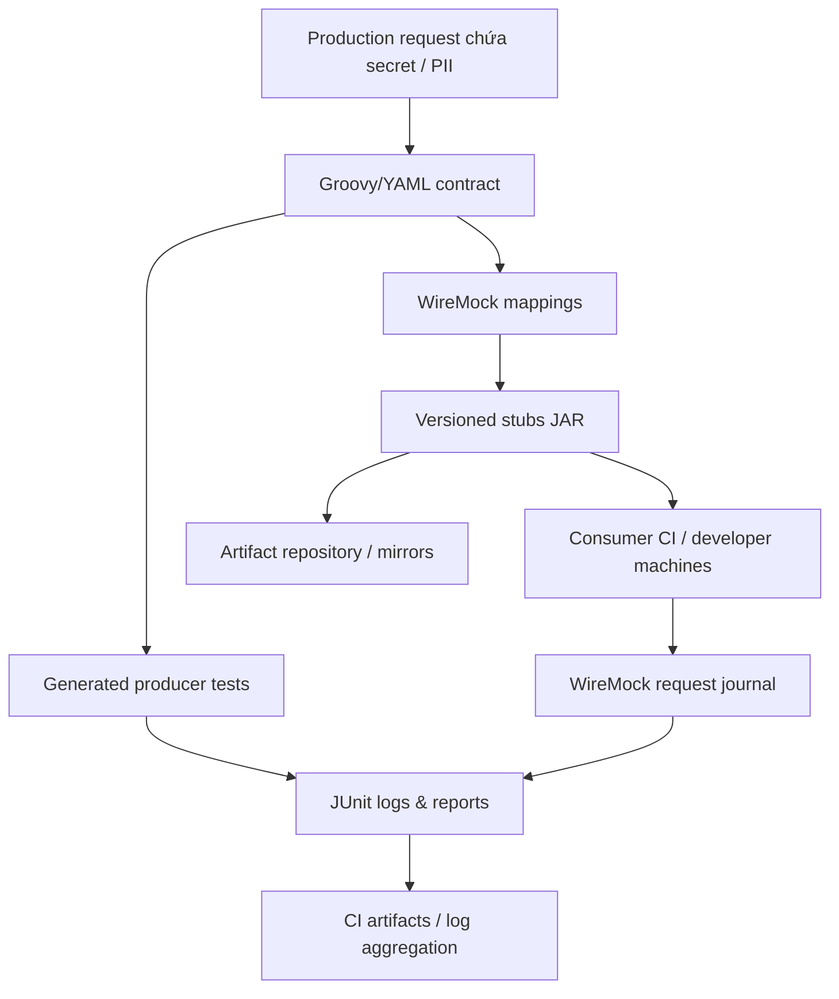
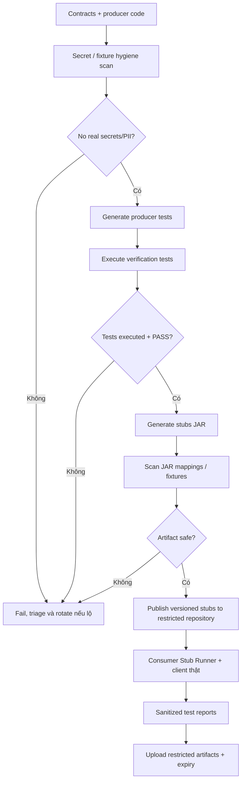
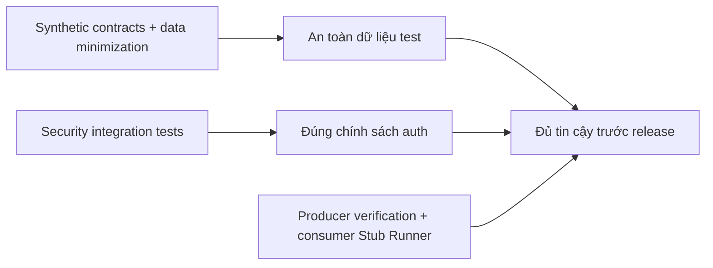

# Ẩn thông tin nhạy cảm trong stub và báo cáo kiểm thử

> **Chương:** Bảo mật hợp đồng  
> **Module:** `SPRING_CLOUD_CONTRACT` — học kiểm thử hợp đồng giữa producer và consumer bằng Groovy/YAML DSL cho HTTP hoặc thông điệp, sinh kiểm thử phía producer, phát hành stub, dùng Stub Runner và tích hợp CI để phát hiện thay đổi API không tương thích.

## Mục tiêu học tập

Sau bài học, bạn có thể:

1. Nhận diện dữ liệu nhạy cảm có khả năng bị ghi lại trong **contract DSL**, generated test, WireMock mapping, stub JAR, request journal, log, JUnit XML/HTML report và CI artifacts.
2. Phân loại token, API key, cookie, password, thông tin định danh cá nhân (PII), dữ liệu thanh toán, bí mật của message broker và những giá trị trông vô hại nhưng có thể suy ra danh tính.
3. Thiết kế **fixture giả, không lấy từ production** để contract vẫn kiểm tra được method/path/header/body/status mà không chứa bí mật thật.
4. Dùng các matcher của Spring Cloud Contract để kiểm tra **định dạng/hành vi cần thiết** mà không buộc lưu giá trị bí mật thật trong contract.
5. Phân biệt **ẩn thông tin nhạy cảm** với việc **vô hiệu hóa kiểm tra bảo mật**; biết những gì chỉ contract test chứng minh được và những gì cần Spring Security/integration test riêng.
6. Cấu hình logging theo hướng **allowlist**, kiểm soát WireMock request journal/admin API và không để một request thất bại làm rò token hoặc PII qua output.
7. Đọc đường đi của stdout/stderr và stack traces vào Maven Surefire/Failsafe, Gradle test reports, CI logs và artifact lưu trữ.
8. Tổ chức quality gates quét secrets/PII mẫu, quyền tải artifact, thời hạn lưu, bằng chứng provenance và xử lý sự cố khi đã lộ thông tin.
9. Áp dụng các nguyên tắc tương tự cho **message contracts**, broker records, DLQ, event logs và báo cáo Stub Runner.
10. Thiết kế một pipeline producer → verified stubs → consumer tests có **bằng chứng kiểm thử đầy đủ mà không công khai dữ liệu nhạy cảm**.

## 1. Vì sao một hợp đồng kiểm thử lại có thể làm lộ dữ liệu?

Giả sử `checkout-service` cần gọi `inventory-service`:

```http
GET /api/stock/SKU-001 HTTP/1.1
Accept: application/json
Authorization: Bearer <test-only-token>
X-Correlation-Id: trace-demo-001
```

Producer trả:

```json
{
  "sku": "SKU-001",
  "available": true,
  "quantity": 4,
  "warehouse": "DEMO-WAREHOUSE"
}
```

Nếu một developer sao chép request từ production vào contract, `<test-only-token>` rất dễ bị thay bằng **bearer token thật**. Từ đây, cùng một bí mật có thể lan rộng:

1. Commit vào Git dưới dạng YAML/Groovy.
2. Được plugin Spring Cloud Contract đọc để sinh generated producer test.
3. Xuất hiện trong WireMock JSON mapping.
4. Được đóng gói vào `*-stubs.jar` và publish lên Maven repository.
5. Được consumer tải về máy hoặc CI runner.
6. Bị WireMock ghi vào request journal khi test gọi stub.
7. Được in ra console, stack trace, báo cáo XML/HTML hoặc test artifact khi assertion thất bại.

Như vậy, **một bí mật được copy vào contract không còn là bí mật chỉ của nhóm producer**. Nó có thể được phân phối tới tất cả consumer có quyền tải stub, người xem CI logs, hệ thống index artifact hoặc bên thứ ba được chia sẻ file.



**Nguyên tắc nền tảng:** *Đừng đưa thông tin nhạy cảm thật vào test fixtures; đừng phụ thuộc hoàn toàn vào bước che log ở cuối pipeline.* Phòng ngừa từ nguồn đáng tin cậy hơn sửa từng bản sao đã phát tán.

## 2. Dữ liệu nào cần được bảo vệ?

| Loại | Ví dụ trong contract/test | Rủi ro | Cách thể hiện an toàn |
| --- | --- | --- | --- |
| Bearer/OAuth access token | `Authorization: Bearer ...` | Có thể gọi API bằng danh tính bị chiếm đoạt | Token **test-only**, ký giả hoặc header matcher tùy mục đích |
| Refresh token, session cookie | `Cookie: SESSION=...` | Chiếm phiên/tái cấp token | Giá trị giả không truy cập được hệ thống thật |
| API key / client secret | `X-Api-Key`, `client_secret` | Truy cập dịch vụ, lạm dụng quota | Dummy value/synthetic credential không có quyền thật |
| Password, OTP, recovery code | Request body/login form | Chiếm tài khoản, danh tính | User/test account cô lập và dữ liệu giả |
| PII | Tên, email, số điện thoại, địa chỉ, mã định danh | Rò rỉ thông tin cá nhân | Persona tổng hợp, không giống khách hàng thật |
| Dữ liệu thanh toán | Số thẻ, tài khoản, giao dịch, CVV | Rủi ro tài chính và tuân thủ | Dữ liệu sandbox/fixtures được nhà cung cấp công bố cho test |
| Broker/service credentials | Kafka SASL password, RabbitMQ secret | Truy cập topic/queue | Secret manager; không nằm trong contract |
| Link nhạy cảm | URL có chữ ký, query `token` | Lộ quyền truy cập khi copy URL | Không đưa signed URL thật; tránh log query |
| ID có thể truy vết | Order/customer ID thật | Tái nhận diện qua hệ thống khác | ID tổng hợp, không ánh xạ khách hàng thật |
| Nội dung thông điệp | Email, nội dung đơn hàng, payload DLQ | Phát tán đến logs/replay | Event test với dữ liệu tối thiểu giả lập |

Không phải mọi giá trị "trông giống token" đều thực sự là secret. Ví dụ `test-token-001` chỉ là **chuỗi giả phục vụ học tập**, không có quyền gọi bất kỳ API thật nào. Nhưng **một JWT dùng trong môi trường thật** vẫn là secret dù chỉ còn hiệu lực vài phút.

### 2.1. Ba mức chính sách minh họa

Một nhóm có thể phân loại:

- **Public synthetic:** `SKU-001`, `CUST-DEMO-001`, `test-token-001`, được tạo để không liên kết dữ liệu thật.
- **Internal non-secret:** tên route nội bộ, tên consumer, environment identifier; không phải credential, nhưng không nhất thiết được công khai.
- **Confidential/secret:** bearer token thật, mật khẩu, dữ liệu khách hàng thật, signed URL, key file, private customer identifier.

Không gộp "không phải credential" với "được công khai". Stub artifact có thể chứa **logic nghiệp vụ hoặc cấu trúc hệ thống nội bộ** cần quyền truy cập giới hạn dù không có password.

### 2.2. Giả lập khác ẩn bớt vài ký tự

Những ví dụ **không an toàn**:

```text
Email thật:    alice@real-customer.example
Che một phần:  a***e@real-customer.example
Số thẻ thật:   4111-....-1234 (đã sao chép từ production)
Access token:  eyJ...<giữ nguyên 12 ký tự cuối>
```

Một bản ghi đã che một phần vẫn có thể tái nhận diện hoặc đủ thông tin để khớp với hệ thống khác. Nếu không cần dữ liệu thật để test, hãy thay bằng persona hoàn toàn giả, như `customer-001@example.invalid` và `PAY-DEMO-001`.

**Không tái sử dụng bí mật thật sau khi cắt bớt, mã hóa Base64 hoặc băm đơn giản rồi coi là dữ liệu giả.** Những biến đổi đó có thể giữ lại khả năng suy luận dữ liệu gốc.

## 3. Mô hình đe dọa theo từng nơi lưu dữ liệu

| Nơi lưu/hiển thị | Có thể chứa gì? | Ai có thể tiếp cận? | Biện pháp chính |
| --- | --- | --- | --- |
| Source contract `.yml/.groovy` | Token, PII, request/response samples | Người đọc Git, code search, fork | Synthetic fixtures, PR review, secret scan |
| Generated tests | Literal values từ DSL | CI logs, build output, test artifact | Không đưa secret vào DSL, không in request thô |
| WireMock JSON mapping | Header matcher, response body, metadata | Stub Runner consumers, artifact readers | Dummy values, narrow matching, kiểm tra JAR |
| `*-stubs.jar` | Mappings, contracts, `__files` | Maven repo mirrors, local caches | Immutable version, ACL, retention, scan trước publish |
| WireMock request journal | URL, headers, body/cookies của request nhận | Test code, WireMock admin, debug tooling | Server test-owned, hạn chế journal, bảo vệ admin |
| Maven Surefire/Failsafe reports | Test names, stdout/stderr, exception message | CI, uploaded reports | Không log secret, sanitize trước lưu, access control |
| Gradle test XML/HTML | Failed assertions, captured output, stack traces | CI, report viewer | Test logging policy, non-secret assertion messages |
| CI console/log aggregator | Commands, env dump, HTTP debug traces | Người xem job, log platform | Không echo secrets, masking phòng thủ, hạn chế debug |
| Broker test/DLQ | Payload sự kiện, headers, trace IDs | Team vận hành/consumer | Synthetic payloads, topic test riêng, TTL/ACL |
| Screenshots/traces | URL có token, dữ liệu form hiển thị | Artifact viewers | Test data giả, sanitize, hạn chế lưu |

### 3.1. Một request có thể bị lưu nhiều lần

Giả sử consumer test gửi:

```http
POST /api/orders HTTP/1.1
Authorization: Bearer test-token-001
Content-Type: application/json

{"customerRef":"CUST-DEMO-001","sku":"SKU-001"}
```

Dù token là giả, request này minh họa bốn vị trí chứa cùng nội dung:

- HTTP client debug output.
- WireMock request journal.
- Assertion thất bại in actual request/response.
- Artifact logs được CI lưu sau test.

Trong test **không có dữ liệu nhạy cảm thật**, việc nhìn thấy `test-token-001` không phải sự cố. Nhưng nếu header được thay bằng token production ở bất kỳ bước nào, cả bốn bản sao đều có thể nguy hiểm.

## 4. Quy tắc số một: dữ liệu test phải được sinh riêng

**Lý tưởng:** fixture **không bao giờ** lấy từ request/response production thật. Hãy tạo dữ liệu tổng hợp có định danh rõ ràng:

```json
{
  "customerRef": "CUST-DEMO-001",
  "email": "customer-001@example.invalid",
  "sku": "SKU-001",
  "quantity": 2,
  "deliveryCity": "DEMO-CITY"
}
```

`example.invalid` là tên miền dành cho ví dụ không dùng để gửi email thật. Nếu test cần email delivery, hãy dùng **mail catcher/sandbox**, không gửi vào địa chỉ khách hàng thật.

### 4.1. Tạo fixture đủ thực tế nhưng không mang danh tính

Một fixture tốt phải kiểm thử được:

- Trường bắt buộc có mặt.
- Định dạng email/ID theo đúng schema.
- Số lượng, tiền tệ và kiểu JSON.
- Trường optional/null.
- Edge cases: chuỗi dài, ký tự Unicode, mảng rỗng.
- Những tương tác nghiệp vụ quan trọng.

Fixture **không cần**:

- Một số điện thoại khách hàng thật.
- Một token đã chạy được trên staging/production.
- Địa chỉ khách hàng đã ẩn một vài ký tự.
- Ảnh chụp JSON đầy đủ từ incident production.
- Tên người dùng/trường email xác định được người thật.

### 4.2. Deterministic synthetic data

Nếu generated producer tests cần giá trị cố định, dùng `CUST-DEMO-001`, `trace-demo-001` và thời gian cố định giả. Nếu cần giá trị động, dùng matcher có kiểm soát, chứ không ghi một UUID hoặc token production vào contract.

**Cẩn trọng:** định dạng "giống thật" không đủ. Dữ liệu tổng hợp phải được tạo độc lập, không lấy từ một người dùng thật rồi hoán đổi tên.

### 4.3. Trường hợp thật sự cần dữ liệu gần production

Nếu tổ chức cần kiểm thử trên dữ liệu thực để tái hiện lỗi khó:

1. Được phép theo policy và pháp luật áp dụng.
2. Tạo dataset **đã được khử định danh phù hợp** trong môi trường test kiểm soát.
3. Không xuất dữ liệu đó vào **contract source hoặc public/consumer stub JAR**.
4. Đặt retention/access controls và audit.
5. Tách integration test dữ liệu khỏi contract test shareable.
6. Không xem một regex che email là quy trình anonymization đầy đủ.

## 5. Thiết kế contract HTTP không chứa credential thật

Giả sử consumer cần truy cập endpoint `POST /api/orders/quote`. Hệ thống production cần bearer token, nhưng contract sample dùng **token giả không có quyền truy cập**.

File `quote_success.yml`:

```yaml
name: quote_success
description: "HTTP quote success with test-only identity"

request:
  method: POST
  url: /api/orders/quote
  headers:
    Accept: application/json
    Content-Type: application/json
    Authorization: Bearer test-token-001
  body:
    customerRef: CUST-DEMO-001
    sku: SKU-001
    quantity: 2

response:
  status: 200
  headers:
    Content-Type: application/json
  body:
    quoteRef: QUOTE-DEMO-001
    amount: 240000
    currency: VND
```

Đây là YAML DSL của Spring Cloud Contract: mỗi sample value là **giả và có kiểm soát**. Hợp đồng có thể sinh producer tests và WireMock mappings.

**Quan trọng:** vì `Authorization: Bearer test-token-001` là token giả, producer verification có bật Spring Security thật **không tự nhiên chấp nhận token này**. Base test phải thiết lập **test authentication/controlled decoder** hoặc scope test riêng phù hợp; đừng gỡ Security filters một cách âm thầm rồi tuyên bố đã kiểm tra authorization.

### 5.1. Điều contract này thật sự kiểm tra

- Consumer gửi `POST` vào đúng URL.
- Consumer gửi `Accept` và `Content-Type` hợp lệ.
- Request có cấu trúc body đã thống nhất.
- Producer trả `200` và response amount/currency theo fixture.
- Consumer có thể parse response từ stubs.

Contract trên **không** tự chứng minh:

- Token signature/expiration hợp lệ.
- Quyền `SCOPE_orders.quote` hay `ROLE_USER` đúng.
- OAuth issuer, audience, JWKS rotation hoạt động.
- Gateway/TLS thực hiện đúng xác thực.
- Dữ liệu khách hàng thật được phép truy cập hay không.

Các thuộc tính đó cần security integration tests tương ứng.

### 5.2. Vì sao không dùng biến môi trường thật trong DSL?

Một anti-pattern dễ gặp:

```yaml
# KHÔNG NÊN đưa giá trị này từ môi trường thật vào artifact:
request:
  headers:
    Authorization: "Bearer <real-prod-token>"
```

Thay thế bằng `<real-prod-token>` trong tài liệu không phải một kỹ thuật tự động "giấu" secret khi build. Trong file contract thực, phải dùng **synthetic test token** hoặc matcher mà generated test có fixture giả. Nếu DSL giải nội suy từ environment, phải kiểm tra kết quả **sau sinh** để chắc secret không được ghi vào generated code/mappings.

## 6. Dùng matchers để không phải lưu một giá trị thật

Spring Cloud Contract hỗ trợ request/response matchers. Với YAML DSL, request header matcher có thể nằm dưới `request.matchers.headers`.

Ví dụ **cho phép chuỗi token test theo định dạng xác định**, không match một token thật:

```yaml
name: quote_with_test_identity
request:
  method: POST
  url: /api/orders/quote
  headers:
    Authorization: Bearer test-token-001
    Content-Type: application/json
  body:
    customerRef: CUST-DEMO-001
    quantity: 2
  matchers:
    headers:
      - key: Authorization
        regex: 'Bearer test-[A-Za-z0-9-]{3,32}'

response:
  status: 200
  headers:
    Content-Type: application/json
  body:
    quoteRef: QUOTE-DEMO-001
    amount: 240000
```

**Giải thích từng phần:**

- `Authorization` trong `request.headers` có giá trị mẫu giả để producer generated tests có request fixture.
- `request.matchers.headers` cho stub có thể nhận nhiều test tokens cùng định dạng, tùy generator/version.
- Regex được **giới hạn tiền tố `test-`** nhằm tránh vô tình coi mọi bearer token ngoài đời là thứ phù hợp cho test.
- Nếu client bỏ header hoàn toàn, mapping phải không match khi `Authorization` bắt buộc.
- Không nên viết `regex: '.*'` chỉ để tất cả request được nhận; như vậy bạn đã bỏ khả năng kiểm tra header.

**Một regex matching header không xác minh token thật.** Nó chỉ kiểm tra chuỗi request. WireMock không xác nhận chữ ký JWT hoặc quyền truy cập bằng một regex.

### 6.1. Khi phải dùng token tùy ý cho HTTP client tests

Một consumer-side test đôi khi cần đảm bảo adapter **đính kèm header Authorization** bất kể token là gì. Có thể kiểm tra:

- Header tồn tại và có tiền tố `Bearer `.
- Không rỗng, không phải chữ `null`, không chứa newline.
- Client dùng đúng cơ chế cấu hình token ở test.
- Không log toàn bộ header sau khi test fail.

Nếu mục tiêu là kiểm tra JWT signature, expiry, issuer, audience hoặc roles, hãy dùng security integration test với **test keys / controlled issuer**. Không mở rộng matcher WireMock tới mức có vẻ bảo mật nhưng chỉ là một pattern.

### 6.2. Nếu response chứa dữ liệu động

Một API có thể trả `quoteRef` sinh mới mỗi request. Có thể dùng sample fake và matcher:

```yaml
response:
  status: 200
  body:
    quoteRef: 84fe2261-2afb-4d3c-8f3a-79f820805ac2
    amount: 240000
  matchers:
    body:
      - path: $.quoteRef
        type: by_regex
        predefined: uuid
```

Đoạn này là **phần response thay thế** cho API có quoteRef kiểu UUID, không ghép cả hai khối `response` vào một file YAML. UUID mẫu là dữ liệu giả, không tham chiếu đến khách hàng thật.

Matcher giúp producer tạo giá trị động đúng định dạng nhưng giữ bất biến `amount`. **Không được nới `amount` thành mọi chuỗi chỉ để tránh assertion thất bại.**

### 6.3. Groovy DSL tương đương

Một hợp đồng Groovy hoàn toàn dùng dữ liệu giả:

```groovy
org.springframework.cloud.contract.spec.Contract.make {
    name 'quote_success'

    request {
        method 'POST'
        url '/api/orders/quote'
        headers {
            contentType(applicationJson())
            header 'Authorization': 'Bearer test-token-001'
        }
        body(
            customerRef: 'CUST-DEMO-001',
            sku: 'SKU-001',
            quantity: 2
        )
    }

    response {
        status 200
        headers {
            contentType(applicationJson())
        }
        body(
            quoteRef: 'QUOTE-DEMO-001',
            amount: 240000,
            currency: 'VND'
        )
    }
}
```

Không lưu **cả Groovy và YAML của cùng interaction** trong một lần build nếu không muốn sinh hai contract tests hoặc hai mappings trùng.

Trong Groovy DSL, `consumer(...)`/`producer(...)` giúp tách giá trị phù hợp với stub và producer tests khi cần. Nhưng **cả hai nhánh cuối cùng vẫn có thể xuất hiện trong generated artifacts**, nên tuyệt đối không nhét token thật vào một nhánh rồi cho rằng nhánh kia sẽ che nó.

## 7. Từ DSL đến WireMock JSON: cần kiểm tra bản cuối

Một WireMock mapping sinh ra từ contract có thể tương tự:

```json
{
  "name": "quote_with_test_identity",
  "request": {
    "method": "POST",
    "url": "/api/orders/quote",
    "headers": {
      "Authorization": {
        "matches": "Bearer test-[A-Za-z0-9-]{3,32}"
      }
    }
  },
  "response": {
    "status": 200,
    "headers": {
      "Content-Type": "application/json"
    },
    "jsonBody": {
      "quoteRef": "QUOTE-DEMO-001",
      "amount": 240000
    }
  }
}
```

Đây là **mapping minh họa theo WireMock format**, không khẳng định generator của mọi version sẽ tạo đúng từng byte. Khi dùng Spring Cloud Contract thật, cần kiểm tra **JSON mapping được sinh**.

### 7.1. Trường nhạy cảm trong matcher cũng có thể rò

Nếu mapping viết:

```json
{
  "request": {
    "headers": {
      "Authorization": {
        "equalTo": "Bearer REAL-LIVE-TOKEN"
      }
    }
  }
}
```

thì secret đã nằm trong JAR, dù mọi log console được che. **Đừng nghĩ "chỉ là stub" nên không cần bảo vệ.** Mappings là dữ liệu có thể được upload/download và giải nén bởi người đọc artifact.

### 7.2. Response của stub cũng phải không chứa dữ liệu thật

Không được đặt số tài khoản, địa chỉ, phone/email thật vào `response.body` chỉ vì "đó là response giả". Nếu consumer test cần kiểm tra email, dùng địa chỉ synthetic. Nếu cần kiểm tra dữ liệu tài chính, dùng test card/account identifiers do sandbox chính thức cung cấp theo chính sách.

### 7.3. Inspect artifact trước khi publish

Stub JAR thường chứa `mappings`, `contracts` và đôi khi `__files` hay fixtures khác theo cấu hình. Khi ở **project thật**:

```bash
# Ví dụ: xem danh sách entry trong file JAR thuộc workspace test.
jar tf build/libs/inventory-service-1.0.0-stubs.jar

# Maven build có thể tạo artifact tại target/.
jar tf target/inventory-service-1.0.0-stubs.jar
```

Đường dẫn là minh họa; không khẳng định mọi project đều dùng `build/libs` hoặc `target`. Sau khi mở artifact test-owned, kiểm tra cả nội dung mappings, response files, header/URL matchers và contract definitions.

**Không dựa chỉ vào secret scanner của Git:** một bí mật có thể được thêm vào generated file trong bước build hoặc được copy từ fixture ngoài repository.

## 8. Không dùng production token để cho contract test "qua Security"

Một vấn đề điển hình:

1. Producer dùng Spring Security Resource Server.
2. Generated producer test gửi `Authorization: Bearer test-token-001`.
3. Security trả 401 vì chuỗi giả không có chữ ký hợp lệ.
4. Một developer đề xuất đặt token thật trong YAML.

**Không được làm bước 4.** Hãy quyết định mục tiêu test và dùng **test authentication phù hợp**.

### 8.1. Chia hai loại kiểm chứng

| Test | Mục tiêu | Credential |
| --- | --- | --- |
| Producer HTTP contract verification | Method/path/status/body khi một request hợp lệ đi qua | Test-only identity hoặc controlled security fixture |
| Consumer Stub Runner HTTP contract | Client gửi header và xử lý schema/response | Fake test token, stub matcher có kiểm soát |
| Spring Security authorization test | Role/scope/tenant đúng, 401/403 được trả | Mock JWT/test identity có claims do test tạo |
| Security integration với issuer/JWKS | Signature, expiration, audience, issuer, keys | Test keypair/issuer cô lập, không phải prod key |
| E2E smoke security | Cấu hình gateway/identity provider ở môi trường được kiểm soát | Test account/token phạm vi hẹp, quản lý qua secret store |

### 8.2. Ví dụ Security MockMvc test riêng

Một test Java sử dụng `spring-security-test` để mô phỏng claims của JWT **mà không cần chép token sống**:

```java
import static org.springframework.security.test.web.servlet
    .request.SecurityMockMvcRequestPostProcessors.jwt;
import static org.springframework.test.web.servlet.request
    .MockMvcRequestBuilders.get;
import static org.springframework.test.web.servlet.result
    .MockMvcResultMatchers.status;

import org.junit.jupiter.api.Test;
import org.springframework.beans.factory.annotation.Autowired;
import org.springframework.boot.test.autoconfigure.web.servlet.AutoConfigureMockMvc;
import org.springframework.boot.test.context.SpringBootTest;
import org.springframework.security.core.authority.SimpleGrantedAuthority;
import org.springframework.test.web.servlet.MockMvc;

@SpringBootTest
@AutoConfigureMockMvc
class InventoryAuthorizationIT {

    @Autowired
    MockMvc mvc;

    @Test
    void readScopeCanReadStock() throws Exception {
        mvc.perform(get("/api/stock/SKU-001")
                .with(jwt().authorities(
                    new SimpleGrantedAuthority("SCOPE_inventory.read")
                )))
            .andExpect(status().isOk());
    }

    @Test
    void withoutAuthenticationIsUnauthorized() throws Exception {
        mvc.perform(get("/api/stock/SKU-001"))
            .andExpect(status().isUnauthorized());
    }
}
```

**Đây là ví dụ security integration ở tầng MVC**, cần có controller, `SecurityFilterChain` và rule yêu cầu auth đúng scope. Với cấu hình không bật security filter như mong đợi, assertion 401 có thể fail; đó là tín hiệu cấu hình test chưa đại diện cho bảo mật thật.

`jwt()` của `spring-security-test` **không kiểm tra chữ ký JWT**: nó cung cấp authentication test cho filter/authorization behavior. Phải có test riêng nếu việc xác minh token thật (issuer, audience, signature, key rotation) là rủi ro quan trọng.

### 8.3. Token test cũng phải có đặc quyền tối thiểu

Nếu một integration test **bắt buộc** xin token từ identity provider sandbox:

- Dùng service account/test identity chỉ ở môi trường test.
- Scope nhỏ nhất phục vụ kịch bản.
- TTL ngắn, rotate được, không cấp quyền production.
- Lấy token qua secret manager hoặc protocol test an toàn.
- Không in token/refresh token vào console, JUnit XML hay file attachments.
- Không chuyển token qua artifact repository cùng stub JAR.

Nếu test chạy được với một token production, đó là dấu hiệu thiết kế isolation cần được xem lại.

## 9. Cần kiểm tra cả 401, 403 và rò dữ liệu trong response

Một API bảo vệ thông tin đơn hàng thường có ba tình huống:

1. **Chưa xác thực:** 401.
2. **Đã xác thực nhưng không có quyền:** 403.
3. **Có quyền:** 200 với dữ liệu thuộc tenant/user được phép.

Contract DSL có thể mô tả response 401/403 dưới các request có fixture phù hợp, nhưng việc giả lập một header token bằng WireMock **không đủ để kiểm chứng authorization policy thật**.

### 9.1. Contract không có auth

```yaml
name: stock_requires_authentication
request:
  method: GET
  url: /api/stock/SKU-001
  headers:
    Accept: application/json

response:
  status: 401
  headers:
    Content-Type: application/json
  body:
    code: UNAUTHENTICATED
```

Đây là **tình huống khác** với contract 200 đã xác thực. Để producer test PASS, server thật phải trả đúng body/header lỗi, có thể cần Spring Security exception handling được cấu hình. Không tự giả định framework trả JSON mẫu này theo mặc định.

### 9.2. 403 với test identity không đủ quyền

Đối với 403, có thể cần tạo test identity có claims thiếu scope bằng Spring Security test harness, rồi kiểm tra response. Nếu generated test không có cách dựng principal/authorization thích hợp, hãy chạy **security-specific test riêng**, thay vì ghi một token thật vào contract để cố ép 403.

### 9.3. Không cho dữ liệu của tenant khác xuất hiện trong log hoặc stub

Nếu response test có:

```json
{
  "orderRef": "ORDER-DEMO-001",
  "tenantRef": "TENANT-DEMO-A",
  "status": "CREATED"
}
```

thì đó là fixture tổng hợp. Để kiểm tra cross-tenant access, cần một test có hai principal/tenant **giả** nhưng đủ phân biệt, đồng thời assertion response không trả tài nguyên tenant B cho A. **Không dùng bản ghi khách hàng thật** làm bằng chứng.

## 10. WireMock request journal: nguồn rò ít được chú ý

WireMock có **request journal** ghi lại các HTTP requests đã nhận để phục vụ verification. Mỗi logged request có thể chứa:

- Method/URL và query parameters.
- Headers, kể cả `Authorization`, `Cookie` hoặc custom API keys.
- Request body, kể cả customerRef, email hoặc signed URL.
- Thời gian và các metadata khác.

WireMock cung cấp Admin API như `GET /__admin/requests` để xem logged requests, và `DELETE /__admin/requests` để xóa chúng. Vì thế, khi test gửi **secret thật**, journal có thể giữ một bản sao ngay cả khi application không gọi `logger.info`.

### 10.1. Journal cần thiết cho verification

Theo tài liệu WireMock, request journal được dùng bởi các tính năng verify requests. Có thể tắt bằng cấu hình:

```java
WireMockServer server = new WireMockServer(
    wireMockConfig()
        .dynamicPort()
        .disableRequestJournal()
);
```

**Đánh đổi:** khi journal bị tắt, các tính năng request verification dựa vào journal sẽ không hoạt động hoặc báo lỗi. Vì vậy, nếu consumer contract test cần `verify(1, getRequestedFor(...))`, đừng chỉ tắt journal rồi bỏ assertion.

Cách tốt hơn thường là **không gửi credential thật**, giữ journal test-owned và xóa sau test.

### 10.2. Hạn chế kích thước journal không làm nó vô hại

WireMock cũng hỗ trợ giới hạn số request entries (API cụ thể tùy phiên bản). Giới hạn giúp quản lý bộ nhớ/retention nhưng **không tự xóa giá trị Authorization khỏi mỗi entry**. Một request duy nhất mang token thật vẫn là một bản sao có rủi ro.

### 10.3. Đặt WireMock admin ở môi trường kín

- Chỉ bind/expose mock server trong test network hoặc container cục bộ.
- Không publish `/__admin` ra Internet hay môi trường không tin cậy.
- Không dùng WireMock server chung giữa các team chứa dữ liệu test nhạy cảm.
- Không đưa response của `/__admin/requests` nguyên văn vào CI logs.
- Reset request journal sau test, khi test sở hữu instance riêng.
- Khi cần debug, chỉ in method, path template, status, scenario name, request count.

**Lệnh xóa journal** cho instance do bạn sở hữu:

```bash
curl -X DELETE http://localhost:8089/__admin/requests
```

Dùng đúng WireMock test instance và chỉ sau khi đã hoàn thành assertions cần journal. **Không** reset server dùng chung vì có thể làm các test khác mất dữ liệu cần kiểm tra.

### 10.4. Journal không phải log duy nhất

Ngay cả khi journal bị vô hiệu hóa:

- HTTP client có thể log raw request.
- WireMock notifier/debug mode có thể in thông tin.
- Framework exception có thể chứa URL/query/body.
- APM/tracing có thể ghi headers dưới cấu hình không an toàn.
- CI artifact có thể lưu response snapshots.

Do đó, **tắt journal không tương đương đã giải quyết rò dữ liệu**.

## 11. Logging an toàn: ghi danh mục chứ không ghi raw payload

Chống rò tốt nhất ở tầng logging là **allowlist những trường cần cho chẩn đoán**.

### 11.1. Không log kiểu này

```java
// KHÔNG NÊN:
log.info("Inventory request headers={}", request.getHeaders());
log.error("Failed body={}", responseBody);
log.debug("Authentication details: {}", authorizationHeader);
log.info("Customer payload: {}", orderRequest);
```

Những lệnh trên có thể chứa `Authorization`, `Cookie`, email, địa chỉ, số điện thoại hoặc dữ liệu thanh toán. `toString()` của DTO cũng có thể tự in mọi field dù lời gọi log trông ngắn.

### 11.2. Log tối thiểu có cấu trúc

```java
log.info(
    "inventory_call traceId={} method={} endpoint={} status={}",
    safeTraceId,
    "GET",
    "/api/stock/{sku}",
    httpStatus
);
```

**Điều an toàn hơn ở đây:**

- Dùng **endpoint template** thay vì URL thực có query token/PII.
- Không in `Authorization`, `Cookie` hoặc raw request body.
- Chỉ in traceId được hệ thống test tạo, không dùng nó để suy ngược customerRef.
- Trạng thái HTTP và tên operation đủ cho phần lớn lỗi contract.

**Chú ý:** `traceId` cũng có thể là thông tin nội bộ, cần access controls phù hợp. Không biến một ID có thể liên kết với khách hàng thật thành "public" chỉ vì không phải password.

### 11.3. Nếu thật sự cần xem headers

Chỉ xuất những headers được duyệt:

```java
Map<String, Object> safeHeaders = Map.of(
    "Accept", "application/json",
    "Content-Type", "application/json",
    "Authorization", "[REDACTED]",
    "Cookie", "[REDACTED]"
);
```

Đây là **ví dụ cấu trúc dữ liệu đã được che sẵn**, không phải một generic sanitization utility. Khi triển khai, phải đọc headers theo cơ chế case-insensitive và che `authorization`, `AUTHORIZATION`, custom `X-Api-Key`, `Proxy-Authorization`, `Set-Cookie` và các trường nghiệp vụ nhạy cảm.

**Allowlist tốt hơn denylist** nếu dữ liệu có thể xuất hiện ở các tên field mới không được ai nghĩ tới.

### 11.4. Bảng chính sách redaction tối thiểu

| Trường | Chiến lược log | Lý do |
| --- | --- | --- |
| `Authorization`, `Proxy-Authorization` | Không ghi giá trị; chỉ `present=true/false` | Token/credential |
| `Cookie`, `Set-Cookie` | Không ghi giá trị | Session |
| `X-Api-Key` và custom secret headers | Không ghi giá trị | API key |
| `password`, `refresh_token`, `client_secret` | Loại khỏi payload log | Credential |
| `email`, `phone`, `address` | Không ghi hoặc dùng synthetic values trong test | PII |
| `paymentAccount`, `card` | Không ghi | Dữ liệu tài chính |
| `method`, `route template`, `status` | Có thể ghi khi được phép | Chẩn đoán |
| `testCaseId`, `contractName`, `artifactVersion` | Thường ghi được | Truy vết test |
| `traceId` | Chỉ khi cần; giới hạn quyền xem | Correlation nội bộ |

Không có bộ tên field nào bao phủ mọi domain. Team phải cập nhật policy khi API thêm trường nhạy cảm mới.

## 12. Report JUnit và test runner có thể lưu nhiều hơn bạn nghĩ

### 12.1. Maven Surefire/Failsafe

Với Maven, test results thường ở:

```text
target/surefire-reports/
  TEST-<test-class>.xml
  <test-class>.txt

target/failsafe-reports/
  TEST-<integration-class>.xml
  ...
```

Một XML report có thể chứa:

```xml
<testsuite name="CheckoutContractTest" tests="1">
  <testcase name="shouldReadStock" classname="CheckoutContractTest">
    <failure message="Expected status 200 but was 403">
      Assertion failed in request processing
    </failure>
  </testcase>
</testsuite>
```

**Đây là XML minh họa**, không phải report thật. Trong thực tế, `failure message`, stack trace, `system-out` và `system-err` có thể chứa nội dung test đã in ra. Nếu một assertion in toàn bộ HTTP response hoặc headers, test report có thể mang theo secrets.

Một tùy chọn Surefire như `enableOutErrElements` có thể điều khiển xuất stdout/stderr vào XML ở những phiên bản hỗ trợ. Nhưng **không đưa stdout vào XML không làm stdout biến mất khỏi console/log aggregator hoặc các file khác**.

### 12.2. Gradle test task

Với Gradle, reports thường ở:

```text
build/test-results/test/
build/reports/tests/test/

# Spring Cloud Contract Gradle plugin: source set riêng
build/test-results/contractTest/
build/reports/tests/contractTest/
```

Gradle `Test.testLogging.showStandardStreams` điều khiển việc hiển thị stdout/stderr của test trên console. Một cấu hình giảm console noise:

```groovy
tasks.withType(Test).configureEach {
    testLogging {
        events 'passed', 'skipped', 'failed'
        showStandardStreams = false
    }
}
```

**Không nhầm:** `showStandardStreams = false` chỉ quyết định console presentation trong test logging, **không bảo đảm stdout/stderr bị xóa khỏi XML/HTML report hoặc log nguồn khác**. Cách an toàn nhất vẫn là test **không in secret từ đầu**.

### 12.3. Không bật --debug bừa bãi trong CI

Gradle documentation cảnh báo mức log `DEBUG` có thể làm lộ environment variables, private repository credentials, build cache credentials hoặc publishing credentials.

Tương tự, Maven `-X`/`--debug` có thể tăng đáng kể thông tin cấu hình/log. Nếu cần debug, chạy **môi trường kiểm soát**, giới hạn người xem, kiểm tra output trước upload và không đăng toàn bộ log trong issue công khai.

### 12.4. Tên test/parameter cũng có thể rò PII

Một parameterized test đặt display name:

```text
quote for alice@customer.example with bearer abc...
```

có thể xuất hiện trong XML, HTML dashboard và CI summary **dù test không log body**.

Dùng tên test không chứa dữ liệu cá nhân:

```text
quote_for_synthetic_customer_001
requires_scope_orders_quote
returns_401_without_authentication
```

Đối với JUnit parameterized tests, kiểm soát `@ParameterizedTest(name=...)` để không tự đưa toàn bộ arguments nhạy cảm vào display name.

## 13. Đừng hy sinh bằng chứng kiểm thử chỉ để giấu log

Hai cách giải quyết cực đoan đều sai:

- **In tất cả request/response để debug dễ**, làm lộ dữ liệu.
- **Tắt mọi assertion, mọi report và mọi request verification**, khiến CI luôn xanh nhưng không có bằng chứng contract test thật sự chạy.

Chiến lược phù hợp:

1. Contract chỉ chứa dữ liệu giả.
2. Log theo allowlist và không in raw payload.
3. Giữ JUnit XML/HTML report để biết case count, status, failures, duration.
4. Khi test fail, chỉ xuất **diff của field không nhạy cảm** và định danh test.
5. Đối với lỗi liên quan secret, in `Authorization=[REDACTED]` và `authHeaderPresent=true` thay vì giá trị.
6. Giới hạn quyền truy cập/retention của report và artifact.
7. Khi cần forensic, có **kênh bảo mật, được phê duyệt và kiểm toán** ngoài report dùng chung.

### 13.1. Gợi ý assert theo cấu trúc

Thay vì:

```java
// KHÔNG NÊN nếu response có PII/secrets:
assertEquals(expectedWholeBody, actualWholeBody);
```

có thể:

```java
JsonNode body = mapper.readTree(response.body());

assertEquals(
    "QUOTE-DEMO-001",
    body.path("quoteRef").asText()
);

assertTrue(body.path("amount").isIntegralNumber());
assertEquals(240000, body.path("amount").intValue());
```

Đây là ví dụ JSON parser test. Nếu assertion failure tự in field values, hãy bảo đảm những field được assert là synthetic. Đối với response có secret thật, **không** log/assert whole body bằng framework có thông báo lỗi hiển thị actual value.

### 13.2. Kiểm tra lỗi auth mà không in token

Một test tốt có thể assert:

- Request có header `Authorization` hợp lệ về cấu trúc (trong consumer contract).
- Khi thiếu auth, endpoint trả 401.
- Khi principal không có quyền, endpoint trả 403.
- Khi có quyền, endpoint trả 200 với đúng resource.

Không cần in token vào bất kỳ failure message nào. Một câu như `"Expected 401 for unauthenticated request"` đủ để chẩn đoán intent.

## 14. Artifact repository, quyền truy cập và retention

Stub JAR sau publish là một **bản sao dữ liệu**. Ngay cả khi bạn không log token, người có quyền tải artifact có thể giải nén và đọc mappings.

### 14.1. Kiểm soát truy cập

- Chỉ producer CI/release job có quyền publish.
- Consumer CI và các nhóm được phép mới có quyền đọc.
- Không dùng một repository public cho private API artifacts nếu policy không cho phép.
- Tách snapshots/candidates/releases theo quy tắc và ACL.
- Dùng HTTPS và secret manager cho credentials; không commit Maven `settings.xml` có password thật.
- Audit download/publication khi có khả năng.
- Giới hạn mirrors và không phát hành stub JAR sang external plugin/repository ngoài chủ đích.

### 14.2. Retention

Phân loại artifact:

| Artifact | Retention gợi ý | Lý do |
| --- | --- | --- |
| PR test logs | Ngắn, theo chính sách team | Có thể chứa failure context |
| Snapshot stubs | Theo nhịp phát triển, dọn candidate cũ | Giảm bản sao dữ liệu và chi phí |
| Verified release stubs | Theo vòng đời API/release support | Cần tái lập consumer tests |
| Sanitized manifest | Có thể giữ lâu hơn logs thô | Provenance, audit |
| Debug request dumps | Không lưu mặc định; chỉ khi được phê duyệt | Nguy cơ chứa headers/body |

Không có một số ngày mặc định áp dụng cho mọi tổ chức. Chính sách lưu giữ phải phù hợp với khả năng tái lập, pháp luật, phân loại dữ liệu và quy định nội bộ.

### 14.3. Encryption không thay redaction

Mã hóa repository hoặc artifact storage giúp bảo vệ dữ liệu **at rest**, nhưng người có quyền tải JAR vẫn có thể đọc mapping. **Không nên dùng encryption làm lý do đưa token production vào stub.**

## 15. CI pipeline an toàn và có thể kiểm chứng

Một pipeline producer–consumer có thể chia thành các bước:



### 15.1. Vì sao phải quét trước *và* sau build?

- **Trước build:** tìm giá trị không nên xuất hiện trong DSL/fixture source.
- **Sau build:** generated tests, WireMock JSON và `*-stubs.jar` có thể chứa copy hoặc dữ liệu tạo ra bằng nội suy.
- **Trước upload:** log/report cũng có thể chứa dữ liệu lỗi do test.
- **Sau phát hành:** audit checksum/version và quyền tải.

Secret scan không bảo đảm tìm được mọi PII hoặc mọi biến thể mã hóa. **Đó là một lớp kiểm soát**, không phải bằng chứng hệ thống chắc chắn không rò.

### 15.2. Ví dụ quy tắc pipeline ở dạng pseudocode

```yaml
stages:
  - source_hygiene
  - producer_verification
  - artifact_hygiene
  - publish_candidate
  - consumer_contract_test
  - report_hygiene

source_hygiene:
  checks:
    - "secret scanning enabled"
    - "synthetic fixture review passed"
    - "no raw production traces in contracts"

producer_verification:
  required:
    generated_contract_tests_executed: "> 0"
    failed_required_tests: 0
    skipped_required_tests: 0

artifact_hygiene:
  required:
    - "inspect generated mappings and contracts"
    - "scan stubs JAR content"
    - "no secrets or real PII"

publish_candidate:
  requires: [source_hygiene, producer_verification, artifact_hygiene]
  access: restricted

consumer_contract_test:
  requires: [publish_candidate]
  checks:
    - "Stub Runner loaded exact candidate version"
    - "real consumer client/handler executed"
    - "required contract tests passed"

report_hygiene:
  checks:
    - "reports contain only approved fields"
    - "artifact access scoped"
    - "retention policy applied"
```

**Đây là pseudocode YAML để truyền đạt chính sách**, không phải một file GitHub Actions/GitLab/Jenkins chạy ngay. Những chuỗi `checks` cần được hiện thực thành lệnh/tool phù hợp trong repo thật. **Không hard-code `PASS`** trong job khi chưa có báo cáo kiểm thử.

### 15.3. Upload report có chọn lọc

Nếu dùng GitHub Actions, một bước minh họa có thể tải một thư mục **đã được làm sạch và kiểm tra trước đó**:

```yaml
permissions:
  contents: read

# Giả sử job khác đã tạo report đã được kiểm duyệt:
- name: Upload sanitized test summary
  uses: actions/upload-artifact@v4
  if: always()
  with:
    name: sanitized-contract-summary
    path: build/safe-report/
    retention-days: 7
```

Đây là **fragment minh họa, chưa phải workflow YAML hoàn chỉnh**. Thư mục `build/safe-report/` không tự được Gradle tạo; CI phải có bước **tạo/kiểm tra báo cáo an toàn**. `retention-days: 7` chỉ là ví dụ; retention thực tế theo policy doanh nghiệp.

**Không upload raw `target/surefire-reports` hoặc `build/test-results` một cách mù quáng** nếu tests hiện tại có khả năng in secrets. Trước hết phải sửa nguồn log/fixture và xác nhận reports an toàn; sau đó mới quyết định upload những phần cần thiết cho debugging.

## 16. Dựng kiểm tra an toàn cho báo cáo

### 16.1. Phương pháp allowlist

Một báo cáo thử nghiệm tối thiểu có thể là:

```json
{
  "service": "inventory-service",
  "contractArtifact": "com.example:inventory-service:1.0.0:stubs",
  "contractRevision": "demo-commit-id",
  "testsExecuted": 12,
  "testsFailed": 0,
  "testsSkipped": 0,
  "durationMs": 3420,
  "sanitized": true
}
```

Các giá trị chỉ minh họa. Trong CI thật, số test/commit phải đến từ reports/build metadata. `"sanitized": true` chỉ có ý nghĩa nếu pipeline đã chạy **các bước làm sạch và xác minh**; không được tự thêm cờ này rồi coi là an toàn.

### 16.2. Kiểm thử chính cơ chế che dữ liệu

Có thể tạo **sentinel giả** như `test-only-sentinel-123`, đưa vào một request của test hệ thống log, rồi kiểm tra rằng report/console không có sentinel và có marker `[REDACTED]` ở chỗ phù hợp.

**Lưu ý:** đây phải là một chuỗi **hoàn toàn giả**, không phải token thật. Test redaction không nên đưa secret production vào pipeline để "thử che".

### 16.3. Kiểm tra dựa vào key nhạy cảm

Một lớp scan tĩnh có thể phát hiện những chuỗi như:

```text
Authorization: Bearer <real-looking value>
Cookie: <non-demo session>
client_secret: ...
refresh_token: ...
password: ...
X-Api-Key: ...
email: <non-synthetic domain>
```

Tuy nhiên, pattern scan có false positives và false negatives. Nếu false positive do fixture hợp lệ, xử lý bằng allowlist **có lý do và phạm vi hẹp**, không vô hiệu hóa scanner cho toàn bộ repository.

### 16.4. Không biến scanner thành nơi làm lộ bí mật

Một số scanner có thể in đoạn text chứa secret để minh họa match. Hãy cấu hình chúng **ẩn giá trị khi thông báo**, hạn chế quyền xem output và không đẩy full matching line vào pull request công khai.

## 17. Messaging contracts cũng có đường rò tương tự

Ví dụ một event `OrderAccepted` dùng dữ liệu tổng hợp:

```yaml
name: order_accepted
label: order_accepted
input:
  triggeredBy: publishAcceptedOrder()
outputMessage:
  sentTo: orders.test.events
  headers:
    contentType: application/json
    eventType: OrderAccepted
  body:
    eventType: OrderAccepted
    orderRef: ORDER-DEMO-001
    customerRef: CUST-DEMO-001
    amount: 240000
    currency: VND
```

Hợp đồng này không chứa email, địa chỉ, token hay dữ liệu thanh toán thật. Destination `orders.test.events` chỉ là tên ví dụ; producer thật phải được test bằng binder/adapter đúng cấu hình.

### 17.1. Những nơi message có thể bị sao chép

- Generated producer messaging tests.
- Stub/contract JAR.
- Spring Cloud Contract Stub Runner `StubTrigger` events.
- Kafka topic/RabbitMQ queue/JMS destination thử nghiệm.
- Consumer listener logs.
- Dead-letter queue chứa payload lỗi.
- Message tracing, replay, dump files và CI screenshots.

### 17.2. Không dùng production event làm fixture

Đừng lấy một event từ production rồi cắt bớt email và đưa nguyên các trường còn lại vào contract. `orderRef`, `customerRef`, IP, timestamp, tổ hợp lượng tiền hoặc địa chỉ có thể vẫn tái nhận diện khi liên kết với hệ thống khác.

Dùng dữ liệu giả, và bảo đảm test message không thể bị publish nhầm vào production topic nhờ cấu hình/test profile, IAM và namespace tách biệt.

### 17.3. Đừng bỏ kiểm thử nghiệp vụ chỉ vì giấu payload

Nếu notification consumer cần kiểm tra `amount` là số và `currency` là `VND`, vẫn nên có assertions cho chúng trên **fixture giả**. Không cần body thật để kiểm tra kiểu, định dạng và các quy tắc quan trọng.

Đối với broker thật, bổ sung integration test để kiểm tra serialization, routing, ACK/retry, partition/offset và DLQ; Stub Runner không tự tạo một Kafka cluster có security production.

## 18. Phân biệt data minimization và authorization correctness

Có hai mục tiêu khác nhau:

**Mục tiêu A — Confidentiality:** Không có token thật/PII thật trong contract, stubs, request journal và reports.

**Mục tiêu B — Security behavior:** Consumer và producer xử lý authentication/authorization đúng.

Một hệ thống có thể **đạt A nhưng chưa đạt B**: contract dùng token giả rất an toàn nhưng producer vô tình cho mọi request 200. Ngược lại, hệ thống có thể đạt B ở production nhưng **vi phạm A** khi test logs in access token thật.

Cần cả hai:



Một quality gate có thể yêu cầu:

- Contract source không chứa secret.
- Generated artifact scan sạch.
- Report/log sanitized.
- Producer contract tests PASS.
- Consumer tests dùng đúng stub version và PASS.
- Security-specific 401/403/scope/tenant tests PASS.
- Một integration smoke path khi cần kiểm tra identity provider/gateway thật.

## 19. Khi phát hiện bí mật đã lọt vào Git/JAR/report

**Xóa dòng khỏi file không có nghĩa các bản sao đã biến mất.** Có thể đã tồn tại Git history, Maven mirrors, CI archives, caches và log aggregation.

### 19.1. Quy trình ứng phó

1. **Dừng phát hành và hạn chế truy cập** artifact/report đang chứa secret.
2. **Thông báo security/on-call/owner** theo quy trình sự cố của tổ chức.
3. **Thu hồi hoặc rotate credential** bị lộ; không đợi dọn hết JAR mới rotate.
4. Xác định nơi đã nhân bản: Git commits/forks, CI logs, JUnit reports, artifact repositories, caches, backups.
5. Thực hiện purge/revoke/retention actions theo quyền và chính sách của từng hệ thống.
6. Sửa test fixture để dùng synthetic values; quét source, generated tests và artifact.
7. Publish artifact version **mới** sau producer verification và security scan.
8. Điều tra nguyên nhân: copy production trace, debug logging, thiếu PR review hoặc scanner cấu hình sai.
9. Ghi nhận incident, phạm vi ảnh hưởng và biện pháp ngăn tái diễn.

Không đăng lại giá trị bí mật vào ticket/chats để nhờ tìm. Chỉ chia sẻ **vị trí, loại dữ liệu và mã định danh sự cố đã được làm sạch**.

### 19.2. Vì sao phải rotate trước?

Một access token hoặc API key có thể vẫn được dùng để truy cập hệ thống, kể cả khi bạn đã:

- Xóa file YAML khỏi nhánh hiện tại.
- Xóa artifact trong một Maven repository.
- Chặn upload báo cáo mới.

Những bản sao cũ có thể còn tồn tại trong cache hoặc đã được tải xuống. **Thu hồi/quay vòng credential** là biện pháp cần thiết để vô hiệu hóa nguy cơ lạm dụng.

### 19.3. Không tự động sửa Git history hoặc xóa dữ liệu dùng chung

Rewrite Git history, purge artifact repository, xóa CI archives hoặc thực hiện credential rotation là các thao tác có ảnh hưởng rộng. Chúng cần được thực hiện bởi owner được ủy quyền theo incident procedure, có backup/audit và thông báo cho các nhóm bị ảnh hưởng. **Không tự xóa file hoặc lịch sử của nhóm khác chỉ để làm test pass.**

## 20. Các lỗi phổ biến và cách sửa

| Triệu chứng | Nguyên nhân thường gặp | Cách sửa |
| --- | --- | --- |
| Secret xuất hiện trong generated test | DSL có literal token thật | Thay fixture từ nguồn, rotate token, rebuild và scan |
| Stub JAR có PII | `response.body` hoặc `__files` dùng production sample | Synthetic fixture, artifact scan, publish version mới |
| CI logs có `Authorization` | HTTP client hoặc logging interceptor dump headers | Log allowlist, chặn raw request |
| Report XML chứa body thật | Assertion failure in whole request/response | Assert field không nhạy cảm, sanitize error output |
| `showStandardStreams=false` nhưng dữ liệu vẫn trong XML | Chỉ tắt console streaming | Không log từ nguồn; kiểm tra report content |
| Scanner báo false positive từ `test-token-001` | Rule quá rộng | Synthetic prefix allowlist có review, không tắt scanner |
| WireMock admin cho xem request auth | Journal giữ request và admin bị expose | Fake token, restrict server/admin, reset journal |
| Test 401 fail khi dùng fake token | Producer security thực sự từ chối token không hợp lệ | Controlled test auth/decoder, không dùng prod token |
| Test 403 luôn xanh với WireMock | Stub trả canned 403, không kiểm tra policy thật | Spring Security integration tests |
| Secret trong URL query | URL được log nhiều nơi | Chuyển cơ chế auth theo chuẩn, không log URL nhạy cảm |
| Người dùng tải được internal stubs | Repository ACL quá rộng | Restrict read, kiểm tra mirrors |
| Quên kiểm tra generated files | Scanner chỉ quét source | Scan artifacts sau build |
| Messaging DLQ chứa PII | Consumer message test dùng event thật | Synthetic events, DLQ ACL/TTL |
| Debug CI với Gradle `--debug` | In env/credentials ra log | Giảm log level, chạy môi trường cô lập |
| Xóa token khỏi HEAD nhưng vẫn thấy ở Git | Lịch sử chứa version cũ | Rotate, incident response, xử lý history theo policy |
| CI không upload test report vì lo rò | Quality gate thiếu bằng chứng | Tạo sanitized summary, giữ report an toàn theo ACL |

## 21. Bài tập thực hành

**Bài 1 — Xây dữ liệu giả.** Cho một request checkout chứa email, address, token và orderId lấy từ production. Viết lại thành fixture synthetic độc lập nhưng vẫn giữ định dạng phù hợp để test.

**Bài 2 — Phân loại.** Xếp các mục sau vào public synthetic, internal non-secret hoặc confidential: `SKU-001`, `trace-demo-001`, hostname nội bộ, JWT thật, API key sandbox có quyền, `CUST-DEMO-001`, email khách hàng thật.

**Bài 3 — YAML contract.** Viết `POST /api/orders/quote` với header `Authorization: Bearer test-token-001` và body `customerRef: CUST-DEMO-001`. Dùng request header matcher cho token test, giữ amount/currency equality.

**Bài 4 — Groovy DSL.** Chuyển contract bài 3 sang Groovy DSL. Vì sao `consumer(...)`/`producer(...)` không thể dùng để "giấu" token thật một cách an toàn nếu generated tests/stubs còn chứa giá trị đó?

**Bài 5 — WireMock mapping.** Quan sát mapping đã sinh. Tìm các trường trong `request.headers`, `response.jsonBody` và `__files` có nguy cơ chứa secret. Đề xuất cách thay từ DSL nguồn.

**Bài 6 — Journal.** Giải thích `GET /__admin/requests` có thể lộ những gì. Nếu tắt request journal thì test `verify(1, ...)` có còn dùng được không? Đề xuất phương án cô lập thay thế.

**Bài 7 — Maven/Gradle reports.** Tìm test report của Surefire hoặc `contractTest`. Kiểm tra `failure message` và `system-out`/`system-err` có chứa raw payload không. Vì sao `showStandardStreams=false` không đủ?

**Bài 8 — Authorization.** Tách một consumer stub test kiểm tra header và một Spring Security integration test kiểm tra 401/403/scope. Viết rõ bằng chứng mỗi test bảo vệ.

**Bài 9 — CI gate.** Thiết kế source scan → producer verification → JAR scan → publish → Stub Runner → report scan. Ở bước nào pipeline phải fail nếu phát hiện token production?

**Bài 10 — Messaging.** Tạo `OrderAccepted` với `orderRef`/`customerRef` synthetic. Nêu các nơi event có thể được lưu lại và cách ngăn nó xuất hiện ở production topic.

**Bài 11 — Redaction regression.** Sử dụng sentinel giả `test-only-sentinel-123`, kiểm thử bộ logging tạo `[REDACTED]` thay vì sentinel. Tại sao không dùng token production làm dữ liệu regression?

**Bài 12 — Incident response.** Một secret thật đã xuất hiện trong `inventory-service-1.0.0-stubs.jar` và CI reports. Hãy viết trình tự xử lý đúng gồm revoke/rotate, giới hạn truy cập, tìm bản sao, sửa fixture, publish mới và thông báo cho các nhóm liên quan.

### Gợi ý đáp án

1. Thay bằng `customer-001@example.invalid`, `CUST-DEMO-001`, `ORDER-DEMO-001` và token giả không có quyền; không chỉ che một phần dữ liệu thật.
2. JWT/API key còn hoạt động và email thật là confidential; hostname nội bộ thường internal; identifiers demo không liên kết dữ liệu thật là synthetic.
3. YAML `request.headers` chứa token giả, `request.matchers.headers` chứa regex test token, response amount/currency giữ matcher chặt.
4. Hai nhánh DSL có thể xuất hiện trong output generated; không được đưa bí mật thật vào nhánh nào.
5. Sửa giá trị từ nguồn, kiểm tra cả generated mappings và JAR; không chỉ dựa vào logs.
6. Journal giữ URL/headers/body; disable có thể làm verification fail; dùng fake token và server test-owned.
7. XML/HTML có thể lưu output/stack trace; giảm console output không tự làm sạch nội dung đã capture.
8. Contract test kiểm tra client gọi API; security test kiểm tra policy thật theo test identity, cần test signature riêng khi rủi ro yêu cầu.
9. Fail ngay ở source/artifact/report gate khi phát hiện secret; dừng publish và xử lý sự cố nếu credential đã lộ.
10. Event synthetic, test destination riêng, hạn chế broker/DLQ access, bảo đảm không route sang production.
11. Chỉ dùng sentinel giả không có giá trị bảo mật; kiểm tra scanner/redactor mà không tạo sự cố mới.
12. Rotate/revoke trước, giới hạn phân phối, điều tra mọi bản sao, rebuild bằng synthetic fixtures và báo cáo qua kênh incident.

## 22. Checklist bảo mật cho contract/stub và report

**Trước khi commit:**

- [ ] Contract chỉ chứa dữ liệu giả, không có request dump production?
- [ ] Authorization, Cookie, X-Api-Key và password không chứa giá trị thật?
- [ ] Email/phone/address/ID là synthetic và không thể liên kết khách hàng?
- [ ] Matcher regex không quá rộng để che thiếu header/body quan trọng?
- [ ] Contract 401/403 có test authentication setup phù hợp?
- [ ] Không có biến môi trường/secret nội suy thành literal trong DSL?

**Sau khi sinh code/stub:**

- [ ] Generated tests được kiểm tra/scanned?
- [ ] WireMock mappings và `__files` không chứa secrets/PII thật?
- [ ] Stub JAR được scan trước publish?
- [ ] Mappings không chứa exact-match token thật?
- [ ] Không có secrets trong fixtures nhúng vào resource files?

**Khi chạy test:**

- [ ] HTTP client/log interceptor không dump raw Authorization/Cookie/body?
- [ ] WireMock request journal được cô lập và Admin API không exposed?
- [ ] JUnit/Gradle test names và exception messages không mang secret?
- [ ] Security test có kiểm tra 401/403/scope chứ không chỉ stub canned response?
- [ ] Tests thực sự chạy, không bị skip hoặc chỉ có 0 case?

**Khi publish và lưu báo cáo:**

- [ ] Artifact repository có ACL, HTTPS và version rõ ràng?
- [ ] CI logs và XML/HTML reports đã được kiểm tra an toàn trước upload?
- [ ] Artifact có retention/access policy phù hợp?
- [ ] CI scanner không tự in lại giá trị bí mật?
- [ ] Có provenance producer verification và checksum artifact?
- [ ] Có incident response/rotation plan nếu phát hiện lộ credential?

## 23. Tổng kết

**Bảo mật hợp đồng không chỉ là che token trong console.** Với Spring Cloud Contract, một giá trị từ Groovy/YAML DSL có thể lan qua generated producer tests, WireMock mappings, stub JAR, Stub Runner consumers, request journal, JUnit reports và CI artifacts. Vì vậy biện pháp mạnh nhất là **dữ liệu tổng hợp không có quyền truy cập thật ngay từ nguồn**, sau đó thêm logging theo allowlist, scanner, repository ACL, retention và báo cáo đã kiểm duyệt.

Khi contract cần kiểm tra header Authorization, dùng **test-only token hoặc matcher giới hạn định dạng** thay vì secret production. Nhưng kiểm tra sự tồn tại của header **không chứng minh** JWT hợp lệ hoặc quyền đúng; hãy kết hợp Spring Security/integration tests cho 401, 403, scope, issuer và chữ ký theo nhu cầu thực tế.

Một quality gate đáng tin bao gồm: **source hygiene → producer verification PASS → artifact scan → publish restricted verified stubs → consumer Stub Runner test → report hygiene và quyền truy cập phù hợp**. Không bỏ assertions và test reports chỉ để tránh rò; hãy bảo vệ dữ liệu từ nguồn, giữ bằng chứng đã làm sạch, và có quy trình revoke/rotate nếu secret lỡ xuất hiện trong hệ thống.

## Tài liệu tham khảo

- [Spring Cloud Contract — Contract DSL](https://docs.spring.io/spring-cloud-contract/reference/project-features-contract.html) — HTTP/message DSL và `request.matchers.headers`.
- [Spring Cloud Contract — Dynamic Properties](https://docs.spring.io/spring-cloud-contract/reference/project-features-contract/dsl-dynamic-properties.html) — matcher, YAML/Groovy DSL và giá trị producer/consumer.
- [Spring Cloud Contract — Stub Runner Core](https://docs.spring.io/spring-cloud-contract/reference/project-features-stubrunner/stub-runner-core.html) — phân phối stub artifacts và chạy WireMock.
- [Spring Cloud Contract — Messaging](https://docs.spring.io/spring-cloud-contract/reference/project-features-messaging.html) — message contract, producer verifier và consumer stubs.
- [WireMock — Configuration: Request Journal](https://wiremock.org/docs/configuration/) — `disableRequestJournal` và cấu hình journal.
- [WireMock — Verifying Requests](https://wiremock.org/docs/verifying/) — logged requests, request journal và reset.
- [WireMock — Admin API](https://wiremock.org/docs/standalone/admin-api-reference/) — `/__admin/requests` và các thao tác quản trị.
- [Spring Security — MockMvc OAuth2 Tests](https://docs.spring.io/spring-security/reference/servlet/test/mockmvc/oauth2.html) — `jwt()` cho security testing.
- [Maven Surefire — Introduction](https://maven.apache.org/surefire/maven-surefire-plugin/) — XML/text reports.
- [Maven Surefire — Test Mojo](https://maven.apache.org/surefire/maven-surefire-plugin/test-mojo.html) — `enableOutErrElements` và report configuration.
- [Gradle — TestLogging](https://docs.gradle.org/current/dsl/org.gradle.api.tasks.testing.logging.TestLogging.html) — `showStandardStreams` và test logging options.
- [Gradle — Logging and Output](https://docs.gradle.org/current/userguide/logging.html) — cảnh báo dữ liệu nhạy cảm trong debug output.
- [Spring Boot — Actuator Endpoints](https://docs.spring.io/spring-boot/reference/actuator/endpoints.html) — `/env`, `/configprops` sanitization và quyền xem.
