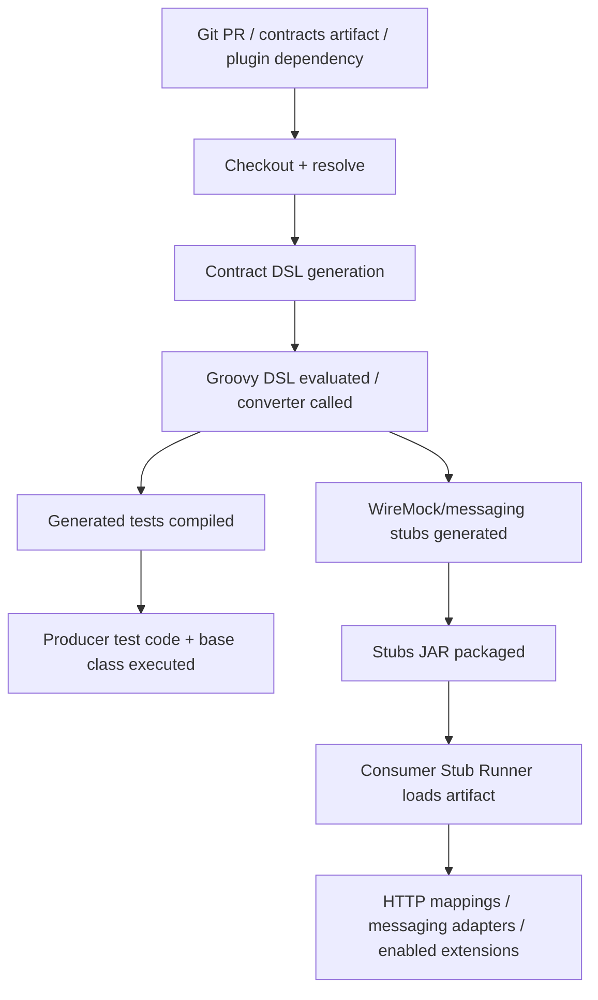
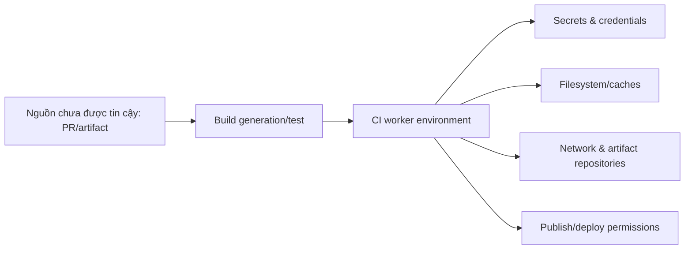
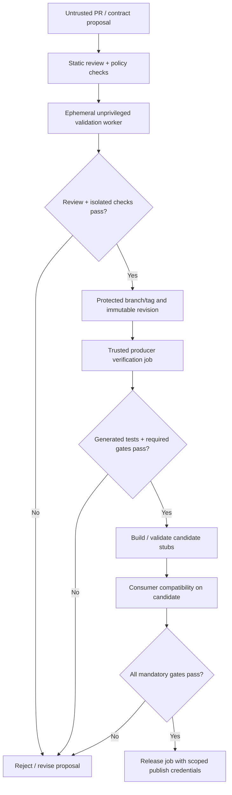
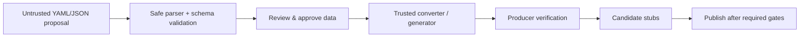
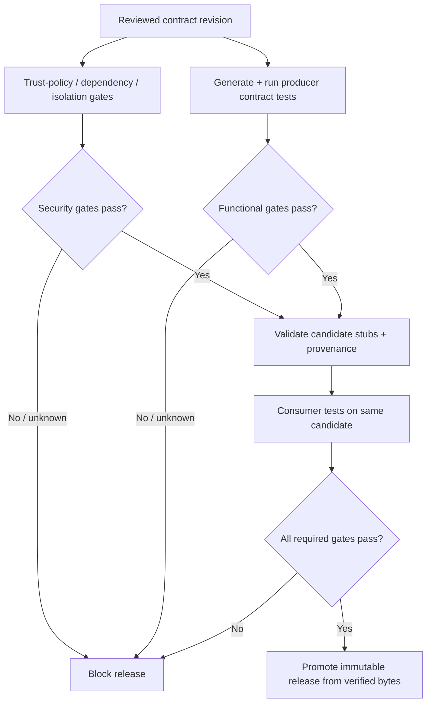

# Rủi ro khi nạp Groovy hoặc mã mở rộng từ nguồn không tin cậy

Một contract trong **Spring Cloud Contract** có thể trông như tài liệu mô tả API: request, response, matcher, status và vài dòng Groovy DSL. Nhưng **Groovy là ngôn ngữ lập trình có thể thực thi**, không phải chỉ là một định dạng dữ liệu. Khi một công cụ tải và đánh giá script Groovy từ nguồn chưa được tin cậy, quá trình **sinh producer tests hoặc stubs** có thể trở thành điểm thực thi mã với quyền của tiến trình build.

Đây là rủi ro đặc biệt quan trọng khi nhóm dùng **common contracts repository**, nhận Pull Request từ nhiều consumer, tải contract artifact từ Maven repository, hoặc dùng **custom converters, extensions, base classes và test helpers**. Một build chạy trên CI thường có quyền đọc source code, cache, environment variables, cấu hình Maven/Gradle, đôi khi cả credentials phát hành. Nếu coi một contract Groovy không rõ nguồn gốc là “chỉ có dữ liệu”, nhóm có thể vô tình trao những quyền này cho tác giả contract.

Bài thuộc chương **Bảo mật hợp đồng** của module **SPRING_CLOUD_CONTRACT**, nơi chúng ta học định nghĩa HTTP/messaging contracts bằng **Groovy/YAML DSL**, sinh producer tests, phát hành stubs, dùng **Stub Runner** và kiểm tra tương thích trong CI. Trọng tâm bài là **ranh giới tin cậy khi nạp contract hoặc mã mở rộng**, cách giảm thiểu khả năng thực thi mã ngoài ý muốn và cách xây pipeline an toàn mà vẫn giữ được sự cộng tác giữa producer–consumer.

Sau bài học, bạn có thể:

- Giải thích vì sao việc **đọc/evaluate Groovy DSL** khác với việc parse YAML/JSON.
- Phân biệt thời điểm **contract generation**, **producer test execution** và **consumer stub runtime** có thể thực thi mã.
- Nhận diện các nguồn không tin cậy: Git PR, contracts JAR, build plugin, converter, extension, test fixture và dependency.
- Xây threat model thực tế cho CI của producer và consumer.
- Chọn cách tổ chức nguồn contract, review, cô lập build và cấp quyền theo **least privilege**.
- Hiểu vai trò và giới hạn của validation, pin version, checksum, chữ ký, provenance và policy “data-only”.
- Tránh dùng một “Groovy sandbox” tự chế làm biện pháp bảo vệ duy nhất.
- Thiết kế quy trình phát hành stub chỉ dùng artifact đã được review và xác minh.
- Xử lý tình huống phát hiện contract hoặc extension đáng ngờ mà không chạy nó trên máy có secrets.

## 1. Ranh giới tin cậy nằm ở đâu?

Giả sử `OrderService` là consumer và `InventoryService` là producer. Nhóm Order gửi PR đề xuất contract vào một kho dùng chung:

```text
shared-contracts/
└── inventory-service/
    └── order-service/
        └── create-reservation.groovy
```

Một pipeline producer tự động làm:

```text
1. Tải contract từ PR hoặc artifact repository
2. Đưa file .groovy vào Spring Cloud Contract Verifier
3. Sinh generated producer tests và WireMock mappings
4. Chạy tests
5. Đóng gói và publish *-stubs.jar
```

Nếu bước 2 **đánh giá Groovy code**, quyền chạy code của script có thể gắn với quyền của Gradle/Maven/CI worker. Vì thế cần hỏi trước:

1. **Ai có thể thay đổi** file hoặc artifact đang được tải?
2. **Ai đã review** nội dung và dependency của nó?
3. **Quyền của tiến trình thực thi** là gì?
4. **Secrets, network, filesystem và artifact repository** nào có thể tiếp cận?
5. **Đường phát hành** có cho một PR chưa được duyệt dùng credentials hay không?

Một file mang tên `create-reservation.groovy` không tự nhiên an toàn hơn file `build.gradle` chỉ vì nó nằm trong thư mục `contracts`.

### Bốn thành phần tham gia

| Thành phần | Nguồn thường gặp | Rủi ro khi không kiểm nguồn |
| --- | --- | --- |
| **Groovy contract** | Repository producer, common repo, contracts JAR | Script được evaluate với quyền build |
| **Mã mở rộng** | Custom contract converter, generator, WireMock extension, message verifier | Plugin/JAR có thể thực thi code khi tải hoặc gọi |
| **Base class / fixture** | `src/test`, `src/contractTest`, shared test library | Test code chạy trong producer verification |
| **Stub artifact** | Repository Maven, Git SCM, local cache | Mapping/messaging dữ liệu giả sai, artifact/extension bị thay hoặc không đúng nguồn |

Nguồn dữ liệu và quyền thực thi phải được xét **riêng cho từng thành phần**; không phải mọi file `.yml` hoặc `.json` đều có khả năng thực thi trực tiếp như Groovy, nhưng chúng vẫn có thể ảnh hưởng hành vi test/runtime.

## 2. Groovy DSL không phải một định dạng dữ liệu thuần túy

Một contract Groovy hợp lệ:

```groovy
import org.springframework.cloud.contract.spec.Contract

Contract.make {
    name 'create_reservation_success'

    request {
        method 'POST'
        url '/api/v1/reservations'
        headers {
            contentType(applicationJson())
        }
        body([
            sku     : 'SKU-001',
            quantity: 2
        ])
    }

    response {
        status 201
        headers {
            contentType(applicationJson())
        }
        body([
            reservationId: 'RES-701',
            status       : 'HELD'
        ])
    }
}
```

Đây là cú pháp Groovy tạo một đối tượng `Contract`. Trong đường xử lý Groovy DSL thông thường, công cụ cần **đánh giá script** để tạo ra định nghĩa contract. Bản thân script có thể chứa khai báo, biểu thức và lời gọi phương thức ngoài phần DSL dự kiến. Đây là đặc tính của Groovy, không phải một yêu cầu rằng người viết contract được phép sử dụng mọi khả năng đó.

### Minh họa vô hại để thấy có thực thi

Ví dụ sau **chỉ tính toán một biểu thức trong bộ nhớ** trước khi tạo contract; không đọc file, không gọi mạng và không thực thi lệnh hệ điều hành:

```groovy
import org.springframework.cloud.contract.spec.Contract

def valueComputedByGroovy = 2 + 2
assert valueComputedByGroovy == 4

Contract.make {
    name 'example_only'
    request {
        method 'GET'
        url '/api/v1/health/example'
    }
    response {
        status 200
        body([ok: true])
    }
}
```

Điểm cần quan sát là `valueComputedByGroovy` và `assert` **không phải dữ liệu request/response**. Chúng là mã Groovy được đánh giá khi script chạy. Cách plugin tải file cụ thể có thể khác nhau theo phiên bản hoặc tùy biến, nhưng **không nên coi cơ chế xử lý script Groovy là sandbox an ninh**.

**Không dùng máy có secrets để thử một contract Groovy đáng ngờ.** Chỉ đọc/review ở dạng văn bản trong công cụ không thực thi, hoặc chuyển đến môi trường cô lập đã được nhóm bảo mật cho phép.

## 3. Groovy, YAML, JSON và Java extension: mức nguy cơ khác nhau

| Định dạng/thành phần | Vai trò trong Spring Cloud Contract | Nhận xét bảo mật |
| --- | --- | --- |
| **Groovy DSL `.groovy`** | Script diễn đạt `Contract.make` | Có khả năng thực thi mã khi được evaluate |
| **YAML DSL `.yml/.yaml`** | Dữ liệu cấu trúc request/response/matcher | Không mặc nhiên thực thi Groovy; vẫn cần parser, schema và quy tắc nạp an toàn |
| **WireMock mapping JSON** | Dữ liệu HTTP stub dùng ở consumer | Thông thường là cấu hình dữ liệu, nhưng có thể kích hoạt tính năng/extension đã bật |
| **Java/Groovy test base class** | Chuẩn bị fixture và khởi tạo test context | Là mã biên dịch/chạy trong producer tests |
| **Custom converter / plugin JAR** | Mở rộng cách đọc/generate contract | Có thể thực thi code ở thời điểm khởi tạo/gọi plugin |
| **WireMock extension/transformer** | Mở rộng hành vi stub runtime | Có thể chạy mã tại server/test runtime nếu được nạp |
| **Maven/Gradle plugin và build scripts** | Tổ chức generation, tests, packaging | Là mã chạy trong build, có quyền theo worker |

### YAML có phải luôn an toàn?

**Không.** YAML theo mô hình DSL thông thường là dữ liệu, nhưng điều đó chỉ loại một nhóm rủi ro do thực thi Groovy. Vẫn phải kiểm:

- Parser có hỗ trợ **custom tags** hoặc tạo đối tượng kiểu tùy ý hay không.
- Có chạy **custom converters/validators** dựa trên dữ liệu vừa parse hay không.
- Có tham chiếu file/body fixture nằm ngoài root được phép không.
- Matcher regex có biểu thức quá tốn tài nguyên hay không.
- Có đầu vào quá lớn, cấu trúc quá sâu hoặc alias expansion gây cạn tài nguyên không.
- Có trường dữ liệu được xử lý thành shell command, template, URL hoặc đường dẫn bởi phần mềm tùy biến hay không.

Với một pipeline **data-only** thực sự, chỉ dùng YAML/JSON parser an toàn, schema validation, hạn chế kích thước/độ sâu và converter đã được tin cậy. Đừng dựa vào phần mở rộng `.yml` như một chứng nhận tự động.

### “Không thấy Groovy” vẫn có thể có code không tin cậy

Ví dụ một YAML contract có thể chỉ chứa request/response vô hại, nhưng build lại tải một plugin hoặc converter mới từ repository không được tin cậy. **Mã nguy hiểm khi đó nằm trong dependency**, không nằm trong YAML. Vì vậy kiểm nguồn contract và kiểm nguồn **toolchain** là hai nhiệm vụ song song.

## 4. Thời điểm nào có khả năng chạy mã?



Các thời điểm có rủi ro khác nhau:

1. **Checkout/resolve:** file và dependencies chưa chắc được chạy ngay, nhưng có thể bị thay nội dung, giả mạo nguồn hoặc đặt tên giống artifact tin cậy.
2. **Generation:** Groovy contract có thể được evaluate; custom converter được gọi; Maven/Gradle plugins và build script chạy.
3. **Producer verification:** generated test, base class, fixtures, Spring context và custom helpers chạy trong tiến trình test.
4. **Packaging:** Gradle/Maven tasks, transform/copy tasks và publish plugin có thể chạy mã.
5. **Consumer runtime:** WireMock đọc HTTP mappings; một số messaging stub handling hoặc custom extensions cần logic Java/Groovy/framework riêng. **Không được tuyên bố mọi nội dung JAR đều chỉ là dữ liệu hoặc mọi file Groovy trong JAR đều tự động được thực thi.** Phải xem adapter/tính năng/version được sử dụng.

**Ranh giới trọng tâm:** việc một công cụ **đọc contract source để generate** không tương đương việc Stub Runner **phục vụ một HTTP mapping JSON đã sinh**. Hai hành vi có những luồng nạp và quyền thực thi khác nhau; nhưng cả hai đều cần kiểm artifact provenance và extensions.

## 5. Threat model: nếu một tác giả không được tin cậy kiểm soát contract

Giả sử một người có thể mở PR thay đổi:

```text
contracts/order-service/create-reservation.groovy
```

nhưng không được phép truy cập credentials của producer CI. Nếu workflow dùng token có quyền publish khi xử lý PR chưa review, ta đã vượt qua ranh giới:



Trong threat model, cần xác định:

| Tài sản cần bảo vệ | Ví dụ | Hậu quả nếu pipeline bị lạm dụng |
| --- | --- | --- |
| **Secrets** | Repository token, cloud credential, private signing key | Lộ quyền truy cập hệ thống khác |
| **Source & artifacts** | Mã private, dependency cache, JAR release | Đọc/ghi nội dung ngoài quyền tác giả PR |
| **Tính toàn vẹn kiểm thử** | JUnit reports, stub mappings, test settings | “Test xanh giả”, bỏ qua regression |
| **Tính toàn vẹn phát hành** | Stubs JAR, version metadata | Publish artifact sai hoặc giả mạo |
| **CI availability** | CPU, RAM, disk, build minutes | Cạn tài nguyên hoặc ngừng pipeline |
| **Thông tin từ request journal** | Token test, HTTP headers/body | Rò dữ liệu qua log/artifact report |

Không phải mọi PR xấu đều có thể gây tất cả hậu quả trên: **mức độ nguy hiểm phụ thuộc quyền của tiến trình chạy, cách công cụ xử lý input và các biện pháp cô lập đang có**. Threat model giúp tránh cả hai cực đoan: coi mọi DSL hoàn toàn vô hại hoặc khẳng định chắc chắn đã có lỗ hổng thực thi mã ở một plugin/version cụ thể.

## 6. Một số kịch bản rủi ro thường gặp

### Kịch bản A — PR contract chạy ở job có credentials

Một workflow checkout mã do PR tác giả ngoài tổ chức cung cấp, sau đó chạy `mvn verify` hoặc `gradlew check` trong job được cấp token upload artifact. Nếu công cụ đánh giá Groovy do PR kiểm soát, quá trình test có thể chạy code với quyền của job.

**Giảm thiểu:** PR untrusted chạy trong job không có secret/publish permission; chỉ release job từ revision đã review mới nhận credentials. Không dùng quyền cao như một cách “tiện” để khỏi cấu hình hai pipeline.

### Kịch bản B — Contracts JAR bị thay nội dung

Producer pin `com.example.contracts:inventory-contracts:2.3.0` nhưng repository cho phép ghi đè cùng version. Build hôm nay và build ngày mai nhận hai bytes khác nhau. Nếu JAR chứa Groovy DSL được evaluate, rủi ro là cả **tính toàn vẹn hợp đồng** lẫn **thực thi code không đúng nguồn**.

**Giảm thiểu:** version bất biến, SHA-256/identity, quyền ghi repository hạn chế, provenance và kiểm chữ ký/attestation khi policy yêu cầu.

### Kịch bản C — Extension JAR được thêm như “để hỗ trợ matcher”

Một thay đổi build thêm dependency `custom-contract-converter` không rõ publisher. Dù contracts đều là YAML, extension có thể chạy Java code trong quá trình plugin nạp hoặc convert.

**Giảm thiểu:** review dependency diff, cho phép theo danh sách nguồn tin cậy, pin version, kiểm transitive dependencies, dùng SBOM/signature/provenance nếu khả dụng; không bật dynamic plugin loading từ contract input.

### Kịch bản D — Base class test đọc dữ liệu không được phép

Contract đúng cú pháp nhưng test base class mới tham chiếu file, environment variable hoặc service ngoài phạm vi. Generated producer tests có thể chạy code base class dưới quyền CI.

**Giảm thiểu:** quản lý `ContractVerifierBase` và test helpers như production code về mặt review; test fixture dùng fake data, test container/quyền file phù hợp và egress hạn chế.

### Kịch bản E — Artifact chứa mapping/extension giả mạo

Stub Runner tải `inventory-service:1.4.2:stubs` từ repository khác dự kiến hoặc local cache bị thay. Consumer tests có thể sử dụng mapping không xuất phát từ producer đã verify; nếu runtime còn nạp extension executable không được review, rủi ro cao hơn.

**Giảm thiểu:** pin tọa độ, repository allowlist, digest/provenance, runtime instance cô lập, hạn chế custom extensions, kiểm danh sách mappings active.

## 7. Rủi ro không chỉ là “lộ secrets”

Một nguồn Groovy/extension không được tin cậy còn có thể:

- **Phá kết quả kiểm thử:** thay fixtures, ghi đè test resources, làm một bài test bị bỏ qua.
- **Đổi stub behavior:** sinh mapping trả status/body dễ khiến consumer test xanh giả.
- **Can thiệp build:** sửa file output hoặc metadata dùng khi đóng gói.
- **Cạn tài nguyên:** vòng lặp tốn CPU, memory allocation lớn, file rất lớn hoặc regex tệ.
- **Gây rò dữ liệu qua log:** in environment, request journal hoặc nội dung lỗi.
- **Gây nhiễu giữa jobs:** thay dependency cache hoặc artifact tạm nếu có vùng lưu trữ chung và quyền ghi.

Vì vậy thành công của `mvn verify` hay `gradlew check` **không phải bằng chứng pipeline an toàn**. Một workflow an toàn cần bảo vệ **bí mật, tính toàn vẹn và khả năng sẵn sàng**, không chỉ xét test assertions.

## 8. Những điều không nên suy ra về cơ chế sandbox

**Groovy sandbox không phải tính năng bảo mật mặc định của Spring Cloud Contract.** Một DSL có hình thức giống cấu hình vẫn có thể được thực thi bởi Groovy runtime trong quy trình generate.

Không nên dựa vào:

- **Kiểm đuôi file:** chỉ chấp nhận `*.groovy` có đúng tên, nhưng không review nội dung.
- **Regex blacklist:** tìm vài từ như `System`, `Runtime`, `File` để kết luận script an toàn.
- **Chạy code rồi mới quét logs:** nếu đã chạy trên máy có secrets, kiểm tra sau đó quá muộn.
- **Dựa vào plugin “chỉ tạo test”**: generation có thể evaluate script trước test execution.
- **Tự đặt một ClassLoader/GroovyShell sandbox sơ sài:** khó chứng minh đã chặn hết reflection, classpath, compiler transforms và các API có side effects.
- **Dựa vào Java SecurityManager** như một rào bảo mật phổ quát; cơ chế này đã thay đổi/ngừng phù hợp trong các JDK hiện đại.

Một **AST allowlist** hoặc static validation có thể là một lớp kiểm bổ sung khi được thiết kế và kiểm chứng nghiêm túc, nhưng **không thay thế** OS/container-level isolation, least privilege, trusted code review và nguồn artifact đáng tin.

## 9. Thiết kế hai vùng tin cậy cho vòng đời contract

Một cách tổ chức rõ ràng là tách **vùng xử lý đề xuất chưa được duyệt** khỏi **vùng verify/phát hành bản đã được chấp thuận**.



**Vùng chưa tin cậy** có thể kiểm cú pháp và thậm chí chạy Groovy trong môi trường được cô lập, nhưng không được có quyền đọc secrets hoặc publish release. **Vùng đáng tin cậy** chỉ nhận revision đã được review qua quy trình bảo vệ, và vẫn phải xác minh code/tests, không tự suy “merged nghĩa là an toàn tuyệt đối”.

### Chính sách thực thi tham khảo

| Giai đoạn | Nguồn contract | Quyền nên có | Hành động |
| --- | --- | --- | --- |
| PR static checks | Đề xuất chưa duyệt | Chỉ đọc source, không secrets | Kiểm file paths, YAML/schema, review diffs |
| PR executable verification | Đề xuất chưa duyệt | Worker ngắn hạn, không có token nhạy cảm, egress hạn chế | Chạy generator/tests trong sandbox đúng chính sách |
| Merge/protected revision | Đã review | Quyền ghi source theo branch policy | Chốt commit/contract revision |
| Producer CI | Revision đã review | Chỉ quyền cần cho verify | Sinh/chạy tests, tạo candidate |
| Consumer CI | Candidate xác định bằng digest | Quyền đọc artifact cần thiết | Kiểm code consumer với stub tương ứng |
| Release publication | Candidate đã verify | Credential publish giới hạn repository | Promote bytes đã kiểm, không build lại tùy ý |

Khi tổ chức hỗ trợ PR từ fork, đừng cấp cùng credentials cho job PR và release chỉ vì hai job sử dụng chung workflow hoặc tên `verify`.

## 10. Cô lập tiến trình đánh giá Groovy

Trong trường hợp cần chạy code chưa được review để lấy feedback cho tác giả PR, hãy coi Groovy contract và những build scripts/dependencies thuộc PR là **untrusted code execution**. Công cụ kỹ thuật và chính sách cụ thể phụ thuộc hạ tầng, nhưng các nguyên tắc là:

1. **Ephemeral worker:** dùng runner/container/VM được tạo mới cho từng job, không chia sẻ trạng thái nhạy cảm.
2. **Unprivileged user:** không chạy root/admin nếu không cần; không cấp elevated capabilities.
3. **Không có production secrets:** không mount `~/.m2/settings.xml` có credentials, cloud keys, SSH keys, signing keys hoặc token phát hành.
4. **Chỉ mount workspace cần thiết:** không mount nguyên home directory của người dùng/host hoặc volume chứa dữ liệu private ngoài dự án.
5. **Giới hạn network egress:** chặn Internet hoặc chỉ cho phép nguồn dependency mirror tin cậy, theo chính sách.
6. **Giới hạn tài nguyên:** CPU, memory, disk, thời gian chạy và số tiến trình.
7. **Chặn quyền quản trị container/host:** không mount Docker socket, không cho privileged containers hoặc hostPath tùy ý.
8. **Cô lập dependency cache:** không cho job untrusted ghi vào cache chung mà job phát hành sẽ tin tưởng.
9. **Cô lập output:** chỉ đưa logs/reports/artifact đã kiểm vào khu vực được phép; không tự động promote output untrusted.
10. **Hủy môi trường sau job:** giảm nguy cơ persistence và nhiễm chéo sang lần build sau.

### Vì sao chỉ dùng container chưa đủ?

Một container mặc định có thể:

- Truy cập network nội bộ nếu không cấu hình egress.
- Đọc secrets được mount vào.
- Ghi vào shared volumes hoặc dependency cache.
- Có quyền quá rộng nếu chạy privileged hoặc dùng host Docker socket.

Vì vậy “đã chạy trong Docker” không đồng nghĩa **đã sandbox Groovy an toàn**. Cần xem **quyền host, mounts, network, seccomp/AppArmor/SELinux hoặc isolation policy** áp dụng thực tế.

### Chuẩn bị dependencies mà vẫn hạn chế network

Maven/Gradle thường phải tải dependencies. Nếu chặn toàn bộ network ngay từ đầu, job có thể fail chỉ vì thiếu thư viện. Một quy trình khả thi:

1. Chuẩn bị hoặc cache **dependencies đã được kiểm nguồn** trong bước đáng tin cậy.
2. Dùng repository mirror/allowlist read-only cho job untrusted.
3. Cấp cache riêng hoặc copy chỉ-đọc vào môi trường thực thi.
4. Chặn network không cần thiết trong bước evaluate Groovy.
5. Không chấp nhận dynamic dependency version từ nội dung PR nếu chưa được review.

Đừng biến nhu cầu tải dependencies thành lý do mở network vô hạn từ một runner đang thực thi contract chưa tin cậy.

## 11. PR từ fork và nguy cơ cấu hình CI đặc quyền

Với GitHub Actions, các event và permissions có ý nghĩa bảo mật. Một nguyên tắc quan trọng: **không checkout code không tin cậy rồi thực thi nó trong workflow có quyền cao**.

### Ví dụ workflow PR chỉ có quyền đọc

```yaml
name: Contract proposal validation

on:
  pull_request:

permissions:
  contents: read

jobs:
  validate-proposal:
    runs-on: ubuntu-latest
    steps:
      - uses: actions/checkout@v4
        with:
          persist-credentials: false

      - name: Validate changes without release secrets
        run: ./ci/check-contract-proposal.sh

      # Nếu chính sách yêu cầu chạy Groovy từ PR:
      # Hãy dùng một sandbox cô lập hơn, không có publish credentials,
      # với dependency/network/filesystem policy rõ ràng.
```

Đây là **workflow minh họa**; `ci/check-contract-proposal.sh` là script do nhóm phải tự viết/review. Nó chỉ nên kiểm những đầu vào theo policy và không được đọc secrets. Việc checkout repository cũng đưa các script từ PR vào workspace: nếu cho PR sửa chính `ci/check-contract-proposal.sh`, lệnh trên **có thể thực thi code của PR**. Do đó:

- Đặt script kiểm policy trong một **nguồn mã đáng tin** (ví dụ pinned reusable action/workflow hoặc checkout riêng immutable revision).
- Dùng runner không có credentials nhạy cảm cho mọi hoạt động thực thi code chưa review.
- Review thay đổi trong workflow/scripts như thay đổi mã có tác động bảo mật.
- Nếu cần chạy contract generation trên PR, xử lý nó như **sandbox execution**, không phải “static validation”.

**Cảnh báo về `pull_request_target`:** event này chạy trong ngữ cảnh base repository và có thể được cấp token/secret quyền cao hơn theo cấu hình. Nếu workflow checkout HEAD của PR không tin cậy rồi chạy Groovy hoặc script từ đó, nguy cơ vượt ranh giới tin cậy tăng mạnh. Không dùng `pull_request_target` cho quy trình như vậy; nếu cần vì lý do đặc biệt, phải có thiết kế an toàn được review riêng.

### Điều kiện của release workflow

Một release workflow có thể chạy trên protected tag/branch và phụ thuộc vào verification jobs:

```yaml
name: Release verified stubs

on:
  push:
    tags:
      - "v*"

permissions:
  contents: read

jobs:
  verify:
    runs-on: ubuntu-latest
    steps:
      - uses: actions/checkout@v4
        with:
          persist-credentials: false
      - name: Verify producer from reviewed revision
        run: ./ci/verify-producer-and-candidate.sh

  publish:
    needs: [verify]
    runs-on: ubuntu-latest
    environment: approved-artifact-release
    steps:
      - name: Promote verified candidate only
        run: ./ci/promote-verified-stubs.sh
```

Đây cũng là **bản phác thảo**, chưa có artifact handoff, kiểm checksum, checkout nguồn trusted cho publish script hoặc credentials. Trong triển khai thực:

- Chỉ publish **candidate từ job verify cùng commit** hoặc artifact được chứng thực qua digest.
- `promote-verified-stubs.sh` phải đến từ nguồn trusted, không thay tùy ý bằng file chưa review.
- Credential publish chỉ hiện diện trong môi trường release được bảo vệ; không cấp cho job PR.
- Protected tag/branch, required reviews, artifact immutability và các status checks là điều kiện bắt buộc theo policy.
- Nếu verification/consumer gates là mandatory, `publish` phải phụ thuộc **tất cả**, không chỉ một job `verify` đơn giản.

## 12. Review Groovy DSL: xem như review mã nguồn

Một PR thay đổi Groovy DSL cần xem cả **nội dung ngoài `Contract.make { ... }`** và các tham chiếu sang mã khác.

Ví dụ thay đổi cần đặt câu hỏi:

| Loại thay đổi | Câu hỏi review |
| --- | --- |
| Thêm `import` | Có tham chiếu package ngoài DSL hoặc helper đã kiểm không? |
| Thêm method/function/class | Đây là helper dữ liệu hay code có side effect? |
| Thêm static initializer | Nó có thể chạy ở lúc nạp/evaluate không? |
| Tham chiếu file/network | Có cần thiết cho DSL? Có vi phạm data-only policy không? |
| Gọi custom matcher/converter | Thành phần này do ai sở hữu và chạy với quyền gì? |
| Đổi đường dẫn fixture | Có thể đọc file ngoài root hoặc secret không? |
| Thêm regex phức tạp | Có thể gây cạn CPU hoặc match quá rộng không? |
| Đổi request/response schema | Có làm consumer test xanh giả hoặc phá tương thích không? |
| Thêm dependency/build plugin | Nguồn artifact và transitive dependencies có đáng tin? |

### Tiêu chí review thực dụng

- Nếu contract chỉ cần mô tả HTTP/message, ưu tiên DSL **tường minh, tối giản, dễ đọc**.
- Helper tái sử dụng nên đến từ thư viện nội bộ đã review, **pin version** và kiểm sự thay đổi độc lập.
- Hạn chế logic động có side effects trong script, nhất là đọc environment hoặc network.
- Có PR owner của consumer và reviewer của producer khi thay đổi cam kết.
- Contract không chứa token/password/private data, kể cả giá trị “tạm để test”.
- Mọi thay đổi mở rộng quyền chạy code cần review kỹ hơn thay đổi dữ liệu response.

**Static review là điều kiện quan trọng, không phải bộ chứng minh an toàn tuyệt đối.** Với code chưa tin cậy, vẫn phải dùng sandbox/least privilege nếu quyết định thực thi.

## 13. Mã mở rộng là một ranh giới tin cậy riêng

Spring Cloud Contract và hệ sinh thái liên quan có thể dùng các phần mở rộng, ví dụ:

- **Custom contract DSL converters** đọc định dạng riêng rồi tạo contract models.
- **Groovy/Java helper libraries** cho value generator hoặc test fixtures.
- **Base classes** và test configuration cho producer verification.
- **Custom message verifier/adapter** để kết nối Spring Integration, Stream, Kafka hoặc RabbitMQ.
- **WireMock extensions/response transformers** cho stub behavior.
- **Gradle/Maven plugins** thêm tasks generate/package/publish.

Các thành phần trên không phải “data files” chỉ vì xuất hiện trong quy trình contract test. Một plugin JAR có thể có initializer, reflection, ServiceLoader registrations hoặc logic thực thi khi được gọi.

### Không tải extension theo tên do contract cung cấp

Một anti-pattern kiến trúc:

```text
YAML contract:
  extensionClass: "some.package.DynamicExtension"

Pipeline:
  Đọc class name từ YAML
  -> tải JAR không có allowlist
  -> khởi tạo class theo tên
  -> chạy trên CI worker có secrets
```

Đây là **mô hình phản ví dụ**, không phải cơ chế mặc định của Spring Cloud Contract. Nó minh họa lỗi thiết kế khi chuyển dữ liệu chưa tin cậy thành **quyền chọn mã sẽ thực thi**. Nếu cần plugin architecture, hãy dùng registry/allowlist được quản trị, phiên bản pin và quyền runtime hạn chế.

### Review dependency và plugin versions

Ví dụ Maven:

```xml
<!-- Một dependency version cố định, không phải lời bảo đảm an toàn. -->
<dependency>
    <groupId>com.example.build</groupId>
    <artifactId>trusted-contract-test-support</artifactId>
    <version>1.4.0</version>
    <scope>test</scope>
</dependency>
```

Ví dụ Gradle:

```groovy
dependencies {
    contractTestImplementation(
        'com.example.build:trusted-contract-test-support:1.4.0'
    )
}
```

Các tọa độ trên **chỉ minh họa**, không phải artifact có thật. `scope=test` hoặc `contractTestImplementation` không ngăn mã trong dependency thực thi trong producer test/generation; nó chỉ giới hạn classpath hoặc vòng đời dependency.

Ưu tiên repository mirror đáng tin, dependency locking/verification, duyệt thay đổi plugin và chữ ký/provenance khi hệ thống hỗ trợ. Hãy coi **thay đổi Maven/Gradle scripts hoặc plugin versions** là một thay đổi bảo mật có thể quan trọng hơn bản diff nhỏ của một DSL.

## 14. Nếu muốn chính sách data-only, cần thiết kế hẳn một luồng xử lý

Một số tổ chức có nhiều consumer không cùng cấp độ tin cậy. Thay vì cho mọi consumer viết Groovy tùy ý, có thể định nghĩa:

1. Consumer chỉ đề xuất một **schema giới hạn** ở YAML/JSON.
2. CI không tin cậy chỉ làm **safe parsing + schema validation** và static review.
3. Một converter **đã review và pin version** chuyển dữ liệu sang mô hình contract.
4. Producer CI mới chạy generated tests trên revision đã được duyệt.
5. Nếu cần Groovy DSL, Groovy chỉ được sinh từ generator nội bộ đáng tin hoặc được review riêng trước execution.



### Dữ liệu phải có giới hạn

Một data-only policy nên quy định:

- Những fields được phép: method, path, headers, body, response status và các matcher hỗ trợ.
- Những kiểu dữ liệu được phép: scalar/list/object trong schema, không cho object instantiation tùy ý.
- Hạn chế độ dài path, JSON body, số lượng contracts, nesting depth và regex complexity.
- Đường dẫn fixture chỉ được tham chiếu **bên trong root an toàn**.
- Không cho phép nội dung tự chọn class, script, command, template extension hoặc URL tải dependency.
- File được parse bằng safe loader và xác minh theo schema trước khi chuyển sang generator.

**Vẫn cần sandbox** cho những phần executable còn lại: converter, Gradle/Maven plugins và generated tests. “Data-only” làm **giảm bề mặt tấn công từ người đề xuất contract**, không biến cả toolchain thành phần mềm không thể lỗi.

## 15. Đường dẫn file, archive và dữ liệu được nạp gián tiếp

Contract DSL thường tham chiếu payload JSON, file fixture hoặc resource trong repository. Một file source có thể không chứa executable code nhưng lại ảnh hưởng **file nào được công cụ đọc**.

Ví dụ cách bố trí minh họa:

```text
inventory-service/
└── src/contractTest/
    └── resources/
        ├── contracts/
        │   └── order-service/
        │       └── reserve-success.yml
        └── fixtures/
            ├── reserve-request.json
            └── reserve-response.json
```

Khi áp dụng policy cho path:

1. Chỉ cho phép các resource roots đã xác định.
2. Chuẩn hóa đường dẫn và kiểm nó vẫn nằm trong root sau khi resolve.
3. Xem xét symlinks/junctions hoặc case-insensitive paths khi kiểm trên Windows/Linux.
4. Không tin rằng chỉ chặn chuỗi `../` là đã loại mọi cách thoát root.
5. Giới hạn kích thước fixture và số lượng files.
6. Tránh đọc trực tiếp secret paths hoặc user-supplied absolute paths.

### Nếu nhận contracts từ JAR/ZIP bên ngoài

Một contracts artifact có thể là archive chứa các đường dẫn nested. Với thành phần **tự viết để giải nén/copy**, phải kiểm tên entry và destination để phòng lỗi ghi file ra ngoài thư mục đích. Đây là rủi ro **archive path traversal** thường gặp khi xử lý archive không tin cậy.

**Không khẳng định Spring Cloud Contract có lỗ hổng cụ thể chỉ vì có xử lý JAR.** Điểm học là: nếu pipeline tự thêm script/copy task để xử lý archive do bên ngoài cung cấp, chính đoạn xử lý đó cần kiểm an toàn và giới hạn root.

### Mối liên hệ với `bodyFileName` của WireMock

Khi mapping JSON dùng `bodyFileName`, runtime tìm response body theo file source/root của WireMock, thường dưới `__files`. Nếu custom loader cho phép path ngoài root hoặc giải nén body files thiếu kiểm tra, ta có vấn đề ở **layer loader**, không nhất thiết ở DSL syntax.

Do đó nên:

- Đóng gói body files từ source đáng tin vào đúng root.
- Kiểm JAR cuối cùng có đủ mappings và body files.
- Không dùng custom resolver nhận path tùy ý từ source chưa tin cậy.
- Thử stub trong runtime cô lập trước khi consumer dùng.

## 16. Đối chiếu artifact: checksum, chữ ký và provenance không giống nhau

Các cơ chế sau giải quyết những câu hỏi khác nhau:

| Cơ chế | Cho biết điều gì? | Không tự chứng minh |
| --- | --- | --- |
| **Version string** | Tên logic của release | Bytes không bị ghi đè |
| **SHA-256 checksum** | Hai bản sao có cùng nội dung ở mức hash | Ai tạo ra bản gốc, có đáng tin không |
| **Artifact signature** | Artifact được ký bởi một khóa tương ứng, nếu verification thành công | Người ký không bị xâm phạm, source không có mã xấu |
| **Provenance/attestation** | Thông tin build/source/materials được chứng thực theo quy trình | Mọi input đều an toàn hoặc test hoàn toàn đầy đủ |
| **Dependency lock/verification** | Các dependency được resolve có thể tái lập/được kiểm integrity | Nội dung dependency không chứa logic nguy hiểm |
| **Immutable repository** | Không dễ ghi đè một release đã publish | Release ban đầu đã đúng hoặc không bị làm giả từ trước |

Một hệ thống đáng tin cần kết hợp **review nguồn**, **pin version**, **kiểm integrity**, **ký/attest khi phù hợp**, **quyền repository** và **CI isolation**.

### Ví dụ một record truy vết

```yaml
contractSource:
  repository: example-shared-contracts
  revision: REPLACE_WITH_APPROVED_COMMIT
  path: inventory-service/order-service
producer:
  artifact: com.example:inventory-service:1.4.2
  revision: REPLACE_WITH_VERIFIED_COMMIT
generation:
  tool: spring-cloud-contract
  version: REPLACE_WITH_PINNED_VERSION
  buildRun: REPLACE_WITH_CI_RUN_ID
verification:
  generatedTests: 12
  executedTests: 12
  failedTests: 0
  skippedTests: 0
stub:
  coordinates: com.example:inventory-service:1.4.2:stubs
  sha256: REPLACE_WITH_ACTUAL_SHA256
  publication: APPROVED_RELEASE_ONLY
```

Đây là **manifest minh họa do tổ chức tự quản lý**, không phải schema mặc định của Contract Verifier. Các số 12 chỉ để giải thích ý nghĩa. Trong release thật, CI phải thu các giá trị thực từ job dùng đúng source revisions.

### Vì sao cùng phiên bản có thể vẫn không an toàn?

Nếu artifact repository cho overwrite, `inventory-service:1.4.2:stubs` có thể có bytes khác nhau ở hai thời điểm. Một consumer chạy `StubsMode.REMOTE` và một consumer dùng Maven local cache có thể tải **hai artifact khác nội dung cùng tên**.

Nên:

- Khóa release version và chặn overwrite.
- Ghi resolved repository, artifact coordinates và SHA-256.
- Với SNAPSHOT, ghi timestamp/build metadata thực sự được resolve.
- Khi nâng version, chạy consumer compatibility trên **chính candidate bytes** dự kiến promote.
- Khi dùng artifact signatures/attestations, xác minh theo key/identity policy được quản trị.

## 17. Những dữ liệu nhạy cảm có thể vô tình lọt vào log và stub

Rủi ro không chỉ đến từ contract script chủ ý có mã xấu. Một test framework hoặc custom logger có thể in:

- HTTP request/response bodies, bao gồm bearer token test hoặc customer data.
- `Authorization`, cookies, session headers.
- Environment variables trong CI.
- Maven repository credentials, Gradle publishing properties.
- File paths và stack traces tiết lộ cấu trúc nội bộ.
- JWT samples vô tình dùng key hoặc claim thật.

### Quy tắc cho dữ liệu contract

| Dữ liệu | Nên làm | Không nên làm |
| --- | --- | --- |
| `reservationId` | Sử dụng ID giả có cấu trúc hợp lệ | Dùng ID giao dịch thật |
| `Authorization` | Token giả có định dạng hoặc test credential giới hạn | Commit production token |
| User details | Dữ liệu tổng hợp/ẩn danh | Dùng email, phone, địa chỉ thật |
| Payment fields | Test identifiers không có giá trị thanh toán | PAN/CVV hay thông tin khách hàng thật |
| Secrets | Truyền từ secret store vào job tin cậy nếu cần | Ghi vào Groovy/YAML/JSON hoặc stdout |
| Stub response | Schema hợp lệ với dữ liệu giả | Chép response production chưa làm sạch |

Khi cần kiểm security headers, hãy dùng assertion trên **sự có mặt/định dạng** hoặc thông tin giả; không tạo contract chứa credential thật để so equality.

### WireMock request journal

Request journal hữu ích để xác nhận consumer thật đã gọi đúng stub, nhưng có thể lưu headers/body. Không để WireMock Admin API hoặc request journal truy cập công khai; cô lập cổng test, hạn chế log/retention và dùng dữ liệu giả.

Một mapping có thể chứa response rất lớn hoặc unexpected content; consumer test nên hạn chế kích thước input/timeout và không đưa phản hồi chưa được kiểm vào HTML/log viewer mà không encoding.

## 18. Rủi ro đến từ WireMock và các extension ở consumer test

Một stub JAR HTTP thường chứa mappings JSON do Spring Cloud Contract sinh từ DSL. Trong quá trình consumer test, Stub Runner có thể giải nạp artifact và khởi động WireMock để phục vụ request.

Điều cần phân biệt:

- **Mapping JSON** mô tả request/response và thường không phải Java/Groovy bytecode.
- **Response templating/transformers** có thể biến một mapping thành hành vi động khi extension được bật.
- **Custom extension JAR** chạy code trong tiến trình WireMock/test.
- **Messaging adapter** có vòng đời và cơ chế thực thi khác HTTP mappings.
- **Consumer test code** tự nó cũng là code được thực thi, không phải chỉ là cấu hình.

Chính sách đề xuất:

1. Tải stub từ repositories nằm trong allowlist, với version và provenance được pin.
2. Không tự động nạp executable extension đi kèm một artifact chưa review.
3. Chỉ bật các WireMock transformers cần thiết, do nhóm quản trị.
4. Không để mappings viết tay override generated mappings mà không có test kiểm conflict.
5. Không để `/__admin/mappings` mở từ mạng ngoài; endpoint này có thể thay đổi hành vi stub.
6. Chạy consumer tests trong môi trường có quyền hạn giới hạn và test dữ liệu giả.
7. Kiểm mapping active/runtime thực sự được nạp, không chỉ kiểm file JAR tồn tại.

**Caveat:** không phải cứ có class hoặc `.groovy` nằm trong artifact là Stub Runner sẽ tự nạp/thực thi nó. Rủi ro chỉ cụ thể khi **một đường nạp và execution path thực tế** đưa mã đó vào runtime. Luôn đọc tài liệu và cấu hình của Spring Cloud Contract/WireMock version mà dự án sử dụng.

## 19. Nguồn Git và repository riêng cho contracts

Nhiều nhóm dùng:

```text
Consumer PR
  -> shared-contracts Git repository
  -> contracts JAR
  -> producer Contract Verifier
  -> verified stubs JAR
  -> consumer Stub Runner
```

Mỗi mũi tên là một **trust boundary**:

| Ranh giới | Câu hỏi phải kiểm |
| --- | --- |
| PR → Git repo | Người đề xuất có quyền gì? Review đã hoàn tất chưa? |
| Git repo → contracts artifact | Artifact được tạo từ đúng commit đã duyệt không? |
| Contracts artifact → producer CI | Plugin có pin đúng version/digest không? |
| Producer tests → stubs artifact | Generated tests thật sự chạy và pass không? |
| Stubs artifact → consumer CI | Stub Runner có tải đúng artifact từ repo tin cậy không? |
| Consumer CI → release | Có thể một test xanh giả hoặc mapping manual che generated không? |

### Đừng dùng branch động cho release build

Nếu producer CI tải “HEAD của main” từ external contracts Git repo trong khi pipeline đang chạy, contracts có thể thay đổi giữa verification và packaging hoặc giữa hai lần build từ cùng producer commit.

Nên dùng:

- Immutable tag/commit cho contract revision.
- Artifact version bất biến nếu dùng Maven repository.
- SHA/checksum cho candidate stub đã verify.
- Release workflow pin đúng producer commit và contract source revision.

Với Git-based contract/stub storage của Spring Cloud Contract, việc chọn revision, protocol và credentials còn tùy adapter/version; không tự suy một URL Git bình thường luôn có semantics giống `repositoryRoot` Maven.

## 20. Sự khác nhau giữa quét bảo mật và thực thi hợp đồng

Static scanners có thể phát hiện imports hoặc patterns đáng ngờ, dependencies có CVE và cấu hình CI nguy hiểm. Nhưng:

- Không có scanner nào đảm bảo phát hiện mọi logic có side effects trong Groovy.
- CVE scan dependency không chứng minh dependency chưa bị cài mã xấu.
- YAML schema validation không chứng minh converter được thực thi an toàn.
- Unit test/contract test pass không chứng minh plugin không lộ secrets.
- Kết quả dynamic scan trên sandbox không chứng minh an toàn trong môi trường có nhiều quyền hơn.

Vì vậy **defense in depth** phải kết hợp chính sách nguồn tin cậy, review, sandbox, dependency security, permissions, provenance, monitoring và incident response.

### Gợi ý tiêu chí chấp nhận một contract từ nguồn ngoài

```text
REQUIRE:
  - source identity is known
  - changes are reviewed by producer + consumer owners
  - dynamic Groovy is not executed with production secrets
  - custom code/extensions come from approved, pinned dependencies
  - file paths and parsed data pass policy validation
  - producer generated tests execute on intended implementation
  - stub artifact matches reviewed contract revision
  - consumer compatibility tests use the matching stub candidate
  - release publishing is gated and access-controlled

ELSE:
  - quarantine or reject input
  - do not publish official stubs
```

Đây là **policy mô tả**, không phải tệp cấu hình tự động. Trong hệ thống thực, mỗi yêu cầu phải được gắn với một job, rule, approval hoặc điều kiện hạ tầng có thể xác minh.

## 21. Kết quả CI xanh có thể che mất rủi ro bảo mật

Giả sử producer CI báo:

```text
Generated contracts: 12
Executed producer tests: 12
Failures: 0
Skipped: 0
Stubs artifact: inventory-service-1.4.2-stubs.jar
Result: BUILD SUCCESS
```

Đó là bằng chứng tốt cho **những assertions đã được chạy**, nhưng **không chứng minh** Groovy source hoặc custom plugin an toàn. Một script có side effect vẫn có thể tạo contract hợp lệ, test pass và sinh stub đúng format.

### Hai nhóm gate độc lập

| Nhóm gate | Câu hỏi | Ví dụ kết quả |
| --- | --- | --- |
| **Functional compatibility** | Producer đáp ứng request/response/message đã thỏa thuận chưa? | Generated tests pass |
| **Trust & security** | Input được review, code không tin cậy bị cô lập, secrets và artifact integrity được bảo vệ chưa? | Approved revision, no-credential sandbox, verified provenance |

Release chỉ nên được phép khi **cả hai nhóm điều kiện bắt buộc đạt**.



Đối với một Pull Request chưa được review, có thể tạo candidate để test trong **khu vực hạn chế**, nhưng không cho phép tự động nâng thành release stable hoặc truy cập credentials phát hành.

## 22. Khi phát hiện contract hoặc extension đáng ngờ

Giả sử reviewer thấy một contract Groovy mới có lời gọi ngoài DSL hoặc dependency extension lạ. Hành động cần ưu tiên là **không thực thi nội dung ấy trong môi trường có quyền**.

### Quy trình xử lý ban đầu

1. **Không merge** PR và không chạy lại pipeline privileged với cùng đầu vào.
2. **Cô lập artifact/PR revision**: lưu hash, nguồn, commit, tác giả, thời điểm và diff để điều tra.
3. **Dừng hoặc vô hiệu hóa job có quyền cao** nếu có khả năng nó sẽ tự động xử lý nguồn đáng ngờ.
4. **Xác định có từng thực thi chưa**: xem CI run, logs, job permissions, dependency resolver, host/network policy và artifact publication.
5. Nếu có khả năng secrets bị lộ, **kích hoạt quy trình ứng cứu bảo mật**: thu hồi/rotate credentials theo phạm vi bị ảnh hưởng, đánh giá truy cập và xử lý các token cấp phát.
6. **Kiểm tính toàn vẹn output**: JAR artifacts, reports, repository releases, caches và deployment metadata từ những runs liên quan.
7. **Thông báo nhóm producer/consumer/platform** và tạm pin artifact an toàn nếu cần.
8. Sửa policy hoặc workflow cho phép vượt ranh giới, thêm kiểm regression của gate.
9. Chỉ chạy lại verification trên revision được duyệt trong môi trường đã kiểm quyền và cô lập.

### Bảo toàn chứng cứ và hạn chế phát tán

- Không copy file có khả năng chứa dữ liệu nhạy cảm vào issue công khai hoặc chat nhóm rộng.
- Lưu logs theo quy trình bảo mật của tổ chức; kiểm secret masking trước khi chia sẻ.
- Không “kiểm lại xem có nguy hiểm không” bằng cách chạy Groovy trên laptop cá nhân.
- Không upload đè artifact stable với cùng version để che dấu vết; dùng release mới sau khi verify.

Một incident response hiệu quả phân biệt **nghi vấn**, **khả năng đã chạy code** và **bằng chứng truy cập dữ liệu thực tế**. Không mặc định đã bị xâm nhập chỉ vì thấy `.groovy`, nhưng cũng không xem nhẹ rủi ro nếu untrusted script đã chạy với publish credentials.

## 23. Bảng chẩn đoán những sai lầm thường gặp

| Hiện tượng | Rủi ro/nhầm lẫn | Cách kiểm và sửa |
| --- | --- | --- |
| “Đó chỉ là contract Groovy” | Không nhận ra script có thể được evaluate | Review như code, dùng sandbox cho nguồn untrusted |
| PR fork chạy `mvn verify` trong job có secrets | Mã PR có thể nhận quyền không cần thiết | Tách untrusted PR job và protected release job |
| `pull_request_target` checkout HEAD PR rồi build | Vượt ranh giới base repo/untrusted code | Đổi event/thiết kế, không thực thi untrusted head với quyền cao |
| Chỉ kiểm đuôi `.yml` là an toàn | Parser/extension và custom tags chưa được xét | Safe parser, schema, allowlist converter |
| Static grep không thấy `Runtime` nên cho chạy | Blacklist từ khóa dễ thiếu trường hợp | Defense in depth và cô lập thực thi |
| Cài plugin mới từ artifact repo không rõ | Extension executable ngoài review | Pin approved publisher/version, dependency verification |
| Contract JAR version bị overwrite | Producer build có thể tải bytes khác | Immutability, checksum, provenance |
| Build xanh nhưng có side effects không liên quan | Functional test không kiểm security | Tách security/trust gate |
| Stub Runner tải nhầm repository | Mapping/version khác nguồn producer đã verify | Repository allowlist, digest, log resolved coordinates |
| WireMock Admin API lộ ra mạng ngoài | Có thể thêm/sửa stubs, xem journal | Bind/cô lập cổng và giới hạn quyền |
| Test logs chứa token | Secret/data leakage qua report artifacts | Dữ liệu giả, masking, retention policy |
| Contract dùng file ngoài root | Nguy cơ đọc sai đường dẫn/secret | Canonical path checks, fixture roots |
| Custom unzip từ JAR không kiểm entry | Nguy cơ ghi file ngoài output folder | Safe archive extraction |
| Groovy sandbox tự viết | Dễ thiếu các đường thực thi mã | Không dùng như lớp bảo vệ duy nhất |
| CI cache dùng chung PR và release | Untrusted output có thể ảnh hưởng trusted build | Cache partition, read-only/verified inputs |
| Có SHA-256 nên coi artifact đáng tin | Checksum không chứng minh nguồn | Kết hợp review, identity, signature/provenance |
| Release job build lại sau khi verify | Có thể dùng input/dependency khác | Promote same digest hoặc verify lại chính revision |
| Consumer test xanh nhưng client không gọi stub | Test chỉ kiểm WireMock trực tiếp | Gọi code consumer thật, kiểm request journal |

## 24. Checklist bảo mật trước khi nạp Groovy hoặc extension

- [ ] Đã xác định ai kiểm soát contract source và artifact repository.
- [ ] Groovy DSL được xem là **mã có thể thực thi**, không chỉ tài liệu.
- [ ] Đã phân biệt Groovy, YAML/JSON, test base class và executable extensions.
- [ ] PR/contract chưa được review không chạy trên worker có credentials nhạy cảm.
- [ ] Không dùng `pull_request_target` để checkout/execute untrusted PR code trong privileged context.
- [ ] CI dùng ephemeral unprivileged runners với quyền OS/network/filesystem hạn chế.
- [ ] Không mount Docker socket, host secrets hoặc shared writable caches cho untrusted jobs.
- [ ] Có giới hạn CPU, RAM, disk, timeout và network egress.
- [ ] Build scripts, plugin versions, custom converter và test helpers được review.
- [ ] Dependencies từ nguồn tin cậy, version pin và integrity/provenance được kiểm theo policy.
- [ ] Không tự động tải executable extension/class name từ field của contract.
- [ ] Với YAML/JSON data-only, dùng safe parser và schema validation giới hạn.
- [ ] Paths/resource references được kiểm nằm trong root hợp lệ, kể cả symlinks.
- [ ] Custom archive/copy logic không ghi ra ngoài output directory.
- [ ] Test dữ liệu không chứa credentials hoặc thông tin người dùng thật.
- [ ] WireMock/Admin API và request journal không mở công khai.
- [ ] Consumer Stub Runner chỉ tải artifact từ repository cho phép, version xác định.
- [ ] Producer generated tests thực sự chạy và pass trên implementation đã dự định publish.
- [ ] Stub JAR có mapping/contract/body files đúng và checksum được ghi nhận.
- [ ] Consumer tests dùng đúng candidate stub và gọi mã consumer thật.
- [ ] Release job có credentials riêng được bảo vệ; untrusted PR job không có quyền publish.
- [ ] Artifact release bất biến, có Git SHA, contract revision và build provenance.
- [ ] Functional tests pass **không** được dùng thay cho security/trust review.
- [ ] Có phương án cô lập/điều tra khi phát hiện script hoặc extension đáng ngờ.

### Bài tập thực hành

Giả sử nhóm phát triển `InventoryService` cho phép `OrderService` và `CheckoutService` gửi Pull Request thêm Groovy/YAML contracts vào `shared-contracts`. Producer pipeline có quyền đọc private Maven repository và publish `inventory-service:1.4.2:stubs`. Các nhóm cần bảo đảm contract verification vẫn hoạt động nhưng không tạo cơ hội thực thi mã không tin cậy trên worker có secrets.

**Yêu cầu:**

1. Vẽ chuỗi `consumer PR → common contracts repo → producer generator → generated tests → stub JAR → consumer Stub Runner` và đánh dấu từng **trust boundary**.
2. Liệt kê quyền mà job PR cần và những quyền **không được cấp**, nhất là publish token, signing key và cloud credential.
3. Giải thích vì sao Groovy `Contract.make { ... }` có rủi ro khác YAML/JSON được parse như dữ liệu.
4. Viết một contract Groovy cho `POST /api/v1/reservations` trả `201 HELD` mà **không có code ngoài DSL không cần thiết**.
5. Viết một YAML contract tương đương ở mức literal và liệt kê những trường cần schema/size validation.
6. Xem một PR giả định bổ sung helper Java không rõ nguồn và extension converter: xác định những mã nào cần review riêng.
7. Thiết kế runner ephemeral giới hạn secrets, network egress, mounts, privileges và caches khi cần chạy DSL từ PR.
8. So sánh một workflow `pull_request` quyền đọc với một workflow `pull_request_target` có khả năng checkout mã PR và giải thích ranh giới nguy hiểm.
9. Thiết kế một **data-only contract proposal schema** chỉ cho phép method, path, headers, body và response; chặn field chọn class/command tùy ý.
10. Giả lập một Maven contracts artifact cùng version nhưng khác checksum và đưa ra quyết định của producer pipeline.
11. Lập danh sách checks cho stub JAR: coordinates, contracts, mappings, body files, provenance và repository allowlist.
12. Dùng một mapping WireMock JSON có body file để giải thích vì sao loader phải kiểm paths và vì sao Admin API cần cô lập.
13. Thiết kế producer CI để contract revision **được duyệt** mới dùng quyền release và chỉ publish nếu generated tests thực thi.
14. Thiết kế consumer CI dùng Stub Runner với **candidate digest xác định**, kiểm request journal và mã consumer thật.
15. Tạo một tình huống kiểm thử mà functional producer tests đều pass nhưng trust/security gate fail; giải thích vì sao phải block release.
16. Lập một release manifest liên kết commit producer, revision contract, plugin version, test results, stub checksum và identity của publisher.
17. Mô tả các bước incident response khi phát hiện untrusted Groovy đã chạy trên worker có quyền đọc credential, **không cần thực thi mã đáng ngờ**.
18. Viết một policy ngắn phân biệt “contract proposal được chấp nhận”, “producer verified” và “stub release được phép công bố”.

**Tiêu chí hoàn thành:** người học giải thích được **mã nào có thể chạy ở giai đoạn nào**, **nguồn nào được tin**, **quyền gì có thể bị lạm dụng**, và **cách chứng minh stub được phát hành đến từ contract đã review và producer đã verify**. Nếu một nguồn Groovy/extension chưa được tin cậy có thể chạy với credentials phát hành, quy trình chưa đạt yêu cầu bảo mật.

## Tài liệu tham khảo

- [Spring Cloud Contract — Reference](https://docs.spring.io/spring-cloud-contract/reference/): Contract DSL, producer test generation, stubs và các phần mở rộng.
- [Spring Cloud Contract — HTTP Contracts](https://docs.spring.io/spring-cloud-contract/reference/project-features-contract/http.html): Groovy/YAML request–response DSL và matchers.
- [Spring Cloud Contract — External Contracts Repository](https://docs.spring.io/spring-cloud-contract/reference/using/cdc-external-repo.html): cộng tác producer–consumer với nguồn hợp đồng bên ngoài.
- [Spring Cloud Contract — Stub Runner](https://docs.spring.io/spring-cloud-contract/reference/project-features-stubrunner.html): nạp stubs và các chế độ repository.
- [Spring Cloud Contract — Gradle Project](https://docs.spring.io/spring-cloud-contract/reference/gradle-project.html): tasks generate/test và plugin configuration.
- [Spring Cloud Contract — Maven Project](https://docs.spring.io/spring-cloud-contract/reference/maven-project.html): Maven plugin và contract artifact resolution.
- [Apache Groovy — Documentation](https://groovy-lang.org/documentation.html): Groovy như ngôn ngữ lập trình và runtime.
- [GitHub Actions — Security Hardening](https://docs.github.com/en/actions/security-for-github-actions/security-guides/security-hardening-for-github-actions): workflow permissions, secrets, untrusted PRs.
- [GitHub Actions — Events that Trigger Workflows](https://docs.github.com/en/actions/reference/events-that-trigger-workflows): sự khác biệt giữa `pull_request` và `pull_request_target`.
- [OWASP — CI/CD Security Cheat Sheet](https://cheatsheetseries.owasp.org/cheatsheets/CI_CD_Security_Cheat_Sheet.html): quản lý pipeline, quyền và supply chain.
- [OWASP — Deserialization Cheat Sheet](https://cheatsheetseries.owasp.org/cheatsheets/Deserialization_Cheat_Sheet.html): rủi ro khi chuyển dữ liệu không tin cậy thành object/code.
- [WireMock — Stubbing](https://wiremock.org/docs/stubbing/): HTTP mappings, response files và extensions liên quan.
