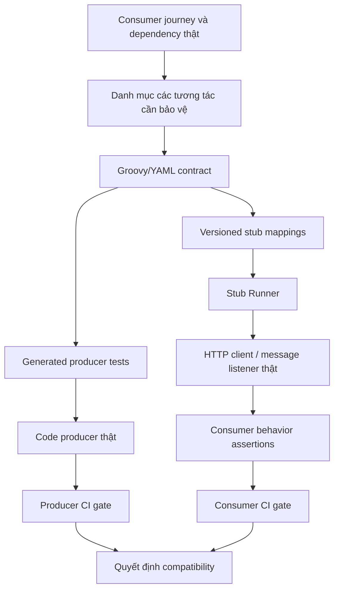
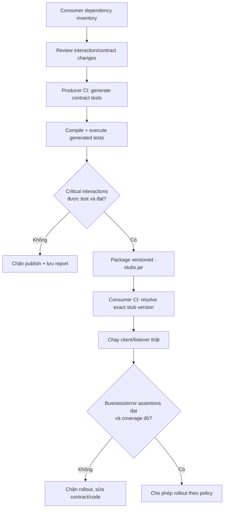

# Bao phủ tương tác mà consumer thật sự phụ thuộc

## 1. Chất lượng hợp đồng không được đo bằng số file DSL

Trong **Spring Cloud Contract**, producer và consumer thống nhất hành vi HTTP hoặc thông điệp bằng **Groovy/YAML DSL**. Spring Cloud Contract Verifier có thể sinh kiểm thử chạy trên producer thật, đóng gói các stub để **Stub Runner** phục vụ consumer tests, và tích hợp CI nhằm phát hiện các thay đổi API không tương thích.

Tuy nhiên, một bộ hợp đồng có nhiều file chưa chắc bảo vệ consumer tốt. Ví dụ, nhóm có mười contract cho `GET /api/orders/42` trả `200` với các giá trị khác nhau, nhưng consumer lại phụ thuộc mạnh vào `404 ORDER_NOT_FOUND` và `409 ORDER_ALREADY_PAID` mà không contract nào mô tả. **Số lượng lớn không bù được một tương tác quan trọng bị bỏ sót.**

Ngược lại, một hợp đồng quá chi tiết, khóa mọi field và whitespace của response dù consumer chỉ dùng `id`, `state` và `currency`, có thể làm producer tests thất bại vì thay đổi vô hại. Chất lượng vì thế có **hai mặt**:

1. **Không bỏ sót** những hành vi mà consumer thực sự phụ thuộc để hoạt động đúng.
2. **Không ràng buộc quá mức** những chi tiết mà consumer không cần và API không cam kết ổn định.

**Câu hỏi trung tâm của bài:** *Nếu producer thay đổi điều gì làm consumer hỏng, tập hợp hợp đồng và test hiện tại có phát hiện được trước khi triển khai không?*

Sau bài này, bạn có thể lập danh mục tương tác từ code/luồng nghiệp vụ của consumer, chọn các kịch bản đáng bảo vệ, viết Groovy/YAML contracts có assertions đúng trọng tâm, nối producer verification với consumer tests bằng Stub Runner, và xây quality gate dựa trên **mức bao phủ hành vi**, không phải chỉ số file hoặc dòng mã.

## 2. Tương tác là một giao kèo có điều kiện và kết quả

Một **tương tác** không chỉ là tên endpoint. Nó gồm:

```text
Consumer gửi một request/message có điều kiện xác định
    + trạng thái producer cần có
    → Producer trả response/message/side effect đã cam kết
    → Consumer đưa ra một quyết định dựa trên kết quả đó
```

Ví dụ hai tương tác cùng `GET /api/orders/{id}`:

| Bối cảnh | Request | Producer response | Consumer phụ thuộc |
|---|---|---|---|
| Order tồn tại, đã thanh toán | `GET /api/orders/42` | `200`, `state=PAID`, `currency=VND` | Checkout cho phép xuất biên lai |
| Order không tồn tại | `GET /api/orders/9999` | `404`, `code=ORDER_NOT_FOUND` | Checkout hiển thị lỗi phù hợp, không thử xuất biên lai |

Hai hàng thuộc **cùng endpoint**, nhưng là **hai cam kết hành vi khác nhau**. Coverage chỉ ghi “GET orders đã được test” không nói rõ nhánh thứ hai có được bảo vệ hay không.

### 2.1. Những thành phần cần xác định

| Thành phần | Ví dụ | Câu hỏi của consumer |
|---|---|---|
| Request method/path | `GET /api/orders/42` | Client có gọi đúng route không? |
| Query/header cần thiết | `Accept: application/json` | Consumer có gửi điều kiện làm thay đổi response không? |
| Request body/kiểu dữ liệu | `quantity: 2` | Producer yêu cầu dữ liệu gì? |
| Producer state | Order 42 ở `PAID` | Test có trạng thái tái lập không? |
| HTTP status | `200`/`404`/`409` | Consumer phân nhánh theo status nào? |
| Response body/header | `state`/`code`/`Content-Type` | Client parse và quyết định dựa vào gì? |
| Message destination/key | `orders.paid`/`eventId` | Listener nhận đúng sự kiện không? |
| Ngữ nghĩa nghiệp vụ | `PAID` nghĩa là thanh toán hoàn tất | Consumer có thể hành động an toàn không? |

Không nhất thiết mọi tương tác đều cần assert tất cả thành phần trong bảng. Phải xác định **phần nào là cam kết mà consumer phụ thuộc** và những phần còn lại là dữ liệu phụ/chi tiết implementation.

### 2.2. Hai tầng bằng chứng không được đánh đồng

- **Generated producer contract tests** trả lời: *code producer có thực hiện hành vi đã mô tả không?*
- **Consumer tests với stub** trả lời: *client và logic consumer có sử dụng đúng hành vi đó không?*

Nếu producer tests không chạy, stub có thể phản ánh một JSON lý tưởng không khớp producer thật. Nếu consumer tests chỉ kiểm tra WireMock trả `200` mà không chạy client thật, chúng có thể bỏ lọt lỗi deserialize và business behavior.



## 3. Lấy yêu cầu bao phủ từ luồng consumer, không đoán từ API docs

Giả sử `checkout-service` gọi `order-service` để quyết định hiển thị nút xuất biên lai; `notification-service` nhận `OrderPaid` để gửi thông báo.

Một consumer journey:

```text
Người dùng mở trang checkout
  └─ checkout-service GET /api/orders/{id}
       ├─ 200, state=PAID
       │    └─ Bật nút "Xuất biên lai"
       ├─ 200, state=PENDING
       │    └─ Hiện "Chờ thanh toán"
       ├─ 404, code=ORDER_NOT_FOUND
       │    └─ Hiện "Không tìm thấy đơn"
       └─ 503 hoặc lỗi mạng
            └─ Hiện thông báo tạm thời / retry theo chính sách

Producer phát sự kiện OrderPaid
  └─ notification-service nhận message
       ├─ eventId mới, state=PAID → gửi thông báo
       └─ eventId trùng → tránh xử lý lặp
```

Với luồng này, **một contract cho HTTP 200 PAID không đủ**. Ngay cả nhánh HTTP `200` cũng có hai giá trị `state` làm consumer chọn hành vi khác nhau.

### 3.1. Danh mục tương tác (interaction inventory)

| ID | Consumer | Tác vụ | Input/state quan trọng | Kết quả producer | Quyết định consumer |
|---|---|---|---|---|---|
| ORD-01 | Checkout | Xem order PAID | `GET /42`, order PAID | `200` + `state=PAID` | Cho phép xuất biên lai |
| ORD-02 | Checkout | Xem order PENDING | `GET /43`, order PENDING | `200` + `state=PENDING` | Không xuất biên lai |
| ORD-03 | Checkout | Order không tồn tại | `GET /9999` | `404` + `ORDER_NOT_FOUND` | Hiển thị lỗi nghiệp vụ |
| ORD-04 | Checkout | Lỗi producer tạm thời | `GET /42` trong trạng thái lỗi | `503` | Không coi là order không tồn tại; retry/fallback |
| ORD-05 | Checkout | Tạo order | `POST /api/orders` với body hợp lệ | `201` + ID/location | Chuyển tới trang order |
| ORD-06 | Checkout | Dữ liệu tạo order sai | `POST` với `quantity=0` | `400` + error code | Hiện lỗi form |
| ORD-07 | Checkout | Thanh toán lặp | `POST /42/pay` khi đã PAID | `409` + error code | Không gửi lại vô hạn |
| EVT-01 | Notification | Nhận `OrderPaid` | Message vào `orders.paid` | `eventId/orderId/state` | Gửi thông báo một lần |

**Bảng này là inventory minh họa**, không phải khẳng định mọi API phải có `503` hoặc `409`. Nếu consumer thực tế không gọi `POST /42/pay`, không cần tạo contract đó chỉ vì endpoint tồn tại. Ngược lại, nếu một consumer khác phụ thuộc `409`, phải đưa yêu cầu ấy vào inventory.

### 3.2. Bằng chứng để xác định dependency

Ưu tiên kết hợp những nguồn sau, không dựa duy nhất vào một nguồn:

1. **Code client thực tế:** route/method, headers, DTO, parser, error mapping, retry và business branches.
2. **Consumer tests đang chạy:** các assertion thể hiện quyết định dựa vào status/body/message.
3. **Tài liệu và thỏa thuận API:** cam kết public, error schemas, event schema và deprecation policy.
4. **Trao đổi với nhóm consumer:** hành vi nào gây mất dữ liệu, thanh toán lặp hoặc trải nghiệm sai khi đổi?
5. **Telemetry có kiểm soát:** tần suất status/path, headers không nhạy cảm, phiên bản client, dấu hiệu người dùng thật còn phụ thuộc.
6. **Sự cố lịch sử:** lỗi deserialize, breaking changes, retry storm, missing event và nguyên nhân.

Telemetry chỉ nói một tương tác **đã xảy ra** trong khoảng quan sát; nó không chứng minh tình huống hiếm nhưng quan trọng sẽ không xảy ra. Không ghi token, PII hoặc raw payment body vào log chỉ để đo coverage.

## 4. Coverage phải đo theo quyết định, không chỉ endpoint

Một phép đo “7/8 endpoints có contract” có thể che tình trạng thiếu nhánh lỗi quan trọng. Một mô hình giàu ý nghĩa hơn là:

```text
Business decision
    ↔ Consumer request/message
    ↔ Producer outcome / state
    ↔ Contract scenario
    ↔ Generated producer test
    ↔ Consumer stub test
```

Đối với ví dụ ORD-01:

```text
Decision: Cho phép xuất biên lai khi order đã PAID
  Request: GET /api/orders/42 + Accept application/json
  Producer outcome: 200 JSON id=42, state=PAID, currency=VND
  Contract: http/orders/get-paid-order.groovy
  Producer verification: generated contract test executed + passed
  Stub artifact: com.example:order-service:1.4.0:stubs
  Consumer test: checkout client -> receiptEnabled = true
```

Khi một mắt xích bị thiếu, có thể là **lỗ hổng coverage**:

- Có contract nhưng không có producer test thực thi: không chứng minh code producer tuân thủ.
- Có stub và consumer test nhưng chỉ assert HTTP status: chưa bảo vệ business decision.
- Có consumer test nhưng dùng stub version cũ: chưa kiểm tra thay đổi mới.
- Có producer test `200` nhưng consumer cần nhánh `404`: không bảo vệ error handling.

### 4.1. Ma trận coverage theo consumer

| Tương tác | Checkout | Notification | Producer test | Consumer test | Nhận xét |
|---|---|---|---|---|---|
| ORD-01 `200 PAID` | Phụ thuộc | Không | Có | Có | Đã bảo vệ |
| ORD-02 `200 PENDING` | Phụ thuộc | Không | Có | **Chưa** | Thiếu assertion nhánh pending |
| ORD-03 `404` | Phụ thuộc | Không | **Chưa** | Có | Stub tự tạo có nguy cơ lệch producer |
| ORD-06 `400` | Phụ thuộc | Không | Có | Có | Đã bảo vệ |
| EVT-01 `OrderPaid` | Không | Phụ thuộc | Có | **Chưa** | Chưa kiểm tra listener thực |

**“Không” ở cột một consumer không phải thiếu coverage** nếu consumer ấy không sử dụng tương tác. Nhưng **“Chưa”** trong cột test của một tương tác mà consumer có dependency là khoảng trống cần xử lý.

### 4.2. Độ bao phủ có trọng số rủi ro

Một nhóm có thể phân loại kịch bản thay vì áp một tỷ lệ phần trăm cứng:

| Mức | Đặc điểm | Ví dụ | Chính sách CI gợi ý |
|---|---|---|---|
| **Critical** | Có thể gây sai thanh toán, mất dữ liệu, mất authorization | ORD-01 state PAID, duplicate payment, consumer event idempotency | Phải có producer + consumer evidence trước release |
| **High** | Gây lỗi user flow hoặc nhầm business error | ORD-03 404 error code, validation 400 | Phải có test theo đường đi thật |
| **Medium** | Tác động cách hiển thị hoặc optional field | Thêm ghi chú giao hàng | Test nếu consumer sử dụng/strict parser |
| **Low** | Chi tiết không phải giao diện cam kết | Thứ tự key JSON trong object | Tránh khóa không cần thiết |

Đây là **khung quyết định minh họa**, không phải chuẩn điểm số bắt buộc. Một tương tác hiếm gặp như hoàn tiền vẫn có thể critical; chỉ dùng tần suất để ưu tiên sẽ bỏ sót kịch bản hiếm nhưng hậu quả lớn.

## 5. “Bao phủ đủ” và “bao phủ quá mức” khác nhau như thế nào?

### 5.1. Test thiếu ràng buộc: chỉ kiểm tra `200`

```java
// Assertion này quá yếu nếu checkout phụ thuộc state và currency.
assertThat(response.getStatusCode().value()).isEqualTo(200);
```

Nếu producer trả:

```json
{
  "id": 42,
  "state": "CANCELLED",
  "currency": "VND"
}
```

test trên vẫn xanh dù checkout có thể cho phép xuất biên lai sai.

### 5.2. Test ràng buộc đúng vào phần consumer dùng

```java
OrderDto order = orderClient.findById(42L);

assertThat(order.id()).isEqualTo(42L);
assertThat(order.state()).isEqualTo("PAID");
assertThat(order.currency()).isEqualTo("VND");
assertThat(receiptPolicy.canIssueReceipt(order)).isTrue();
```

Đây là snippet minh họa khi đã có `OrderClient` và `ReceiptPolicy` của consumer. Nó bảo vệ cả **DTO contract** và **quyết định nghiệp vụ**.

### 5.3. Test ràng buộc quá mức vào chi tiết không sử dụng

Ví dụ một consumer không đọc `internalTraceId` nhưng lại so sánh toàn bộ JSON string:

```java
assertThat(rawJson).isEqualTo(
    "{\"id\":42,\"state\":\"PAID\",\"currency\":\"VND\"}");
```

Chỉ cần producer thêm một field optional hoặc đổi thứ tự key JSON object, so sánh string có thể fail dù consumer thực tế vẫn hoạt động. Nếu schema đã thống nhất là **extensible**, nên kiểm tra subset có ý nghĩa và hành vi client thực tế; không đồng nhất byte-level equality với compatibility.

Ngược lại, nếu response phải được ký bằng canonical representation hoặc consumer có schema đóng có chủ ý, phép so sánh chặt có thể cần thiết. Hãy ghi rõ **vì sao strictness là dependency thực**, không vô tình biến chi tiết implementation thành cam kết lâu dài.

### 5.4. Bảng kiểm tra ràng buộc

| Thành phần | Cần assert chặt khi... | Có thể linh hoạt khi... |
|---|---|---|
| HTTP status | Consumer phân nhánh theo `200`, `404`, `409` | Không có ý nghĩa khác biệt theo contract |
| Content-Type | Client chọn decoder dựa trên media type | API cho phép nhiều media types và client xử lý được |
| Field `state` | Dùng chọn quyết định nghiệp vụ | Không áp dụng nếu consumer không dùng |
| Field tùy chọn | Consumer cần parse format hoặc phụ thuộc khi có | Consumer được phép bỏ qua |
| JSON key order | Giao thức ký/byte-exact yêu cầu | JSON object semantic bình thường |
| Array element order | API cam kết sort và consumer dùng thứ tự | Danh sách không có bảo đảm thứ tự |
| Error `code` | Consumer map lỗi nghiệp vụ theo code | Không được sử dụng trong logic/tài liệu |
| Header correlation | Consumer dựa vào tracing/idempotency | Chỉ dùng để debug, không phải API guarantee |

## 6. Chọn một contract bằng cách truy vết nhánh ứng dụng

Giả sử checkout có phương thức:

```java
public ReceiptDecision evaluateOrder(long orderId) {
    try {
        OrderDto order = orderClient.findById(orderId);
        if ("PAID".equals(order.state())) {
            return ReceiptDecision.ENABLED;
        }
        return ReceiptDecision.WAITING_FOR_PAYMENT;
    } catch (OrderNotFoundException exception) {
        return ReceiptDecision.NOT_FOUND;
    } catch (TemporaryOrderServiceException exception) {
        return ReceiptDecision.TEMPORARILY_UNAVAILABLE;
    }
}
```

Mã trên có **bốn nhánh** mà producer response/error có thể kích hoạt. Nếu chúng quan trọng với người dùng, bạn nên có:

1. `200 + PAID` → `ENABLED`.
2. `200 + PENDING` (hoặc state chưa thanh toán hợp lệ) → `WAITING_FOR_PAYMENT`.
3. `404 + ORDER_NOT_FOUND` → `NOT_FOUND`.
4. `503` hoặc một lỗi tạm thời theo API policy → `TEMPORARILY_UNAVAILABLE`.

Không nhất thiết phải kiểm thử mọi giá trị `state` nếu một số giá trị cho **cùng quyết định và cùng kiểu xử lý**; chọn representative cases và boundary cases theo yêu cầu. Nhưng nếu `REFUNDED` cần xử lý khác `PENDING`, không nên gộp cả hai thành “not PAID” trong contract coverage.

### 6.1. Một đơn vị coverage tốt

```text
interaction_id: ORD-03
consumer_decision: NOT_FOUND
producer_request:
  GET /api/orders/9999
producer_response:
  status: 404
  body.code: ORDER_NOT_FOUND
consumer_assertion:
  evaluateOrder(9999) == NOT_FOUND
```

Đây là **mẫu thiết kế**, không phải một schema chuẩn của Spring Cloud Contract. Quan trọng là bạn có thể truy từ business decision đến request/response, contract file và test report.

## 7. Groovy DSL: kịch bản `200 PAID` và `404`

Hai contract sau là **hai interaction khác nhau**, dùng điều kiện request khác nhau để tránh stub mappings chồng lấn.

### 7.1. HTTP `200` khi order tồn tại

```groovy
import org.springframework.cloud.contract.spec.Contract

Contract.make {
    description 'Checkout đọc một order đã thanh toán'

    request {
        method GET()
        url '/api/orders/42'
        headers {
            header 'Accept', 'application/json'
        }
    }

    response {
        status OK()
        headers {
            contentType(applicationJson())
        }
        body(
            id: 42,
            state: 'PAID',
            currency: 'VND'
        )
    }
}
```

Ví dụ dùng một ID cố định để fixture của producer và consumer stub test đều có thể tái lập. Trong hệ thống thực tế, có thể dùng matcher nếu ID không cố định, nhưng vẫn phải giữ assertion kiểm tra **kiểu và ngữ nghĩa** consumer đang phụ thuộc.

### 7.2. HTTP `404` có mã lỗi nghiệp vụ

```groovy
import org.springframework.cloud.contract.spec.Contract

Contract.make {
    description 'Checkout nhận ORDER_NOT_FOUND khi order vắng mặt'

    request {
        method GET()
        url '/api/orders/9999'
        headers {
            header 'Accept', 'application/json'
        }
    }

    response {
        status NOT_FOUND()
        headers {
            contentType(applicationJson())
        }
        body(
            code: 'ORDER_NOT_FOUND',
            message: 'Order does not exist'
        )
    }
}
```

**Không** thay bằng một mapping “trả `404` cho mọi request” để consumer test xanh. Nếu client gọi sai `/api/order/42` (thiếu chữ s) và WireMock trả unmatched `404`, consumer test chỉ assert status có thể **pass giả**. Cần kiểm tra `code=ORDER_NOT_FOUND` trong body và, khi phù hợp, xác minh request journal thấy **đúng method/path**.

### 7.3. YAML DSL cho `404`

Nếu nhóm dùng YAML DSL, tương tác trên có thể được biểu đạt:

```yaml
description: Checkout nhận ORDER_NOT_FOUND khi order vắng mặt
request:
  method: GET
  url: /api/orders/9999
  headers:
    Accept: application/json
response:
  status: 404
  headers:
    Content-Type: application/json
  body:
    code: ORDER_NOT_FOUND
    message: Order does not exist
```

Đoạn YAML là **phương án thay thế** cho Groovy `404`, không nên đặt cả hai làm hai mappings cạnh tranh cùng điều kiện trong một tập hợp hợp đồng. Chọn một nguồn duy nhất cho cùng một interaction/version, kiểm tra generated test và stub thực tế.

## 8. Đủ coverage cho request: query, headers và body quyết định hành vi

Một endpoint có thể đổi kết quả theo **query parameters**, **request headers** hoặc **request body**. Nếu consumer phụ thuộc sự khác biệt ấy, contract phải biểu đạt request tương ứng.

Ví dụ `GET /api/orders` hỗ trợ:

```text
GET /api/orders?state=PAID&limit=20
GET /api/orders?state=PENDING&limit=20
GET /api/orders?state=PAID&limit=0
```

Các trường hợp có thể trả: danh sách PAID, danh sách PENDING, hoặc `400 INVALID_LIMIT`. Chỉ có một contract cho `GET /api/orders` không query params chưa bảo vệ cách checkout phân trang/lọc dữ liệu.

### 8.1. Chọn những biến thể consumer thật dùng

| Request variation | Consumer dependency | Nên có contract? |
|---|---|---|
| `state=PAID` | Checkout chỉ hiển thị đơn đã thanh toán | **Có** |
| `limit=20` | Consumer thật luôn truyền giới hạn hợp lệ | Có thể chung với success scenario |
| `limit=0` | UI có thể gửi 0, consumer hiển thị validation | **Có nếu lỗi này là nhánh được consumer xử lý** |
| `sort=createdAt,desc` | Consumer dựa thứ tự kết quả | **Có** khi sort là cam kết |
| `debug=true` | Consumer không bao giờ gửi | Không ưu tiên chỉ vì API hỗ trợ |
| Header `X-Tenant-Id` | Routing/authorization phụ thuộc tenant | **Có** nếu là giao diện bắt buộc |
| Header trace ngẫu nhiên | Chỉ dùng quan sát và không đổi semantic | Tránh khóa đúng một giá trị |

Đừng viết một hợp đồng cho **mọi tổ hợp Cartesian** của query parameters nếu phần lớn không có ý nghĩa hành vi khác. Hãy phân nhóm **equivalence classes**, boundary values và interactions dựa trên nhánh consumer thực.

### 8.2. Contract request/response có filter

Ví dụ YAML cho interaction mà consumer thật dùng:

```yaml
description: Checkout lọc đơn đã thanh toán
request:
  method: GET
  urlPath: /api/orders
  queryParameters:
    state: PAID
    limit: "20"
  headers:
    Accept: application/json
response:
  status: 200
  headers:
    Content-Type: application/json
  body:
    - id: 42
      state: PAID
      currency: VND
```

Lưu ý phiên bản plugin/DSL có thể ảnh hưởng cú pháp và giá trị query parameter. Khi số lượng, thứ tự hoặc kiểu query param quan trọng, phải **xem generated test và WireMock mapping** để xác minh thực tế điều kiện request đã được match như mong muốn. Query parameter truyền qua HTTP vốn là string; không suy ra kiểu Java `int` của client từ cách YAML biểu diễn.

Nếu consumer yêu cầu nhiều giá trị query parameter cùng tên, cần hợp đồng riêng phản ánh cách client thật encode danh sách, thay vì giả định `state=PAID,PENDING` và `state=PAID&state=PENDING` tương đương.

### 8.3. Một contract nên đặt ranh giới đủ rõ

Mapping quá rộng:

```text
GET /api/orders*  → luôn 200 với state PAID
```

có thể cho phép client gọi sai path, bỏ thiếu filter hoặc truyền param không hợp lệ mà test vẫn pass. Mapping quá hẹp:

```text
GET /api/orders?state=PAID&limit=20&traceId=abc-123
```

có thể làm test fail chỉ vì trace ID không mang ý nghĩa nghiệp vụ đổi. **Match chặt thứ consumer phải gửi, linh hoạt phần không nằm trong giao kèo.**

## 9. Nhánh lỗi: validation, business conflict và lỗi tạm thời

Consumer thường có logic lỗi khác nhau:

- `400`: request sai, hiển thị lỗi nhập dữ liệu; **không** retry cùng request vô hạn.
- `404`: không tìm thấy entity; xử lý như một trạng thái nghiệp vụ, khác lỗi kết nối.
- `409`: xung đột trạng thái, có thể yêu cầu reload, không tạo giao dịch trùng.
- `503`: dịch vụ tạm thời không sẵn sàng; có thể retry/backoff theo policy.
- Lỗi mạng không có HTTP response: khác `503` vì request có thể đã được gửi hay chưa đến server.

Đừng thêm tất cả mã lỗi vào contract một cách hình thức. Hãy chọn những nhánh mà **consumer thực sự phân biệt hoặc cần bảo vệ để tránh hậu quả lớn**. Một error code bất biến theo hợp đồng có thể quan trọng hơn message text diễn đạt cho người đọc.

### 9.1. YAML contract cho input validation

Ví dụ checkout tạo order với số lượng bằng 0:

```yaml
description: Từ chối số lượng đơn hàng không hợp lệ
request:
  method: POST
  url: /api/orders
  headers:
    Content-Type: application/json
    Accept: application/json
  body:
    sku: BOOK-1
    quantity: 0
response:
  status: 400
  headers:
    Content-Type: application/json
  body:
    code: INVALID_QUANTITY
    field: quantity
```

Nếu UI phân nhánh theo `code=INVALID_QUANTITY` hoặc `field=quantity`, các giá trị này là **ràng buộc thật**. Nếu UI chỉ hiển thị một thông điệp tổng quát, đừng khóa thêm stack trace, timestamp, thứ tự validation errors hoặc nội dung message nội bộ trừ khi chúng được cam kết.

### 9.2. Vì sao `404` unmatched không phải lỗi nghiệp vụ?

WireMock có thể trả `404` khi request không khớp mapping nào. Khi consumer test chỉ assert status, nó có nguy cơ xanh giả nếu client gọi sai đường dẫn hoặc thiếu header.

Vì vậy, test nhánh error nên:

1. Assert **status** và **business error code** trong response body, khi API quy định.
2. Xác minh **request method/path/query/header** mà client thật đã gửi khi cần.
3. Dùng stub được sinh từ **contract đã kiểm chứng ở producer**, thay vì tự tạo mapping lỗi dễ lệch.
4. Chạy generated producer tests cho kịch bản error, bao gồm validation/exception handler thực sự.

### 9.3. Coverage cho authentication và authorization

Nếu consumer phụ thuộc `401` hoặc `403`, hợp đồng phải nêu rõ **ranh giới bảo mật** và test harness phải thực sự chạy đúng security filters/adapters. Với Spring MVC `MOCKMVC`, một cấu hình test mock/bypass Spring Security có thể khiến generated test không kiểm tra nhánh auth của production.

Không nhúng token thật hoặc credentials vào Groovy/YAML contract. Dùng token giả hoặc test authentication phù hợp; xác minh request headers, status/error schema và security filter boundary được thực thi trong producer verification. Một contract có expected `401` nhưng setup mock controller trả `401` cố định chưa chứng minh security policy hoạt động.

## 10. Messaging: bao phủ event mà listener và workflow thật cần

Consumer message có thể phụ thuộc:

- **Destination/topic/queue** và routing key.
- Header `eventType`, `contentType`, correlation ID.
- Body `orderId`, `state`, `eventId`.
- Event ordering, duplicate delivery, idempotency, retry/dead-letter handling.
- Schema evolution của field đang sử dụng.

Không nên kiểm thử chỉ “message được phát” nếu consumer cần `eventId` để chống gửi thông báo hai lần.

### 10.1. Groovy message contract

Ví dụ producer phát một event sau khi order được thanh toán:

```groovy
import org.springframework.cloud.contract.spec.Contract

Contract.make {
    description 'Notification nhận sự kiện OrderPaid'
    label 'order_paid'

    input {
        triggeredBy('publishPaidOrderForContract()')
    }

    outputMessage {
        sentTo('orders.paid')
        headers {
            header('eventType', 'OrderPaid')
        }
        body(
            eventId: 'EVT-42',
            orderId: 42,
            state: 'PAID'
        )
    }
}
```

Producer base test phải có method `publishPaidOrderForContract()` để kích hoạt business flow **phát message thật**, và message verifier/test binder hoặc broker adapter phù hợp để quan sát output. Chỉ gọi một method trong base test rồi tự phát một message giả bypass producer logic có thể tạo ra **producer verification giả**.

### 10.2. Một message contract có bảo vệ duplicate delivery không?

**Không mặc nhiên.** Contract trên chứng minh một sự kiện có shape/routing đã hứa. Nó không tự chứng minh listener xử lý duplicate đúng, hay message broker đảm bảo exactly-once. Nếu Notification Team thực sự phụ thuộc idempotency, cần consumer behavior test:

```text
Given listener nhận EVT-42 lần đầu
  → gửi một notification

When listener nhận lại cùng eventId EVT-42
  → không gửi thêm notification trùng
```

Test có thể dùng messaging stub adapter, test binder hoặc môi trường broker test phù hợp. **Stub Runner cho HTTP không tự trở thành broker Kafka/RabbitMQ**; chọn adapter theo stack. Không biến yêu cầu retry/idempotency của consumer thành một assertion duy nhất “body có eventId” rồi coi là đủ.

### 10.3. Tách producer output và consumer behavior

| Cần chứng minh | Nơi kiểm tra thích hợp |
|---|---|
| Producer phát `OrderPaid` với destination/schema đã cam kết | Generated producer contract test + message verifier |
| Notification listener parse được event sample | Consumer test với message stub/fixture đúng contract |
| Duplicate `eventId` không gửi thông báo hai lần | Consumer workflow/integration test |
| Broker transport/ACL thực hoạt động | Integration environment với adapter/broker thật khi cần |
| Schema thay đổi không phá listener cũ | Compatibility test với event từ version producer mới |

## 11. Chọn dữ liệu contract: ổn định nhưng đủ phát hiện sai khác

Một contract chất lượng cần sample **dễ hiểu, có thể tái lập, đủ phân biệt đúng/sai**. Các lỗi thường gặp:

1. Sample dùng giá trị `"test"` cho mọi field, không phân biệt semantic.
2. Chỉ dùng một giá trị hợp lệ; không thử boundary mà consumer phụ thuộc.
3. Dùng một random UUID trong expected body rồi khóa giá trị cố định không liên quan.
4. Dùng regex `.*` cho business field, khiến mọi thay đổi đều pass.
5. Dùng fixture không reset, khiến test phụ thuộc thứ tự chạy.
6. Consumer test chạy với stub khác version producer đang đề xuất.

### 11.1. Bảng chọn dữ liệu mang ý nghĩa

| Field/tình huống | Dữ liệu nên dùng | Vì sao |
|---|---|---|
| `state` | `PAID`, `PENDING`, `CANCELLED` nếu có nhánh riêng | Phân biệt business decisions |
| `quantity` | `1`, `0` hoặc boundary theo policy | Kiểm chứng validation |
| `currency` | `VND` và một code khác nếu consumer có format khác | Phát hiện sai xử lý đơn vị |
| `orderId` | `42` cho tồn tại, `9999` cho không tồn tại | Tái lập fixture |
| `eventId` | `EVT-42` trong test idempotency | Kiểm chứng duplicate handling |
| Timestamp | ISO-8601 đúng format; matcher nếu giá trị runtime | Không ràng buộc đồng hồ test |
| Correlation header | Matcher đúng type/format khi cần | Tránh khóa giá trị trace vô nghĩa |

### 11.2. Matcher cần bắt được bug mà consumer quan tâm

Ví dụ: `state` không nên được validate bằng regex `.*` nếu consumer phụ thuộc chính xác vào `PAID`. Đối với `orderId` động, có thể dùng matcher xác minh là một số dương hoặc một định dạng được cam kết, nhưng consumer test vẫn cần dữ liệu mẫu đủ cụ thể để kiểm tra hành vi.

Spring Cloud Contract có các matcher Groovy/YAML cho cả request và response tùy phiên bản. Khi dùng matcher, **đọc generated producer assertion và generated WireMock mapping thực tế**, vì mức ràng buộc có thể khác nhau giữa phía producer và stub. Không suy luận từ tên helper rằng consumer tự động chấp nhận mọi thay đổi.

### 11.3. Empty, missing, null và empty array

Nếu consumer phân biệt:

```json
{"items":[]}
```

với:

```json
{"items":null}
```

hoặc:

```json
{}
```

thì đây là **các response semantics khác nhau**, cần có contract hoặc test tương ứng. Nếu consumer dùng `items.size()` mà không xử lý `null`, một thay đổi từ empty list sang null có thể gây lỗi runtime. Không bỏ qua vì “vẫn không có item”.

## 12. Producer contract test: bao phủ hành vi của code thật

Một contract được viết rất tốt vẫn không mang giá trị bảo vệ nếu generated producer test không chạy, không nạp đúng state hoặc mock bỏ qua route/serialization/handler cần kiểm tra.

### 12.1. Ví dụ base test HTTP `MOCKMVC`

```java
package com.example.orders.contract;

import io.restassured.module.mockmvc.RestAssuredMockMvc;
import org.junit.jupiter.api.BeforeEach;
import org.junit.jupiter.api.AfterEach;
import org.springframework.beans.factory.annotation.Autowired;
import org.springframework.boot.test.autoconfigure.web.servlet.AutoConfigureMockMvc;
import org.springframework.boot.test.context.SpringBootTest;
import org.springframework.web.context.WebApplicationContext;

@SpringBootTest(webEnvironment = SpringBootTest.WebEnvironment.MOCK)
@AutoConfigureMockMvc
public abstract class OrderContractBase {

    @Autowired
    WebApplicationContext context;

    @BeforeEach
    protected void setUp() {
        RestAssuredMockMvc.webAppContextSetup(context);
        // Seed order 42=PAID và order 43=PENDING.
        // Bảo đảm order 9999 không tồn tại trong test fixture.
    }

    @AfterEach
    protected void tearDown() {
        RestAssuredMockMvc.reset();
        // Dọn records, cache hoặc mock state đã thay đổi.
    }
}
```

Đây là **base test phác thảo**, cần bổ sung fixture thật và dependencies Spring Boot Test/Rest Assured MockMvc tương thích. Nếu generated JUnit test nằm trong subclass khác package, các lifecycle methods có thể kế thừa theo quy tắc JUnit Jupiter; cần xác minh ở project thật.

Không mock chính controller rồi trả response mẫu từ code test nếu mục đích là kiểm tra **HTTP boundary của producer**. Mock dependency ngoại vi có thể phù hợp, nhưng route/controller/JSON converter/validation/exception advice đang được contract bảo vệ phải thực sự tham gia.

### 12.2. Producer state là một phần coverage

Nếu bạn dùng cùng route `GET /api/orders/{id}` cho PAID/PENDING/NOT_FOUND, base test cần tạo **đúng ba trạng thái**. Điều này đặc biệt quan trọng khi test chạy song song hoặc DB dùng chung:

```text
BeforeEach:
  order 42   -> PAID, currency VND
  order 43   -> PENDING, currency VND
  order 9999 -> absent

Generated tests:
  GET /42   -> 200 PAID
  GET /43   -> 200 PENDING
  GET /9999 -> 404 ORDER_NOT_FOUND
```

State có thể được tạo bằng mock service, in-memory repository, database fixture hoặc test containers tùy boundary cần kiểm chứng. Chọn cách tạo state **có thể tái lập**, không lệ thuộc dữ liệu của lần chạy trước.

### 12.3. Generated test *có mặt* khác *đã chạy*

| Tình huống | Có thể thấy `BUILD SUCCESS`? | Có xác minh producer chưa? |
|---|---|---|
| Sinh generated sources nhưng skip test | Có | **Chưa** |
| Test biên dịch, Surefire không match class | Có | **Chưa** |
| 100 unit tests đạt, 0 generated contract tests | Có | **Chưa** |
| Generated tests chạy, nhưng 5 tests skipped | Có tùy policy | **Chưa đủ** |
| Generated tests chạy đúng các contract và assertions đạt | Có | **Đã có bằng chứng producer phù hợp với tập contract đó** |

CI nên đối chiếu **tập generated test classes/methods** với inventory kịch bản quan trọng, không chỉ tổng số test executions. Khi thay đổi compiler/Surefire filters, số file contract vẫn giữ nguyên nhưng tất cả generated tests có thể biến mất khỏi report.

## 13. Consumer contract test: chạy client thật với đúng stub version

Phía consumer cần kiểm tra **điều họ làm sau khi nhận response**, không chỉ WireMock có trả đúng mẫu hay không.

### 13.1. HTTP client minh họa

Ví dụ Spring `RestClient` (Spring Framework 6.1+):

```java
package com.example.checkout.client;

import org.springframework.http.MediaType;
import org.springframework.web.client.RestClient;

public final class OrderClient {
    private final RestClient http;

    public OrderClient(RestClient.Builder builder, String baseUrl) {
        this.http = builder.baseUrl(baseUrl).build();
    }

    public OrderDto findById(long id) {
        return http.get()
            .uri("/api/orders/{id}", id)
            .accept(MediaType.APPLICATION_JSON)
            .retrieve()
            .body(OrderDto.class);
    }
}
```

```java
package com.example.checkout.client;

public record OrderDto(long id, String state, String currency) {}
```

Ở `404`, `retrieve()` thông thường phát exception HTTP nếu không cấu hình `onStatus(...)`. Consumer có thể có lớp adapter ánh xạ HTTP `404` + JSON `code=ORDER_NOT_FOUND` thành `OrderNotFoundException` và `503` thành `TemporaryOrderServiceException`. **Những classes lỗi này thuộc dự án consumer**, không phải API mặc định của Spring Cloud Contract.

### 13.2. Dùng Stub Runner tải artifact contract đã xác minh

```java
package com.example.checkout.contract;

import com.example.checkout.client.OrderClient;
import com.example.checkout.client.OrderDto;
import org.junit.jupiter.api.Test;
import org.springframework.beans.factory.annotation.Autowired;
import org.springframework.boot.test.context.SpringBootTest;
import org.springframework.cloud.contract.stubrunner.StubRunnerProperties;
import org.springframework.cloud.contract.stubrunner.spring.AutoConfigureStubRunner;
import org.springframework.cloud.contract.stubrunner.spring.StubRunnerPort;
import org.springframework.web.client.RestClient;

import static org.assertj.core.api.Assertions.assertThat;

@SpringBootTest
@AutoConfigureStubRunner(
    ids = "com.example:order-service:1.4.0:stubs",
    stubsMode = StubRunnerProperties.StubsMode.LOCAL
)
class CheckoutContractTest {

    @Autowired
    RestClient.Builder restClientBuilder;

    @StubRunnerPort("com.example:order-service")
    int orderStubPort;

    @Test
    void paidOrderEnablesReceipt() {
        OrderClient client = new OrderClient(
            restClientBuilder,
            "http://localhost:" + orderStubPort
        );
        OrderDto order = client.findById(42L);

        assertThat(order.id()).isEqualTo(42L);
        assertThat(order.state()).isEqualTo("PAID");
        assertThat(order.currency()).isEqualTo("VND");

        // Trong dự án thật, gọi ReceiptPolicy/workflow
        // và assert quyết định được xuất biên lai.
    }
}
```

**Giới hạn của mẫu:**

- Stub artifact `com.example:order-service:1.4.0:stubs` phải có trong **Maven local repository** với `LOCAL`; `REMOTE` cần repository URL/quyền truy cập tương ứng.
- `OrderClient` trong ví dụ cần trùng code/config HTTP client mà checkout sử dụng trong production; không thay bằng client test đơn giản bỏ qua error mapping.
- `@StubRunnerPort` được lấy **sau khi stub đã khởi động**, không dùng cổng `8080` hardcode.
- Đoạn test mới xác minh DTO; để bảo vệ **quyết định nghiệp vụ**, cần nối `ReceiptPolicy` hoặc service checkout thật theo thiết kế ứng dụng.
- Consumer test này **không thay thế producer generated test**. Cả hai report đều cần để tin vào compatibility.

### 13.3. Khi consumer là reactive

Nếu WebClient trả `Mono<OrderDto>`, chỉ tạo publisher là chưa đủ để gửi HTTP. Cần subscribe và chờ đúng tín hiệu:

```java
StepVerifier.create(orderReactiveClient.findById(42L))
    .assertNext(order ->
        assertThat(order.state()).isEqualTo("PAID"))
    .expectComplete()
    .verify(Duration.ofSeconds(5));
```

`StepVerifier` thuộc `reactor-test`; đoạn trên giả định client reactive và imports phù hợp. Với stream không tự complete như SSE, cần điều kiện cancel/nhận đủ event thay vì chờ completion vô hạn. Nếu không đợi HTTP/message thật sự hoàn tất, test có thể xanh nhưng **không bao phủ interaction nào**.

## 14. Chất lượng không thể chỉ đánh giá bằng phần trăm coverage

Những con số như “80% endpoint coverage”, “95% contract file coverage” hoặc “100% line coverage” chỉ có ích khi **định nghĩa mẫu số và chất lượng assertion**.

Ví dụ:

```text
Endpoints đã có contract:       8/8   = 100%
Business decisions quan trọng:  6/10  = 60%
Đã có producer test thực thi:    5/10  = 50%
Đã có consumer test dùng stub:   4/10  = 40%
```

Nếu dashboard chỉ hiển thị **100% endpoint coverage**, đội có thể bỏ sót nhánh không tìm thấy đơn, thanh toán lặp hoặc message trùng lặp.

### 14.1. Đề xuất định nghĩa coverage có thể kiểm toán

Gọi:

- **I**: tập interaction scenarios đã được nhóm producer và consumers thỏa thuận là cần bảo vệ.
- **P**: tập scenarios trong I có generated producer test **thực sự chạy và đạt**.
- **C**: tập scenarios trong I có consumer test **đúng client/listener thật** chạy và đạt với stub version cần kiểm tra.

Khi đó có thể trình bày:

\[
\text{Producer coverage} = \frac{|P|}{|I|}
\]

\[
\text{End-to-end contract confidence} = \frac{|P \cap C|}{|I|}
\]

**Diễn giải hạn chế:**

1. Công thức chỉ có ý nghĩa khi I được xây từ **dependency thực tế**, không phải một danh sách dễ làm cho đủ chỉ tiêu.
2. Một interaction critical chưa được bảo vệ không thể “bù” bằng nhiều interaction trivial.
3. `P ∩ C` không đảm bảo performance, security, networking hoặc mọi dữ liệu runtime; nó chỉ là bằng chứng cho các kịch bản được mô tả.
4. Không nên ép mỗi interaction tương ứng đúng một file DSL hoặc đúng một generated method; dùng **ID kịch bản** và ánh xạ tới test report phù hợp.
5. Nếu một scenario đã bị deprecated và không còn consumer, thay đổi mẫu số phải có **review ownership**, không âm thầm xóa để tăng tỷ lệ.

### 14.2. Đánh giá theo độ rủi ro

Một scorecard có thể gồm:

| Chỉ số | Câu hỏi | Ví dụ điều kiện gate |
|---|---|---|
| **Critical interaction coverage** | Có thiếu nhánh gây mất dữ liệu/tiền không? | Không được thiếu kịch bản critical đã thỏa thuận |
| **Producer execution** | Generated tests có chạy thật không? | Không chấp nhận 0 hoặc skipped ở critical contracts |
| **Consumer behavior** | Client có parse/ra quyết định đúng không? | Bắt buộc với interactions quan trọng |
| **Change sensitivity** | Cố ý tạo breaking change thì test có fail không? | Có thử nghiệm mutation có kiểm soát |
| **Stability** | Test có phụ thuộc trạng thái ngẫu nhiên không? | Không flaky do port/fixture/shared state |
| **Version traceability** | Biết stub nào đã được dùng không? | Pin và ghi resolved artifact |
| **Review ownership** | Ai xác nhận đây là hành vi consumer cần? | Có owner và consumer contact |

**Không gắn một ngưỡng mặc định như 90% cho mọi tổ chức**. Hãy chọn coverage gate dựa trên rủi ro, giao diện đã công bố và khả năng phát hiện hồi quy thực tế.

## 15. Kiểm tra độ nhạy bằng một thay đổi sai có chủ đích

Một cách thử chất lượng rất hiệu quả là đặt câu hỏi:

> Nếu producer đổi đúng điều mà consumer phụ thuộc, test nào phải thất bại?

Thực hiện thử nghiệm **trong nhánh test/môi trường cô lập**, không triển khai lỗi lên production.

| Mutation có chủ đích | Consumer bị ảnh hưởng | Test phải phát hiện |
|---|---|---|
| `state=PAID` → `state=PENDING` ở order 42 | Checkout quyết định xuất biên lai | Generated producer test và consumer behavior assertion |
| `id` number → string | DTO/validation số | Contract assertion kiểu/deserialize phù hợp |
| `404 ORDER_NOT_FOUND` → `200 null` | Client error mapping | Negative-path contract và consumer test |
| Xóa `currency` | Checkout hiển thị đơn vị tiền | Producer body assertion và client DTO/use-case |
| `quantity=0` được nhận thành công | Checkout validation | Contract `400 INVALID_QUANTITY` |
| Đổi `orders.paid` → `orders.completed` | Notification listener | Producer message contract và consumer listener test |
| Xóa `eventId` | Notification deduplication | Event body contract + consumer idempotency test |
| Thêm một response field optional | Consumer strict parser | Chạy consumer cũ với stub mới |

### 15.1. Cách đọc kết quả

- Mutation làm producer fail ngay ở **generated test**: producer contract bảo vệ được cam kết đã mô tả.
- Mutation vẫn qua producer test nhưng consumer test fail: hợp đồng producer **chưa mô tả đủ dependency** hoặc phần đó được bảo vệ chỉ ở consumer.
- Cả hai đều pass nhưng hành vi user hỏng: **khoảng trống coverage** đáng ưu tiên, cần bổ sung interaction/assertion.
- Test fail do fixture/port/mapping không ổn định, không liên quan mutation: hạ tầng test thiếu tin cậy; chưa đủ bằng chứng chất lượng contract.

Không sửa expected value của contract cho trùng mutation chỉ để build xanh. Việc thử sai nhằm chứng minh **test có thể thất bại đúng lý do**, không nhằm chấp nhận bug.

### 15.2. Cần phân biệt producer mutation và consumer mutation

**Producer mutation** (đổi HTTP status/field/body/destination) kiểm tra xem generated producer tests phát hiện sai khác giao diện hay không.

**Consumer mutation** (đổi nhánh `PAID` thành luôn trả `ENABLED`, xóa error mapping) kiểm tra consumer behavior assertions có bảo vệ workflow hay không. Một trong hai phía có thể pass nếu phía kia mới là nơi cần assertion; phải hiểu **mục tiêu của mỗi test** trước khi kết luận.

## 16. Tránh over-specification và test trùng lặp

Một bộ contract khó bảo trì có thể có các dấu hiệu:

- Cùng request predicate nhưng nhiều mappings không chủ ý trả các response khác nhau.
- Mỗi test khóa toàn bộ JSON raw string thay vì field mà consumer cần.
- Nhiều contract success chỉ khác ID fixture mà không mở thêm business branch.
- Regex `.*` quá rộng cho field nghiệp vụ quan trọng.
- Snapshot test thay đổi khi producer thêm field không ảnh hưởng consumer.
- Dùng timestamp ngẫu nhiên trong contract cố định, khiến generated test không tái lập.
- Chỉ viết kịch bản happy path; không có error/schema compatibility test.

### 16.1. Một quy tắc loại trùng có căn cứ

Khi cân nhắc xóa/gộp hai contracts, hỏi:

1. Chúng có cùng **request/state predicate** không?
2. Chúng có bảo vệ **cùng business decision** và cùng field/status không?
3. Có consumer khác đang cần một nhánh mà contract kia không thể hiện không?
4. Một trong hai có boundary/error condition riêng không?
5. Việc gộp có làm generated producer assertions yếu đi không?

Nếu hai hợp đồng chỉ khác ID `42` và `43` nhưng cả hai đều `PAID` và không có semantics khác, có thể gộp hoặc chọn representative case. Nếu một ID `PAID` còn ID kia `PENDING`, **không** gộp nếu consumer quyết định khác nhau.

### 16.2. Chú ý những thứ consumer không đọc nhưng vẫn là API promise

Không phải mọi trường không được **một** consumer dùng đều có thể bỏ khỏi contract:

- Một consumer khác có thể dùng nó.
- API public schema có thể cam kết nó với người dùng chưa được thống kê.
- Trường có thể liên quan compliance/security/audit.
- Protocol có thể yêu cầu nó dù business code không đọc trực tiếp.

Do đó, khi dùng **consumer-driven contracts**, phải quản lý **tập hợp consumer dependencies** cùng với cam kết API tổng thể. Không được để nhu cầu tối thiểu của Checkout Team xóa mất những cam kết cần thiết cho Billing Team.

## 17. Versioning: bao phủ tương tác giữa consumer cũ và producer mới

Một bộ contract cho producer phiên bản mới chưa tự chứng minh **consumer đang chạy** tương thích với nó. Ví dụ producer thêm:

```json
{
  "id": 42,
  "state": "PAID",
  "currency": "VND",
  "estimatedDeliveryDate": "2026-12-01"
}
```

Consumer lenient thường có thể bỏ qua field mới, nhưng strict parser, exact JSON assertion hoặc JSON Schema `additionalProperties: false` có thể từ chối response ấy.

### 17.1. Ma trận tương thích

| Bản consumer | Stub P1: ba trường | Stub P2: thêm trường | Điều cần bảo vệ |
|---|---|---|---|
| C1 lenient | Baseline | Có thể tương thích | Client thật vẫn hoạt động và behavior cũ đúng |
| C1 strict | Baseline | Có thể fail | Phát hiện unknown-field breaking change |
| C2 dùng field mới bắt buộc | Có thể fail | Hoạt động nếu field đúng | Thứ tự rollout/compatibility |
| C2 có fallback optional | Có thể hoạt động | Có thể hoạt động | Missing/null/format và fallback đúng |

Một **release gate** nên pin stub version, ví dụ `com.example:order-service:1.5.0:stubs`. Nếu dùng `+`/`SNAPSHOT` để canary, phải ghi **resolved version và provenance** để biết chính xác payload nào đã được thử.

### 17.2. Không bỏ nhánh lỗi cũ khi thêm chức năng mới

Khi P2 thêm `estimatedDeliveryDate`, kịch bản `404 ORDER_NOT_FOUND` vẫn có thể là dependency quan trọng của C1. Thay đổi nhỏ ở nhánh `200` không phải lý do để xóa những contract lỗi đã được công bố. Khi đánh giá coverage release P2, dùng **toàn bộ tương tác cần bảo vệ**, gồm negative paths và messages, không chỉ những file vừa thay đổi.

## 18. Tổ chức ownership và traceability cho coverage

Một interaction inventory chỉ hữu ích nếu có người cập nhật khi producer/consumer đổi.

| Đối tượng | Người thường chịu trách nhiệm | Việc cần duy trì |
|---|---|---|
| API semantics và contract source | Producer API owner, có consumer review | Đúng behavior và compatibility policy |
| Consumer dependency | Mỗi nhóm consumer | Field/status/route/message và business decision thật |
| Producer fixtures/base tests | Producer | State tái lập, generated tests chạy đúng boundary |
| Stub artifact/version | Producer/release pipeline | Publish sau verification, đúng classifier |
| Consumer stub tests | Consumer | Client thật, response/error handling và business behavior |
| Coverage register/CI gate | Nhóm sở hữu quy trình cùng producer/consumers | Không bỏ sót critical scenarios, báo lỗ hổng |

### 18.1. Mẫu bảng truy vết

```text
ID: ORD-03
Consumer: checkout-service
Business outcome: NOT_FOUND (không xuất biên lai)
Request/state: GET /api/orders/9999, không có order
Expected: HTTP 404 + body.code=ORDER_NOT_FOUND
Contract path: http/orders/get-order-not-found.yml
Producer owner: Order Team
Producer generated test: [tên class/method thực từ build]
Stub artifact: com.example:order-service:1.4.0:stubs
Consumer test: [tên test class/method của checkout]
Evidence: [CI run link/report thực tế]
Criticality: High
```

Các dấu ngoặc vuông là **chỗ điền thông tin thực tế**, không phải cú pháp DSL của Spring Cloud Contract. Có thể lưu bảng này trong issue tracker, catalog hoặc tài liệu repo tùy tổ chức. Đừng nhúng credentials hoặc dữ liệu cá nhân vào metadata.

### 18.2. Khi consumer ngừng dùng một tương tác

Nếu Checkout Team bỏ chức năng phân biệt `PENDING` và `CANCELLED`, không xóa contract ngay. Trước tiên xác minh:

- Còn consumer khác dùng field/nhánh ấy không?
- Contract có phải public API promise hay yêu cầu compliance không?
- Có chính sách deprecation/versioning cần tôn trọng không?
- Tests đã được thay thế bằng kịch bản tương đương nào chưa?

Thay đổi inventory phải được review; không xóa các trường hợp khó kiểm thử chỉ để nâng coverage.

## 19. CI quality gate theo chuỗi contract → producer → consumer

Một pipeline có thể có trình tự:



### 19.1. Cổng producer

Một producer CI gate nên:

1. Kiểm tra `contractsDirectory` (Maven) hoặc source location tương đương trỏ đúng file Groovy/YAML.
2. Sinh generated producer tests, xác nhận kịch bản cần bảo vệ đã được phát hiện.
3. Biên dịch và chạy **generated tests**, không để Surefire/Failsafe filters/skip flags bỏ qua.
4. Đối chiếu test reports với critical interactions: executed > 0, không skipped, failures/errors = 0.
5. Chỉ attach/publish stub artifact với version/classifier đúng **sau khi verification đạt**.

Đừng coi `BUILD SUCCESS` là đủ khi các generated test classes không xuất hiện trong report. Một build có 100 unit tests đạt vẫn có thể thiếu 100% producer contract coverage.

### 19.2. Cổng consumer

Một consumer CI gate nên:

1. Resolve đúng `group:artifact:version:stubs`, ghi lại version thực tế.
2. Khởi động Stub Runner với port động hoặc môi trường network riêng, rồi cấp URL cho client.
3. Chạy **client/listener production code** với request/message tương ứng.
4. Kiểm tra dữ liệu được deserialize, nhánh business, error mapping, retry/idempotency khi thật sự phụ thuộc.
5. Không dùng kịch bản “pass” nếu test không gửi request/message hoặc publisher reactive chưa subscribe.
6. Giữ log/CI reports và mapping provenance khi fail, không lộ secrets.

### 19.3. Tránh flaky test làm sai đánh giá coverage

Coverage chỉ đáng tin khi test có thể lặp lại. Nếu các contract tests chạy song song:

- Dùng WireMock/Stub Runner **random port**, không hardcode cùng `8090` cho mọi job.
- Không để hai tests ghi đè mappings, request journal hoặc scenario state cùng một server.
- Seed/reset producer state ở phạm vi test phù hợp, tránh xóa dữ liệu của test khác.
- Với messaging, phân vùng queue/topic/test consumer groups hoặc correlation IDs theo job.
- Dùng readiness có timeout thay vì `sleep` cố định.
- Không retry test vô hạn để che race.

Một test fail vì server chưa start không cung cấp bằng chứng API sai. Một test pass nhờ stub mapping quá rộng cũng không cung cấp bằng chứng consumer đúng. CI phải phân biệt **lỗi hạ tầng** và **lỗi hợp đồng/hành vi**.

## 20. Bài thực hành: tìm và đóng lỗ hổng trong bộ contract hiện có

**Bối cảnh:** `checkout-service` đọc đơn hàng từ `order-service`. Hiện nhóm có ba Groovy contracts đều kiểm tra `GET /api/orders/42` trả `200 PAID`; consumer CI chỉ kiểm tra status 200. Một số lần người dùng không tìm được đơn hàng, UI lại hiển thị lỗi không rõ nguyên nhân. Ngoài ra, Notification Team nói một thay đổi `orders.paid` từng làm listener ngừng nhận sự kiện nhưng producer CI vẫn xanh.

### 20.1. Bước 1 — Lập inventory từ code consumer

Đọc đường đi HTTP của checkout và listener của notification, ghi:

```text
ORD-01  GET /42   -> 200 PAID       -> RECEIPT_ENABLED
ORD-02  GET /43   -> 200 PENDING    -> WAITING_PAYMENT
ORD-03  GET /9999 -> 404 NOT_FOUND  -> SHOW_NOT_FOUND
ORD-04  GET /42   -> 503           -> TEMP_UNAVAILABLE
EVT-01  OrderPaid -> orders.paid    -> SEND_NOTIFICATION
```

Đối chiếu những interaction này với contract source và generated test reports thực tế. Không đánh dấu “covered” chỉ vì có ba file `GET /42` cùng happy path.

### 20.2. Bước 2 — Sửa hợp đồng có mục tiêu

1. Giữ một success contract `200 PAID` có request predicate đủ rõ và assert `id/state/currency`.
2. Thêm một `200 PENDING` nếu consumer thực sự có nhánh chờ thanh toán.
3. Thêm `404 ORDER_NOT_FOUND` với error schema consumer đang xử lý.
4. Thêm `503` nếu producer có chính sách trả lỗi tạm thời mà consumer cần phân biệt.
5. Thêm messaging contract `OrderPaid` với đúng destination/headers/body có ý nghĩa.
6. Không copy exact JSON với timestamp/debug field chỉ để “tăng coverage”.

### 20.3. Bước 3 — Xác minh producer

- Chuẩn bị fixture `42=PAID`, `43=PENDING` và `9999` absent.
- Đảm bảo generated tests chạy trên **controller/service/exception handler** thật.
- Với message, trigger business flow thật và capture output đúng destination.
- Kiểm tra report có đầy đủ generated contract scenarios; không skip.
- Nếu một contract cho `404` fail, không sửa expected thành `200` chỉ để build pass.

### 20.4. Bước 4 — Xác minh consumer

- Dùng Stub Runner tải đúng artifact version đã producer xác minh.
- Chạy HTTP client thật, assert cả decision `RECEIPT_ENABLED`/`WAITING_PAYMENT`/`SHOW_NOT_FOUND`.
- Với `503`, kiểm tra client không nhầm nó với `404` và không retry mãi.
- Với event, chạy listener và kiểm tra notification behavior; thử duplicate `eventId` nếu đó là dependency thật.
- Với WebClient, chờ publisher hoàn tất trước khi kết luận pass.

### 20.5. Bước 5 — Thử mutation và đọc lại scorecard

Cố ý đổi producer `PAID` thành `CANCELLED`, hoặc đổi event destination `orders.paid` thành `orders.other` trong môi trường test. Xác minh ít nhất một test có liên quan **thất bại đúng lý do**, rồi khôi phục code.

Một scorecard kỳ vọng:

| ID | Producer test | Consumer test | Quan sát |
|---|---|---|---|
| ORD-01 | Đã chạy và đạt | Đã chạy và đạt | Mutation state bị phát hiện |
| ORD-02 | Đã chạy và đạt | Đã chạy và đạt | Branch pending được bảo vệ |
| ORD-03 | Đã chạy và đạt | Đã chạy và đạt | Không nhầm unmatched 404 |
| ORD-04 | Đã chạy và đạt nếu thuộc producer contract | Đã chạy và đạt | Error policy đúng |
| EVT-01 | Đã chạy và đạt | Listener test đạt | Đổi destination bị phát hiện |

Đây là **kết quả mục tiêu của bài tập**, không phải kết quả đã chạy trên một codebase thật.

### 20.6. Câu hỏi tự đánh giá

| Câu hỏi | Trả lời |
|---|---|
| Có 10 hợp đồng cho `GET` success thì chắc bao phủ 404 chưa? | **Không** |
| Một endpoint có thể cần nhiều contract scenarios không? | **Có**, khi consumer phụ thuộc các outcomes khác nhau |
| Consumer không dùng debug field có cần khóa giá trị đó không? | **Thường không**, trừ khi API có cam kết khác |
| Consumer C1 chỉ assert status 200 thì đủ bảo vệ `state=PAID` chưa? | **Chưa** |
| Thêm field response có luôn non-breaking không? | **Không**, strict parser có thể lỗi |
| `404` unmatched WireMock có thể tạo test pass giả không? | **Có**, nếu chỉ assert status |
| Generated source tồn tại có chứng minh producer test đã chạy không? | **Không** |
| Stub Runner test pass có chứng minh producer thật tuân thủ chưa? | **Không**, cần producer verification |
| Message có đúng body nhưng sai destination có breaking không? | **Có**, consumer có thể không nhận được |
| 100% endpoint coverage đồng nghĩa đủ business decision coverage không? | **Không** |

## 21. Checklist review chất lượng coverage của một bộ contract

- [ ] Đã liệt kê consumer và **business decisions** thực sự phụ thuộc producer API/message.
- [ ] Inventory phân biệt method/path/query/header/body, state, response/status/error và destination/message semantics.
- [ ] Tập hợp scenarios bao gồm những happy path, error path và boundary quan trọng, không chỉ một endpoint success.
- [ ] Có ID/tên kịch bản cho các interaction cần bảo vệ, với consumer owner và criticality rõ ràng.
- [ ] Contract chỉ ràng buộc những field/status/headers/semantics đã cam kết; không khóa chi tiết không cần thiết.
- [ ] Không dùng matcher quá rộng cho business fields như `state` hoặc `code` mà consumer dựa vào.
- [ ] Query/body/header predicates đủ chặt để client gửi sai request thì test không pass giả.
- [ ] Với `404` hoặc `409`, consumer test assert business error code/schema, không nhầm unmatched stub response.
- [ ] Đã xét validation `400`, auth `401/403` và temporary errors nếu consumer thật có nhánh xử lý.
- [ ] Với collections, đã xác định null/missing/empty/ordering khi consumer phụ thuộc.
- [ ] Với messaging, destination, headers, payload và duplicate/idempotency policy đã được xem xét.
- [ ] Producer state/fixture rõ ràng, có thể tái lập và không phụ thuộc test order.
- [ ] Generated producer tests đã được sinh, biên dịch, **thực thi và đạt**, không chỉ có file hoặc build success.
- [ ] Stub artifact chứa đúng mappings/body files, có group/artifact/version/classifier để truy vết.
- [ ] Consumer CI chạy HTTP client/message listener thật với đúng stub version, không chỉ assert mapping tự tạo.
- [ ] Reactive/async consumer test chờ đúng kết quả hoặc event, có timeout và cleanup phù hợp.
- [ ] Test kiểm tra **quyết định nghiệp vụ** sau deserialize, không chỉ HTTP status.
- [ ] Đã có ma trận tương thích khi producer/consumer có thể deploy ở các phiên bản khác nhau.
- [ ] Có test chứng minh một mutation breaking ở field/status/destination quan trọng sẽ bị phát hiện.
- [ ] Không dùng tổng số file, endpoint hoặc line coverage làm bằng chứng duy nhất về chất lượng hợp đồng.
- [ ] CI phát hiện khi critical interaction coverage giảm hoặc generated test biến mất do filter/skip.
- [ ] Ownership có người xác nhận thêm/bỏ kịch bản và bảo vệ các consumer khác đang phụ thuộc.
- [ ] Test isolation/readiness đủ tin cậy để không diễn giải flakiness như compatibility failure.

**Ghi nhớ:** **Bao phủ tốt không phải là kiểm thử mọi chi tiết API, mà là bảo vệ có chủ đích mọi tương tác mà consumer cần để hành động đúng.** Hãy bắt đầu từ nhánh nghiệp vụ và dependency của client/listener thật, mô tả request/response/message bằng Groovy hoặc YAML DSL, chạy generated producer tests trên code thật, rồi kiểm tra behavior consumer với Stub Runner và đúng stub version. Khi mỗi interaction quan trọng đều có bằng chứng hai phía và CI có thể phát hiện một thay đổi phá vỡ nó, bộ hợp đồng mới thực sự có chất lượng.
