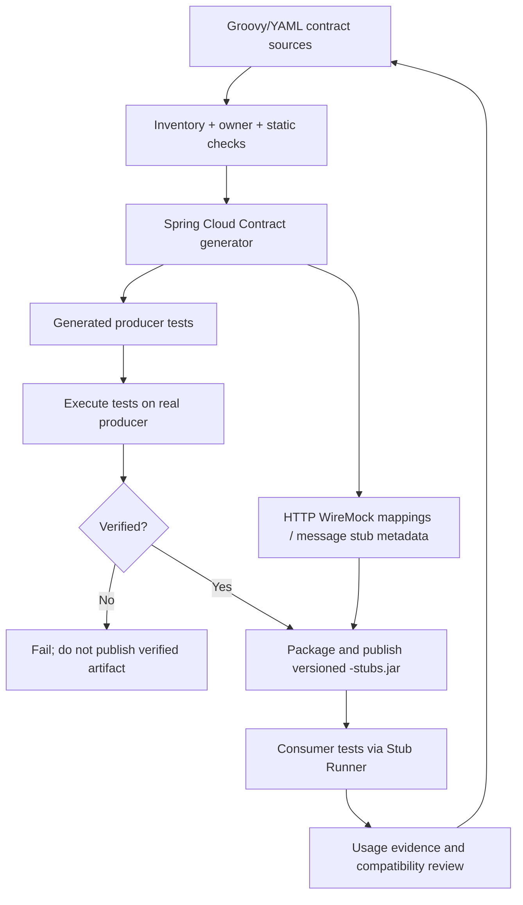
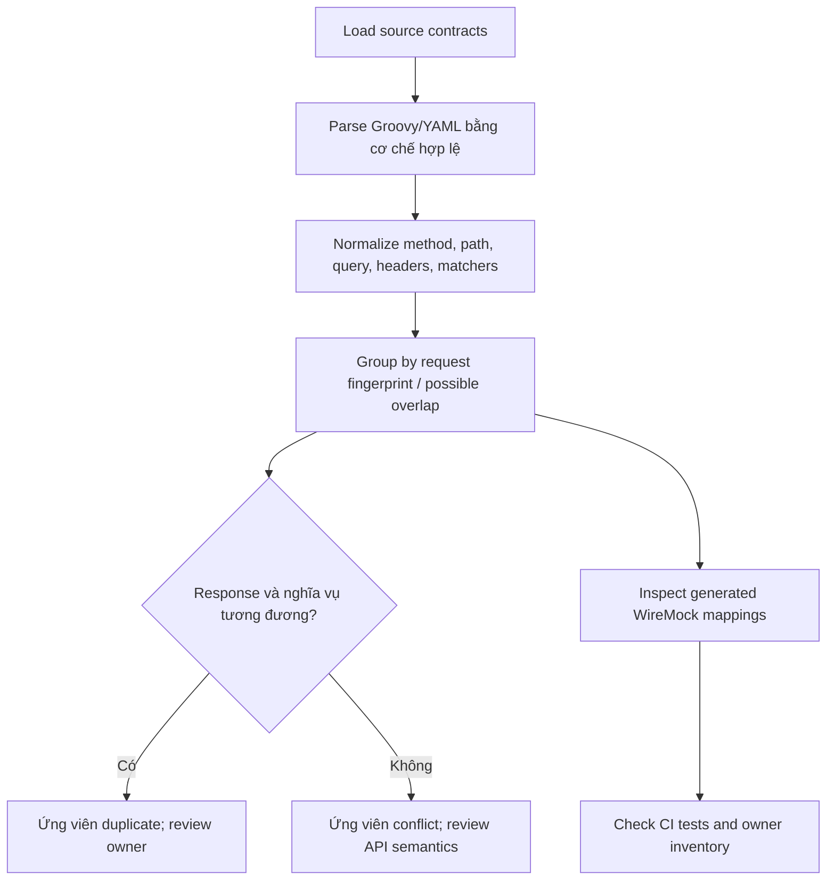
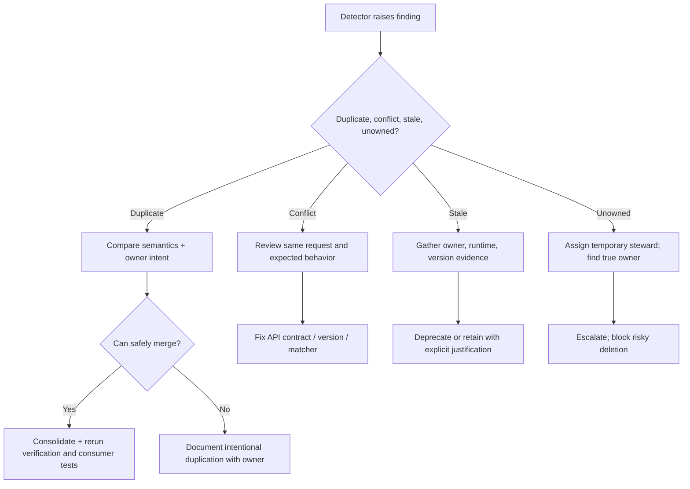
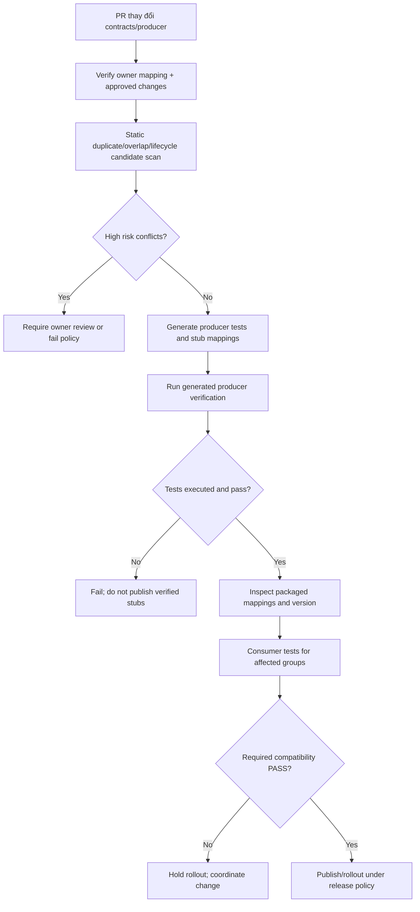

# Phát hiện hợp đồng trùng, lỗi thời hoặc không có chủ sở hữu

## 1. Khi số lượng hợp đồng tăng, “test xanh” chưa đủ

Một nhóm bắt đầu sử dụng **Spring Cloud Contract** với vài hợp đồng Groovy/YAML cho `Order Service` (producer). Sau một năm, `Checkout Service`, `Reporting Service`, `Mobile API` và `Notification Service` cùng đóng góp hàng trăm hợp đồng. Plugin sinh **producer verification tests**, đóng gói **stub artifact**; phía consumer dùng **Stub Runner** để kiểm tra HTTP client hoặc message handler.

Số lượng hợp đồng tăng có thể gây ra ba loại nợ chất lượng:

- **Trùng/chồng lấn:** hai hợp đồng mô tả cùng request nhưng tạo hai stub mappings giống nhau hoặc mâu thuẫn. WireMock có thể chọn một mapping ngoài ý định, còn generated producer tests trở nên lặp hoặc khó đáp ứng.
- **Lỗi thời:** hợp đồng vẫn tham chiếu URL, trường, event, consumer hoặc phiên bản đã ngừng hỗ trợ. Bài test vô ích làm tăng thời gian build, hoặc tệ hơn, stub cũ khiến consumer test tiếp tục xanh với giao diện không tồn tại.
- **Không có chủ sở hữu:** không ai biết ai được quyền chấp nhận thay đổi, khi nào được bỏ hợp đồng, ai cần sửa consumer hoặc ai xác nhận migration. Một PR có thể xóa nghĩa vụ quan trọng mà không có người review phù hợp.

**Chất lượng hợp đồng không phải tối đa hóa số file hoặc số test.** Một bộ hợp đồng tốt cần **đúng nghĩa vụ, rõ nguồn sở hữu, không mâu thuẫn, có thể thực thi và có kế hoạch vòng đời**.

Sau bài học thuộc chương **Chất lượng hợp đồng**, bạn sẽ:

1. Phân biệt trùng byte, trùng ngữ nghĩa, matcher chồng lấn và hợp đồng mâu thuẫn.
2. Thiết kế cách phát hiện ở mức DSL, generated tests, WireMock mappings và consumer tests.
3. Xác định hợp đồng có dấu hiệu lỗi thời mà **không xóa nhầm consumer còn hoạt động**.
4. Xây dựng cơ chế owner, review, deprecation và chứng cứ kiểm thử.
5. Tổ chức CI để phát hiện lỗi mới mà không phá quá trình chuyển đổi API/schema.
6. Thực hành phân tích các trường hợp HTTP và messaging bằng Groovy/YAML DSL.

## 2. Một hợp đồng nằm ở đâu trong vòng đời producer–consumer?



Mỗi lớp phát hiện được lỗi khác nhau:

| Lớp | Có thể phát hiện | Không tự chứng minh |
| --- | --- | --- |
| Source Groovy/YAML | Trùng file, trùng request pattern, thiếu owner metadata ở bên ngoài DSL | Request thực được WireMock chọn thế nào |
| Generated producer tests | Producer không đáp ứng những assertion đã khai báo | Hợp đồng nào còn người dùng, độ phủ nghiệp vụ |
| Generated WireMock mappings | Mappings trùng/chồng lấn, đường dẫn và priority | Producer thật sẽ phản hồi đúng trong production |
| Stub Runner consumer tests | Consumer gọi và xử lý được response mẫu | Các consumer không có test đều an toàn |
| Telemetry và owner review | Giao diện cũ còn được dùng hay không | Mọi khách hàng ngoại tuyến đều đã nâng cấp |

Không được tự kết luận “hợp đồng sạch” chỉ vì `./gradlew test` hoặc `mvn verify` trả exit code 0. Nếu một nghĩa vụ đã bị xóa khỏi DSL, producer verification không thể tiếp tục kiểm tra nghĩa vụ đó.

## 3. Phân loại trùng lặp trước khi tự động loại bỏ

“Duplicate contract” không có một định nghĩa duy nhất:

| Loại | Dấu hiệu | Mức độ |
| --- | --- | --- |
| **Trùng nguyên văn** | Hai file có cùng nội dung hoặc chỉ khác mô tả/tên | Ứng viên gộp; cần kiểm tra owner và phân nhóm |
| **Trùng ngữ nghĩa** | Groovy và YAML biểu đạt cùng request/response dù văn bản khác | Có thể gây test/mapping lặp |
| **Matcher chồng lấn** | Hai request patterns có ít nhất một HTTP request chung | Nguy cơ mapping không xác định/khó debug |
| **Mâu thuẫn** | Cùng request và cùng trạng thái nghiệp vụ nhưng yêu cầu response khác nhau | Nghiêm trọng; cần thống nhất API |
| **Trùng có chủ đích** | Cùng nghĩa vụ nhưng hai consumer cần bằng chứng sở hữu riêng | Có thể giữ sau review |
| **Tái sử dụng dữ liệu mẫu** | Cùng JSON fixture, khác endpoint hoặc tình huống | Chưa phải trùng hợp đồng |

**Trùng request không đồng nghĩa mâu thuẫn**: hai contract có thể xác minh hai field khác nhau trong cùng response. Nhưng nếu cả hai cùng sinh WireMock stub mapping cho request không thể phân biệt, phải xem mapping thực tế để biết liệu client test có nhận response cần thiết không.

### 3.1. Ví dụ trùng ở cấp source

Trong `checkout-service/get_order.groovy`:

```groovy
import org.springframework.cloud.contract.spec.Contract

Contract.make {
    description 'Checkout lay don hang 42'
    request {
        method GET()
        url '/api/orders/42'
    }
    response {
        status OK()
        headers {
            contentType(applicationJson())
        }
        body(orderId: 42, status: 'CONFIRMED')
    }
}
```

Trong `reporting-service/get_order.yml`:

```yaml
description: Reporting lay don hang 42
request:
  method: GET
  url: /api/orders/42
response:
  status: 200
  headers:
    Content-Type: application/json
  body:
    orderId: 42
    status: CONFIRMED
```

Về hành vi HTTP được minh họa, hai hợp đồng giống nhau dù viết bằng **hai DSL khác nhau**. Tuy nhiên, hai thư mục có thể đại diện cho **hai consumer owners**, và việc xóa một contract có thể làm mất bằng chứng consumer đó đang được hỗ trợ.

Hướng xử lý:

1. Xác nhận request/response thực sự tương đương trong phiên bản generator hiện hành.
2. Hỏi Checkout và Reporting liệu cùng một canonical contract có đáp ứng trách nhiệm review/CI của hai bên không.
3. Nếu gộp, cập nhật catalog và mapping giữa canonical contract với hai consumers; không âm thầm xóa người sở hữu.
4. Kiểm tra stub được sinh và các consumer tests sau khi gộp.

## 4. Matcher chồng lấn: lỗi tinh vi hơn trùng URL

Một contract có thể khai báo URL chính xác; contract khác sử dụng regex, JSONPath hoặc matcher header rộng. Hai file **khác văn bản** vẫn có thể cùng khớp một request.

Ví dụ **hai mapping WireMock native để minh họa kết quả sinh stub**, không phải nội dung của Spring Cloud Contract YAML:

**Mapping A — request chính xác:**

```json
{
  "request": {
    "method": "GET",
    "url": "/api/orders/42"
  },
  "response": {
    "status": 200,
    "jsonBody": {
      "orderId": 42,
      "status": "CONFIRMED"
    }
  }
}
```

**Mapping B — một pattern rộng:**

```json
{
  "request": {
    "method": "GET",
    "urlPathPattern": "/api/orders/[0-9]+"
  },
  "response": {
    "status": 404,
    "jsonBody": {
      "code": "ORDER_NOT_FOUND"
    }
  }
}
```

Request `GET /api/orders/42` khớp cả A và B. Nếu không có điều kiện khác biệt hoặc priority được thiết kế có chủ đích, response mà consumer nhận có thể không phản ánh đúng hợp đồng.

**Điểm cần nhớ:** WireMock có cơ chế ưu tiên mapping, nhưng ưu tiên chỉ quyết định stub trả gì; nó **không chứng minh** producer thật có thể trả `200` và `404` cho cùng một request và trạng thái. Với `404` nghiệp vụ, nên dùng request phân biệt, ví dụ ID `999` không tồn tại, hoặc điều kiện nghiệp vụ được thiết lập rõ trong test.

### 4.1. Các chiều cần xét khi phát hiện overlap

Không chỉ so sánh URL string:

- **HTTP method:** `GET` và `POST` khác nhau.
- **URL path và query:** `/api/orders/42?view=summary` khác `?view=detail` nếu mapping phân biệt query.
- **Headers:** `Accept`, `Content-Type`, API version, authorization trong phạm vi request contract.
- **Body matcher:** `equalToJson`, JSONPath, regex, multipart hoặc binary.
- **Path regex:** pattern rộng có thể bao trùm đường dẫn chính xác.
- **State/priority:** WireMock scenarios và mapping priority có thể khiến request khớp theo trạng thái hoặc thứ tự.
- **Consumer filtering:** hai mapping nằm trong artifact nhưng một consumer có thể chỉ nạp một nhóm nhờ `stubsPerConsumer`.

Một scanner đơn giản chỉ ghép `method + rawUrl` sẽ bỏ sót các overlap giữa exact URL và regex. Ngược lại, nếu quên header/query, scanner có thể báo xung đột giả đối với hai API version được phân biệt bằng `Accept`.

## 5. Mâu thuẫn hợp đồng nghiêm trọng hơn trùng lặp thông thường

Hai file trong hai consumer folders có thể khai báo:

```text
Contract 1:
  GET /api/orders/42
  Accept: application/json
  -> 200 {"orderId":42,"status":"CONFIRMED"}

Contract 2:
  GET /api/orders/42
  Accept: application/json
  -> 200 {"orderId":42,"status":"CANCELLED"}
```

Nếu cùng điều kiện nghiệp vụ và không có version/state nào phân biệt, producer không thể thỏa **hai giá trị status mâu thuẫn** cùng lúc. Đừng chữa bằng cách:

- Đặt `priority` cho mapping `CONFIRMED` để che mapping `CANCELLED`.
- Bật `stubsPerConsumer` và kết luận Checkout/Reporting đều tương thích.
- Nới `status` matcher thành regex rộng `.*` chỉ để producer test qua.
- Xóa một contract không thông báo chủ sở hữu.

Cách giải quyết:

1. Xác định **nghĩa nghiệp vụ**: `status` của đơn hàng hay của khoản thanh toán?
2. Nếu là hai khái niệm, đổi tên trường hoặc endpoint cho rõ, ví dụ `settlementStatus`.
3. Nếu là hai API versions, phân biệt bằng route hoặc media type **được producer thực hiện thật**.
4. Nếu cần giai đoạn chuyển đổi, dùng kế hoạch **expand → migrate → contract**, bảo vệ consumer cũ tới thời điểm ngừng hỗ trợ.
5. Producer verification phải chạy trên mọi nghĩa vụ vẫn được chấp nhận.

## 6. Thiết kế “dấu vân tay ngữ nghĩa” để tìm ứng viên trùng

Một công cụ kiểm tra tĩnh có thể xây dựng **contract fingerprint** từ các thuộc tính đã chuẩn hóa. Thay vì hash toàn bộ text, nó cố gắng biểu diễn **những phần quyết định tương tác**:

```text
requestFingerprint:
  transport: HTTP
  method: GET
  path: /api/orders/42
  queryMatchers: normalized
  headerMatchers: normalized
  bodyMatchers: normalized
  state/scenario: optional

responseFingerprint:
  status: 200
  headers: Content-Type=application/json
  body/responseMatchers: normalized
```

Trình tự khái niệm:



### 6.1. Những gì có thể chuẩn hóa an toàn

| Thuộc tính | Cách nhìn phù hợp | Cạm bẫy |
| --- | --- | --- |
| Method | Uppercase (`GET`, `POST`) | Không gộp `GET` và `HEAD` tự động |
| Header names | HTTP header names không phân biệt chữ hoa/thường | Giá trị header có thể cần matching đặc thù |
| JSON object | So sánh cấu trúc thay vì pretty-print | Đừng tự bỏ qua kiểu hoặc trường bắt buộc |
| Query params | So sánh các matcher cho từng key | Có key lặp, thứ tự/multiple values tùy API |
| URL pattern | Phân biệt exact, regex và template | Regex overlap khó kết luận hoàn toàn |
| Matcher | Giữ loại và điều kiện (`byRegex`, `byType`, `byEquality`) | Đổi matcher rộng/hẹp thay đổi nghĩa vụ |
| Consumer group | Ghi owner/thư mục riêng | Khác owner không mặc nhiên khác HTTP behavior |
| Messaging | Destination, event type, headers, payload schema | Không gộp hai event có ý nghĩa khác nhau chỉ vì cùng body |

Chú ý: `{"a":1,"b":2}` và `{"b":2,"a":1}` tương đương về nội dung JSON object, nhưng `{"a":1}` khác `{"a":"1"}`; và nếu mảng có thứ tự nghiệp vụ, `[1,2]` khác `[2,1]`. **Không xóa mọi khoảng trắng hoặc xếp lại mảng rồi gọi là cùng hợp đồng**.

### 6.2. Groovy DSL không phải JSON thuần

Groovy contract có thể dùng DSL closures, dynamic properties, method calls và matcher khác nhau giữa producer/consumer. Vì thế **không nên** đọc bằng regex thô rồi diễn giải như JSON. Nếu xây scanner thật:

- Dùng parser/model của Spring Cloud Contract tương thích phiên bản đang dùng khi có thể.
- Phân biệt consumer-side values và producer-side values.
- Hoặc đọc **generated WireMock mappings** như bằng chứng bổ sung, nhưng nhớ mapping chỉ đại diện phía stub.
- Giữ những trường không phân tích được ở trạng thái **needs review**, không tự kết luận “không trùng”.

### 6.3. Pseudocode cho bộ phát hiện ứng viên

Đoạn sau là **thuật toán minh họa**, không phải lệnh có sẵn của Spring Cloud Contract hay script đang tồn tại trong repository:

```text
contracts = parse_all_supported_contracts()

for each contract in contracts:
    validate_required_owner_reference(contract)
    normalized = normalize_without_losing_matcher_semantics(contract)
    index_by_transport_and_request_dimensions(normalized)

for each candidate_pair from_index:
    if equivalent_request_and_equivalent_response(candidate_pair):
        report("POSSIBLE_DUPLICATE", candidate_pair)
    else if requests_may_overlap(candidate_pair):
        report("POSSIBLE_CONFLICT", candidate_pair)

for each contract in contracts:
    if no_active_owner_or_no_supported_consumer_evidence(contract):
        report("NEEDS_LIFECYCLE_REVIEW", contract)

never_auto_delete_without_owner_approval()
```

“`requests_may_overlap`” là kiểm tra **khả năng**: với regex phức tạp, body matching động hoặc scenario state, kết quả có thể không quyết định được chỉ bằng phân tích tĩnh. Lúc đó cần generated mapping inspection và request thực nghiệm.

## 7. Kiểm tra ở cấp stub artifact để phát hiện mapping trùng

Spring Cloud Contract sinh HTTP stub mappings cho WireMock; trong stub artifact có thể có nhiều mappings tương tự nhau. Kiểm tra source thôi chưa đủ nếu:

- Generator tạo mapping với điều kiện rộng hơn dự đoán.
- Hợp đồng bị copy từ nguồn ngoài và tạo thêm một mapping nữa.
- Có mappings WireMock native được đóng gói chung.
- `stubsPerConsumer` khiến mỗi consumer nạp một tập khác nhau.
- Stale generated output chưa được dọn khi source contract bị xóa.

Trong một môi trường thực hành với **artifact đã build**, có thể dùng lệnh tham khảo:

```bash
# Thay tọa độ bằng artifact đã build/resolve thực tế.
jar tf build/libs/order-service-1.4.0-stubs.jar
```

Đường dẫn ở đây chỉ là minh họa theo convention Gradle; Maven hoặc cấu hình publication có thể tạo artifact ở vị trí khác. Hãy tìm các mapping JSON thực tế và xem **request patterns** có giao nhau không.

### 7.1. Một nguyên tắc đánh giá quan trọng

Nếu hai mapping hoàn toàn giống nhau và cùng trả response giống nhau, chúng có thể chỉ làm tăng dung lượng/thời gian debug. Nếu cùng match nhưng trả response khác nhau, đây có thể là **lỗi nghiêm trọng ảnh hưởng consumer behavior**.

Tuy vậy, hai mapping có thể được thiết kế như **stateful scenarios** hoặc priority có chủ đích. Một detector tốt không xóa các trường `scenarioName`, `requiredScenarioState`, `priority`, header khác biệt trước khi so sánh.

**Không mặc nhiên coi mọi mapping collision là lỗi của Spring Cloud Contract.** Phải chỉ ra hai source contracts hoặc một mapping native nào đã tạo ra chồng lấn, rồi xác định đó có phải tình huống được thiết kế không.

## 8. Phát hiện hợp đồng lỗi thời: cần chứng cứ, không chỉ tuổi tệp

Một hợp đồng có thể được tạo từ ba năm trước nhưng vẫn là API quan trọng của mobile app cũ. Ngược lại, hợp đồng mới tạo tuần trước đã có thể lỗi thời nếu endpoint bị bỏ từ một release khác.

Thay vì dùng tiêu chí “file không sửa trong N ngày”, hãy kết hợp:

| Dấu hiệu | Câu hỏi cần xác minh | Độ tin cậy khi đứng một mình |
| --- | --- | --- |
| Endpoint `/api/v1` đã deprecated | Có consumer còn được hỗ trợ sử dụng v1 không? | Trung bình |
| Không thấy request trong logs | Khoảng quan sát có bao gồm monthly/rarely-used jobs không? | Thấp |
| Owner/consumer service đã ngừng vận hành | Có client thay thế, partner hoặc replay cần giao diện đó không? | Trung bình |
| Generated producer test bị `NO-SOURCE`/`SKIPPED` | Có lỗi wiring thay vì lỗi thời không? | Thấp |
| Contract tham chiếu route không còn trong code | Có route cấu hình động/gateway không? | Trung bình |
| Stub artifact không chứa mapping mong đợi | Packaging/filtering có bị sai không? | Thấp |
| Message event đã ngừng phát | Có event replay hoặc subscriber lâu không hoạt động không? | Trung bình |
| Không còn owner trong service catalog | Có mất metadata hay nhóm đã đổi tên không? | Thấp |
| Deprecation deadline đã qua | Đã hoàn thành migrate và có approval chưa? | Trung bình |

**Một dấu hiệu chỉ tạo ra ứng viên review.** Quyết định loại bỏ cần kết hợp owner, version hỗ trợ, consumer tests, telemetry và chính sách retention.

### 8.1. Các loại lỗi thời cần phân biệt

1. **Contract obsolete:** yêu cầu API/event đã chính thức ngừng hỗ trợ.
2. **Fixture obsolete:** dữ liệu mẫu sai hoặc không còn đại diện cho nghĩa vụ hiện hành.
3. **Matcher obsolete:** regex quá rộng/tài liệu kiểu dữ liệu cũ che lỗi.
4. **Consumer orphan:** consumer không còn owner hoặc đã ngừng vận hành.
5. **Generated artifact stale:** source đã xóa nhưng JSON mapping/class test cũ vẫn được đóng gói.
6. **Version stale:** consumer CI tải stub của producer cũ hơn version cần kiểm tra.

Các vấn đề này cần hành động khác nhau: sửa fixture, siết matcher, cập nhật version, dọn output, thay ownership hoặc thực hiện deprecation có kiểm soát.

## 9. Hợp đồng lỗi thời ở HTTP và messaging có rủi ro khác nhau

### 9.1. HTTP: một endpoint đã ngừng hỗ trợ

Ví dụ `GET /api/v1/orders/42` đã được thay bằng `GET /api/v2/orders/42`. Nếu source contract v1 còn lại:

- Có thể nó đang bảo vệ client đối tác cần thời gian nâng cấp.
- Có thể nó là contract deprecated đã vượt thời hạn.
- Có thể source đã không còn được build đọc, dẫn đến **false confidence**.

Phải đối chiếu **API support policy**, owner và traffic/consumer matrix. Không xóa chỉ vì đã xuất hiện hợp đồng v2.

### 9.2. Messaging: sự kiện có thể được replay

```groovy
import org.springframework.cloud.contract.spec.Contract

Contract.make {
    label 'order_confirmed_v1'
    input {
        triggeredBy('confirmOrderAndPublish()')
    }
    outputMessage {
        sentTo('orders.confirmed')
        body(
            eventType: 'OrderConfirmed',
            schemaVersion: 1,
            eventId: 'evt-42',
            orderId: 42
        )
    }
}
```

Một team muốn bỏ contract v1 vì producer đang phát v2. Nhưng Kafka topic có thể giữ lại v1 để consumer **replay**, hoặc một consumer vẫn dùng v1 trên môi trường khác.

Khi kiểm tra lỗi thời ở message:

1. Xem producer còn phát v1 không.
2. Xem broker retention, replay, dead-letter/reprocessing.
3. Xem schema registry compatibility và các subscriber versions.
4. Xem consumer tests với event cũ có còn được yêu cầu không.
5. Xác định có cần duy trì **consumer deserialization fixture v1** dù producer không còn **phát v1** hay không.

**Hợp đồng producer phát event v1** và **consumer test đọc fixture v1** là hai nghĩa vụ khác nhau. Không nhất thiết giữ producer contract đã deprecated chỉ để test replay; có thể chuyển fixture lịch sử sang lớp test của consumer, với owner và chính sách riêng.

## 10. Không có chủ sở hữu: phát hiện và quản lý thế nào?

Một contract bị coi là **unowned** khi không xác định được ai chịu trách nhiệm:

- Chấp nhận hoặc từ chối thay đổi từ producer.
- Bảo trì assertions/fixtures khi nghiệp vụ thay đổi.
- Xác nhận một consumer còn phụ thuộc vào giao diện hay không.
- Quyết định deprecation hoặc bỏ hỗ trợ.
- Giải quyết lỗi CI nếu contract fail.

Chỉ có tên folder `checkout-service/` chưa đủ nếu ứng dụng đó đã đổi tên, team đã giải thể hoặc không có người được giao trách nhiệm review.

### 10.1. Hai tầng ownership

| Vai trò | Quyền/trách nhiệm |
| --- | --- |
| **Producer API owner** | Đảm bảo implementation và tập nghĩa vụ đã chấp nhận được verify |
| **Consumer expectation owner** | Giải thích vì sao consumer cần behavior và review breaking change |
| **Contract repository maintainer** | Bảo vệ quy trình merge, convention, lint và CI |
| **Release/CI owner** | Chặn publish stub chưa verify, quản lý artifact/version |
| **Fallback/escalation owner** | Xử lý khi nhóm consumer ngừng tồn tại hoặc owner không phản hồi |

Không nên để quyền xóa một nghĩa vụ đã chấp nhận phụ thuộc duy nhất vào người đang sửa file. Quy trình cần bảo vệ cả producer lẫn consumer đang bị ảnh hưởng.

### 10.2. Cấu trúc thư mục là tín hiệu, không phải sổ chủ sở hữu

```text
src/test/resources/contracts/
  checkout-service/
    get_order.groovy
  reporting-service/
    get_order_report.yml
  notification-service/
    order_confirmed.groovy
```

Từ cấu trúc này có thể suy ra **ứng viên consumer ID**, nhưng không biết email/team owner, trạng thái hoạt động hoặc deadline deprecation. Cần thêm một **service catalog hoặc ownership registry** được quản trị và review.

## 11. Sổ đăng ký ownership và trạng thái vòng đời

Một ví dụ metadata **ngoài Spring Cloud Contract DSL**, chỉ minh họa cách quản trị:

```yaml
contracts:
  - id: order-get-checkout-v1
    path: checkout-service/get_order.groovy
    producer: order-service
    consumer: checkout-service
    producerOwner: order-platform-team
    consumerOwner: checkout-team
    state: active
    supportedSince: '2026-01-10'
    lastConfirmedByConsumer: '2026-10-15'
  - id: order-confirmed-v1
    path: notification-service/order_confirmed.groovy
    producer: order-service
    consumer: notification-service
    producerOwner: order-platform-team
    consumerOwner: notification-team
    state: deprecated
    replacement: order-confirmed-v2
    retirementRequires: owner-approval-and-replay-review
```

**Đây không phải YAML contract mà plugin Spring Cloud Contract tự đọc.** Những key như `producerOwner`, `lastConfirmedByConsumer`, `retirementRequires` là metadata quản trị ví dụ và **không được tự thêm vào ba trường của YAML bài học hoặc vào contract DSL rồi mặc định plugin hiểu**.

Các giá trị ngày/team trong ví dụ là giả định. Trong hệ thống thật, registry có thể nằm trong service catalog, Git-tracked metadata hoặc hệ thống quản lý dịch vụ; điều quan trọng là **có nguồn quản lý rõ ràng, owner xác nhận và lịch sử review**.

### 11.1. Vòng đời có trạng thái tường minh

| Trạng thái | Ý nghĩa | Hành động |
| --- | --- | --- |
| `proposed` | Consumer đề xuất, producer chưa chấp nhận | Review và đàm phán |
| `active` | Đã chấp nhận, đang được producer bảo vệ | Chạy verification thường xuyên |
| `deprecated` | Vẫn phải hỗ trợ trong thời gian chuyển tiếp | Cảnh báo, theo dõi kế hoạch migration |
| `retirement-review` | Đang xác minh có thể xóa | Owner sign-off và chứng cứ |
| `retired` | Không còn là nghĩa vụ producer | Lưu lịch sử theo chính sách và gỡ khỏi active set |
| `orphaned` | Chưa xác định được owner | **Tạm giữ**, escalate, không tự xóa |

Không phải mọi tổ chức cần đúng sáu trạng thái. Điểm bắt buộc là **phân biệt “deprecated nhưng còn được bảo vệ” với “retired đã được phép bỏ”**.

### 11.2. CODEOWNERS hỗ trợ review, nhưng không thay consumer inventory

Ví dụ **fragment GitHub/GitLab CODEOWNERS có tính minh họa**:

```text
/src/test/resources/contracts/checkout-service/ @checkout-team
/src/test/resources/contracts/reporting-service/ @reporting-team
/src/test/resources/contracts/notification-service/ @notification-team
```

Các handle là giả định. Tùy nền tảng, cần bật **required code owner reviews** trong branch protection/rulesets; chỉ có file CODEOWNERS mà không thiết lập rule có thể chưa chặn merge. Ngoài ra:

- CODEOWNERS ánh xạ **reviewer theo đường dẫn**, không chứng minh service đang chạy.
- Khi một file bị chuyển thư mục, quyền review có thể thay đổi; nên kiểm tra diff và registry.
- Nếu team bị xóa/đổi tên, CODEOWNERS cần được cập nhật.
- Một số thay đổi ở producer code ảnh hưởng contract dù không sửa file contract; producer owner vẫn phải kiểm tra compatibility.

## 12. Quy trình triage khi scanner báo lỗi



### 12.1. Mức độ ưu tiên

| Mức | Ví dụ | Phản ứng phù hợp |
| --- | --- | --- |
| **Critical** | Hai active contracts yêu cầu `200` và `403` cho cùng request/security context | Chặn release cho tới khi review |
| **High** | Hai WireMock mappings cùng match nhưng body khác nhau; contract quan trọng thiếu owner | Chặn thay đổi gây rủi ro hoặc yêu cầu phê duyệt |
| **Medium** | Trùng response giống nhau giữa hai consumers đã biết | Tạo đề xuất gộp, xác minh tác động |
| **Low** | Metadata deprecation thiếu ngày review, fixture cũ ít sử dụng | Cập nhật catalog, lên lịch review |

Mức độ này là **chính sách đề xuất**, cần điều chỉnh theo rủi ro nghiệp vụ. Với API tài chính/bảo mật, một `403` bị che bởi mapping `200` có thể nghiêm trọng hơn một contract trùng đơn thuần.

### 12.2. Allowlist có kiểm soát

Đôi khi phải chấp nhận một trùng lặp có chủ đích, ví dụ hai consumers có nghĩa vụ ownership riêng hoặc stateful scenario đã được thiết kế.

Nếu detector hỗ trợ suppression/allowlist, một entry nên chứa:

- **Finding ID/fingerprint** và danh sách contract liên quan.
- Lý do nghiệp vụ hoặc lý do kỹ thuật.
- Producer/consumer owner đã duyệt.
- Thời hạn hoặc ngày review lại.
- Phạm vi giới hạn đúng loại finding; không tắt toàn bộ scanner.

Không dùng “ignore all duplicate contracts” để làm CI xanh. Allowlist không nên che các finding mới có cùng pattern nhưng khác ngữ nghĩa.

## 13. Dọn hợp đồng: bước đúng và bước sai

### 13.1. Cách làm sai

1. Scanner phát hiện hai hợp đồng trùng.
2. Developer xóa file cũ khỏi `checkout-service/`.
3. Generated tests ít đi, build nhanh hơn.
4. Không kiểm tra stub JAR, không báo Checkout owner và không chạy consumer CI.
5. Vài tuần sau Checkout mới phát hiện một response không còn được bảo vệ.

**Giảm số file không phải chứng cứ rằng có thể giảm nghĩa vụ.**

### 13.2. Cách làm đúng

1. Xác định loại duplicate/stale, producer ID, consumer IDs và version bị ảnh hưởng.
2. Xem generated mappings và producer test coverage để biết chính xác nghĩa vụ đang được bảo vệ.
3. Xác nhận với owners: trùng có chủ đích, có cần hai consumer approvals riêng không?
4. Nếu gộp, lưu canonical contract và cập nhật registry/CI mapping cho consumers.
5. Nếu bỏ legacy API, lập kế hoạch deprecation/expand–migrate–contract và kiểm tra client versions.
6. Chạy lại generated producer verification, bảo đảm không mất các assertion thiết yếu.
7. Kiểm tra stub artifact không còn stale mapping ngoài ý định.
8. Chạy consumer tests của những nhóm bị ảnh hưởng và lưu kết quả review.

### 13.3. Kiểm tra generated outputs sau khi xóa file

Một tệp `old_order.groovy` đã bị xóa nhưng file mapping JSON tương ứng vẫn xuất hiện trong artifact có thể do:

- Một contract khác đang sinh mapping tương tự.
- Generated output directory chưa được dọn khi input bị xóa.
- Packaging đang lấy mappings từ một source khác.
- Artifact CI đã được build trước khi xóa hoặc phiên bản tải về bị cũ.

**Không chỉnh generated mapping thủ công rồi coi lỗi đã được sửa.** Hãy điều tra nguồn DSL, task inputs/outputs và quá trình packaging; dùng build sạch trong môi trường kiểm chứng khi cần để so sánh với incremental build. Bài này không yêu cầu chạy Gradle hoặc sửa build logic.

## 14. Phát hiện hợp đồng thiếu assertion dù có owner

Một bộ hợp đồng có thể **không trùng, không lỗi thời, có owner** nhưng vẫn chất lượng thấp nếu chỉ mô tả điều kiện quá rộng:

```groovy
response {
    status OK()
    bodyMatchers {
        jsonPath('$.status', byRegex('.*'))
    }
}
```

Đây là **fragment để thảo luận**, chưa phải `Contract.make` hoàn chỉnh. Matcher `.*` gần như không bảo vệ miền giá trị `status`; nếu producer trả `CANCELLED` thay vì `CONFIRMED`, test vẫn có thể chấp nhận chuỗi này.

Một hợp đồng tốt cần ưu tiên:

- Giá trị bắt buộc có ngữ nghĩa khi consumer dựa vào, ví dụ `status: 'CONFIRMED'`.
- Kiểu số/boolean/string chính xác, không biến mọi field thành `byType` nếu miền giá trị quan trọng.
- Nhánh lỗi quan trọng như `400`, `401`, `403`, `404` đúng policy.
- Header `Content-Type`, version hoặc correlation ID nếu là phần của contract.
- Request matchers đủ chặt để không cho nhiều tương tác khác nhau cùng khớp một stub.

**Kiểm tra duplicate nên gắn với review chất lượng matcher.** Gộp hai hợp đồng thành một contract siêu rộng có thể làm giảm số file nhưng lại tăng rủi ro tương thích.

## 15. Producer verification, Stub Runner và giới hạn đánh giá chất lượng

Một quy trình hợp lệ phải chứng minh:

```text
Source contract được chấp nhận
  -> generated producer tests được sinh và THỰC SỰ chạy
  -> producer hiện tại đáp ứng assertions
  -> stub artifact được đóng gói/publish đúng version
  -> consumer test dùng đúng stub và client thật
```

### 15.1. Chỉ chạy producer tests có đủ không?

Không. Producer tests có thể pass vì hai contract giống nhau, vì một assertion đã bị bỏ hoặc vì chúng chỉ mô tả happy path. Chúng không tự phát hiện:

- Hợp đồng không còn consumer owner.
- Hai consumer kỳ vọng khác nhau nhưng contract chỉ ghi một bên.
- Consumer dùng stub version cũ hơn bản vừa verify.
- Một test fixture giả khác với dữ liệu nghiệp vụ thật ở môi trường khác.

### 15.2. Chỉ chạy consumer tests có đủ không?

Không. Stub Runner trả response từ artifact đã tải; consumer test PASS chỉ chứng minh client xử lý được mẫu response. Nếu artifact cũ hoặc producer verification bị skip, test xanh không bảo vệ behavior mới nhất của producer.

### 15.3. `stubsPerConsumer` có giải quyết duplicate?

Không hoàn toàn. `stubsPerConsumer` giúp **lọc mappings** nạp cho consumer tương ứng, hữu ích khi Checkout và Reporting có các nhóm hợp đồng khác nhau. Nhưng:

- Nó không biết hai hợp đồng có cùng ngữ nghĩa hay không.
- Nó không giải quyết một API producer thật có response mâu thuẫn.
- Nếu thiếu mapping cho consumer do folder/consumerName sai, test có thể báo unmatched request.
- Producer verification vẫn cần bảo vệ toàn bộ hợp đồng active đã được chấp nhận.

Đừng dùng filtering thay cho đánh giá chất lượng source và compatibility.

## 16. CI: xây cổng kiểm tra chất lượng theo nhiều lớp



Tùy hệ thống, bước publish stubs có thể xảy ra trước khi consumer CI tải artifact từ kho staging; nhưng **release production** vẫn cần chính sách bảo đảm producer verification và compatibility gates. Sơ đồ minh họa thứ tự logic, không bắt buộc mọi tổ chức phải có cùng topology CI.

### 16.1. Những rule phù hợp để chạy tự động

| Rule | Cách thực hiện | Khi fail |
| --- | --- | --- |
| File Groovy/YAML parse được | Sử dụng parser/generator đúng version | Block vì không sinh được tests/stubs |
| Không trùng nội dung byte trong cùng nhóm | Hash theo nội dung/đường dẫn | Báo ứng viên, cân nhắc block khi cùng owner |
| Không có mappings chồng lấn nguy hiểm | So sánh generated request patterns + test cases | Block nếu đã xác minh là conflict |
| Mỗi active contract có producer/consumer owner | Đối chiếu ownership registry | Block với file mới không có owner |
| Breaking changes cần owner approval | Diff contract + review policy | Không merge/publish khi chưa duyệt |
| Deprecated contract có migration ticket/review date | Registry và deadline | Warning/escalation, không tự xóa |
| Generated tests có thực thi | Test report/count, test failure | Block publish nếu skip hoặc fail |
| Stub JAR đúng classifiers và mappings | Artifact inspection | Block nếu thiếu/stale |
| Consumer tests của nhóm bị ảnh hưởng | Stub Runner và client tests | Block rollout theo compatibility policy |

**Spring Cloud Contract không có sẵn một lệnh duy nhất bảo đảm tất cả rule trong bảng.** Static lint, ownership registry, policy checks và artifact inspection cần được tổ chức tự xây hoặc tích hợp với công cụ phù hợp. Không nên gọi một script ví dụ là lệnh built-in của Spring Cloud Contract.

### 16.2. Lệnh kiểm tra producer tham khảo

Trong dự án đã cấu hình Maven hoặc Gradle phù hợp:

```bash
# Maven producer: đảm bảo generated contract tests được nối vào lifecycle.
./mvnw -B -ntp verify

# Hoặc Gradle producer: xem task graph và chạy verification.
./gradlew tasks --all --console=plain
./gradlew check --info
```

Đây chỉ là **lệnh hướng dẫn thực hành**, không phải lệnh đã chạy khi biên soạn. Tên task sinh contract, wiring vào `test`/`check` và cấu hình verifier phụ thuộc phiên bản plugin. **Không chỉ dựa vào exit code:** cần kiểm tra generated test count, các test classes quan trọng và build reports.

### 16.3. Một kiểm tra artifact có giá trị

Sau producer verification:

```text
Expected:
  checkout-service/get_order mapping
  reporting-service/get_order_report mapping
  notification-service/order_confirmed message contract

Actual:
  mapping nào thực sự được đóng gói vào -stubs.jar?
```

Không nên hard-code tên file JSON mà generator có thể đặt khác qua các bản plugin. Thay vào đó, dựa trên source contract metadata, mapping request/response và consumer group để xác nhận nghĩa vụ còn trong artifact đúng version.

## 17. Bảo trì theo lịch: chuyển từ “quét một lần” sang vòng phản hồi

Một nhịp review chất lượng phù hợp có thể gồm:

- **Mỗi PR:** parse, owner mapping, new conflicts, test count và producer/consumer verification.
- **Mỗi release:** diff contract versions, xác minh stub artifact, kiểm tra intentional duplicate suppressions.
- **Theo chu kỳ team lựa chọn:** rà owner, deprecated contracts, orphan consumers, telemetry và API support policy.
- **Sau incident:** bổ sung contract hoặc negative test cho hành vi đã gây lỗi, tránh chỉ thêm một mapping trùng để chữa hiện tượng.

Không có một ngưỡng “90 ngày không sửa là stale” phù hợp mọi hệ thống. Với public/mobile API hoặc message replay, cửa sổ cần dài hơn chu kỳ sử dụng của consumer; với API nội bộ được triển khai đồng bộ, có thể ngắn hơn nếu owners đã xác nhận.

### 17.1. Các chỉ số theo dõi chất lượng

| Chỉ số | Ý nghĩa | Cạm bẫy |
| --- | --- | --- |
| `unowned_active_contracts` | Số hợp đồng active chưa xác định owner | Owner registry có thể thiếu cập nhật |
| `duplicate_candidates` | Số cặp nghi trùng | Không phải mọi cặp đều sai |
| `conflicting_request_patterns` | Mappings có khả năng trả khác response cho cùng request | Cần review state/header/priority |
| `deprecated_past_review` | Hợp đồng quá hạn xem xét deprecation | Không có nghĩa được tự xóa |
| `unexecuted_generated_tests` | Test đáng lẽ chạy nhưng bị skip/NO-SOURCE | Có thể do wiring/build cấu hình |
| `unverified_stub_releases` | Artifact không liên kết được với verification evidence | Ưu tiên xử lý cao |
| `consumer_version_coverage` | Cặp producer/consumer versions được test | Không tự đo toàn bộ production traffic |

Đừng đặt KPI “phải giảm số hợp đồng” vì nhóm có thể xóa những nghĩa vụ cần thiết chỉ để cải thiện con số. Chỉ số hữu ích phải thúc đẩy **giảm ambiguity, tăng traceability và khả năng phát hiện breaking change**.

## 18. Troubleshooting: phân biệt trùng, lỗi thời và sai cấu hình

| Triệu chứng | Khả năng gây ra | Điều tra phù hợp |
| --- | --- | --- |
| Consumer nhận `404` từ WireMock | Không match hoặc contract có `404` nghiệp vụ | Xem body lỗi, request journal và mappings |
| Cùng request lúc trả `200`, lúc `404` | Mappings overlap hoặc stateful scenario | Xem patterns, priority, scenario state |
| Có hai generated tests tương đương | Trùng DSL hoặc source contracts được copy hai lần | So canonical request/response và source path |
| Xóa contract nhưng stub cũ vẫn còn | Stale generated output hoặc artifact cũ | Xem task outputs, packaging và resolved version |
| Một consumer không tìm thấy stub | `consumerName`/folder khác nhau | Kiểm tra `stubsPerConsumer`, JAR layout |
| Bài test xanh dù API đã xóa | Generated contract tests bị skip hoặc dùng phiên bản cũ | Kiểm tra test execution, artifact provenance |
| Không ai đồng ý xóa hợp đồng | Ownership thiếu hoặc team đã đổi tên | Tìm owner tạm, escalation, giữ nghĩa vụ |
| Scanner báo duplicate cho `Accept` v1/v2 | Không xét header trong fingerprint | Bổ sung header/negotiation conditions |
| Scanner báo một event v1 là stale | Bỏ qua replay/subscriber đang dùng schema cũ | Kiểm tra broker retention và consumer tests |
| Warning quá nhiều khiến team bỏ qua | Rule quá rộng, không có severity/allowlist | Phân lớp kết quả và có expiry của suppressions |
| Hai contract cùng ví dụ JSON nhưng API khác | Scanner so hash body thay vì request | Xem method/URL, event type và semantics |

### 18.1. Cách điều tra một conflict thực tế

Thực hiện lần lượt:

1. Tìm source Groovy/YAML và owner của từng hợp đồng.
2. Ghi lại **request thực** gây lỗi: method, URL, query, headers, body.
3. Xem generated WireMock mappings thật sự được nạp cho consumer đó.
4. Kiểm tra có `priority`, scenario state hoặc matcher nào bị bỏ qua không.
5. Xác minh producer behavior trên cùng điều kiện qua generated producer tests.
6. Nếu mâu thuẫn ngữ nghĩa, liên hệ producer/consumer owners và quyết định API mới/transition.
7. Khi sửa, chạy lại consumer tests và kiểm tra artifact đã phát hành theo đúng version.

Đừng sửa bằng cách nới regex toàn cục hoặc bỏ một assertion quan trọng mà không có quyết định từ owner.

## 19. Bài thực hành: audit bộ hợp đồng của Order Service

Giả sử có các tệp:

```text
src/test/resources/contracts/
  checkout-service/
    get_order.groovy
    get_order_copy.yml
    order_not_found.yml
  reporting-service/
    get_order_report.yml
    get_order_legacy.yml
  notification-service/
    order_confirmed.groovy
    order_confirmed_v1.groovy
```

Thông tin từ nhóm:

- `get_order.groovy` và `get_order_copy.yml` cùng match `GET /api/orders/42`, cùng trả `200` và JSON giống nhau.
- `order_not_found.yml` dùng regex `/api/orders/[0-9]+`, trả `404`.
- `get_order_report.yml` dùng `GET /api/orders/42/report`, trả số tiền và tiền tệ.
- `get_order_legacy.yml` dùng `GET /api/v1/orders/42`; chủ sở hữu trước đây đã chuyển nhóm, chưa rõ đối tác còn dùng không.
- `order_confirmed.groovy` phát event schema v2; `order_confirmed_v1.groovy` phát schema v1, nhưng broker có retention và một subscriber dùng replay.

### 19.1. Yêu cầu

1. Phân loại `get_order_copy.yml`: trùng byte hay trùng ngữ nghĩa? Cần kiểm tra gì trước khi xóa?
2. Giải thích vì sao `order_not_found.yml` có thể chồng lấn mapping `GET /api/orders/42`.
3. Đề xuất thay đổi để stub `404` không che happy path.
4. `get_order_report.yml` có trùng với `get_order.groovy` chỉ vì cùng `orderId=42` không?
5. `get_order_legacy.yml` có nên xóa ngay khi không biết owner không?
6. Vì sao event v1 có thể vẫn cần trong consumer replay test dù producer chỉ phát v2?
7. Thiết kế metadata owner cho các contracts và một review gate trong CI.
8. Đề xuất thứ tự kiểm tra sau khi gộp/xóa bất kỳ contract nào.

### 19.2. Gợi ý phân loại và hành động

| Tệp hoặc cặp tệp | Phân loại | Hành động đề xuất |
| --- | --- | --- |
| `get_order.groovy` / `get_order_copy.yml` | Ứng viên trùng ngữ nghĩa | Xem owner và generated output; gộp có kiểm chứng |
| `order_not_found.yml` và happy path | Request matcher có thể overlap | Siết điều kiện `404`, dùng ID `999` hoặc state/condition hợp lệ |
| `get_order_report.yml` | Tương tác khác endpoint | Giữ nếu là contract được chấp nhận |
| `get_order_legacy.yml` | Nghi lỗi thời và unowned | Tìm owner, kiểm tra partner/deprecation, tạm giữ |
| `order_confirmed_v1.groovy` | Nghi obsolete ở producer, có replay consumer | Phân biệt producer publish contract với historical consumer fixture |

### 19.3. Ví dụ YAML cho trường hợp `404` không chồng lấn

```yaml
description: Don hang 999 khong ton tai
request:
  method: GET
  url: /api/orders/999
  headers:
    Accept: application/json
response:
  status: 404
  headers:
    Content-Type: application/json
  body:
    code: ORDER_NOT_FOUND
```

Đây là ví dụ hợp đồng **sau khi thiết kế lại input** để phân biệt trường hợp không tìm thấy. Producer test phải chuẩn bị fixture sao cho ID `999` thật sự không tồn tại. Nếu API yêu cầu có thể trả `404` cho cùng ID tùy authentication/tenant hoặc state, hãy mô tả và kiểm thử những điều kiện thật đó thay vì đổi ID một cách tùy ý.

### 19.4. Bài tập kiểm tra âm tính

Sau khi có kiểm thử cơ bản, thử:

- Tạo một contract mới cùng request nhưng response `status: CANCELLED`, xem bộ phát hiện conflict có cảnh báo hay không.
- Cố tình đổi `consumerName` làm Stub Runner không nạp mapping Checkout, xem consumer test có fail chính xác không.
- Xóa một source contract trên nhánh thử nghiệm, xem generated test/mapping cũ có thực sự biến mất khỏi stub artifact không.
- Gỡ quyền owner đối với một contract active, xem PR policy có đưa nó vào review/escalation không.

Những thao tác trên là **bài tập gợi ý trong môi trường test**, không phải hành động đã thực hiện trên repository này.

## 20. Checklist đánh giá chất lượng trước khi merge

- Hợp đồng mới có request/response đủ phân biệt với các hợp đồng active khác không?
- Đã rà **exact duplicate**, **semantic duplicate**, **possible matcher overlap** và **contradictory responses**?
- Nếu hai consumer cần các field khác nhau, một producer response chung có thỏa cả hai không?
- Có mapping `404`, `401`, `403` nào match quá rộng và che happy path không?
- Có kiểm tra URL, query, headers, body và scenario/priority thay vì chỉ ghép method+URL?
- Có phân biệt DSL source với generated WireMock mapping và messaging metadata?
- Mỗi active contract có producer owner và consumer expectation owner còn hoạt động?
- CODEOWNERS/ownership registry có được cập nhật khi thêm, chuyển thư mục hoặc xóa contract?
- Contract bị nghi lỗi thời đã có chứng cứ owner, consumer usage, version support, deprecation và replay chưa?
- Có hạn chế xóa các hợp đồng orphan mà chưa có fallback/escalation owner không?
- Matcher có đủ chặt để bảo vệ hành vi nghiệp vụ, không chỉ để test xanh?
- Generated producer tests có thực sự chạy trên implementation hiện tại và đủ assertion/test count?
- Stub JAR có đúng mappings sau thay đổi, không chứa stale output hoặc artifact version cũ?
- Consumer CI có sử dụng Stub Runner với đúng artifact và các consumer groups bị ảnh hưởng?
- Suppressions có lý do, owner, expiry/review date và phạm vi hẹp?
- Những thay đổi phá vỡ đã có migration plan và approvals trước khi loại bỏ cam kết cũ?

**Tài liệu để đối chiếu theo phiên bản công cụ:**

- [Spring Cloud Contract — Reference](https://docs.spring.io/spring-cloud-contract/reference/).
- [Spring Cloud Contract — Contract DSL](https://docs.spring.io/spring-cloud-contract/reference/project-features-contract.html).
- [Spring Cloud Contract — Stub Runner](https://docs.spring.io/spring-cloud-contract/reference/project-features-stubrunner.html).
- [Spring Cloud Contract — Stubs Per Consumer](https://docs.spring.io/spring-cloud-contract/reference/project-features-stubrunner/stub-runner-stubs-per-consumer.html).
- [WireMock — Request Matching](https://wiremock.org/docs/request-matching/).
- [WireMock — Stubbing](https://wiremock.org/docs/stubbing/).
- [GitHub — About code owners](https://docs.github.com/en/repositories/managing-your-repositorys-settings-and-features/customizing-your-repository/about-code-owners).

**Ghi nhớ:** Một bộ hợp đồng chất lượng không chỉ **chạy pass** mà còn phải **không mâu thuẫn, có chủ sở hữu, phản ánh giao diện còn được hỗ trợ và có khả năng truy vết**. Hãy dùng kiểm tra tĩnh để tìm ứng viên, xem generated mappings và producer verification để xác minh tác động, dùng consumer tests và telemetry để đánh giá tương thích, rồi yêu cầu owners duyệt trước khi gộp hoặc xóa. **Đừng tự xóa một hợp đồng chỉ vì nó trùng, lâu không sửa hoặc chưa tìm được owner.** Quy trình đó mới giúp Spring Cloud Contract bảo vệ các mối quan hệ producer–consumer thay vì chỉ tạo thêm file YAML và stub.
