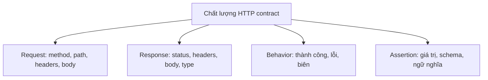
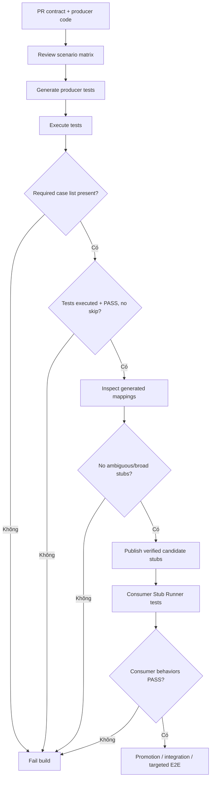

# Kiểm tra đủ nhánh thành công, lỗi và trường hợp biên

> **Chương:** Chất lượng hợp đồng  
> **Module:** Spring Cloud Contract (`SPRING_CLOUD_CONTRACT`) — học kiểm thử hợp đồng giữa producer và consumer bằng Groovy/YAML DSL cho HTTP hoặc thông điệp; thực hành sinh producer tests, phát hành stub, dùng Stub Runner và tích hợp CI để phát hiện thay đổi API không tương thích.

## Mục tiêu học tập

Sau bài học, bạn có thể:

1. Giải thích vì sao **có nhiều contract files** chưa chắc đồng nghĩa đã bao phủ những hành vi mà consumer thực sự phụ thuộc.
2. Lập **ma trận kịch bản** cho các nhánh thành công, dữ liệu hợp lệ ở biên, đầu vào không hợp lệ, lỗi nghiệp vụ, lỗi hệ thống và lỗi bảo mật khi liên quan.
3. Dùng **phân hoạch tương đương, phân tích giá trị biên và bảng quyết định** để chọn một tập hợp hợp đồng ít nhưng có ý nghĩa.
4. Viết các HTTP contracts **YAML/Groovy** phân biệt được request, response status, headers, body và error code, tránh stub mappings trùng hoặc quá rộng.
5. Hiểu điểm khác nhau giữa lỗi `400`, `401`, `403`, `404`, `409`, `422`, `429`, `503`; không lấy HTTP status chỉ vì "trông hợp lý".
6. Dùng **matchers** chỉ cho trường động, trong khi vẫn giữ kiểu, bất biến và các giá trị nghiệp vụ cần được xác minh.
7. Kiểm tra phía **producer bằng generated tests** và phía **consumer bằng client thật + Stub Runner**, nhận diện nơi cần thêm unit, security, component hoặc integration tests.
8. Đánh giá các trạng thái messaging như có sự kiện, không phát sự kiện, lỗi xử lý, event trùng lặp và backlog mà không nhầm stub với broker thật.
9. Thử **mutation/negative tests** để xem mỗi hợp đồng có làm build đỏ khi producer phá hành vi hay không.
10. Thiết kế một **quality gate CI** vừa bảo đảm các kịch bản quan trọng hiện diện và đã chạy, vừa tránh chạy toàn bộ trường hợp biên nặng nề qua E2E.

## 1. Chất lượng hợp đồng không đo bằng số dòng YAML

Giả sử `checkout-service` là consumer của `inventory-service`. Checkout cần đặt giữ hàng trước khi xử lý thanh toán:

```http
POST /api/reservations HTTP/1.1
Content-Type: application/json
Accept: application/json

{
  "sku": "SKU-001",
  "units": 2
}
```

Một contract chỉ kiểm tra `units: 2` được chấp nhận:

```http
HTTP/1.1 201 Created
Content-Type: application/json

{
  "reservationId": "RSV-DEMO-002",
  "sku": "SKU-001",
  "units": 2,
  "status": "RESERVED"
}
```

Đây là một bằng chứng hữu ích nhưng chưa đủ. Hệ thống có thể sai ở các nhánh:

- `units = 0` hoặc số âm vẫn được chấp nhận.
- `units = 4` (đúng số tồn kho) bị từ chối vì dùng `<` thay vì `<=`.
- `units = 5` (vượt tồn kho) vẫn được đặt vì thiếu kiểm tra.
- `sku` bị thiếu hoặc không tồn tại nhưng service trả `201`.
- Producer trả đúng `201` nhưng thiếu `reservationId`.
- Producer dùng JSON string `"2"` thay cho number `2`.
- Consumer không xử lý `409 INSUFFICIENT_STOCK` và tiếp tục thu tiền.
- Việc lặp request làm tạo hai reservation khi yêu cầu idempotency chưa được thỏa thuận.
- Tình huống upstream tạm thời lỗi `503` khiến consumer retry không giới hạn.

Một tập hợp contract chất lượng cần bảo vệ **những lời hứa đã được thống nhất với consumer**, đặc biệt ở nơi có thay đổi nhánh, dữ liệu biên hoặc xử lý lỗi.

**Cần phân biệt:** Spring Cloud Contract không tự bảo đảm "test coverage 100%". Nó kiểm chứng **các interactions được mô tả**, không tự khám phá mọi state và nhánh trong code.

### 1.1. Điều gì được gọi là "đủ"?

"Đủ" phụ thuộc vào **rủi ro và nhu cầu của consumer**, không phải một con số 10 hay 100 contracts cho mọi API. Một tập hợp tốt cần trả lời:

1. Tất cả **đường thành công mà consumer sử dụng** đã có hợp đồng?
2. Tất cả **trường hợp lỗi consumer phải hiểu để ra quyết định** đã được mô tả?
3. Các **giá trị biên làm đổi kết quả nghiệp vụ** đã có ví dụ?
4. Contract có khẳng định đúng **status, header, body, loại dữ liệu và ý nghĩa trường**?
5. Producer tests đã **thực sự chạy** trên code liên quan?
6. Consumer tests đã gọi **adapter/handler thật** với stubs từ producer?
7. Những rủi ro ngoài contract đã có unit/integration/security tests ở tầng thích hợp?

Không nên làm một contract cho mọi số nguyên từ 1 đến 1.000.000. Hãy chọn **điểm ranh giới và các lớp tương đương**, rồi để unit/property-based tests bao phủ không gian dữ liệu rộng hơn.

## 2. Phân biệt các loại coverage

| Khái niệm | Đo cái gì? | Có thể bảo vệ gì? | Không tự bảo vệ |
| --- | --- | --- | --- |
| **Code coverage** | Line/branch của code đã được thực thi | Phần implementation đã chạy | API contract đúng hoặc assertions đủ mạnh |
| **Contract count** | Số contract definitions | Mức độ khai báo interactions | Các nhánh quan trọng có bị bỏ sót không |
| **Scenario coverage** | Các nhóm hành vi đã có test | Success, lỗi, biên, quyền truy cập | Mọi giá trị đầu vào khả dĩ |
| **Consumer dependency coverage** | Các field/status/headers consumer thật sự dùng | Tương thích những consumer được hỗ trợ | Consumer chưa khai báo hoặc không được biết đến |
| **Mutation sensitivity** | Khi phá một lời hứa, test có đỏ không | Chất lượng assertion/gate | Đầy đủ mọi lỗi production |
| **Deployment coverage** | Đường hệ thống thật đã được E2E/integration test | Routing, DB, broker, security | Mọi error/schema case đã có contract |

**Không đồng nhất line coverage với contract quality.** Một generated test có thể đi qua controller và giúp tăng coverage nhưng vẫn bỏ qua field `status` hoặc `quantity` mà checkout phụ thuộc.

### 2.1. Bốn chiều của một hợp đồng HTTP



Ví dụ một contract "trả 201" nhưng không khẳng định response body **không đủ** nếu consumer cần `reservationId` để tiếp tục thanh toán. Ngược lại, kiểm tra body chi tiết nhưng quên `Content-Type` có thể không phát hiện thay đổi content negotiation.

## 3. Xác định quy tắc nghiệp vụ trước khi chọn trường hợp biên

Trong bài, ta định nghĩa các quy tắc **của ứng dụng minh họa**, không coi chúng là quy tắc mặc định của Spring Cloud Contract:

- `SKU-001` có **4 đơn vị còn có thể giữ** tại thời điểm fixture.
- Request `POST /api/reservations` chứa `sku` và `units`.
- `units` phải là **số nguyên dương**, ít nhất 1.
- Khi `1 <= units <= availableUnits`, producer trả `201 Created` cùng reservation hợp lệ.
- Khi `units <= 0` hoặc thiếu dữ liệu bắt buộc, producer trả `400 Bad Request` cùng `code: INVALID_REQUEST`.
- Khi `units > availableUnits`, producer trả `409 Conflict` cùng `code: INSUFFICIENT_STOCK`.
- Khi `sku` không tồn tại, producer trả `404 Not Found` cùng `code: SKU_NOT_FOUND`.
- JSON response có `Content-Type: application/json`; `units` là number, không phải string.
- Hợp đồng **chưa** cam kết retry/idempotency hoặc timeout. Khi cần, phải thương lượng, thiết kế thêm và test ở tầng phù hợp.

Với luật này, ta có thể chọn các boundary examples mà không cần tự suy "số 4 có nghĩa gì".

### 3.1. Điểm ranh giới được xác định từ điều kiện

Nếu quyết định là:

```java
boolean validQuantity(int units, int available) {
    return units >= 1 && units <= available;
}
```

với `available = 4`, các giá trị quan trọng:

| Giá trị `units` | Lý do chọn | Kết quả theo hợp đồng |
| --- | --- | --- |
| `-1` | Ngay dưới vùng hợp lệ về phía 0 | 400 |
| `0` | Ngay dưới cận dưới 1 | 400 |
| `1` | Đúng cận dưới | 201 |
| `2` | Một giá trị bình thường bên trong | 201 |
| `4` | Đúng cận trên | 201 |
| `5` | Ngay trên cận trên | 409 |
| Rất lớn | Overflow, giới hạn kiểu hoặc validation | Test ở tầng phù hợp và định nghĩa behavior |

Đây là minh họa kỹ thuật **boundary value analysis**: chú ý `b - 1`, `b` và `b + 1` quanh mỗi ngưỡng. Với kiểu dữ liệu và ràng buộc khác, các giá trị cần chọn có thể là chuỗi rỗng, `null`, missing field, ngày cuối tháng, giới hạn length hoặc kích thước collection.

### 3.2. Phân hoạch tương đương

Có thể chia đầu vào thành các lớp:

1. **Valid, below stock:** `units` thuộc `[1,3]`.
2. **Valid, exactly stock:** `units = 4`.
3. **Invalid quantity:** `units <= 0`.
4. **Conflict stock:** `units >= 5` với SKU còn 4.
5. **Invalid schema:** thiếu `sku`, thiếu `units`, sai kiểu.
6. **Unknown resource:** `sku` không tồn tại.
7. **Not authorized:** nếu API yêu cầu xác thực và consumer phụ thuộc response.
8. **Transient failure:** nếu đã thống nhất error semantics với consumer.

Trong **bộ contract**, có thể chọn một hoặc hai case đại diện cho mỗi lớp quan trọng. Trong **unit/property tests**, chạy nhiều case hơn để bắt lỗi công thức và giới hạn kiểu.

### 3.3. Không áp một ma trận khổng lồ lên mọi endpoint

Một GET chỉ đọc danh mục có thể cần `200`, `404` và phân trang. Một POST reservation cần validation, conflict và idempotency. Một OAuth endpoint cần 401/403/scope. Ma trận phải phản ánh **hành vi thật của endpoint**, không sao chép máy móc mọi mã 4xx/5xx có trong HTTP.

## 4. Ma trận success–error–boundary cho một API

| ID | Tình huống | Request đặc trưng | Status | Invariant cần assert | Tầng ưu tiên |
| --- | --- | --- | --- | --- | --- |
| `RSV-01` | Bình thường | `SKU-001, units=2` | 201 | `reservationId`, `units=2`, `status=RESERVED` | Contract |
| `RSV-02` | Cận dưới | `units=1` | 201 | Không từ chối giá trị tối thiểu | Contract + unit |
| `RSV-03` | Cận trên | `units=4` | 201 | Không lỗi off-by-one | Contract + unit |
| `RSV-04` | Dưới cận | `units=0` | 400 | `code=INVALID_REQUEST` | Contract khi consumer cần; unit |
| `RSV-05` | Số âm | `units=-1` | 400 | Không tạo reservation | Unit; contract chọn lọc |
| `RSV-06` | Trên cận | `units=5` | 409 | `code=INSUFFICIENT_STOCK` | Contract + unit |
| `RSV-07` | Thiếu SKU | JSON chỉ có `units` | 400 | Validation response theo cam kết | Contract chọn lọc |
| `RSV-08` | Unknown SKU | `sku=SKU-MISSING` | 404 | `code=SKU_NOT_FOUND` | Contract |
| `RSV-09` | Sai media type | `Content-Type: text/plain` | 415 nếu API cam kết | Không chấp nhận payload sai | Web/security integration |
| `RSV-10` | Không có auth | Thiếu token | 401 nếu API bảo vệ | Không tiết lộ dữ liệu | Security integration |
| `RSV-11` | Thiếu scope | Test identity thiếu quyền | 403 | Không được phép giữ hàng | Security integration |
| `RSV-12` | Upstream tạm thời không sẵn sàng | Fixture lỗi được kiểm soát | 503 nếu được cam kết | Consumer phân biệt lỗi tạm thời | Adapter/contract tùy policy |
| `RSV-13` | Request trùng | Cùng idempotency key | Theo thỏa thuận | Không tạo side effect trùng | Component/integration |
| `RSV-14` | Response field động | Reservation ID mới mỗi lần | 201 | Đúng UUID/định dạng, không rỗng | Contract matcher |

**Đây là ma trận thiết kế**, không khẳng định `inventory-service` hiện tại đã thực thi tất cả. Không tạo contract 415, 401, 403 hay 503 khi producer chưa cam kết chúng; hãy xác định error contract và implementation trước.

### 4.1. Ưu tiên theo rủi ro

Khi thời gian có hạn, hỏi:

- Consumer cần giá trị/status này để quyết định **cho phép thu tiền hoặc từ chối**?
- Nếu sai, có thể gây mất tiền, lộ dữ liệu, đặt quá tồn kho hoặc tạo duplicate không?
- Nhánh này từng gây incident hoặc có tần suất gọi lớn?
- Thay đổi ở đây có thể phá một consumer khác?
- Một test giá rẻ ở unit/component layer đã bảo vệ đủ hay còn cần contract?

Rủi ro cao và phụ thuộc xuyên service → contract rõ ràng; thuật toán phức tạp nhưng không lộ qua interface → unit/property-based tests bổ sung mạnh.

## 5. Quy tắc của bộ contract tốt

Một contract cần mô tả **một interaction quan sát được**, với tên có ý nghĩa và request đủ phân biệt.

Các nguyên tắc thực hành:

1. **Mỗi scenario có tên ổn định**, ví dụ `reserve_exact_stock`, không phải `test1`.
2. **Request phân biệt được** bằng method/path/query/headers/body (nếu cần).
3. **Response status đúng ngữ nghĩa nghiệp vụ** và được cả hai nhóm chấp nhận.
4. **Field consumer dùng** được assert cụ thể, không chỉ response "có JSON".
5. **Body type** phải hợp lý; `units: 4` không phải `units: "4"`.
6. **Field động** dùng matcher phù hợp nhưng không làm yếu các invariant.
7. **Lỗi thật được mô tả** bằng status và error code ổn định, không dựa vào exception message ngẫu nhiên.
8. **Fixtures có thể reset/cô lập**, không phụ thuộc thứ tự chạy tests.
9. **Generated producer tests phải chạy**, và consumer tests phải dùng artifact đã verify.
10. **Không trùng mapping** cùng request nhưng hứa response khác nhau.

### 5.1. Vì sao tên contract quan trọng?

Tên rõ ràng giúp review coverage và đọc JUnit report:

```text
reserve_two_units
reserve_minimum_unit
reserve_exact_available_stock
reserve_zero_units_invalid
reserve_more_than_stock
reserve_unknown_sku
```

Spring Cloud Contract có thể dùng `name` khi sinh tên test/mapping. Nên tránh trùng name hoặc ký tự gây lỗi generated code; mỗi scenario phải có định danh dễ truy vết tới yêu cầu.

### 5.2. Cùng path không có nghĩa cùng request

Các case đều POST `/api/reservations`. Chúng vẫn có thể khác nhau nhờ body:

```json
{"sku":"SKU-001","units":1}
```

```json
{"sku":"SKU-001","units":4}
```

```json
{"sku":"SKU-001","units":5}
```

Tuy nhiên, nếu matcher của một mapping cho phép mọi `units` hoặc bỏ so sánh body, nó có thể **nuốt request** của mapping khác. Đó là lý do nên inspect WireMock JSON mappings sau khi generate.

## 6. Các hợp đồng YAML: thành công và biên

Các ví dụ sau đặt trong **từng file YAML riêng** trong thư mục nguồn contract của producer. Với Maven mặc định thường là `src/test/resources/contracts`; với Gradle plugin hiện đại thường là `src/contractTest/resources/contracts`.

### 6.1. Trường hợp bình thường — reserve_two_units.yml

```yaml
name: reserve_two_units
description: "Co ton kho, giu hai don vi"

request:
  method: POST
  url: /api/reservations
  headers:
    Content-Type: application/json
    Accept: application/json
  body:
    sku: SKU-001
    units: 2

response:
  status: 201
  headers:
    Content-Type: application/json
  body:
    reservationId: RSV-DEMO-002
    sku: SKU-001
    units: 2
    status: RESERVED
```

Contract này cam kết `201`, JSON content type, reservation ID, SKU, số lượng và trạng thái. Nó **không** nói rằng sau mỗi request thật reservation luôn có cùng ID: đây là fixture test cố định, chỉ phù hợp khi producer base test chủ động điều khiển output. Khi hệ thống sinh ID động, xem mục matchers.

### 6.2. Cận dưới — reserve_minimum_unit.yml

```yaml
name: reserve_minimum_unit
description: "Mot don vi la so luong duoc phep"

request:
  method: POST
  url: /api/reservations
  headers:
    Content-Type: application/json
    Accept: application/json
  body:
    sku: SKU-001
    units: 1

response:
  status: 201
  headers:
    Content-Type: application/json
  body:
    reservationId: RSV-DEMO-001
    sku: SKU-001
    units: 1
    status: RESERVED
```

Case này bảo vệ **cận dưới = 1**. Nếu producer lỡ đổi điều kiện thành `units > 1`, generated test phải FAIL.

### 6.3. Cận trên — reserve_exact_stock.yml

```yaml
name: reserve_exact_stock
description: "Dat dung so ton kho van thanh cong"

request:
  method: POST
  url: /api/reservations
  headers:
    Content-Type: application/json
    Accept: application/json
  body:
    sku: SKU-001
    units: 4

response:
  status: 201
  headers:
    Content-Type: application/json
  body:
    reservationId: RSV-DEMO-004
    sku: SKU-001
    units: 4
    status: RESERVED
```

Đây là **off-by-one guard** quan trọng: với `available=4`, phải chấp nhận `4`, không chỉ `1,2,3`.

**Cảnh báo fixture:** nếu producer test lưu reservation vào DB có trạng thái, mỗi generated case cần setup dữ liệu `SKU-001` ban đầu còn 4 đơn vị. Đừng để case `units=4` tiêu hết tồn kho làm case khác fail do thứ tự chạy; xem phần cô lập dữ liệu.

## 7. Các hợp đồng YAML: request không hợp lệ và lỗi nghiệp vụ

### 7.1. Dưới cận dưới — reserve_zero_units.yml

```yaml
name: reserve_zero_units
description: "So luong bang 0 khong hop le"

request:
  method: POST
  url: /api/reservations
  headers:
    Content-Type: application/json
    Accept: application/json
  body:
    sku: SKU-001
    units: 0

response:
  status: 400
  headers:
    Content-Type: application/json
  body:
    code: INVALID_REQUEST
    message: units must be positive
```

Đây là **API policy của ví dụ**, không phải default error body của Spring MVC. Để producer verification PASS cần validation + exception handler trả **đúng JSON** `code` và `message`.

Nếu consumer chỉ cần `code`, việc assert message tiếng Anh từng byte có thể làm contract giòn. Khi đó hãy trao đổi giữa hai nhóm: có thật cần message cố định không? Có thể tập trung vào code và bỏ message khỏi contract, hoặc dùng matcher có điều kiện.

### 7.2. Vượt tồn kho — reserve_more_than_stock.yml

```yaml
name: reserve_more_than_stock
description: "Ton kho 4, yeu cau 5 la conflict"

request:
  method: POST
  url: /api/reservations
  headers:
    Content-Type: application/json
    Accept: application/json
  body:
    sku: SKU-001
    units: 5

response:
  status: 409
  headers:
    Content-Type: application/json
  body:
    code: INSUFFICIENT_STOCK
    message: Not enough stock to reserve
```

Lỗi này **khác 400**:

- `400`: request không hợp lệ (số lượng 0 hoặc âm).
- `409`: request hợp lệ về hình thức nhưng **xung đột trạng thái tồn kho**.

Nếu producer chọn `422` hoặc một status khác cho insufficient stock, cả hai nhóm phải **thỏa thuận và định nghĩa nhất quán**. Spring Cloud Contract không tự quyết định một lỗi nghiệp vụ dùng status nào.

### 7.3. SKU không tồn tại — reserve_unknown_sku.yml

```yaml
name: reserve_unknown_sku
description: "SKU khong ton tai"

request:
  method: POST
  url: /api/reservations
  headers:
    Content-Type: application/json
    Accept: application/json
  body:
    sku: SKU-MISSING
    units: 2

response:
  status: 404
  headers:
    Content-Type: application/json
  body:
    code: SKU_NOT_FOUND
    message: SKU does not exist
```

Không nhầm **SKU không tồn tại** với **SKU có mặt nhưng hết hàng**. Consumer có thể hiển thị thông điệp khác nhau và không nên xử lý cả hai như một case `available=false`.

### 7.4. Thiếu trường bắt buộc — reserve_missing_sku.yml

```yaml
name: reserve_missing_sku
description: "Thieu sku trong request"

request:
  method: POST
  url: /api/reservations
  headers:
    Content-Type: application/json
    Accept: application/json
  body:
    units: 2

response:
  status: 400
  headers:
    Content-Type: application/json
  body:
    code: INVALID_REQUEST
    message: sku is required
```

Với JSON request thiếu `sku`, test được sinh phải gửi một body **không có field này**, không tự thêm một chuỗi rỗng. `null`, field absent và `""` có thể được framework validate khác nhau; hãy quyết định case nào consumer cần và case nào để unit/controller integration tests.

### 7.5. Có cần contract cho số âm và null không?

Có thể, nhưng không cần tạo hàng chục contract nếu chúng chỉ xác minh cùng một validation rule và consumer không phân biệt. Ví dụ:

- Unit/controller integration tests: `-1`, `Integer.MIN_VALUE`, `null`, missing, string thay number, array thay number, decimal `1.5`.
- Shared consumer contract: một `units=0` đại diện cho `INVALID_REQUEST` và một `units=5` đại diện cho `INSUFFICIENT_STOCK`.
- Contract bổ sung: nếu consumer **phân biệt** mã lỗi cho kiểu dữ liệu không hợp lệ, hoặc từng có breaking change tại đây.

**Tập hợp contract nên nhỏ và đủ nghĩa**, còn kiểm tra đầu vào diện rộng phù hợp hơn với parameterized/property-based tests.

## 8. Groovy DSL biểu diễn cùng một interaction

Để hiểu hai DSL, dưới đây là **bản thay thế Groovy** cho case `reserve_more_than_stock`:

```groovy
org.springframework.cloud.contract.spec.Contract.make {
    name 'reserve_more_than_stock'

    request {
        method 'POST'
        url '/api/reservations'
        headers {
            contentType(applicationJson())
            header 'Accept': 'application/json'
        }
        body(
            sku: 'SKU-001',
            units: 5
        )
    }

    response {
        status 409
        headers {
            contentType(applicationJson())
        }
        body(
            code: 'INSUFFICIENT_STOCK',
            message: 'Not enough stock to reserve'
        )
    }
}
```

Groovy DSL có thể mô tả multiple contracts trong một file bằng cách trả về list, nhưng bài thực hành này dùng **mỗi file một contract** để dễ đếm và review.

**Không đặt bản YAML và Groovy tương đương cùng một lượt scan** rồi mong có đúng một scenario; chúng có thể sinh hai tests/mappings và khiến báo cáo coverage sai.

### 8.1. Tránh ký hiệu quá ngắn, không có ngữ nghĩa

Một contract:

```groovy
Contract.make {
    request {
        method 'POST'
        url '/api/reservations'
    }
    response {
        status 200
    }
}
```

chỉ bảo vệ một phần nhỏ, vì:

- Request body không được ràng buộc.
- Không kiểm tra media type.
- Không kiểm tra code/body khi lỗi.
- Status 200 có thể trái lời hứa 201 của API.
- Không bảo vệ dữ liệu consumer thật sự dùng.

Một "test pass" dựa vào contract này không cho phép kết luận "nhánh reservation đã đủ chất lượng".

## 9. Matcher: không quá chặt, cũng không quá rộng

Producer thực có thể tạo `reservationId` mới mỗi lần. Nếu contract cố định `RSV-DEMO-002` nhưng test không kiểm soát sequence, generated test dễ flaky.

Một thiết kế thường gặp là dùng **UUID mẫu giả** và matcher chỉ cho field động:

```yaml
name: reserve_two_units_dynamic_id
request:
  method: POST
  url: /api/reservations
  headers:
    Content-Type: application/json
    Accept: application/json
  body:
    sku: SKU-001
    units: 2

response:
  status: 201
  headers:
    Content-Type: application/json
  body:
    reservationId: 84fe2261-2afb-4d3c-8f3a-79f820805ac2
    sku: SKU-001
    units: 2
    status: RESERVED
  matchers:
    body:
      - path: $.reservationId
        type: by_regex
        predefined: uuid
```

**Đây là phương án thay thế** cho `reserve_two_units.yml` khi ID thực là UUID. Không chạy đồng thời hai contract có **cùng request** nhưng ID/response mapping khác nhau: chọn một lời hứa nhất quán rồi bỏ bản trùng.

### 9.1. Chỉ field thật sự động mới được nới

Trong ví dụ:

- `reservationId`: UUID mới, matcher theo `uuid`.
- `sku`: vẫn phải đúng `SKU-001`.
- `units`: vẫn phải đúng `2`.
- `status`: vẫn phải đúng `RESERVED`.
- HTTP `201` và `Content-Type`: giữ nguyên.

Nếu thay mọi assertion bằng `by_type`, producer có thể trả `units=999` và generated test vẫn không phát hiện vi phạm logic.

### 9.2. Mỗi kiểu matcher có một ý nghĩa

| Matcher | Công dụng | Rủi ro nếu lạm dụng |
| --- | --- | --- |
| `by_equality` | Khẳng định giá trị quan trọng | Quá chặt với timestamp/ID động |
| `by_regex` | Định dạng UUID, timestamp, code | Regex `.*` bỏ hầu hết kiểm tra |
| `by_type` | Kiểu JSON, kích thước collection khi cấu hình đúng | Không kiểm tra giá trị nghiệp vụ |
| `by_null` | Khẳng định field là null | Không thay thế kiểm tra absent |
| `by_command` | Delegate assertion đặc thù cho method của test | Phụ thuộc custom code, cần kiểm tra chính method ấy |
| `minOccurrence/maxOccurrence` | Giới hạn kích thước collection | Không tự đảm bảo nội dung từng phần tử |

Với YAML, `response.matchers.body` định nghĩa cách generated producer tests xác minh response. Với `request.matchers.body`, nó ảnh hưởng cách WireMock stub nhận request. **Matcher request và matcher response không cùng nhiệm vụ.**

### 9.3. Ví dụ kiểm tra kiểu và giá trị

Nếu response có field `available` kiểu boolean động theo dữ liệu nhưng luôn phải đúng kiểu:

```yaml
response:
  status: 200
  body:
    sku: SKU-001
    available: true
    quantity: 4
  matchers:
    body:
      - path: $.available
        type: by_type
```

Đoạn trên là **fragment** cho API có `available`, không ghép chung vào file reservation khác. `by_type` không tự chứng minh `available=true` cho SKU cụ thể. Nếu Checkout cần biết SKU-001 **chắc chắn còn hàng** ở fixture này, equality `true` mạnh hơn và nên được giữ.

### 9.4. Kiểm tra số lượng phần tử JSON array

Nếu API trả danh sách reservation, `by_type` với `minOccurrence`/`maxOccurrence` có thể được dùng trong DSL. Tuy nhiên tài liệu Spring Cloud Contract cũng lưu ý **assert size của JSON arrays** có những giới hạn/cấu hình thử nghiệm ở một số phiên bản. Phải kiểm tra generated test thực tế, không suy rằng chỉ cấu hình matcher là đã bảo vệ chính xác array length.

Nếu thứ tự array là ngữ nghĩa nghiệp vụ, một matcher chỉ kiểm tra kiểu/kích thước không đủ: bổ sung assert order/id tương ứng ở contract hoặc integration tests.

## 10. Lỗi HTTP: không cố bao phủ mọi status code

Một danh sách phân loại tham khảo:

| Status | Ngữ nghĩa phổ biến | Khi có contract |
| --- | --- | --- |
| `200 OK` | Trả dữ liệu thành công | GET/query hoặc POST trả kết quả theo API |
| `201 Created` | Tạo resource thành công | POST reservation tạo mới; xem body/Location nếu cam kết |
| `202 Accepted` | Đã nhận để xử lý bất đồng bộ | Consumer cần poll trạng thái hoặc chờ event |
| `204 No Content` | Thành công, không trả body | DELETE/cập nhật theo policy; không nên assert JSON body |
| `400 Bad Request` | Request không hợp lệ | Consumer phải hiển thị/sửa input |
| `401 Unauthorized` | Chưa xác thực | Consumer thực hiện login/refresh theo policy |
| `403 Forbidden` | Có identity nhưng thiếu quyền | Consumer từ chối thao tác |
| `404 Not Found` | Resource không tồn tại | Consumer báo thiếu SKU |
| `409 Conflict` | Xung đột với trạng thái hiện tại | Đặt quá tồn kho, optimistic locking |
| `422 Unprocessable Content` | Dữ liệu có ngữ nghĩa không xử lý được theo thiết kế API | Khi producer thực sự cam kết status này |
| `429 Too Many Requests` | Rate limit | Consumer thực hiện backoff đúng policy |
| `500 Internal Server Error` | Lỗi server | Không dựa vào chi tiết stack trace |
| `503 Service Unavailable` | Tạm không sẵn sàng | Retry/fallback khi được thỏa thuận |

**Không tạo contract `401/403` chỉ vì endpoint có Spring Security nếu generated test setup đang tắt filter**. Contract có thể mô tả response, nhưng cần security integration test mới chứng minh **policy thật**.

### 10.1. 200 và 201 không hoán đổi tùy tiện

Nếu consumer chờ `201` để lấy `reservationId`, producer đổi thành `200` có thể phá client so status chính xác. Phải có contract đúng status đã chấp nhận.

### 10.2. 204 không có body

Nếu API chọn `204`, không đưa JSON vào response contract chỉ để "có đủ field" — đó là tự tạo lời hứa không tương thích HTTP semantics. Khi consumer cần response data thì thỏa thuận status/body phù hợp.

### 10.3. 400 và 422 là quyết định thiết kế

Một số API dùng 422 cho validation/business errors. Spring MVC với Bean Validation thường có phản hồi 400 mặc định khi request invalid, nhưng **response format** còn phụ thuộc controller advice. Team nên chọn **một quy tắc nhất quán**; contract test phải kiểm chứng quy tắc đã được chấp nhận, không quyết định ngầm.

## 11. Validation, missing, null và kiểu dữ liệu

Các request sau khác nhau:

```json
{"sku":"SKU-001","units":0}
```

```json
{"sku":"SKU-001","units":null}
```

```json
{"sku":"SKU-001"}
```

```json
{"sku":"SKU-001","units":"2"}
```

```json
{"sku":"SKU-001","units":2.5}
```

| Case | Nguy cơ | Tầng kiểm tra phù hợp |
| --- | --- | --- |
| `0` | Cận dưới bị sai | Unit + contract đại diện |
| `null` | Mapping tới primitive/object khác nhau | Validation integration; contract nếu consumer phụ thuộc |
| Missing | Mặc định thành 0/null, validation không chạy | Controller integration/contract chọn lọc |
| String thay number | JSON mapper có thể coerce ngầm | Strict DTO/schema integration + producer tests |
| Decimal thay integer | Có thể bị làm tròn hoặc từ chối | Unit/serialization integration |
| Integer quá lớn | Overflow hoặc `400` | Property-based/integration tests |
| Chuỗi rỗng `sku=""` | `@NotBlank` so `@NotNull` | Validation integration |
| Unicode, newline trong SKU | Security/encoding/validation | Unit/web/security integration |

### 11.1. Tránh khẳng định quá mức từ DTO Java

Nếu code dùng:

```java
public record ReservationRequest(
    String sku,
    int units
) {}
```

thì `int` không thể là null trong Java nhưng JSON thiếu `units` có thể được deserialize thành giá trị mặc định tùy cấu hình Jackson, dẫn tới khác biệt giữa `missing` và `0`.

Muốn phát hiện thiếu field một cách rõ ràng, có thể dùng `Integer` và ràng buộc `@NotNull` + `@Min(1)`, hoặc cấu hình strict deserialization. Cần có integration test với ObjectMapper thật của ứng dụng.

### 11.2. Một giá trị boundary phải gắn với quy tắc

Không phải API nào cũng cho phép `units=4`. Trong ví dụ này nó là cận trên vì fixture có availableUnits=4; trong production số tồn kho thay đổi theo thời gian. **Đừng hard-code availableUnits=4 như một invariant toàn hệ thống** — nó chỉ là dữ liệu fixture để kiểm tra điều kiện.

## 12. Producer implementation đủ để verification có ý nghĩa

Một controller học tập triển khai phần chính, dùng Java 17+ và Spring MVC. Các lỗi cần error body thống nhất.

```java
package com.example.inventory;

import jakarta.validation.Valid;
import jakarta.validation.constraints.Min;
import jakarta.validation.constraints.NotBlank;
import jakarta.validation.constraints.NotNull;
import org.springframework.http.HttpStatus;
import org.springframework.http.MediaType;
import org.springframework.http.ResponseEntity;
import org.springframework.web.bind.annotation.*;

@RestController
@RequestMapping("/api/reservations")
public class ReservationController {

    @PostMapping(
        consumes = MediaType.APPLICATION_JSON_VALUE,
        produces = MediaType.APPLICATION_JSON_VALUE
    )
    public ResponseEntity<ReservationResponse> reserve(
            @Valid @RequestBody ReservationRequest request) {

        if (!"SKU-001".equals(request.sku())) {
            throw new SkuNotFoundException();
        }

        if (request.units() > 4) {
            throw new InsufficientStockException();
        }

        ReservationResponse response = new ReservationResponse(
            "RSV-DEMO-" + String.format("%03d", request.units()),
            request.sku(),
            request.units(),
            "RESERVED"
        );

        return ResponseEntity
            .status(HttpStatus.CREATED)
            .body(response);
    }

    public record ReservationRequest(
        @NotBlank String sku,
        @NotNull @Min(1) Integer units
    ) {}

    public record ReservationResponse(
        String reservationId,
        String sku,
        int units,
        String status
    ) {}
}
```

Để biên dịch snippet trên, cần định nghĩa `SkuNotFoundException` và `InsufficientStockException` (ví dụ `RuntimeException` đơn giản) và thêm dependency `spring-boot-starter-validation`. Dùng `Integer` để phân biệt `null/missing` với giá trị `0` ở mức validation.

**Đây là fixture code phục vụ bài học**, không phải implementation tồn kho production: nó không giữ/khóa bản ghi DB, không quản lý concurrency và không thực sự trừ stock. Những hành vi stateful phải có component/integration tests riêng.

### 12.1. Error handler theo hợp đồng

```java
package com.example.inventory;

import org.springframework.http.HttpStatus;
import org.springframework.http.ResponseEntity;
import org.springframework.web.bind.MethodArgumentNotValidException;
import org.springframework.web.bind.annotation.ExceptionHandler;
import org.springframework.web.bind.annotation.RestControllerAdvice;

@RestControllerAdvice
public class ReservationErrorAdvice {

    @ExceptionHandler(InsufficientStockException.class)
    ResponseEntity<ApiError> notEnoughStock() {
        return ResponseEntity.status(HttpStatus.CONFLICT)
            .body(new ApiError(
                "INSUFFICIENT_STOCK",
                "Not enough stock to reserve"
            ));
    }

    @ExceptionHandler(SkuNotFoundException.class)
    ResponseEntity<ApiError> skuMissing() {
        return ResponseEntity.status(HttpStatus.NOT_FOUND)
            .body(new ApiError(
                "SKU_NOT_FOUND",
                "SKU does not exist"
            ));
    }

    @ExceptionHandler(MethodArgumentNotValidException.class)
    ResponseEntity<ApiError> invalid(
            MethodArgumentNotValidException ex) {
        String message = ex.getBindingResult().getFieldErrors()
            .stream()
            .anyMatch(e -> "sku".equals(e.getField()))
            ? "sku is required"
            : "units must be positive";

        return ResponseEntity.badRequest()
            .body(new ApiError("INVALID_REQUEST", message));
    }

    public record ApiError(String code, String message) {}
}
```

Hai exception types `SkuNotFoundException` và `InsufficientStockException` cần do project định nghĩa. Đoạn handler chủ yếu minh họa **response shape ổn định**, không phải cơ chế phân loại mọi lỗi production: trong hệ thật, cần phân biệt lỗi khác do body malformed, JSON decode exception và validation type mismatch.

Với case thiếu `sku` hoặc `units=0`, `@Valid` kết hợp handler trên tạo body ví dụ. Với JSON sai cú pháp/kiểu không deserialize được, Spring có thể ném `HttpMessageNotReadableException`; muốn API cũng trả `INVALID_REQUEST`, cần thêm handler cụ thể và contract nếu consumer cần.

### 12.2. Base test: dùng controller và advice thật

Một base test producer qua Spring MVC context:

```java
package com.example.inventory;

import io.restassured.module.mockmvc.RestAssuredMockMvc;
import org.junit.jupiter.api.BeforeEach;
import org.springframework.beans.factory.annotation.Autowired;
import org.springframework.boot.test.autoconfigure.web.servlet.AutoConfigureMockMvc;
import org.springframework.boot.test.context.SpringBootTest;
import org.springframework.web.context.WebApplicationContext;

@SpringBootTest
@AutoConfigureMockMvc
public abstract class ContractTestBase {

    @Autowired
    WebApplicationContext context;

    @BeforeEach
    public void setup() {
        RestAssuredMockMvc.webAppContextSetup(context);
    }
}
```

Đây là một biến thể dành cho producer có Spring MVC. Cần cấu hình Maven/Gradle plugin `testMode=MOCKMVC`, `baseClassForTests`, dependency Verifier, JUnit 5 và application context hợp lệ. Đối với Spring Boot khác phiên bản, test import packages có thể thay đổi; chọn các phiên bản Spring Boot/Spring Cloud Contract tương thích.

**Không mock chính `ReservationController` hoặc `ReservationErrorAdvice` trong producer contract verification.** Làm vậy generated tests có thể chỉ kiểm tra fixture giả do test viết, không bảo vệ implementation.

## 13. Consumer Stub Runner phải kiểm tra cách xử lý mọi nhánh cần dùng

Một consumer contract test không chỉ gọi stub URL rồi assert nó trả 201. Nó phải chạy **HTTP adapter thật** hoặc service consumer đọc response.

Giả sử consumer có `InventoryReservationClient` gọi `POST /api/reservations` và map lỗi `409` sang `StockConflictException`:

```java
package com.example.checkout;

import org.springframework.beans.factory.annotation.Value;
import org.springframework.http.MediaType;
import org.springframework.stereotype.Component;
import org.springframework.web.client.RestClient;
import org.springframework.web.client.RestClientResponseException;

@Component
public class InventoryReservationClient {

    private final RestClient http;

    public InventoryReservationClient(
            RestClient.Builder builder,
            @Value("${inventory.base-url}") String baseUrl) {
        http = builder.baseUrl(baseUrl).build();
    }

    public Reservation reserve(String sku, int units) {
        try {
            Reservation result = http.post()
                .uri("/api/reservations")
                .contentType(MediaType.APPLICATION_JSON)
                .accept(MediaType.APPLICATION_JSON)
                .body(new ReservationRequest(sku, units))
                .retrieve()
                .body(Reservation.class);

            if (result == null) {
                throw new IllegalStateException("Empty reservation body");
            }
            return result;
        } catch (RestClientResponseException e) {
            if (e.getStatusCode().value() == 409) {
                throw new StockConflictException(e);
            }
            throw e;
        }
    }

    public record ReservationRequest(String sku, int units) {}
    public record Reservation(
        String reservationId,
        String sku,
        int units,
        String status
    ) {}

    public static class StockConflictException
            extends RuntimeException {
        public StockConflictException(Throwable cause) {
            super("Inventory has insufficient stock", cause);
        }
    }
}
```

Đây là **mẫu client** cho Spring Framework `RestClient` (Spring Framework 6.1+). Nó map status `409` chứ chưa parse `code: INSUFFICIENT_STOCK`; trong ứng dụng có nhiều loại conflict, nên đọc error body và xác minh `code` để không lẫn các lỗi 409 khác nhau.

### 13.1. Consumer test với verified stubs

Giả sử producer đã verify/publish `com.example:inventory-service:1.0.0:stubs` vào Maven local của runner:

```java
package com.example.checkout;

import org.junit.jupiter.api.Test;
import org.springframework.beans.factory.annotation.Autowired;
import org.springframework.boot.test.context.SpringBootTest;
import org.springframework.cloud.contract.stubrunner.spring.AutoConfigureStubRunner;
import org.springframework.cloud.contract.stubrunner.spring.StubRunnerProperties;

import static org.junit.jupiter.api.Assertions.*;

@SpringBootTest(
    properties = "inventory.base-url=http://localhost:8090"
)
@AutoConfigureStubRunner(
    ids = "com.example:inventory-service:1.0.0:stubs:8090",
    stubsMode = StubRunnerProperties.StubsMode.LOCAL
)
class ReservationConsumerContractTest {

    @Autowired
    InventoryReservationClient client;

    @Test
    void acceptsLowerAndUpperValidBoundaries() {
        assertEquals(1, client.reserve("SKU-001", 1).units());
        assertEquals(4, client.reserve("SKU-001", 4).units());
    }

    @Test
    void mapsInsufficientStockIntoDomainException() {
        assertThrows(
            InventoryReservationClient.StockConflictException.class,
            () -> client.reserve("SKU-001", 5)
        );
    }
}
```

Điều kiện: producer stubs JAR đúng version đã được cài, consumer có các Spring Boot/Stub Runner test dependencies, cổng 8090 đang rảnh và application context không tự gọi production collaborators. Trong CI chạy song song, ưu tiên port động với `StubFinder.findStubUrl(...)` hoặc cơ chế inject tương ứng.

Với case `units=0`, client ứng dụng có thể **tự từ chối trước khi gọi upstream**, khi đó test ở tầng consumer unit/validation phù hợp hơn; không bắt buộc mọi validation contract được gọi từ một consumer test. Producer vẫn có thể kiểm chứng error API riêng nếu nó là một phần giao diện được cam kết.

### 13.2. Vì sao cần assert behavior chứ không chỉ HTTP status?

Nếu consumer `CheckoutService` nhận lỗi 409 nhưng vẫn tạo thanh toán, API contract có thể đúng mà hành trình nghiệp vụ sai. Consumer integration test cần assert **không tiến hành thanh toán/giữ đơn** khi nhận domain exception.

Contract bảo vệ đường dữ liệu; component/unit test của consumer bảo vệ hành động sau khi nhận dữ liệu.

## 14. Kiểm tra cả request matching và mapping ambiguity

Nếu có ba mappings cho cùng `POST /api/reservations` nhưng một mapping chỉ match method/path, WireMock có thể chọn mapping chung thay vì mapping theo body.

Ví dụ nguy hiểm:

```json
{
  "request": {
    "method": "POST",
    "url": "/api/reservations"
  },
  "response": {
    "status": 201,
    "body": "{\"status\":\"RESERVED\"}"
  }
}
```

Mapping này có thể trả `201` cho `units=0` hoặc `units=5`, làm consumer error tests thất bại hoặc che lỗi tùy setup. Không dùng `priority` như giải pháp duy nhất cho hai responses thực sự mâu thuẫn.

### 14.1. Checklist inspect mappings

Sau khi generator chạy ở project thật, mở mappings trong `*-stubs.jar` và hỏi:

- `reserve_zero_units` có request body matcher phân biệt `units=0` không?
- `reserve_more_than_stock` có phân biệt `units=5` không?
- `Content-Type` và `Accept` có được match đúng chính sách không?
- Có một mapping khác với request matcher quá rộng trùm cả hai case không?
- Priority có đang vô tình làm một mapping được chọn trước mọi case không?
- Name của contracts có đụng nhau, khiến mapping bị overwrite không?
- Nếu response có dynamic values, matcher chỉ nới đúng fields?

### 14.2. Priority không chữa lời hứa mâu thuẫn

Spring Cloud Contract hỗ trợ `priority` trên contract để ảnh hưởng độ ưu tiên mapping (số nhỏ thường ưu tiên cao). Nó có thể hữu ích cho **một ngoại lệ cụ thể hơn so với quy tắc tổng quát**, nhưng không làm cho hai responses khác nhau cho **cùng request đầy đủ** trở nên đúng về nghiệp vụ.

Nếu v1/v2 cần response khác nhau, phải phân biệt request bằng path/header/media type hoặc một quy ước versioning được chấp nhận.

## 15. Producer verification: phải sinh và thực thi đầy đủ các case quan trọng

### 15.1. Maven

Với producer Maven đã cấu hình Spring Cloud Contract plugin, `testFramework=JUNIT5`, `testMode=MOCKMVC` và `baseClassForTests`:

```bash
mvn clean verify
```

Kiểm tra:

1. Plugin tìm đúng thư mục contracts.
2. Generated test methods cho `reserve_two_units`, `reserve_minimum_unit`, `reserve_exact_stock`, `reserve_zero_units`, `reserve_more_than_stock`, `reserve_unknown_sku`, `reserve_missing_sku`.
3. Generated tests được biên dịch và thực sự chạy qua JUnit.
4. Các response/status/headers/body assertions PASS.
5. Không có test quan trọng bị ignored/inProgress/skipped.

**Đừng đếm đơn giản một YAML file = một Java class.** Spring Cloud Contract có thể nhóm nhiều contracts vào một generated class; nên so scenario names và số test cases/report.

### 15.2. Gradle

Với producer Gradle plugin hiện đại, contracts mặc định thường ở `src/contractTest/resources/contracts`, generated tests chạy bằng task riêng `contractTest`:

```bash
./gradlew clean build --console=plain
./gradlew contractTest --console=plain
```

Trong CI, phải xem test reports `build/test-results/contractTest`, không chỉ xem `build/test-results/test`. Nếu task `contractTest` báo `NO-SOURCE` hoặc bị skip, không được coi là "API đã được kiểm chứng" chỉ vì `build` xanh.

### 15.3. Cổng kiểm tra số case không được thay bằng cổng tên case

Một quality gate "có ít nhất 7 tests" có thể sai khi:

- Một scenario bắt buộc bị xóa.
- Một scenario khác sinh thêm nhiều tests và bù vào tổng.
- Một test bị ignore nhưng số test khác vẫn đủ ngưỡng.
- Test được sinh nhưng không có body assertion cần thiết.

Nên kết hợp **danh sách ID bắt buộc** (RSV-01, RSV-03, RSV-04, RSV-06, RSV-08...) với report executed case names và thử mutation.

## 16. Thử mutation để đánh giá độ nhạy của từng nhánh

Một tập hợp contract chỉ có giá trị khi nó **đỏ** trước các breaking changes tương ứng.

| Mutation thử trong producer | Hợp đồng phải fail | Vì sao |
| --- | --- | --- |
| Trả `200` thay `201` khi reserve thành công | `reserve_two_units` hoặc `reserve_exact_stock` | Sai status |
| Dùng `units < available` thay `<=` | `reserve_exact_stock` | Off-by-one cận trên |
| Chấp nhận `units=0` | `reserve_zero_units` | Thiếu validation |
| Chấp nhận `units=5` | `reserve_more_than_stock` | Không xử lý conflict |
| Bỏ `reservationId` | Success cases | Consumer thiếu định danh |
| Đổi `units` từ number sang string | Success cases nếu assertion type đủ mạnh | Sai JSON wire type |
| Trả `400` cho SKU không tồn tại | `reserve_unknown_sku` | Sai 404 |
| Đổi `INSUFFICIENT_STOCK` thành `FAILED` | `reserve_more_than_stock` | Phá error code |
| Bỏ `Content-Type` response | Các contracts cần JSON | Sai content negotiation |
| Bật mapping quá rộng ở stub | Consumer error/biên tests phải fail | Stub trả nhầm scenario |

### 16.1. Thử một lỗi tại một thời điểm

Trong nhánh thử nghiệm, đổi:

```java
if (request.units() >= 4) {
    throw new InsufficientStockException();
}
```

Thay vì điều kiện đúng `request.units() > 4`. Contract `reserve_exact_stock` phải **FAIL** cho `units=4`. Sau đó khôi phục code rồi thử mutation tiếp theo.

Không đưa mutations cố ý phá vào branch release. Mục tiêu là xác minh **tín hiệu của test pipeline**, không làm hệ thống production sai.

### 16.2. Nếu build vẫn xanh sau mutation

Kiểm tra theo thứ tự:

1. Contract source có được plugin phát hiện?
2. Generated test cho case này có được sinh?
3. Test có chạy hay bị ignored/inProgress/disabled?
4. Base class có đang dựng **producer controller/service thật**?
5. Fixture dữ liệu có đúng availableUnits=4?
6. Assertion có kiểm tra status/body cần thiết hay matcher đã nới quá rộng?
7. Report số executed cases có thực sự tăng từ 0?
8. Gradle cache/Maven build lifecycle có dùng output cũ ngoài dự kiến?

Không sửa contract theo output sai chỉ để build xanh. Nếu yêu cầu nghiệp vụ thay đổi thật, cần consumer review/versioning, không phải mutation fix bằng việc xóa assertion.

## 17. Error handling phải được kiểm chứng ở consumer

Producer trả `409` và `code=INSUFFICIENT_STOCK` là **một nửa hợp đồng**. Consumer có thể:

- Báo "không đủ hàng" và giữ nguyên trạng thái checkout.
- Đề xuất giảm số lượng.
- Không gọi payment gateway.
- Không retry vô hạn.
- Không tự coi `409` là thành công.
- Ghi log đủ chẩn đoán nhưng không lộ dữ liệu nhạy cảm.

Một consumer test nên assert **hành vi ngoài HTTP decoder**, ví dụ service không gọi collaborator thanh toán khi `InventoryReservationClient` báo `StockConflictException`.

Nếu chỉ kiểm tra WireMock trả đúng 409, ta chủ yếu đã test **stub của producer**, chưa test code consumer xử lý lỗi.

### 17.1. Không trộn 404, 409 và 503

| Response | Ý nghĩa đã thỏa thuận | Consumer nên làm |
| --- | --- | --- |
| `404 SKU_NOT_FOUND` | Không có SKU | Báo không có sản phẩm, không retry vô hạn |
| `409 INSUFFICIENT_STOCK` | Có SKU nhưng không đủ hàng | Không thanh toán, hiển thị số lượng phù hợp nếu API cung cấp |
| `400 INVALID_REQUEST` | Request không hợp lệ | Sửa validation/input, không retry cùng payload |
| `503 SERVICE_UNAVAILABLE` | Lỗi tạm thời theo contract nếu có | Retry/backoff có giới hạn, tránh tạo duplicate |
| `401/403` | Authentication/authorization | Theo auth policy, không lộ thông tin |

Một catch-all:

```java
catch (Exception error) {
    return canCheckoutAnyway();
}
```

là ví dụ **sai nguy hiểm**: các lỗi khác nhau có thể dẫn đến quyết định nghiệp vụ trái yêu cầu. Domain-specific mapping và tests rõ nhánh giúp bảo vệ consumer.

## 18. Security và rate limit: cần phân chia ranh giới test

Nếu reservation API đòi OAuth2:

- `401` khi thiếu token.
- `403` khi token có identity nhưng thiếu scope.
- `201` khi đúng scope.

Một Stub Runner mapping nhận header `Authorization: Bearer test-token` **không xác minh chữ ký/scope JWT**. Vì thế:

- **Contract:** HTTP status/error body và client header behavior đã thỏa thuận.
- **Spring Security integration:** 401/403/role/scope/tenant thực tế.
- **Gateway smoke:** đường triển khai/auth integration thực khi cần.
- **Resilience integration:** 429/503, `Retry-After`, timeout, circuit breaker, idempotency.

Nếu team không cam kết response `429` trong giao diện v1, không tự thêm contract để "đủ số status". Hãy đưa chính sách rate limit vào API documentation/review rồi chọn kịch bản có ý nghĩa.

### 18.1. Tránh test lỗi tạm thời bằng thời gian ngẫu nhiên

Không nên làm producer test phụ thuộc vào việc một server ngoài dự án "đúng lúc trả 503". Để kiểm chứng contract lỗi tạm thời, tạo **fixture/trigger có kiểm soát**, reset giữa các test. Consumer resilience test có thể dùng WireMock faults/delays, nhưng chúng không mặc nhiên là promises của producer.

## 19. Messaging: success, failure và boundary nghĩa là gì?

Spring Cloud Contract hỗ trợ messaging DSL: `input.triggeredBy`, `outputMessage.sentTo`, `headers`, `body` và `label`. Nhưng messaging **không có sẵn HTTP status 200/409**; các nhánh được định nghĩa theo event và state.

Giả sử `order-service` phát `OrderAccepted` khi đơn hợp lệ:

```yaml
name: order_accepted
label: order_accepted
input:
  triggeredBy: publishOrderAccepted()
outputMessage:
  sentTo: orders.events
  headers:
    contentType: application/json
    eventType: OrderAccepted
  body:
    eventType: OrderAccepted
    orderRef: ORDER-DEMO-001
    amount: 240000
    currency: VND
```

Đây là **contract event thành công**. Producer cần message verifier adapter/binder và fixture; consumer cần handler/binder hoặc StubTrigger được cấu hình đúng. Stub Runner không tự chạy Kafka/RabbitMQ production.

### 19.1. Ma trận messaging

| Scenario | Kỳ vọng có ý nghĩa | Tầng ưu tiên |
| --- | --- | --- |
| Order hợp lệ | Phát `OrderAccepted` với schema đã cam kết | Message contract |
| Amount = 0 | Nếu nghiệp vụ cho phép/từ chối, phản ánh đúng event behavior | Unit + contract chọn lọc |
| Amount âm | Không phát `OrderAccepted` hoặc phát rejection event **nếu đã cam kết** | Unit/component |
| Missing required field | Consumer handler từ chối/quarantine đúng policy | Consumer integration/schema |
| Event trùng | Idempotent handler, không tạo side effect trùng | Consumer component/broker integration |
| Unknown schema version | Handler xử lý theo version policy | Consumer contract/integration |
| Broker timeout | Retry/DLQ theo chính sách | Broker integration |
| Event đến không đúng thứ tự | Consumer không phá state hoặc reject phù hợp | Stateful/broker integration |
| Không phát event | Assert số event bằng 0 trong cửa sổ quan sát có kiểm soát | Producer integration/negative test |

### 19.2. Không thể chứng minh "không phát event" chỉ với outputMessage

Một contract `outputMessage` mô tả **event cần xuất hiện**. Nếu business rule là "đơn invalid thì không được phát `OrderAccepted`", bạn cần test khác kiểm tra publisher/broker fake/probe **không ghi nhận event** sau khi gọi hành vi tương ứng.

Ví dụ ý tưởng:

```java
@Test
void invalidOrderMustNotPublishAcceptedEvent() {
    // Publisher probe test-owned: không dùng topic production.
    service.accept(new OrderInput("ORDER-DEMO-002", -1));

    assertEquals(
        0,
        publisherProbe.count("OrderAccepted")
    );
}
```

Đây là **pseudocode Java theo domain**: cần `OrderInput`, service và probe do project định nghĩa. Trong flow bất đồng bộ, kiểm tra absence cần thời gian quan sát có giới hạn, setup test chắc chắn, tránh kết luận âm tính chỉ vì listener chưa kịp xử lý.

### 19.3. Event lỗi cũng cần contract nếu consumer phụ thuộc

Nếu producer cam kết phát `OrderRejected` khi tồn kho thiếu:

```yaml
name: order_rejected_insufficient_stock
label: order_rejected_insufficient_stock
input:
  triggeredBy: publishRejectedOrder()
outputMessage:
  sentTo: orders.events
  headers:
    contentType: application/json
    eventType: OrderRejected
  body:
    eventType: OrderRejected
    orderRef: ORDER-DEMO-003
    code: INSUFFICIENT_STOCK
```

Đây là **một contract độc lập** yêu cầu producer thực sự có trigger và event tương ứng. Không bổ sung chỉ vì muốn "có lỗi"; cần review semantics và bảo đảm event không mâu thuẫn với workflow.

### 19.4. Cận của schema messaging

Các giá trị biên có thể là:

- `amount = 0` so với số âm.
- Empty list vs một item vs nhiều items.
- Optional field absent/null.
- Số chữ số của money/quantity.
- Timestamp có timezone vs không timezone.
- Enum value mới.
- Version cũ còn trong backlog.
- Payload gần giới hạn kích thước broker.

Kiểm tra thông điệp có schema đúng khác với kiểm tra **broker durability, partitioning, ordering, redelivery và ACK**. Phần sau cần integration tests với broker đại diện.

## 20. Kiểm tra ma trận rủi ro thay vì tăng số files vô hạn

Một cách đo **scenario coverage có thể review** là lập danh sách scenario IDs và biết chúng được bảo vệ bằng loại test nào:

| Scenario ID | Contract source | Producer verifier | Consumer test | Bổ sung |
| --- | --- | --- | --- | --- |
| RSV-01 normal success | `reserve_two_units.yml` | Có | Có | Unit logic |
| RSV-02 lower boundary | `reserve_minimum_unit.yml` | Có | Có | Unit boundary |
| RSV-03 upper boundary | `reserve_exact_stock.yml` | Có | Có | Unit boundary |
| RSV-04 invalid zero | `reserve_zero_units.yml` | Có | Tùy consumer | Controller integration |
| RSV-06 insufficient | `reserve_more_than_stock.yml` | Có | Có | Business unit |
| RSV-08 unknown SKU | `reserve_unknown_sku.yml` | Có | Có | Repository integration |
| RSV-07 missing field | `reserve_missing_sku.yml` | Có | Tùy consumer | Validation tests |
| Auth scope | Tùy contract policy | Tùy setup | Tùy client | **Security integration** |
| Duplicate reservation | Chưa contract | Không | Không | **Component/DB integration** |
| OrderAccepted event | `order_accepted.yml` | Có | Có | Broker integration |

**Không tự động đánh dấu "Có" dựa vào tên file.** Phải kiểm tra plugin sinh đúng test, test runner chạy, assertions khớp và report có đúng scenario.

### 20.1. Chọn chỉ số coverage hữu ích

Có thể theo dõi:

- **Required scenario coverage:** số scenario ID có test đã chạy / tổng số scenario ID bắt buộc.
- **Required behavior coverage:** số điều kiện status/header/field/semantics được kiểm tra.
- **Error branch coverage:** các lỗi consumer cần phân biệt đã có contracts và consumer assertions chưa.
- **Boundary coverage:** có case sát ngưỡng quyết định nghiệp vụ chưa.
- **Mutation detection rate:** trong tập mutation thử, bao nhiêu mutation bị test bắt.
- **Consumer compatibility:** phiên bản consumer được hỗ trợ đã chạy với stub candidate nào.

Các chỉ số là **công cụ ra quyết định**, không phải metric để tối đa hóa bằng cách viết những contract trùng lặp chỉ nhằm tăng tổng số.

### 20.2. Phân loại must-have và optional

Một team có thể xếp:

- **P0:** giao diện nếu sai sẽ gây mất tiền, hỏng auth hoặc dữ liệu; bắt buộc trong PR/merge gate.
- **P1:** lỗi nghiệp vụ phổ biến và boundary; bắt buộc trước release.
- **P2:** trường hợp hiếm/robustness; ưu tiên unit/property test và nightly.
- **Exploratory:** dữ liệu lạ, fuzzing, tải cao; không nhất thiết là shared contract.

Đây là phân loại **do team tự đặt**, không phải tính năng priority severity mặc định của Spring Cloud Contract. Không nhầm nó với `priority` dùng cho WireMock mapping.

## 21. Quality gate CI: có đủ case và test phải thực thi

Một pipeline có thể theo luồng:



### 21.1. Gate ở producer

- Contract source đúng vị trí Maven/Gradle và không rỗng.
- Danh sách ID bắt buộc của ma trận có definitions.
- Generated test runner thực thi đủ case quan trọng; không có 0 generated tests.
- Các test bị `ignored`, `inProgress` hoặc `skipped` được xử lý theo chính sách, không lặng lẽ bỏ qua.
- Failure count bằng 0; body/status/header assertion thực sự tồn tại.
- Mutation mẫu khiến build đỏ khi phá logic boundary.
- Không publish `*-stubs.jar` trước verification.

### 21.2. Gate ở consumer

- Tải **đúng versioned verified stubs** theo release/candidate.
- HTTP client/handler thật đi qua Stub Runner.
- Nhánh thành công nhận response, đọc đủ các field consumer sử dụng.
- Nhánh lỗi được chuyển thành domain behavior tương ứng.
- Không bị WireMock mappings trùng/không match dẫn đến 404 khó hiểu.
- Báo cáo test có executed counts, không skip các case quan trọng.

### 21.3. Một policy manifest mô tả chất lượng

```yaml
producer: inventory-service
requiredScenarios:
  - reserve_two_units
  - reserve_minimum_unit
  - reserve_exact_stock
  - reserve_zero_units
  - reserve_more_than_stock
  - reserve_unknown_sku
  - reserve_missing_sku

qualityGate:
  requireGeneratedTests: true
  requireExecutedScenarios: true
  requiredSkipped: 0
  requiredFailures: 0
  requireCandidateStubVersion: true
```

Đây là **manifest minh họa do team tự định nghĩa**, không phải file Spring Cloud Contract tự đọc. CI cần code/script hoặc plugin phù hợp để so manifest với source/generated test names và JUnit report thật.

### 21.4. Vì sao chỉ kiểm tra số test là yếu?

Nếu một required contract bị xóa nhưng người khác thêm một contract không liên quan, tổng số tests có thể không đổi. Do đó quality gate cần kết hợp **ID scenario bắt buộc + executed test reports**, không chỉ kiểm tra số lượng.

Tuy nhiên, report mapping từ contract name sang generated test method có thể khác giữa các version. Khi thiết kế checker thực, hãy dựa vào tên generated code/report của **phiên bản plugin đang dùng** và có test cho chính checker.

## 22. Test isolation: nhiều nhánh nhưng không phụ thuộc thứ tự

Các reservation tests có thể làm thay đổi tồn kho. Nếu một test lấy hết 4 đơn vị rồi test sau yêu cầu reserve 2, kết quả sẽ phụ thuộc **thứ tự thực thi**.

### 22.1. Những cách cô lập

- Với producer base test, reset DB/fixture về `availableUnits=4` trước mỗi case.
- Với business/service tests, dùng fake repository độc lập cho từng test.
- Với Testcontainers, seed dữ liệu theo test và cleanup đúng ownership.
- Với WireMock Scenario stateful, reset state trước workflow và không chia sẻ instance giữa tests song song một cách vô kiểm soát.
- Với message broker, dùng queue/topic/consumer group test-owned và chờ async với timeout.
- Với time-based edge cases, inject `Clock` có thể kiểm soát thay vì phụ thuộc đồng hồ thật.

### 22.2. Test không được xanh nhờ dữ liệu còn sót

Nếu test trước tạo `RSV-DEMO-001`, test sau đọc lại ID này rồi PASS dù producer hiện tại không tạo reservation, đó là **false green**. Đối với dữ liệu có side effects, kiểm tra state trước/sau rõ ràng trong component tests; contract tests nên dùng fixture reset hoặc mock ở cổng ngoài sao cho output vẫn đến từ code đang kiểm chứng.

### 22.3. Không mock phần hành vi phải kiểm chứng

- Được mock payment gateway khi contract reservation không liên quan payment.
- Có thể fake repository với 4 đơn vị tồn kho nếu mục tiêu là controller/service behavior.
- Không nên mock `ReservationController` rồi trả cố định 201/409 mà bỏ toàn bộ business decisions.
- Nếu cần kiểm tra DB locking và concurrent reservations, thêm integration test; không coi một contract HTTP response là bằng chứng concurrency đúng.

## 23. Các anti-pattern thường gặp

| Anti-pattern | Vì sao yếu | Cách cải thiện |
| --- | --- | --- |
| Chỉ một happy path | Bỏ qua errors/boundaries | Scenario matrix theo rủi ro |
| Mỗi input có một contract | Chậm, trùng, khó quản lý | Equivalence partitions + unit/property tests |
| Chỉ assert status | Bỏ schema và fields consumer phụ thuộc | Assert body/header/invariants |
| Chỉ assert JSON type | Có thể sai business value | Giữ equality cho field quan trọng |
| Matcher `.*` mọi nơi | Hầu như không còn oracle | Regex giới hạn trường động |
| Dùng chung request cho hai responses | Stub ambiguity | Phân biệt body/path/header/version |
| Bỏ error contract vì "producer luôn thành công" | Consumer thiếu fallback | Case lỗi mà consumer thực sự cần |
| Tạo 401/403 contract nhưng tắt Security | Đánh giá quá cao độ bảo vệ | Security integration tests riêng |
| Generated test bị skip nhưng CI xanh | Không có verification | Executed test count gate |
| Stub Runner test mock HTTP adapter | Không kiểm tra client thật | Client/handler thật + stubs |
| E2E test cho mọi giá trị -1,0,1,4,5 | Tốn chi phí, flaky | Contract biên chọn lọc, unit rộng |
| Dùng data fixture stateful không reset | Phụ thuộc thứ tự test | Isolation/seed/reset |
| Contract xác nhận message sent nhưng không test handler | Consumer có thể parse sai | Consumer listener/StubTrigger tests |
| Không thử mutation | Có thể test xanh giả do mock hoặc matcher | Đổi code có chủ đích và quan sát fail |
| Đếm file YAML như đếm test method | Generator có thể group/ignore | Inspect generated report |
| Đổi contract theo code lỗi | Che breaking change | Review với consumer, version/migration |

## 24. Bài tập thực hành

**Bài 1 — Xây ma trận.** Với tồn kho 4 đơn vị, lập bảng cases cho `units=-1,0,1,2,4,5` và missing `sku`. Chọn status theo quy tắc mục 3, giải thích từng điểm biên.

**Bài 2 — Phân hoạch tương đương.** Trong một API giới hạn `1 <= units <= 100`, chọn ít nhất ba lớp tương đương và các điểm biên. Những case nào cần thành shared contract? Những case nào nên chuyển sang unit/property tests?

**Bài 3 — YAML success.** Viết contract `reserve_two_units` cho POST `/api/reservations` trả 201, có `reservationId`, `sku`, `units`, `status`. Đảm bảo `units` là JSON number.

**Bài 4 — YAML errors.** Viết một contract `units=0` trả 400 và một contract `units=5` trả 409 với error codes khác nhau. Vì sao không gộp hai lỗi thành một response `400`?

**Bài 5 — Cận trên.** Producer code dùng `units < availableUnits` thay vì `<=`. Contract nào phải đỏ? Nếu build vẫn xanh, nêu các nguyên nhân có thể.

**Bài 6 — Mappings.** Một WireMock mapping chỉ match `POST /api/reservations` và luôn trả 201. Chỉ ra các scenarios bị lấn át và cách cải thiện request matching.

**Bài 7 — Matchers.** Reservation ID chuyển thành UUID mới mỗi lần. Viết matcher `predefined: uuid` cho response, nhưng giữ `units=2` và `status=RESERVED`. Vì sao `by_type` cho mọi field là yếu?

**Bài 8 — Consumer test.** Dùng Stub Runner và HTTP adapter thật để kiểm tra success và 409. Ngoài exception, CheckoutService còn phải kiểm tra hành vi gì để không thanh toán khi không đủ hàng?

**Bài 9 — Producer fixture.** Generated tests dùng Spring MVC controller/service thật với fixture availableUnits=4. Nêu phương án reset state giữa tests để `reserve_exact_stock` không ảnh hưởng `reserve_two_units`.

**Bài 10 — HTTP vs Security.** Trong reservation API có JWT, nêu nhánh nào thuộc HTTP contract, nhánh nào cần Spring Security integration tests để bảo vệ 401/403/scope.

**Bài 11 — Messaging.** Thiết kế contracts cho `OrderAccepted` và `OrderRejected` khi được cam kết. Làm sao kiểm tra invalid order **không** phát `OrderAccepted` mà không suy từ việc test chưa thấy event?

**Bài 12 — CI gate.** Lập danh sách scenario IDs bắt buộc, xác minh generated producer tests và consumer compatibility tests với candidate stubs. Nêu cách tránh false green khi số tests đủ nhưng một case quan trọng biến mất.

### Gợi ý đáp án

1. `-1/0` invalid 400, `1/2/4` success 201, `5` conflict 409, thiếu SKU 400 theo API policy đã chọn.
2. Dưới 1, trong [1,100], trên 100; test cận `0,1,100,101`, chọn contract đại diện và unit tests cho dải lớn.
3. YAML có method/path/body/headers/status/body; `units: 2` không đặt trong dấu nháy.
4. 400 là request invalid; 409 là request hợp lệ nhưng không đủ tồn kho, consumer xử lý khác.
5. `reserve_exact_stock` phải FAIL; kiểm tra contract discovery, task execution, fixtures, assertions/matchers và mock scope.
6. Mapping chung trùm 0/5; cần request body match cụ thể và tránh conflict.
7. Chỉ nới `reservationId`; quantity/status là invariant.
8. Không gọi payment/không chuyển trạng thái đơn sang thành công; kiểm tra domain error mapping.
9. Seed/reset trước mỗi generated case hoặc fake repository độc lập; không phụ thuộc thứ tự chạy.
10. Contract schema/status; Security integration kiểm tra token/claims/policy thật bằng test identities.
11. Event contracts cho thông điệp thực sự được cam kết; absence cần publisher probe/broker test với khoảng quan sát có giới hạn.
12. Danh sách required case names + executed test reports + mutation; không chỉ total count.

## 25. Checklist chất lượng trước khi chấp nhận một contract PR

**Nhu cầu và rủi ro:**

- [ ] Consumer nào phụ thuộc behavior đang được mô tả?
- [ ] Nhánh thành công, lỗi và giá trị biên nào thực sự quan trọng?
- [ ] Có ma trận với scenario ID và business rationale?
- [ ] Đã phân hoạch đầu vào để không tạo hàng trăm contract trùng lặp?
- [ ] Lỗi có status và error code đúng API policy được chấp nhận?

**Nội dung contract:**

- [ ] Request method/path/headers/body đủ phân biệt?
- [ ] Response status, content type, body fields phù hợp?
- [ ] Required field có type và value assertions đủ mạnh?
- [ ] Dynamic fields dùng matcher giới hạn thay vì `.*`?
- [ ] Không có hai mappings mâu thuẫn cho cùng request?
- [ ] Không chứa dữ liệu nhạy cảm thật trong fixtures?
- [ ] Không có `ignored`/`inProgress` bất ngờ cho case bắt buộc?

**Producer verification:**

- [ ] Generated tests được sinh từ đúng contract source?
- [ ] Base test gọi producer implementation thật ở phạm vi đã chọn?
- [ ] Test reports chứng minh các required cases đã thực thi?
- [ ] Không có required tests bị skip?
- [ ] Mutation off-by-one/status/body làm đúng generated test đỏ?
- [ ] DB/broker/security behavior ngoài contract có integration tests bổ sung?

**Consumer và CI:**

- [ ] Consumer Stub Runner tải verified candidate đúng version?
- [ ] Consumer test chạy HTTP client hoặc message handler thật?
- [ ] Success và error behaviors consumer cần đều được assert?
- [ ] WireMock mappings không có request matcher quá rộng?
- [ ] Scenario ID quan trọng không bị mất dù tổng test count vẫn đủ?
- [ ] Test data được cô lập, không phụ thuộc test order?
- [ ] Stub artifact chỉ publish khi producer verification PASS?

## 26. Tổng kết

**Chất lượng contract không được quyết định bởi số lượng file hay việc build báo xanh.** Với Spring Cloud Contract, producer và consumer cần thống nhất các nhánh **thành công, lỗi và trường hợp biên** mà client thật sự phụ thuộc, rồi mã hóa chúng bằng Groovy/YAML DSL với request matching và assertions đủ mạnh.

Hãy bắt đầu từ **business rules**, dùng **phân hoạch tương đương và giá trị biên** để chọn cases như `units=0,1,4,5` khi tồn kho là 4; phân biệt lỗi validation 400, resource missing 404 và insufficient stock 409; giữ những trường quan trọng ở equality/type assertion, chỉ dùng matcher linh hoạt cho giá trị thực sự động. Producer Contract Verifier kiểm chứng code đáp ứng lời hứa, còn consumer Stub Runner xác nhận client/handler thật xử lý được stubs đã xác minh.

Cuối cùng, dùng **scenario manifest, executed test reports, mutation tests, mapping inspection và dữ liệu test cô lập** làm quality gate. Những trường hợp biên rất nhiều hoặc liên quan transaction, security, broker và concurrency nên được bổ sung ở unit/component/integration tests. Mục tiêu không phải là test mọi giá trị ở mọi tầng; mục tiêu là **không bỏ sót những nhánh có thể làm gãy hợp đồng khi service thay đổi**.

## Tài liệu tham khảo

- [Spring Cloud Contract — Contract DSL](https://docs.spring.io/spring-cloud-contract/reference/project-features-contract.html) — YAML/Groovy DSL, request/response, priority, ignored và multiple contracts.
- [Spring Cloud Contract — Dynamic Properties](https://docs.spring.io/spring-cloud-contract/reference/project-features-contract/dsl-dynamic-properties.html) — request/response matchers, `by_regex`, `by_type`, `by_null` và values.
- [Spring Cloud Contract — YAML Schema](https://docs.spring.io/spring-cloud-contract/reference/yml-schema.html) — cấu trúc YAML contracts.
- [Spring Cloud Contract — Stub Runner Core](https://docs.spring.io/spring-cloud-contract/reference/project-features-stubrunner/stub-runner-core.html) — WireMock stubs và consumer tests.
- [Spring Cloud Contract — Messaging](https://docs.spring.io/spring-cloud-contract/reference/project-features-messaging.html) — `input`/`outputMessage`, message verifier và event stubs.
- [Spring Cloud Contract — Maven Project](https://docs.spring.io/spring-cloud-contract/reference/maven-project.html) — producer generated tests và stub packaging.
- [Spring Cloud Contract — Gradle Project](https://docs.spring.io/spring-cloud-contract/reference/gradle-project.html) — `contractTest` source set và test reports.
- [Spring Boot — Testing Spring Boot Applications](https://docs.spring.io/spring-boot/reference/testing/spring-boot-applications.html) — controller/component/security tests.
- [WireMock — Stubbing](https://wiremock.org/docs/stubbing/) — request matchers, priority và response mappings.
- [JUnit 5 — User Guide](https://junit.org/junit5/docs/current/user-guide/) — parameterized tests, assertions và lifecycle isolation.
