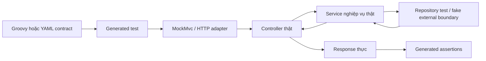
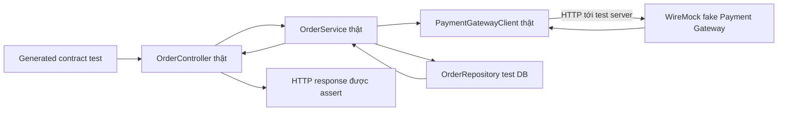
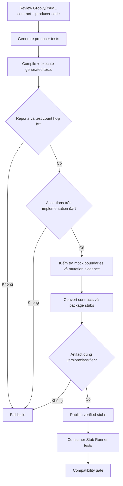

# Đánh giá test producer có kiểm chứng mã triển khai thực không

Một bộ **producer contract tests** có thể chạy xanh nhưng vẫn không bảo vệ hệ thống khỏi thay đổi API không tương thích. Lý do không nằm ở Spring Cloud Contract DSL mà ở **đường thực thi được test**: nếu generated test gọi một controller giả, hoặc service nghiệp vụ đã bị mock để luôn trả đúng dữ liệu trong hợp đồng, bài test chỉ xác nhận **dữ liệu mock khớp với dữ liệu mock**. Khi implementation thực của producer thay đổi sai, test vẫn có thể đạt.

Trong lộ trình **SPRING_CLOUD_CONTRACT**, Spring Cloud Contract dùng **Groovy/YAML DSL** để đặc tả HTTP hoặc thông điệp; **Contract Verifier** sinh kiểm thử phía producer, plugin tạo stubs, **Stub Runner** phục vụ consumer tests và CI giúp phát hiện breaking changes. Bài này thuộc chương **Chất lượng hợp đồng**, với đề bài trực tiếp: **Đánh giá test producer có kiểm chứng mã triển khai thực không**.

Câu hỏi trung tâm không phải “Có bao nhiêu generated tests?” mà là:

> Khi tôi làm sai hành vi của **producer implementation thực**, những generated tests đang chạy có **thất bại vì đúng vi phạm hợp đồng** hay không?

Bài học trình bày các tiêu chí kiểm tra mã sinh, đường request, phạm vi mock, test fixtures, messaging hook, báo cáo Surefire/Failsafe, phép thử mutation, Stub Runner và CI gates. Các ví dụ sử dụng **Order Service** làm producer, **Checkout Service** làm HTTP consumer và **Billing Service** làm message consumer.

## 1. Thế nào là producer verification có giá trị?

Giả sử Order Service có API:

```http
GET /api/orders/ORDER-42
Accept: application/json
```

Khi đúng hợp đồng:

```http
HTTP/1.1 200 OK
Content-Type: application/json

{"id":"ORDER-42","status":"PAID","totalAmount":125000}
```

Một test tốt cần xác minh:

1. Request thực sự được gửi vào **lớp tiếp nhận HTTP của Order Service**, theo phạm vi đã chọn.
2. Router, controller và phần xử lý tạo response **mà hợp đồng cần bảo vệ** được thực thi.
3. Test fixture chỉ kiểm soát các **đầu vào và dependency bên ngoài**, không thay thế vô điều kiện output cần xác minh.
4. Response `200`, `Content-Type` và body xuất phát từ implementation được kiểm tra.
5. Generated assertions so sánh response thực với hợp đồng Groovy/YAML.
6. Nếu controller hoặc service đổi `status=PAID` thành `status=CANCELLED`, test không còn đạt.
7. Test thực sự xuất hiện trong báo cáo runner, không chỉ được sinh ra dưới `target/`.

**Không nhất thiết phải chạy toàn bộ hạ tầng production**. Với test mode `MOCKMVC`, Spring MVC và controller thực có thể được kiểm tra **không cần mở cổng HTTP thật**. Điều quyết định chất lượng là **phạm vi code thực sự được chạy và những gì đã bị mock**, không phải test có dùng socket hay không.

### 1.1. Đường thực thi mong muốn



Một boundary giả như payment gateway hoặc kho dữ liệu thử nghiệm là **hợp lệ nếu nó giữ cho logic cần kiểm tra vẫn chạy**. Ngược lại, nếu mock chính `OrderQueryService` để luôn trả object `PAID`, test không còn kiểm tra service đó.

### 1.2. Phân biệt “mã thật” và “hạ tầng thật”

| Thành phần | Thường cần chạy thật trong contract producer test? | Có thể thay thế khi nào? |
|---|---|---|
| HTTP request mapping/controller | Có, nếu hợp đồng bảo vệ HTTP API | Controller-only slice nếu đây là phạm vi công bố và có test service riêng |
| Service định nghĩa response/status | Thường có | Chỉ mock nếu phạm vi hợp đồng cố ý giới hạn ở controller mapping |
| DTO mapper/serializer | Có nếu consumer phụ thuộc JSON shape | Rất hạn chế, vì mock mapper dễ che thay đổi schema |
| Spring Security filters | Có nếu contract bao gồm `401/403` | Không thay bằng `permitAll` khi muốn bảo vệ auth |
| Repository/query | Tùy mục tiêu: test DB hoặc deterministic fake | Chỉ khi logic đọc dữ liệu không phải đối tượng kiểm tra |
| Payment provider ngoài hệ thống | Không cần gọi thật | Dùng fake/MockWebServer/WireMock kiểm soát phản hồi |
| Message publisher adapter | Thường chạy phần publish thật | Dùng test binder/broker thay broker production |
| Producer method `publishOrderPaid()` | Phải kích hoạt đường nghiệp vụ cần kiểm tra | Không được chỉ tự gửi message mẫu qua test verifier |
| Kafka/RabbitMQ production | Không bắt buộc cho mọi contract test | Dùng test broker/binder, có integration suite riêng |

**Bài test có thể đạt ở phạm vi hẹp và vẫn hữu ích.** Nhưng cần mô tả trung thực nó chỉ kiểm tra controller, hay thực sự kiểm tra controller + service + mapping + authorization.

## 2. Ba loại “xanh” cần phân biệt

Một pipeline có thể trả `BUILD SUCCESS` trong ba tình huống hoàn toàn khác nhau:

| Trường hợp | Điều đã xảy ra | Có chứng minh producer đáp ứng contract không? |
|---|---|---|
| **Xanh vì không có test** | Plugin không phát hiện contracts hoặc test runner chạy 0 tests | **Không** |
| **Xanh vì dữ liệu đã được mock đúng đáp án** | Test gọi fake controller/service trả đúng JSON mẫu | **Không** cho phần implementation bị thay thế |
| **Xanh có giá trị** | Generated tests được thực thi trên đường code thật trong phạm vi định nghĩa, kiểm tra response/message thực | **Có**, trong phạm vi assertions và môi trường test |

Vì vậy, đánh giá chất lượng cần **ba lớp bằng chứng**:

- **Generation:** hợp đồng có được chuyển thành tests?
- **Execution:** tests có thực sự chạy và assert?
- **Behavioral sensitivity:** thay đổi sai trong implementation có làm test fail?

Nếu thiếu một lớp, chưa được kết luận “producer đã được xác minh”.

## 3. Bắt đầu bằng hợp đồng Groovy có assertion rõ

Ví dụ file `src/test/resources/contracts/checkout/get_paid_order_200.groovy`:

```groovy
import org.springframework.cloud.contract.spec.Contract

Contract.make {
    name 'checkout_get_paid_order_200'
    description 'Checkout đọc đơn hàng đã thanh toán'

    request {
        method GET()
        url '/api/orders/ORDER-42'
        headers {
            header 'Accept', 'application/json'
        }
    }

    response {
        status OK()
        headers {
            contentType(applicationJson())
        }
        body(
            id: 'ORDER-42',
            status: 'PAID',
            totalAmount: 125000
        )
    }
}
```

Các kỳ vọng phải được giữ:

- Request `GET` vào đúng `/api/orders/ORDER-42`.
- Response status `200`.
- Response `Content-Type: application/json`.
- Trường `id` đúng.
- `status` có giá trị `PAID`.
- `totalAmount` có giá trị số `125000`.

Nếu chỉ kiểm tra status `200`, một producer trả `{"status":"CANCELLED"}` có thể vẫn qua test. Nếu matcher quá rộng cho `status`, một thay đổi nghiệp vụ cũng có thể bị bỏ qua.

### 3.1. YAML DSL cho một case lỗi độc lập

Ví dụ `src/test/resources/contracts/checkout/get_missing_order_404.yml`:

```yaml
name: checkout_get_missing_order_404
description: Producer trả lỗi nghiệp vụ khi không có đơn
request:
  method: GET
  url: /api/orders/ORDER-MISSING
  headers:
    Accept: application/json
response:
  status: 404
  headers:
    Content-Type: application/json
  body:
    code: ORDER_NOT_FOUND
```

Đây là **kịch bản khác** với Groovy `200`, không phải cùng hợp đồng được viết hai lần. Với fixture, cần tạo `ORDER-42` và bảo đảm `ORDER-MISSING` không tồn tại.

**Chú ý:** `404` từ WireMock do **không có mapping khớp** không đồng nghĩa `404` nghiệp vụ có `code=ORDER_NOT_FOUND`. Trong producer verification, response phải đến từ implementation được test; trong consumer Stub Runner test, phải phân biệt hai nguồn `404`.

## 4. Phần implementation nào đang được test?

Một producer tối giản có kiến trúc:

```text
GET /api/orders/{id}
        |
        v
OrderController.getOrder(id)
        |
        v
OrderQueryService.findById(id)
        |
        v
OrderRepository.findById(id)
        |
        v
OrderMapper.toResponse(entity)
        |
        v
HTTP 200 + JSON
```

Ví dụ controller:

```java
package com.example.order.api;

import org.springframework.web.bind.annotation.GetMapping;
import org.springframework.web.bind.annotation.PathVariable;
import org.springframework.web.bind.annotation.RequestMapping;
import org.springframework.web.bind.annotation.RestController;

@RestController
@RequestMapping("/api/orders")
public class OrderController {

    private final OrderQueryService orderQueryService;

    public OrderController(OrderQueryService orderQueryService) {
        this.orderQueryService = orderQueryService;
    }

    @GetMapping("/{id}")
    public OrderResponse findOrder(@PathVariable String id) {
        return orderQueryService.findOrder(id);
    }
}
```

Ví dụ service:

```java
package com.example.order.api;

import org.springframework.stereotype.Service;

@Service
public class OrderQueryService {

    private final OrderRepository repository;

    public OrderQueryService(OrderRepository repository) {
        this.repository = repository;
    }

    public OrderResponse findOrder(String id) {
        OrderEntity order = repository.findById(id)
            .orElseThrow(() -> new OrderNotFoundException(id));

        return new OrderResponse(
            order.getId(),
            order.getStatus(),
            order.getTotalAmount()
        );
    }
}
```

Trong ví dụ, `OrderResponse`, `OrderEntity`, `OrderRepository` và `OrderNotFoundException` là **các lớp của project minh họa cần được cài đặt**. Exception handler phải ánh xạ `OrderNotFoundException` thành `404` và body lỗi theo hợp đồng. Đoạn code trên **không phải một module có thể build độc lập**.

### 4.1. Câu hỏi về đường đi của generated request

Sau khi đọc base class, hãy trả lời:

1. Request đi vào `OrderController` thật hay một fake/controller mock?
2. Controller nhận bean `OrderQueryService` thật hay mock của service?
3. Service có gọi repository hoặc gateway thực trong phạm vi đã chọn không?
4. `OrderResponse` được tạo bằng logic ứng dụng hay được dựng sẵn trong test?
5. Controller advice, security filters và Jackson mapper có đang hoạt động không?
6. Response được assert có phải response **của lời gọi hiện tại** không?
7. Test có chạy implementation từ **commit đang được verify** không?

Nếu không trả lời được, tên test “ContractVerificationTest” chưa đủ để kết luận.

## 5. Ba kiểu base test: phạm vi khác nhau

Spring Cloud Contract Verifier sinh classes kế thừa **base test class** được khai báo ở plugin. Với HTTP, phạm vi thực thi phụ thuộc base class và `testMode`.

### 5.1. Mức A — MockMvc standalone với controller thật

Một cách phổ biến trong ví dụ tài liệu:

```java
@BeforeEach
void setup() {
    OrderRepository fakeRepository = new InMemoryOrderRepository();
    fakeRepository.save(
        new OrderEntity("ORDER-42", "PAID", 125000)
    );

    OrderQueryService service =
        new OrderQueryService(fakeRepository);

    OrderController controller =
        new OrderController(service);

    RestAssuredMockMvc.standaloneSetup(controller);
}
```

Đoạn minh họa yêu cầu project cung cấp `InMemoryOrderRepository` và model phù hợp. Đây **không phải test vô giá trị**: request có thể chạy qua controller và service **thật**, còn repository được thay bằng in-memory test double.

Tuy nhiên, `standaloneSetup` thường **không tự nạp toàn bộ Spring Boot application context, filters, security, method interceptors và các bean tùy biến**. Nếu hợp đồng yêu cầu kiểm tra filter/authentication, cách này có thể quá hẹp.

### 5.2. Mức B — MockMvc standalone với business service bị mock

Ví dụ:

```java
@BeforeEach
void setup() {
    OrderQueryService service = Mockito.mock(
        OrderQueryService.class
    );

    Mockito.when(service.findOrder("ORDER-42"))
        .thenReturn(
            new OrderResponse("ORDER-42", "PAID", 125000)
        );

    RestAssuredMockMvc.standaloneSetup(
        new OrderController(service)
    );
}
```

Khi generated test gọi GET:

- Controller thật nhận request.
- Controller gọi `service.findOrder(...)`.
- **Mockito trả sẵn đúng response từ contract**.
- Logic `OrderQueryService` thật **không chạy**.

Bài test này có thể kiểm tra mapping/path/serialization của controller, nhưng **không xác minh business implementation**. Nếu service thực đổi `PAID` thành `CANCELLED`, test vẫn xanh vì đang gọi mock.

Không có nghĩa phải xóa mọi mock. Cần công bố **phạm vi**: “controller contract slice” hay “producer behavior verification qua service”.

### 5.3. Mức C — Spring Boot context với MockMvc đã cấu hình

Một cách gần application behavior hơn:

```java
package com.example.order.contract;

import io.restassured.module.mockmvc.RestAssuredMockMvc;
import org.junit.jupiter.api.BeforeEach;
import org.springframework.beans.factory.annotation.Autowired;
import org.springframework.boot.test.autoconfigure.web.servlet.AutoConfigureMockMvc;
import org.springframework.boot.test.context.SpringBootTest;
import org.springframework.test.web.servlet.MockMvc;

@SpringBootTest
@AutoConfigureMockMvc(addFilters = true)
public abstract class OrderContractTestBase {

    @Autowired
    MockMvc mockMvc;

    @Autowired
    OrderContractFixture fixtures;

    @BeforeEach
    protected void setUpContractTest() {
        fixtures.resetOrders();
        fixtures.insertPaidOrder(
            "ORDER-42", "PAID", 125000
        );
        fixtures.ensureAbsent("ORDER-MISSING");

        RestAssuredMockMvc.mockMvc(mockMvc);
    }
}
```

`OrderContractFixture` cần do dự án tự hiện thực và inject; ví dụ không độc lập compile nếu chưa có application, fixture, repository và dependencies tương ứng.

Các ưu điểm:

- Controller được lấy từ Spring context.
- Service và mapper có thể là beans thật.
- HTTP routing, argument binding, validation, exception handlers và security filters có cơ hội được kiểm tra.
- Test có thể dùng test database hoặc fake chỉ tại các **external boundaries**.
- Generated assertions chạy trên output của request qua MockMvc.

**Không mặc định `@SpringBootTest` đảm bảo mọi bean là thật.** Test profile có thể chứa `@MockitoBean`/`@MockBean`, `@Primary` fake hoặc configuration override. Phải kiểm tra **bean graph**, runtime test context và chính xác bean nào được thay thế.

## 6. Bảng đánh giá phạm vi với các kiểu test

| Thiết lập | Controller | Service nghiệp vụ | Infrastructure | Bằng chứng |
|---|---|---|---|---|
| Mock controller trả JSON cố định | Giả | Không chạy | Giả | Hầu như chỉ test assertion wiring |
| `standaloneSetup` + mock service | Thật | Giả | Tối thiểu | Kiểm tra route/controller/serialization |
| `standaloneSetup` + service thật + fake repository | Thật | Thật | Fake repository | Kiểm tra logic service trong phạm vi hẹp |
| `@WebMvcTest` + mock service | Thật trong MVC slice | Giả | Spring MVC slice | Kiểm tra web layer, không phải service |
| `@SpringBootTest` + MockMvc + service thật + test DB | Thật | Thật | DB test và app context | Kiểm tra hành vi producer sâu hơn |
| `@SpringBootTest` + `EXPLICIT` + random port | Thật qua socket | Thật nếu không bị mock | HTTP server + app context | Kiểm tra network HTTP layer và app behavior |
| Full E2E staging | Thật | Thật | Nhiều thành phần thật | Độ phủ lớn hơn nhưng chi phí/flakiness cao hơn |

**Mức độ tin cậy không chỉ tăng tuyến tính theo số thành phần thật.** Test bị phụ thuộc dữ liệu không ổn định có thể bỏ sót lỗi khác; fixture rõ và mutation sensitivity quan trọng hơn việc cố khởi động càng nhiều container càng tốt.

### 6.1. Khi nào một controller-only contract test là hợp lý?

Nếu hợp đồng chỉ bảo vệ **HTTP mapping và DTO adapter**, service behavior đã được bảo vệ bằng một suite riêng và nhóm công khai phạm vi đó, controller slice test có giá trị. Nhưng không được trình bày nó như bằng chứng producer implementation **toàn phần** đáp ứng nghiệp vụ khi service chính đã bị stubbed.

Tiêu chí là **mức cam kết**. Nếu consumer dựa vào `status=PAID` do business rules, nên có test chạy quy tắc business đó thay vì chỉ mock một DTO `PAID`.

## 7. Maven plugin: generated tests kế thừa class nào?

Maven producer thường cấu hình:

```xml
<plugin>
    <groupId>org.springframework.cloud</groupId>
    <artifactId>spring-cloud-contract-maven-plugin</artifactId>
    <version>CONTRACT_PLUGIN_VERSION_PHU_HOP</version>
    <extensions>true</extensions>
    <configuration>
        <baseClassForTests>
            com.example.order.contract.OrderContractTestBase
        </baseClassForTests>
        <testMode>MOCKMVC</testMode>
        <testFramework>JUNIT5</testFramework>
    </configuration>
</plugin>
```

Đây là **POM fragment**, chưa đủ để build độc lập. Cần BOM/dependencies tương thích, test starter, Spring Cloud Contract Verifier test dependency, POM coordinates, security/test infrastructure và source contracts.

Khi kiểm tra:

1. Plugin thực sự ở `build/plugins` của **producer module**, hoặc được lifecycle kích hoạt qua cấu hình được xác minh.
2. `baseClassForTests` là FQN tồn tại trên test classpath.
3. Generated tests kế thừa đúng class đó.
4. `testMode` khớp HTTP stack và setup ở base class.
5. JUnit/TestNG/Spock test runner thực sự chọn generated tests.
6. Plugin đã đọc đúng contracts directory.

Trong multi-module, nếu plugin chỉ được khai báo trong `pluginManagement` của parent nhưng không được bật cho producer, tests có thể không được sinh như kỳ vọng.

### 7.1. Khi có nhiều base classes

Nếu một module chứa HTTP contracts và message contracts, hoặc hai nhóm controllers cần fixtures khác nhau, có thể dùng `baseClassMappings` hoặc `packageWithBaseClasses` theo phiên bản hỗ trợ. Ví dụ:

```xml
<configuration>
    <baseClassForTests>
        com.example.order.contract.DefaultContractBase
    </baseClassForTests>
    <baseClassMappings>
        <baseClassMapping>
            <contractPackageRegex>.*http.*</contractPackageRegex>
            <baseClassFQN>
                com.example.order.contract.HttpContractBase
            </baseClassFQN>
        </baseClassMapping>
        <baseClassMapping>
            <contractPackageRegex>.*messaging.*</contractPackageRegex>
            <baseClassFQN>
                com.example.order.contract.MessagingContractBase
            </baseClassFQN>
        </baseClassMapping>
    </baseClassMappings>
</configuration>
```

Regex, package path và test FQNs cần đối chiếu với generated classes thực tế. **Không suy rằng tất cả tests đã dùng base class đúng** chỉ vì POM có tên một base class phù hợp.

## 8. Test mode: `MOCKMVC` không đồng nghĩa controller bị giả

Trong tài liệu Spring Cloud Contract Maven, `testMode` có những lựa chọn như `MOCKMVC`, `EXPLICIT` và các mode khác tùy version/stack. Cần phân biệt:

- **MOCKMVC:** gửi HTTP request giả lập qua Spring MVC test infrastructure; có thể chạy controller/service thật.
- **EXPLICIT:** gửi request qua cổng HTTP thực đang lắng nghe trong test; cần ứng dụng khởi chạy server và base URI/port.
- **WEBTESTCLIENT:** dùng WebTestClient khi plugin/version và reactive test setup hỗ trợ; cần kiểm tra generated code.
- **JAXRSCLIENT:** dành cho JAX-RS mode được version hỗ trợ.

**MockMvc** là công cụ mô phỏng **HTTP transport**, không có nghĩa mọi lớp nghiệp vụ bị mock. Tương tự, dùng `EXPLICIT` với server socket thật **không bảo đảm** business service không bị mock.

### 8.1. Ví dụ mode `EXPLICIT`

Trong các dự án/version hỗ trợ:

```java
import io.restassured.RestAssured;
import org.junit.jupiter.api.BeforeEach;
import org.springframework.boot.test.context.SpringBootTest;
import org.springframework.boot.test.web.server.LocalServerPort;

@SpringBootTest(
    webEnvironment = SpringBootTest.WebEnvironment.RANDOM_PORT
)
public abstract class HttpContractBase {

    @LocalServerPort
    int port;

    @BeforeEach
    void configureClient() {
        RestAssured.baseURI = "http://localhost";
        RestAssured.port = port;
    }
}
```

**Lưu ý:** import `LocalServerPort` trong đoạn này phù hợp với các dòng Spring Boot hiện đại dùng `org.springframework.boot.test.web.server`. Các bản Spring Boot cũ có thể dùng package khác. Khi áp dụng, dùng import/RestAssured API đúng với release train đã ghim, kiểm tra server đã khởi động và generated tests gọi qua HTTP thực.

Điểm cần kiểm tra vẫn là: service thật có chạy không, response thật có được generated assertions kiểm tra không, và mutation có làm test fail không.

### 8.2. Với WebFlux

Nếu producer dùng Spring WebFlux-only, đừng copy base `MockMvc` một cách máy móc. Tùy version, plugin có thể sinh tests dùng WebTestClient hoặc chế độ `EXPLICIT` cho HTTP server thực. Chọn mode có hỗ trợ và kiểm tra:

- Reactive controller/handler được khởi tạo đúng.
- Mono/Flux được subscribe để logic thật chạy.
- Body, HTTP headers và response status theo contract.
- Streaming responses không bị nhầm với JSON body một lần.
- Asynchronous timeouts/virtual time được kiểm soát.
- Không thay handler thật bằng test-only controller trả sẵn sample.

## 9. Generated source: xem test đang gọi cái gì

Sau khi Maven chạy bước generate tests, generated source trong nhiều versions nằm ở đường dẫn giống:

```text
target/generated-test-sources/contracts/
```

Đó là **output do plugin sinh**, không phải nơi lập trình viên chỉnh sửa lâu dài. Tên file/path và test framework có thể khác theo version.

Một generated test **mô phỏng cấu trúc**:

```java
// CHỈ LÀ MINH HỌA cấu trúc assertions.
// Không phải output chính xác của mọi plugin version.

class CheckoutGetPaidOrderTest extends OrderContractTestBase {

    @Test
    void checkout_get_paid_order_200() {
        given()
            .header("Accept", "application/json")
        .when()
            .get("/api/orders/ORDER-42")
        .then()
            .statusCode(200)
            .header("Content-Type", containsString("application/json"))
            .body("id", equalTo("ORDER-42"))
            .body("status", equalTo("PAID"))
            .body("totalAmount", equalTo(125000));
    }
}
```

Trong test thật, helper `given()`, imports/matchers và adapter được generator quyết định. Ý nghĩa là **generated test gửi request và so kết quả**, chứ không tự tạo DTO từ chính contract rồi so hai bản sao.

### 9.1. Các dấu hiệu đáng báo động khi đọc generated source

- Test không có `@Test`/Spock method được runner nhận diện.
- Test kế thừa base class sai.
- Generated test không gửi request vào producer mà chỉ so hai constants.
- Assertions thiếu `status`, header/body fields consumer thực sự sử dụng.
- JSONPath matcher `.*` quá rộng, không phát hiện thay đổi kiểu/dữ liệu.
- Test bị disable, ignore, exclude hoặc dùng wrong test runner.
- Test mode sinh ra REST client nhưng base class chỉ setup MockMvc.
- Test chỉ xác minh HTTP `200`, bỏ `404`/security/message scenarios quan trọng.
- Test bị generate vào một source set không nằm trong test task.

Không sửa generated code thủ công. Nếu sai, sửa **contract DSL, generator options, base class hoặc implementation**, rồi generate lại.

## 10. Chứng minh các lớp business code đã chạy

Đọc source và annotations là bước đầu, nhưng **không thay thế quan sát thực tế**.

Các kỹ thuật tăng độ tin cậy:

| Kỹ thuật | Chứng minh điều gì? | Giới hạn |
|---|---|---|
| Đọc Spring context/test configuration | Bean nào được tạo hoặc replace | Không tự chứng minh method được gọi |
| Kiểm tra generated test request | Request được phát từ đâu | Có thể vào fake adapter |
| Mockito `verify` trên spy ở boundary phù hợp | Method được gọi trong test | Một invocation không bảo đảm logic đúng |
| Metrics/traces test-only | Code path đã chạy | Cần tránh log dữ liệu nhạy cảm |
| DB state assertion | Business side effect xảy ra | Cần fixture và isolation |
| Controlled external fake | Producer gọi gateway bằng request đúng | Không chứng minh gateway production thật |
| Mutation test | Thay đổi sai làm test fail | Chỉ bao phủ mutation được thực hiện |
| Coverage report | Những dòng/nhánh code được chạy | Coverage cao không bảo đảm assertions đủ |
| Test reports | Test được thực thi và status | Không cho biết test đã mock mất business logic chưa |

**Coverage 100% không đồng nghĩa contract đúng.** Nếu test gọi một fake service có cùng tên method, coverage phần business real có thể bằng 0; nếu code thật được chạy nhưng assertions không bảo vệ output, test vẫn có thể đạt khi behavior sai.

### 10.1. Kiểm tra bean graph trước khi chạy test

Một audit checklist:

1. Tìm trong **base test class** nơi `RestAssuredMockMvc.mockMvc(...)` hoặc `standaloneSetup(...)` được gọi.
2. Xác định `OrderController` là Spring bean thật hay được tạo bằng `new`/Mockito.
3. Xác định `OrderQueryService` bean nào được inject vào controller.
4. Kiểm tra test-only overrides như `@Primary`, `@TestConfiguration`, `@MockitoBean` hoặc `@MockBean`.
5. Xem những external clients nào được mock và vì sao.
6. Chỉ giữ fake ở boundary **ngoài mục tiêu của contract**.
7. Kiểm tra fixture reset đúng trước mỗi test.
8. Kiểm tra security configuration có bị thay bằng `permitAll` hay tắt filters không.

Tên bean hoặc annotation `@Service` không chứng minh implementation thật đang được dùng nếu test context đã thay thế bean đó.

## 11. Mock boundary nào là hợp lý?

Một producer có thể phải gọi Payment Gateway bên ngoài khi tạo đơn. Nếu contract đang kiểm tra **Order Service REST response** dựa trên kết quả thanh toán, bạn có thể stub HTTP phản hồi của gateway thay vì gọi gateway thật.

Ví dụ:



Trong thiết kế này:

- Controller, service, gateway client adapter và mapper của Order Service vẫn chạy.
- External Payment Gateway được thay bằng deterministic fake.
- Test có thể kiểm tra cả request gửi đến gateway, nếu liên quan.
- Stubs từ `Spring Cloud Contract` không tự thay thế bước producer implementation verification.

### 11.1. Test double đúng chỗ

**Hợp lý:**

```text
OrderService thật
    -> PaymentGatewayClient thật
        -> HTTP WireMock bên ngoài
```

**Nguy cơ che lỗi:**

```text
OrderController thật
    -> Mockito.mock(OrderService.class)
        -> thenReturn(OrderResponse như contract)
```

**Rất ít giá trị để đánh giá producer:**

```text
Generated test
    -> Mockito.mock(OrderController.class)
        -> thenReturn(OrderResponse như contract)
```

Test double càng ở gần **đầu ra hợp đồng**, nguy cơ xác minh vòng tròn càng cao.

### 11.2. Khi mock service vẫn có thể chấp nhận

Một nhóm có thể chủ đích tạo **controller slice contract verification** để bảo vệ serialization, path/query/header binding, sau đó có một **business/service integration suite** riêng. Điều này có thể hiệu quả nếu:

- Phạm vi được ghi rõ.
- Business suite thật sự chạy trong cùng release gate.
- Hai suite cùng bảo vệ dữ liệu và semantics consumer phụ thuộc.
- Không gọi bài controller slice là bằng chứng service logic đã được verify.
- Mutation test ở service gây thất bại cho **ít nhất một bước release gate**.

Nếu business suite không tồn tại hoặc bị skip, mô hình đó có một khoảng trống rõ ràng.

## 12. Mutation test: phép thử đáng tin cậy nhất cho câu hỏi trung tâm

**Mutation test thủ công** là thay đổi có chủ đích một hành vi của implementation trong một branch tạm, rồi chạy lại producer contract suite. Đây là cách trực tiếp kiểm tra tests có nhạy với breaking change không.

### 12.1. Mutation 1 — đổi response status

Contract yêu cầu `200`. Tạm sửa controller:

```java
@GetMapping("/{id}")
public ResponseEntity<OrderResponse> getOrder(@PathVariable String id) {
    OrderResponse response = service.findOrder(id);
    return ResponseEntity.status(202).body(response);
}
```

Đây là code minh họa; cần imports tương ứng cho `@GetMapping`, `@PathVariable`, `ResponseEntity` và service trong dự án thực.

**Kỳ vọng:** generated test `checkout_get_paid_order_200` thất bại ở assertion status `200`. Nếu test vẫn xanh:

- Generated test không chạy?
- Contract có thực sự assert `200` không?
- Request đi vào controller giả?
- Test class trỏ nhầm module/port?
- Một layer khác override status?

Không sửa DSL thành `202` nếu producer vẫn cam kết `200` cho consumer hiện tại.

### 12.2. Mutation 2 — đổi business field

Trong `OrderQueryService`, tạm đổi:

```java
return new OrderResponse(
    order.getId(),
    "CANCELLED",           // Sai có chủ đích
    order.getTotalAmount()
);
```

Contract đang đòi `"status":"PAID"`.

**Kỳ vọng:** producer test fail tại JSONPath/body assertion. Nếu test vẫn pass dù đổi code này, đó là dấu hiệu:

- Service real không được gọi;
- Response được dựng sẵn từ mock;
- Test dùng fixture khác hoặc endpoint khác;
- Assertion không bảo vệ `status`;
- Mutation chưa được compile vào artifact đang chạy.

### 12.3. Mutation 3 — bỏ một trường JSON

Tạm sửa DTO/mapper để không trả `totalAmount`.

**Kỳ vọng:** generated test có assertion trường này thất bại. Nếu test chỉ assert `statusCode(200)`, sẽ không phát hiện. Khi ấy **contract quality** hoặc generator coverage cần được cải thiện.

### 12.4. Mutation 4 — phá trường hợp 404

Tạm để service trả object rỗng/`200` khi không có order, thay vì ném `OrderNotFoundException`.

**Kỳ vọng:** YAML contract `checkout_get_missing_order_404` thất bại vì status/body sai. Nếu `404` của test đến từ route không khớp thay vì nghiệp vụ, hãy kiểm tra URL và exception handler.

### 12.5. Mutation 5 — bỏ authorization

Nếu contract bao gồm `401/403`, tạm cấu hình endpoint `permitAll()` hoặc bỏ kiểm tra scope trong nhánh thử nghiệm.

**Kỳ vọng:** negative contracts fail. Nếu không, có thể security filters bị tắt hoặc test profile không nạp rule thực.

### 12.6. Mutation 6 — đổi message type/destination

Nếu Order Service phát `ORDER_PAID` qua `orders.events`, tạm đổi sang `ORDER_CANCELLED` hoặc `wrong.events`.

**Kỳ vọng:** producer message contract test fail. Nếu test vẫn xanh, có thể hook chỉ tự gửi message mẫu thay vì gọi implementation thật.

### 12.7. Mutation được kiểm soát như thế nào?

1. Tạo branch tạm hoặc thay đổi chưa commit.
2. Đảm bảo generated tests và implementation thuộc **cùng commit/worktree**.
3. Chạy baseline trước mutation, xác nhận pass.
4. Sửa **một** hành vi contract-relevant.
5. Chạy lại đúng suite, ghi nhận test fail và assertion cụ thể.
6. Khôi phục implementation.
7. Chạy lại, xác nhận pass.
8. Không merge các mutations chủ đích vào nhánh chính.
9. Nếu test không fail, điều tra theo tầng; không vội kết luận framework bị lỗi.
10. Ghi kết quả trong test-quality report.

Một test chất lượng **không nhất thiết phát hiện mọi mutation có thể tưởng tượng**, nhưng phải phát hiện những thay đổi phá vỡ các cam kết mà nó tuyên bố bảo vệ.

## 13. Ma trận mutation và bằng chứng kỳ vọng

| Thay đổi sai có chủ đích | Test nào phải fail? | Phần code phải đang chạy |
|---|---|---|
| `200` → `202` | Contract status assertion | Controller/response layer |
| `PAID` → `CANCELLED` | Contract body assertion | Service/DTO mapper |
| `125000` → `"125000"` | Typed JSON assertion | Serializer/response mapper |
| Bỏ `Content-Type` | Header assertion | HTTP response configuration |
| Mất `ORDER-42` fixture | Test `200` sẽ fail đúng nguyên nhân môi trường | Repository/test data setup |
| `404` → `200` | Contract not-found case | Service/exception handler |
| Mở public endpoint yêu cầu token | Contract `401/403` | Spring Security filter/authorization |
| Bỏ tenant ownership check | Cross-tenant negative contract | Business access policy |
| `ORDER_PAID` → `ORDER_CANCELLED` | Message body/header assertion | Publisher/mapper |
| `orders.events` → `wrong.events` | Message destination assertion | Producer binding/routing |
| Đổi producer version nhưng chỉ test stub cũ | Consumer may still pass incorrectly | Artifact resolution/test targeting |

**Lưu ý:** mutation làm fixture thiếu có thể chứng minh test phụ thuộc dữ liệu, nhưng **không chứng minh business logic đúng**. Mutation phải nhằm vào implementation hoặc mapping cần bảo vệ để trả lời câu hỏi chính.

## 14. Messaging: hook `triggeredBy` có đi qua producer thật không?

Spring Cloud Contract hỗ trợ hợp đồng thông điệp. Ví dụ Order Service phát sự kiện khi đơn được thanh toán:

```groovy
import org.springframework.cloud.contract.spec.Contract

Contract.make {
    name 'billing_order_paid_v1'
    label 'billing_order_paid_event_v1'

    input {
        triggeredBy('publishOrderPaid()')
    }

    outputMessage {
        sentTo('orders.events')
        headers {
            header('contentType', 'application/json')
            header('eventType', 'ORDER_PAID')
        }
        body(
            eventId: 'EVENT-42',
            eventType: 'ORDER_PAID',
            orderId: 'ORDER-42',
            totalAmount: 125000
        )
    }
}
```

Generated producer test gọi method `publishOrderPaid()` được cung cấp bởi base class/hook. **Đó là nơi dễ tạo một “test xanh giả”.**

### 14.1. Hook sai: gửi thẳng dữ liệu mẫu

Một cách setup sai mục tiêu:

```java
// PHẢN VÍ DỤ: hook không chạy OrderService thật.
public void publishOrderPaid() {
    messageVerifier.send(
        "{\"eventType\":\"ORDER_PAID\"," +
        "\"orderId\":\"ORDER-42\"}",
        "orders.events"
    );
}
```

Nếu phương thức `messageVerifier.send(...)` chỉ đưa chính payload từ hợp đồng vào test transport, generated test có thể nhận nó và pass, trong khi production `OrderPaymentService` không hề được gọi.

**Test như vậy xác minh sample message**, không kiểm tra producer implementation phát event thật.

### 14.2. Hook tốt hơn: gọi nghiệp vụ thật

```java
@Autowired
OrderPaymentService orderPaymentService;

public void publishOrderPaid() {
    orderPaymentService.markPaid("ORDER-42");
}
```

Trong setup này, `markPaid(...)` phải thực hiện workflow thực trong phạm vi test và sử dụng publisher adapter thật để phát output. Message test infrastructure (test binder, Spring Integration channel, broker test...) quan sát event được publisher gửi.

**Không tự động đúng chỉ vì tên method là `markPaid`.** Nếu `OrderPaymentService` bị mock hoặc method test-only dựng sẵn payload, vấn đề vẫn còn.

### 14.3. Cấu hình kiểm thử messaging đúng mức

Một base class có thể cần:

```java
@SpringBootTest
@AutoConfigureMessageVerifier
public abstract class MessagingContractBase {

    @Autowired
    OrderPaymentService orderPaymentService;

    @BeforeEach
    void resetFixture() {
        // Seed order trong test DB và làm sạch message state.
    }

    public void publishOrderPaid() {
        orderPaymentService.markPaid("ORDER-42");
    }
}
```

Đây là **khung minh họa**, cần imports và dependencies của Spring Cloud Contract messaging integration đúng version, test binder/broker và fixture thật. Trong tài liệu Spring Cloud Contract, `@AutoConfigureMessageVerifier` giúp cấu hình messaging verification; ứng dụng phải có adapter phù hợp Spring Cloud Stream/Integration/JMS/Camel theo version được hỗ trợ.

### 14.4. Hai lỗi message khác nhau

- **Không có event:** hook không kích hoạt business code, listener/transport chưa hoạt động hoặc publisher không gửi.
- **Có event nhưng sai contract:** destination, headers hoặc body sai.

Nếu test gửi thẳng một message đúng contract qua test helper, nó che được cả hai lỗi. Producer message test phải quan sát **output từ producer thật**, không phải output do test tự phát.

## 15. Producer message test khác Stub Runner message trigger

| Hoạt động | Nơi chạy | Có chạy implementation producer thật? |
|---|---|---|
| Producer generated test gọi `publishOrderPaid()` | Producer test context | **Có**, nếu hook đi qua business code thật |
| Stub Runner phía consumer trigger label | Consumer test context | **Không**, dùng message stub |
| Consumer listener xử lý message stub | Consumer test context | Chạy **consumer handler thật**, không producer |
| Broker integration test với producer thật | Integration/test environment | Có, trong phạm vi tích hợp được thiết lập |

Nếu Billing xử lý message do Stub Runner phát thành công, điều đó chỉ chứng minh **Billing tương thích với message sample**. Producer vẫn phải được verify rằng nó **thực sự phát** message tương đương.

Cách kiểm tra tốt: cố ý đổi field `eventType` trong **OrderService publisher implementation**. Producer contract test phải fail; consumer stub test có thể vẫn pass vì nó chạy artifact mẫu chưa đổi.

## 16. Kiểm tra hiệu ứng thực, không chỉ giá trị trả về

Một producer endpoint có thể tạo side effect: ghi DB, phát event, gọi gateway hoặc cập nhật trạng thái. Hợp đồng HTTP đôi khi chỉ quan sát response; nếu hệ thống cam kết thêm side effect, cần integration tests bổ sung.

Ví dụ API:

```http
POST /api/orders/ORDER-42/confirm
Content-Type: application/json

{}
```

Response:

```http
HTTP/1.1 202 Accepted
Location: /api/order-operations/OP-42
```

Một controller mock có thể luôn trả `202` mà không tạo operation record. Nếu contract chỉ định response `202`, generated test có thể đúng **trong phạm vi quan sát HTTP** nhưng không đủ để khẳng định workflow thật.

Bổ sung test assert:

1. Operation record được tạo trong database test.
2. Order state chuyển đúng thời điểm.
3. Event được phát nếu contract kiến trúc yêu cầu.
4. Không tạo side effect khi request `401/403`.
5. Retry/idempotency không tạo duplicate payment/order.
6. Transaction rollback hoặc failure behavior đúng policy.

**Phân biệt contract violation và implementation invariant:** không cố ép mọi chi tiết nội bộ vào DSL. Một số invariants phù hợp hơn với service integration tests. Nhưng release gate cần **bộ bằng chứng tổng hợp**, không chỉ response bị mock.

### 16.1. Trường hợp response khớp nhưng mutation side effect không bị bắt

Giả sử producer luôn trả `202` theo contract. Bạn đổi code để không lưu operation. Nếu contract chỉ bảo vệ response, test vẫn xanh là **đúng phạm vi**; vấn đề ở chỗ nhóm đã xem test đó như bằng chứng quá rộng. Nên thêm workflow integration test, không kết luận mọi contract verification đều vô nghĩa.

## 17. Dữ liệu fixture: đầu vào kiểm thử, không phải đáp án trả thẳng

Một fixture tốt:

- Khởi tạo `ORDER-42` trong **test database** trước request.
- Khởi tạo `status=PAID` theo nghiệp vụ cần kiểm tra.
- Đảm bảo `ORDER-MISSING` không tồn tại.
- Cô lập dữ liệu khi chạy song song.
- Không dùng production DB.
- Ghi rõ các trạng thái ban đầu để tránh false positives.
- Làm sạch caches, queues, file state hoặc external fake trước test.
- Giữ thời gian và random IDs deterministic hoặc dùng matcher đúng.
- Tránh phụ thuộc một test chạy trước để seed dữ liệu cho test sau.

**Khác biệt quan trọng:**

```text
Fixture tạo input:
    DB có OrderEntity(status=PAID)
    -> Service thực truy vấn, map DTO, controller trả JSON
    -> Test assert response

Mock trả đáp án:
    when(service.findOrder(...)).thenReturn(OrderResponse(status=PAID))
    -> Controller bỏ qua service implementation
    -> Test assert JSON đã dựng sẵn
```

Ở trường hợp đầu, lỗi trong query/mapper/service có thể bị phát hiện. Ở trường hợp sau, lỗi đó bị che khuất.

### 17.1. Dữ liệu động

Nếu response có:

```json
{
  "orderId": "ORDER-42",
  "createdAt": "2026-01-15T08:30:00Z",
  "correlationId": "CORR-42"
}
```

cần chọn:

- **Fixed clock/test IDs** để expected values tái hiện được;
- Hoặc **matchers có semantics cụ thể** cho timestamp/UUID;
- Hoặc assertion bổ sung về quan hệ giữa request/response fields.

Matcher quá rộng như `.*` có thể cho phép timestamp trống hoặc correlation không hợp lệ, bỏ sót sai lệch. Trong Spring Cloud Contract, khả năng matcher chi tiết phụ thuộc DSL/plugin version; kiểm tra generated assertions sau khi sửa.

## 18. Security: một nguồn xanh giả thường gặp

Nếu contract yêu cầu:

- Có `orders.read` → `200`.
- Không có token → `401`.
- Token hợp lệ nhưng thiếu scope → `403`.

Producer base test không được:

```java
@AutoConfigureMockMvc(addFilters = false)
```

khi mục tiêu là kiểm tra security filters. Tương tự, không dùng test profile `permitAll` cho toàn bộ API rồi coi producer contract tests bảo vệ auth.

Một thiết lập có thể dùng **test-only JwtDecoder** để tránh Identity Provider ngoài, nhưng vẫn giữ:

```text
HTTP request
 -> Spring Security filter chain thật
 -> test-only token decoder
 -> authorization rules thật
 -> controller/service thật
 -> response
```

Phải phân biệt “giả lập danh tính” với “giả lập cho phép truy cập”. Nếu test decoder hoặc `@WithMockUser` cấp quyền reader cho mọi request, negative `401/403` tests không có giá trị.

### 18.1. Security mutation

Cố ý thay security rule `hasAuthority("SCOPE_orders.read")` thành `permitAll()` trong nhánh thử nghiệm.

- Nếu generated `401/403` contracts fail, test có bảo vệ policy tương ứng.
- Nếu vẫn pass, kiểm tra request vào route nào, filter chain nào, test principal và mock setup.
- Nếu contract chỉ có `200`, chưa đủ để khẳng định auth policy được kiểm tra. Cần bổ sung negative contracts hoặc security integration suite.

## 19. Kiểm tra đúng build module và commit

Trong monorepo:

```text
commerce-platform/
├── pom.xml
├── order-service/
│   ├── pom.xml
│   └── src/test/resources/contracts/
├── checkout-service/
│   └── pom.xml
└── common-model/
    └── pom.xml
```

Nếu CI chạy:

```bash
./mvnw -pl checkout-service clean test
```

thì báo cáo `BUILD SUCCESS` của Checkout không cho biết generated producer tests của Order Service đã chạy. Để verify producer module trong reactor:

```bash
./mvnw -B -ntp -pl order-service -am clean verify
```

Đây là lệnh minh họa cho **reactor có module tên order-service**. Phải kiểm tra generated source và test reports ở `order-service/target/`, không chỉ ở root.

### 19.1. Những sai lệch provenance nguy hiểm

- Generated tests từ commit A nhưng implementation được build từ commit B.
- Plugin chạy trên module khác không sở hữu contracts.
- Artifact stubs từ build trước được cache và dùng nhầm.
- Snapshot version bị overwrite nhưng CI không ghi resolved build.
- Producer tests pass ở một job, release job publish artifact mới được rebuild từ source đã thay đổi.
- Test fixture khác production behavior nhưng không được ghi chú.

Một release gate tốt ghi **commit SHA, contract revision, artifact version, plugin version, test counts và artifact checksum**.

## 20. Maven: kiểm tra generated tests có thật sự chạy

Trong Maven producer đã cấu hình plugin:

```bash
./mvnw -version
./mvnw -B -ntp clean verify
```

Theo phiên bản plugin, generated tests có thể ở:

```text
target/generated-test-sources/contracts/
```

Và báo cáo thực thi test thông thường nằm ở:

```text
target/surefire-reports/
target/failsafe-reports/
```

Đường dẫn có thể thay đổi nếu POM cấu hình riêng hoặc dùng test engine khác.

### 20.1. Các dấu hiệu cần xác nhận

1. Maven plugin `spring-cloud-contract-maven-plugin` có được khởi chạy trong build logs?
2. Plugin quét đúng `contractsDirectory` chưa?
3. Generated test source count có khớp các scenarios dự kiến?
4. Classes đã compile và test runner đã discover được chưa?
5. Surefire/Failsafe có báo tests chạy, failures, errors, skipped rõ?
6. `@Disabled`, includes/excludes hoặc profile có bỏ các tests đó?
7. Có `-DskipTests` hoặc `-Dmaven.test.skip=true` không?
8. `failOnNoContracts` (nếu version hỗ trợ) có fail khi thiếu contract ngoài dự kiến?
9. Các generated tests HTTP và messaging có đều được chạy?
10. Có mutation test chứng minh output phụ thuộc implementation thật không?

### 20.2. Vì sao “số test > 0” chưa đủ?

Một module có thể chạy 100 **unit tests** và 0 **generated contract tests**. Nhìn tổng `Tests run: 100` rồi đánh dấu contract verification PASS là sai.

Nên:

- Kiểm tra generated source root không rỗng.
- Kiểm tra test classes cụ thể được generate cho các contracts bắt buộc.
- Xác định những classes đó có tên trong reports.
- Kiểm tra không bị skipped.
- Đối chiếu test names với contract inventory hoặc kỳ vọng được version control.
- Thực hiện mutation test định kỳ để bảo vệ chất lượng test.

**Đừng phụ thuộc hoàn toàn vào một tên class generated cố định** khi plugin có thể thay naming rules giữa versions. Cơ chế CI nên dựa trên inventory/metadata hoặc pattern đã được xác minh từ output thực tế.

### 20.3. Generated tests có thể không chạy vì naming pattern

Maven Surefire thường có convention chọn `*Test`, `*Tests` và các pattern được cấu hình. Nếu generator đặt tên khác hoặc project cấu hình excludes quá rộng, tests có thể được compile nhưng không chạy.

Nếu báo cáo có tests bằng 0, kiểm tra:

- `maven-surefire-plugin` và `maven-failsafe-plugin` versions;
- JUnit Jupiter Engine/Spock dependencies;
- Test framework của generator;
- Plugin executions;
- Generated source directories;
- Includes/excludes;
- Tên/package generated classes;
- Maven profiles hoặc skip flags.

Đừng tự tạo script đánh dấu thành công khi không có tests chỉ để release không bị chặn.

## 21. Kiểm tra stubs artifact sau producer verification

Producer có thể tạo:

```text
target/
├── order-service-1.4.0.jar
└── order-service-1.4.0-stubs.jar
```

- Main JAR chứa implementation.
- Stubs JAR chứa mappings/contracts dùng cho consumer.
- Stubs classifier `stubs` thường gắn với cùng groupId/artifactId/version.
- Stubs artifact phải đến từ **cùng producer build đã verify**.

Ví dụ:

```bash
jar tf target/order-service-1.4.0-stubs.jar
```

Kiểm tra có các mapping HTTP, contracts/message labels theo loại artifact và plugin version. **Message-only contracts có thể không tạo WireMock HTTP JSON mappings**, vì vậy tiêu chí archive phải phân biệt HTTP và messaging.

### 21.1. Stubs JAR hiện diện chưa chứng minh implementation đúng

Plugin có thể convert DSL thành mapping mà không cần chạy controller/service thật. Nếu producer tests bị skip, artifact vẫn có thể được đóng gói tùy cấu hình build.

Pipeline phải chứng minh cả:

```text
Producer contract test source đã sinh
              +
Producer contract tests thực thi và đạt
              +
Stubs JAR được đóng gói từ đúng contracts
              +
Artifact identity/version được ghi nhận
```

**Không gọi một artifact là “verified stubs” chỉ vì tên file có `-stubs.jar`.**

## 22. CI gate: phân biệt “đã chạy” và “đã kiểm chứng thật”

Một ma trận gate hữu ích:

| Gate | Điều kiện | Nếu fail |
|---|---|---|
| Contract discovery | Đúng source paths và inventory | Dừng build/điều tra config |
| Generation | Sinh đủ producer test scenarios | Không cho qua với 0 tests |
| Test compilation | Base class, fixtures và imports hợp lệ | Sửa plugin/test setup |
| Test execution | Generated tests có reports, không skipped | Chặn release |
| Behavioral assertions | Đúng status/header/body/message | Sửa producer hoặc contract sau review |
| Implementation path | Không mock mất phần core cần verify | Đánh giá mock graph và test scope |
| Mutation sensitivity | Mutation contract-relevant làm suite fail | Tăng coverage/khắc phục wiring |
| Stub packaging | Đúng mappings/contracts, classifier/version | Không publish |
| Provenance | Artifact từ đúng commit đã verify | Chặn artifact swap |
| Consumer compatibility | Consumer tests dùng đúng version | Chặn rollout theo policy |

### 22.1. Một quy trình CI mức khái niệm



**Mutation evidence không nhất thiết phải chạy mọi permutation trong mỗi PR.** Có thể chạy một suite nhỏ theo lịch/quy định thay đổi quan trọng. Nhưng release gate phải luôn kiểm tra test execution thật, không dựa vào một báo cáo mutation cũ như bằng chứng cho source mới.

### 22.2. GitHub Actions skeleton cho Maven producer

```yaml
name: Verify producer contracts

on:
  pull_request:
  push:
    branches: [main]

permissions:
  contents: read

jobs:
  producer-contracts:
    runs-on: ubuntu-latest
    steps:
      - uses: actions/checkout@v4
      - uses: actions/setup-java@v4
        with:
          distribution: temurin
          java-version: '17'
          cache: maven

      - name: Verify producer
        run: ./mvnw -B -ntp clean verify

      - name: Check generated contract test sources
        shell: bash
        run: |
          test -d target/generated-test-sources/contracts
          find target/generated-test-sources/contracts \
            -type f \( -name '*.java' -o -name '*.groovy' \) \
            -print -quit | grep -q .

      - name: Upload test reports
        if: always()
        uses: actions/upload-artifact@v4
        with:
          name: producer-test-reports
          path: |
            target/surefire-reports/
            target/failsafe-reports/
          if-no-files-found: warn
```

Đây là **mẫu CI chưa hoàn chỉnh**: giả định producer ở repository root, JDK 17 phù hợp, Maven Wrapper tồn tại và contracts plugin được cấu hình. Nó chỉ kiểm tra generated files và tải reports, **chưa tự phân tích XML xem đúng generated test cases đã được thực thi**; cần thêm gate này bằng công cụ/repository script mà dự án tự quản lý. Phiên bản GitHub Actions cần pin theo policy hiện hành.

**Không publish artifact từ pull request** chỉ vì job này pass. Publication nên được đặt sau verification và những checks về provenance, version và quyền secrets ở một job release phù hợp.

## 23. Gradle: cùng tiêu chí, công cụ khác

Với Spring Cloud Contract Gradle plugin, các task có thể gồm:

- `generateContractTests`: tạo producer test source.
- `contractTest`: chạy producer contract tests theo source set/task version hỗ trợ.
- `generateClientStubs`: sinh stubs/mappings.
- `verifierStubsJar`: đóng gói artifact stubs.
- `check`: lifecycle verification mà project có thể cấu hình phụ thuộc contractTest.

Các tên và task graph phụ thuộc plugin version.

Ví dụ commands tham khảo trong một project đã cấu hình:

```bash
./gradlew --version
./gradlew clean check
./gradlew contractTest
./gradlew verifierStubsJar
```

**Không giả định `check` luôn kéo theo `contractTest` trong mọi project**, hoặc `verifierStubsJar` tự chạy producer verification. Cần xem output task graph, test reports và artifacts thực. Không chạy Gradle chỉ để kết luận test đã được verify khi chưa kiểm tra test execution.

## 24. Chẩn đoán: test producer có thể “xanh giả” vì sao?

| Triệu chứng | Khả năng | Bước kiểm tra |
|---|---|---|
| Thay đổi service implementation nhưng test vẫn pass | Service bị mock | Kiểm tra base class/bean replacements |
| Thay controller route nhưng test không fail | Request vào fake controller hoặc test khác | Generated URL, MockMvc setup |
| Bỏ trường JSON nhưng test vẫn pass | DSL/assertion không bảo vệ field | Đọc contract và generated assertions |
| Status đổi `200` → `202` nhưng test xanh | Test không chạy hoặc response bị stubbed | Reports, controller wiring |
| `401` test xanh dù endpoint được mở | Filters bị tắt hoặc false-positive route | `addFilters`, `permitAll`, test principal |
| `404` business test pass dù service bị hỏng | WireMock unmatched response hoặc fake routing | Đọc response body và path |
| Generated test source có nhưng report không có | Test discovery/engine/exclusion sai | Surefire/Failsafe configuration |
| Reports có unit tests nhưng thiếu contract tests | Nhìn tổng test count | Kiểm tra class/method names tương ứng |
| `@WebMvcTest` pass nhưng production service lỗi | Service được `@MockitoBean` thay | Chạy integration suite cho service |
| Message contract pass dù publisher bỏ event | Hook gửi message mẫu trực tiếp | Kiểm tra `triggeredBy` implementation |
| Message contract không nhận event | Broker/test binder chưa sẵn | Adapter, channel, destination, timeout |
| Chỉ local pass, CI fail | Fixture/cache/ports/JDK khác | Toolchain và state isolation |
| Stubs JAR có nhưng producer tests skip | Build packaging không phụ thuộc gate test | Chặn publish, audit skip flags |
| Consumer tests xanh với stub v1, producer v2 lỗi | Consumer test sai stubs version | Kiểm tra resolved artifact |
| Controller slice test giả định method security được bật | Proxy/method interceptor thiếu | Full context test hoặc method-security suite |
| Mutation không làm test fail | Mutation không đi qua code hoặc không được assert | Lập call graph, đọc reports, đúng commit |

### 24.1. Quy trình debug theo từng lớp

1. **Metadata:** đúng producer module và contract source?
2. **Generate:** generated tests có đủ cases?
3. **Base:** test kế thừa đúng base class?
4. **Adapter:** MockMvc/HTTP server/WebTestClient setup đúng?
5. **Bean graph:** controller/service/mapper/security thật hay mock?
6. **Fixture:** dữ liệu ổn định, đúng request?
7. **Execution:** JUnit/Spock tests có chạy, không skip?
8. **Assertions:** status/header/body/message được so sánh đủ?
9. **Mutation:** thay implementation sai có làm test fail?
10. **Artifact:** stubs JAR đúng GAV/classifier/version và từ commit đã verify?
11. **Consumer:** Stub Runner tests dùng artifact mục tiêu?
12. **CI:** release gate có chặn khi một điều kiện trên fail?

Đi từng tầng để tránh sửa sai. Một generated test fail không nhất thiết là bug framework; một generated test xanh không nhất thiết là bằng chứng chất lượng nếu sai scope.

## 25. Bài thực hành: đánh giá producer tests của Order Service

**Mục tiêu:** phân biệt một bộ contract tests chỉ kiểm tra controller mock với một bộ thực thi code thật và tạo bằng chứng mutation sensitivity.

### Phần A — chuẩn bị contract và implementation

1. Tạo Groovy contract `checkout_get_paid_order_200`.
2. Tạo YAML contract `checkout_get_missing_order_404`.
3. Viết `OrderController`, `OrderQueryService` và repository/mapper.
4. Seed `ORDER-42` với `status=PAID`, `totalAmount=125000`.
5. Bảo đảm `ORDER-MISSING` không tồn tại.
6. Dùng test database/fake repository có trạng thái xác định.

### Phần B — thí nghiệm test quá hẹp

1. Dùng MockMvc standalone với controller thật và **mock service**.
2. Stub `service.findOrder("ORDER-42")` trả luôn DTO `PAID`.
3. Generate và chạy producer test, quan sát pass.
4. Đổi code trong `OrderQueryService` thật để trả `CANCELLED`.
5. Chạy lại; nếu vẫn pass, giải thích lý do.
6. Ghi rõ test này chỉ kiểm tra phần **controller slice**.

### Phần C — mở phạm vi kiểm tra

1. Đổi base test sang `@SpringBootTest + @AutoConfigureMockMvc`.
2. Dùng service thật và test repository/DB.
3. Không mock `OrderQueryService` hoặc DTO mapper.
4. Chạy generated tests và kiểm tra reports.
5. Đổi service sang `CANCELLED` lần nữa.
6. Generated test phải fail vì contract `PAID`.
7. Khôi phục implementation, chạy lại và xác nhận pass.

### Phần D — xác minh test execution

1. Mở source được sinh dưới `target/generated-test-sources/contracts` hoặc path plugin version.
2. Tìm generated method cho `200` và `404`.
3. Mở `target/surefire-reports` hoặc `failsafe-reports`.
4. Kiểm tra đúng generated classes được thực thi, không skip.
5. Không chỉ nhìn `BUILD SUCCESS` hoặc tổng unit tests.
6. Kiểm tra test base FQN và test mode.

### Phần E — bổ sung messaging

1. Viết message contract `billing_order_paid_v1`.
2. Tạo hook `publishOrderPaid()` gọi service thực.
3. Dùng messaging verifier/test binder tương thích.
4. Baseline pass khi Order Service phát `ORDER_PAID`.
5. Mutation eventType/destination, kiểm tra test fail.
6. Không gửi message mẫu trực tiếp qua helper rồi coi là producer verification.

### Phần F — release/CI

1. Ghép producer contract suite vào Maven/Gradle test lifecycle.
2. Chặn release nếu không có generated tests hoặc tests bị skip.
3. Lưu test reports và provenance.
4. Package stubs classifier artifact sau verification.
5. Consumer dùng Stub Runner với đúng version.
6. Lưu bằng chứng mutation test cho những thay đổi contract-critical.

**Tiêu chí hoàn thành:** người học giải thích được phần implementation nào thực sự chạy, biết khi nào fake repository hợp lý và mock service che lỗi, chứng minh generated assertions nhạy với mutation, và phân biệt producer verification với consumer Stub Runner tests.

## 26. Bảng đánh giá chất lượng test producer

Không có một điểm số tự động nào được Spring Cloud Contract cấp cho “mức thật”. Bảng dưới đây là **thang tự đánh giá** để review, không phải tiêu chuẩn bắt buộc của framework.

| Cấp | Mô tả | Có thể tuyên bố điều gì? |
|---|---|---|
| **0 — Không thực thi** | Contract chỉ tồn tại; generator/runner không chạy | Chưa có producer verification |
| **1 — Sinh test** | Generated sources có nhưng không chứng minh test execution | Chỉ biết DSL được dịch thành mã |
| **2 — Test thực thi trên fake core** | Test pass nhưng core service/controller bị mock | Chỉ bảo vệ adapter/phần còn lại |
| **3 — Test chạy code thật trong scope** | Request chạy controller/service thật, fixture ở boundary | Producer đã đáp ứng contract trong scope đã định nghĩa |
| **4 — Có mutation evidence** | Breaking mutation làm test fail đúng assertion | Độ tin cậy mạnh hơn về sensitivity |
| **5 — CI có provenance và integration coverage** | Tests chạy/gate/publish đúng revision, có suites bù phạm vi | Có thể tin cậy hơn khi phát hành, vẫn không phải chứng nhận tuyệt đối |

### 26.1. Một mẫu audit record

```yaml
lesson: producer-contract-quality
producer: order-service
contractCases:
  - checkout_get_paid_order_200
  - checkout_get_missing_order_404
testMode: MOCKMVC
baseClass: com.example.order.contract.OrderContractTestBase
scope:
  controllerReal: true
  serviceReal: true
  mapperReal: true
  repository: test-database
  securityFilters: true
evidence:
  generatedTestsPresent: true
  generatedTestsExecuted: true
  skippedContractTests: 0
  statusMutationDetected: true
  businessFieldMutationDetected: true
  messageMutationDetected: not-applicable
  stubsArtifactVersion: 1.4.0
```

Đây là **mẫu báo cáo do team tự định nghĩa**, không phải schema do Spring Cloud Contract tự tạo. Chỉ ghi `true` khi đã thực sự kiểm tra tương ứng; không điền mặc định để một dashboard trông đẹp.

## 27. Các câu hỏi tự kiểm tra

1. **Generated test được sinh đã có nghĩa test chạy chưa?** Chưa, cần runner thực thi và reports.
2. **`MOCKMVC` có nghĩa service nghiệp vụ bị mock không?** Không, nó mô phỏng HTTP transport; bean setup quyết định code nào là thật.
3. **`standaloneSetup` với controller thật có vô giá trị không?** Không, nhưng scope thường hẹp hơn full Spring context.
4. **Nếu mock `OrderQueryService` trả `PAID`, mutation trong service thật có làm test fail không?** Thường không, vì service thật không được gọi.
5. **Fake repository luôn sai không?** Không; có thể là boundary hợp lý nếu service/mapper logic thật được kiểm tra.
6. **Vì sao phải đọc base class?** Nó quyết định HTTP adapter, fixture và phần implementation được gọi.
7. **`@SpringBootTest` đảm bảo toàn bộ beans là thật không?** Không; test configuration có thể override/mocks.
8. **Vì sao cần đọc generated assertions?** Để biết fields/status/headers nào thực sự được bảo vệ.
9. **Đổi `PAID` thành `CANCELLED` mà test vẫn pass gợi ý điều gì?** Code path không chạy, assertion thiếu hoặc test không thực thi.
10. **Mutation test chứng minh điều gì?** Test có phát hiện một sai lệch cụ thể trong implementation.
11. **Coverage 100% có chứng minh correctness không?** Không; cần assertions và mutation sensitivity.
12. **Vì sao fixtures phải độc lập?** Tránh false positive, flaky và phụ thuộc thứ tự tests.
13. **`404` từ WireMock unmatched có giống `ORDER_NOT_FOUND` không?** Không.
14. **Vì sao `@WebMvcTest` với mocked service có giới hạn?** Không kiểm tra service implementation.
15. **Khi nào test mode `EXPLICIT` có ích?** Khi cần kiểm tra qua HTTP server socket thực theo plugin/version hỗ trợ.
16. **Dùng `EXPLICIT` có tự bảo đảm service thật không?** Không; server test có thể được cấu hình mock business beans.
17. **`triggeredBy` trong message contract dùng làm gì?** Chỉ định hook producer test gọi để kích hoạt hành vi phát message.
18. **Hook gửi message mẫu trực tiếp có đủ để chứng minh producer phát message thật không?** Không.
19. **Stub Runner consumer test có chạy Order Service thật không?** Không, nó phục vụ stubs.
20. **Vì sao “Tests run > 0” chưa đủ?** Có thể đó là unit tests, generated contract tests vẫn bị bỏ qua.
21. **Vì sao stubs JAR tồn tại không chứng minh verification?** Plugin có thể package mappings khi producer tests skip.
22. **CI cần ghi provenance gì?** Commit/build ID, contracts revision, artifact version và test reports.
23. **Khi security filters bị tắt, contract `200` có bảo vệ `401/403` không?** Không, cần negative tests và filters thật.
24. **Nếu response đúng nhưng DB side effect sai, contract test có nhất thiết fail không?** Không nếu side effect không được assert; cần integration test bổ sung.
25. **Đánh giá chất lượng tốt nhất cần gì?** Biết scope thật, reports, assertions, mutation evidence và release gates.

## 28. Tài liệu tham khảo và lưu ý phiên bản

Đối chiếu với tài liệu chính thức **Spring Cloud Contract**, vì tên package, plugin options, test mode, source directories và support matrix thay đổi theo dòng phiên bản:

- [Spring Cloud Contract — Reference](https://docs.spring.io/spring-cloud-contract/reference/)
- [Spring Cloud Contract — Maven Project](https://docs.spring.io/spring-cloud-contract/reference/maven-project.html)
- [Spring Cloud Contract — Gradle Project](https://docs.spring.io/spring-cloud-contract/reference/gradle-project.html)
- [Spring Cloud Contract — Messaging](https://docs.spring.io/spring-cloud-contract/reference/project-features-messaging.html)
- [Spring Cloud Contract — Getting Started](https://docs.spring.io/spring-cloud-contract/reference/getting-started/first-application.html)
- [Spring Cloud Contract — Stub Runner Core](https://docs.spring.io/spring-cloud-contract/reference/project-features-stubrunner/stub-runner-core.html)
- [Spring Framework — MockMvc](https://docs.spring.io/spring-framework/reference/testing/mockmvc.html)
- [Spring Boot — Testing](https://docs.spring.io/spring-boot/reference/testing/index.html)
- [Spring Security — Testing](https://docs.spring.io/spring-security/reference/servlet/test/index.html)

**Lưu ý:** `RestAssuredMockMvc`, `@AutoConfigureMockMvc`, `@AutoConfigureMessageVerifier`, `LocalServerPort` và plugin properties phải được kiểm tra trên bộ Spring Boot/Spring Cloud Contract/JDK đã ghim. Những đoạn code trong bài là ví dụ dạy phương pháp kiểm tra, không phải một project hoàn chỉnh đã build. Đặc biệt, import `LocalServerPort`, JUnit 4/5, WebFlux test adapter và Gradle tasks có thể khác theo version.

## Kết luận

**Giá trị của producer contract test không nằm ở việc nó chạy xanh, mà ở việc nó có nhạy với thay đổi sai trong mã producer thật hay không.** Một test đọc DSL, sinh JUnit và nhận đúng JSON từ mocked service mới chỉ chứng minh phần adapter và fixture; nó chưa bảo vệ logic của service bị thay thế. Ngược lại, khi generated request đi qua controller, service, serializer, security và những business rules nằm trong phạm vi cam kết, test có khả năng phát hiện các thay đổi làm consumer không tương thích.

Cách đánh giá đáng tin cậy nhất là kết hợp **đọc base class và bean graph**, **xem generated assertions**, **kiểm tra Surefire/Failsafe reports**, **thử mutation trên implementation thật**, **kiểm tra messaging hook gọi đường nghiệp vụ**, và **đặt CI gates trước khi publish stubs artifact**. Kết quả nên được trình bày theo **phạm vi chứng minh thực tế**, không phóng đại MockMvc hay test binder thành kiểm chứng toàn bộ production. Đó là nền tảng để Spring Cloud Contract thực sự giúp phát hiện breaking changes thay vì chỉ tạo ra các bài kiểm thử xanh không có giá trị.
