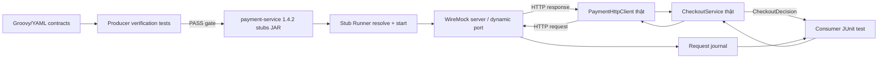
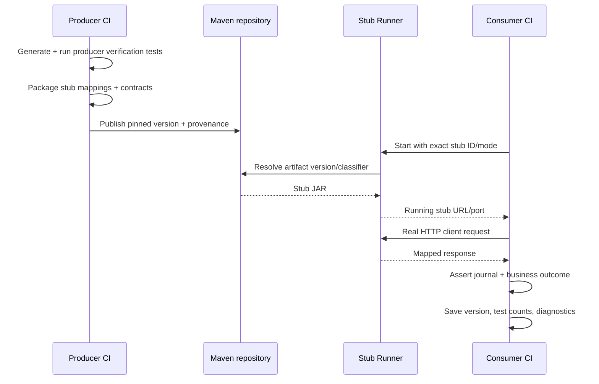

# Đánh giá test consumer có gọi đúng stub và phiên bản không

## 1. Vấn đề: test xanh nhưng có thật sự kiểm tra đúng giao diện không?

**Spring Cloud Contract (SCC)** giúp producer và consumer thống nhất hành vi HTTP hoặc thông điệp bằng **Groovy/YAML DSL**. Producer tạo **generated verification tests** để kiểm tra implementation, đóng gói stub artifact và công bố cho consumer. Consumer dùng **Stub Runner** để lấy stub, khởi chạy HTTP server mô phỏng (thường là WireMock), hoặc tích hợp môi trường messaging test, rồi xác minh mã client thực tế. CI dùng các bằng chứng này để phát hiện thay đổi API không tương thích.

Tuy nhiên, câu “consumer contract test PASS” **chưa đủ**. Một bài test có thể xanh vì:

- `PaymentHttpClient` đã bị mock bằng Mockito, nên không có request HTTP.
- HTTP client thật đang gọi **producer staging** hoặc một mock khác, không phải Stub Runner được cấu hình.
- Stub Runner dùng **version cũ trong local Maven cache** dù release candidate đã đổi.
- Test khai báo stub version `+`, resolver chọn bản mới nhất **khác phiên bản dự kiến**.
- Stub server chạy nhưng không có mapping cho request; WireMock trả `404` mặc định và client coi đó là “không tìm thấy thanh toán”.
- Consumer test chỉ gửi `curl`/`RestClient` được tạo **trong test**, không chạy mã client thật của ứng dụng.
- Dữ liệu trả về lấy từ cache hoặc fixture nội bộ, không đi qua collaborator.
- Một artifact tồn tại với đúng GAV nhưng classifier sai hoặc mappings bị thay đổi sau publication.

**Đề bài của chương Chất lượng hợp đồng:** làm thế nào đánh giá bằng **bằng chứng kỹ thuật có thể kiểm lại** rằng consumer test thực sự gọi **đúng stub**, dùng **đúng artifact version** và xác minh **đúng behavior** mà consumer phụ thuộc?

### 1.1. Kết quả học tập

Sau bài học bạn có thể:

1. Xây dựng **chuỗi bằng chứng** từ contract → verified producer build → artifact → Stub Runner server → request → assertion.
2. Phân biệt `groupId:artifactId:version:classifier:port` với URL HTTP stub và với endpoint production.
3. Cấu hình Stub Runner `CLASSPATH`, `LOCAL`, `REMOTE` phù hợp nguồn artifact.
4. Xác minh application **HTTP client thật** tạo request đúng method/path/headers và được nhận bởi server stub.
5. Sử dụng `@StubRunnerPort`, `StubFinder` và WireMock **request journal** làm công cụ kiểm chứng.
6. Phát hiện `404` giả, client bị mock, cache cũ, mapping trùng và sai version.
7. Tạo **negative controls**: cố ý làm sai path/version trong môi trường test để chắc chắn test đỏ.
8. Thiết kế release CI lưu version đã phân giải, nguồn artifact, checksum, test counts và failure diagnostics.

> **Phạm vi:** Stub Runner xác minh consumer **đối với hành vi mô phỏng từ artifact**. Generated producer verification tests mới là bằng chứng producer implementation của build tương ứng **đáp ứng hợp đồng**. Cần cả hai lớp.

## 2. Bốn bằng chứng độc lập: đúng gói, đúng máy chủ, đúng request, đúng kết quả

Một tiêu chuẩn tối thiểu cho bài test consumer chất lượng:

| Tầng | Câu hỏi | Bằng chứng nên có | Nếu thiếu |
|---|---|---|---|
| **A. Artifact** | Stub có đến từ đúng producer/version/classifier? | GAV, repository/mode, resolved version, checksum khi cần | Có thể test bản cũ hoặc nhầm producer |
| **B. Runtime stub** | Stub Runner có khởi chạy đúng server và nạp mapping? | Port/URL từ `@StubRunnerPort` hoặc `StubFinder`; mappings đã nạp | Có thể test không có dependency thật |
| **C. Traffic** | Mã consumer có **gửi request tới server đó** không? | Request journal/HTTP client instrumentation, method/path/header và matched mapping | Có thể chỉ gọi một client giả hoặc route sai |
| **D. Consumer behavior** | Consumer có xử lý response thành kết quả đúng? | Assertion ở API/service của consumer; success và error paths | Chỉ chứng minh stub phản hồi được |

Bốn tầng này bổ sung nhau: biết đúng version JAR **không** đảm bảo URL của `PaymentHttpClient` trỏ vào nó; thấy request ở WireMock **không** đảm bảo CheckoutService xử lý body đúng; thấy CheckoutService trả `READY` **không** đảm bảo nó đã gọi HTTP.

### 2.1. Sơ đồ đường gọi đáng tin



**Phân biệt hai hướng điều khiển:** `Stub Runner` quản lý **artifact và server**; `PaymentHttpClient` của consumer quyết định **mạng sẽ gọi tới đâu**. Nếu cấu hình client không được đưa về Stub Runner URL, việc khởi chạy stub chỉ là một hoạt động bên lề.

## 3. Ví dụ xuyên suốt: checkout gọi payment

Producer `payment-service` phát hành:

```text
groupId      com.acme.billing
artifactId   payment-service
version      1.4.2
classifier   stubs
stub ID      com.acme.billing:payment-service:1.4.2:stubs
JAR          payment-service-1.4.2-stubs.jar
```

Consumer `checkout-service` gọi:

```http
GET /api/payments/PAY-42 HTTP/1.1
Accept: application/json
```

Kỳ vọng API:

```json
{
  "paymentId": "PAY-42",
  "state": "CAPTURED",
  "amount": 150000,
  "currency": "VND"
}
```

Checkout cần trả `READY` **chỉ khi** thanh toán có cùng ID và `state = CAPTURED`. Khi `state = PENDING` trả `PAYMENT_PENDING`. Khi `404` kèm error code `PAYMENT_NOT_FOUND` trả `PAYMENT_NOT_FOUND`.

Đây là **API giả định để minh họa**, không phải một endpoint mặc định của SCC.

### 3.1. HTTP contract thành công (`200`)

```yaml
name: payment_captured
description: "Thanh toán PAY-42 đã được capture"
request:
  method: GET
  url: /api/payments/PAY-42
  headers:
    Accept: application/json
response:
  status: 200
  headers:
    Content-Type: application/json
  body:
    paymentId: "PAY-42"
    state: "CAPTURED"
    amount: 150000
    currency: "VND"
```

### 3.2. HTTP contract chờ xử lý (`200`)

```yaml
name: payment_pending
description: "Thanh toán PAY-17 vẫn chờ"
request:
  method: GET
  url: /api/payments/PAY-17
response:
  status: 200
  headers:
    Content-Type: application/json
  body:
    paymentId: "PAY-17"
    state: "PENDING"
    amount: 150000
    currency: "VND"
```

### 3.3. HTTP contract không tìm thấy (`404`)

```yaml
name: payment_not_found
description: "Thanh toán PAY-404 không tồn tại"
request:
  method: GET
  url: /api/payments/PAY-404
response:
  status: 404
  headers:
    Content-Type: application/json
  body:
    code: "PAYMENT_NOT_FOUND"
    message: "Payment not found"
```

Các contract cần được producer đưa vào **gói stub phiên bản 1.4.2**. Chỉ có YAML trong bài học **không** làm xuất hiện mapping trong artifact đã phát hành. Sau khi thay đổi contract, producer cần sinh/chạy verification và publish **version/build mới** theo chính sách.

### 3.4. Vì sao cần cả ba tình huống?

Nếu chỉ test `200 CAPTURED`, client có thể bị hỏng ở `404` hoặc parse nhầm `PENDING` thành `READY` mà vẫn xanh. Để biết đúng mapping được kích hoạt, request `PAY-42`, `PAY-17` và `PAY-404` khác nhau, giúp giảm xung đột giữa các stub mappings cùng URL/method.

Một bài test `404` chỉ assert HTTP status có nguy cơ xanh giả: WireMock **cũng trả `404` khi request không khớp mapping**. Bài kiểm tra chất lượng cần đối chiếu **mã lỗi nghiệp vụ hoặc request journal matched status**.

## 4. Version stub: định danh artifact không phải định danh HTTP server

Stub Runner dùng mẫu ID:

```text
groupId:artifactId:version:classifier:port
```

Trong đó `version`, `classifier` và `port` có thể bỏ qua; classifier mặc định thường là `stubs`, port không khai báo được chọn động, version bỏ trống có thể tương đương `+` (phiên bản mới nhất resolver tìm thấy).

Ví dụ:

```text
# Artifact được pin, cổng do Stub Runner chọn
com.acme.billing:payment-service:1.4.2:stubs

# Artifact được pin và yêu cầu server ở port 18081
com.acme.billing:payment-service:1.4.2:stubs:18081

# Tự chọn version mới nhất: không phù hợp làm release gate tái lập
com.acme.billing:payment-service:+:stubs
```

**Tọa độ Maven artifact:** `com.acme.billing:payment-service:1.4.2:stubs`.

**URL HTTP stub:** ví dụ `http://localhost:18081` hoặc `http://localhost:12345`.

**URL producer thật:** ví dụ `https://payments.example.internal`.

Đây là **ba danh tính khác nhau**. Việc một test gọi `http://localhost:18081` không tự chứng minh server trên port đó là Stub Runner server chứa artifact `1.4.2`: một process khác cũng có thể chiếm cổng đó.

### 4.1. CLASSPATH, LOCAL và REMOTE

| `stubsMode` | Nơi lấy artifact | Rủi ro sai version thường gặp |
|---|---|---|
| `CLASSPATH` | Stub JAR trên test classpath | Dependency version/classifier khác; nhiều gói gây nhầm |
| `LOCAL` | Maven local repo (ví dụ `~/.m2`) | Stub cũ còn nằm trong cache; producer chưa `install` bản hiện tại |
| `REMOTE` | Maven-compatible repository | Sai repository, credentials, mirror, snapshot metadata, dùng `+` |

Mode phải khớp **nơi artifact thực sự có mặt**. Consumer test không nên “tự cứu” bằng cách chuyển từ `REMOTE` sang `LOCAL` vì kho remote thiếu artifact; như vậy có thể dùng bản cũ mà không ai biết.

### 4.2. Đặt policy version rõ ràng

- **Release compatibility gate:** pin chính xác version, ghi resolved artifact và nguồn.
- **Forward compatibility job:** có thể thử `+` hoặc một range, nhưng phải ghi lại **version được giải thực tế**.
- **SNAPSHOT:** cần chú ý timestamped snapshot và mutable metadata; khi audit phải có checksum/build provenance.
- **Multi-version support:** chạy **ma trận các cặp consumer build × producer stub version**, không suy từ một job duy nhất.
- **Classifier:** `payment-service:1.4.2:stubs` khác main JAR `payment-service:1.4.2` hoặc custom classifier.

### 4.3. “Có stub đúng tên” khác “có mapping đúng”

Một stub JAR có thể chứa ít mappings hơn kỳ vọng, ví dụ producer vô tình xóa `payment_not_found` hoặc bật `stubsPerConsumer` khiến nó không được nạp cho consumer hiện tại. Vì vậy phải kiểm tra **số lượng/định danh tình huống cần thiết**, không chỉ trạng thái tải artifact thành công.

## 5. Code HTTP client phải là code production của consumer

Ví dụ dùng **Spring Boot 3.2+ / Spring Framework 6.1+** với `RestClient`. Đây là các class minh họa cần đặt trong project consumer thật và bổ sung imports/package phù hợp.

### 5.1. DTO

```java
public record PaymentDto(
    String paymentId,
    String state,
    long amount,
    String currency
) {}
```

`long amount` giả định API trả đơn vị tiền nguyên. Một API khác dùng thập phân có thể cần `BigDecimal` và contract quy định rõ đơn vị.

### 5.2. HTTP client thật, base URL cấu hình được

```java
@Component
public class PaymentHttpClient {
    private final RestClient http;

    public PaymentHttpClient(
            RestClient.Builder builder,
            @Value("${payment.api.base-url}") String baseUrl) {
        this.http = builder.baseUrl(baseUrl).build();
    }

    public PaymentDto loadPayment(String id) {
        return http.get()
            .uri("/api/payments/{paymentId}", id)
            .header("Accept", "application/json")
            .retrieve()
            .body(PaymentDto.class);
    }
}
```

`@Value("${payment.api.base-url}")` đọc URL từ Spring Environment. Trong production, property có thể trỏ tới producer thật; **trong consumer contract test**, property phải trỏ tới stub URL.

Không hard-code production host trong client, không tự fallback về production khi thiếu property và không tạo một HTTP client ad hoc trong test để né `PaymentHttpClient`.

### 5.3. Consumer use case thật

```java
@Service
public class CheckoutService {
    private final PaymentHttpClient payments;

    public CheckoutService(PaymentHttpClient payments) {
        this.payments = payments;
    }

    public CheckoutDecision evaluate(String paymentId) {
        try {
            PaymentDto payment = payments.loadPayment(paymentId);
            if (payment != null
                    && paymentId.equals(payment.paymentId())
                    && "CAPTURED".equals(payment.state())) {
                return new CheckoutDecision(true, "READY");
            }
            return new CheckoutDecision(false, "PAYMENT_PENDING");
        } catch (HttpClientErrorException.NotFound ex) {
            return new CheckoutDecision(false, "PAYMENT_NOT_FOUND");
        }
    }

    public record CheckoutDecision(boolean accepted, String reason) {}
}
```

Cách bắt mọi `404` rồi trả `PAYMENT_NOT_FOUND` chỉ là **mô hình tối giản**. Trong bài test chất lượng phải kiểm tra `404` thật sự đến từ mapping nghiệp vụ, chứ không phải default `404` do không khớp. Hệ thống thực có thể cần `PaymentNotFoundException` và decoder kiểm tra error `code`.

### 5.4. Phản ví dụ: mock đúng class cần kiểm tra

```java
@MockBean
PaymentHttpClient paymentClient;

@Test
void falseSenseOfCoverage() {
    when(paymentClient.loadPayment("PAY-42"))
        .thenReturn(new PaymentDto("PAY-42", "CAPTURED", 150000, "VND"));

    assertTrue(checkoutService.evaluate("PAY-42").accepted());
}
```

Test này có thể có ích như **unit test của CheckoutService**, nhưng **không** phải bằng chứng HTTP client gửi request đúng hoặc Stub Runner chạy mapping đúng. Phân loại test chính xác; đừng ghi “consumer contract test” nếu HTTP boundary bị mock toàn bộ.

## 6. Chạy consumer test với Stub Runner và cổng cố định

Để quan sát rõ đường gọi, ví dụ đầu tiên dùng **port 18081** cố định, trong test chạy riêng và không có process khác chiếm cổng.

Điều kiện: producer đã tạo/`install` `payment-service-1.4.2-stubs.jar` ở Maven local repo, gói chứa ba mappings ở mục 3 và consumer có Spring Boot/SCC test dependencies tương thích.

```java
@SpringBootTest(
    webEnvironment = SpringBootTest.WebEnvironment.NONE,
    properties = {
        "payment.api.base-url=http://localhost:18081"
    }
)
@AutoConfigureStubRunner(
    ids = "com.acme.billing:payment-service:1.4.2:stubs:18081",
    stubsMode = StubRunnerProperties.StubsMode.LOCAL,
    failOnNoStubs = true
)
class CheckoutContractQualityTest {

    @Autowired
    CheckoutService checkoutService;

    @Test
    void capturedPaymentGoesThroughRealClient() {
        CheckoutService.CheckoutDecision result =
            checkoutService.evaluate("PAY-42");

        assertTrue(result.accepted());
        assertEquals("READY", result.reason());
    }

    @Test
    void pendingPaymentIsNotAccepted() {
        var result = checkoutService.evaluate("PAY-17");

        assertFalse(result.accepted());
        assertEquals("PAYMENT_PENDING", result.reason());
    }

    @Test
    void absentPaymentHasOwnBusinessOutcome() {
        var result = checkoutService.evaluate("PAY-404");

        assertFalse(result.accepted());
        assertEquals("PAYMENT_NOT_FOUND", result.reason());
    }
}
```

Ví dụ dùng JUnit 5/Spring Boot test, cần các imports thích hợp và cấu hình `@SpringBootApplication`/`RestClient.Builder` của dự án. **Nó chỉ kiểm tra được mạng khi `PaymentHttpClient` và `CheckoutService` thực sự là beans production, không bị mock/override.**

### 6.1. Điểm mạnh và điểm yếu của ví dụ

**Điểm mạnh:** Spring khởi tạo client thật với URL stub. Gọi `CheckoutService` thật; mọi request đi qua `RestClient` thật nếu không có cache/hook khác.

**Điểm yếu:** Port cố định có nguy cơ xung đột, đặc biệt CI chạy song song. Chỉ assert outcome **chưa đủ để chứng minh port/traffic đúng**, vì stub khác có thể chiếm port hoặc cache làm test không gọi mạng. Cần bổ sung **đối chiếu port Stub Runner** và **request journal** ở các mục sau.

### 6.2. Không gọi producer/staging làm đường dự phòng

Để biết test có “fail closed” khi stub không tồn tại:

- Không cấu hình `payment.api.base-url` mặc định là staging trong test profile.
- Không bắt `Connection refused` rồi trả data fixture thành công.
- Không thay `LOCAL` thành `REMOTE` nếu đang kiểm thử local installed artifact mà chưa xét quy trình.
- Không chạy consumer tests trên máy có proxy/forwarding lặng lẽ chuyển `localhost` sang URL khác.

Mục tiêu là **không có bằng chứng thì test fail**, thay vì tự chuyển sang một nguồn response không kiểm soát.

## 7. Dùng cổng động: quan hệ giữa lifecycle và URL client

Khi bỏ phần `:18081` khỏi Stub ID, Stub Runner chọn cổng động trong khoảng cấu hình. Với test chạy song song, cổng động thường ít xung đột hơn.

```java
@StubRunnerPort("com.acme.billing:payment-service")
int paymentStubPort;
```

Hoặc lấy URL:

```java
@Autowired
StubFinder stubFinder;

URL paymentStubUrl =
    stubFinder.findStubUrl("com.acme.billing", "payment-service");
```

Cần phân biệt **thời điểm Stub Runner tạo server** với **thời điểm Spring tạo PaymentHttpClient**. Nếu class client được khởi tạo trước khi biết port thì không thể chỉ đọc `@StubRunnerPort` trong test instance rồi giả định property đã tồn tại khi bean khởi tạo.

### 7.1. Một bài test cổng động dùng production classes

Để tránh vấn đề Spring context lifecycle, có thể khởi tạo **chính hai class production** sau khi Stub Runner đã chạy:

```java
@SpringBootTest(webEnvironment = SpringBootTest.WebEnvironment.NONE)
@AutoConfigureStubRunner(
    ids = "com.acme.billing:payment-service:1.4.2:stubs",
    stubsMode = StubRunnerProperties.StubsMode.LOCAL,
    failOnNoStubs = true
)
class CheckoutDynamicPortTest {
    @StubRunnerPort("com.acme.billing:payment-service")
    int paymentPort;

    @Autowired
    RestClient.Builder restClientBuilder;

    @Test
    void realClientCallsRunnerAssignedPort() {
        assertTrue(paymentPort > 0);

        String baseUrl = "http://localhost:" + paymentPort;
        PaymentHttpClient realClient =
            new PaymentHttpClient(restClientBuilder, baseUrl);
        CheckoutService realCheckout =
            new CheckoutService(realClient);

        var result = realCheckout.evaluate("PAY-42");

        assertTrue(result.accepted());
        assertEquals("READY", result.reason());
    }
}
```

Test này kiểm tra **logic production classes và HTTP transport**, nhưng **không kiểm tra Spring autowiring `payment.api.base-url`**: test chủ động dựng chúng qua constructor. Nếu wiring Spring là một rủi ro cần bảo vệ, hãy bổ sung test cấu hình profile/cổng cố định hoặc thiết kế một test configuration/factory có lifecycle bảo đảm Stub Runner URL được inject đúng thời điểm.

### 7.2. Không gọi `@DynamicPropertySource` sai lifecycle

`@DynamicPropertySource` thường là phương thức **static** dùng khi dựng Spring application context. `@StubRunnerPort` lại được inject vào **test instance** theo lifecycle Stub Runner. Đọc field đó quá sớm có thể lấy `0` hoặc chưa có giá trị.

Chỉ dùng dynamic property binding khi biết chính xác Stub Runner/server đã sẵn sàng trước khi Spring tạo HTTP client. Nếu không chắc, dùng mô hình constructor/factory minh bạch ở mục 7.1 hoặc tích hợp Stub Runner Spring Cloud discovery được tài liệu của phiên bản hiện tại hỗ trợ.

### 7.3. Nhiều stubs và service IDs

Nếu cùng test chạy `payment-service` và `inventory-service`:

```java
@AutoConfigureStubRunner(
    ids = {
        "com.acme.billing:payment-service:1.4.2:stubs",
        "com.acme.catalog:inventory-service:3.0.0:stubs"
    },
    stubsMode = StubRunnerProperties.StubsMode.LOCAL
)
```

mỗi collaborator có HTTP server/port riêng. Dùng **groupId:artifactId** khi lấy port để không nhầm các producers trùng artifactId:

```java
@StubRunnerPort("com.acme.billing:payment-service")
int paymentPort;

@StubRunnerPort("com.acme.catalog:inventory-service")
int inventoryPort;
```

Không gán nhầm `inventoryPort` cho payment client, và không nghĩ `@AutoConfigureStubRunner` tự thay mọi base URL nếu ứng dụng đã hard-code endpoint.

## 8. Xác nhận có HTTP traffic thật: WireMock request journal

**Request journal** của WireMock ghi các request server nhận được. Nó cho phép kiểm tra method, URL, headers và đôi khi biết request có **matched** với một stub mapping hay không. Đây là lớp kiểm tra mạnh để loại bỏ false positives từ mock/cache hoặc request sai path.

WireMock cung cấp các HTTP admin endpoints như:

```text
GET    /__admin/requests
GET    /__admin/requests/unmatched
DELETE /__admin/requests
POST   /__admin/requests/count
```

Các endpoint này áp dụng cho **server WireMock mà Stub Runner quản lý** trong test environment, không phải API của producer thật. Không bật WireMock admin endpoint cho môi trường production của ứng dụng chỉ để debug contract tests.

### 8.1. Đếm request sau khi gọi CheckoutService

Sau khi biết `paymentPort` từ Stub Runner, test có thể dùng `RestClient` riêng **chỉ để hỏi admin request journal**, còn **business request vẫn phải đi qua CheckoutService thật**.

Pseudocode minh họa:

```text
paymentStubUrl = StubFinder.findStubUrl(payment producer)

clearRequestJournal(paymentStubUrl)   # test setup, không xóa mappings
result = checkoutService.evaluate("PAY-42")
assert result == READY

events = GET paymentStubUrl + "/__admin/requests"
assert có ít nhất một event:
  method = GET
  url = "/api/payments/PAY-42"
  wasMatched = true
```

Đây là **pseudocode**, không phải API Java có sẵn. Cần viết HTTP admin client/JSON parser hoặc dùng WireMock Java verification API với base URL đã cấu hình.

### 8.2. Vì sao reset journal trước mỗi ca test?

Nếu toàn bộ test class dùng chung Stub Runner instance, journal có thể chứa request từ test trước. Một test không gửi request mới vẫn thấy sự kiện cũ, dẫn đến xanh giả. Vì vậy:

- Xóa **request journal**, không xóa mọi mappings.
- Gọi consumer **sau khi** reset.
- Đọc journal ngay sau request và assert theo test ID/URL/header.
- Với tests chạy song song trên cùng stub server, không reset toàn cục giữa hai tests; dùng server cô lập hoặc correlation ID.

**Quan trọng:** WireMock request journal có thể bị vô hiệu hóa vì hiệu năng; nếu tắt, bước verify request sẽ không hoạt động. Đảm bảo tính năng bật trong môi trường contract quality tests.

### 8.3. Request đã nhận nhưng chưa chắc mapping đúng

Một event có method/path đúng chứng minh request đã đến stub server. Nhưng có thể **không khớp** vì:

- Header `Accept`/`Authorization` sai.
- Query param thiếu hoặc sai kiểu.
- JSON body không đáp ứng matcher.
- Mapping được lọc bởi `stubsPerConsumer`.
- Một mapping khác bắt request rộng hơn.

Vì vậy với WireMock API `/__admin/requests`, kiểm tra `wasMatched` khi cần; với `/__admin/requests/unmatched`, xác minh không có request liên quan trong danh sách unmatched. Nếu có mappings rất rộng, request vẫn có thể matched nhầm: kiểm tra mapping identity/response semantics và thiết kế request matcher rõ ràng.

### 8.4. Không dựa vào `404` HTTP status đơn lẻ

```text
GET /api/payments/PAY-404  → 404 PAYMENT_NOT_FOUND (contract)
GET /api/payments/PAY-404?unexpected=1 → 404 (có thể no matching stub)
```

Hai response cùng status nhưng **nguồn gốc khác nhau**. Với error contract, hãy kiểm tra **body code** như `PAYMENT_NOT_FOUND` và request journal matched information, không chỉ `HttpClientErrorException.NotFound`.


## 9. Bài test chứng minh có HTTP request khớp mapping

Ví dụ này kết hợp **ba lớp bằng chứng**: consumer production classes gửi HTTP, WireMock ghi nhận request `matched` và logic checkout trả kết quả đúng. Vì dùng cổng động, test dựng production classes bằng constructor **sau khi Stub Runner khởi chạy**. Đây vẫn là mã client thật, nhưng chưa kiểm chứng Spring bean injection của base URL.

```java
import com.fasterxml.jackson.databind.JsonNode;
import java.util.stream.StreamSupport;
import org.junit.jupiter.api.Test;
import org.springframework.beans.factory.annotation.Autowired;
import org.springframework.boot.test.context.SpringBootTest;
import org.springframework.cloud.contract.stubrunner.spring.AutoConfigureStubRunner;
import org.springframework.cloud.contract.stubrunner.spring.StubRunnerProperties;
import org.springframework.cloud.contract.stubrunner.spring.StubRunnerPort;
import org.springframework.web.client.RestClient;
import static org.junit.jupiter.api.Assertions.*;

@SpringBootTest(webEnvironment = SpringBootTest.WebEnvironment.NONE)
@AutoConfigureStubRunner(
    ids = "com.acme.billing:payment-service:1.4.2:stubs",
    stubsMode = StubRunnerProperties.StubsMode.LOCAL,
    failOnNoStubs = true
)
class CheckoutTrafficEvidenceTest {

    @StubRunnerPort("com.acme.billing:payment-service")
    int paymentPort;

    @Autowired
    RestClient.Builder restClientBuilder;

    @Test
    void actualClientMustCallMatchingStub() {
        assertTrue(paymentPort > 0);

        String stubUrl = "http://localhost:" + paymentPort;
        RestClient admin = RestClient.create(stubUrl);

        // Xóa riêng request journal, không xóa mapping.
        admin.delete().uri("/__admin/requests")
            .retrieve().toBodilessEntity();

        PaymentHttpClient realClient =
            new PaymentHttpClient(restClientBuilder, stubUrl);
        CheckoutService realCheckout =
            new CheckoutService(realClient);

        var result = realCheckout.evaluate("PAY-42");
        assertTrue(result.accepted());
        assertEquals("READY", result.reason());

        JsonNode journal = admin.get()
            .uri("/__admin/requests")
            .retrieve()
            .body(JsonNode.class);

        assertNotNull(journal);
        boolean matched = StreamSupport.stream(
                journal.path("requests").spliterator(), false)
            .anyMatch(event ->
                event.path("wasMatched").asBoolean(false)
                && "GET".equals(
                    event.path("request").path("method").asText())
                && "/api/payments/PAY-42".equals(
                    event.path("request").path("url").asText()));

        assertTrue(matched, "The client must reach a matching stub");
    }
}
```

**Điều kiện:** bài test cần dependency JUnit 5, Spring Boot, SCC Stub Runner, Jackson, `RestClient`, hai production classes ở mục 5 và artifact chứa mapping `payment_captured`. Import/packaging của class consumer cần điều chỉnh theo project thật. Đừng copy riêng test mà bỏ qua setup producer stub.

### 9.1. Test này chứng minh gì?

- `paymentPort` do Stub Runner cung cấp, không suy đoán hoặc hard-code.
- Request journal được reset **trước khi** gọi use case nên giảm nguy cơ đọc traffic cũ.
- Request `GET /api/payments/PAY-42` có `wasMatched = true`.
- Kết quả nghiệp vụ `READY` đến sau HTTP call của **production client**.

### 9.2. Test này chưa chứng minh gì?

- Chưa chứng minh producer bản `1.4.2` **đã chạy verification tests**; đó là trách nhiệm producer CI.
- Chưa test Spring autowiring của `payment.api.base-url` vì test tạo client qua constructor; cần test ở mục 6 hoặc test configuration phù hợp.
- Chưa chứng minh artifact đã resolve **đúng nguồn/checksum**; cần artifact provenance ở CI.
- Nếu WireMock có mappings trùng/regex quá rộng, `wasMatched=true` có thể là **mapping khác** với mapping chủ đích.
- Nếu nhiều tests cùng reset journal trên một stub server, test có thể flaky. Cần isolation hoặc correlation IDs.

### 9.3. Kiểm chứng đúng mapping, không chỉ bất kỳ mapping nào

Khi có mappings chồng lấn, kiểm tra thêm **response semantics**, request headers và **mapping ID** của serve event (khi phù hợp). Một response thành công từ mapping `GET /api/payments/.*` quá rộng chưa chắc chứng minh contract `payment_captured` đã được nạp đúng.

Không chèn một mapping thủ công vào WireMock trong consumer test rồi coi đó là mapping của artifact producer. Nếu cần fault injection riêng, hãy phân biệt nó với consumer-driven contract tests.

## 10. Phân biệt `404` nghiệp vụ với WireMock unmatched

Hai trường hợp có cùng HTTP status nhưng ý nghĩa khác nhau:

```text
A. Request khớp contract payment_not_found
   GET /api/payments/PAY-404
   → HTTP 404 {"code":"PAYMENT_NOT_FOUND"}

B. Request không khớp stub nào
   GET /api/payment/PAY-404
   → HTTP 404 mặc định của WireMock
```

Nếu consumer bắt mọi `HttpClientErrorException.NotFound` và trả `PAYMENT_NOT_FOUND`, một test chỉ assert reason có thể PASS cả với case B.

### 10.1. Kiểm tra error body

Với production `PaymentHttpClient` đã trỏ đúng stub server, có thể bổ sung:

```java
@Test
void notFoundMustHaveContractErrorCode() throws Exception {
    var error = assertThrows(
        HttpClientErrorException.NotFound.class,
        () -> paymentHttpClient.loadPayment("PAY-404")
    );

    JsonNode body = objectMapper.readTree(
        error.getResponseBodyAsString());

    assertEquals("PAYMENT_NOT_FOUND",
        body.path("code").asText());
}
```

Đây là **trích đoạn test**; `paymentHttpClient` và `objectMapper` phải được inject từ context/test setup phù hợp. Nếu WireMock trả 404 mặc định mà không có body như hợp đồng, assertion sẽ đỏ.

### 10.2. Kiểm tra journal matched và unmatched

Sau khi gọi `PAY-404`:

- Xác nhận server nhận `GET /api/payments/PAY-404`.
- Xác nhận event `wasMatched = true`, nếu tính năng request journal được bật.
- Kiểm tra `/__admin/requests/unmatched` khi nghi request sai mapping.
- Xác nhận response body có `code = PAYMENT_NOT_FOUND`.
- Assert CheckoutService xử lý lỗi thành business outcome phù hợp.

**Lưu ý:** HTTP `404` do **Maven repository** không tìm thấy artifact cũng là lỗi hoàn toàn khác. Khi thiếu stub JAR, test chưa đến giai đoạn gửi HTTP đến `/api/payments`.

## 11. Kiểm tra phiên bản artifact **đã nạp** chứ không chỉ version viết trong annotation

Khai báo `ids = "com.acme.billing:payment-service:1.4.2:stubs"` thể hiện **version mong muốn**, chưa tự chứng minh những bytes đã tải đúng bản mà producer phát hành.

Để xác nhận:

1. **GAV/classifier:** kiểm tra `groupId`, `artifactId`, `version`, `classifier` và mode.
2. **Nguồn:** xác định dependency classpath, local Maven repository hoặc remote repository thực tế.
3. **Artifact contents:** kiểm tra stub JAR có đúng layout `META-INF` và mappings.
4. **Provenance:** lưu producer commit, contract revision, generated producer test report và checksum được công bố.
5. **Runtime:** xác định Stub Runner URL/port, registered mappings và request journal.
6. **Consumer:** test business outcome và errors bằng client production code.

### 11.1. Bảng bằng chứng theo mode

| Mode | Cần lưu trong CI | Nguy cơ |
|---|---|---|
| `CLASSPATH` | Resolved dependency tree, test classpath, version/classifier | Dependency conflict chọn gói khác |
| `LOCAL` | Artifact file path/version, provenance của bản `install` | Maven cache chứa bản cũ |
| `REMOTE` | Repository root, resolved coordinates, checksum | Mirror/snapshot/credentials làm tải nhầm |

Không suy ra version từ response `CAPTURED`: hai gói P1 và P2 có thể trả JSON **giống nhau**. Port WireMock cũng không có ý nghĩa version.

### 11.2. Kiểm tra cấu trúc stub JAR

Một cấu trúc phổ biến:

```text
META-INF/
  com.acme.billing/
    payment-service/
      1.4.2/
        contracts/
          payments/payment-captured.yml
        mappings/
          ...payment-captured.json
```

Trong một môi trường có JDK, có thể kiểm tra bản JAR **đã tải đúng nguồn**:

```bash
jar tf payment-service-1.4.2-stubs.jar
```

Đối chiếu mapping mong đợi, artifact version và classifier. Không sửa JAR trực tiếp; nếu thiếu mapping, sửa Groovy/YAML DSL hoặc cấu hình SCC generator, rồi build/publish lại đúng quy trình.

### 11.3. Chuỗi provenance tối thiểu

```text
Producer commit: a1b2c3d
Contract revision: d4e5f6a
Producer verification: PASS, generated tests executed
Artifact: com.acme.billing:payment-service:1.4.2:stubs
Repository: approved release repository
SHA-256: digest of the published JAR
Consumer commit: c8d9e0f
Stub Runner mode: REMOTE
Resolved artifact: same GAV/digest as release record
Consumer HTTP + request journal tests: PASS
```

Các mã commit là **minh họa**, không phải record thật. Checksum chỉ có giá trị integrity khi được đối chiếu với **nguồn tin cậy**; nếu một người có thể thay cả JAR lẫn checksum trong cùng repository, riêng checksum không chứng minh publisher identity.

### 11.4. `+` và SNAPSHOT không phải release proof bất biến

```text
com.acme.billing:payment-service:+:stubs
com.acme.billing:payment-service:1.5.0-SNAPSHOT:stubs
```

Version `+` hữu ích để thử forward compatibility với bản mới nhất. Nhưng khi repository cập nhật, cùng consumer commit có thể lấy gói khác giữa các lần CI. SNAPSHOT cũng có thể thay nội dung. **Release gate nên pin version**, hoặc bảo đảm resolved timestamp/checksum/provenance được lưu đầy đủ.

### 11.5. Producer verification là gate độc lập

Stub Runner tải stub JAR và chạy mappings, nhưng không thực thi generated producer tests cho implementation producer. Bài test consumer xanh chỉ có ý nghĩa đối với **gói stub đã dùng**, không bảo đảm producer mới đang triển khai đúng contract.

Producer pipeline nên sinh và chạy tests **trước khi publish**, hoặc gắn rõ artifact là `in-progress/unverified` nếu tổ chức cho phép phát hành sớm để consumer phát triển song song.

## 12. Xem mappings đã đăng ký và kiểm tra lọc theo consumer

Stub Runner hỗ trợ xuất mappings qua `mappingsOutputFolder` (theo phiên bản tài liệu) hoặc property `spring.cloud.contract.stubrunner.mappings-output-folder` để hỗ trợ debug.

Ví dụ:

```java
@AutoConfigureStubRunner(
    ids = "com.acme.billing:payment-service:1.4.2:stubs",
    stubsMode = StubRunnerProperties.StubsMode.REMOTE,
    repositoryRoot =
        "https://repo.example.org/repository/maven-releases/",
    mappingsOutputFolder = "target/registered-mappings"
)
```

Đường `target` phù hợp với project Maven; Gradle project có thể dùng path khác. Output này giúp xem **các mappings server đang đăng ký**, nhưng **không tự xác thực** artifact checksum hay việc consumer thật đã gọi mapping nào.

### 12.1. Mappings trùng, regex rộng và request matching

Ví dụ:

```text
Mapping A:
  GET /api/payments/PAY-42 → 200 CAPTURED

Mapping B:
  GET /api/payments/.* → 200 PENDING
```

Hai mappings có thể chồng lấn. Nếu request được mapping B bắt trong khi test mong mapping A, `wasMatched = true` vẫn không đủ. Khi đó phải kiểm tra matched stub mapping ID, request conditions/priority và response semantics; thiết kế matcher đủ chặt để bảo vệ contract.

### 12.2. `stubsPerConsumer` thay đổi tập mapping

Nếu contracts được đặt theo thư mục consumer, ví dụ:

```text
contracts/
  checkout-service/payment-captured.yml
  reporting-service/payment-summary.yml
```

và test dùng:

```java
@AutoConfigureStubRunner(
    ids = "com.acme.billing:payment-service:1.4.2:stubs",
    stubsPerConsumer = true,
    consumerName = "checkout-service"
)
```

Stub Runner có thể chỉ đăng ký mappings của `checkout-service` theo folder convention. Một mapping có trong JAR nhưng **không được đăng ký** vì `consumerName` sai vẫn khiến request unmatched.

Vì vậy trong báo cáo chẩn đoán cần ghi **consumerName, stubsPerConsumer, active Spring profiles và danh sách registered mappings**. Tính năng này **lọc theo consumer name**, không tự lựa chọn phiên bản binary C1/C2.


## 13. Khi client dùng Feign, service discovery hoặc cache

Không phải consumer nào cũng dùng `@Value` để inject URL trực tiếp. Một số ứng dụng dùng `OpenFeign`, `@LoadBalanced RestClient` hoặc `WebClient`, API gateway và service discovery. SCC Stub Runner có tích hợp **Spring Cloud discovery/load balancer**, nhưng không thể mặc định mọi client đều được định tuyến đúng.

### 13.1. Các con đường gọi sai thường gặp

| Kiến trúc | Rủi ro | Bằng chứng nên thu |
|---|---|---|
| Feign có `url` cấu hình cố định | Bỏ qua service discovery stubbed | Outgoing URL và request journal tại stub |
| Feign dùng `name`/service ID | Artifact ID khác service ID thực | Kiểm tra `ids-to-service-ids` và resolved instance |
| Load-balanced WebClient | Cache instance/stale service discovery | Traces hoặc journal của đúng Stub Runner server |
| HTTP proxy/gateway | Route hoặc rewriting làm path/header khác | Request thực WireMock nhận được |
| Consumer có cache | Không tạo outbound request trong test | Clear/đóng scope cache, kiểm tra request journal mới |
| Resilience fallback | Stub lỗi nhưng service trả default success | Negative control cho connection failure |
| Nhiều stubs cùng chạy | Payment client gọi inventory server | Đối chiếu server URL và group/artifact ID |

### 13.2. Không chỉ tin annotation

`@AutoConfigureStubRunner` chứng minh bài test **yêu cầu** Stub Runner chạy một danh sách stubs. Nó **không chứng minh** client Feign/WebClient/RestClient thật đã tự dùng chúng.

Một quy trình đánh giá đúng:

1. Xác định client bean production được use case gọi.
2. Xác định base URL/service ID sau khi Spring profiles, config precedence và discovery áp dụng.
3. Lấy Stub Runner server URL/port do framework cung cấp.
4. Gọi use case thật bằng input có thể truy vết.
5. Kiểm tra request journal của **đúng stub server**.
6. Assert response decoding và business outcome.
7. Xác nhận không có request đến host staging/production khi test.

### 13.3. Test Spring wiring và test mã client là hai mục tiêu khác nhau

Nếu test tự khởi tạo `new PaymentHttpClient(builder, stubUrl)`, đó là kiểm tra **production class + HTTP transport**, nhưng **không** kiểm tra property `payment.api.base-url` có được Spring inject đúng vào bean lúc app khởi tạo hay không.

Nếu yêu cầu gồm cả wiring:

- Dùng test profile với **cổng cố định được kiểm soát** (ví dụ mục 6) để Spring khởi tạo bean thật từ property.
- Hoặc dùng test configuration/client factory bảo đảm URL stub có sẵn đúng lifecycle.
- Hoặc sử dụng Stub Runner Spring Cloud discovery integration theo phiên bản đang dùng.

Mỗi test nên ghi rõ **mục tiêu đang bảo vệ** thay vì gán tên `EndToEndContractTest` cho một unit test chỉ tạo DTO bằng mock.

## 14. Negative controls: cố tình làm sai để chứng minh test đủ nhạy

Một kỹ thuật đánh giá mạnh là kiểm tra rằng test **thất bại khi một trong các giả định cần bảo vệ bị vi phạm**. Gọi đây là **sensitivity check** hoặc negative control trong môi trường test cô lập.

| Thay đổi có chủ đích | Kết quả đúng kỳ vọng | Phát hiện loại xanh giả |
|---|---|---|
| Đổi client URL sang port không chạy stub | Fail kết nối/journal không có request | Mock client, fallback hoặc cache |
| Đổi `GET` sang `POST` | Request unmatched, test fail | Không thật sự kiểm tra method |
| Đổi `/api/payments/PAY-42` thành path sai | Fail mapping hoặc behavior | Regex quá rộng/test bỏ qua URL |
| Bỏ `Accept` nếu contract yêu cầu | Mapping mismatch | Header không được xác minh |
| Gỡ mapping `payment_not_found` trong stub fixture riêng | Error-body test fail | Mặc định 404 bị coi là business 404 |
| Dùng Stub ID version không tồn tại | Stub Runner fail resolution | Tải phiên bản gần đúng/fallback local |
| Trỏ payment client sang inventory port | Fail request journal/semantics | Nhầm collaborator |
| Đổi `state` thành `PENDING` | Checkout không còn `READY` | Assertion không phụ thuộc payload |
| Làm mất một field bắt buộc trong response test | DTO/validation/business assertion fail | Decoder được mock hoặc logic không kiểm tra |
| Xóa cache trước test, buộc gọi mạng | Journal có request mới | Kết quả có sẵn trong cache |
| Cố ý không khởi chạy Stub Runner | Fail, không “skip” test | Test không có dependency thật |
| Chạy version P1 thay P2 trong compatibility job | Report phải cho thấy version P1 | Không kiểm chứng artifact identity |

### 14.1. Không phá artifacts đã publish

Các negative controls trên phải thực hiện bằng **test profile, branch tách biệt, stub fixture riêng hoặc CI job có chủ đích**. Không ghi đè `payment-service-1.4.2-stubs.jar` trong release repository hoặc sửa production config để làm một bài thử.

Có thể đưa subset vào CI định kỳ. Quan trọng là bài test thật **có khả năng fail khi behavior cần bảo vệ sai**, không nhất thiết chạy mọi mutation trên từng commit.

### 14.2. Test vẫn PASS khi stub bị vô hiệu hóa: kiểm tra ngay

Nếu Stub Runner không tải được artifact mà test vẫn PASS, xem lần lượt:

- `@Disabled`, test discovery/runner hoặc Maven/Gradle đã skip test?
- `@MockBean`/Mockito đã thay HTTP client?
- Test thực sự gọi đúng `CheckoutService`?
- Cache hay fallback có trả success?
- `failOnNoStubs` có bị đặt `false`?
- Artifact khác có được resolve từ local classpath hoặc repository mirror?
- Spring profile có active đúng không?
- Một WireMock server khác có trả dữ liệu?
- Assertions có đang kiểm tra giá trị hằng thay vì result?

**Không chữa lỗi bằng cách sửa test để PASS**; hãy khôi phục đường đi có thể chứng minh và failure rõ ràng.

## 15. Một thang đánh giá chất lượng test có thể dùng khi review

Để tránh đánh giá bằng trực giác “nhìn có vẻ đã dùng Stub Runner”, có thể dùng **bảng bằng chứng** sau. Điểm số chỉ mang tính **quy ước review của nhóm**, không phải thang điểm chính thức của Spring Cloud Contract.

| Trụ cột | Chưa đạt | Đạt |
|---|---|---|
| **Nguồn stub** | Dùng `+`/cache không rõ artifact | Pin version/classifier và ghi resolved source |
| **Runtime identity** | Chỉ có annotation | Stub Runner chạy đúng group/artifact, có URL/port được xác nhận |
| **Client thực** | Mock `PaymentHttpClient` hoặc client ad hoc | Use case chạy production HTTP client |
| **Request evidence** | Chỉ assert response/status | Request journal hoặc trace chứng minh HTTP tới đúng stub |
| **Mapping evidence** | `404` cũng được coi pass | Có matched mapping và kiểm tra error body/semantics |
| **Business assertions** | Assert không phụ thuộc kết quả | Assert DTO/outcome cho success và error paths |
| **Release provenance** | Không biết producer build nào phát hành | Có producer verification report và artifact checksum |
| **Sensitivity** | Test vẫn xanh khi stub vắng | Negative controls làm test fail đúng nguyên nhân |

### 15.1. Điều kiện chặn phát hành

Một release gate có thể yêu cầu **tất cả** điều kiện thiết yếu:

1. Stub version được pin và xuất hiện đúng artifact trong log/release record.
2. Test class thực sự chạy; không có `0 tests` hoặc disabled suite ngoài chủ đích.
3. Stub Runner nạp mappings yêu cầu, không dùng fallback im lặng.
4. Consumer code thật gọi đúng server stub, có evidence phù hợp.
5. Có assertions cho các field và error cases mà consumer phụ thuộc.
6. Producer verification cho artifact đang dùng đã đạt, hoặc artifact được gắn `unverified` và không dùng như release proof.
7. Không có accidental production/staging network calls từ test.

Có thể lượng hóa coverage theo **số tương tác quan trọng đã kiểm thử / số tương tác bắt buộc**, nhưng không nên tối ưu con số bằng cách loại bỏ contract hoặc assert thừa vô nghĩa.

### 15.2. Phân cấp chất lượng cho mục tiêu khác nhau

| Mức | Mô tả | Có thể khẳng định |
|---|---|---|
| **Unit logic** | Mockito mock HTTP client | Logic consumer trước DTO giả |
| **HTTP client integration** | Client thật gọi WireMock do test tự cấu hình | HTTP client behavior với fixture test |
| **SCC consumer contract test** | Client thật + Stub Runner artifact producer + matching request | Consumer tương thích với hành vi stub đã phát hành |
| **Traceable release compatibility** | Thêm pin/resolved version, producer verification, artifact integrity, CI matrix | Bằng chứng có thể truy vết theo build/contract |
| **Integration/E2E** | Client và producer implementations thật cùng chạy | Tích hợp thực ở môi trường đã kiểm tra |

**Không gộp tên**: một bài consumer contract test không tự chứng minh TLS gateway, database schema migration hoặc producer production hiện đang chạy đúng bản.

## 16. CI gate: lưu đủ thông tin để tái lập test

Một pipeline chất lượng nên có đường đi:



### 16.1. Ví dụ cấu hình `REMOTE` cho release gate

```yaml
spring:
  cloud:
    contract:
      stubrunner:
        stubs-mode: REMOTE
        repository-root: "https://repo.example.org/repository/maven-releases/"
        ids:
          - "com.acme.billing:payment-service:1.4.2:stubs"
        fail-on-no-stubs: true
        mappings-output-folder: "target/stub-mappings"
```

Tài liệu SCC xác nhận các properties ở đây (tên relaxed kebab-case của Spring). File test profile không nên chứa credentials thật; nếu repository private, cấp read-only identity qua CI secrets.

**Nhớ:** `mappings-output-folder` là diagnostic output, không phải bằng chứng request đã tới server. `fail-on-no-stubs` đảm bảo không bỏ qua hoàn toàn việc thiếu stubs, nhưng **không** bảo đảm mọi mapping bắt buộc trong artifact đều có mặt.

### 16.2. Những trường nên lưu vào báo cáo

```text
consumer service + commit/version
producer service + expected version
resolved stub artifact coordinates + classifier
repository source/mode
artifact digest/provenance reference
SCC/Stub Runner version
consumerName/stubsPerConsumer if enabled
running stub server URL/port (non-sensitive)
registered mapping names/count (as applicable)
consumer test names/count/status
request journal matched/unmatched summary
producer verification test report reference
CI job/run/build identifiers
```

Không ghi tokens, cookies, PII hoặc payload nhạy cảm vào report. Nếu cần lưu request journal để debug, redact dữ liệu trước khi publish CI artifacts.

### 16.3. Producer version và consumer version có thể được triển khai độc lập

Với producer `P1 = 1.4.2`, `P2 = 1.5.0` và consumer `C1 = 2.8.0`, `C2 = 3.0.0`:

| Consumer build | Producer stub version | Mục tiêu |
|---|---|---|
| C1 | P1 | Baseline |
| C1 | P2 | Producer mới không phá consumer cũ |
| C2 | P1 | Consumer mới chịu được producer cũ khi rollback/rollout cần |
| C2 | P2 | Pair mới tương thích |

Các ô là **kế hoạch kiểm thử**, không phải kết quả thực chạy. Mỗi CI job cần dùng **đúng artifact version cho ô đó** và lưu PASS/FAIL/NOT TESTED rõ ràng. Nếu `C2/P1` được tuyên bố không hỗ trợ, cần điều kiện routing/deployment bảo đảm cặp này không thể xuất hiện.

### 16.4. Đừng để build xanh khi `0 tests`

Kiểm tra JUnit test reports, số tests thực thi, các trường hợp `@Disabled` và cấu hình Maven Surefire/Gradle Test task. Một job có thể tải stub thành công nhưng không hề gọi consumer test nếu test discovery bị lỗi.

Trong release CI, một suite bắt buộc mà chạy `0 tests` nên bị xem là **không đủ bằng chứng**, không tự động được tính như PASS.

## 17. Với messaging contract, “đã tải stub” chưa chắc message handler đã chạy

SCC không chỉ kiểm thử HTTP. Với messaging, contract có thể mô tả **destination, headers, body, triggeredBy và label**. Consumer dùng Stub Runner messaging integration để nhận thông điệp mô phỏng qua adapter/binder/broker test phù hợp.

Ở đây **không có HTTP WireMock request journal** để chứng minh consumer nhận một Kafka/RabbitMQ message. Cần bằng chứng theo kênh thực tế:

| Tầng | Messaging evidence |
|---|---|
| Artifact | Đúng gói stubs/contract version |
| Stub registration | Label/message definition được Stub Runner nạp |
| Routing | Destination/topic/queue/binding phù hợp test setup |
| Receipt | Consumer handler/test listener thật nhận message |
| Decode | Payload schema/headers được deserialize đúng |
| Business effect | Handler tạo kết quả/trạng thái có thể assert |
| Broker semantics | Integration test riêng cho ack/retry/DLQ/partition/backpressure khi cần |

### 17.1. Ví dụ message contract

```yaml
description: "Thanh toán đã capture"
label: payment_captured
input:
  triggeredBy: emitPaymentCaptured()
outputMessage:
  sentTo: payments.events
  headers:
    eventType: PAYMENT_CAPTURED
    contentType: application/json
  body:
    paymentId: "PAY-42"
    amount: 150000
    currency: "VND"
```

Đây là **contract minh họa**. `emitPaymentCaptured()` là phương thức producer cần hiện thực/fixture phù hợp; SCC không tự định nghĩa nghiệp vụ thanh toán.

### 17.2. Test nên chứng minh message handler thật nhận dữ liệu

Một handler test có thể ghi nhận input qua test sink/in-memory channel phù hợp, nhưng không nên mock toàn bộ handler đang cần kiểm tra. Dùng message source do Stub Runner điều khiển theo contract và assert domain effect.

Nếu hệ thống phụ thuộc Kafka partition key, DLQ, exactly-once-like semantics, schema registry hoặc reprocessing, cần **broker integration tests** riêng. Stub Runner không tự chứng minh semantics của broker production.

## 18. Chẩn đoán theo thứ tự thay vì sửa nhầm tầng

| Triệu chứng | Tầng nghi ngờ | Cách xác minh |
|---|---|---|
| Stub Runner không tải được JAR | Artifact/repository | GAV, version, classifier, mode, credentials |
| `LOCAL` test xanh nhưng `REMOTE` đỏ | Source/version khác | Kiểm tra `~/.m2` và remote artifact provenance |
| Stub server khởi động nhưng mapping cần không có | Registration | `mappingsOutputFolder`, folder filter, `stubsPerConsumer` |
| `@StubRunnerPort` trả port khác URL client | Client wiring | Đọc resolved client config, tránh hard-code |
| Test trả `READY` nhưng journal trống | Mock/cache/fallback | Gọi production client, reset cache |
| Journal có GET sai URL | Client request construction | Path/query encoding, base URL |
| Journal có request `wasMatched=false` | Contract matching | Method, path, headers, query, body |
| Journal matched mapping khác | Mappings conflict | Priorities/matcher width/mapping IDs |
| Test `404` xanh khi mapping bị gỡ | Default 404 giả | Assert error body và matched event |
| Consumer HTTP client decode lỗi | Schema/DTO | Content-Type, type, nullability, field names |
| Test xanh với `+` nhưng thất bại khi pin P2 | Artifact drift | Resolved version và repository state |
| Test không fail khi stub vắng | Test quality | `failOnNoStubs`, mock/caching/test discovery |
| CI reports `0 tests` | Runner configuration | JUnit engines, test includes, skip flags |
| Producer code mới sai dù consumer test xanh | Producer verification | Chạy generated producer tests của đúng build |
| CI song song không ổn định | Test isolation | Port động, request journal reset, shared cache |
| Feign vẫn gọi staging | Discovery/config | Service ID, URL property, traffic journal |
| Stub JAR có đúng tên nhưng khác digest | Artifact immutability | Source provenance, policy publish/cache |

### 18.1. Quy trình điều tra năm bước

**A — Resolve:** Stub artifact có đúng GAV/classifier và được tải từ nguồn đã chọn không?

**B — Register:** Stub Runner thực sự khởi chạy server và nạp mappings cần thiết không?

**C — Route:** Production HTTP client của consumer gọi đúng stub URL/port không?

**D — Match:** Request có khớp đúng contract mapping và response đúng status/body/headers không?

**E — Assert:** Consumer đã decode và xử lý response đúng business expectations chưa?

Nếu lỗi ở A, chưa cần sửa DTO; nếu lỗi ở C, chưa cần sửa producer contract; nếu lỗi ở D thì phân biệt mismatch request và lỗi implementation producer bằng producer verification tests.

## 19. Bài tập: phát hiện test xanh giả của inventory client

### 19.1. Bối cảnh

Producer `inventory-service` có stub artifacts:

```text
P1: com.acme.catalog:inventory-service:2.1.0:stubs
P2: com.acme.catalog:inventory-service:2.2.0:stubs
```

Consumer `order-orchestrator` cần kiểm thử:

- `GET /api/stock/SKU-100` → `200` với `available: true`, `quantity: 8`.
- `GET /api/stock/SKU-200` → `200` với `available: false`, `quantity: 0`.
- `GET /api/stock/SKU-404` → `404` với `code: SKU_NOT_FOUND`.

Tồn tại ba tình huống đáng ngờ:

1. Test dùng `@MockBean InventoryHttpClient` nhưng được đặt tên `InventoryContractTest`.
2. Một test khác dùng Stub Runner `REMOTE` với `ids = "...:+:stubs"`, không ghi resolved version.
3. Một test `404` chỉ assert status, không kiểm tra error body hoặc `wasMatched`.

### 19.2. Nhiệm vụ

1. Chỉ ra **bốn bằng chứng** cần có để khẳng định consumer gọi đúng stub và version.
2. Viết `@AutoConfigureStubRunner` pin P2 `2.2.0` và chọn `REMOTE` với repository minh họa.
3. Viết `InventoryDto` và `InventoryHttpClient` thật, có configurable base URL.
4. Viết `OrderOrchestrator` gọi client thật và assert `ACCEPTED/OUT_OF_STOCK/UNKNOWN_SKU`.
5. Dùng `@StubRunnerPort` hoặc `StubFinder` để lấy URL server đã chạy.
6. Reset request journal, gọi use case thật, kiểm tra `GET /api/stock/SKU-100` có `wasMatched=true`.
7. Bổ sung test `404` kiểm tra `SKU_NOT_FOUND` để tránh default `404` giả.
8. Thiết kế negative control đổi path thành `/api/stocks/SKU-100`; test phải đỏ.
9. Giải thích vì sao `2.1.0` và `2.2.0` có thể trả cùng JSON nhưng không chứng minh version giống nhau.
10. Đề xuất CI artifact provenance và release gate từ producer verification đến consumer result.
11. Nếu `stubsPerConsumer=true`, nêu thông tin cần log để debug missing mapping.
12. Nếu test chạy song song, xử lý request journal/port isolation ra sao?

### 19.3. Gợi ý hợp đồng `SKU-100`

```yaml
name: stock_available
request:
  method: GET
  url: /api/stock/SKU-100
response:
  status: 200
  headers:
    Content-Type: application/json
  body:
    sku: "SKU-100"
    available: true
    quantity: 8
```

### 19.4. Gợi ý annotation

```java
@AutoConfigureStubRunner(
    ids = "com.acme.catalog:inventory-service:2.2.0:stubs",
    stubsMode = StubRunnerProperties.StubsMode.REMOTE,
    repositoryRoot =
        "https://repo.example.org/repository/maven-releases/",
    failOnNoStubs = true
)
```

Đây là **khung configuration**. Trong bài test thật, phải wire URL vào `InventoryHttpClient` production class và assert kết quả của `OrderOrchestrator`; chỉ tạo một RestClient ad hoc gọi URL stub không đủ.

### 19.5. Tiêu chí chấm bài

- Đúng version `2.2.0`, classifier `stubs`, mode và repository.
- Stub Runner chạy đúng inventory server, port/URL rõ ràng.
- Test gọi **InventoryHttpClient/OrderOrchestrator** thật, không mock class cần kiểm tra.
- Có journal evidence request matched tương ứng.
- Test `404` phân biệt lỗi domain và unmatched.
- Negative control làm bài test đỏ.
- CI có resolved artifact/version và producer verification result.
- Không có request vô tình tới producer production/staging.

## 20. Checklist đánh giá trước khi chấp nhận consumer contract test

- [ ] Test dùng **đúng production HTTP/message client** của consumer.
- [ ] Consumer use case/service thật được gọi ở ít nhất những tương tác quan trọng.
- [ ] Không có `@MockBean`/Mockito thay chính client đang cần kiểm tra.
- [ ] `@AutoConfigureStubRunner` hoặc extension đã khởi chạy stubs thật.
- [ ] Stub ID có `groupId:artifactId:version:classifier` đúng producer.
- [ ] Mode `CLASSPATH`/`LOCAL`/`REMOTE` khớp nguồn artifact.
- [ ] Release gate pin version, không dùng `+` làm bằng chứng duy nhất.
- [ ] Có record resolved artifact, classifier, repository và checksum/provenance khi cần.
- [ ] Producer verification tests đã chạy trên đúng build tương ứng.
- [ ] Stub Runner chạy URL/port được xác định, không chỉ load Spring context.
- [ ] URL client thật trỏ tới Stub Runner, không production/staging.
- [ ] Nếu dùng dynamic port, lifecycle Spring/client injection được kiểm tra.
- [ ] Với nhiều producers, không nhầm port hoặc service discovery ID.
- [ ] Có request journal/trace chứng minh HTTP request đúng server và đúng method/path.
- [ ] Request matched đúng mapping, không chỉ nhận default `404`.
- [ ] Error-body code/headers được xác minh khi consumer phụ thuộc.
- [ ] DTO parsing/required fields được kiểm tra bằng HTTP response thật từ stub.
- [ ] Business outcome được assert cho success và error cases.
- [ ] Không có cache/fallback làm test xanh khi server vắng mặt.
- [ ] Request journal được reset hoặc cô lập phù hợp với parallel tests.
- [ ] `failOnNoStubs` không bị tắt vô tình khi dependency bắt buộc.
- [ ] Nếu bật `stubsPerConsumer`, filter/name/layout đúng.
- [ ] Có kiểm tra sensitivity: sai path/port/version làm test fail.
- [ ] CI có reports cho tests thực thi, không có `0 tests` bất thường.
- [ ] Mỗi ô compatibility matrix gắn consumer build và resolved producer stub version.
- [ ] Logs không chứa credentials/PII hoặc dữ liệu production nhạy cảm.

## 21. Ghi nhớ và tài liệu tham khảo

**Đánh giá test consumer có gọi đúng stub và phiên bản hay không** đòi hỏi một **chuỗi bằng chứng**, không chỉ một màu xanh của CI:

1. **Artifact:** đúng producer GAV/version/classifier và nguồn có thể truy vết.
2. **Server:** Stub Runner thực sự khởi chạy HTTP/message stub và nạp mappings cần.
3. **Traffic:** production client của consumer thực sự gửi request/nhận message từ stub đó.
4. **Matching:** request khớp mapping mong đợi, không phải `404` mặc định hoặc response từ mock khác.
5. **Outcome:** consumer decode và xử lý dữ liệu đúng semantics.
6. **Sensitivity:** sai version/mapping/URL phải khiến test thất bại.
7. **Release proof:** producer verification và consumer test gắn đúng artifact/revision.

Đừng khẳng định Stub Runner đã xác minh producer implementation. **Producer verification tests** và **consumer tests với stub** là hai loại bằng chứng bổ sung nhau.

### Tài liệu chính thức

- [Spring Cloud Contract — Stub Runner Core: modes, classpath và artifact resolution](https://docs.spring.io/spring-cloud-contract/reference/project-features-stubrunner/stub-runner-core.html).
- [Spring Cloud Contract — Stub Runner JUnit/Spring: StubFinder, @StubRunnerPort và running ports](https://docs.spring.io/spring-cloud-contract/reference/project-features-stubrunner/stub-runner-junit.html).
- [Spring Cloud Contract — Stub Runner Common Properties và cú pháp IDs](https://docs.spring.io/spring-cloud-contract/reference/project-features-stubrunner/stub-runner-common.html).
- [Spring Cloud Contract — Fail On No Stubs](https://docs.spring.io/spring-cloud-contract/reference/project-features-stubrunner/stub-runner-fail-on-no-stubs.html).
- [Spring Cloud Contract — Stubs Per Consumer](https://docs.spring.io/spring-cloud-contract/reference/project-features-stubrunner/stub-runner-stubs-per-consumer.html).
- [Spring Cloud Contract — Stub Runner Configuration Properties](https://docs.spring.io/spring-cloud-contract/reference/configprops.html).
- [Spring Cloud Contract — Stub Runner Spring Cloud discovery](https://docs.spring.io/spring-cloud-contract/reference/project-features-stubrunner/stub-runner-cloud.html).
- [WireMock — Verifying Requests / Request Journal](https://wiremock.org/docs/verifying/).
- [WireMock — Request Matching](https://wiremock.org/docs/request-matching/).
- [WireMock — Configuration / Request Journal](https://wiremock.org/docs/configuration/).
- [Spring Framework — RestClient](https://docs.spring.io/spring-framework/reference/integration/rest-clients.html).

Những công cụ này cho phép **quan sát và xác minh test path**, nhưng quyết định artifact nào được phép phát hành, version nào còn được hỗ trợ, acceptance criteria và CI gate là **quy trình của tổ chức** cần được ghi rõ và thực thi nhất quán.


