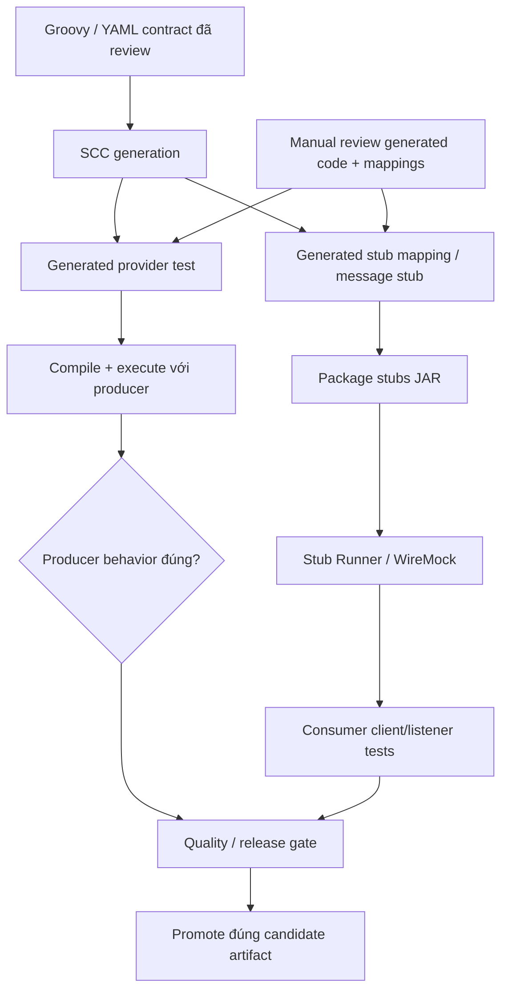
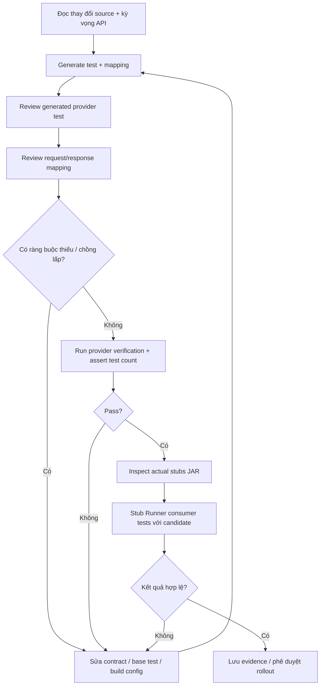

# Kiểm tra thủ công generated test và mapping khi thay đổi phức tạp trong Spring Cloud Contract

**Spring Cloud Contract (SCC)** giúp producer và consumer kiểm thử giao diện HTTP hoặc thông điệp theo một thỏa thuận chung. Nhóm phát triển viết contract bằng **Groovy/YAML DSL**, công cụ tạo **provider verification tests** để kiểm chứng implementation producer, đồng thời tạo **stub mappings** và tài nguyên được phân phối cho consumer qua **stubs JAR** và **Stub Runner**.

Ở những thay đổi API đơn giản, việc sinh test, chạy provider verification và cho consumer test với Stub Runner thường tương đối dễ theo dõi. Tuy nhiên, khi một thay đổi đồng thời tác động tới **method, path, query, headers, body, matcher, status, error handling, security, version hoặc message destination**, nhóm không nên chỉ nhìn dòng `BUILD SUCCESSFUL` hay `BUILD SUCCESS` rồi kết luận mọi thứ đều đúng. **Generated test** và **WireMock mapping** có thể thể hiện hai khía cạnh khác nhau của cùng DSL; một mapping thiếu điều kiện có thể chấp nhận request sai, trong khi một mapping quá chặt có thể khiến consumer hợp lệ nhận 404 mặc định.

Bài thuộc chương **Chất lượng hợp đồng**, tập trung vào **kiểm tra thủ công generated test và mapping khi thay đổi phức tạp**. Mục tiêu không phải yêu cầu lập trình viên sửa các tệp sinh tự động, mà là học cách **đọc chúng, đối chiếu với thỏa thuận và tìm những điểm mất ràng buộc** trước khi phát hành stubs. Ví dụ xuyên suốt sử dụng `order-producer` tạo đơn hàng cho `checkout-consumer`, với endpoint `POST /api/orders` và một sự kiện `OrderCreated`.

## 1. Vì sao thay đổi phức tạp cần kiểm tra đầu ra sinh tự động?

Một PR có thể đổi đồng thời:

- Request thêm `Idempotency-Key`.
- Header `X-Tenant-Id` trở thành bắt buộc với một số client.
- `customerId` phải có định dạng `CUS-0001`.
- `items[].quantity` phải là số nguyên dương, không phải chuỗi.
- Response thành công trả `201 Created` và `Location`.
- Response lỗi bổ sung `400`, `409` hoặc `403`.
- Một producer message bổ sung `schemaVersion` hoặc đổi destination.
- Hệ thống bật Spring Security filter hoặc chuyển qua một gateway.
- Candidate stubs được phát hành với version mới.

Nếu chỉ kiểm tra contract parse thành công, bạn chưa biết **generated provider test có assert tất cả ràng buộc cần thiết hay không**. Nếu chỉ kiểm tra provider test pass, bạn chưa biết **WireMock mapping có mô phỏng chính xác request/response để consumer thử giao tiếp hay không**. Nếu chỉ kiểm tra consumer test pass, bạn chưa biết consumer đang dùng **candidate stubs mới hay artifact đã lưu trong cache từ trước**.

### 1.1. Ba loại sai lệch thường gặp

| Sai lệch | Ví dụ | Hậu quả |
| --- | --- | --- |
| Contract → generated test | Response body thiếu assertion cho field quan trọng | Producer đổi sai field nhưng provider test vẫn xanh |
| Contract → stub mapping | Header quan trọng không xuất hiện trong request matcher | Consumer quên header vẫn có thể nhận 201 từ stub |
| Stub artifact → consumer execution | Stub Runner tải version cũ | Consumer test xanh dù API candidate mới không tương thích |

**Kiểm tra thủ công** giúp rà soát các ranh giới này. Sau khi phát hiện lỗi, cần **sửa contract DSL, base test, build configuration hoặc test setup**, rồi sinh lại output; không dùng bản sửa trực tiếp trong thư mục generated làm nguồn chân lý.

## 2. Mô hình tư duy: một contract, hai nhánh sản phẩm



**Generated provider test** chạy với producer implementation hoặc một test context được cấu hình để kiểm chứng những tình huống mà contract mô tả.

**Stub mapping** mô tả cách một test server chọn response hoặc gửi message mẫu khi consumer tương tác. Với HTTP, đây thường là WireMock mappings; với messaging có thêm label, trigger và tài nguyên message phù hợp.

Hai nhánh có nguồn từ cùng contract nhưng **không phải cùng một chương trình thực thi**. Một nhánh có thể dùng RestAssuredMockMvc, REST Assured, WebTestClient hoặc test mode khác; nhánh kia có thể dùng JSON mapping với request matchers. Do vậy:

- Generated test có thể sử dụng một **request mẫu** hợp lệ để xác minh producer.
- Mapping phải chọn response khi consumer gửi **request phù hợp**.
- Quy tắc matcher động, optional field, regex hoặc request header cần được chuyển đúng qua từng nhánh.
- Các nguyên tắc bảo mật và vận hành ngoài contract vẫn cần kiểm thử riêng.

**Không suy ra “producer test pass” nghĩa là mọi tổ hợp request đều match đúng stub.**

## 3. Phân biệt bốn loại bằng chứng trong quá trình review

| Bằng chứng | Điều nó cho thấy | Giới hạn |
| --- | --- | --- |
| Contract source | Điều các bên đang mô tả/cam kết | Chưa có nghĩa implementation đáp ứng |
| Generated test source | Điều công cụ dự định gửi và assert | Chưa chứng minh test đã chạy |
| Test execution report | Những test được discover và kết quả thực tế | Không tự bảo đảm mapping consumer đúng |
| Generated mapping + stubs JAR | Điều WireMock/Stub Runner sẽ phục vụ | Không chứng minh producer thật đáp ứng |
| Consumer test report | Client/listener xử lý được kịch bản stub | Không chứng minh security/gateway/broker thật đầy đủ |

Một review có chất lượng cần đối chiếu **ít nhất contract source, generated provider test, generated stub mapping và test reports**. Với candidate release, phải thêm **tọa độ JAR và version/digest thực tế** mà consumer đã sử dụng.

### 3.1. Lý do không sửa generated file trực tiếp

Những tệp trong `target/` hoặc `build/` thường bị xóa/ghi lại khi chạy `clean` và generation tasks. Nếu một người sửa generated Java test để thêm assertion mà không sửa Groovy/YAML source, lần build sau có thể mất assertion.

Tương tự, nếu sửa JSON mapping sinh ra để thêm `Authorization` mà không sửa contract, stubs JAR lần build tiếp theo có thể lại mất header matcher.

**Quy tắc:** generated output là *đối tượng kiểm tra*, không phải *nơi bảo trì nguồn*. Chỉ ngoại lệ khi bạn có quy trình code generation tùy biến được quản lý rõ ràng; lúc đó phải sửa nguồn generator/config tương ứng.

## 4. Workflow kiểm tra thủ công theo một thay đổi API

Một review có thể đi theo tám bước:

1. **Xác nhận nguồn:** Contract revision, PR mô tả thay đổi, API/schema quyết định và consumer bị ảnh hưởng.
2. **Tạo output mới:** Chạy generation với phiên bản SCC plugin/build được chốt.
3. **Đọc generated provider test:** Đối chiếu method, path, headers, body mẫu, response status, header/body assertions, matcher.
4. **Đọc generated WireMock mapping:** Đối chiếu request matching, response body/headers, priority, scenario, collision.
5. **Chạy provider verification thật:** Không chấp nhận zero tests, skipped tests hoặc chỉ generation.
6. **Đóng gói và đọc stubs JAR:** Bảo đảm file đóng gói chứa **mapping vừa review**, không phải output cũ.
7. **Chạy consumer tests với candidate:** Stub Runner resolve đúng version/classifier/repository, gọi client thật, kiểm tra cả trường hợp thành công và lỗi.
8. **Ghi bằng chứng và quyết định:** Những gì pass, những gì cần bổ sung, ai review và artifact nào được cho phép phát hành.

Sơ đồ:



**Review thủ công không thay thế CI tự động.** Nó giúp phát hiện những sai khác mà một suite hiện tại chưa có đủ negative cases để tìm ra.

## 5. Ví dụ thay đổi phức tạp: tạo đơn hàng có idempotency và tenant

Giả sử hai bên thống nhất request:

```http
POST /api/orders HTTP/1.1
Content-Type: application/json
Idempotency-Key: idem-1001
X-Tenant-Id: TENANT-01

{
  "customerId": "CUS-0042",
  "items": [{"sku": "BOOK-01", "quantity": 2}],
  "currency": "VND"
}
```

Response thành công:

```http
HTTP/1.1 201 Created
Content-Type: application/json
Location: /api/orders/1001

{"id":1001,"status":"CREATED","amountMinor":210000}
```

Ngoài happy path, cần làm rõ:

- `Idempotency-Key` có bắt buộc không và do ai tạo?
- `X-Tenant-Id` có được lấy từ gateway đáng tin hay từ user-controlled header?
- `customerId` là literal cho fixture hay phải theo regex?
- `quantity` là số JSON nguyên dương; cho phép bằng 0 không?
- Có thể thêm item thứ hai không? Thứ tự items có ý nghĩa không?
- Response `amountMinor` tính bằng đơn vị nào?
- Thiếu header nên trả `400`, `401` hay `403` theo chính sách?
- Gửi lặp một POST với cùng idempotency key có tạo resource mới không?

**Một contract request/response đơn lẻ không trả lời tất cả câu hỏi ấy.** Một số thuộc giao diện và cần thêm contract; một số như chống tạo đơn trùng cần integration test stateful với implementation thật.

## 6. Groovy DSL: mô tả một đường thành công có matcher

Một contract minh họa trong producer:

```groovy
import org.springframework.cloud.contract.spec.Contract

Contract.make {
    description 'Tạo đơn hàng với idempotency key và tenant header'

    request {
        method POST()
        url '/api/orders'

        headers {
            contentType(applicationJson())
            header('Idempotency-Key', 'idem-1001')
            header('X-Tenant-Id', 'TENANT-01')
        }

        body(
            customerId: 'CUS-0042',
            items: [
                [sku: 'BOOK-01', quantity: 2]
            ],
            currency: 'VND'
        )

        bodyMatchers {
            jsonPath('$.customerId',
                byRegex('^CUS-[0-9]{4}$'))
            jsonPath('$.items[0].quantity',
                byEquality())
        }
    }

    response {
        status CREATED()

        headers {
            contentType(applicationJson())
            header('Location', '/api/orders/1001')
        }

        body(
            id: 1001,
            status: 'CREATED',
            amountMinor: 210000
        )
    }
}
```

Đây là **ví dụ contract cho một fixture cụ thể**. `byRegex` thể hiện quy tắc định dạng `customerId`; `byEquality` cho trường quantity trong kịch bản đã mô tả. Cách matcher được chuyển thành assertion/provider request và WireMock JSON cần được kiểm tra **trên SCC version đang dùng**.

### 6.1. Những gì cần xem trong generated test

Không chỉ xem test có request POST:

- Method có đúng `POST`, không phải `GET`?
- URL có đúng `/api/orders` và không vô tình thêm context path?
- `Content-Type` có được gửi đúng và producer có đọc JSON?
- Cả hai header `Idempotency-Key` và `X-Tenant-Id` có xuất hiện?
- Body có `customerId` là string, `items` là array, `quantity` là number?
- Kiểm thử response status `201` và `Location`?
- Body assertions có xác minh `id`, `status`, `amountMinor`?
- Base test có tạo fixture để POST chạy ổn định và không gây side effect giữa tests?

**Quan trọng:** generated provider test có thể sử dụng **giá trị mẫu CUS-0042**, còn các request hợp lệ khác theo regex sẽ được thử qua stub mapping/consumer test hoặc các trường hợp bổ sung. Đừng diễn giải một request mẫu là kiểm chứng toàn bộ miền giá trị.

### 6.2. Những gì cần xem trong mapping

- Có điều kiện match `POST /api/orders`?
- Có kiểm tra hai headers nếu đó là giao diện đã cam kết?
- `customerId` được xử lý theo regex hay bị khóa vào một literal?
- `items[0].quantity` còn được kiểm tra hay bị matcher lỏng hơn che đi?
- Có response `201`, `Location` và body như mong muốn?
- Có catch-all mapping nào match cùng request và trả response khác?
- Mapping này có đúng trong **JAR mà consumer chạy** không?

Nếu mapping bỏ qua `Idempotency-Key`, một consumer thiếu header vẫn có thể nhận 201 từ WireMock. Nếu mapping bắt cố định toàn bộ body đến từng whitespace, một request JSON tương đương có thứ tự field khác có thể bị từ chối.

## 7. YAML DSL tương đương để đối chiếu, không dùng cùng lúc

Một phiên bản YAML diễn đạt cùng kịch bản:

```yaml
description: "Tạo đơn hàng với idempotency key và tenant header"
request:
  method: POST
  url: /api/orders
  headers:
    Content-Type: application/json
    Idempotency-Key: idem-1001
    X-Tenant-Id: TENANT-01
  body:
    customerId: CUS-0042
    items:
      - sku: BOOK-01
        quantity: 2
    currency: VND
  matchers:
    body:
      - path: $.customerId
        type: by_regex
        value: '^CUS-[0-9]{4}$'
      - path: $.items[0].quantity
        type: by_equality
response:
  status: 201
  headers:
    Content-Type: application/json
    Location: /api/orders/1001
  body:
    id: 1001
    status: CREATED
    amountMinor: 210000
```

**Chỉ chọn Groovy hoặc YAML trong build thực tế của cùng một kịch bản**, trừ khi dự án cố ý muốn hai hợp đồng độc lập và có request conditions khác nhau. Hai file trùng request có thể sinh generated tests hoặc WireMock mappings chồng lấp.

### 7.1. Khi so sánh DSL, chú ý những gì không được bỏ sót

| Điều cần so | Groovy | YAML |
| --- | --- | --- |
| Method/path | `method POST()` và `url` | `method: POST` và `url` |
| Header | `header('Idempotency-Key', ...)` | `headers.Idempotency-Key` |
| Body | Groovy Map/List | YAML mapping/list |
| JSONPath | `jsonPath(...)` | `matchers.body[].path` |
| Matcher | `byRegex/byEquality` | `type: by_regex/by_equality` |
| Response status | `CREATED()` | `status: 201` |
| Response headers | `contentType`, `Location` | `Content-Type`, `Location` |
| Response body | Map với number/string | YAML values có kiểu phù hợp |

Cần kiểm tra YAML parser có diễn giải `quantity: 2` là number và `customerId` là string như dự định. Với giá trị có leading zeros, date/time hoặc ký tự đặc biệt, nên quote có chủ đích để tránh parser thay đổi kiểu.

## 8. Đọc generated provider test: tìm logic chứ không chỉ tên file

SCC có thể sinh Java/Groovy test bằng test framework/mode tùy cấu hình. **Tên class, vị trí output và cú pháp thật không cố định giữa mọi plugin version.**

Một generated provider test cho kịch bản trên về mặt logic phải thực hiện:

```text
Given:
  test base/context chuẩn bị producer instance, database/mock fixture,
  security và các dependency cần thiết.

When:
  POST /api/orders
  Content-Type: application/json
  Idempotency-Key: idem-1001
  X-Tenant-Id: TENANT-01
  body.customerId = "CUS-0042"
  body.items[0].quantity = 2

Then:
  HTTP status = 201
  Content-Type là JSON
  Location = /api/orders/1001
  response body.id = 1001
  response body.status = CREATED
  response body.amountMinor = 210000
```

Đây là **pseudocode**, không phải mã generated exact. Bạn cần mở file do bản SCC của mình sinh rồi xác minh từng điều kiện quan trọng.

### 8.1. Dấu hiệu generated test đang thiếu assertion

Một lỗi cần review:

```java
// Pseudocode minh họa, KHÔNG phải SCC-generated code thực:
assertThat(response.statusCode()).isEqualTo(201);
// Không có kiểm tra Location hoặc amountMinor.
```

Nếu contract đã cam kết `Location` và `amountMinor` mà generated source không kiểm tra chúng, cần điều tra:

- Contract DSL viết sai vị trí?
- Plugin bỏ qua một phần cấu hình?
- Matcher response quá rộng?
- Generated source chưa được cập nhật vì caching?
- Test mode có giới hạn so với kỳ vọng?
- File đang mở có phải generated test của contract mới không?

**Không thêm assertion trực tiếp vào generated Java rồi kết thúc review.** Hãy sửa source contract, base class hoặc generator configuration và sinh lại.

### 8.2. Kiểm tra test thực sự được chạy

Một file `ContractVerifierTest.java` xuất hiện không chứng minh test được thực thi. Hãy kiểm tra task/maven goal, JUnit/Surefire/Gradle XML report, số test run, skipped và failures. Nếu test file sinh ra nhưng không được discover do test engine/filter, build có thể xanh giả.

## 9. Base class và HTTP test mode: đầu ra đúng nhưng test context sai

Generated test có thể kế thừa một base class chuẩn bị producer, ví dụ khi dùng MockMvc:

```java
package com.example.order.contract;

import io.restassured.module.mockmvc.RestAssuredMockMvc;
import org.junit.jupiter.api.BeforeEach;
import org.springframework.beans.factory.annotation.Autowired;
import org.springframework.boot.test.autoconfigure.web.servlet.AutoConfigureMockMvc;
import org.springframework.boot.test.context.SpringBootTest;
import org.springframework.test.web.servlet.MockMvc;

@SpringBootTest
@AutoConfigureMockMvc(addFilters = true)
public abstract class OrderContractBase {

    @Autowired
    MockMvc mockMvc;

    @BeforeEach
    void setUp() {
        RestAssuredMockMvc.mockMvc(mockMvc);
    }
}
```

Ví dụ này giả định generated tests sử dụng RestAssuredMockMvc, Spring Boot context và JUnit Jupiter tương thích. Dự án dùng embedded HTTP server hoặc web framework khác cần base class/test mode tương ứng.

**Điểm kiểm tra thủ công:**

- Generated class có thực sự extends `OrderContractBase` không?
- Controller/handler thực có được load không?
- Bean Validation, Jackson serializers, ControllerAdvice và filter chain có hoạt động không?
- Test setup có reset database hoặc mock state giữa requests?
- Handler có nhận được đúng `X-Tenant-Id`/`Idempotency-Key` không?
- Nếu request phải đi qua gateway, test MockMvc nội bộ có bỏ qua rewrite/forwarding không?

### 9.1. Bỏ filter có thể làm contract xanh giả

`@AutoConfigureMockMvc(addFilters = false)` có thể làm provider test POST 201 pass dù production route yêu cầu JWT scope hoặc tenant header ở filter. Khi security là một phần giao diện, cần test filter chain ở đúng cấp độ và thêm integration tests với server/gateway thực nếu cần.

**WireMock mapping chỉ match header không phải bằng chứng JWT signature/tenant authorization thật đã được kiểm tra.**

## 10. Đọc mapping JSON: tìm cả request matching lẫn response serving

WireMock thường dùng JSON có các thành phần như `request`, `response`, `bodyPatterns`, `headers`, `queryParameters`, `priority` và `scenarioName`.

Một **mapping minh họa viết tay** để hiểu cấu trúc:

```json
{
  "name": "create-order-accepted-example",
  "priority": 5,
  "request": {
    "method": "POST",
    "urlPath": "/api/orders",
    "headers": {
      "Idempotency-Key": {
        "equalTo": "idem-1001"
      },
      "X-Tenant-Id": {
        "equalTo": "TENANT-01"
      }
    },
    "bodyPatterns": [
      {
        "matchesJsonPath": "$.customerId"
      },
      {
        "matchesJsonPath": "$.items[0].quantity"
      }
    ]
  },
  "response": {
    "status": 201,
    "headers": {
      "Content-Type": "application/json",
      "Location": "/api/orders/1001"
    },
    "jsonBody": {
      "id": 1001,
      "status": "CREATED",
      "amountMinor": 210000
    }
  }
}
```

**Quan trọng:** JSON trên là **một mapping tối giản để giải thích cách đọc**, **không** phải output được khẳng định sẽ sinh từ Groovy/YAML ví dụ. Nó **chỉ kiểm tra sự tồn tại của JSONPath**, chưa enforce regex `customerId` hay bằng nhau của `quantity`. Một reviewer phải phát hiện sự thiếu sót đó trước khi coi mapping tương đương contract.

Từ một ví dụ cố ý thiếu matcher này, bạn có thể thấy vì sao review thủ công có giá trị: chỉ nhìn `bodyPatterns` tồn tại chưa đủ; phải xem **bộ so khớp bên trong từng điều kiện và tính chặt của chúng**.

### 10.1. Cách nhận biết request matcher quá rộng

Giả sử mapping chỉ có:

```json
{
  "request": {
    "method": "POST",
    "urlPath": "/api/orders"
  },
  "response": {
    "status": 201
  }
}
```

Nó có thể đáp ứng POST sai body, thiếu tenant hoặc không có idempotency key. Nếu yêu cầu bảo mật/định dạng đã được thỏa thuận mà mapping không hề kiểm tra, consumer test có thể xanh giả.

### 10.2. Cách nhận biết request matcher quá hẹp

Một mapping dùng `equalToJson` hoặc so sánh exact string cho toàn bộ body có thể không cho phép những thay đổi mà contract chủ ý chấp nhận, ví dụ:

- JSON object field order khác nhưng giá trị tương đương.
- Field optional vắng mặt.
- `customerId` khác literal mẫu nhưng vẫn đúng regex.
- Header `Content-Type` có thêm `charset` phù hợp.
- Header `Cookie` có nhiều cặp cookie hơn.
- Query parameters xuất hiện theo thứ tự khác khi thứ tự không có ngữ nghĩa.

**Không tự động nới matcher** để tất cả request đều match. Chỉ nới khi hợp đồng thực sự cho phép và test negative cases vẫn chứng minh request sai bị từ chối.

## 11. Soi request matcher theo bảng đối chiếu

| Điều kiện | Contract nguồn | Generated provider test | WireMock mapping | Test bổ sung nếu cần |
| --- | --- | --- | --- | --- |
| Method | POST | Gửi POST | Match POST | GET không nhận 201 |
| Path | `/api/orders` | Gửi đúng path | `urlPath`/URL matching đúng | Path gần giống không match |
| `Content-Type` | JSON | Gửi JSON | Matcher nếu đã cam kết | Không chấp nhận sai media type theo policy |
| `Idempotency-Key` | Fixture được yêu cầu | Header có mặt | Matcher đúng | Thiếu header không match success |
| `X-Tenant-Id` | Tenant fixture | Header có mặt | Matcher đúng | Tenant khác theo policy |
| `customerId` | Regex định dạng | Body mẫu hợp lệ | Regex JSONPath đúng | Một ID hợp lệ khác được nhận |
| `quantity` | JSON number/điều kiện cụ thể | Body số `2` | Matcher tương ứng | String `"2"` không được coi là number nếu contract yêu cầu |
| `currency` | `VND` hoặc tập giá trị | Body gửi `VND` | Matcher có đủ điều kiện? | Currency sai bị xử lý phù hợp |
| Response status | 201 | Assert 201 | Serve 201 | Consumer parse success |
| `Location` | `/api/orders/1001` | Assert response header | Serve header | Consumer đọc location nếu phụ thuộc |
| `amountMinor` | JSON number | Assert kiểu/giá trị | Serve kiểu/giá trị | Consumer không xử lý như string |

**Không có công thức tự động bắt mọi mapping phải match mọi field trong request body.** Những field nào được định nghĩa có điều kiện cụ thể phải có biểu diễn nhất quán với chủ đích của contract. Nếu ý định chưa rõ, quay lại review API thay vì tự suy ra từ một fixture.

### 11.1. Path và query có thể bị nhầm thành một chuỗi URL

So sánh:

```text
GET /api/orders?status=CREATED&page=0
GET /api/orders?page=0&status=CREATED
```

Hai request có thể tương đương về ngữ nghĩa nếu query parameter order không quan trọng. Nhưng một mapping so exact URL string có thể match một thứ tự và từ chối thứ tự còn lại.

Với request có query động, kiểm tra liệu mapping đang dùng `urlPathEqualTo`/`urlPathMatching` cùng `queryParameters` hay một matcher nguyên URL. Không nới query matching một cách vô điều kiện khi có tham số thực sự bắt buộc.

### 11.2. Headers có những sắc thái riêng

- Tên HTTP header không phân biệt chữ hoa/chữ thường theo ngữ nghĩa giao thức.
- Giá trị `Content-Type` có thể có media type parameters; phải biết contract cho phép dạng nào.
- `Accept` của consumer và `Content-Type` của producer là hai hướng khác nhau.
- `Authorization` không nên dùng token production trong fixture.
- `X-Correlation-Id` có thể là giá trị động: match định dạng hoặc presence theo cam kết.
- Một số headers được gateway thêm, không do controller trực tiếp quản lý.

Khi output sinh ra dùng literal exact quá hẹp hoặc quá rộng, ghi nhận và quyết định sửa nguồn contract.

## 12. Soi body matcher: JSONPath, regex, kiểu và độ chặt

**Body matcher** dễ có những sai lệch khó thấy nhất. Ví dụ `customerId` được mô tả bằng regex:

```text
^CUS-[0-9]{4}$
```

Các giá trị thử:

| Giá trị | Đúng format? | Vì sao? |
| --- | --- | --- |
| `CUS-0042` | Có | Prefix và bốn chữ số |
| `CUS-9999` | Có | Khác literal nhưng đúng quy tắc |
| `CUS-42` | Không | Thiếu hai chữ số |
| `CUS-00420` | Không | Dư chữ số |
| `ORD-0042` | Không | Sai prefix |
| `fooCUS-0042bar` | Không | Regex có anchors đầu/cuối |
| `null` | Không nếu kiểu yêu cầu là string | Không phải customer ID hợp lệ |

### 12.1. Regex không thay thế JSON schema validation

Nếu mapping regex kiểm tra `quantity` như chuỗi `[0-9]+`, có thể vô tình cho phép JSON string `"2"` trong khi API yêu cầu JSON number `2`. Khi cần, hãy kiểm chứng cả **kiểu** lẫn **giá trị hoặc miền giá trị**.

Một số matcher chỉ kiểm tra sự tồn tại hoặc biểu diễn chuỗi của giá trị JSONPath, không đảm bảo kiểu. Review cần biết **SCC converter đã sinh loại matcher nào** trong output thực, rồi bổ sung test nếu contract phụ thuộc phân biệt number/string.

### 12.2. Optional, nullable và absent không đồng nghĩa

Giả sử producer bổ sung `promotionCode`:

```json
{
  "promotionCode": null
}
```

khác với:

```json
{}
```

Nhiều deserializer có hành vi khác giữa missing và explicit null. Nếu contract nói optional:

- Có được vắng mặt hoàn toàn không?
- Có được present với giá trị null không?
- Có bắt buộc present với string trong một số trường hợp?
- Consumer cũ có reject unknown fields không?
- Kiểu số/thời gian có thể thay đổi không?

Một generated test chỉ assert body của một fixture có `promotionCode` chưa chứng minh toàn bộ các tổ hợp. Cần các contracts hoặc integration tests cho những nhánh mang tính cam kết.

### 12.3. Arrays có thêm rủi ro thứ tự và kích thước

Với `items`:

- `items[0].sku` có yêu cầu đúng phần tử đầu tiên hay chỉ cần một item phù hợp?
- Array có được rỗng không?
- Có nhiều items không?
- Thứ tự có là semantics của API không?
- Quantity có bắt buộc dương?
- Có được thêm field vào từng item không?

Nếu matcher chỉ kiểm tra `$.items[0].quantity`, request có item đầu hợp lệ nhưng item sau sai có thể vẫn match. Không thể từ việc một JSONPath pass suy ra tất cả phần tử trong array đã được ràng buộc. Cần viết contract/test phù hợp với phạm vi thực sự.

## 13. Soi response assertions: status, headers, body và semantics

Trong provider generated test, kiểm tra response cùng độ nghiêm túc như request.

Một hợp đồng POST tạo resource có thể cần:

- `201 Created` thay vì chỉ 2xx.
- `Content-Type: application/json`.
- `Location` trỏ tới resource vừa tạo, theo quy tắc đã chấp thuận.
- JSON `id` là number hoặc string đúng contract.
- `status` nằm trong tập giá trị hợp lệ.
- `amountMinor` là integer minor units, không phải decimal string.
- Không trả secrets, internal tokens hoặc thông tin riêng tư.
- Error response có code/header ổn định khi tình huống lỗi xảy ra.

Nếu generated test chỉ assert status và không assert header/body quan trọng, hãy kiểm tra DSL response block và matcher conversion.

### 13.1. Dynamic response và consumer/producer-side values

Có những giá trị thay đổi giữa các lần chạy như `id`, `createdAt`, `requestId`. SCC hỗ trợ biểu diễn các giá trị hoặc matcher riêng cho góc nhìn producer và consumer trong Groovy DSL ở những phiên bản phù hợp.

**Ý nghĩa cần review:**

- Provider verification nên chấp nhận giá trị thực đúng định dạng/semantics của producer.
- Stub mapping nên trả giá trị mẫu đủ xác định để consumer test ổn định.
- Không ép producer luôn trả literal `1001` nếu ID được sinh động, trừ khi test fixture đã cố định.
- Không để stub trả kiểu string khi API cam kết number.
- Không dùng matcher `.*` cho field cần bảo vệ định dạng.

Với cú pháp `consumer(...)`/`producer(...)` hoặc `value(...)`, hãy **xem output thực** để xác nhận chiều dữ liệu và matcher được chuyển đúng; các ví dụ trên Internet có thể dùng API/DSL version khác.

### 13.2. Ngày giờ, timezone và precision

Response:

```json
{
  "createdAt": "2026-11-24T03:15:30.123Z",
  "amountMinor": 210000
}
```

đặt ra các câu hỏi: `createdAt` có bắt buộc UTC không? Millisecond precision có cố định? Có chấp nhận offset khác biểu diễn cùng thời điểm? `amountMinor` là integer theo loại tiền nào?

Nếu contract chỉ dùng một literal ngày giờ, provider test có thể quá cứng hoặc quá lỏng so với ý nghĩa thật. Với thay đổi thời gian/tiền tệ, cần review matcher, parser và assertions bằng các ví dụ ranh giới, không chỉ một happy path.

## 14. Soi error mappings: đừng để unmatched 404 che lỗi thật

Một thay đổi phức tạp thường có thêm các phản hồi lỗi:

| Kịch bản | Status minh họa | Điều cần thỏa thuận |
| --- | --- | --- |
| Body JSON sai | 400 | Field/path và error code |
| Thiếu hoặc sai bearer credential | 401 | Auth challenge/body nếu được cam kết |
| Không có quyền tenant/resource | 403 hoặc chính sách 404 | Security/domain semantics |
| Idempotency key xung đột payload | 409 | Mã lỗi/khả năng retry |
| Quota exceeded | 429 | `Retry-After`, policy client |
| Dependency tạm không khả dụng | 503 | Retry-After hoặc error schema nếu có |

Các status trên là **ví dụ cần xác nhận theo API của dự án**, không phải phản hồi tự động SCC sinh khi request sai.

### 14.1. Một request thiếu header success có thể nhận WireMock 404

Giả sử mapping thành công yêu cầu `Idempotency-Key`. Consumer quên gửi header, WireMock không tìm mapping khớp và trả 404 mặc định. Điều đó **không chứng minh producer sẽ trả 404**; producer có thể có validation logic trả 400.

Để kiểm tra consumer xử lý 400 đúng contract, cần:

1. Một contract/fixture lỗi rõ ràng được producer đồng ý.
2. Provider test xác minh producer thật trả 400.
3. Stub mapping riêng phục vụ tình huống lỗi với request conditions phân biệt.
4. Consumer test khẳng định nhánh validation error.

**Unmatched response và intentional error mapping là hai loại bằng chứng khác nhau.**

### 14.2. Cẩn thận mapping lỗi chồng lấp

Một mapping generic:

```json
{
  "priority": 1,
  "request": {
    "method": "POST",
    "urlPath": "/api/orders"
  },
  "response": {
    "status": 400
  }
}
```

có thể thắng mapping cụ thể có priority số lớn hơn ngay cả khi request hợp lệ, vì WireMock chọn mapping phù hợp theo độ ưu tiên; **số priority nhỏ hơn được ưu tiên hơn**. Một fallback quá rộng sẽ phá happy path.

Hãy xem **tất cả mappings có thể khớp cùng một request**, không chỉ một file JSON đang review.

## 15. Mapping priority, độ chồng lấp và scenario state

WireMock có hai cơ chế dễ nhầm:

- **Priority**: khi nhiều mappings cùng phù hợp, dùng quy tắc ưu tiên; priority số nhỏ hơn có ưu tiên cao hơn.
- **Scenario**: mapping chỉ phù hợp khi scenario đang ở trạng thái xác định, có thể chuyển state sau request.

**Một mapping có priority cao không tự tạo chuỗi `503 → 200`.** Muốn mô phỏng response thay đổi qua các lần gọi, dùng scenario hoặc cơ chế stateful test phù hợp.

### 15.1. Ma trận overlap trong review

| Mapping A | Mapping B | Câu hỏi |
| --- | --- | --- |
| Exact `POST /api/orders` | Generic `POST /api/.*` | Mapping nào sẽ thắng? |
| Header tenant = A | Không match tenant | Có trả sai data khi tenant khác? |
| Body JSONPath chỉ cần tồn tại | Exact body JSON | Có request sai vẫn match? |
| 400 catch-all | 201 success | Priority có che happy path không? |
| 503 scenario STARTED | 200 scenario RECOVERED | State có reset giữa tests không? |
| Generated mapping cũ | Generated mapping mới cùng request | Artifact có duplicate mappings không? |

### 15.2. Kiểm thử mapping theo request mẫu và request phản ví dụ

Đừng chỉ thử request hợp lệ. Cho cùng một tập mappings:

```text
Case 1: POST hợp lệ với headers/body đúng
  => phải match 201 đã thống nhất

Case 2: POST thiếu Idempotency-Key
  => không được match mapping success
  => error response chỉ có giá trị contract nếu có mapping lỗi rõ

Case 3: POST sai Content-Type theo contract
  => không được vô tình match success

Case 4: POST customerId="CUS-42"
  => không match regex CUS-4-digit

Case 5: POST quantity="2" (string)
  => phải bị từ chối bởi matcher nếu API cam kết number

Case 6: POST cùng path nhưng tenant khác
  => không match tenant A khi API phân biệt tenant
```

Một test mapping **không match** request sai có thể nhận 404 của WireMock; đừng thay nhãn 404 đó thành “producer trả validation error”. Chỉ xác nhận **mapping success đã không match**.

### 15.3. Reset state giữa bài test

Nếu dùng WireMock scenarios, cần reset scenario states/request journal/mappings hoặc tạo server mới. Một case chạy trước có thể chuyển trạng thái và khiến case chạy sau nhận response khác, dẫn tới flaky tests dù contracts không đổi.

## 16. Đọc request journal và chọn đúng mapping

Khi consumer test thất bại, WireMock request journal giúp biết:

- Request nào được consumer gửi thật?
- Method/path/query có khớp hợp đồng?
- Headers như `Content-Type`, `Accept`, `Idempotency-Key` có được gửi đúng?
- Body JSON có đúng kiểu và nesting?
- Request match mapping nào, hoặc không match mapping nào?
- Có request lặp ngoài ý muốn?
- Response có đến từ stub candidate hay server khác?

Ví dụ gọi WireMock Admin API trong môi trường test:

```text
GET /__admin/mappings
GET /__admin/requests
```

Đây là các endpoint quản trị thường gặp của WireMock; chi tiết API/hình thức response tùy phiên bản. Chỉ bật/truy cập Admin API trong **môi trường test có kiểm soát**, không expose công khai. Request journals có thể chứa `Authorization`, `Cookie` hoặc body nhạy cảm nên cần redact khi lưu CI.

### 16.1. Kiểm tra bằng Java DSL

Một test consumer có thể xác minh request:

```java
import static com.github.tomakehurst.wiremock.client.WireMock.*;

wireMockServer.verify(
    1,
    postRequestedFor(urlPathEqualTo("/api/orders"))
        .withHeader(
            "Idempotency-Key",
            equalTo("idem-1001")
        )
        .withHeader(
            "X-Tenant-Id",
            equalTo("TENANT-01")
        )
);
```

Đoạn này chỉ có ý nghĩa khi **consumer thực đã gọi** WireMock server tương ứng. Nó không thay thế provider verification và không chứng minh producer xử lý idempotency/tenant authorization thật.

### 16.2. Không dùng request journal như nơi lưu token thật

Nếu test dùng bearer token, cookie hoặc API key, cần tránh log nguyên giá trị. Trong bài test hợp đồng, dùng token fixture tổng hợp; trong integration/security tests, redact secrets trong logs và báo cáo.

## 17. Kiểm tra messaging generated tests và message stubs

SCC không chỉ hỗ trợ HTTP; thay đổi event schema/destination cũng cần manual review.

Ví dụ một Groovy message contract:

```groovy
import org.springframework.cloud.contract.spec.Contract

Contract.make {
    description 'Producer phát OrderCreated v1'
    label 'order_created_v1'

    input {
        triggeredBy('publishOrderCreated()')
    }

    outputMessage {
        sentTo('orders.created')
        headers {
            messagingContentType(applicationJson())
        }
        body(
            eventId: 'EVT-1001',
            eventType: 'OrderCreated',
            schemaVersion: 1,
            orderId: 'ORD-1001'
        )
    }
}
```

### 17.1. Kiểm tra generated provider message test

- Có gọi đúng trigger method `publishOrderCreated()` không?
- Test context có bean/message verifier/binder phù hợp không?
- Có assert destination logic `orders.created`?
- Có assert `Content-Type`/headers và JSON body?
- `schemaVersion` có đúng kiểu number không?
- `eventId` có được match theo quy tắc thay vì literal nếu là dynamic?
- Có verify message thật sự được publish bởi producer component không?

### 17.2. Kiểm tra stub cho consumer message

- Stubs JAR có chứa message resources và label `order_created_v1` không?
- `StubTrigger` có thể kích hoạt đúng label của **candidate version** không?
- Listener của consumer có nhận và parse body đúng không?
- Consumer có assert side effect thay vì chỉ gọi `trigger(...)` không?
- Nếu destination đổi, có consumer nào còn subscribe kênh cũ không?

**Message stub không tự kiểm chứng broker delivery semantics** như Kafka offset, RabbitMQ ack/nack, DLQ, partition ordering hay database outbox. Chúng cần integration tests tương ứng.

### 17.3. Không giả định HTTP mapping và message stub có cùng định dạng

HTTP Stub Runner thường dựa trên WireMock mappings; messaging phụ thuộc cơ chế Stub Runner trigger, message contracts và integration tương ứng. Review cần tìm **loại artifact đầu ra đúng với transport đang thay đổi**. Không kết luận message contract thiếu chỉ vì không thấy một JSON mapping HTTP mới.

## 18. Kiểm tra vị trí generated output theo Maven và Gradle

Đường dẫn generated files và tên task có thể thay đổi theo SCC plugin version, test mode, build configuration hoặc source set riêng.

### 18.1. Dự án Maven

Với cấu hình SCC Maven plugin tương thích, quy trình có thể dùng:

```bash
./mvnw -B -ntp clean verify
```

Sau đó xem:

- Log các goal của `spring-cloud-contract-maven-plugin`.
- Generated provider tests trong build output thực tế.
- `target/surefire-reports/` và/hoặc `target/failsafe-reports/` theo test setup.
- Stubs JAR mà plugin đóng gói/attach với classifier `stubs`.
- Nội dung JAR bằng `jar tf`.

Không suy ra mọi test contract nhất thiết chạy bởi Surefire; một số project dùng Failsafe hoặc test plugins khác. **Xác minh số tests và class names từ report thực tế**.

### 18.2. Dự án Gradle

Một số version plugin cung cấp các task như:

```bash
./gradlew tasks --all
./gradlew generateContractTests
./gradlew contractTest
./gradlew check --dry-run
./gradlew verifierStubsJar
```

**Các tên task cần xác minh với plugin version thực tế**. `generateContractTests` sinh mã, không tự chạy provider assertions. `contractTest`/task `Test` tương ứng mới thực thi test, nếu được đăng ký. `--dry-run` kiểm tra graph, không chạy assertions.

Đọc generated test output và reports ở những thư mục được task/source set khai báo. Không sửa tệp trong `build/` để giữ bản sửa lâu dài.

### 18.3. Quan hệ task graph đáng kiểm tra

- Contract source có nằm trong input của generation task?
- Generation có xảy ra trước compile/execution của generated tests?
- Task provider verification có được chạy trong `check`/`verify`?
- Build có tạo artifact mới sau khi verification?
- Job packaging có vô tình dùng cached mapping từ build trước?
- CI có cấm `-DskipTests` hoặc `-x contractTest` ở release gate?
- Có test count gate để không pass khi 0 tests?

Bất kỳ lỗ hổng nào cũng có thể khiến manual review một generated file đúng nhưng pipeline cuối cùng không dùng nó.

## 19. Đóng gói mapping vào stubs JAR: không chỉ kiểm tra file trong build

Trong Maven artifact repository, stubs thường có classifier `stubs`:

```text
groupId    = com.example
artifactId = order-producer
version    = 2.5.0-rc.1
type       = jar
classifier = stubs
```

Tên file minh họa:

```text
order-producer-2.5.0-rc.1-stubs.jar
```

Kiểm tra:

```bash
jar tf target/order-producer-2.5.0-rc.1-stubs.jar
```

Vị trí JAR trên chỉ là **ví dụ Maven default naming**, phụ thuộc project/packaging. Nếu dùng Gradle hoặc đổi `finalName`, cần dùng output thực.

**Không dừng ở việc file tồn tại.** Hãy kiểm tra bên trong có mappings và contracts/message resources đúng với thay đổi vừa review.

**Checksum của candidate:** sau khi xác định JAR đúng nội dung, ghi SHA-256 của file trong build manifest; consumer CI phải so sánh checksum của artifact thực đã tải với nguồn manifest đáng tin. Nếu chỉ nhìn tên file hoặc version mà bỏ kiểm tra bytes, vẫn có thể dùng nhầm bản cache hoặc artifact bị ghi đè.

### 19.1. Bẫy artifact cũ

Giả sử producer PR thay mapping để yêu cầu `X-Tenant-Id` nhưng consumer test vẫn resolve:

```text
com.example:order-producer:2.4.0:stubs
```

trong khi candidate mới là:

```text
com.example:order-producer:2.5.0-rc.1:stubs
```

Consumer test xanh với `2.4.0` không chứng minh candidate `2.5.0-rc.1` tương thích. Ghi **resolved GAV/type/classifier, repository và digest** của JAR thực consumer chạy.

### 19.2. Manual review có thể cần diff mappings giữa hai version

Khi thay đổi phức tạp, so sánh:

- Mapping cũ và mapping mới cho cùng endpoint.
- Những headers/query/body constraints được thêm/xóa.
- Response status/headers/body đã thay đổi.
- Priority có đổi không?
- Mapping lỗi có thể che mapping thành công không?
- Có mapping lặp do Groovy/YAML duplicate không?
- Message label/destination có đổi làm consumer không kích hoạt được không?

Đừng so diff của generated JSON một cách máy móc: các công cụ có thể thay đổi thứ tự thuộc tính, IDs hoặc whitespace. **Tập trung vào nghĩa của matcher/response**.

## 20. Kiểm chứng consumer dùng đúng candidate Stub Runner

Ví dụ Spring Boot consumer test:

```java
import org.springframework.boot.test.context.SpringBootTest;
import org.springframework.cloud.contract.stubrunner.spring.AutoConfigureStubRunner;
import org.springframework.cloud.contract.stubrunner.spring.StubRunnerProperties;

@SpringBootTest(properties = {
    "order.api.base-url=http://localhost:8085"
})
@AutoConfigureStubRunner(
    ids = "com.example:order-producer:2.5.0-rc.1:stubs:8085",
    stubsMode = StubRunnerProperties.StubsMode.LOCAL
)
class CheckoutConsumerContractTest {
    // Gọi OrderClient thật từ ứng dụng consumer.
    // Assert response DTO và nhánh xử lý lỗi khi cần.
}
```

Đây là ví dụ sử dụng `LOCAL` với stubs JAR đã được cài vào Maven local repo của test runner. Khi dùng `REMOTE`, cần cấu hình repository đúng và pin candidate version bất biến.

**Một consumer test chỉ khởi động Stub Runner mà không gọi OrderClient thật không bảo vệ đường giao tiếp của sản phẩm.**

### 20.1. Một request do consumer thật tạo ra có thể khác fixture

Ví dụ contract fixture POST có:

```json
{
  "customerId": "CUS-0042",
  "items": [{"sku": "BOOK-01", "quantity": 2}],
  "currency": "VND"
}
```

nhưng consumer client serialize:

```json
{
  "customer_id": "CUS-0042",
  "items": [{"sku": "BOOK-01", "quantity": "2"}],
  "currency": "VND"
}
```

Một mapping đúng phải giúp **phát hiện sự khác biệt có ý nghĩa** giữa snake_case và camelCase hoặc number/string nếu chúng thuộc cam kết. Nếu mapping chỉ match method/path, consumer có thể nhận 201 và báo pass dù request đã sai schema.

### 20.2. Phân biệt “stub match” và “producer chấp nhận”

Một WireMock mapping có thể quá rộng hoặc quá chặt. Khi consumer request không match, đừng lập tức sửa producer contract; hãy xem:

- Consumer request có hợp lệ theo thỏa thuận?
- Mapping có biểu diễn đúng thỏa thuận?
- Candidate artifact có đúng version?
- API có phần optional/dynamic nào chưa được mô tả?
- Có mapping khác chặn request?
- Cần sửa consumer, contract hay generation/configuration?

Chỉ sau khi xác định căn nguyên mới thực hiện thay đổi có thể review.

## 21. Bảng kiểm thủ công cho một pull request phức tạp

| Câu hỏi kiểm tra | PASS khi nào? | Bằng chứng |
| --- | --- | --- |
| Thay đổi đã được thống nhất | Scope và consumers bị ảnh hưởng rõ ràng | PR/ADR/API decision |
| DSL đúng bản | Contract Groovy/YAML sửa đúng và không duplicate | Contract source diff |
| Generated test đúng | Method/URL/body/headers và response assertions đầy đủ | Generated test source |
| Test thực thi | Có test run và pass, không skip/zero test | JUnit/Surefire/Gradle XML |
| Base test đúng | Không bỏ filter/validation quan trọng | Test configuration |
| Mapping request đúng | Match đủ ràng buộc theo contract | Generated JSON mapping |
| Mapping không quá rộng | Request sai không match success | Negative stub tests |
| Mapping không quá chặt | Request hợp lệ khác fixture vẫn match khi được phép | Positive variant tests |
| Mapping không chồng lấp | Priority/scenario không gây response sai | Full mappings + request journal |
| Response đúng | Status, headers, JSON types, error schema | Provider asserts + stub response |
| Messaging đúng | Label/destination/schema headers | Message test + StubTrigger |
| Artifact đúng | JAR có mapping mới và classifier/version chính xác | `jar tf`, manifest/digest |
| Consumer đúng | Client/listener thật dùng candidate và pass | Consumer test report |
| CI đủ gate | Không publish khi provider/consumer bắt buộc fail | Pipeline dependency/report |
| Bảo mật dữ liệu | Không lộ token/cookie/PII thật qua artifacts | Secret/redaction review |

**Không phải mọi PR đều cần đủ 15 mục theo cùng độ sâu.** Với thay đổi nhỏ, có thể kiểm nhanh; với thay đổi liên quan security, tiền tệ, idempotency hoặc nhiều consumers, cần evidence đầy đủ hơn.

### 21.1. Mẫu ghi nhận review ngắn

```text
Change: POST /api/orders thêm tenant/idempotency rules
Producer commit: <full source SHA>
Contract(s): <path và review revision>
SCC plugin/toolchain: <versions>
Generated provider test: <class/path>
Verification: <test count, report link>
Generated mapping: <file/JAR entry>
Observed matching: <positive & negative request cases>
Overlap check: <priority/scenario result>
Stubs artifact: <GAV:jar:stubs + SHA-256>
Consumer CI: <commit, Stub Runner mode, test report>
Open risks: <security, data/state, broker, etc.>
Decision: APPROVED / NEEDS_CHANGES
```

Đây là **mẫu tài liệu nội bộ**, không phải schema SCC mặc định. Ghi kết quả thật, không thay evidence bằng dấu `PASS` tự điền.

## 22. CI: tự động hóa những dấu hiệu review thủ công đã tìm ra

Manual review nên tạo **regression tests** để lần sau hệ thống tự bắt được cùng loại lỗi.

Một pipeline có thể kiểm tra:

1. Contract DSL parse/generate không lỗi.
2. Có generated provider tests cho những contracts dự kiến.
3. Provider verification được chạy và pass.
4. Test reports không có zero tests hoặc skipped tests ngoài chính sách.
5. Stubs JAR có chứa mappings cho endpoints/messages mới.
6. Candidate GAV/classifier/digest được ghi nhận.
7. Consumer Stub Runner tests thực sự resolve candidate.
8. Positive/negative request matching tests chạy với WireMock.
9. Priority/collision scenarios quan trọng có assertions.
10. Consumer DTO/error handling pass.
11. Không có secrets/PII thật trong test fixtures và logs.
12. Release gate chặn khi required consumers fail hoặc evidence thiếu.

### 22.1. Kiểm tra bằng mutation có chủ đích

| Mutation thử nghiệm | Test/gate đáng ra phải fail |
| --- | --- |
| Bỏ `Location` khỏi response producer | Generated provider contract test |
| Đổi `amountMinor` number thành string | Provider/consumer schema assertion |
| Xóa `Idempotency-Key` matcher khỏi mapping source/config | Negative stub test thiếu header |
| Đổi customerId regex thành `.*` | Invalid customerId test |
| Thêm 400 catch-all priority cao | Success consumer/stub selection test |
| Bật `addFilters=false` khi auth thuộc contract | Security integration gate |
| Đổi message label | StubTrigger consumer test |
| Xóa contract directory input | Contract/test count gate |
| Dùng stubs version cũ | Candidate version/digest assertion |
| Skip `contractTest` | Provider verification gate |
| Bỏ reset WireMock scenario | Test isolation/order-independent suite |

Đây là **bảng kỳ vọng đối với một CI được thiết kế đúng**, không phải tuyên bố mọi bản SCC có sẵn toàn bộ các gate này.

### 22.2. Không dùng generated file diff như cổng duy nhất

Diff JSON/Java sinh ra có thể chứa thay đổi do plugin version/formatting; mặt khác một thay đổi ngữ nghĩa nghiêm trọng lại chỉ khác một matcher nhỏ. Tốt hơn là kết hợp:

- Semantic review cho request/response mappings.
- Executed provider tests.
- Request-matching positive/negative tests.
- Candidate artifact integrity check.
- Consumer tests với client/listener thật.

## 23. Troubleshooting: triệu chứng và cách soi generated output

| Triệu chứng | Điều cần kiểm tra |
| --- | --- |
| Provider test pass nhưng consumer nhận 404 | WireMock matcher, unmatched 404, version stub, base URL |
| Generated test không xuất hiện | Contract directory, plugin configuration, YAML/Groovy parsing |
| Generated test compile fail | Base class, imports, test dependencies, `byCommand` helper |
| Generated test pass dù header bắt buộc bị bỏ | Contract request, test base/filter, request assertion |
| Consumer thiếu header vẫn nhận 201 | Mapping quá rộng hoặc catch-all success |
| Consumer hợp lệ nhận 404 | Mapping quá hẹp, regex, header/JSONPath types, priority |
| Khác JSON number/string | YAML types, serializer, matcher semantics |
| Status đúng nhưng response schema sai | Response assertions thiếu hoặc stub body cũ |
| 401 kỳ vọng nhưng nhận 404 | Unmatched stub thay vì intentional 401 mapping |
| 503 → 200 không xảy ra | Scenario state không đổi/reset, priority bị che |
| Stub Trigger không phát event | Label, destination, message setup, artifact |
| Test xanh với old artifact | Stub Runner `ids`/repo/cache/version |
| CI chỉ báo `NO-SOURCE` | Generation/task graph/test discovery |
| Chỉ fail sau đổi plugin | DSL converter/matcher semantics version khác |
| Test thất thường theo thứ tự chạy | Shared state, scenario/request journal không reset |
| Lộ token ở CI report | Test fixture dùng credential thật, logs chưa redact |

### 23.1. Runbook khi thấy “provider xanh, consumer đỏ”

```text
1. Xác định producer commit, SCC plugin version và contract revision.
2. Kiểm tra test provider có thực sự chạy và pass (không chỉ generate).
3. Mở generated test để xem request/response assertions.
4. Mở generated WireMock mapping để xem request matchers.
5. Xem toàn bộ mappings có thể match cùng method/path.
6. Xác định artifact version/classifier/digest consumer đã resolve.
7. Xem consumer request thật trong WireMock request journal.
8. Tách request mismatch, response mismatch và application logic error.
9. Kiểm tra negative/positive variants có thiếu trong test suite không.
10. Sửa đúng nguồn: contract, base, consumer adapter hoặc CI config.
11. Sinh lại và chạy provider + consumer tests với cùng candidate.
12. Lưu kết quả/evidence; không sửa tạm generated output.
```

### 23.2. Khi kết quả trái với kỳ vọng nghiệp vụ

Nếu generated test và mapping đều “đúng với DSL” nhưng API behavior vẫn sai so với mong muốn của một nhóm consumer, có thể **DSL đang thiếu hoặc diễn tả sai thỏa thuận**. Khi đó phải quay lại producer/consumer owners, API docs và quyết định thiết kế; công cụ không thể tự quyết định semantics nghiệp vụ nào đúng.

## 24. Thực hành tổng hợp: review một PR cố tình chứa lỗi

Chuẩn bị producer Spring Boot có SCC Gradle hoặc Maven plugin tương thích, consumer dùng Stub Runner và một ứng dụng `OrderClient` thật.

**Bối cảnh:** PR chuyển `POST /api/orders` sang yêu cầu `Idempotency-Key` và `X-Tenant-Id`, mở rộng regex `customerId`, trả `201` với `Location`, và bổ sung `OrderCreated` message.

Thực hiện:

1. **Tạo contract nguồn:** Viết Groovy ví dụ phần 6 và YAML tương đương ở nhánh riêng.
2. **Sinh generated tests:** Chạy task/goal phù hợp plugin version, xác định file generated Java và base class.
3. **Kiểm tra provider assertions:** Lập bảng method, URL, headers, request body, response status/headers/body thực được assert.
4. **Đọc mapping:** Tìm WireMock JSON cho `POST /api/orders` và ghi lại request matcher/response.
5. **Kiểm tra header:** Đảm bảo `Idempotency-Key` và `X-Tenant-Id` không bị bỏ khỏi stub success conditions.
6. **Kiểm tra customerId regex:** Thử `CUS-0042`, `CUS-9999`, `CUS-42` và `ORD-0042`.
7. **Kiểm tra kiểu dữ liệu:** Thử `quantity: 2` và `quantity: "2"`; giải thích phần matcher nào bảo vệ kiểu.
8. **Kiểm tra array:** Thử nhiều items nếu API cho phép, nêu những giới hạn chưa có assertion.
9. **Kiểm tra headers response:** Thử producer bỏ `Location`, generated test phải fail nếu contract yêu cầu nó.
10. **Kiểm tra body response:** Thử đổi `amountMinor` sang string và xem gate nào phát hiện.
11. **Thêm negative contract:** Tạo kịch bản 400/409 đã được thỏa thuận, không lấy WireMock unmatched 404 làm error contract.
12. **Tạo overlap cố ý:** Thêm một catch-all POST mapping priority 1 rồi xác minh nó che success; sửa priority/matcher đúng cách.
13. **Thêm scenario tùy chọn:** Mô phỏng 503 rồi 200 cho consumer retry, reset state giữa tests.
14. **Kiểm tra security:** Xác minh base test có bật những filters quan trọng; tách JWT/mTLS integration tests nếu liên quan.
15. **Kiểm tra message:** Tạo `OrderCreated` contract, xem label/destination/message body trong generated outputs.
16. **Provider test thật:** Chạy execution và xác minh report count, không nhận `NO-SOURCE`/skip.
17. **Stubs JAR:** Tạo artifact classifier `stubs`, xem nội dung `jar tf` và ghi version/digest.
18. **Stub Runner:** Cấu hình consumer test resolve đúng candidate mới, gọi `OrderClient` thật.
19. **Request journal:** Đối chiếu request HTTP được gửi và mapping đã match.
20. **CI gate:** Cố ý dùng artifact cũ hoặc bỏ task `contractTest`; pipeline phải từ chối evidence sai.
21. **Review checklist:** Điền bảng phần 21 cùng đường dẫn báo cáo và quyết định có thể truy vết.
22. **Phục hồi:** Khôi phục code và contract đúng, chạy lại suite, xác nhận tất cả cổng bắt buộc đạt.

### 24.1. Bảng tự đánh giá

| Năng lực | Bằng chứng đạt |
| --- | --- |
| Đọc generated code | Xác định đúng request và response assertions |
| Đọc stub mapping | Biết request matcher, response và priority |
| So sánh DSL với output | Phát hiện ràng buộc mất/thêm ngoài ý định |
| Matcher động | Phân biệt literal fixture, regex và equality |
| JSON types | Bắt được string/number mismatch |
| Optional/null/array | Biết các trường hợp một fixture chưa bao phủ |
| Error path | Phân biệt intentional 400/404 với unmatched 404 |
| Mapping collision | Kiểm tra overlap, priority, scenario state |
| Security | Không nhầm filter-disabled test với production behavior |
| Messaging | Kiểm tra label, destination và listener assertion |
| Artifact | Đối chiếu đúng stubs JAR/classifier/version/digest |
| CI | Provider/consumer tests thật, không zero/skipped |
| Kỷ luật bảo trì | Sửa nguồn DSL/config, không patch generated files |

## 25. Kết luận: đọc generated output để kiểm tra ý nghĩa của hợp đồng

Trong **Spring Cloud Contract**, generated provider tests và stub mappings là hai sản phẩm giúp producer và consumer tiến hóa API an toàn. Nhưng **một bản build xanh không tự chứng minh mapping đã chặt đúng mức**, và **một stub trả đúng status không tự chứng minh producer thật hay client thật đáp ứng mọi điều kiện**.

Khi API thay đổi phức tạp, hãy thực hiện bốn đối chiếu:

1. **Thỏa thuận → DSL:** Có mô tả đúng method/path/headers/body, matcher, lỗi và message semantics không?
2. **DSL → generated provider tests:** Có đủ request mẫu, response assertions, base class, test mode và bằng chứng test đã thực thi không?
3. **DSL → mappings/stubs JAR:** Request matching có quá rộng/quá hẹp, collision, sai status/headers/body hay stale artifact không?
4. **Artifact → consumer CI:** Stub Runner có dùng đúng candidate version và client/listener thật đã thực thi assertions không?

**Kiểm tra thủ công không có nghĩa là tin code sinh ra ít hơn; đó là cách xác minh công cụ đã diễn dịch hợp đồng theo đúng ý định của các nhóm.** Mọi sai lệch phát hiện được cần sửa ở **contract source, cấu hình hoặc test phù hợp**, rồi được biến thành regression test và bằng chứng CI.

Khi giữ được chuỗi **Groovy/YAML contract → generated test → provider verification → stub mapping/JAR → Stub Runner consumer tests**, nhóm sẽ phát hiện sớm cả thay đổi API không tương thích lẫn những trường hợp kiểm thử xanh giả do matcher hoặc artifact sai.
