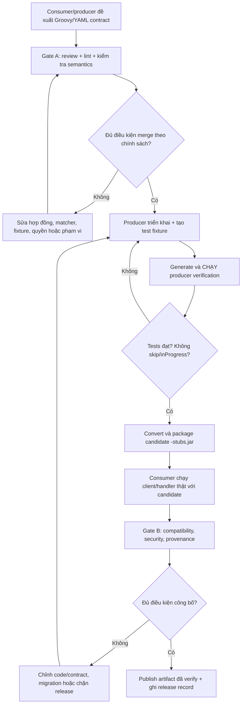
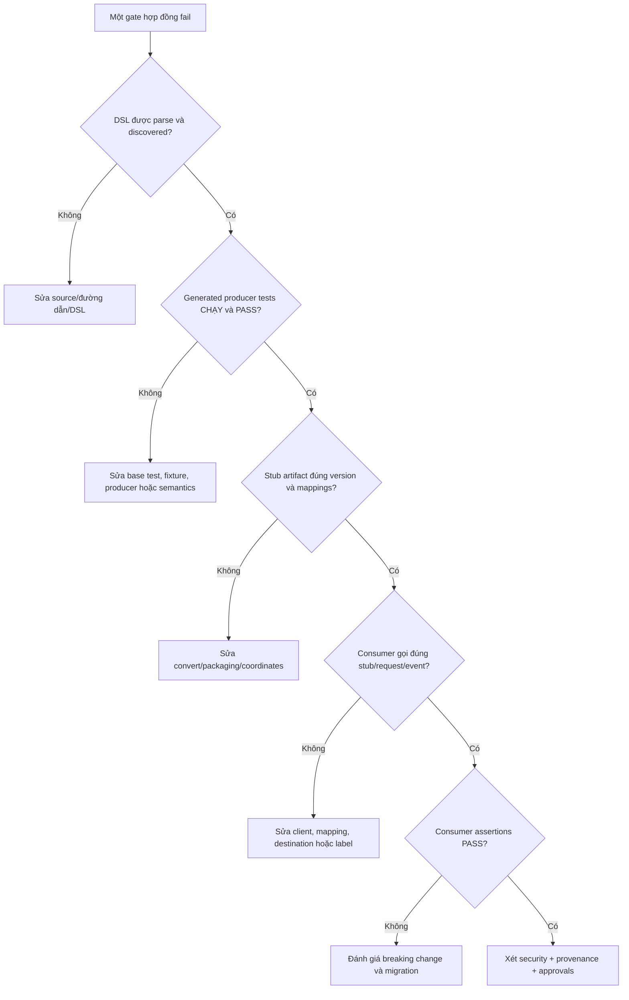

# Danh sách kiểm tra trước khi hợp nhất hoặc công bố hợp đồng

## 1. Vì sao cần hai lần kiểm tra chất lượng?

Trong module **SPRING_CLOUD_CONTRACT**, Spring Cloud Contract cho phép producer và consumer thỏa thuận hành vi **HTTP** hoặc **thông điệp** qua **Groovy/YAML DSL**. Contract Verifier sinh kiểm thử producer; hợp đồng có thể được chuyển thành stub, đóng gói theo phiên bản rồi được consumer dùng qua **Stub Runner**. CI giúp phát hiện thay đổi API không tương thích trước khi triển khai.

Tuy nhiên, một hợp đồng có cú pháp hợp lệ **chưa chắc là hợp đồng tốt**. Nó có thể mô tả sai quy tắc nghiệp vụ, quá rộng đến mức không bắt được lỗi, hoặc khóa chặt một chi tiết nội bộ mà consumer không dùng. Một stub tạo thành công cũng **không chứng minh producer đã thực thi đúng**. Ngay cả khi producer verification đã đạt, consumer cũ vẫn có thể hỏng do thay đổi schema hoặc lỗi giải mã.

Vì vậy cần phân biệt hai thời điểm:

1. **Trước khi hợp nhất (merge)**: hợp đồng có đúng ý nghĩa, có người chịu trách nhiệm, có ví dụ và matcher đủ chất lượng, có thể được xác minh và không gây xung đột với hợp đồng khác không?
2. **Trước khi công bố (publish/release)**: phiên bản producer **thật sự đáp ứng** hợp đồng, generated tests đã chạy, stub JAR đúng nội dung, consumer được hỗ trợ vẫn tương thích và artifact được phát hành an toàn không?

Một số tổ chức gộp hai gate vào một PR bắt buộc producer CI đạt trước khi merge. Tổ chức khác cho phép merge **đề xuất chưa triển khai** vào nhánh phát triển nhưng chặn publish. Điều quan trọng là **không xem trạng thái “contract reviewed” tương đương “producer verified”**.

### Kết quả học tập

Sau bài này, bạn có thể:

- Dùng checklist đánh giá **tính rõ ràng, tính nhất quán, độ bao phủ và khả năng bảo trì** của contract.
- Rà soát HTTP method, URL, query, headers, body, status và error code.
- Đánh giá request/response matcher: **không quá chặt, không quá lỏng**.
- Rà soát message `label`, `sentTo`, body, headers, content type và trạng thái bất đồng bộ.
- Kiểm tra dữ liệu fixture, generated producer tests, mapping và Stub Runner.
- Phân biệt các bằng chứng cần cho **merge gate** và **publish gate**.
- Kiểm tra tương thích theo các consumer/branch còn được hỗ trợ.
- Thiết lập tiêu chí chặn CI, xử lý waiver và tránh “build xanh giả”.

## 2. Định nghĩa “hợp đồng đạt chất lượng”

Một hợp đồng tốt cần trả lời được **ai cần hành vi nào, producer cam kết điều gì và test nào phát hiện khi cam kết bị phá vỡ**.

| Tiêu chí | Câu hỏi đánh giá | Dấu hiệu chưa đạt |
| --- | --- | --- |
| **Đúng nhu cầu** | Consumer nào thật sự dùng trường/trạng thái này? | Copy toàn bộ response mà không có use case |
| **Rõ semantics** | Kiểu dữ liệu và ý nghĩa nghiệp vụ có thống nhất? | `available` không rõ là “có hàng” hay “đã giữ hàng” |
| **Xác định được** | Request nào dẫn tới response nào? | Hai mappings trùng request nhưng trả kết quả trái nhau |
| **Có thể verify** | Producer tạo được fixture và chạy test thật? | Response chỉ xuất hiện ở một hệ thống bên ngoài chưa kiểm soát |
| **Bắt đúng lỗi** | Thay đổi phá consumer có khiến test fail? | Matcher `.*` cho mọi field |
| **Không khóa nội bộ** | Các assertion có phụ thuộc chi tiết producer không công bố? | Assert database row ID hoặc thứ tự trường JSON |
| **Đủ nhánh quan trọng** | Có happy path, lỗi/đối chứng mà consumer dựa vào? | Chỉ kiểm tra `200`, bỏ `404/409` |
| **An toàn dữ liệu** | Có token hoặc PII thật bị ghi vào fixture không? | Copy request production vào DSL |
| **Có nguồn gốc** | Ai duyệt và artifact nào được tạo từ revision nào? | JAR không xác định được commit |
| **Tương thích** | Consumer đang hỗ trợ có tiếp tục chạy được? | Chỉ kiểm tra producer tests |

**Checklist không phải bảng đếm tick để đạt điểm.** Một lỗi nghiêm trọng, ví dụ credential thật trong contract hoặc nhánh `404` bị trùng mapping, đủ để **chặn merge hoặc publish** dù các mục khác đều được đánh dấu đã kiểm.

## 3. Phân loại gate: trước merge và trước publish



### 3.1. Bảng xác định loại bằng chứng

| Bằng chứng | Trước merge PR | Trước publish/release |
| --- | --- | --- |
| Consumer use case và owner | **Bắt buộc** | Giữ bằng chứng |
| DSL parse và contract được phát hiện | **Bắt buộc** | **Bắt buộc** |
| Review semantics và breaking changes | **Bắt buộc** | Không có thay đổi chưa review |
| Fixture/mock-up có ý nghĩa | Bắt buộc có kế hoạch hoặc triển khai | **Được hiện thực và kiểm chứng** |
| Generated producer tests | Nếu implementation đã có, nên chạy | **Phải sinh và thực thi** |
| Contract `inProgress`/`ignored` | Phải công bố lý do/trạng thái | **Không được che thiếu verification** |
| Stub JAR | Có thể là bản thử nghiệm | **Đúng version, contents và checksum** |
| Consumer test trên stub | Có thể dùng stub đề xuất, ghi rõ *unverified* | **Phải dùng candidate đã verified** |
| Compatibility matrix | Nhận diện những consumer cần test | **Có kết quả/waiver được phê duyệt** |
| Release permissions, artifact provenance | Kế hoạch rõ | **Bắt buộc trước xuất bản** |

Nếu PR chỉ đề xuất design trong khi producer chưa triển khai, tổ chức có thể cho phép merge vào **nhánh dành cho đề xuất**. Nhưng stable artifact chỉ được phát hành khi **Gate B** đã đạt.

## 4. Checklist trước khi bắt đầu review: đối tượng và phạm vi

Trước khi đọc một dòng Groovy, reviewer cần biết hợp đồng phục vụ ai.

### 4.1. Các câu hỏi cần có trên pull request

- **Producer** nào chịu trách nhiệm cung cấp endpoint/event?
- **Consumer** nào thực sự gọi API hoặc nhận message, và owner của consumer là ai?
- Use case là gì? Consumer dựa vào field, status, header hoặc event type nào để quyết định?
- Contract mô tả **hành vi hiện có**, **hành vi mới** hay **breaking change**?
- Producer/consumer đang dùng phiên bản nào? Có branch LTS/hotfix cần hỗ trợ không?
- Có liên quan authentication, authorization, dữ liệu cá nhân hoặc giao dịch nhạy cảm không?
- Các tình huống nào phải được kiểm chứng để kết luận sẵn sàng?
- Một người review có thể **chỉ ra lỗi cụ thể** mà hợp đồng sẽ bắt được không?

Ví dụ bảng PR:

| Thuộc tính | Giá trị minh họa |
| --- | --- |
| Producer | Orders Service |
| Consumer | Checkout Service và Mobile Gateway |
| Nhu cầu | Đọc trạng thái đơn để cho phép/không cho phép thanh toán |
| Endpoint | `GET /api/orders/{orderId}` |
| Nhánh chính | `CREATED`, `PAID`, `ORDER_NOT_FOUND` |
| API owner | Orders Team |
| Consumer owners | Checkout/Mobile Teams |
| Phạm vi tương thích | `main` và `release/lts` còn hỗ trợ |
| Đầu ra cần có | Producer verification report + versioned stub + consumer compatibility report |

Đây là **dữ liệu học tập giả định**, không phải thông tin của dự án thật.

### 4.2. Trách nhiệm của các nhóm

| Nhóm | Chịu trách nhiệm |
| --- | --- |
| Consumer author | Đề xuất hành vi tối thiểu và consumer test |
| Producer/API owner | Phê duyệt semantics, khả năng triển khai, fixture, error model |
| Contract reviewer | Kiểm tra DSL/matcher/overlap, tính nhất quán với hợp đồng hiện có |
| Security reviewer khi cần | Xác nhận không có secret/PII và kiểm tra auth model |
| CI/release owner | Bảo đảm tests thực thi, artifact đúng version/provenance, publish gate |

Consumer **không tự quyết định** producer đã hỗ trợ một hành vi chỉ bằng việc tạo stub từ PR. Producer cần **xác minh ứng dụng thật**; consumer cần **xác minh mã client/handler thật**.

## 5. Checklist cấu trúc file và DSL

Spring Cloud Contract đọc contracts từ vị trí được plugin cấu hình, thường là `src/test/resources/contracts` với Maven.

Ví dụ:

```text
orders-producer/
  pom.xml
  src/
    test/
      java/com/example/orders/contract/OrdersContractBase.java
      resources/contracts/
        orders/
          get_order_created.groovy
          get_order_paid.groovy
          get_order_not_found.yml
        messaging/
          order_created_event.groovy
```

### 5.1. Các mục kiểm tra

- [ ] File nằm trong **contracts root thật** của module producer, không dựa trên tên thư mục suy đoán.
- [ ] Đuôi file và DSL hợp lệ, được plugin đang dùng hỗ trợ.
- [ ] Có tên `name` riêng, ổn định, không trùng với hợp đồng khác.
- [ ] Một hợp đồng chỉ mô tả một kịch bản có mục tiêu rõ.
- [ ] Mọi request/response HTTP có những trường bắt buộc, đặc biệt method, URL và response status.
- [ ] Với message, `input`/`outputMessage`, `label` và `sentTo` được thiết kế nhất quán.
- [ ] Không copy **cả Groovy và YAML tương đương** vào cùng build gây duplicate.
- [ ] Không còn thử nghiệm tạm, matcher `.*` quá rộng, TODO chưa giải quyết hoặc contract bị `ignored` vô cớ.
- [ ] Nếu có `baseClassMappings`, generated tests phải kế thừa đúng base test.

**Lưu ý:** contract có thể dùng `url` hoặc `urlPath` theo API, nhưng không dùng đồng thời cả hai cho cùng request. Khi cần query parameters linh hoạt, `urlPath` với `queryParameters` thường làm điều kiện rõ ràng hơn.

### 5.2. Tên hợp đồng là một phần khả năng bảo trì

Tên như `order_1` hay `test_new` không nói rõ nhánh nào. Nên dùng:

```text
get_order_created
get_order_paid
get_order_not_found
create_order_invalid_quantity
create_order_out_of_stock
```

Tên trùng có thể gây xung đột generated test/mapping; tên mơ hồ làm reviewer khó đối chiếu failure với use case. Đặt tên riêng và nhất quán theo nghiệp vụ; không ràng buộc phải khớp một định dạng tên duy nhất cho mọi tổ chức.

## 6. Ví dụ xuyên suốt: ba hợp đồng HTTP cho Orders API

Checkout cần quyết định đơn nào có thể thanh toán. Ta chọn ba tình huống có **đầu vào phân biệt**, tránh stub chọn nhầm response.

| Request | Response | Quy tắc consumer |
| --- | --- | --- |
| `GET /api/orders/ord-1001` | `200 CREATED` | `canPay = true` |
| `GET /api/orders/ord-2002` | `200 PAID` | `canPay = false` |
| `GET /api/orders/ord-missing` | `404 ORDER_NOT_FOUND` | Báo không tìm thấy |

### 6.1. Groovy contract cho trạng thái CREATED

File `get_order_created.groovy`:

```groovy
import org.springframework.cloud.contract.spec.Contract

Contract.make {
    name 'get_order_created'
    description 'Đọc đơn có thể thanh toán'

    request {
        method GET()
        urlPath '/api/orders/ord-1001'
        headers {
            header 'Accept': 'application/json'
        }
    }

    response {
        status 200
        headers {
            contentType(applicationJson())
        }
        body([
            id         : 'ord-1001',
            status     : 'CREATED',
            totalAmount: 125000,
            currency   : 'VND'
        ])
    }
}
```

Điểm review:

- **Method/URL:** consumer có dùng đúng `GET /api/orders/{id}`?
- **Header:** `Accept` thật sự là ràng buộc của API hay được thêm không cần thiết?
- **Type:** `totalAmount` là number, không phải chuỗi; `currency` là chuỗi.
- **Semantics:** `CREATED` có nghĩa là được phép thanh toán theo chính sách đã thống nhất?
- **Fixture:** producer test có thể tạo `ord-1001` với đúng state?
- **Độ chặt:** có field nào trong response mà consumer không phụ thuộc nhưng test lại khóa cứng?

### 6.2. Groovy contract cho trạng thái PAID

```groovy
import org.springframework.cloud.contract.spec.Contract

Contract.make {
    name 'get_order_paid'

    request {
        method GET()
        urlPath '/api/orders/ord-2002'
        headers {
            header 'Accept': 'application/json'
        }
    }

    response {
        status 200
        headers {
            contentType(applicationJson())
        }
        body([
            id         : 'ord-2002',
            status     : 'PAID',
            totalAmount: 89000,
            currency   : 'VND'
        ])
    }
}
```

Nhánh đối chứng bắt được lỗi consumer `canPay` luôn `true`. Hai ID và số tiền khác nhau còn giúp phát hiện việc client hardcode URL hoặc mapper trả một giá trị cố định.

### 6.3. YAML contract cho nhánh không tìm thấy

```yaml
name: get_order_not_found
description: Đơn hàng không tồn tại
request:
  method: GET
  urlPath: /api/orders/ord-missing
  headers:
    Accept: application/json
response:
  status: 404
  headers:
    Content-Type: application/json
  body:
    code: ORDER_NOT_FOUND
```

Reviewer phải phân biệt **`404` do business contract** với **`404` do WireMock không tìm được mapping**. Nếu chỉ assert HTTP status `404`, một request sai đường dẫn cũng có thể khiến test xanh. Cần xác minh mã lỗi `ORDER_NOT_FOUND` và bảo đảm mapping nhánh này tồn tại.

### 6.4. Điều kiện xung đột cần chặn

Sai:

```text
Contract A: GET /api/orders/ord-1001 -> 200 CREATED
Contract B: GET /api/orders/ord-1001 -> 200 PAID
```

Hai contract có **cùng request matcher** nhưng **response trái nhau**. Không dùng tên file hoặc thư mục khác nhau để phân biệt. Cần bổ sung một **điều kiện request có ý nghĩa**, hoặc đổi fixture/request để mỗi nhánh độc lập. Nếu ý nghĩa thực sự phụ thuộc trạng thái server không thể phân biệt chỉ bằng request, thiết kế fixture/test flow phải được review riêng.

## 7. Checklist HTTP: những gì phải khớp với giao diện công bố

| Thành phần | Kiểm tra tối thiểu | Cảnh báo điển hình |
| --- | --- | --- |
| Method | `GET/POST/PUT/PATCH/DELETE` có đúng? | Contract `GET` cho hành vi tạo resource |
| URL/path | Đúng route, case, path variable và encoding | Test bắt sai route nhưng vẫn nhận mapping rộng |
| Query | Tên, loại, giá trị bắt buộc, empty/optional | Không kiểm tra `limit`/`offset` mà consumer dùng |
| Headers | `Accept`, `Content-Type`, correlation/auth khi có nghĩa vụ | Hardcode token thật hoặc header dư thừa |
| Cookies/session | Có thực sự thuộc public contract? | Bản sao session cookie production |
| Request body | Field names/types/nullability, object/array | `quantity` chuỗi thay vì số |
| Response status | Thành công và lỗi theo semantics | `200` cho cả lỗi và thành công không rõ quy tắc |
| Response headers | `Content-Type`, Location, cache headers nếu consumer phụ thuộc | Khai báo JSON body nhưng trả text/plain |
| Response body | Những field consumer sử dụng, type, schema | Assert field nội bộ hoặc bỏ qua field quan trọng |
| Error model | Mã lỗi body và phân loại domain | Chỉ assert `404`, bỏ `ORDER_NOT_FOUND` |

### 7.1. Các câu hỏi ngữ nghĩa quan trọng

**`404` và `200` với danh sách rỗng có tương đương không?** Không nhất thiết. Một API truy vấn tập hợp có thể trả `200 []` khi không có kết quả; API đọc resource theo ID có thể trả `404`. Phải hỏi consumer xử lý như thế nào, không thay response tùy ý cho dễ viết test.

**`201` và `200` có thể dùng thay nhau không?** Không mặc định. Với hành vi tạo resource, consumer có thể dựa vào `201` và header `Location` hoặc body ID. Nếu các giá trị đó là một phần giao diện, đưa vào contract.

**Header có cần so sánh chính xác toàn bộ không?** Thường chỉ nên bắt các header mà consumer thật sự dùng hoặc API yêu cầu; một số header vận hành có thể biến thiên.

**JSON field order có quan trọng không?** Thông thường JSON object không có nghĩa vụ về thứ tự field. Đừng khóa byte-for-byte response chỉ vì thứ tự serialization thay đổi, trừ khi giao thức của bạn thật sự định nghĩa ràng buộc đó.

## 8. Matcher: ranh giới giữa “quá chặt” và “quá lỏng”

Spring Cloud Contract hỗ trợ matcher và phân biệt **giá trị consumer/stub** với **giá trị producer/test** theo DSL. Khi review, phải hiểu một assertion sẽ hoạt động **ở phía nào**.

### 8.1. Quy tắc kiểm tra matcher

- **Request**: stub cần match những request consumer được phép gửi; producer test cần gửi được một request mẫu xác định.
- **Response**: stub cần trả một ví dụ hợp lệ cho consumer; producer test cần assert đúng ràng buộc response.
- Matcher phải bảo vệ **format/type/quy tắc** mà consumer phụ thuộc, không phải chấp nhận mọi thứ.
- Ví dụ producer dùng trong fixture phải thỏa matcher, không phải một chuỗi ngẫu nhiên trái format.
- Regex hoặc JSONPath phải được áp dụng đúng **vị trí field** và không vô tình bắt một nhánh khác.
- Array size, field bắt buộc và nullability cần được xem xét khi consumer phụ thuộc chúng.
- Không dùng một matcher quá khái quát để “chữa” mapping bị sai.

### 8.2. Ví dụ review độ nhạy

Giả sử producer trả:

```json
{
  "orderId": "ord-1001",
  "status": "CREATED",
  "totalAmount": 125000
}
```

| Assertion/matcher | Vấn đề | Phương án |
| --- | --- | --- |
| `totalAmount` khớp bất kỳ chuỗi nào | Không bắt đổi number → string | Kiểm tra numeric type |
| `status` khớp `.*` | Không bắt enum đổi sai | Giới hạn giá trị được công bố |
| So sánh toàn bộ JSON text byte-for-byte | Có thể fail vì field order/whitespace | So sánh theo cấu trúc/field quan trọng |
| `orderId` luôn đúng duy nhất `ord-1001` | Có thể quá chặt cho ID động | Khi cần, dùng matcher định dạng + sample |
| Query/request body khớp mọi nội dung | Stub trả thành công cho cả request sai | Matcher theo schema và nghiệp vụ |

### 8.3. Ví dụ kiểm tra biến đổi data type

Consumer nhận `totalAmount` rồi tính phí. Nếu producer đổi từ:

```json
{"totalAmount":125000}
```

sang:

```json
{"totalAmount":"125000"}
```

thì một deserializer nghiêm ngặt có thể fail, hoặc một ngôn ngữ linh hoạt có thể tính sai. Contract review phải coi **kiểu JSON là một phần khả năng tương thích**, không chấp nhận “cùng số hiển thị” nếu giao diện quy định number.

### 8.4. Không biến fixture thành oracle của chính nó

Một consumer test như:

```java
OrderDto expected = OrderFixtures.createdOrder();
OrderDto actual = expected;
assertThat(actual).isEqualTo(expected);
```

không gọi consumer code. Đây là **assertion đồng nhất thức**, không xác minh HTTP client/mapper/logic nghiệp vụ. Test tốt cần gọi mã consumer thật qua Stub Runner và kiểm tra kết quả có ý nghĩa.

## 9. Kiểm tra dữ liệu fixture và test base phía producer

Một contract có thể đúng nhưng generated test fail ngẫu nhiên nếu dữ liệu đầu vào không ổn định.

### 9.1. Nguyên tắc fixture

- Test nào cũng có **precondition rõ**: ID tồn tại, trạng thái, tồn kho, user/role, thời gian.
- Fixture không phụ thuộc vào **thứ tự chạy các tests**.
- Không dùng cùng dữ liệu DB chia sẻ giữa các jobs/test cases mà không có isolation.
- Giá trị dynamic như thời gian/UUID được kiểm soát bằng clock/test data/matcher thích hợp.
- Với `404`, ID mẫu phải thật sự **không tồn tại**, không chỉ “thường không có”.
- Với `409`, phải tạo đúng trạng thái conflict; không dựa vào một lần chạy trước.
- Không dùng data/customer/token production để “làm thật” fixture.
- Test producer thực thi controller/service ở mức đã chọn, không mock toàn bộ response.

### 9.2. Base test JUnit 5 với MockMvc

Một producer Spring MVC giả định có thể có:

```java
package com.example.orders.contract;

import io.restassured.module.mockmvc.RestAssuredMockMvc;
import org.junit.jupiter.api.BeforeEach;
import org.springframework.beans.factory.annotation.Autowired;
import org.springframework.boot.test.autoconfigure.web.servlet.AutoConfigureMockMvc;
import org.springframework.boot.test.context.SpringBootTest;
import org.springframework.test.web.servlet.MockMvc;

@SpringBootTest
@AutoConfigureMockMvc
public abstract class OrdersContractBase {

    @Autowired
    private MockMvc mockMvc;

    @Autowired
    private OrdersContractFixtures fixtures;

    @BeforeEach
    protected void prepareContractState() {
        fixtures.reset();
        fixtures.createOrder("ord-1001", "CREATED", 125000L, "VND");
        fixtures.createOrder("ord-2002", "PAID", 89000L, "VND");
        fixtures.ensureMissing("ord-missing");
        RestAssuredMockMvc.mockMvc(mockMvc);
    }
}
```

`OrdersContractFixtures` và các method `reset`, `createOrder`, `ensureMissing` là **helper minh họa do dự án tự định nghĩa**, không phải API tích hợp sẵn. Chúng phải nạp dữ liệu vào test DB hoặc lớp repository mà controller thật sử dụng. Đoạn code yêu cầu các dependencies JUnit 5, MockMvc, Rest Assured MockMvc và Spring Boot phù hợp.

### 9.3. Base class sai tạo false confidence

Một base test có thể gọi:

```java
// Phản ví dụ: không nên chỉ dùng mock trả đúng contract.
when(ordersService.getOrder("ord-1001"))
    .thenReturn(new OrderDto("ord-1001", "CREATED", 125000L, "VND"));
```

Nếu mục tiêu là kiểm tra **controller serialization/HTTP response**, mock ở service boundary đôi khi là lựa chọn có chủ đích, nhưng **không được tuyên bố** đã kiểm tra toàn bộ logic đọc trạng thái thật. Đối với hợp đồng cần chứng minh business service và persistence hoạt động đúng, dùng fixture ở tầng thích hợp và chạy code thật.

Việc chọn phạm vi phải ghi rõ: generated test có kiểm tra **controller contract boundary** hay toàn bộ **producer application integration**? Không overclaim bằng chứng.

## 10. Checklist riêng cho hợp đồng messaging

Message contract có thể mô tả producer phát sự kiện để consumer xử lý. Các review criteria khác HTTP vì không có request/response đồng bộ.

| Thành phần | Điều cần kiểm tra | Hậu quả nếu sai |
| --- | --- | --- |
| `name` | Tên duy nhất, dễ truy vết | Generated test/mapping artifact trùng |
| `label` | Nhãn kích hoạt stub mà consumer sử dụng | `StubTrigger.trigger(label)` không tìm thấy |
| `input.triggeredBy` | Method tồn tại trong producer base/test setup | Generated producer test không gọi được |
| `outputMessage.sentTo` | Logical destination/topic/queue đúng | Consumer không nhận event |
| Body | Field names/types, event semantics, schema version | Deserialize hoặc handler sai |
| Headers | Event type, correlation, tenant nếu là contract | Consumer không route được |
| Content type | JSON/XML/text và converter phù hợp | Lỗi serialization/decoding |
| Fixture | Message có được publish bởi producer thật? | Test pass nhờ message dựng tay ở sai tầng |
| Async | Handler có xử lý và thay đổi trạng thái? | Trigger pass nhưng handler không hoạt động |
| Transport | Có cần broker test bổ sung? | Stub không chứng minh ordering/retry/delivery |

### 10.1. Ví dụ Groovy messaging contract

```groovy
import org.springframework.cloud.contract.spec.Contract

Contract.make {
    name 'order_created_event'
    label 'order_created'

    input {
        triggeredBy('publishOrderCreated()')
    }

    outputMessage {
        sentTo('orders.events')
        body([
            eventType: 'ORDER_CREATED',
            orderId  : 'ord-1001',
            quantity : 2
        ])
        headers {
            header('eventType', 'ORDER_CREATED')
            messagingContentType(applicationJson())
        }
    }
}
```

`publishOrderCreated()` là **method do producer test base hiện thực**. Đoạn Groovy trên không tự gửi event nếu producer chưa có message publisher/binder phù hợp. Reviewer phải kiểm tra publisher thực sự được gọi và message quan sát được ở đúng transport.

### 10.2. YAML DSL tương đương

```yaml
name: order_created_event
label: order_created
input:
  triggeredBy: publishOrderCreated()
outputMessage:
  sentTo: orders.events
  body:
    eventType: ORDER_CREATED
    orderId: ord-1001
    quantity: 2
  headers:
    eventType: ORDER_CREATED
    contentType: application/json
```

**Chỉ chọn một biểu diễn** cho cùng kịch bản khi đưa vào build; Groovy và YAML ở đây nhằm so sánh cú pháp. Nếu producer dùng message DSL nhưng không cấu hình test binder/verifier tương ứng, test sẽ không tạo đủ bằng chứng.

### 10.3. Không nhầm contract messaging với bảo đảm broker

Hợp đồng có thể kiểm tra **body, headers và destination** của event do producer phát và cung cấp stub cho consumer. Nó **không tự chứng minh** exactly-once delivery, ordering, retry, dead-letter routing, ACL hoặc availability của broker production.

Những tính chất này cần integration/resilience tests riêng. Checklist phải ghi “out of scope” khi hợp đồng không nhằm kiểm tra chúng, không tự đánh dấu PASS.

## 11. Consumer test: kiểm tra mã thật, không chỉ stub

Sau khi producer đã có verified stub, consumer cần chạy **client/service/handler của chính mình**.

### 11.1. Consumer HTTP test với Stub Runner

```java
import org.junit.jupiter.api.Test;
import org.springframework.beans.factory.annotation.Autowired;
import org.springframework.boot.test.context.SpringBootTest;
import org.springframework.cloud.contract.stubrunner.StubRunnerProperties;
import org.springframework.cloud.contract.stubrunner.spring.AutoConfigureStubRunner;

import static org.assertj.core.api.Assertions.assertThat;
import static org.assertj.core.api.Assertions.assertThatThrownBy;

@SpringBootTest(properties = {
    "clients.orders.base-url=http://localhost:8090"
})
@AutoConfigureStubRunner(
    ids = "com.example:orders-producer:1.4.2:stubs:8090",
    stubsMode = StubRunnerProperties.StubsMode.LOCAL
)
class CheckoutConsumerContractTest {

    @Autowired
    private CheckoutService checkoutService;

    @Test
    void createdOrderCanBePaid() {
        CheckoutView result = checkoutService.load("ord-1001");
        assertThat(result.orderId()).isEqualTo("ord-1001");
        assertThat(result.canPay()).isTrue();
    }

    @Test
    void paidOrderCannotBePaid() {
        CheckoutView result = checkoutService.load("ord-2002");
        assertThat(result.canPay()).isFalse();
    }

    @Test
    void missingOrderBecomesDomainError() {
        assertThatThrownBy(() -> checkoutService.load("ord-missing"))
            .isInstanceOf(OrderNotFoundException.class);
    }
}
```

`CheckoutService`, `CheckoutView` và `OrderNotFoundException` là **API minh họa của consumer**, không phải Spring Cloud Contract classes. Test có ý nghĩa nếu `CheckoutService` gọi HTTP client thật trỏ tới stub và thực hiện logic nghiệp vụ. Ví dụ dùng **port cố định `8090`**, chỉ phù hợp môi trường test được cô lập; CI chạy song song nên xem xét port động và `StubFinder`.

### 11.2. Những gì consumer test phải chứng minh

| Kịch bản | Assertion có ý nghĩa | Test dễ “xanh giả” |
| --- | --- | --- |
| `CREATED` | `canPay == true` sau khi gọi service | Assert JSON fixture chứa `CREATED` |
| `PAID` | `canPay == false` | Chỉ test `CREATED` |
| `404 ORDER_NOT_FOUND` | Domain error được ánh xạ đúng | Assert duy nhất HTTP `404` từ WireMock |
| Message `ORDER_CREATED` | Handler tạo read model sau trigger | Seed sẵn read model rồi assert nó tồn tại |

Test chỉ gọi `curl` tới WireMock có thể là **smoke test hữu ích**, nhưng không thay được consumer contract test đi qua mã consumer thật.

## 12. Pre-merge Gate A: kiểm tra `inProgress` và `ignored`

Spring Cloud Contract cho phép một hợp đồng ở trạng thái phát triển:

```groovy
import org.springframework.cloud.contract.spec.Contract

Contract.make {
    inProgress()
    name 'proposed_order_endpoint'
    request {
        method GET()
        url '/api/orders/ord-proposed'
    }
    response {
        status 200
        body([id: 'ord-proposed'])
    }
}
```

Một YAML có thể dùng:

```yaml
name: proposed_order_endpoint
inProgress: true
request:
  method: GET
  url: /api/orders/ord-proposed
response:
  status: 200
  body:
    id: ord-proposed
```

**Hệ quả quan trọng:** contract `inProgress` có thể **sinh stub cho consumer thử sớm** nhưng **không sinh producer verification test** tương ứng. Vì vậy “consumer PASS với proposed stub” không chứng minh producer triển khai xong.

### 12.1. `ignored` có khác không?

DSL cũng có `ignored()` hoặc `ignored: true` để bỏ qua contract theo cấu hình. Nếu một contract bị ignored trong gate bắt buộc, nó **không cung cấp bằng chứng mà reviewer mong đợi**. Không dùng `ignored` để che generated test fail rồi công bố version như đã được verify.

### 12.2. Cấu hình Maven release gate

```xml
<plugin>
  <groupId>org.springframework.cloud</groupId>
  <artifactId>spring-cloud-contract-maven-plugin</artifactId>
  <version>REPLACE_WITH_COMPATIBLE_VERSION</version>
  <extensions>true</extensions>
  <configuration>
    <testFramework>JUNIT5</testFramework>
    <testMode>MOCKMVC</testMode>
    <baseClassForTests>com.example.orders.contract.OrdersContractBase</baseClassForTests>
    <failOnNoContracts>true</failOnNoContracts>
    <failOnInProgress>true</failOnInProgress>
  </configuration>
</plugin>
```

Đây là **plugin fragment**, không phải `pom.xml` hoàn chỉnh. `REPLACE_WITH_COMPATIBLE_VERSION` phải thay bằng phiên bản Spring Cloud Contract tương thích Spring Boot/Cloud, Maven và JDK. Tài liệu plugin mô tả `failOnNoContracts` và `failOnInProgress` giúp tránh pipeline xanh khi không quét được hợp đồng hoặc có contract chưa hoàn thiện. **Không thay thế** việc kiểm tra generated tests có thật sự chạy.

Không cần cấm mọi đề xuất `inProgress` ở branch thảo luận nếu workflow cho phép; **bắt buộc chặn release** cho đến khi contract được hoàn thiện và producer verification thật sự đạt.

## 13. Producer verification: đếm test đã chạy, không chỉ test được sinh

### 13.1. Maven lifecycle gợi ý

```text
Groovy/YAML contracts
     |
     v
spring-cloud-contract:generateTests (generate-test-sources)
     |
     v
Generated JUnit producer tests
     |
     v
spring-cloud-contract:convert (process-test-resources)
     |
     v
HTTP WireMock mappings
     |
     v
test-compile + Surefire test: THỰC THI assertions
     |
     v
spring-cloud-contract:generateStubs (package)
     |
     v
verify gates -> install / deploy theo chính sách
```

**Giải thích về phase:** đây là **thứ tự các mốc chính trong Maven default lifecycle** khi plugin đã được bind vào các phase tương ứng. `convert` chạy ở `process-test-resources`, tức **trước** Surefire `test`; `generateStubs` chạy ở `package`, tức **sau** Surefire. Không được nhầm `convert` tạo mapping với generated producer tests xác minh implementation thật. Thứ tự đầy đủ hơn ở những phase liên quan:

```text
generate-test-sources (generateTests)
  -> process-test-resources (convert)
  -> test-compile
  -> test (Surefire)
  -> package (generateStubs)
  -> integration-test / verify (nếu cấu hình)
  -> install
  -> deploy
```

### 13.2. Kiểm tra ở CI

```bash
# Hướng dẫn cho pipeline producer đã cấu hình plugin, JUnit và fixtures.
./mvnw -B -ntp clean verify

# Xem stub artifact sau khi build đạt.
jar tf target/orders-producer-1.4.2-stubs.jar
```

Không thực hiện những lệnh này chỉ để “đếm status” của một worker viết tài liệu. Khi vận hành thật, cần:

- Đếm generated contract test classes và test cases.
- Xem Surefire/Failsafe report: **run, pass, fail, skip**.
- Đối chiếu số test với các nhánh contract bắt buộc.
- Xác nhận fixture/test setup không mock sai ranh giới.
- Kiểm tra HTTP mappings `target/stubs/.../mappings`.
- Kiểm tra `-stubs.jar` chứa hợp đồng/mappings đúng version.

`jar tf` **chỉ liệt kê entries**; không chứng minh nội dung JSON an toàn hoặc behavior đúng. Cần xem mapping thực tế và quét nội dung nếu chính sách yêu cầu.

### 13.3. Phân biệt `BUILD SUCCESS` với producer verification

| Tình huống | Có thể có BUILD SUCCESS? | Có được coi là verified không? |
| --- | --- | --- |
| `generateTests` sinh Java nhưng không chạy | Có | **Không** |
| `clean verify -DskipTests` | Có | **Không** |
| Surefire chạy 20 unit tests nhưng 0 generated tests | Có | **Không** |
| Generated tests có chạy và pass, fixture đúng | Có | **Có**, trong phạm vi contract tests đó |
| Producer tests pass nhưng artifact JAR thiếu mappings | Có thể | **Chưa đủ để publish stub** |
| Producer tests pass, Failsafe integration gate fail | Build `verify` fail khi cấu hình đúng | **Không publish** |

Một cờ `failIfNoTests=true` của Surefire có thể phát hiện **0 tests toàn module**, nhưng không phát hiện trường hợp các unit tests chạy còn generated contract tests bị bỏ qua. Release gate cần **kiểm tra chính các generated test cases**.

## 14. Trước khi publish, kiểm tra artifact đúng tọa độ và nội dung

Ví dụ producer artifacts:

```text
groupId    = com.example
artifactId = orders-producer
version    = 1.4.2
classifier = stubs
type       = jar
```

Stub Runner có thể được cấu hình:

```text
com.example:orders-producer:1.4.2:stubs:8090
```

`8090` là **cổng WireMock runtime**, không phải một phần Maven artifact. Khi chạy Maven Dependency Plugin `dependency:get`, cú pháp tọa độ lại khác:

```bash
./mvnw -B dependency:get \
  -Dartifact=com.example:orders-producer:1.4.2:jar:stubs
```

**Lưu ý:** ví dụ này sẽ có thể tải artifact vào cache Maven cục bộ; không dùng cache có sẵn làm bằng chứng repository remote vẫn còn artifact. Cần kiểm tra trên môi trường thích hợp.

### 14.1. Checklist stub JAR

- [ ] Artifact **đúng groupId, artifactId, version, type và classifier**.
- [ ] Có `META-INF/.../contracts` của các nhánh đã review.
- [ ] HTTP contracts sinh ra **WireMock mappings**, không bị thiếu vì goal `convert`.
- [ ] Messaging contracts cần thiết được đóng gói và dùng được ở transport tương ứng.
- [ ] Không chứa resource cũ từ lần build trước; nên dùng `clean` trong verification.
- [ ] Không chứa **secret, PII thật**, credential hoặc dữ liệu production.
- [ ] Artifact có **checksum/digest** và gắn với commit đã được verified.
- [ ] Release không bị ghi đè bằng nội dung khác dưới cùng version.
- [ ] Quy trình publish chỉ chạy sau producer/consumer/security gates.

### 14.2. Nội dung bên trong JAR

Một cấu trúc minh họa:

```text
orders-producer-1.4.2-stubs.jar
  META-INF/
    com.example/
      orders-producer/
        1.4.2/
          contracts/
            orders/get_order_created.groovy
            orders/get_order_not_found.yml
          mappings/
            orders/<generated-mapping>.json
```

`<generated-mapping>` là placeholder; tên file thật do plugin quyết định. Messaging contract không nhất thiết sinh thành một WireMock HTTP mapping, nên không so sánh tổng file JSON với tổng **HTTP + message** contracts.

## 15. Compatibility matrix: một producer có nhiều consumer

Producer verification kiểm tra producer đối với hợp đồng; nó **không tự chứng minh mọi consumer đều chạy được**.

Giả sử Orders Producer dự kiến đổi `status` từ `CREATED` thành `DRAFT`.

| Consumer | Branch/version được hỗ trợ | Candidate stub `1.5.0` | Kết luận |
| --- | --- | --- | --- |
| Checkout `main` | Có | PASS | Có thể tiếp tục |
| Checkout `release/lts` | Có | FAIL: không nhận `DRAFT` | **BLOCK hoặc migration** |
| Mobile Gateway `main` | Có | Chưa chạy | **NOT_TESTED**, không tự coi PASS |
| Analytics `main` | Có | PASS | Có thể tiếp tục |

Đây là bảng kết quả **giả định phục vụ học tập**. Nếu Checkout LTS còn trong support window, producer không được tự bỏ qua nó chỉ vì `main` đã nâng cấp.

### 15.1. Cách review breaking changes

| Kiểu thay đổi | Rủi ro | Cần kiểm tra |
| --- | --- | --- |
| Xóa/đổi tên field | DTO hoặc UI không đọc được | Consumer contract/integration tests |
| Đổi JSON type | Lỗi deserialize hoặc tính toán | Type assertions và consumer parsing |
| Thêm field tùy chọn | Một số clients strict unknown-field fail | Consumer tests thực tế |
| Đổi HTTP status | Error handling thay đổi | Negative tests |
| Đổi URL/header | Routing/auth/serialization không khớp | Client request matching |
| Đổi event destination | Message consumer không nhận | Broker binding/consumer handler |
| Đổi message label | `StubTrigger.trigger` không tìm thấy | Stub Runner message tests |
| Đổi content type | Converter parse payload khác | Schema/serializer tests |

**Đừng đánh đồng “thay đổi cộng thêm” với “luôn không breaking”.** Tương thích phụ thuộc consumer thực tế, schema policy và deserializer.

### 15.2. Khi không thể chạy hết ma trận

Ghi rõ `NOT_TESTED`, lý do và chủ sở hữu. Nếu chính sách tổ chức cho phép waiver, nó phải ghi:

- Consumer/version cụ thể được miễn.
- Rủi ro và tác động dự kiến.
- Người có thẩm quyền phê duyệt.
- Ngày hết hạn và kế hoạch kiểm tra bù.
- Điều kiện rollback/stop release khi phát hiện lỗi.

Không đổi test thành skipped rồi báo toàn bộ compatibility PASS.

## 16. Security checklist trước merge và trước publish

Đây là một gate độc lập: contract hợp lệ và producer test pass **không có nghĩa dữ liệu được chia sẻ an toàn**.

### 16.1. Trước merge

- Không có access token, API key, password, private key, JWT thật, session cookie thật.
- Không có tên/email/số điện thoại/địa chỉ của người thật trong fixture.
- ID khách hàng là dữ liệu tổng hợp, không lấy từ hệ thống production.
- Không hardcode endpoint có thể gây tác động ngoài môi trường test, webhook hoặc broker thật.
- Matcher `Authorization` chỉ mô tả header và **không được coi là xác thực**.
- PR reviewer hiểu trường nào là công khai, trường nào là nội bộ/nhạy cảm.

### 16.2. Trước publish

- Scan **generated Java tests**, WireMock mappings, response-body files và JAR, không chỉ DSL source.
- Kiểm tra Git diff/history nếu có cảnh báo secret.
- Kiểm soát quyền đọc artifact repository và CI reports.
- Tài khoản tải stub có quyền tối thiểu, tránh production credentials.
- Stub Runner Boot và WireMock `/__admin` chỉ truy cập trong mạng test.
- Messaging stub không publish event giả vào broker production.
- Logs/request journal không lưu header `Authorization` hoặc body có PII.

Một token lộ trong Git/JAR phải được **revoke/rotate** theo incident playbook; xóa nó khỏi commit mới **không vô hiệu hóa các bản sao** trong artifact repository, Maven cache và logs.

## 17. CI gates: chuyển checklist thành bằng chứng tự động

Checklist thủ công cần được hỗ trợ bằng những kiểm tra tự động, nhưng không phải mọi điều đều máy móc hóa được.

### 17.1. Bảng trách nhiệm

| Gate | Có thể tự động hóa | Cần review con người |
| --- | --- | --- |
| YAML/Groovy parse | Có | Cú pháp đúng chưa đủ semantics |
| Contracts discovered/test counts | Có | Độ bao phủ hành vi có đủ không |
| Trùng `name` hoặc mapping overlap | Có thể kiểm tra một phần | Rà soát tiền điều kiện và nghiệp vụ |
| Generated producer verification | Có | Fixture có thật sự đại diện production behavior không |
| Stub packaging/checksum | Có | Artifact có phù hợp release intent không |
| Secret scanning | Có, kết hợp nhiều nguồn | False positives/PII và xử lý incident |
| Consumer compatibility matrix | Có thể tự động chạy tests | Danh sách supported consumers và waiver |
| Backward compatibility semantics | Một phần | API/domain owner cần quyết định |
| Release permissions | Có | Phê duyệt rollout/rollback |

### 17.2. Pseudocode pipeline gating

```text
PR:
  parse contracts
  validate naming and contract root
  scan DSL and synthetic fixtures
  review API semantics and ownership
  check matcher overlap and breaking changes
  optionally test against proposal stub (mark UNVERIFIED)

Producer candidate:
  run clean verify with NO skip flags
  assert generated producer contract tests were executed
  assert failOnNoContracts and failOnInProgress enforced
  inspect mappings and -stubs.jar
  scan generated source, mappings and archive
  capture commit + artifact digest + test report

Consumer compatibility:
  resolve EXACT candidate artifact version
  run real consumer client/handler tests
  include supported branches and important error cases
  record PASS / FAIL / NOT_TESTED per consumer

Publish:
  require producer + consumer + security gates PASS
  require approvals and rollout/rollback plan
  publish immutable release artifact
  retain verification and provenance evidence
```

**Đây là mô hình pipeline**, không phải lệnh thực thi sẵn. Các check đếm generated cases, quét JAR và kiểm tra ma trận phải được triển khai bằng tooling cụ thể của tổ chức.

### 17.3. Ví dụ GitHub Actions đơn giản cho producer PR

```yaml
name: Contract producer PR gate

on:
  pull_request:
    branches: [main]

permissions:
  contents: read

jobs:
  verify-contracts:
    runs-on: ubuntu-latest
    steps:
      - uses: actions/checkout@v4

      - uses: actions/setup-java@v4
        with:
          distribution: temurin
          java-version: '17'
          cache: maven

      - name: Verify producer contract tests and build stub
        run: ./mvnw -B -ntp clean verify

      - name: Upload producer test reports
        if: always()
        uses: actions/upload-artifact@v4
        with:
          name: producer-test-reports
          path: target/surefire-reports/
          if-no-files-found: error
```

**Ví dụ không phải release pipeline hoàn chỉnh.** Nó giả định project một module, Maven plugin đã bind đúng lifecycle, generated tests được Surefire discover và runner JDK tương thích. Cần bổ sung **secret scanning, contract count, artifact scan, consumer tests, Failsafe reports và provenance checks** trước khi biến nó thành gate phát hành. Trong CI production nên pin phiên bản actions bằng commit SHA theo chính sách supply-chain; không cấp deploy credentials cho PR không tin cậy.

### 17.4. Không dùng build của PR để publish release

Code từ PR có thể chưa đáng tin. Không trao signing keys, repository deploy token hoặc production credentials cho job chạy source PR chưa được kiểm duyệt. **Protected release workflow** mới được quyền publish sau khi quality gates đã đạt.

## 18. Review trạng thái công việc và cách phân loại lỗi

| Dấu hiệu | Phân loại | Hành động |
| --- | --- | --- |
| Contract file không được phát hiện | Discovery/config | Kiểm tra contracts root/filter, chặn merge hoặc release |
| Groovy/YAML parse fail | DSL syntax | Sửa DSL, chạy lại generator |
| Generated test không compile | Test framework/base class/dependency | Kiểm tra JUnit/MockMvc, FQCN, BOM |
| Producer test `200` trả `404` | Implementation/fixture | Kiểm tra dữ liệu và endpoint thật |
| Stub trả sai nhánh | Mapping overlap/matcher | Xem WireMock mappings và unmatched requests |
| Producer tests PASS nhưng consumer DTO fail | Compatibility/type | Đàm phán schema hoặc migrate |
| Contract `inProgress` | Chưa được producer verify | Không publish |
| Artifact đúng GAV nhưng thiếu `stubs` classifier | Packaging | Kiểm tra plugin và `-stubs.jar` |
| CI report 0 generated contract cases | False-green build | Chặn publish, sửa discovery/runner |
| Consumer gọi stub version cũ | Provenance | Cập nhật exact Stub Runner IDs |
| Stub JAR có access token thật | Security incident | Chặn publish, revoke/rotate và xử lý bản sao |
| Consumer LTS không test được | Coverage/gate | Đánh dấu NOT_TESTED; xử lý waiver nếu có |

### 18.1. Quy trình chẩn đoán đúng tầng



Không sửa expected data để “cho xanh” nếu vẫn chưa biết hợp đồng hay implementation nào đang sai. Mỗi failure là bằng chứng để xác định **producer, consumer, contract hoặc test infrastructure** cần thay đổi.

## 19. Anti-pattern thường thấy trong review

### 19.1. Chỉ nhìn số lượng test, không nhìn case nào chạy

Một job báo `Tests run: 120` nhưng cả 120 đều là unit tests không liên quan Spring Cloud Contract. Nếu generated contract tests không được discover, job đó **không chứng minh** producer đáp ứng hợp đồng. Hãy kiểm tra cụ thể generated class/method names hoặc metadata tương ứng.

### 19.2. Matcher quá rộng để tránh failure

Sau khi producer đổi `status`, người viết thay assertion enum bằng `.*`. CI xanh nhưng consumer cũ vẫn có thể crash khi đọc enum. **Chữa nguyên nhân không phải xóa ràng buộc quan trọng**.

### 19.3. Kiểm tra HTTP `404` nhưng thiếu hợp đồng lỗi

WireMock có thể trả `404` khi không tìm thấy mapping. Nếu test chỉ assert status, request sai URL cũng qua. Contract tốt có body lỗi phân biệt, và test kiểm chứng mã lỗi cụ thể.

### 19.4. Chỉ kiểm thử chính fixture

Consumer test gọi thẳng WireMock rồi assert JSON đúng dữ liệu trong contract. Đó là smoke test, không bảo vệ logic consumer. Cần gọi client/service thật và assert kết quả nghiệp vụ như `canPay`.

### 19.5. Gộp một hợp đồng đề xuất vào release khi còn `inProgress`

Hợp đồng có thể sinh stub mà không sinh producer tests. Nếu release chỉ kiểm tra JAR tồn tại, có thể phát hành một lời hứa mà producer chưa implement. Bắt `failOnInProgress` trong release và kiểm tra generated test report.

### 19.6. Chỉ kiểm tra nhánh main

Một producer mới có thể PASS với Checkout `main` nhưng phá Checkout LTS. Phải bảo vệ những consumer/versions **còn được hỗ trợ** theo policy.

### 19.7. Xóa version stub cũ ngay sau release

Consumer LTS hoặc hotfix pipeline có thể còn cần bản cũ để rebuild. Version mới được publish không tự động làm phiên bản cũ vô dụng. Quản lý retention theo **usage inventory, support, rollback và pháp lý**.

## 20. Tình huống review mẫu: phát hiện một contract chưa đạt

Đề xuất không tốt:

```groovy
import org.springframework.cloud.contract.spec.Contract

Contract.make {
    name 'get_orders_generic'

    request {
        method GET()
        urlPath('/api/orders/.*')
    }

    response {
        status 200
        body([
            id    : 'ord-1001',
            status: 'CREATED'
        ])
    }
}
```

**Vấn đề:** `urlPath('/api/orders/.*')` trong ví dụ chỉ là **chuỗi path literal**, không tự động được coi là regex matcher theo ý định. Ngay cả khi đổi thành regex đúng cú pháp, việc “mọi orderId trả `CREATED`” cũng sai nghiệp vụ. Người viết muốn mock tất cả ID nhưng lại làm mất nhánh `PAID` và `404`.

### 20.1. Kết quả review

| Mục | Đánh giá | Hành động |
| --- | --- | --- |
| Use case | Chưa rõ consumer cần gì | Bổ sung `canPay` và error handling |
| Request matching | Sai ý định regex | Sử dụng matcher thật hoặc các path cố định có ý nghĩa |
| Response cases | Chỉ có `CREATED` | Bổ sung `PAID` và `ORDER_NOT_FOUND` |
| Headers | Chưa mô tả Content-Type | Thêm response JSON header |
| Fixture | Chưa có precondition | Tạo ba ID/states rõ ràng |
| Producer evidence | Chưa có tests | Chạy generated JUnit |
| Consumer evidence | Chưa có | Chạy Checkout code với Stub Runner |

Sau khi sửa, nhóm dùng ba hợp đồng ở mục 6, với request path rõ, response types phù hợp và fixture phân biệt. **Không dùng `.*` để che cả hai trạng thái khác nhau.**

### 20.2. Một review comment có ích

> Contract hiện chỉ trả `CREATED` cho một điều kiện request chưa chính xác. Checkout còn xử lý `PAID` và `ORDER_NOT_FOUND`. Đề nghị thêm hai kịch bản tương ứng, xác nhận response content type và chạy producer verification; sau đó chúng tôi sẽ chạy consumer tests với stub candidate đúng version.

Nhận xét này nêu **lý do, thay đổi cần thiết và tiêu chí xác minh**, tốt hơn việc chỉ viết “matcher sai”.

## 21. Case study: thay đổi error model và tiêu chí release

Orders Producer muốn thay:

```json
{"code":"ORDER_NOT_FOUND"}
```

thành:

```json
{
  "error": {
    "type": "NOT_FOUND",
    "resource": "ORDER"
  }
}
```

Nội bộ producer có thể thấy mô hình mới đẹp hơn. Nhưng Checkout cũ đang map `code = ORDER_NOT_FOUND` thành domain error. Đề xuất chưa được coi là an toàn chỉ vì producer test mới PASS.

### 21.1. Ma trận review

| Câu hỏi | Kết quả |
| --- | --- |
| Producer có generated test cho error format mới? | Phải có |
| Mã producer trả response đúng? | Producer verification |
| Consumer `main` có đọc được error mới? | Consumer test |
| Consumer LTS có đọc được không? | Required compatibility gate |
| Có cần dual format/version mới? | Quyết định API owners |
| Có giữ stub cũ cho rollback? | Retention policy |

### 21.2. Phương án migration

Nhóm có thể chọn **giữ field `code`** trong một giai đoạn, đồng thời thêm object `error`, hoặc version hóa API nếu schema không thể tương thích. Mọi phương án đều phải kiểm tra với deserializer của consumer cũ; việc thêm field cũng có thể fail với client strict schema.

Release checklist không chỉ hỏi “producer đã pass chưa?”, mà còn hỏi **những consumer nào hiện vẫn dựa vào error model cũ**.

## 22. Bài thực hành: review hợp đồng Payments Producer

### 22.1. Bối cảnh

Payments Producer dự kiến thay đổi API:

```text
POST /api/payments
Content-Type: application/json

201 {"paymentId":"pay-test-1001","status":"AUTHORIZED","currency":"VND"}
400 {"code":"INVALID_AMOUNT"}
409 {"code":"DUPLICATE_PAYMENT"}
```

Checkout Consumer dùng `status` để cập nhật trạng thái giỏ hàng; Settlement Consumer nhận một event `PAYMENT_AUTHORIZED`.

### 22.2. Đề xuất Groovy cho nhánh thành công

```groovy
import org.springframework.cloud.contract.spec.Contract

Contract.make {
    name 'authorize_payment_success'

    request {
        method POST()
        url '/api/payments'
        headers {
            contentType(applicationJson())
            header 'Idempotency-Key': 'req-test-1001'
        }
        body([
            orderId : 'ord-test-1001',
            amount  : 125000,
            currency: 'VND'
        ])
    }

    response {
        status 201
        headers {
            contentType(applicationJson())
        }
        body([
            paymentId: 'pay-test-1001',
            status   : 'AUTHORIZED',
            currency : 'VND'
        ])
    }
}
```

### 22.3. Đề xuất YAML cho duplicate request

```yaml
name: authorize_payment_duplicate
request:
  method: POST
  url: /api/payments
  headers:
    Content-Type: application/json
    Idempotency-Key: req-test-duplicate
  body:
    orderId: ord-test-2002
    amount: 125000
    currency: VND
response:
  status: 409
  headers:
    Content-Type: application/json
  body:
    code: DUPLICATE_PAYMENT
```

`req-test-duplicate` là chuỗi test giả, **không phải secret**. Producer fixture phải tạo ra trạng thái đã sử dụng idempotency key này hoặc cơ chế conflict đúng với API. Vì hai request có key và orderId khác nhau, stub HTTP có thể phân biệt nhánh; việc producer thực sự trả `409` phải được generated test kiểm chứng.

### 22.4. Nhiệm vụ người học

1. Xác định ai là producer/consumer owners và contract nào họ cần.
2. Kiểm tra `201`, `400` và `409` có semantics đúng; có thiếu `401/403` không?
3. Viết thêm contract `400 INVALID_AMOUNT` với `amount=0`.
4. Xác định fixture producer cho ba nhánh, không phụ thuộc thứ tự tests.
5. Tìm những field bị khóa quá mức hoặc thiếu: `paymentId`, `status`, `currency`, `Idempotency-Key`.
6. Thiết kế test message `PAYMENT_AUTHORIZED` với label/destination/body/content type.
7. Cấu hình producer plugin và base class phù hợp để generated tests thực thi.
8. Mô tả cách kiểm tra artifact `-stubs.jar`, classifier và GAV.
9. Tạo ma trận Checkout `main`/LTS và Settlement consumer với candidate version.
10. Chỉ ra vì sao nếu producer tests `PASS` nhưng consumer LTS `FAIL` thì chưa được publish.
11. Tìm một ví dụ secret/PII không được đặt vào payment contract.
12. Viết **release gate decision** khi một nhánh quan trọng còn `NOT_TESTED`.

### 22.5. Đáp án định hướng

| Câu hỏi | Kết quả mong đợi |
| --- | --- |
| Điều kiện duplicate | Precondition tạo key đã xử lý; không chỉ request giống key mà không có trạng thái |
| Nhánh `400` | `amount=0` → `INVALID_AMOUNT` theo API đã chấp thuận |
| Response `201` | JSON types đúng; consumer hiểu `AUTHORIZED` |
| Nhánh message | Producer thực sự publish event, consumer handler xử lý được |
| Dữ liệu bảo mật | Không có payment token/card number thật; dùng test identifiers |
| Generated tests | Có số test cụ thể trong report, không chỉ source |
| Artifact | Đúng version + classifier `stubs`, mappings đủ, checksum được lưu |
| Consumer LTS FAIL | **BLOCK hoặc migration/waiver theo chính sách** |
| Required consumer NOT_TESTED | Không được tự báo PASS |

**Câu hỏi thêm:** nếu `PAYMENT_AUTHORIZED` được phát qua broker test nhưng consumer test chỉ assert `StubTrigger.trigger(label) == true`, đã đủ chưa? **Chưa.** Phải kiểm tra handler thật cập nhật read model hoặc domain state sau event.

## 23. Bộ checklist có thể dùng trực tiếp trong PR

### A. Trước khi merge contract

- [ ] **Owner:** producer và consumer được xác định, có người chịu trách nhiệm review.
- [ ] **Use case:** hành vi phục vụ một nhu cầu consumer cụ thể.
- [ ] **Semantics:** các field, status và error codes được giải thích thống nhất.
- [ ] **Scope:** không ràng buộc những chi tiết nội bộ consumer không dùng.
- [ ] **DSL:** Groovy/YAML parse và được generator phát hiện tại đúng thư mục.
- [ ] **Identity:** `name` duy nhất, không trùng test/mapping.
- [ ] **HTTP:** method, path, query, header, body, response status/content type rõ.
- [ ] **Messaging:** label, triggeredBy/messageFrom, sentTo, body, headers hợp lệ nếu có.
- [ ] **Matchers:** không quá rộng/quá chặt; giá trị mẫu đúng loại/format.
- [ ] **Mapping overlap:** không có hai request không phân biệt nhưng response trái nhau.
- [ ] **Branches:** có success/error/counterexample mà consumer phụ thuộc.
- [ ] **Fixture:** có cách dựng precondition ổn định, không phụ thuộc test order.
- [ ] **Security:** không secret/PII thật, không route tới production.
- [ ] **Compatibility:** đánh giá ảnh hưởng với consumer và branch LTS đang hỗ trợ.
- [ ] **Review evidence:** ghi rõ status `PROPOSED`, `IN_PROGRESS` hoặc `READY_FOR_VERIFICATION`.
- [ ] **Test plan:** có kế hoạch producer verification và consumer compatibility.

### B. Trước khi công bố contract/stub artifact

- [ ] Generated producer tests đã **thực sự chạy** và đạt.
- [ ] Không có `inProgress` hoặc `ignored` che mất contract phải xác minh.
- [ ] Không có `-DskipTests` hoặc test discovery sai khiến build xanh giả.
- [ ] Base test và fixture kiểm tra đúng ranh giới producer đã công bố.
- [ ] HTTP mappings được convert, không bị thiếu/sai matcher.
- [ ] Messaging contract definitions được package và test binder phù hợp.
- [ ] Stub artifact có **đúng classifier/version/content** và digest.
- [ ] Generated outputs/JAR đã qua kiểm tra secret/PII.
- [ ] Consumer test gọi **mã thật** với đúng stub candidate, không chỉ assert fixture.
- [ ] Các nhánh lỗi như `404/409` được consumer xử lý đúng.
- [ ] Ma trận supported consumers/branches có PASS hoặc waiver hợp lệ.
- [ ] Artifact gắn với **cùng commit/contract revision đã test**.
- [ ] Release artifact bất biến, không overwrite version cũ tùy tiện.
- [ ] Có approval, migration/rollout/rollback và retention plan.
- [ ] Publish workflow được bảo vệ, không cấp quyền deploy cho PR không tin cậy.
- [ ] Log/report có test counts, source revision, GAV/classifier và artifact checksum.

### C. Sau khi công bố

- [ ] Artifact mới resolve được từ repository theo đúng coordinate.
- [ ] Các consumer được hỗ trợ tải đúng version và CI chạy lại khi cần.
- [ ] Không xóa các stub cũ mà consumer LTS/rollback vẫn sử dụng.
- [ ] Ghi nhận incident/breaking issue và cập nhật contract khi có phản hồi.
- [ ] Có thể tái lập kết quả verification cho cùng release revision.

### 23.1. Mẫu bảng quyết định cuối

| Gate | Trạng thái minh họa | Người xác nhận |
| --- | --- | --- |
| Contract design review | PASS | API owner |
| Producer generated tests | PASS, 3/3 | Producer CI |
| Stub artifact/provenance | PASS | Release CI |
| Consumer Checkout main | PASS | Checkout owner |
| Consumer Checkout LTS | NOT_TESTED | Checkout LTS owner |
| Security scan | PASS | Security automation/reviewer |
| Release decision | **BLOCKED** | Release owner |

Trong ví dụ, **một required consumer còn `NOT_TESTED`** là đủ để release bị block theo chính sách bảo vệ consumer đang hỗ trợ. Không dùng tổng “5/6 gates xanh” để thay cho quyết định trên từng rủi ro.

## 24. Những câu hỏi tự kiểm tra

**Câu 1.** Vì sao hợp đồng Groovy parse đúng chưa đủ để merge?

**Đáp án:** Cú pháp không chứng minh semantics, tính tương thích, testability, matcher quality hay thiếu secret/PII.

**Câu 2.** Vì sao `generateTests` thành công chưa đủ để publish?

**Đáp án:** Nó chỉ tạo source. Generated tests phải compile và **thực thi** trên producer thật với fixture phù hợp.

**Câu 3.** `inProgress` có thể sinh stub nhưng không sinh producer tests, vậy có được publish release không?

**Đáp án:** Không được coi là producer verified; release gate cần chặn hoặc hoàn tất contract/test trước.

**Câu 4.** Consumer test assert `404` có thể xanh giả như thế nào?

**Đáp án:** WireMock cũng trả `404` khi không có mapping, nên cần xác minh business error body và mapping nhánh lỗi.

**Câu 5.** Producer tests PASS có chứng minh mọi consumer tương thích không?

**Đáp án:** Không. Phải chạy những consumer/branches còn hỗ trợ với stub artifact ứng viên.

**Câu 6.** Một response JSON có thêm field mới có chắc tương thích không?

**Đáp án:** Không. Consumer deserializer nghiêm ngặt hoặc schema validation có thể từ chối field không biết.

**Câu 7.** Vì sao không chỉ lưu test report mà còn lưu artifact digest?

**Đáp án:** Cần chứng minh file được phát hành chính là candidate gắn với source revision và kết quả kiểm thử, tránh build lại nhầm.

**Câu 8.** Nếu test message gọi `trigger` thành công, đã chứng minh consumer xử lý event chưa?

**Đáp án:** Chưa. Cần assert thay đổi state/domain qua handler thật, với precondition ban đầu chưa có dữ liệu.

## 25. Tài liệu tham khảo

- [Spring Cloud Contract — HTTP Contracts](https://docs.spring.io/spring-cloud-contract/reference/project-features-contract/http.html): request, response, matcher, headers, content type.
- [Spring Cloud Contract — Messaging](https://docs.spring.io/spring-cloud-contract/reference/project-features-messaging.html): label, triggeredBy, sentTo, headers và verification.
- [Spring Cloud Contract — Common Top-Level Elements](https://docs.spring.io/spring-cloud-contract/reference/project-features-contract/common-top-elements.html): name, ignored, inProgress và những giới hạn.
- [Spring Cloud Contract — Maven Project](https://docs.spring.io/spring-cloud-contract/reference/maven-project.html): plugin, baseClassForTests, failOnNoContracts, failOnInProgress.
- [Spring Cloud Contract — Stub Runner Core](https://docs.spring.io/spring-cloud-contract/reference/project-features-stubrunner/stub-runner-core.html): artifact coordinates, chạy stub cho consumer.
- [Spring Cloud Contract Maven Plugin — Goals](https://docs.spring.io/spring-cloud-contract/docs/current/spring-cloud-contract-maven-plugin/plugin-info.html): generateTests, convert, generateStubs.
- [Apache Maven — Build Lifecycle](https://maven.apache.org/guides/introduction/introduction-to-the-lifecycle.html): thứ tự phase test, package, verify, install và deploy.
- [OWASP — Secrets Management Cheat Sheet](https://cheatsheetseries.owasp.org/cheatsheets/Secrets_Management_Cheat_Sheet.html): không để credentials thật trong source và artifacts.

**Ghi nhớ:** chất lượng hợp đồng không chỉ là **một DSL file hợp lệ** hoặc **một stub trả đúng dữ liệu mẫu**. Trước khi merge, cần thống nhất nhu cầu, semantics, nhánh, matcher, fixture, ownership và security. Trước khi publish, cần **producer generated tests thực sự chạy**, artifact đúng nội dung/phiên bản và **consumer compatibility tests** đạt cho các phiên bản còn hỗ trợ, với provenance và cổng phát hành an toàn. Hai checklist này giúp Spring Cloud Contract trở thành **bằng chứng tương thích đáng tin cậy**, không phải một nguyên nhân mới của những lần build xanh giả.
