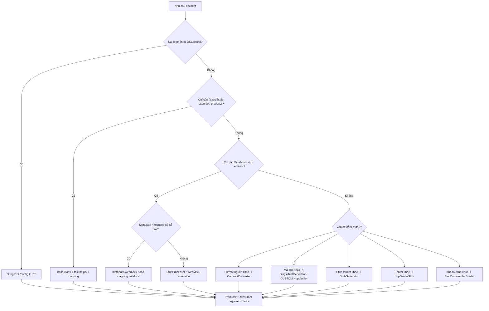
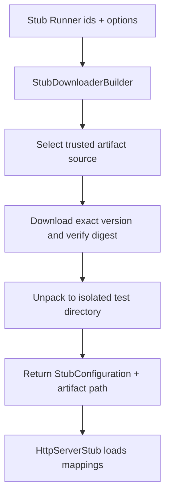
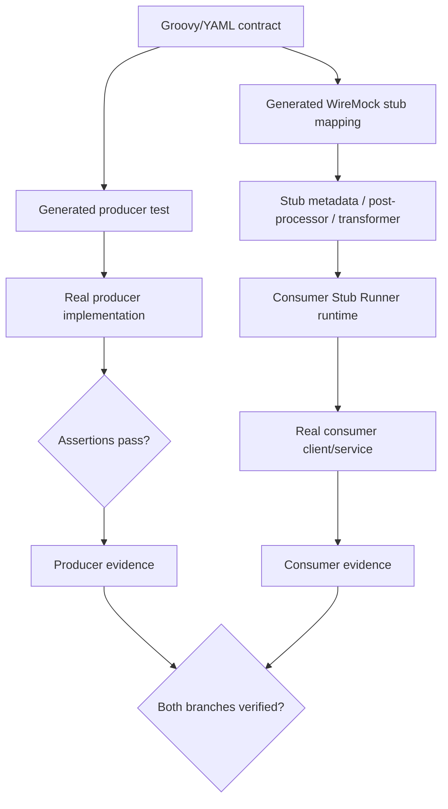
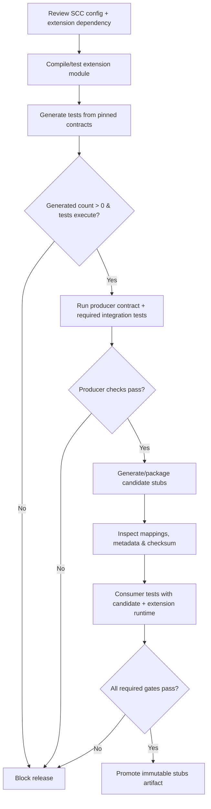

# Khi dùng cấu hình có sẵn và khi cần extension

**Spring Cloud Contract (SCC)** giúp producer và consumer thống nhất hành vi của giao diện HTTP hoặc messaging thông qua **Groovy/YAML DSL**. Từ contract, producer có thể sinh test xác minh implementation; consumer dùng stub qua **Stub Runner** để kiểm mã tích hợp mà không cần chạy producer thật. Khi phát sinh yêu cầu đặc biệt, câu hỏi quan trọng không phải “viết extension thế nào?” mà là: **cấu hình có sẵn đã diễn đạt đủ nhu cầu chưa, và giới hạn cụ thể nào buộc ta phải mở rộng công cụ?**

Ví dụ, `InventoryService` trả `reservationId` động. Người mới có thể muốn viết custom test generator chỉ để kiểm chuỗi ID. Nhưng **response matcher** của DSL đã xử lý được. Nếu chỉ cần chuẩn bị dữ liệu cho những test khác nhau, **base class và baseClassMappings** thường đủ. Nếu muốn thêm độ trễ cho WireMock stub, **metadata `wiremock`** có thể đáp ứng mà không cần một Java extension. Ngược lại, nếu hợp đồng được lưu bằng một định dạng độc quyền không có converter, hoặc consumer phải dùng một HTTP stub server hoàn toàn khác WireMock, extension có thể thật sự cần thiết.

Bài thuộc chương **Tùy biến và mở rộng** của module **SPRING_CLOUD_CONTRACT**. Nội dung bám sát mục tiêu module: viết HTTP/message contracts, sinh producer tests, phát hành stubs, dùng Stub Runner và tích hợp CI để phát hiện thay đổi không tương thích. Ta sẽ xây một **khung quyết định configuration-first**, sau đó đi qua các điểm mở rộng có tài liệu chính thức, phạm vi hiệu lực, chi phí và cách kiểm an toàn.

Trong ví dụ, `InventoryService` là producer, `OrderService` là consumer, còn `FulfillmentService` nhận sự kiện. Các tọa độ artifact, URL và mã nguồn là **ví dụ học tập**, không giả định repository hiện có. Cú pháp plugin/API có thể khác theo Spring Cloud Contract, Spring Boot, WireMock và Gradle/Maven version; luôn khóa một tổ hợp tương thích và đối chiếu reference của đúng release.

Sau bài học, bạn có thể:

- Phân biệt **cấu hình**, **mã test base/fixture**, **contract metadata** và **extension thực sự**.
- Giải thích vì sao “customization” không đồng nghĩa “phải viết plugin”.
- Dùng Groovy/YAML DSL, matchers, producer/consumer values, test mode và base class trước khi viết extension.
- Chọn cấu hình Stub Runner/HTTP mappings phù hợp consumer và môi trường.
- Biết lúc nào metadata WireMock đủ, lúc nào cần `StubProcessor` hoặc runtime extension.
- Nhận diện các SPI như `ContractConverter`, `SingleTestGenerator`, `StubGenerator`, `HttpServerStub` và `StubDownloaderBuilder`.
- Tránh extension thay đổi stub mà không đổi producer tests, gây **tương thích giả**.
- Thiết kế chiến lược test, bảo mật, phát hành và nâng phiên bản cho mã mở rộng.
- Lập quyết định có giải thích bằng một bảng so sánh và các phép thử phản chứng.

## 1. Định nghĩa các mức thay đổi

Hãy phân biệt bốn tầng, từ chi phí thấp đến cao:

| Tầng | Ví dụ | Phạm vi ảnh hưởng | Ưu tiên |
| --- | --- | --- | --- |
| **A. Contract DSL và cấu hình có sẵn** | `byRegex`, `bodyMatchers`, test mode, Stub Runner properties | Hành vi test/stub đã được framework hỗ trợ | **Thử trước** |
| **B. Mã test hỗ trợ trong dự án** | `ContractVerifierBase`, fixture, deterministic clock, base class mappings | Test setup/assertions phía producer | Khi cấu hình DSL không biểu diễn đủ setup |
| **C. Metadata hoặc mapping WireMock có kiểm soát** | `metadata.wiremock`, `fixedDelayMilliseconds`, mapping test-local | Thường là **stub side** | Khi cần đặc tính WireMock có sẵn |
| **D. Plugin/extension SPI** | `ContractConverter`, `StubProcessor`, `HttpVerifier`, custom server/downloader | Toolchain, runtime hoặc cả hai | Chỉ khi có giới hạn có thể chứng minh |

**Cấu hình** là khai báo dùng behavior mà framework đã có; **extension** là đưa một implementation mới vào hệ thống qua SPI/điểm đăng ký. Một lớp `ContractVerifierBase` tự viết là code, nhưng không nhất thiết là plugin extension: nó chỉ chuẩn bị môi trường cho generated tests và đã được framework dự kiến sử dụng.

### Từ “custom” đôi khi gây nhầm

- **Custom matcher/fixture:** logic kiểm thử riêng, không cần thay test generator.
- **Custom response payload:** dùng Groovy/YAML body hoặc file fixture, không cần WireMock transformer.
- **Custom WireMock metadata:** thay một số thuộc tính mapping được sinh, không phải tạo server khác.
- **Custom converter:** thay cách đọc/ghi định dạng hợp đồng, ảnh hưởng generation.
- **Custom Stub Runner backend:** thay loại HTTP stub server hoặc cách tìm artifact, chi phí tích hợp cao.

## 2. Cây quyết định: trước hết hãy hỏi đang thiếu điều gì



Đây là một **heuristic ra quyết định**, không phải quy trình tự động do SCC thực thi. Khi một nhu cầu chạm nhiều tầng, hãy giữ phạm vi extension **nhỏ nhất có thể**. Ví dụ: chỉ thêm delay của stub không phải lý do thay toàn bộ DSL converter; đổi kho lưu trữ không phải lý do viết HTTP server mới.

### Sáu câu hỏi bắt buộc trước khi phê duyệt extension

1. **Giới hạn nào của khả năng có sẵn?** Có ví dụ tái hiện được không?
2. **Extension chạy ở đâu?** Producer generation, producer test, stub packaging, consumer runtime hay downloader?
3. **Ai phải cài extension JAR?** Producer, consumer, plugin classpath, test runtime hay nhiều phía?
4. **Ngữ nghĩa nào phải giữ nguyên?** Method, URL, request/response body, errors, headers, message destination?
5. **Có rủi ro bỏ qua producer verification không?** Stub có thể trả dữ liệu giả mà producer không bao giờ trả?
6. **Ai duy trì khi nâng SCC/WireMock?** API/SPI, test matrix, version, rollback và quyền chạy code?

Nếu không trả lời được, hãy tạm giữ giải pháp cấu hình hoặc một test riêng thay vì tạo extension phụ thuộc toàn hệ thống.

## 3. Bảng chọn nhanh theo tình huống

| Nhu cầu | Thường đủ với cấu hình hoặc test code | Chỉ cân nhắc extension khi |
| --- | --- | --- |
| Response ID/timestamp động | `consumer/producer` values, regex/type matcher | Cần semantics không thể diễn đạt bằng DSL/test helper |
| HTTP status, headers, cookies, JSON | HTTP DSL, request/body matchers | Protocol/format thực sự khác model hiện có |
| Test controller có Spring context | `testMode`, base class `@SpringBootTest` | Cần transport client chưa được mode hỗ trợ |
| Mỗi nhóm contract dùng fixture khác | `baseClassMappings`, `packageWithBaseClasses` | Setup vượt test extension points tiêu chuẩn |
| Stub trả chậm để kiểm timeout | `metadata.wiremock` hoặc WireMock test mapping | Transformation động không được metadata hỗ trợ |
| Stateful consumer stub | WireMock Scenarios/mappings nếu phù hợp | State model quá khác hoặc cần riêng stub backend |
| Chọn phiên bản stub | `stubsMode`, `ids`, repository root, `StubFinder` | Stub nằm trong kho/protocol không có downloader |
| Chỉ nạp contract của một consumer | `stubsPerConsumer`, `consumerName` | Phải có custom filtering phức tạp, đã kiểm hạn chế |
| Sinh tests từ định dạng nội bộ `.xyz` | Chuyển dữ liệu trước sang Groovy/YAML | Phải tích hợp định dạng gốc trực tiếp vào generation |
| Sinh tests bằng ngôn ngữ khác | Mode/framework có sẵn nếu đáp ứng | Bắt buộc có output ngôn ngữ/test framework mới |
| Chạy stubs không bằng WireMock | Chưa phải nhu cầu nếu HTTP mappings đủ | Server đặc biệt là yêu cầu thực sự |
| Sinh thêm file Pact từ cùng contract | Công cụ xuất/chuyển đổi riêng nếu đủ | Cần `StubGenerator` để xuất artifact tự động |
| Kiểm message trên Integration/Stream/JMS | `@AutoConfigureMessageVerifier` và adapter được hỗ trợ | Transport/custom broker không có integration phù hợp |

Hãy xem bảng là **điểm khởi đầu**. Cần xác minh phiên bản, vì một tính năng có thể xuất hiện ở bản mới hoặc thay đổi SPI giữa các dòng release.

## 4. Bài toán mẫu: API tạo reservation

Giả sử OrderService gửi:

```http
POST /api/v1/reservations HTTP/1.1
Content-Type: application/json

{"sku":"SKU-001","quantity":2}
```

InventoryService trả:

```http
HTTP/1.1 201 Created
Content-Type: application/json

{"reservationId":"RES-701","status":"HELD"}
```

Một contract Groovy thông thường là đủ:

```groovy
import org.springframework.cloud.contract.spec.Contract

Contract.make {
    name 'create_reservation_success'
    description 'OrderService cần ID lượt giữ hàng và trạng thái HELD'

    request {
        method 'POST'
        url '/api/v1/reservations'
        headers {
            contentType(applicationJson())
        }
        body([
            sku: 'SKU-001',
            quantity: 2
        ])
    }

    response {
        status 201
        headers {
            contentType(applicationJson())
        }
        body([
            reservationId: $(consumer('RES-701'),
                             producer(regex('RES-[0-9]+'))),
            status: 'HELD'
        ])
    }
}
```

**Cần hiểu rõ hai phía:**

- Producer verification chạy generated test trên mã producer, kiểm ID trả về có dạng `RES-[0-9]+` và status `HELD`.
- Stub dành cho consumer trả `RES-701` làm sample response ổn định.
- Không cần tạo `CustomReservationIdTestGenerator` chỉ để kiểm regex.
- Regex chỉ kiểm **định dạng**, không chứng minh ID là duy nhất hoặc được commit vào database.

Contract có thể được viết bằng YAML DSL ở mức literal:

```yaml
name: create_reservation_success
description: OrderService cần ID lượt giữ hàng
request:
  method: POST
  url: /api/v1/reservations
  headers:
    Content-Type: application/json
  body:
    sku: SKU-001
    quantity: 2
response:
  status: 201
  headers:
    Content-Type: application/json
  body:
    reservationId: RES-701
    status: HELD
```

YAML mẫu này **chưa tương đương về regex** với Groovy trên; để tương đương, cần thêm response `matchers` theo cú pháp YAML của phiên bản SCC. Không để cả hai file mô tả cùng một scenario trong folder nguồn nếu không chủ ý tạo hai contracts.

## 5. Matcher và producer/consumer values: lớp tùy biến rẻ nhất

Các khả năng DSL giải quyết phần lớn nhu cầu khi giá trị thay đổi:

| Yêu cầu | Lựa chọn có sẵn |
| --- | --- |
| ID theo định dạng | Regex matcher hoặc typed matcher |
| Số lượng JSON là number | Kiểm `byType`/JSONPath hoặc equality theo kiểu |
| Timestamp đúng format | Date/time/timestamp matcher tương ứng |
| Array có phần tử đúng kiểu | Array JSONPath/matcher và quy tắc size tùy cấu hình |
| Một field luôn cố định | Literal/equality assertion |
| Field nullable/optional | Matchers phù hợp và kịch bản riêng |
| Request động khác response động | `consumer`/`producer` values đúng phía |
| Header cần regex | Header matcher hoặc DSL predicate phù hợp |

Những helper/DSL chi tiết có sự khác nhau giữa Groovy và YAML cũng như giữa phiên bản. Đừng copy thẳng `$(consumer(...), producer(...))` vào YAML; cũng đừng dùng regex `.*` để “giải quyết” mọi khác biệt vì nó khiến tests mất ý nghĩa.

### Khi business rule vượt quá matcher

Ví dụ `reservationId` phải được lưu vào database và chỉ thuộc về `orderId` đã truyền. Regex không chứng minh được quan hệ đó. Nhưng giải pháp hợp lý đầu tiên là **producer integration test/domain assertion**, không phải thay `SingleTestGenerator`.

Một quy tắc hữu ích:

> Thiếu assertion về nghiệp vụ → bổ sung test ở đúng tầng. Chỉ thiếu khả năng biểu diễn/sinh test của framework → mới đánh giá extension.

## 6. Base class là nơi mở rộng *test setup*, không phải DSL parser

Spring Cloud Contract sinh producer tests kế thừa một lớp base do dự án chỉ định. Base class thường chuẩn bị Spring context, MockMvc, data fixture hoặc methods được generated tests gọi.

Ví dụ cho Spring MVC:

```java
package com.example.inventory;

import io.restassured.module.mockmvc.RestAssuredMockMvc;
import org.junit.jupiter.api.BeforeEach;
import org.springframework.beans.factory.annotation.Autowired;
import org.springframework.boot.test.context.SpringBootTest;
import org.springframework.web.context.WebApplicationContext;

@SpringBootTest
public abstract class ContractVerifierBase {

    @Autowired
    WebApplicationContext context;

    @BeforeEach
    void setUp() {
        RestAssuredMockMvc.webAppContextSetup(context);
        // Tạo dữ liệu giả xác định cho SKU-001, dọn database khi cần.
    }
}
```

Nếu `InventoryService` có endpoint HTTP lẫn messaging, có thể cần hai base classes với các setup khác nhau, ví dụ HTTP Spring MVC và message verifier. Đó là lúc `baseClassMappings` hoặc quy ước `packageWithBaseClasses` hữu ích.

### Maven — chọn base class mặc định

```xml
<plugin>
  <groupId>org.springframework.cloud</groupId>
  <artifactId>spring-cloud-contract-maven-plugin</artifactId>
  <version>VERSION_COMPATIBLE_WITH_PROJECT</version>
  <extensions>true</extensions>
  <configuration>
    <testFramework>JUNIT5</testFramework>
    <testMode>MOCKMVC</testMode>
    <baseClassForTests>
      com.example.inventory.ContractVerifierBase
    </baseClassForTests>
  </configuration>
</plugin>
```

**Đây là mảnh POM**, cần quản lý dependency Spring Cloud Contract, Spring Test/JUnit/RestAssured và version cụ thể. `VERSION_COMPATIBLE_WITH_PROJECT` là placeholder, không phải version có thể dùng nguyên văn.

### Gradle — cùng mục tiêu

```groovy
contracts {
    testFramework = 'JUNIT5'
    testMode = 'MockMvc'
    baseClassForTests = 'com.example.inventory.ContractVerifierBase'
}
```

Đây là Groovy DSL snippet trong build đã áp dụng SCC Gradle plugin, không phải toàn bộ `build.gradle`. Khi chọn JUnit 5, task chạy generated tests phải dùng JUnit Platform. Nhiều dòng SCC Gradle plugin dùng source set/task `contractTest` riêng: đừng giả định task `test` luôn chạy chúng.

### Khi base class là đủ

| Vấn đề | Base class/fixture xử lý |
| --- | --- |
| Test cần SKU có đủ hàng | Setup database/in-memory fixture |
| Test phụ thuộc thời gian | Inject fixed `Clock` test |
| Test dùng security context | Cấu hình role/test token ở setup |
| HTTP controller setup | Web application context/MockMvc |
| Message contract cần trigger | Implement method trigger và `@AutoConfigureMessageVerifier` |
| Nhóm contracts dùng setup khác | Base class mapping theo package |

Đừng để một base class khổng lồ với `if` theo mọi filename contract; nên nhóm contracts theo capability và chia base classes có trách nhiệm rõ. Đừng mock chính producer behavior mà contract cần verify, vì sẽ tạo kết quả pass sai.

## 7. Base class mappings thay vì viết generator mới

Giả sử hai nhóm contracts:

```text
src/contractTest/resources/contracts/
├── http/reservations/create-success.groovy
└── messaging/reservations/reservation-confirmed.groovy
```

HTTP cần `InventoryHttpContractBase`, messaging cần `InventoryMessageContractBase`. Một trong các phương án SCC hỗ trợ là ánh xạ contract package pattern sang base class fully-qualified bằng `baseClassMappings`. Phương án khác là `packageWithBaseClasses` theo quy ước tên.

Mô hình ánh xạ:

```text
contracts dưới /http/...      -> com.example.inventory.InventoryHttpContractBase
contracts dưới /messaging/... -> com.example.inventory.InventoryMessageContractBase
```

**Lưu ý:** `baseClassMappings` là cấu hình riêng của plugin Maven/Gradle; syntax khác nhau, package regex và thứ tự ưu tiên cần được kiểm trên generated source thực tế. Không viết code ánh xạ regex trong contract Groovy chỉ để thay base class. Nếu plugin version có một form mapping khác, ưu tiên reference đúng bản.

Kiểm sau khi generate:

1. Test HTTP được sinh kế thừa đúng HTTP base.
2. Test messaging được sinh kế thừa đúng message base.
3. Mọi class và dependencies nằm trên đúng test classpath.
4. Cả hai nhóm generated tests **được thực thi**, không phải chỉ compile.
5. Stub artifacts được sinh từ cùng tập contracts.

## 8. Đổi test mode trước khi nghĩ đến custom HTTP client

Spring Cloud Contract cung cấp nhiều **test modes** để generated producer tests gọi implementation theo cách phù hợp.

| Nhu cầu | Hướng cấu hình |
| --- | --- |
| Spring MVC controller | `MockMvc` |
| Spring WebFlux/reactive HTTP | `WebTestClient` theo phiên bản hỗ trợ |
| HTTP server thật và context path | `EXPLICIT` hoặc mode HTTP phù hợp |
| JAX-RS endpoint | `JAXRSCLIENT` khi được hỗ trợ |
| Transport/protocol đặc biệt | Cân nhắc `CUSTOM` và `HttpVerifier` |
| Producer message events | Messaging verifier/adapter, không nhất thiết đổi HTTP test mode |

`testMode` quyết định **cách generated tests gửi request**, không đổi request/response contract. Nếu chỉ cần chạy HTTP thật thay vì MockMvc, lựa chọn `EXPLICIT` và base class cấu hình cổng có thể đủ — không nên viết `HttpVerifier` mới chỉ để gọi `localhost`.

### Kiểm đúng phạm vi khi đổi mode

- MockMvc có thể kiểm controller/filter chain theo setup, nhưng không tự chứng minh proxy/load balancer production.
- HTTP server mode kiểm transport thực trong môi trường test, nhưng chưa chắc có cùng gateway/certificates/runtime settings như production.
- WebTestClient có thể dùng với reactive controller hoặc server, tùy cách setup.
- Custom mode có bề mặt API rộng và chịu rủi ro thay đổi giữa các dòng SCC.

Với một dự án đang hoạt động, hãy xác minh **generated test source** và test reports sau khi đổi mode, không chỉ thay giá trị trong POM.

## 9. Stub Runner có rất nhiều cấu hình không cần extension

Consumer sử dụng stubs từ artifact producer qua Stub Runner. Các lựa chọn tiêu biểu:

- `stubsMode=CLASSPATH`: nạp stubs từ classpath.
- `stubsMode=LOCAL`: dùng kho artifact local, thường là Maven `.m2`.
- `stubsMode=REMOTE`: resolve từ repository được cấu hình.
- `ids`: chọn producer group, artifact, version, classifier và cổng.
- `repositoryRoot`: nơi tìm artifact khi dùng remote resolver phù hợp.
- `stubsPerConsumer`/`consumerName`: lọc HTTP mappings theo consumer nếu path artifact phù hợp.
- `minPort`/`maxPort` hoặc injected port: tránh va chạm cổng cố định.
- `mappingsOutputFolder`: quan sát mappings được đăng ký.
- `httpServerStubConfigurer`: **điểm mở rộng có sẵn** khi thật sự cần tùy chỉnh HTTP server.

Ví dụ ở consumer:

```java
import org.springframework.boot.test.context.SpringBootTest;
import org.springframework.cloud.contract.stubrunner.spring.AutoConfigureStubRunner;
import org.springframework.cloud.contract.stubrunner.spring.StubRunnerProperties;

@SpringBootTest(properties = {
    "spring.application.name=order-service",
    "inventory.base-url=http://localhost:8090"
})
@AutoConfigureStubRunner(
    ids = "com.example:inventory-service:1.4.2:stubs:8090",
    stubsMode = StubRunnerProperties.StubsMode.LOCAL,
    stubsPerConsumer = true
)
class OrderServiceInventoryContractTest {
    // Gọi OrderCheckoutService/InventoryClient thật.
}
```

Ví dụ giả định artifact `1.4.2:stubs` đã được cài vào Maven local và mappings được nhóm dưới consumer folder tương ứng. Với `stubsPerConsumer=true` mà không có folder khớp `order-service`, test có thể không nạp mapping nào.

Nếu muốn cổng động, cần **lấy port thực tế từ Stub Runner và truyền vào client consumer trước khi gọi**, bằng các cơ chế cấu hình/injection phù hợp vòng đời Spring test của dự án. Không đổi Stub Runner port rồi vẫn hardcode `8090`.

### Điểm phân biệt quan trọng

Đổi `repositoryRoot` chỉ đổi **nguồn tải artifact**, không thay cách WireMock match HTTP request. Đổi `stubsPerConsumer` chỉ đổi **tập mappings được đăng ký**, không làm producer thực thi behavior khác. Viết một custom downloader chỉ vì cần thay cổng hoặc lọc theo consumer là lựa chọn quá nặng.

## 10. Metadata WireMock: một tính năng có sẵn trước khi viết transformer

Giả sử OrderService cần kiểm rằng request timeout khi InventoryService phản hồi chậm. Một cách test consumer có thể là WireMock trả `201` sau một khoảng trễ cố định.

Spring Cloud Contract hỗ trợ `metadata` với khóa `wiremock` để bổ sung một số thuộc tính vào **generated stub mapping**. Ví dụ hướng khai báo Groovy:

```groovy
import org.springframework.cloud.contract.spec.Contract

Contract.make {
    name 'create_reservation_slow_response'

    request {
        method 'POST'
        url '/api/v1/reservations'
        headers { contentType(applicationJson()) }
        body([sku: 'SKU-SLOW', quantity: 2])
    }

    response {
        status 201
        headers { contentType(applicationJson()) }
        body([reservationId: 'RES-702', status: 'HELD'])
    }

    metadata([
        wiremock: [
            stubMapping: '{"response":{"fixedDelayMilliseconds":1200}}'
        ]
    ])
}
```

**Cú pháp metadata và cách merge phụ thuộc SCC version**; ví dụ minh họa dựa trên cơ chế `wiremock/stubMapping` được tài liệu chính thức mô tả. Sau generation phải đọc mapping cuối cùng để xác nhận `fixedDelayMilliseconds` xuất hiện.

Một phần JSON mapping kỳ vọng:

```json
{
  "response": {
    "status": 201,
    "headers": {
      "Content-Type": "application/json"
    },
    "jsonBody": {
      "reservationId": "RES-702",
      "status": "HELD"
    },
    "fixedDelayMilliseconds": 1200
  }
}
```

Đây là **đoạn minh họa response**, không phải toàn bộ WireMock `StubMapping`. Cần giữ phần `request` được generator sinh và kiểm JSON thật.

### Giới hạn cực kỳ quan trọng của metadata

Trong cơ chế WireMock metadata customization đã được SCC mô tả:

- Tùy biến áp dụng cho **stub side**.
- **Generated producer tests không tự đổi** chỉ vì metadata thêm delay.
- Không phải mọi trường của `StubMapping` đều được phép/được merge; tài liệu có giới hạn việc thay toàn bộ request và response body/headers.
- Nếu muốn thay cách producer test kiểm timing hoặc tải, hãy viết test chuyên biệt hoặc cấu hình test cần thiết, đừng tưởng metadata đã làm việc đó.

Độ trễ 1.200 ms mô phỏng một response chậm của stub, **không chứng minh producer thật có latency như vậy**. Nó phục vụ kiểm consumer timeout/circuit breaker behavior, một mục đích khác producer contract verification.

## 11. Khi nào dùng mapping WireMock viết tay?

Nếu chỉ cần một kịch bản test-local đặc biệt, bạn có thể đăng ký mapping trực tiếp với WireMock mà không đổi generated artifact chính thức.

Ví dụ một stub cho test lỗi tạm thời:

```json
{
  "name": "test-only-inventory-unavailable",
  "priority": 1,
  "request": {
    "method": "POST",
    "url": "/api/v1/reservations",
    "bodyPatterns": [
      {
        "matchesJsonPath": "$[?(@.sku == 'SKU-FAIL')]"
      }
    ]
  },
  "response": {
    "status": 503,
    "headers": { "Content-Type": "application/json" },
    "jsonBody": { "code": "INVENTORY_TEMPORARILY_UNAVAILABLE" }
  }
}
```

Nên chọn **manual mapping** khi:

- Kịch bản chỉ để kiểm consumer resilience, không phải producer contract chính thức.
- Có thể đăng ký mapping trong test setup riêng và xóa/reset sau test.
- Không cần thay đổi generator cho mọi service.
- Đã kiểm overlap với generated mappings và `priority`.

**Không nên chọn** khi bạn đang cố che một producer không đáp ứng DSL: sửa mã producer/contract nguồn và verify lại. Một mapping viết tay trả thành công không thay thế producer verification.

### Tại sao cần `priority` và isolation?

Nếu generated mapping `POST /reservations` khớp `SKU-001` nhưng manual mapping quá rộng cũng trả `201`, consumer test có thể pass nhờ manual mapping mà không biết generated mapping bị sai hoặc không được nạp. WireMock ưu tiên số `priority` nhỏ hơn khi có nhiều mapping cùng match. Hãy dùng request matcher đủ chặt, một server instance cô lập và kiểm `/__admin/mappings` hoặc request journal khi cần.

## 12. WireMock extension thực sự: khi metadata/mapping không đủ

Một yêu cầu có thể cần behavior động: ví dụ sinh response theo một quy tắc phức tạp phụ thuộc request hoặc làm biến đổi response theo một API ngoài WireMock default behavior. Trước khi viết extension, hãy xem WireMock **response templating**, **Scenarios**, **fault/delay settings** và metadata có giải quyết được không.

Nếu không, SCC hỗ trợ một điểm đăng ký extension qua `WireMockExtensions`. Tài liệu chính thức mô tả:

```text
META-INF/spring.factories

org.springframework.cloud.contract.verifier.dsl.wiremock.WireMockExtensions=\
com.example.contractsupport.InventoryWireMockExtensions
```

Trong JAR extension, implementation cung cấp danh sách các WireMock `Extension` muốn đăng ký. Đây là **điểm mở rộng Java/Groovy có thể thực thi mã**, không phải chỉ một thuộc tính JSON.

**Phạm vi và trách nhiệm:**

1. Extension phải tồn tại trên classpath phù hợp khi SCC hoặc WireMock nạp nó.
2. Consumer Stub Runner có thể cần một `HttpServerStubConfigurer` riêng để đăng ký extension ở **runtime**.
3. Mapping phải tham chiếu đúng transformer nếu extension không áp dụng toàn cục.
4. Extension phải tránh leak shared state giữa tests/ports và xử lý input ngoài dự kiến.
5. Producer verification vẫn cần kiểm implementation thật; một response được transformer dựng lên không bảo đảm producer trả tương tự.

### Một bẫy thường gặp

“Đã thêm JAR có class `CustomExtension` vào test classpath, nhưng WireMock log nói transformer không tìm thấy.” Nguyên nhân có thể là **chưa đăng ký extension với WireMock instance mà Stub Runner đang khởi động**, không phải contract body sai. Với Stub Runner, cần truyền `HttpServerStubConfigurer` phù hợp và kiểm runtime mappings/extension registration.

Vì WireMock API có thay đổi giữa major versions, một implementation transformer copy từ dự án WireMock 2.x có thể không biên dịch ở 3.x; hãy viết theo **WireMock dependency version thực tế của SCC**.

## 13. `StubProcessor`: hậu xử lý mapping thay vì thay toàn bộ generator

Khi `metadata.wiremock` chưa đủ, nhưng output vẫn là **WireMock StubMapping**, SCC có cơ chế **post-processing**:

- `org.springframework.cloud.contract.verifier.converter.StubProcessor` là một extension registration key.
- `org.springframework.cloud.contract.verifier.wiremock.WireMockStubPostProcessor` là interface thuận tiện để xử lý riêng WireMock mappings.
- Implementation quyết định khi nào áp dụng và chuyển đổi mapping như thế nào.

Đăng ký mô tả:

```properties
# resources/META-INF/spring.factories trong JAR plugin/test support
org.springframework.cloud.contract.verifier.converter.StubProcessor=\
com.example.contractsupport.InventoryWireMockPostProcessor
```

Ví dụ tên class ở trên là **minh họa**. Implementation phải tuân theo interface/signatures của đúng SCC release; tài liệu chính thức là nguồn tham khảo API.

### Khi nào post-processor phù hợp?

| Yêu cầu | Lựa chọn |
| --- | --- |
| Chỉ thêm delay/thuộc tính mapping hỗ trợ | `metadata.wiremock` trước |
| Áp cùng quy tắc patch lên nhiều WireMock mappings có metadata cụ thể | `StubProcessor` có filter rõ |
| Muốn đổi toàn bộ request/response vì contract không hợp | **Không** sửa bằng processor; đổi contract và producer tests |
| Muốn sinh JSON stub cho server khác WireMock | `StubGenerator`, không phải WireMock post-processor |
| Muốn thay behavior server runtime | WireMock extension/`HttpServerStubConfigurer` |

Post-processor thường tác động ở **generation/packaging**; runtime transformer lại tác động khi consumer **gửi request**. Đây là hai thời điểm khác nhau. Không giải quyết một lỗi runtime bằng cách viết generation processor nếu thứ cần là bật extension ở Stub Runner.

## 14. Tùy chỉnh HTTP Stub Runner mà không thay `HttpServerStub`

SCC có `HttpServerStubConfigurer` để tinh chỉnh instance của HTTP stub server. Với WireMock, có lớp `WireMockHttpServerStubConfigurer` có thể được kế thừa để thay `WireMockConfiguration`: ví dụ HTTPS, extension registration hoặc cài đặt server chuyên biệt.

Mô hình:

```text
Custom Stub Runner Configurer
  -> nhận thông tin artifact / HttpServerStubConfiguration
  -> điều chỉnh WireMockConfiguration
  -> WireMock server chạy với cấu hình ấy
```

Có thể chọn configurer qua `@AutoConfigureStubRunner`:

```java
@AutoConfigureStubRunner(
    ids = "com.example:inventory-service:1.4.2:stubs:8090",
    httpServerStubConfigurer = InventoryWireMockConfigurer.class
)
```

`InventoryWireMockConfigurer` là class **phải được dự án tự triển khai**, và mảnh annotation này chỉ minh họa vị trí cấu hình. Cần kiểm import, constructor và method `configure(...)` theo SCC/WireMock version đang chạy.

### Khi nào chỉ cần cấu hình?

Nếu mục tiêu là:

- Chọn port, repo, artifact version → `@AutoConfigureStubRunner`/properties.
- Chạy HTTP server độc lập trong test → SCC Stub Runner / WireMock defaults.
- Bật HTTPS với cấu hình WireMock cụ thể theo producer → cân nhắc `WireMockHttpServerStubConfigurer`.
- Thay toàn bộ HTTP server framework → lúc đó mới đánh giá `HttpServerStub`.

Đừng tạo một server SPI riêng chỉ vì muốn bật response templating. Đó là ví dụ của **giải pháp rộng hơn vấn đề**.

## 15. Messaging: bắt đầu với adapter tích hợp sẵn

Spring Cloud Contract có phần messaging với các adapter/integration cho những môi trường như Spring Integration, Spring Cloud Stream, Spring JMS và Apache Camel, tùy phiên bản. Generated producer tests cần một cách gửi/nhận message qua **message verifier**.

Ví dụ contract Groovy:

```groovy
import org.springframework.cloud.contract.spec.Contract

Contract.make {
    name 'reservation_confirmed'
    label 'reservation_confirmed'
    input {
        triggeredBy('publishReservationConfirmed()')
    }
    outputMessage {
        sentTo('reservationEvents')
        body([
            reservationId: 'RES-701',
            status: 'CONFIRMED'
        ])
        headers {
            messagingContentType(applicationJson())
            header('eventType', 'reservation.confirmed')
        }
    }
}
```

`publishReservationConfirmed()` là method mà producer test base phải cung cấp; `reservationEvents` là destination được adapter giải nghĩa. Với một ứng dụng Spring Integration/Stream bình thường, có thể cấu hình:

- Dependencies/adapters phù hợp.
- `@AutoConfigureMessageVerifier` ở producer test base.
- Fixture/trigger method đúng.
- Consumer test với `StubTrigger` và assertion về listener/side effect.

**Chưa nên viết custom messaging verifier** chỉ vì test cần nhận một event hoặc chờ xử lý async. Hãy xem adapter framework và test completion mechanisms trước.

### Khi mới cần custom adapter?

Khi producer dùng một message transport hoặc binding semantics mà các adapter hiện có không xử lý được, có thể phải triển khai theo contract của `MessageVerifierSender` / `MessageVerifierReceiver` hoặc những interface tích hợp tương ứng trong release đang dùng. Lúc đó cần test gửi, nhận, headers, destination mapping, serialization và sự cô lập consumer/producer.

Quan trọng: generated messaging test pass bằng in-memory adapter **không tự chứng minh** Kafka/RabbitMQ production broker, routing, acknowledgments, retry hoặc outbox transaction. Nếu đó là rủi ro nghiệp vụ, thêm **broker integration test**, không cố gói mọi thứ vào một plugin.

## 16. Tái sử dụng helper Groovy DSL: nhẹ hơn custom converter

Tổ chức có nhiều Groovy contracts đôi khi lặp regex và sample values. SCC có tài liệu **DSL customization** bằng các classes/helpers trong **common JAR**:

```java
package com.example.contractsupport;

import java.util.regex.Pattern;

public final class ReservationPatterns {
    private ReservationPatterns() {}

    public static Pattern reservationId() {
        return Pattern.compile("RES-[0-9]+");
    }
}
```

Sau khi dependency được thêm vào classpath mà **Groovy DSL evaluator** dùng, contract có thể tham chiếu helper theo cách tương thích DSL:

```groovy
import org.springframework.cloud.contract.spec.Contract
import com.example.contractsupport.ReservationPatterns

Contract.make {
    request {
        method 'GET'
        url '/api/v1/reservations/RES-701'
    }
    response {
        status 200
        body([
            reservationId: $(consumer('RES-701'),
                             producer(regex(ReservationPatterns.reservationId().pattern()))),
            status: 'HELD'
        ])
    }
}
```

**Lưu ý kỹ thuật:** code trên lấy chuỗi regex từ `Pattern.pattern()` để tránh phụ thuộc vào một overload nhận `Pattern` cụ thể. Vẫn cần kiểm Groovy DSL generator và compilation của phiên bản SCC dùng trong dự án. Có thể thay bằng `regex('RES-[0-9]+')` nếu không cần helper.

### Tại sao helper có chi phí?

- Common JAR phải có mặt đúng **plugin execution classpath**, không chỉ application runtime classpath.
- Generated producer tests có thể cần classpath của helper tương ứng.
- Consumer có thể không cần Groovy helper nếu artifact được chuyển/đóng gói thành YAML hoặc JSON mappings phù hợp.
- Groovy script đánh giá được mã: helper JAR phải có nguồn đáng tin, code review, pin version.
- Thay helper regex có thể làm đổi hàng trăm contracts; cần regression tests cho generator và consumer stubs.

Với một regex dùng hai lần, giữ literal rõ ràng đôi khi tốt hơn tạo thư viện helper và tăng gánh dependency.

## 17. `ContractConverter`: khi định dạng nguồn thực sự khác

Hãy tưởng tượng tổ chức có các hợp đồng `.contractspec` tồn tại từ trước, dùng bởi nhiều đội. Chúng không phải Groovy/YAML SCC chuẩn. Thay vì yêu cầu mọi nhóm viết lại hàng nghìn files hoặc tạo một Groovy file chỉ gọi parser tùy ý, tổ chức có thể cần **custom contract converter**.

SCC mô tả SPI `org.springframework.cloud.contract.spec.ContractConverter<T>` có vai trò:

```java
// Hình dạng rút gọn của SPI trong tài liệu SCC;
// đây không phải một chương trình độc lập có thể biên dịch.
public interface ContractConverter<T>
        extends ContractStorer<T>, ContractReader<T> {

    boolean isAccepted(File file);

    Collection<Contract> convertFrom(File file);

    T convertTo(Collection<Contract> contracts);
}
```

Các imports/generics và method signatures phải được đối chiếu với dependency version đang sử dụng. Điều quan trọng là **hai chiều chuyển đổi** và **điều kiện chọn file**.

### Bài toán cụ thể

```text
Input .contractspec
  -> ContractConverter.isAccepted
  -> ContractConverter.convertFrom
  -> SCC Contract model
  -> Generated producer tests
  -> WireMock/messaging stubs
```

Ví dụ nếu format nguồn có:

```yaml
# File giả định reservation.contractspec,
# chỉ dùng để giải thích mapping, không phải SCC YAML DSL.
api:
  verb: POST
  route: /api/v1/reservations
  expectedStatus: 201
  responseFields:
    reservationId: string
    status: HELD
```

Converter phải ánh xạ đủ semantics: HTTP method, URL, headers, body, status, matchers, consumer/producer values và metadata cần thiết. Nếu mapping mất thông tin, generated tests/stubs có thể **rộng hoặc yếu hơn contract nguồn**.

### Đăng ký theo tài liệu

```properties
# META-INF/spring.factories của JAR chứa implementation
org.springframework.cloud.contract.spec.ContractConverter=\
com.example.contractsupport.LegacyContractConverter
```

`LegacyContractConverter` phải được triển khai và cung cấp trên **plugin classpath** phù hợp. Đây không phải một property tạo ra implementation tự động.

### Khi **không** nên viết converter

- Chỉ muốn thay tên thư mục `contracts`: dùng plugin configuration.
- Chỉ cần YAML thay Groovy: SCC có YAML DSL chuẩn.
- Một vài test cần body file: dùng DSL/file fixture.
- Cần chuyển tài liệu contract một lần: một migration tool **ngoài pipeline** có thể đơn giản và an toàn hơn custom SPI chạy vĩnh viễn.

### Bộ test bắt buộc cho converter

| Test | Vì sao |
| --- | --- |
| File đúng extension được chọn | `isAccepted` không vô tình chiếm formats khác |
| File sai/không hợp lệ bị từ chối có thông báo | Tránh tạo contract rỗng nhưng build xanh |
| Method/path/status/headers/body còn đúng | Bảo toàn lời hứa |
| Regex/typed matcher/optional field đúng | Không mất assertions |
| Một file chứa nhiều scenarios | Không bỏ sót hoặc trùng contracts |
| Round-trip `convertFrom`/`convertTo` nếu được hỗ trợ | Phát hiện mất thông tin khi serialize |
| Fixture và reference path an toàn | Tránh truy cập ngoài source root |
| Producer generated tests pass/fail đúng | Kiểm tương thích ở đầu ra quan trọng nhất |

Nếu custom converter làm contract count giảm từ 20 xuống 0 mà CI vẫn xanh, extension đã phá cơ chế đảm bảo. Cần fail gate khi thiếu contracts ngoài chủ đích.

## 18. `SingleTestGenerator`: khi phải đổi cách sinh mã producer test

Đây là một trong những extension **đắt nhất** vì nó tham gia trực tiếp vào cách SCC xây assertions. Tài liệu SCC có `SingleTestGenerator` để tự tạo nội dung class test từ `ContractMetadata` và cấu hình plugin.

Ví dụ nhu cầu hợp lý:

- Tổ chức bắt buộc sinh tests cho một ngôn ngữ/framework không được generator chuẩn hỗ trợ.
- Có một transport đặc biệt mà test mode hiện tại không thể biểu diễn.
- Có yêu cầu kiến trúc về cấu trúc generated test không thể đáp ứng bằng base class hoặc test framework configuration.

Đăng ký theo SPI:

```properties
org.springframework.cloud.contract.verifier.builder.SingleTestGenerator=\
com.example.contractsupport.InventorySingleTestGenerator
```

**Đây chỉ là khai báo service provider**. Class `InventorySingleTestGenerator` phải triển khai đúng interface của SCC version đang dùng và được build/test riêng.

### Tại sao không nên thay generator để thêm một assertion?

Nếu chỉ cần kiểm rằng `quantity > 0`, có thể:

- Đưa request matcher/fixture vào contract.
- Viết integration/domain test của producer.
- Viết helper assertion trong base class nếu generated test có hook phù hợp.

Một custom generator phải xử lý mọi thứ mà generator chuẩn đang làm, chẳng hạn HTTP body encoding, header matching, JSONPath, matcher conversion, messaging semantics, naming, test framework và resource paths. Một cập nhật Spring Cloud Contract có thể thay đổi mô hình nội bộ mà plugin tùy chỉnh phải theo kịp.

### Tiêu chí chấp nhận

1. Có **giới hạn đã tái hiện** với generator chuẩn.
2. Có golden tests so generated output với kịch bản chuẩn.
3. Có contract kiểm status, header, JSON, matcher, optional/null, error cases.
4. Có producer test **phải fail** khi implementation cố ý vi phạm contract.
5. Đã kiểm classpath, source set, test discovery và 0-tests gate.
6. Có compatibility matrix cho các SCC versions tổ chức hỗ trợ.

**Không để custom generator tạo test luôn pass hoặc không có assertion.** Khi đó toàn bộ chain producer verification có thể bị vô hiệu hóa nhưng stub vẫn phát hành.

## 19. `StubGenerator`: khi output không còn là WireMock mapping

Nếu tổ chức muốn tạo thêm một định dạng stub khác (ví dụ file phục vụ một stub server ngoài WireMock hoặc một artifact riêng), SCC có `org.springframework.cloud.contract.verifier.converter.StubGenerator<T>`.

Theo tài liệu, SPI này làm việc với các `Contract` và `ContractMetadata` để tạo stub representation, có cơ chế phân biệt file extension và post-processing.

Đăng ký theo `spring.factories`:

```properties
org.springframework.cloud.contract.verifier.converter.StubGenerator=\
com.example.contractsupport.AdditionalStubGenerator
```

### Phải quyết định output semantics

| Câu hỏi | Ví dụ lựa chọn |
| --- | --- |
| Sinh một hay nhiều mappings cho một contract? | Một success + một error mapping |
| Response matcher nào thành literal stub value? | `RES-701` |
| Request matcher nào được giữ trong stub? | Method/path/body matcher |
| Metadata nào còn ý nghĩa? | Delay/fault/headers |
| Output path và extension? | `.json`, `.yaml` hoặc dạng backend cần |
| Stub Runner nào đọc được output ấy? | WireMock mặc định hoặc custom `HttpServerStub` |

Một custom stub generator có thể tạo artifact hoàn chỉnh, nhưng **consumer Stub Runner mặc định không tự học cách chạy một format mới**. Nếu format không phải WireMock JSON, còn có thể phải bổ sung runtime backend. Đó là chi phí kép.

### Có thể nhiều generators cùng tồn tại?

Tài liệu SCC mô tả khả năng cung cấp nhiều `StubGenerator` implementations để tạo thêm dạng output như WireMock và Pact từ cùng contract. Cần kiểm không xảy ra conflict ở file names/paths và các generated artifacts được đóng gói đúng.

**Lựa chọn nhẹ hơn:** nếu chỉ xuất một báo cáo/snapshot dùng cho CI, một Gradle/Maven task hậu xử lý ngoài SCC SPI có thể phù hợp hơn, miễn không thay đổi nguồn hợp đồng và không làm mất producer verification.

## 20. `HttpServerStub`: chỉ khi thật sự đổi stub server backend

`Stub Runner` có abstraction `org.springframework.cloud.contract.stubrunner.HttpServerStub` để chạy HTTP stub server. Mặc định SCC thường dùng WireMock. Nếu tổ chức có stub server khác với những năng lực không thể dùng WireMock, có thể triển khai backend riêng.

Các trách nhiệm được mô tả bởi interface/runtime bao gồm:

```text
start(configuration)
registerMappings(stubFiles)
port()
isRunning()
registeredMappings()
stop()
isAccepted(file)
```

Đây là **mô hình các method/khả năng**, không phải một Java interface đầy đủ với exact signatures. Đăng ký backend qua:

```properties
org.springframework.cloud.contract.stubrunner.HttpServerStub=\
com.example.contractsupport.InventoryAlternativeHttpServer
```

### Vì sao chi phí cao?

- Quản lý cổng động, start/stop, test isolation.
- Chọn và parse đúng mappings; handle malformed files.
- Nạp body files và metadata.
- Lộ địa chỉ stub cho consumer test.
- Đảm bảo API diagnostics, error mapping và request verification.
- Đảm bảo cùng một contract có kết quả tương đương giữa producer verification và stub runtime.
- Cleanup resources khi test fail hoặc CI bị dừng.

Nếu server riêng trả `201` cho mọi request thì test consumer có thể xanh dù request sai path/body. Một backend mới bắt buộc phải có **conformance tests** so với contract semantics, không chỉ smoke test rằng port đang mở.

**Không viết `HttpServerStub` nếu chỉ cần bật HTTPS, custom WireMock transformer hoặc đổi port.** Dùng `HttpServerStubConfigurer`/WireMock settings trước.

## 21. `StubDownloaderBuilder`: khi nguồn artifact không tương thích resolver sẵn có

Stub Runner hỗ trợ lấy stubs từ **classpath**, **Maven local** và **remote artifact repository**, và còn có hướng SCM theo protocol được tài liệu mô tả. Nếu nguồn thực sự khác (ví dụ kho nội bộ với API xác thực/phân phối riêng), có thể cần `StubDownloaderBuilder`.

Luồng logic:



Một cấu hình service provider minh họa:

```properties
org.springframework.cloud.contract.stubrunner.StubDownloaderBuilder=\
com.example.contractsupport.CorporateStubDownloaderBuilder
```

**Ranh giới của downloader:**

- Nó **tải/tìm artifact**, không nhất thiết thay logic HTTP matching.
- Không dùng downloader để “sửa” status/response trong stub.
- Phải giữ exact coordinates/version/classifier và bảo vệ integrity.
- Không ghi credentials vào logs, không bỏ qua TLS verification.
- Không dùng file path chưa kiểm nguồn để giải nén tùy ý ra ngoài root.
- Cần cache policy, timeout/retry và cleanup rõ.

### Các trường hợp chưa cần extension

| Yêu cầu | Dùng gì trước |
| --- | --- |
| Tải từ Nexus/Artifactory tương thích Maven | `StubsMode.REMOTE`, repository configuration |
| Dùng artifact mới build trên máy dev | `StubsMode.LOCAL` |
| Dùng JAR đã thêm vào test classpath | `StubsMode.CLASSPATH` |
| Cần pin version và không dùng `latest` | `ids` với version cụ thể |
| Cần chỉ load consumer riêng | `stubsPerConsumer`/`consumerName` |
| Kho Git/SCM theo convention được hỗ trợ | Downloader SCM/config sẵn có của release |

Khi môi trường chỉ cần thêm credentials hoặc đổi URL repo, việc viết downloader hoàn toàn mới là chi phí và rủi ro bảo mật không cần thiết.

## 22. `CUSTOM` test mode và `HttpVerifier`: một lựa chọn đặc biệt

Tài liệu SCC có **CUSTOM test mode** qua `org.springframework.cloud.contract.verifier.http.HttpVerifier`, dành cho trường hợp cần một HTTP client/transport không được test modes sẵn có đáp ứng. Mode này đã được tài liệu đánh dấu **experimental** ở một số dòng release.

Ý tưởng:

```text
Generated test
  -> HttpVerifier.exchange(Request)
  -> Custom transport client
  -> Producer HTTP/protocol endpoint
  <- Response
  -> Generated assertions
```

Cấu hình producer có thể dùng:

```groovy
// Mảnh cấu hình Gradle Groovy DSL.
contracts {
    testMode = 'CUSTOM'
    baseClassForTests = 'com.example.inventory.CustomHttpVerifierBase'
}
```

Base class của producer phải cung cấp hoặc inject một `HttpVerifier` thực thi request/response đúng semantics mà generated test sử dụng. Trước khi triển khai:

1. Thử `MockMvc`/`WebTestClient`/`EXPLICIT` nếu phù hợp.
2. Xác nhận custom transport thực sự cần thiết, không phải do client URL sai.
3. Kiểm URL, headers, protocol, binary bodies, charset và error mapping.
4. Kiểm generated tests vẫn phát hiện vi phạm contract.
5. Đối chiếu API/signatures giữa SCC versions; CUSTOM mode có thể thay đổi.

**Không coi `CUSTOM` là cách “mở khóa mọi backend” tự động.** Stub side có thể vẫn dùng WireMock hoặc cần extension riêng nếu protocol không biểu diễn được qua HTTP stub mặc định.

## 23. Bảng phân biệt extension theo giai đoạn

| Điểm mở rộng | Chạy chủ yếu lúc nào? | Bên nào phải biết? | Rủi ro nếu thiếu |
| --- | --- | --- | --- |
| `baseClassForTests` / `baseClassMappings` | Producer test runtime | Producer | Generated tests compile/fail hoặc setup sai |
| Groovy DSL helper JAR | DSL evaluation/generation | Plugin/proposer; có thể cần test classpath | Contract không parse hoặc helper không tìm thấy |
| `ContractConverter` | Đọc/ghi contract model | Producer/toolchain | Mất contract/matcher |
| `SingleTestGenerator` | Generate test source | Producer/toolchain | Tests sai/không chạy |
| `StubGenerator` | Generate stub output | Producer/toolchain | Stub format/mapping sai |
| `metadata.wiremock` | Generation of WireMock mapping | Producer/build; consumer nạp artifact kết quả | Stub không có delay/thuộc tính kỳ vọng |
| `StubProcessor` | Post-process generated mapping | Producer/build | Mapping không được patch |
| `WireMockExtensions` | Plugin/runtime WireMock configuration | Producer generation và/hoặc consumer runtime tùy setup | Transformer không được register |
| `HttpServerStubConfigurer` | Stub server startup | Consumer Stub Runner | TLS/extension config không hoạt động |
| `HttpServerStub` | Stub server runtime | Consumer | Không chạy được định dạng/backend mới |
| `StubDownloaderBuilder` | Artifact resolution | Consumer/runner, có thể cả build | Không tải đúng artifact |
| `HttpVerifier` trong `CUSTOM` | Producer test HTTP execution | Producer | Generated tests không gọi đúng transport |

**Đừng cài mọi extension vào mọi service.** Hãy xác định rõ classpath và thời điểm chạy; chỉ đưa dependency tới thành phần cần nó để giảm xung đột version và bề mặt tấn công.

## 24. Quy trình phát triển extension có kiểm soát

Một extension nên là **quyết định kiến trúc có lý do và phép kiểm rõ**, không phải một bản vá nhanh cho test fail.

### Bước 1 — Ghi nhận ca không giải được bằng tính năng có sẵn

Ví dụ:

```text
Problem:
  Consumer test cần simulation của HTTP response có biến đổi
  theo một cấu trúc binary riêng không được WireMock mapping mặc định hỗ trợ.

Available features evaluated:
  - Groovy/YAML body/headers matchers
  - Body file + __files
  - WireMock response templating
  - WireMock metadata
  - Manual test-local mapping

Evidence:
  - Minimal failing contract / mapping
  - Expected vs actual output
  - SCC / WireMock version

Decision:
  Explore a narrowly scoped runtime transformer.
```

Đây là **mẫu ghi chép**, không phải công thức bắt buộc. Nếu `bodyFileName` đã mô phỏng đủ binary response, không cần extension. Nếu behavior chỉ cần cho một integration test, có thể dùng test-specific fake server thay vì đưa extension vào stubs JAR chung.

### Bước 2 — Chọn điểm mở rộng nhỏ nhất

- Cần sửa **input parsing** → converter, không phải downloader.
- Cần sửa **producer test output** → test mode/base class trước, generator khi thật sự cần.
- Cần sửa **generated WireMock mapping** → metadata/post-processor.
- Cần sửa **runtime response behavior** → WireMock extension + server configurer.
- Cần đổi **stub server** → `HttpServerStub`.
- Cần đổi **artifact source** → `StubDownloaderBuilder`.

Nếu một extension phải làm đồng thời cả tải artifact, parse contracts, sinh test và chạy server, cần xem lại ranh giới trách nhiệm; khả năng cao đó là một công cụ bên ngoài SCC nên được thiết kế/test riêng.

### Bước 3 — Gói dependency riêng, có ownership

Ví dụ module nguồn được tổ chức dưới tên `contract-test-support`:

```text
contract-test-support/
├── build.gradle                      # Hoặc pom.xml
└── src/
    ├── main/java/com/example/contractsupport/
    │   ├── ReservationPatterns.java
    │   └── InventoryWireMockPostProcessor.java
    ├── main/resources/META-INF/
    │   └── spring.factories
    └── test/java/com/example/contractsupport/
        └── ...
```

Đây là **cây minh họa**; chỉ tạo file/classes thực sự cần. Với một helper thuần không dùng SPI, **không cần `spring.factories`**. Một JAR đăng ký nhiều SPI phải được review vì mỗi registration có thể ảnh hưởng toàn bộ generator classpath.

### Bước 4 — Kiểm tác động lên hai phía

Giả sử post-processor thêm response transformer. Hãy kiểm:

1. Producer test được sinh **không bất ngờ mất assertion**.
2. Generated stub mapping chỉ có transformation khi metadata đúng.
3. Consumer Stub Runner đã nạp extension runtime đúng.
4. Consumer code thật nhận response và xử lý đúng.
5. Với contract không yêu cầu extension, output không bị ảnh hưởng.
6. Khi extension vắng mặt, lỗi là có thể chẩn đoán, không âm thầm trả success không đúng.

### Bước 5 — Chuẩn hóa vận hành

Chỉ publish extension JAR và stub artifact khi:

- Test suite của extension pass.
- Producer verification pass.
- Consumer integration tests với **artifact được đóng gói** pass.
- Dependency versions và checksum rõ.
- Có owner, docs, upgrade plan và cách rollback.

## 25. Test extension ở ba mức

| Mức | Đầu vào | Assertion quan trọng |
| --- | --- | --- |
| **Unit** | Contract model/metadata/mapping mẫu | Extension chỉ đổi phần dự kiến |
| **Golden generation** | Tập Groovy/YAML contracts tiêu biểu | Generated Java/Groovy tests và stub JSON giữ semantics |
| **Integration/conformance** | Producer implementation + Stub Runner runtime | Producer tests bắt regression; consumer nhận đúng mappings |

### Unit test cho post-processor

Trong bài test của chính extension, cung cấp một `StubMapping` có:

```json
{
  "request": {
    "method": "POST",
    "url": "/api/v1/reservations"
  },
  "response": {
    "status": 201,
    "jsonBody": {
      "reservationId": "RES-701",
      "status": "HELD"
    }
  }
}
```

Áp metadata cần delay rồi assert:

- `response.fixedDelayMilliseconds` được thêm đúng.
- `request.method` và `request.url` giữ nguyên.
- `response.status`, `jsonBody`, `Content-Type` không biến mất.
- Mappings không có metadata không bị sửa.
- Processor chạy hai lần không nhân đôi hoặc hủy cấu hình nếu yêu cầu **idempotence**.

Với `ContractConverter`, thay bộ input tương ứng và kiểm round-trip/contract count. Với `StubDownloaderBuilder`, dùng fake artifact repository có kiểm soát rồi assert resolved coordinates/checksum và cleanup.

### Golden test có ích nhưng không nên quá cứng

Golden files giúp phát hiện sự đổi generation qua version. Nhưng một số trường generated mapping có UUID/order/formatting không ổn định; so sánh toàn bộ file dạng text có thể tạo false negatives. Nên **parse cấu trúc** rồi so các trường ngữ nghĩa quan trọng, hoặc normalize những trường không có ý nghĩa trước khi so.

Ví dụ:

```text
Assert mapping semantics:
  request.method = POST
  request.url = /api/v1/reservations
  request.bodyPatterns match expected SKU + quantity
  response.status = 201
  response.body.status = HELD
  response.delay = 1200 ms

Ignore for semantic comparison:
  generated UUID
  JSON key order
  incidental whitespace
```

### Phép thử phản chứng (negative control)

Một extension tốt phải **không che vi phạm hợp đồng**:

1. Sửa producer trả `200` thay `201`. Producer generated test vẫn phải fail.
2. Cho consumer gửi sai JSON body. Stub phải không trả nhầm success qua fallback rộng.
3. Thử không tải runtime extension cần thiết. Consumer test phải báo lỗi hữu ích, không âm thầm pass.
4. Thay artifact version/digest. Consumer test phải phát hiện đúng nguồn stub.
5. Thêm contract không liên quan. Extension không được sửa mapping đó.
6. Xóa contract file, phải có kiểm contract inventory/test count để tránh `0 tests PASS`.

Thực hiện các phản chứng trên branch hoặc test fixture cô lập; không đưa mã cố ý sai vào release.

## 26. Tách producer verification khỏi hiệu ứng stub

Một lỗi thiết kế rất phổ biến:

> “Tôi sửa generated WireMock mapping để nó trả đúng JSON consumer mong đợi, nên producer chắc chắn đáp ứng contract.”

Điều này **không đúng**. Hãy vẽ hai nhánh:



### Ba tình huống cần phân biệt

| Điều thay đổi | Có tác động producer generated tests? | Có tác động consumer stubs? |
| --- | --- | --- |
| DSL request/response/matcher thay đổi | Thường **có** | Thường **có** |
| `metadata.wiremock` thêm delay | Không tự động đổi assertions/test timing | **Có** nếu generated mapping hỗ trợ |
| Base class fixture thay đổi | **Có** ở runtime setup | Không tự động đổi mapping |
| Custom WireMock runtime transformer | Không tự động | **Có** nếu được register/called |
| Custom `ContractConverter` | Có thể đổi cả hai thông qua model | Có thể đổi cả hai |
| Custom `StubGenerator` | Không nhất thiết | **Có** ở generated stub |

Nếu một bên đổi còn bên kia không, phải **viết test bổ sung và giải thích giới hạn**. Đặc biệt không nên dùng extension để producer tests xanh giả bằng cách sửa contract output sau khi test sources được sinh.

## 27. Bảo mật: Groovy DSL và extension đều là mã có quyền chạy

Trong một common contracts repository, không phải mọi tác giả PR đều có cùng cấp độ tin cậy với producer CI. Groovy DSL là script có thể được evaluate; custom converters/transformers/downloaders là code Java/Groovy được nạp vào tiến trình build hoặc runtime.

**Bốn nhóm bảo vệ:**

1. **Nguồn đáng tin:** review contracts, dependency changes và `META-INF/spring.factories` registrations; pin artifact version và checksum.
2. **Thực thi cô lập:** untrusted PR jobs không có publish credentials, chạy bằng runner không đặc quyền, hạn chế network/volume/cache.
3. **Dữ liệu và đường dẫn:** giới hạn input size, parser/schema, fixture paths và archive extraction; không đưa secrets vào contracts/stubs.
4. **Phát hành có gate:** producer generated tests và consumer candidate tests thực thi, artifact release bất biến và có provenance.

### Một thiết kế dễ mắc lỗi

```text
Fork PR sửa contract và thêm custom converter dependency
     |
     v
CI job có repository publish token
     |
     v
Gradle/Maven evaluate Groovy + load extension
     |
     v
Upload verified?  (thực chất chưa có trust boundary)
```

**Không chạy code chưa review với secrets chỉ để “kiểm contract sớm”.** Tách untrusted validation job và protected release job; nếu phải execute Groovy từ PR, dùng sandbox được thiết kế cho untrusted code. Một blacklist regex trong Groovy source **không đủ** để bảo đảm an toàn.

### Extension còn có rủi ro supply chain

- `ContractConverter` có thể đọc file không mong đợi nếu source path không giới hạn.
- `StubDownloaderBuilder` có thể tải artifact nhầm repo hoặc không xác minh TLS/digest.
- `SingleTestGenerator` có thể bỏ assertions quan trọng.
- `StubGenerator` có thể tạo mappings overly permissive.
- `HttpServerStub`/WireMock extension có thể lộ Admin API hoặc chia sẻ state giữa tests.
- Helper JAR có thể bị overwrite cùng version hoặc mang transitive dependency không kiểm.

Đối với release, hãy xem thay đổi extension **có mức độ review tương tự build/plugin code**, không phải thay đổi dữ liệu contract thông thường.

## 28. Versioning và classpath: extension phải được nâng cùng toolchain

Một custom implementation thường phụ thuộc các APIs của SCC/WireMock. Khi nâng Spring Boot/Spring Cloud Contract:

- Package hoặc method signature của SPI có thể đổi.
- WireMock major version có thể thay đổi extension/transformer interfaces.
- Spring test framework/JUnit discovery có thể thay đổi.
- Generated test names, output layout, metadata merging có thể khác.
- Build plugins có thể thay đổi cách resolve service providers.
- Một artifact helper dùng được ở producer không có nghĩa consumer runtime đã có nó.

### Bảng tương thích extension nên được lưu

| Thành phần | Ví dụ version | Kiểm gì? |
| --- | --- | --- |
| Spring Boot | Version được pin trong producer | Context/test engine |
| Spring Cloud Contract | Version tương thích release train | DSL, SPI, generation |
| WireMock | Version transitively resolved | Transformer/configurer API |
| Maven/Gradle | Wrapper/plugin versions | Service loading và task graph |
| Extension JAR | `com.example:contract-support:1.2.0` | Compile/runtime/test results |
| Stub artifact | `inventory-service:1.4.2:stubs` | Runtime mapping + extension dependency |

Các version trên là **ví dụ**, không phải ma trận compatibility đã được xác minh. Trong CI hãy kiểm dependencies thật đã resolve; tránh vừa khai báo WireMock version khác vừa kỳ vọng tất cả APIs SCC vẫn hoạt động.

### Kế hoạch upgrade ít rủi ro

1. Ghi lại tests và output baseline ở toolchain cũ.
2. Nâng **một nhóm dependency có kiểm soát**.
3. Chạy compile/unit tests của extension.
4. Sinh lại producer tests và stubs từ cùng contract revision.
5. Kiểm generated semantics sau normalize.
6. Chạy producer verification và consumer stub integration.
7. Kiểm các kịch bản fail/negative controls.
8. Publish extension/stubs version mới, không ghi đè artifact cũ.

Nếu extension chỉ phục vụ một nhu cầu nay đã có config chính thức ở SCC mới, đây là cơ hội **loại bỏ extension**, giảm chi phí bảo trì.

## 29. CI/CD: chỉ release sau khi cả contract và extension cùng được kiểm

Một pipeline producer có extension nên có các gate tối thiểu:



### Maven/Gradle lệnh kiểm tiêu biểu

```bash
# Producer Maven đã cấu hình Contract Verifier và test runner:
mvn -B -ntp clean verify

# Hoặc producer Gradle đã có plugin/contractTest task:
./gradlew clean contractTest check verifierStubsJar
```

Đây là **hai lựa chọn theo build tool**, không cần chạy cả hai trên cùng project. Những lệnh này chưa tự chứng minh generated tests count khác 0, hay WireMock runtime đã nạp extension. CI phải có assertion/report riêng phù hợp.

### Cần lưu những chứng cứ nào?

| Bằng chứng | Trả lời câu hỏi |
| --- | --- |
| Producer Git SHA | Mã producer nào được kiểm? |
| Contract source revision | Tập hợp đồng nào được dùng? |
| SCC + WireMock resolved versions | Toolchain nào sinh/test? |
| Extension artifact coordinates/digest | Extension code nào chạy? |
| Generated test count/executed count | Có tests thực sự được chạy không? |
| Producer test report | Producer behavior pass không? |
| Stub JAR mapping inventory/checksum | Stub output nào được sinh? |
| Consumer Stub Runner results | Client thực sự dùng đúng stub/extension không? |
| Published artifact digest | Artifact công bố có phải candidate đã kiểm không? |

**Đừng publish khi test integration báo `UNKNOWN`/`SKIPPED` mà policy yêu cầu chúng.** Có thể đưa candidate vào CI artifact store để debug, nhưng đừng công bố như verified release.

## 30. Chẩn đoán: lỗi nằm ở cấu hình hay extension?

Đọc triệu chứng theo **giai đoạn**, không lập tức thêm code vào plugin.

| Triệu chứng | Nguyên nhân thường gặp | Thử trước | Khi nào xem xét extension |
| --- | --- | --- | --- |
| Không sinh tests từ `.groovy` | Sai contracts directory, invalid DSL, plugin chưa apply | Kiểm `contractsDslDir`/`contractsDirectory` và generator logs | Chỉ khi format nguồn thực sự chưa hỗ trợ |
| Test ID động fail | Đang so equality ID tĩnh | Dùng producer regex + consumer sample | Không cần trong trường hợp thường |
| Test HTTP cần DB fixture | Base class không setup dữ liệu | `ContractVerifierBase`, test containers/fixture | Không cần generator mới |
| Generated class kế thừa sai base | `baseClassForTests`/mapping sai | `baseClassMappings`, review package | Không cần extension |
| Response JSON có extra field làm client fail | Consumer deserializer strict | Sửa schema/consumer test & compatibility | Không cần stub generator mới |
| Test message không thấy event | Thiếu adapter, `@AutoConfigureMessageVerifier` hoặc trigger | Cấu hình messaging/test base | Custom verifier chỉ nếu adapter không hỗ trợ |
| Stub không có delay | Metadata sai key, plugin version không hỗ trợ | Kiểm generated JSON, `wiremock` metadata | StubProcessor nếu patch cần vượt giới hạn |
| Stub response transformer không chạy | Chưa register runtime extension | `HttpServerStubConfigurer` + kiểm logs | Implement extension nếu behavior không sẵn có |
| WireMock có mapping nhưng response không như mong | Mapping overlap/priority, body mismatch | Xem Admin API, request journal, reset isolation | Extension chỉ khi backend behavior khác |
| Stub Runner không tải JAR | Sai `ids`/repo mode/credentials | CLASSPATH/LOCAL/REMOTE, repositoryRoot | Custom downloader khi kho/protocol thật sự khác |
| Cần HTTPS stub | WireMock server chưa cấu hình HTTPS | `WireMockHttpServerStubConfigurer` | Không cần thay `HttpServerStub` |
| Stub format custom không chạy | WireMock không hiểu custom file | Cân nhắc export WireMock JSON | `StubGenerator` + `HttpServerStub` nếu phải dùng backend riêng |
| Consumer test vẫn pass dù không gọi HTTP | Mock/cache/hardcode response | Gọi service thật; verify journal | Không phải vấn đề generator |
| Producer test pass nhưng production sai contract | Test base mock behavior/không chạy integration | Sửa test setup và thêm integration | Không sửa stub response để che |
| Build báo 0 contract tests | Generation/discovery/task graph lỗi | Fail-on-no-contracts, report counts, JUnit Platform | Không viết extension chỉ để thêm test giả |
| Test xanh ở local nhưng CI fail | Version/toolchain/classpath mismatch | Kiểm resolved deps, Java, Gradle/Maven tasks | Chỉ sửa SPI khi có thay đổi API thực |

### Quy trình gỡ lỗi 8 bước

1. **Xác định stage lỗi:** DSL parse, test generation, test compilation, producer execution, stub generation, packaging, download hay stub runtime.
2. **Cố định source revision** và phiên bản SCC/WireMock đang dùng, tránh chỉnh nhiều thứ một lúc.
3. **Tắt extension mới** ở một môi trường test cô lập để xác định regression có thực sự do extension.
4. **Thử cấu hình sẵn** cho cùng nhu cầu; ghi lại vì sao nó không đủ.
5. **Đọc output sinh ra:** generated Java/Groovy tests, WireMock mappings, JAR layout.
6. **Kiểm test report:** có bao nhiêu generated tests đã thực thi, có skipped không.
7. **Kiểm consumer thật:** client sử dụng đúng stub version/port, WireMock journal ghi request như mong đợi.
8. **Viết regression test** cho vấn đề rồi mới sửa extension/upgrade dependency.

Hãy dừng ở bước cấu hình nếu đã tái hiện được kết quả đúng. Đừng coi mọi warning của một converter cũ là bằng chứng cần viết converter mới ngay.

## 31. Những anti-pattern trong tùy biến Spring Cloud Contract

### Anti-pattern A — Viết extension cho việc có DSL matcher

**Sai mục tiêu:** tạo `CustomIdGenerator` chỉ vì producer sinh ID động.

**Nên làm:** dùng `consumer`/`producer` values, `regex` hoặc body matcher phù hợp; test database invariants riêng.

### Anti-pattern B — Dùng StubProcessor để che response sai của producer

**Sai:** producer trả `200` nhưng processor ép WireMock stub thành `201`, rồi công bố “contract pass”.

**Nên làm:** sửa implementation producer hoặc thương lượng lại contract; producer verification phải fail khi HTTP status không đúng.

### Anti-pattern C — Tái sử dụng custom converter như nơi chạy business logic

**Sai:** converter gọi InventoryService thật để quyết định status của contract và tạo những response khác nhau tùy môi trường.

**Nên làm:** converter chuyển đổi **schema/semantics** một cách xác định, không phụ thuộc network/data production. Business logic thuộc producer code/tests.

### Anti-pattern D — Để downloader lấy “bất cứ bản nào mới nhất”

**Sai:** custom downloader luôn chọn artifact mới nhất không kiểm version/digest, khiến cùng consumer commit test hai stubs khác nhau.

**Nên làm:** pin tọa độ, kiểm checksum, ghi resolved revision và dùng release immutable.

### Anti-pattern E — Đưa extension JAR vào producer nhưng quên consumer

**Sai:** generated mapping có transformer tên riêng, nhưng Stub Runner ở consumer không đăng ký extension.

**Nên làm:** kiểm rõ classpath/runtime configurer của consumer hoặc chuyển sang metadata/mapping có sẵn không cần plugin runtime.

### Anti-pattern F — Lạm dụng custom server để giải quyết test isolation

**Sai:** thay toàn bộ WireMock bằng HTTP server riêng chỉ vì test song song trùng cổng.

**Nên làm:** dùng dynamic ports, isolated instances và client configuration đúng vòng đời test.

### Anti-pattern G — Chỉnh generated Java hoặc JSON trực tiếp

**Sai:** sửa file trong `build/generated-test-sources` hoặc `build/stubs` mà không sửa nguồn.

**Nên làm:** sửa contract DSL, cấu hình, metadata hoặc extension đã có test; build lại. Generated output thường bị tạo lại nên chỉnh tay không bền.

### Anti-pattern H — Tin “có extension nên test đầy đủ hơn”

**Sai:** chỉ đo số lượng code/plugin thay vì test evidence.

**Nên làm:** so generated assertions, test coverage theo requirement và ability to fail trước một regression có chủ đích.

## 32. Checklist ra quyết định trước khi viết extension

- [ ] Đã mô tả vấn đề bằng một kịch bản HTTP/message cụ thể.
- [ ] Đã xác định phase bị giới hạn: parse DSL, generation, producer test, stub output hay consumer runtime.
- [ ] Đã thử DSL matchers, sample values và các kiểu dữ liệu sẵn có.
- [ ] Đã thử `baseClassForTests`/fixture và `baseClassMappings` nếu chỉ cần setup khác.
- [ ] Đã kiểm `testMode` phù hợp trước khi viết `HttpVerifier` mới.
- [ ] Đã thử cấu hình Stub Runner `CLASSPATH/LOCAL/REMOTE`, `ids` và repositoryRoot.
- [ ] Đã kiểm `stubsPerConsumer`/`consumerName` khi muốn lọc mappings.
- [ ] Với WireMock, đã đánh giá metadata, fault/delay, Scenarios, response templating và manual test-local mapping.
- [ ] Đã xác định vì sao metadata/post-processing không đủ trước khi viết runtime transformer.
- [ ] Nếu thay định dạng contract, đã nêu rõ những semantics cần giữ và test converter.
- [ ] Nếu thay generator, đã có golden tests và negative controls phát hiện mất assertions.
- [ ] Nếu thay stub server, đã có conformance tests về method/path/body/status/port/lifecycle.
- [ ] Nếu thay downloader, đã kiểm nguồn, credentials, checksum và extraction path.
- [ ] Đã xác định producer, consumer và plugin classpaths nào cần extension JAR.
- [ ] Mọi `META-INF/spring.factories` registration đã được code review và test.
- [ ] Đã pin phiên bản SCC/WireMock/Spring Boot/JDK/extension hỗ trợ.
- [ ] Groovy/helper/extensions từ nguồn chưa tin cậy không chạy với CI secrets.
- [ ] Đã thử một hợp đồng không dùng extension để phát hiện side effects ngoài phạm vi.
- [ ] Producer generated tests thật sự chạy và fail khi implementation vi phạm contract.
- [ ] Stub JAR cuối chứa mappings/contract resources đúng, có artifact version và checksum.
- [ ] Consumer tests dùng mã consumer thật, đúng candidate Stub Runner và kiểm request/message evidence.
- [ ] Có log/diagnostics cho tình huống extension vắng mặt hoặc không tương thích.
- [ ] Có owner và kế hoạch nâng version/rollback/loại bỏ extension khi không còn cần.

## 33. Bài tập thực hành và tiêu chí đánh giá

Bạn đang thiết kế Spring Cloud Contract cho `InventoryService` có consumer `OrderService`. Producer xử lý các hợp đồng:

```text
POST /api/v1/reservations
  body {"sku":"SKU-001","quantity":2}
  -> 201 {"reservationId":"RES-701","status":"HELD"}

POST /api/v1/reservations
  body {"sku":"SKU-EMPTY","quantity":2}
  -> 409 {"code":"INSUFFICIENT_STOCK"}

Event: reservation.confirmed
  -> {"reservationId":"RES-701","status":"CONFIRMED"}
```

**Phần A — Chọn cấu hình hay extension**

1. Viết Groovy contract thành công với regex phía producer và ID mẫu phía consumer. Giải thích vì sao không cần custom generator.
2. Viết YAML contract cho `409`; phân biệt Groovy `$(...)` với YAML matchers.
3. Chuẩn bị `ContractVerifierBase` để có `SKU-001` đủ hàng và `SKU-EMPTY` hết hàng. Chọn MockMvc/WebTestClient/EXPLICIT phù hợp.
4. Tách HTTP và message contracts thành hai nhóm. Dùng base class mappings hoặc convention thay vì viết generator mới.
5. Cho OrderService dùng Stub Runner với artifact version cố định và đúng consumer name. Xác định lúc nào nên chọn CLASSPATH, LOCAL, REMOTE.
6. Mô phỏng response chậm bằng WireMock metadata `fixedDelayMilliseconds`, kiểm JSON mapping cuối cùng; chỉ ra vì sao generated producer tests không tự kiểm latency.
7. Tạo mapping test-local trả `503` cho `SKU-FAIL`. Giải thích khi nào cần xóa mapping runtime-only.

**Phần B — Khi có yêu cầu mở rộng thật**

8. Tổ chức đã có `.contractspec` độc quyền. Thiết kế `ContractConverter` giữ đủ method/path/headers/body/matchers/status và kiểm conformance với DSL gốc.
9. Nhóm muốn xuất thêm một định dạng stub cho server khác WireMock. Chọn `StubGenerator` và nêu khi nào cũng cần `HttpServerStub`.
10. Stub JAR nằm trong kho nội bộ không tương thích Maven/SCM. Thiết kế nhiệm vụ `StubDownloaderBuilder`, gồm cache, timeout, integrity và credentials.
11. Cần HTTP/2 transport có behavior đặc biệt khi generated test chạy producer. So sánh dùng `CUSTOM HttpVerifier` với mode HTTP hiện có.
12. Cần một response transformer động vượt WireMock template. Mô tả `WireMockExtensions`, `spring.factories` và vai trò `HttpServerStubConfigurer`.
13. Đánh giá trường hợp metadata đủ nhưng nhóm vẫn định viết StubProcessor. Liệt kê chi phí phát sinh và đề xuất loại bỏ.

**Phần C — Chứng minh không phá tương thích**

14. Tạo unit/golden/integration tests cho extension dự kiến; với golden JSON, bỏ qua UUID/formatting không mang ý nghĩa nhưng giữ method/path/body/status.
15. Cố tình để producer trả `200` thay `201`. Generated producer test phải fail dù stub transformer vẫn trả `201`.
16. Cố tình cho consumer gửi quantity JSON string thay number; kiểm stub không trả success do mapping fallback rộng.
17. Gỡ runtime transformer JAR trong một test cô lập; ghi nhận lỗi chẩn đoán và thử cấu hình đúng.
18. Kiểm CI không báo pass khi generated tests bằng 0 hoặc bị skip; chỉ publish stub sau khi required gates đạt.
19. Lập ma trận plugin version/SCC/WireMock và kế hoạch nâng cấp từng bước với rollback.
20. Xác định cách chạy contract proposal từ PR chưa được tin cậy mà không cấp quyền publish hoặc secrets.
21. Ghi một ADR ngắn chọn phương án cuối cùng với bốn mục: **giới hạn của config**, **SPI được chọn**, **test evidence** và **owner/maintenance plan**.

**Tiêu chí hoàn thành:** người học giải thích được **vì sao cấu hình có sẵn đủ hoặc không đủ cho từng nhu cầu**, **extension chạy ở giai đoạn và phía nào**, **producer tests và consumer stubs có đồng bộ semantics hay không**, cùng **cách phát hiện regression và kiểm quyền thực thi**. Một extension chỉ được coi là tốt khi giải quyết giới hạn cụ thể với chi phí và rủi ro thấp hơn phương án thay thế.

## Tài liệu tham khảo

- [Spring Cloud Contract — Reference](https://docs.spring.io/spring-cloud-contract/reference/): tổng quan contracts, producer verification, Stub Runner và các điểm mở rộng.
- [Spring Cloud Contract — DSL Customization](https://docs.spring.io/spring-cloud-contract/reference/customization/dsl-customization.html): common JAR/helper classes, Groovy DSL và test/plugin classpath.
- [Spring Cloud Contract — WireMock Customization](https://docs.spring.io/spring-cloud-contract/reference/customization/wiremock-customization.html): metadata `wiremock`, `StubProcessor`, `WireMockExtensions` và runtime configurer.
- [Spring Cloud Contract — Pluggable Architecture](https://docs.spring.io/spring-cloud-contract/reference/customization/pluggable-architecture.html): `ContractConverter`, `SingleTestGenerator`, `StubGenerator`, `HttpServerStub` và `StubDownloaderBuilder`.
- [Spring Cloud Contract — Stub Runner Core](https://docs.spring.io/spring-cloud-contract/reference/project-features-stubrunner/stub-runner-core.html): CLASSPATH/LOCAL/REMOTE, HTTP stub configurer và mappings.
- [Spring Cloud Contract — HTTP Contracts](https://docs.spring.io/spring-cloud-contract/reference/project-features-contract/http.html): DSL, matchers, request/response behavior.
- [Spring Cloud Contract — Messaging](https://docs.spring.io/spring-cloud-contract/reference/project-features-messaging.html): messaging contracts và verifier adapters.
- [Spring Cloud Contract — Maven Project](https://docs.spring.io/spring-cloud-contract/reference/maven-project.html): plugin configuration, generated tests, lifecycle và artifact.
- [Spring Cloud Contract — Gradle Project](https://docs.spring.io/spring-cloud-contract/reference/gradle-project.html): source set `contractTest`, extension configuration và test tasks.
- [WireMock — Stubbing](https://wiremock.org/docs/stubbing/): request/response mappings, priorities, body files và fault behavior.
- [WireMock — Extending WireMock](https://wiremock.org/docs/extending-wiremock/): extension model và response transformers.
- [GitHub Actions — Security Hardening](https://docs.github.com/en/actions/security-for-github-actions/security-guides/security-hardening-for-github-actions): untrusted workflow, CI permissions và artifacts.
