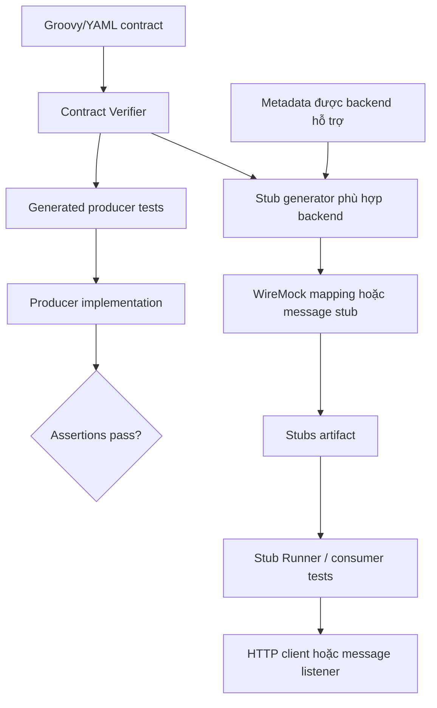
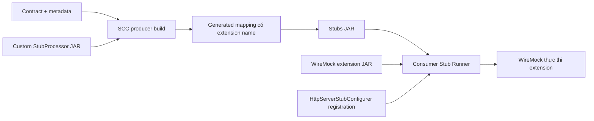
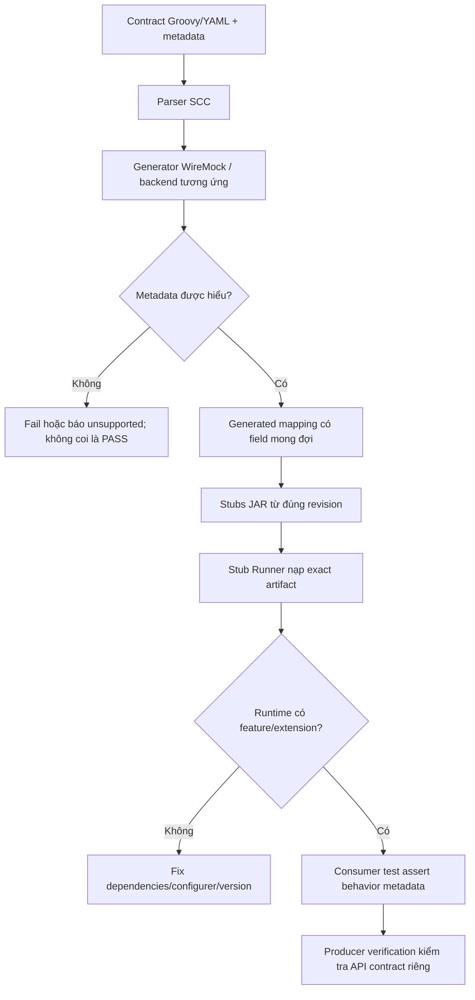

# Metadata phục vụ sinh stub theo khả năng hỗ trợ

## 1. Metadata giải quyết vấn đề nào trong Spring Cloud Contract?

Trong **Spring Cloud Contract (SCC)**, producer và consumer thống nhất hành vi HTTP hoặc thông điệp bằng hợp đồng **Groovy/YAML DSL**. Từ hợp đồng, SCC có thể **sinh producer verification tests** để kiểm tra triển khai thật, **sinh stubs** cho consumer dùng với **Stub Runner**, rồi kết hợp hai kết quả trong CI nhằm phát hiện thay đổi API không tương thích.

Với những trường hợp phổ biến, phần `request` và `response` của contract đã đủ để tạo WireMock mapping. Nhưng đôi khi consumer cần mô phỏng thêm một khả năng riêng của stub server, chẳng hạn:

- Làm chậm response để thử **timeout**, loading state hoặc fallback.
- Kích hoạt một **WireMock response transformer** đã được cài và đăng ký.
- Bổ sung một thiết lập StubMapping riêng chỉ được backend WireMock hiểu.
- Cung cấp thông tin cấu hình đặc thù cho một **message transport** hoặc trình sinh stub tùy biến, nếu integration hỗ trợ.

SCC cung cấp trường **`metadata`** ở cấp contract để chuyển một số cấu hình như vậy tới extension/generator. Tuy nhiên, **metadata không phải cơ chế tự động biến mọi khóa tùy ý thành tính năng**. Một khóa chỉ có tác dụng khi **phiên bản SCC, converter/generator và stub runtime có code đọc, xử lý đúng khóa ấy**.

> **Nguyên tắc trọng tâm:** Hợp đồng mô tả *lời hứa API*; metadata mô tả *cách một công cụ cụ thể mở rộng việc sinh hoặc vận hành stub*. Metadata chỉ có hiệu lực **theo khả năng hỗ trợ**, và không được dùng để lách producer verification.

### Kết quả học tập

Sau bài học, người học có thể:

1. Phân biệt `request`/`response` DSL với `metadata` và WireMock `StubMapping`.
2. Viết metadata `wiremock.stubMapping` bằng Groovy/YAML để yêu cầu một **fixed delay** trên stub.
3. Hiểu rõ **những phần được patch** và những phần **không được patch** của generated mapping.
4. Biết khi nào cần custom `StubProcessor`, WireMock extension hoặc `HttpServerStubConfigurer`.
5. Đánh giá metadata khác nhau cho WireMock, Kafka/AMQP và các integration mà phiên bản thực sự hỗ trợ.
6. Thiết kế kiểm tra output, consumer behavior và CI để tránh giả định metadata đã hoạt động khi thực tế bị bỏ qua.

## 2. Một contract có hai con đường sử dụng khác nhau



| Thành phần | Chức năng | Metadata có thể ảnh hưởng? |
| --- | --- | --- |
| `request` DSL | Method, URL, query, headers, body mà producer phải nhận | Không nên thay lời hứa request bằng metadata patch |
| `response` DSL | Status, headers, body mà producer phải trả | Không thay assertions producer bằng WireMock metadata |
| Generated producer tests | Gọi triển khai producer, assert behavior | **WireMock stub metadata không tự sửa** test này |
| Generated WireMock mapping | Chọn request và phát response giả lập | **Có**, với các vùng patch được hỗ trợ |
| WireMock runtime | Đọc mapping, xử lý delay/transformer/extension | Chỉ khi feature và extension được runtime hỗ trợ |
| Consumer Stub Runner tests | Kiểm tra HTTP client/consumer xử lý stub | Chỉ quan sát kết quả stub đã nạp, không chạy producer thật |

Sự phân tách này quan trọng trong một tình huống: producer thực phản hồi trong 50 ms nhưng consumer cần thử timeout sau 2 giây. Có thể **thêm delay cho stub** mà không biến 2 giây thành yêu cầu độ trễ của producer. Nếu thật sự có SLA thời gian đáp ứng, SLA ấy phải được xác minh bằng test/monitoring thích hợp, không suy từ cấu hình WireMock delay.

## 3. Metadata ở cấp contract khác gì những trường hợp đồng thông thường?

Một DSL contract HTTP cơ bản:

```groovy
import org.springframework.cloud.contract.spec.Contract

Contract.make {
    description 'Tra cứu đơn hàng đã xác nhận'

    request {
        method GET()
        url '/api/orders/42'
        headers {
            accept(applicationJson())
        }
    }

    response {
        status OK()
        headers {
            contentType(applicationJson())
        }
        body([
            orderId: 'ord-42',
            status : 'CONFIRMED'
        ])
    }
}
```

Đây là **lời hứa chức năng**: GET đúng endpoint phải cho một HTTP response tương thích với status/headers/body đã mô tả, trong phạm vi những assertion generator tạo. Khi thêm `metadata`, ta không có ý định thay yêu cầu đó.

| Dữ liệu | Nên khai báo ở đâu? | Vì sao? |
| --- | --- | --- |
| HTTP method `GET` | `request.method` | Một phần của API |
| URL `/api/orders/42` | `request.url` | Một phần của API |
| Response status `200` | `response.status` | Producer phải đáp ứng |
| Response field `status = CONFIRMED` | `response.body` | Consumer dựa vào dữ liệu |
| Response content type | `response.headers` | Giao diện API |
| Fixed 2-second delay **chỉ để thử consumer** | `metadata.wiremock.stubMapping` nếu hỗ trợ | Hành vi mô phỏng của stub |
| Transformer tên `my-transformer` | WireMock metadata + extension được đăng ký | Không phải logic contract thuần |
| Chủ sở hữu contract hoặc ticket ID | Metadata/quy ước quản trị riêng nếu có processor | Không phải tính năng sinh stub tự động |
| Test framework/base class | Cấu hình SCC Maven/Gradle | Không phải WireMock stub metadata |

**Đừng nhầm `metadata` với các top-level field `description`, `name`, `label`, `priority`, `ignored`, `inProgress` của DSL**. Các field này có ý nghĩa riêng do SCC định nghĩa theo phiên bản; không cần đưa chúng vào `metadata.wiremock` để dùng chức năng có sẵn.

## 4. Khả năng hỗ trợ là yếu tố quyết định

Từ Spring Cloud Contract **3.0.0**, tài liệu SCC mô tả cơ chế metadata để mở rộng WireMock stubs. Một cấu hình có khóa `wiremock` và `stubMapping` có thể dùng JSON, map hoặc đối tượng `StubMapping` phù hợp để **patch generated WireMock mapping**.

Nhưng có ít nhất **bốn lớp hỗ trợ**:

| Lớp | Câu hỏi phải kiểm tra |
| --- | --- |
| **Contract DSL parser** | Phiên bản SCC có đọc đúng `metadata` Groovy/YAML không? |
| **Generator/processor** | Generator đã chọn có hiểu khóa `wiremock.stubMapping` hay metadata khác không? |
| **WireMock version** | Thuộc tính JSON được yêu cầu có hợp lệ với `StubMapping` bản đó không? |
| **Consumer runtime** | Stub Runner có nạp extension/transformer liên quan và xử lý response như mong đợi không? |

Metadata lạ có thể không được sử dụng bởi generator đã chọn, bị bỏ qua hoặc làm build lỗi tùy loại integration và phiên bản. **Không coi “YAML parse thành công” là bằng chứng metadata đã hoạt động.**

### Các câu hỏi thiết kế trước khi thêm metadata

1. Mình đang dùng **WireMock HTTP stub**, **messaging stub** hay custom stub server?
2. Feature này **nằm trong `request`/`response` DSL chuẩn** hay chỉ là đặc thù runtime?
3. Khóa metadata và kiểu dữ liệu được **tài liệu hóa** trong phiên bản SCC/transport đang dùng chưa?
4. Nó có ảnh hưởng **generated producer test**, **generated stub**, hay chỉ **Stub Runner runtime**?
5. Có thể kiểm tra **generated mapping** và **hành vi tiêu dùng** bằng một test xác định không?

Nếu chưa có câu trả lời cho câu 3 hoặc 4, nên dùng contract bình thường và bổ sung test/resilience fixture riêng thay vì tự sáng chế metadata.

## 5. Ví dụ Groovy: metadata yêu cầu WireMock fixed delay

Ví dụ dưới đây minh họa cách cấu hình được SCC hỗ trợ trong các phiên bản có **WireMock metadata customization**:

```groovy
import org.springframework.cloud.contract.spec.Contract

Contract.make {
    name 'get_confirmed_order_with_stub_delay'
    description 'Consumer thử xử lý response tra cứu đơn đến chậm'

    request {
        method GET()
        url '/api/orders/42'
        headers {
            accept(applicationJson())
        }
    }

    response {
        status OK()
        headers {
            contentType(applicationJson())
        }
        body([
            orderId: 'ord-42',
            status : 'CONFIRMED'
        ])
    }

    metadata([
        wiremock: [
            stubMapping: '''{
              "response": {
                "fixedDelayMilliseconds": 2000
              }
            }'''
        ]
    ])
}
```

Ở đây:

- `name` đặt tên scenario/test; `description` giải thích mục đích.
- `request` và `response` vẫn khai báo contract như thông thường.
- `metadata` là một **map** có khóa `wiremock`.
- `wiremock.stubMapping` chứa JSON mô tả phần muốn patch vào WireMock mapping.
- `fixedDelayMilliseconds: 2000` yêu cầu WireMock **giữ response thêm khoảng 2 giây** trước khi trả, nếu backend/runtime hỗ trợ.

**Chú ý:** Test producer được sinh **không tự bắt buộc producer ngủ 2 giây**. Metadata này dùng cho **stub-side behavior**; cần thêm test riêng nếu muốn giới hạn thời gian đáp ứng của producer.

### Vì sao dùng JSON nhỏ thay vì copy cả StubMapping?

Nếu mục tiêu chỉ là delay, chỉ cung cấp phần `response.fixedDelayMilliseconds`. Không lặp lại `request.method`, `request.url` hay `response.body` trong JSON metadata. Để contract DSL tiếp tục là **nguồn chân lý** của hành vi API, còn metadata chỉ bổ sung tính năng stub được hỗ trợ.

## 6. Ví dụ YAML tương đương với Groovy

YAML DSL cũng có thể truyền metadata theo cấu trúc `wiremock.stubMapping`:

```yaml
name: get_confirmed_order_with_stub_delay
description: Consumer thử xử lý response tra cứu đơn đến chậm

request:
  method: GET
  url: /api/orders/42
  headers:
    Accept: application/json

response:
  status: 200
  headers:
    Content-Type: application/json
  body:
    orderId: "ord-42"
    status: "CONFIRMED"

metadata:
  wiremock:
    stubMapping: >
      {
        "response": {
          "fixedDelayMilliseconds": 2000
        }
      }
```

**Đây là một phiên bản thay thế**, không nên đặt cùng lúc bản Groovy và bản YAML mô tả **cùng kịch bản HTTP** trong source directory được plugin quét. Hai file trùng method/path nhưng khác tên hoặc priority có thể tạo nhiều stub mapping cạnh tranh.

### Cấu trúc dữ liệu của phần metadata

| Cấp | Kiểu minh họa | Ý nghĩa |
| --- | --- | --- |
| `metadata` | YAML object / Groovy map | Chứa dữ liệu bổ sung cho integration |
| `wiremock` | Object/map | Namespace mà WireMock integration nhận diện |
| `stubMapping` | JSON string trong YAML ví dụ | Phần `StubMapping` để patch |
| `response` trong JSON | WireMock response definition | Không phải `response` DSL chuẩn ở phía trên |
| `fixedDelayMilliseconds` | Số nguyên, đơn vị **mili giây** | Thời gian trì hoãn response của stub |

**Có hai `response` với vai trò khác nhau:** `response` ở top level là lời hứa producer; `metadata.wiremock.stubMapping.response` là cấu hình **response giả lập của WireMock**. Cần phân biệt rõ khi review code.

### Lưu ý YAML block scalar

- `>` là kiểu folded block scalar; phù hợp khi biến nhiều dòng JSON thành một chuỗi.
- `|` giữ line breaks; cũng có thể dùng khi JSON parser của integration chấp nhận xuống dòng.
- JSON bên trong `stubMapping` phải **đúng cú pháp JSON**, kể cả dấu ngoặc, dấu phẩy và dấu nháy.
- Không nhầm scalar JSON string với YAML object nếu generator/plugin phiên bản đang dùng yêu cầu một kiểu cụ thể.

Tài liệu SCC mô tả `stubMapping` có thể được biểu diễn bằng JSON/string, map hoặc đối tượng tương đương ở những DSL hỗ trợ. **Kiểm tra kiểu mà version/plugin đang dùng thực sự parse được**, không giả định mọi serialization đều tương thích.

## 7. Generated WireMock mapping sau khi patch trông như thế nào?

SCC sinh một mapping từ `request`/`response`, rồi áp dụng phần metadata được hỗ trợ. Một kết quả **minh họa rút gọn**:

```json
{
  "request": {
    "method": "GET",
    "url": "/api/orders/42",
    "headers": {
      "Accept": {
        "equalTo": "application/json"
      }
    }
  },
  "response": {
    "status": 200,
    "headers": {
      "Content-Type": "application/json"
    },
    "jsonBody": {
      "orderId": "ord-42",
      "status": "CONFIRMED"
    },
    "fixedDelayMilliseconds": 2000
  }
}
```

**Đây không phải bản sao byte-for-byte của file SCC sinh trong mọi version.** Generator có thể chọn dạng `urlPath`, `equalToJson`, `jsonBody`, lưu body trong file, thêm `id`, `uuid` hoặc các trường khác. Điều cần tìm là: request matcher và contract response ban đầu vẫn đúng, **và** `response.fixedDelayMilliseconds` thực sự xuất hiện.

### Quy trình xác minh output

1. Đặt **một** contract có metadata trong source root được cấu hình.
2. Chạy bước **generate stubs** tương ứng của Maven/Gradle plugin.
3. Mở **generated WireMock JSON mapping** ở thư mục output thực tế.
4. Đối chiếu `request.method`, URL, headers và body matcher với contract nguồn.
5. Đối chiếu `response.status`, `headers`, `body` với lời hứa API.
6. Xác nhận có `fixedDelayMilliseconds: 2000` trong đúng vị trí.
7. Đóng gói stubs artifact, chạy Stub Runner và kiểm tra **response thật** có delay trong giới hạn đo chấp nhận được.

**YAML/Groovy parse thành công chưa đủ** để xác minh metadata đã được backend nhận. **Có JSON mapping chưa đủ** để khẳng định consumer runtime đã nạp đúng artifact và xử lý delay.

## 8. Giới hạn patch: metadata không được ghi đè mọi thứ

Tài liệu SCC về **WireMock customization via metadata** nêu giới hạn quan trọng: cơ chế này **tác động phía stub**, không sửa generated producer tests; và **không thay toàn bộ `request` cũng như `response.body` và `response.headers`** của generated stub.

| Thành phần cần đổi | Có nên dùng `wiremock.stubMapping`? | Giải pháp đúng |
| --- | --- | --- |
| HTTP method `GET` → `POST` | **Không** | Đổi `request.method` DSL và verify producer |
| Request URL `/v1` → `/v2` | **Không** | Đổi `request.url` DSL/version API |
| Request body matcher | **Không** dùng metadata để thay cả request | Dùng `request.matchers`/Groovy consumer matcher |
| Response HTTP `200` → `201` | Không nên dùng patch để mâu thuẫn lời hứa | Đổi `response.status` DSL |
| Response JSON `status` → `state` | **Không** | Đổi `response.body` có review compatibility |
| Response `Content-Type` | **Không** | Đổi `response.headers` DSL |
| Stub response delay | **Có, nếu hỗ trợ** | Patch `response.fixedDelayMilliseconds` |
| Stub response transformer | Có thể, nếu runtime extension hỗ trợ | Patch cấu hình transformer, đăng ký extension |
| Tính năng WireMock mới chưa có trong SCC | Chỉ nếu đúng patch area và WireMock version hỗ trợ | Kiểm chứng schema/runtime hoặc custom processor |
| Producer latency SLA | **Không** | Test hiệu năng/latency producer riêng |

### Đừng cố “chữa” breaking change bằng metadata

Nếu producer thật đã bỏ field `status` nhưng consumer vẫn cần field ấy, **không thể sửa chính đáng** bằng metadata để stub tiếp tục trả field cũ, rồi coi producer đã tương thích. Generated producer test cần fail khi producer vi phạm contract cũ. Hãy sửa implementation, có migration plan hoặc version API; metadata không phải công cụ che lỗi tương thích.

### Vì sao cần nhìn cả hai nhánh sinh?

```text
contract: response.status=200, body.status=CONFIRMED
                 |
       +---------+---------+
       |                   |
generated producer test    generated WireMock stub
assert status/body         return status/body + delay 2000 ms
       |                   |
verify producer code       consumer tests timeout/fallback
```

Consumer có thể timeout với stub 2 giây trong khi producer contract test vẫn pass. Điều đó không mâu thuẫn: **hai bộ test đang kiểm tra hai đặc tính khác nhau**.

## 9. Metadata không tự chứng minh tính năng được hỗ trợ

Giả sử một developer thêm:

```yaml
metadata:
  myOrganization:
    chaosMode: "FAIL_EVERY_THIRD_REQUEST"
```

Đây chỉ là **YAML metadata tùy ý**. Trừ khi có một converter/processor/extension được đăng ký và đọc `myOrganization.chaosMode`, không có cơ sở kết luận WireMock sẽ tự fail mỗi request thứ ba.

Tương tự, thêm:

```yaml
metadata:
  wiremock:
    unsupportedProperty: true
```

không có nghĩa SCC sẽ chuyển bất kỳ khóa `unsupportedProperty` nào thành WireMock mapping hợp lệ. **Namespace và schema mà integration chấp nhận mới quyết định hiệu lực.**

### Ma trận năng lực

| Metadata muốn dùng | Cần kiểm tra | Khi không hỗ trợ |
| --- | --- | --- |
| `wiremock.stubMapping.response.fixedDelayMilliseconds` | SCC 3.0+ có patch + WireMock hỗ trợ delay | Bỏ metadata, dùng fixture WireMock độc lập có chú thích |
| `response.transformers` | WireMock version, tên extension, registration | Tránh khai báo extension không tồn tại |
| Webhook/callback sau request | Khả năng WireMock cụ thể, egress policy | Dùng integration test sandbox riêng |
| Kafka/AMQP connection options | Đúng adapter/backend và metadata schema | Cấu hình broker/test binder theo đường được hỗ trợ |
| Custom organization key | Custom processor đã được cài và test | Chỉ coi là metadata quản trị, không là behavior |

**Nguyên tắc fail closed trong CI:** Với metadata mà bài test bắt buộc phụ thuộc, nếu capability không có hoặc output không như mong đợi, **đánh dấu FAILED/INCOMPLETE**, không âm thầm chạy test mà bỏ qua feature.

## 10. Kiểm thử delay ở consumer mà không biến test thành flaky

Ví dụ contract tạo stub delay 2 giây. Consumer `checkout-service` có một HTTP client với timeout nhỏ hơn 2 giây và fallback hợp lệ.

### Test intent

```text
Given:
  WireMock GET /api/orders/42 -> 200, body bình thường, delay ~2000ms
  Consumer HTTP read timeout: 500ms

When:
  checkout-service gọi OrderClient.getOrder("42")

Then:
  Consumer nhận timeout ở HTTP client
  Consumer áp dụng fallback được thiết kế
  Không chờ vô hạn, không gọi production API
```

Test consumer nên assert **loại exception/kết quả fallback và side effect nghiệp vụ**. Chỉ viết `Thread.sleep(2100)` trong test rồi xem response có đến hay không thường làm test chậm và dễ flaky.

### Cần kiểm tra những con số nào?

| Giá trị | Vai trò |
| --- | --- |
| Stub delay `2000 ms` | Mô phỏng backend chậm |
| Consumer timeout `500 ms` | Ngưỡng mà client dự định hết thời gian chờ |
| Network/setup overhead | Có thể thay đổi trên máy CI |
| Test suite deadline | Giới hạn thời gian của test framework/CI |

Không đòi elapsed time **chính xác tuyệt đối 2000 ms** vì scheduling, HTTP stack và CI load gây dao động. Với resilience test, ưu tiên assert hành vi timeout/fallback và đặt timeouts đủ cách biệt để kết quả ổn định. Không dùng fixed delay quá lớn cho hàng trăm tests khi chỉ một kịch bản cần mô phỏng mạng chậm.

### Không đồng nghĩa producer response phải chậm

Việc consumer xử lý tốt delay chỉ chứng minh client chịu được stub chậm theo kịch bản. Nó **không chứng minh producer có latency xấu**, cũng không đo hiệu năng hay SLA của producer thật. Nếu release yêu cầu latency giới hạn, cần đo producer trong môi trường phù hợp.

## 11. Khi cần response transformer hoặc WireMock extension

`fixedDelayMilliseconds` là ví dụ nhỏ vì không cần cài custom Java extension. Một số yêu cầu phức tạp hơn có thể dùng **WireMock transformer** để thay đổi response dựa trên request, dữ liệu môi trường test hoặc trạng thái đã được quản lý.

Ví dụ minh họa một **WireMock mapping** tham chiếu tới transformer:

```json
{
  "request": {
    "method": "GET",
    "urlPath": "/api/orders/42"
  },
  "response": {
    "status": 200,
    "jsonBody": {
      "orderId": "ord-42",
      "status": "CONFIRMED"
    },
    "transformers": ["order-test-response-transformer"]
  }
}
```

**Lưu ý:** `order-test-response-transformer` là **tên giả định** của một extension do dự án tự cài, không phải transformer mặc định của WireMock. Đoạn JSON này là **WireMock mapping minh họa**, không phải bảo đảm rằng SCC sẽ tự generate nó từ một metadata tùy ý.

### Ba điều kiện để extension có tác dụng

1. **Generator:** Generated mapping thực tế phải chứa `transformers` với đúng tên đã đăng ký.
2. **Classpath:** JAR chứa extension phải có trong **classpath của WireMock server chạy bởi Stub Runner**, không chỉ classpath của producer build.
3. **Runtime registration:** WireMock phải được cấu hình để **nạp extension**; có class trên classpath chưa chắc đồng nghĩa class đã được đăng ký.

Theo tài liệu SCC, khi dùng Stub Runner và custom WireMock extension, cần cung cấp **`HttpServerStubConfigurer`** phù hợp, chẳng hạn một implementation mở rộng `WireMockHttpServerStubConfigurer`, để đăng ký extension. Cú pháp liên kết configurer tới `@AutoConfigureStubRunner` hoặc Stub Runner configuration **phụ thuộc phiên bản**; cần đối chiếu API thật trước khi viết annotation/property.

### Đừng đánh đồng extension với contract assertion

Một transformer biến response `status` thành `state` cho consumer v2 có thể làm consumer tests pass, nhưng producer verification **không tự được bổ sung test để đảm bảo producer trả `state`**. Nếu v2 là lời hứa API thật, hãy định nghĩa bằng contract v2 phù hợp và kiểm tra producer implementation, không chỉ thêm transformer tại mock layer.

### Trường hợp transformer có thể phù hợp

- Tạo dữ liệu giả biến thiên nhưng vẫn đáp ứng schema được contract cam kết.
- Thử các nhánh client dựa trên header hoặc context trong môi trường sandbox.
- Tạo response test-specific không phụ thuộc backend production.

Với các trường hợp này, cần kiểm soát **determinism**: seed/clock cố định, không gọi mạng ngoài, không đọc secrets thật, không làm thứ tự chạy test ảnh hưởng response.

## 12. Custom StubProcessor: mở rộng có chủ đích ở bước sinh stub

Khi metadata mặc định không đủ nhưng yêu cầu vẫn gắn với quá trình sinh WireMock mapping, Spring Cloud Contract cung cấp cơ chế **stub post-processing** trong một số nhánh. Tài liệu mô tả:

- Đăng ký implementation thông qua `META-INF/spring.factories` với key:
  `org.springframework.cloud.contract.verifier.converter.StubProcessor`.
- Với WireMock, có interface chuyên biệt `org.springframework.cloud.contract.verifier.wiremock.WireMockStubPostProcessor`.
- Processor cần quyết định **contract nào áp dụng** và **mapping sau xử lý trông như thế nào**.

Ví dụ cấu hình **định hướng**, chưa kèm Java implementation vì chữ ký interface có thể khác theo version:

```properties
# META-INF/spring.factories
org.springframework.cloud.contract.verifier.converter.StubProcessor=\
com.example.contract.stub.OrderWireMockPostProcessor
```

Lưu ý `OrderWireMockPostProcessor` là **lớp giả định cần tự triển khai**, không phải class thư viện có sẵn. Cần build JAR chứa lớp và `spring.factories` rồi đặt nó trên **classpath mà generator sử dụng**. Chỉ thêm `spring.factories` mà không có implementation không tạo ra chức năng.

### Một thuật toán post-process nên có giới hạn

```text
Nhận (contract, generated StubMapping)
    |
    +-- Metadata có namespace/khóa được hỗ trợ?
    |     +-- Không -> trả mapping gốc, hoặc fail theo policy
    |     +-- Có -> validate kiểu/giá trị metadata
    |
    +-- Chỉ sửa những trường stub đã được phê duyệt
    |
    +-- Giữ request và response contract assertions nhất quán
    |
    +-- Trả mapping mới -> validate JSON -> smoke test runtime
```

Một processor tốt cần **đúng phạm vi**: không tự ý thay request matcher hay response body để làm test dễ pass, không mở proxy tới external URL, không biến lỗi parse thành silent no-op nếu metadata là bắt buộc.

### Khi nào không cần custom processor?

| Yêu cầu | Thường nên làm gì? |
| --- | --- |
| Chỉ thêm fixed delay đã hỗ trợ | Dùng `metadata.wiremock.stubMapping` |
| Chỉ thay HTTP status/body | Sửa contract DSL và producer verification |
| Chọn test framework/base class | Cấu hình Maven/Gradle SCC plugin |
| Thêm matcher request chuẩn | Dùng `request.matchers`/`consumer(...)` đúng DSL |
| Thêm tính năng WireMock có extension nhưng không cần logic biến đổi mapping | Đăng ký WireMock extension/configurer và kiểm tra generated mapping |
| Cần logic tái viết mapping cho nhiều contract | Cân nhắc custom `StubProcessor` |
| Cần backend stub khác WireMock | Xem `StubGenerator`/`StubRunner` pluggable architecture |

**Không nên xây custom Java extension chỉ để né một ràng buộc DSL đang cần bảo vệ.** Mỗi extension là code cần được version hóa, review bảo mật, đưa vào classpath và kiểm thử.

## 13. Lifecycle extension: producer generator và consumer server là hai môi trường

Một sai lầm thường gặp: developer thêm extension JAR vào producer build, tạo mapping có tên transformer mới, nhưng consumer Stub Runner vẫn không nhận diện transformer.



| Môi trường | Cần có gì? | Lỗi nếu thiếu |
| --- | --- | --- |
| **Producer generator** | SCC plugin + metadata processor nếu dùng | Mapping không được patch/không sinh |
| **Stubs artifact** | Generated mappings và response resources | Consumer không tìm thấy mapping |
| **Consumer Stub Runner** | WireMock runtime version tương thích | Mapping parse/runtime fail |
| **Consumer test classpath** | Custom extension JAR nếu mapping yêu cầu | Không load được transformer |
| **WireMock server configuration** | Extension được đăng ký đúng tên | Warning “extension not found” hoặc response không đúng |
| **Consumer client** | Gọi đúng stub port/method/path | Không quan sát được tính năng stub |

Sự đồng bộ giữa **processor ở thời điểm build** và **extension ở thời điểm consumer test** là một dạng compatibility khác. Hãy version hóa custom extension giống dependency thông thường và ghi version của nó trong CI.

### Tại sao không chỉ thêm JAR vào stubs artifact?

Một stubs JAR tiêu chuẩn thường được dùng làm **tập mappings/resources**, không phải nơi SCC tự động load và đăng ký arbitrary Java plugin. Nếu muốn chứa extension, phải có cơ chế đóng gói/classpath/configurer rõ ràng. Không mặc định chỉ vì class nằm trong một JAR cùng tên thì WireMock sẽ tìm thấy và kích hoạt.

## 14. Metadata cho messaging và HTTP verifier: không có một schema chung

Tài liệu SCC một số phiên bản còn mô tả **metadata namespaces** ngoài `wiremock`, ví dụ:

| Namespace tài liệu từng hỗ trợ | Mục tiêu điển hình | Điều cần kiểm chứng |
| --- | --- | --- |
| `wiremock` | Patch WireMock `StubMapping` cho HTTP stubs | Đúng generator và WireMock version |
| `amqp` | Tùy chọn/broker properties cho AMQP-based communication | Đúng AMQP integration/backend |
| `kafka` | Tùy chọn kết nối broker Kafka ở input/output message | Đúng Kafka metadata schema và adapter |
| `standalone` | Cấu hình standalone/middleware cho một số flow | Chỉ dùng với backend/runtime tương ứng |
| `verifierHttp` | Thông tin HTTP scheme/protocol cho verifier trong một số version | **Không** coi là WireMock response metadata |

**Danh sách không phải lời hứa rằng mọi version SCC đều hỗ trợ tất cả khóa.** Một phần metadata có thể phục vụ **producer verifier**, **message stub generator** hoặc **runtime adapter**, chứ không nhất thiết patch WireMock. Đọc schema/tài liệu tương ứng nhánh SCC và transport sử dụng.

### Ví dụ AMQP YAML theo dạng tài liệu cho middleware có hỗ trợ

```yaml
description: Phát OrderConfirmed cho consumer notification
label: order_confirmed
input:
  triggeredBy: "confirmOrder()"
outputMessage:
  sentTo: orders.confirmed
  body:
    orderId: "ord-42"
    status: CONFIRMED
metadata:
  amqp:
    outputMessage:
      connectToBroker:
        declareQueueWithName: "orders.confirmed"
```

Ví dụ này **chỉ áp dụng với integration AMQP/standalone phù hợp có đọc khóa đó**. Nó không tự đăng ký broker, không tự tạo queue production và không chứng minh event thực được gửi đúng trong mọi môi trường. Với SCC producer verification, base class phải trigger `confirmOrder()`, adapter nhận output và test đúng destination/header/body.

### Ví dụ Kafka: đừng chuyển cấu hình broker thành lời hứa API

Trong một số nhánh SCC, metadata `kafka.input.connectToBroker.additionalOptions` hoặc `kafka.outputMessage.connectToBroker.additionalOptions` được mô tả trong schema của backend. Nhưng việc thêm các trường này **không tự đảm bảo một test binder đang dùng Kafka thật**, không thay thế cấu hình bootstrap server và không xác nhận broker vận hành đúng.

Với messaging, trước tiên cần xác minh `label`, `input.triggeredBy`, `outputMessage.sentTo`, headers và body mà consumer dựa vào. Sau đó mới thêm metadata transport-specific nếu tính năng được **chính backend** hỗ trợ.

## 15. Metadata tùy biến của tổ chức: tách nhãn quản trị khỏi behavior

Một nhóm có thể muốn ghi thêm:

```yaml
metadata:
  organization:
    ownerTeam: "orders-platform"
    consumerGroup: "checkout"
    risk: "latency"
    ticket: "CONTRACT-218"
```

Đây là **metadata quản trị minh họa**, không phải những khóa Spring Cloud Contract tự động chuyển thành generated mapping hay producer assertions. Chúng có thể hữu ích cho một report generator/catalog **do tổ chức tự xây**, nếu pipeline có processor đọc/validate.

Để tránh nhầm lẫn:

- Đặt namespace riêng, không dùng `wiremock` cho những trường không thuộc WireMock.
- Có schema version hoặc validation cho metadata nội bộ, chẳng hạn `ownerTeam` là chuỗi không rỗng.
- Xác định rõ **ai đọc** và **để làm gì**; metadata không có consumer xử lý thì chỉ là ghi chú.
- Không ghi API keys, mật khẩu hoặc dữ liệu nhạy cảm vào metadata: DSL có thể được đóng gói, publish và hiển thị trong CI.
- Không đưa các ràng buộc API trọng yếu vào metadata tùy biến mà producer verification không biết.

### Vì sao cần phân biệt nhãn quản trị với StubMapping metadata?

**WireMock cũng có khái niệm `metadata` của chính StubMapping** trong một số phiên bản, dùng để gắn nhãn hoặc lọc mappings. Đó là **metadata trong JSON mapping của WireMock**, khác với **`metadata` top-level của Spring Cloud Contract DSL**. Nếu muốn truyền các nhãn này qua SCC, phải kiểm tra **phần patch được hỗ trợ**, output thực tế và version WireMock. Chỉ trùng tên trường `metadata` không đủ chứng minh dữ liệu sẽ được chuyển qua nguyên vẹn.

## 16. Kiểm chứng metadata từ source tới consumer Stub Runner

Một quy trình đúng không chỉ xác nhận YAML/Groovy có trường `metadata`. Cần kiểm tra **cả build-time và runtime**:



### Với Maven producer đã cấu hình Contract Verifier

```bash
./mvnw -B clean verify
```

Kiểm tra rằng plugin sinh stubs và generated producer tests như mong đợi; xem **test reports** để xác nhận producer tests **đã chạy**, không chỉ có file được generate. Nếu plugin/project không gắn generation hoặc stubs packaging vào lifecycle, cần chạy các goal/task thích hợp theo **phiên bản plugin thực tế**.

### Với Gradle producer đã cấu hình Contract Verifier

```bash
./gradlew tasks --all
./gradlew generateContractTests
./gradlew contractTest
./gradlew generateClientStubs
./gradlew verifierStubsJar
```

Task names và source directories phụ thuộc plugin/Gradle configuration; lệnh trên là **ví dụ thực hành**, không phải những lệnh đã thực thi để soạn bài. Khi sinh stubs, hãy tìm **JSON WireMock mapping thực tế**, không giả định một path output cố định trong mọi project.

### Những thông tin cần lưu sau khi sinh

| Dữ kiện | Cần biết gì? |
| --- | --- |
| Contract source path/revision | Metadata bắt đầu từ tệp nào |
| SCC/Gradle/Maven plugin version | Khả năng metadata parser/generator |
| WireMock version | Khả năng đọc/thi hành field JSON |
| Generated mapping path | Bằng chứng phần patch đã được áp dụng |
| Stubs artifact coordinates/digest | Consumer nạp đúng artifact hay không |
| Stub Runner / extension version | Runtime có hiểu mapping/transformer không |
| Producer test report | Producer contract vẫn được verify độc lập |
| Consumer test result | Delay/transformer được quan sát thật hay chỉ có trong JSON |

Một kết quả xanh nhưng không biết **runtime đã nạp mapping nào** có thể bỏ sót metadata chưa được áp dụng hoặc consumer đang dùng stubs JAR cũ.

## 17. Consumer test với stub được tăng độ trễ

Ví dụ test consumer qua Stub Runner:

```java
import org.junit.jupiter.api.Test;
import org.springframework.beans.factory.annotation.Autowired;
import org.springframework.boot.test.context.SpringBootTest;
import org.springframework.cloud.contract.stubrunner.StubRunnerProperties;
import org.springframework.cloud.contract.stubrunner.spring.AutoConfigureStubRunner;

import static org.assertj.core.api.Assertions.assertThat;

@SpringBootTest(properties =
    "clients.orders.base-url=http://localhost:9090")
@AutoConfigureStubRunner(
    ids = "com.example:order-service:1.7.0:stubs:9090",
    stubsMode = StubRunnerProperties.StubsMode.LOCAL
)
class OrderClientSlowResponseTest {

    @Autowired
    OrderClient orderClient;

    @Test
    void fallsBackWhenOrderServiceIsTooSlow() {
        OrderView result = orderClient.getOrderWithFallback("42");
        assertThat(result.fromFallback()).isTrue();
    }
}
```

`OrderClient`, `OrderView`, `getOrderWithFallback` và `clients.orders.base-url` đều là **API giả định của ứng dụng consumer**, không có sẵn trong SCC. Để test có ý nghĩa:

1. Client thật phải trỏ tới `localhost:9090` (hoặc port Stub Runner cấp).
2. Client timeout phải **nhỏ hơn** delay WireMock, ví dụ 500 ms so với 2000 ms.
3. `LOCAL` phải tìm thấy **đúng stubs JAR** đã được build từ contract metadata.
4. Assertion phải kiểm tra **fallback nghiệp vụ**, không chỉ exception bị ném.
5. Nếu test được chạy theo profile khác và client trỏ tới producer thật, đó là lỗi setup nghiêm trọng.

### Đừng đánh đồng một stub với mọi tình huống thực

Một stub delay cố định 2 giây không mô phỏng đầy đủ packet loss, network reset, retry storm hay tải cao. Với những đặc tính đó, dùng resilience tests/fault injection riêng theo policy. **Metadata là công cụ tiện lợi để tạo một kịch bản cụ thể**, không phải mô hình toàn bộ hệ thống phân tán.

### Cẩn thận với việc dùng chung URL trong nhiều contract

Nếu có một contract GET nhanh và một contract GET chậm **cùng method/path/headers/query/body matcher**, WireMock có thể nạp hai mappings cạnh tranh. Không chắc consumer sẽ nhận response nào nếu không có cách phân biệt. Nên:

- Chỉ giữ **một mapping** cho kịch bản tương ứng trong một stub instance.
- Hoặc tách consumer test profile/stubs artifact/port theo kịch bản.
- Hoặc dùng request header được contract/producer hỗ trợ để **phân biệt thật** những yêu cầu khác nhau.

**Không dùng header “X-Test-Slow: true” như một phần production contract nếu producer thật không có semantics ấy**, trừ khi đó là một giao diện dành riêng cho test được tổ chức chấp thuận. Lọc fixture theo job có thể là cách sạch hơn.

## 18. CI quality gate: metadata bắt buộc phải có bằng chứng

Để không có tình huống "metadata parse được nhưng không có hiệu lực", CI có thể tách ba loại gate:

| Gate | Kiểm tra | Điều kiện không đạt |
| --- | --- | --- |
| **Producer contract gate** | Generated tests chạy/pass trên đúng producer revision | Không publish verified stubs |
| **Stub-generation gate** | Mapping sinh ra chứa đúng metadata được hỗ trợ | Fail khi field bắt buộc vắng hoặc sai kiểu |
| **Consumer-runtime gate** | Stub Runner nạp mapping + extension, consumer quan sát đúng behavior | Fail/INCOMPLETE nếu runtime không nhận |

Ví dụ mô hình kiểm tra metadata delay:

```text
Required contract: get_confirmed_order_with_stub_delay
Expected mapping:
  request.method = GET
  request.url = /api/orders/42
  response.status = 200
  response.body.status = CONFIRMED
  response.fixedDelayMilliseconds = 2000

Expected runtime behavior:
  consumer client readTimeout = 500 ms
  observed result = fallback activated

Expected producer verification:
  generated contract tests executed > 0
  HTTP response assertions pass
```

Đây là **mẫu test plan**, không phải output của SCC. CI cần xác định test nào/kịch bản nào là bắt buộc; kiểm tra count `> 0` chưa đủ nếu có nhiều hợp đồng nhưng mất đúng kịch bản latency cần test.

### Một JSON validation nhỏ có ích

Trong job kiểm tra generated mapping, có thể dùng một test hoặc script **đọc JSON bằng parser**, tìm đúng mapping và assert:

```text
assert mapping.request.method == "GET"
assert mapping.response.status == 200
assert mapping.response.fixedDelayMilliseconds == 2000
assert mapping.response.headers["Content-Type"] == "application/json"
```

Đây là **pseudocode assertion**, không phải script ngôn ngữ cụ thể. Không dùng grep toàn bộ thư mục chỉ tìm chuỗi `2000` rồi cho rằng đúng mapping đã được patch: chuỗi đó có thể nằm trong log hoặc mapping khác.

### Trường hợp cần fail dù producer test pass

Producer verification pass nhưng generated mapping thiếu `fixedDelayMilliseconds` vì:

- SCC plugin cũ không hỗ trợ metadata;
- Metadata namespace/kiểu sai;
- Backend không phải WireMock;
- Build lấy contract revision cũ;
- Stub processor không được load.

Nếu release candidate phụ thuộc kịch bản timeout của consumer, **stub-generation gate phải fail** thay vì tuyên bố tất cả contract/resilience requirements đã được xác minh.

## 19. Bảo mật khi dùng metadata cho extension, proxy và webhook

Metadata được xử lý trong build và có thể điều khiển runtime stub; đây là **đầu vào cần review**.

### Những rủi ro chính

| Rủi ro | Vì sao nguy hiểm? | Biện pháp |
| --- | --- | --- |
| Proxy/forward tới hệ thống thật | Gửi request hoặc token test tới endpoint ngoài ý muốn | Cấm proxy mặc định, kiểm soát egress và URL allowlist |
| Webhook gọi dịch vụ nội bộ | Tạo outbound network activity từ stub | Dùng sandbox targets, NetworkPolicy/firewall |
| Extension Java không đáng tin | Có thể chạy code với quyền test runner | Review dependency, chạy non-root, giới hạn filesystem/network |
| Response templating từ dữ liệu bí mật | Có thể đưa secrets vào response/journal | Chỉ dùng synthetic data, redaction |
| Custom Groovy DSL chưa được duyệt | Groovy có khả năng thực thi khi generate | Không cấp secrets cho untrusted contract PRs |
| Không giới hạn delay | Làm consumer test timeout/hang diện rộng | Limit delay và time budget theo policy |
| Mutable stubs artifact | Cùng version nhưng mappings thay đổi | Pin digest/version bất biến, quản lý registry |

### Áp dụng nguyên tắc quyền tối thiểu

- Producer CI có quyền publish stubs sau verification; consumer CI chỉ cần quyền đọc.
- Nếu dùng WireMock extension, chỉ đưa **những JAR đã review** lên classpath.
- Chạy stub server ephemeral cho từng test job, hạn chế Admin API và outbound network.
- Không cho metadata chứa URI dẫn đến production, cloud metadata service hay token thật.
- Khi test cần webhook/proxy, dùng môi trường sandbox riêng và đo request outbound đã phát sinh.

**Đừng biến convenience của metadata thành quyền chạy code/tạo traffic không kiểm soát.**

## 20. Bảng chẩn đoán metadata không hoạt động

| Triệu chứng | Nguyên nhân cần xét | Hành động đầu tiên |
| --- | --- | --- |
| Groovy contract parse lỗi ở `metadata` | Sai map/quotes, phiên bản DSL khác | Đọc stack trace parser và contract nguồn |
| YAML parse thành công nhưng stub không delay | Metadata không được generator hỗ trợ/đọc | Kiểm tra generated WireMock JSON |
| `stubMapping` báo JSON invalid | Dấu ngoặc/nháy hoặc YAML scalar sai | Parse chính chuỗi JSON, không chỉ file YAML |
| Generated mapping có delay nhưng client không thấy | Consumer dùng stub artifact cũ hoặc không gọi WireMock đúng port | So artifact version/digest và actual request |
| Producer tests pass nhưng consumer timeout test fail | Producer tests không kiểm tra delay; client timeout/fallback setup có lỗi | Xem Stub Runner runtime behavior và client timeout |
| Generated mapping thay body không như kỳ vọng | `response.body` không thuộc phần patch metadata được hỗ trợ | Sửa `response.body` DSL thay vì ép patch |
| Request matcher không đổi dù metadata có `request` | Whole request không được thay theo cơ chế patch mô tả | Dùng request DSL/matchers chuẩn |
| Warning transformer không tìm thấy | Chưa có extension JAR hoặc chưa đăng ký runtime | Kiểm tra classpath, configurer, name |
| Custom `StubProcessor` không được gọi | `spring.factories` hoặc plugin classpath sai | Xem service registration và generator runtime |
| Postprocessor chạy nhưng chỉ một số contract bị sửa | `isApplicable`/selector không match | Xem contract path/metadata và điều kiện |
| Stub Runner parse mapping fail sau nâng cấp | WireMock schema/version thay đổi | Xem field supported trong runtime version |
| Có 2 mappings cùng path trả khác response | Hai contracts/fixture cạnh tranh | Phân biệt request hoặc tách stub instances |
| Test messaging không thấy metadata AMQP | Đang dùng backend khác hoặc không có adapter phù hợp | Kiểm tra transport/version/schema |
| Delay quá lớn làm CI hết thời gian | Test timeout/CI deadline không nhất quán | Rút ngắn delay, tách suite resilience |
| Consumer test pass với fixture `LOCAL` cũ | Stubs JAR không phải bản producer đang xét | Resolve exact version và checksum |
| Metadata chứa URL ngoài khiến stub gọi mạng thật | Proxy/webhook được kích hoạt ngoài dự kiến | Chặn egress, review metadata/extension |

### Thứ tự điều tra gợi ý

```text
1. Nguồn:
   Contract nào? Metadata key nào? Groovy hay YAML?

2. Capability:
   SCC version + generator + WireMock/transport backend hỗ trợ không?

3. Parse:
   Metadata và embedded JSON đúng kiểu, đúng schema không?

4. Generate:
   Generated mapping có field mong đợi không?

5. Package:
   Stubs JAR có chứa đúng mapping, đúng artifact revision không?

6. Runtime:
   Stub Runner nạp đúng JAR? Extension đã được đăng ký?

7. Consumer:
   Request có match? Timeout/fallback được assert đúng?

8. Producer:
   Generated producer tests đã chạy và pass với lời hứa API chưa?
```

**Một nguyên nhân không nên dùng để “chữa” nguyên nhân khác:** nếu metadata thiếu trong mapping, không sửa controller producer để làm response chậm; nếu consumer gọi sai path, không tắt request matcher; nếu WireMock extension chưa đăng ký, không tự sửa generated producer tests.

## 21. Bài thực hành: tạo stub có delay mà producer verification vẫn độc lập

### Bối cảnh

`order-service` trả dữ liệu đơn hàng qua:

```http
GET /api/orders/42 HTTP/1.1
Accept: application/json
```

Và hợp đồng response:

```json
{
  "orderId": "ord-42",
  "status": "CONFIRMED"
}
```

`checkout-service` cần chứng minh khi response đến chậm thì UI/service hiển thị trạng thái dự phòng, không treo vô hạn. Producer thật **không được yêu cầu cố ý delay**. Nhóm dùng Spring Cloud Contract phiên bản có hỗ trợ `wiremock.stubMapping`.

### Phần A — Viết metadata trong Groovy DSL

1. Tạo contract giống mục 5.
2. Thêm `metadata([wiremock: [stubMapping: ...]])` chỉ chứa `response.fixedDelayMilliseconds = 2000`.
3. Giữ `request.method`, URL, `response.status`, body và headers như contract ban đầu.
4. Đảm bảo chỉ có **một** contract tương ứng trong input source root; không đồng thời nạp bản YAML trùng kịch bản.
5. Nêu rõ tại sao delay thuộc **stub behavior**, không phải assertion producer.

### Phần B — Chuyển sang YAML DSL

1. Dùng cấu trúc `metadata.wiremock.stubMapping` trong mục 6.
2. Đặt JSON dưới YAML block scalar `>`.
3. Phân tích hai `response`: một trong DSL, một trong JSON patch.
4. Đọc lại bằng mắt, kiểm tra JSON chỉ có `fixedDelayMilliseconds` — không lặp `body`.
5. Chỉ giữ **một** định dạng Groovy hoặc YAML trong tập contract active để tránh duplicate mappings.

### Phần C — Kiểm tra generated mapping

Sinh stubs bằng plugin tương ứng. Sau đó hoàn thành bảng:

| Điều kiện | Giá trị kỳ vọng | Bằng chứng cần thu |
| --- | --- | --- |
| Request method | `GET` | Generated mapping |
| URL | `/api/orders/42` | Generated mapping |
| Response status | `200` | Generated mapping |
| Body field | `status = CONFIRMED` | Generated mapping |
| Content type | `application/json` | Generated mapping |
| Fixed delay | `2000` (ms) | Generated mapping |

**Nếu thiếu fixed delay:** kiểm tra version SCC, generator và JSON metadata; **không** tự ghi `fixedDelayMilliseconds` trực tiếp vào generated output rồi coi source contract đã đúng. Phải sửa nguồn/cấu hình và generate lại.

### Phần D — Chạy producer verification

1. Chuẩn bị producer test base class gọi controller/service cần xác minh.
2. Chạy generated producer tests; xác nhận test report có kịch bản GET đã **thực sự chạy**.
3. Cho producer trả HTTP `200` với body và headers đúng: producer test phải pass.
4. Cố ý đổi `status` thành `FAILED`: producer test phải fail.
5. Khôi phục implementation và chạy lại.

**Không bắt producer phải chờ 2 giây.** Đây là bài học về ranh giới metadata: consumer stub có delay nhưng producer test bảo vệ lời hứa API.

### Phần E — Chạy consumer với Stub Runner

1. Đóng gói `com.example:order-service:1.7.0:stubs` từ đúng revision đã verify.
2. Khởi động Stub Runner, xác nhận port WireMock và mapping đã nạp.
3. Cấu hình consumer client timeout 500 ms.
4. Gọi `GET /api/orders/42` qua client thật của consumer.
5. Assert fallback của consumer được kích hoạt và không có request tới production.
6. Để kiểm tra đối chứng, chạy một stub **không delay** trong test profile/instance khác, xác nhận client đọc response bình thường.

Không nên giữ hai mappings không phân biệt cho cùng request trên một WireMock instance rồi mong máy chủ chọn “slow” hay “fast” theo ý test.

### Phần F — Thử những sai khác có chủ đích

| Mutation | Kết quả phù hợp |
| --- | --- |
| Đổi khóa `wiremock` thành `mywiremock` | Không có cơ sở để SCC WireMock processor hiểu metadata |
| Viết JSON `"fixedDelayMilliseconds": "two seconds"` | Sai kiểu đối với field số; cần fail validation/runtime |
| Đặt `fixedDelayMilliseconds` dưới `request` trong JSON patch | Không phải vị trí WireMock response delay đúng |
| Thay top-level `response.body.status` bằng `state` | Thay đổi lời hứa API; cần producer verification và review compatibility |
| Thêm `request.url` vào patch để đổi path | Không phải cách supported để thay whole request |
| Không đưa custom transformer JAR vào consumer classpath | Runtime không có transformer đã khai báo |
| Dùng stubs JAR version cũ không có delay | Consumer resilience test có thể không đi vào fallback |
| Chỉ chạy `generateContractTests` và không chạy tests | Chưa có bằng chứng producer implementation pass |
| Consumer test dùng HTTP client mock trực tiếp thay vì WireMock | Không chứng minh mapping/metadata runtime có tác dụng |
| Đổi delay thành 30 giây không có kế hoạch timeout | Dễ tạo test chậm/hang, cần giới hạn theo policy |

### Phần G — Câu hỏi đánh giá

**Câu 1:** Vì sao producer test pass với response 50 ms trong khi consumer test lại timeout trên stub delay 2 giây?

**Đáp án:** Vì metadata delay chỉ dành cho stub; producer verification kiểm tra response/status/body theo contract, không có ràng buộc phải chờ 2 giây.

**Câu 2:** Nếu YAML chứa `metadata.wiremock.stubMapping` nhưng generated mapping không có delay, có thể báo metadata đã được kiểm chứng không?

**Đáp án:** Không. Cần xem generator capability, kiểu metadata, output và runtime; nếu feature là yêu cầu của consumer test thì CI nên fail.

**Câu 3:** Có thể dùng metadata để che việc producer đổi `status` thành `state` trong khi consumer cũ vẫn cần `status` không?

**Đáp án:** Không. Thay đổi thuộc HTTP API contract và backward compatibility; phải sửa producer hoặc áp dụng migration/versioning đúng.

**Câu 4:** Một custom transformer trên producer classpath có đủ để Stub Runner consumer thực thi nó không?

**Đáp án:** Không. Consumer runtime phải có extension và đăng ký nó bằng cơ chế hỗ trợ, thường thông qua custom `HttpServerStubConfigurer`.

## 22. Checklist khi dùng metadata để sinh stub

- [ ] Xác định metadata cần **mô phỏng stub** hay bảo vệ **lời hứa API**; giữ method/path/body/status quan trọng trong contract DSL.
- [ ] Biết SCC version, generator và backend WireMock/Kafka/AMQP đang dùng.
- [ ] Đã tra tài liệu/version xem metadata namespace và schema có được hỗ trợ hay không.
- [ ] Với WireMock, sử dụng đúng `metadata.wiremock.stubMapping` và JSON/Map hợp lệ.
- [ ] Chỉ patch các vùng được SCC hỗ trợ; không cố thay whole request hoặc response body/headers bằng metadata.
- [ ] Có generated mapping output để chứng minh metadata thực sự được áp dụng.
- [ ] Đã xác minh field `fixedDelayMilliseconds` nằm đúng trong `response` của WireMock mapping.
- [ ] Không có các mappings cùng request nhưng response mâu thuẫn khiến test không ổn định.
- [ ] Nếu dùng transformer, tên extension, JAR/classpath và runtime registration đã được xác minh.
- [ ] Nếu dùng custom `StubProcessor`, kiểm tra `spring.factories`, plugin classpath và điều kiện áp dụng.
- [ ] Nếu dùng metadata messaging, xác định đúng transport adapter và backend hỗ trợ.
- [ ] Không nhầm metadata quản trị nội bộ với behavior tự động của generator.
- [ ] Không đặt secrets, endpoint production hoặc dữ liệu cá nhân thật vào contract metadata/stubs.
- [ ] Producer generated tests thực sự chạy/pass và không phụ thuộc vào WireMock delay giả lập.
- [ ] Stubs artifact có version/digest tương ứng contract revision đã verify.
- [ ] Consumer Stub Runner nạp đúng artifact, client thật gọi đúng port và runtime xử lý feature.
- [ ] Có consumer assertion quan sát delay/fallback hoặc extension behavior, không chỉ xem JSON mapping.
- [ ] CI báo lỗi khi feature bắt buộc không được hỗ trợ hoặc bị bỏ qua; không coi parse success là runtime PASS.
- [ ] Có test đối chứng cho case không delay hoặc không transformer để tránh false positive.
- [ ] Khi nâng cấp SCC/WireMock/extension, chạy lại cả producer tests, mapping inspections và consumer runtime tests.

## 23. Tổng kết và tài liệu tham khảo

**Ba tầng cần được giữ độc lập:**

1. **Contract nguồn:** diễn đạt giao diện HTTP/message mà producer cam kết bằng Groovy/YAML DSL.
2. **Stub generation customization:** metadata cung cấp cấu hình cho **những tính năng backend thực sự hỗ trợ**, ví dụ `wiremock.stubMapping.response.fixedDelayMilliseconds`.
3. **Consumer runtime:** Stub Runner/WireMock hoặc message adapter phải **nạp đúng artifact, có extension nếu cần và biểu hiện đúng behavior**.

Để triển khai trong dự án thật, hãy đối chiếu **đúng phiên bản SCC/WireMock**:

- [Spring Cloud Contract — Common Top-Level Elements](https://docs.spring.io/spring-cloud-contract/reference/project-features-contract/common-top-elements.html): metadata ở cấp contract, ví dụ Groovy/YAML và giới hạn phạm vi.
- [Spring Cloud Contract — Customization](https://docs.spring.io/spring-cloud-contract/docs/current/reference/html/advanced.html): WireMock metadata customization, `StubProcessor`, custom extension và pluggable generators.
- [WireMock — Stubbing](https://wiremock.org/docs/stubbing/): `StubMapping` schema, delay, transformers và response features.
- [Spring Cloud Contract — Reference](https://docs.spring.io/spring-cloud-contract/reference/): producer verification, Stub Runner, messaging contracts và version-specific behavior.

Những trang `current`/`reference` có thể được cập nhật khi công cụ ra phiên bản mới. Trước khi copy cấu hình, đối chiếu docs tương ứng dependency/BOM của project; chạy một bài smoke test nhỏ để **thực sự nhìn thấy generated mapping và runtime behavior**.

**Ghi nhớ:** `metadata` trong Spring Cloud Contract là **đầu vào cho extension được hỗ trợ**, không phải ngôn ngữ mới để thay request/response contract. Ví dụ WireMock `stubMapping` có thể thêm delay trên **stub**, nhưng không sửa generated producer assertions. Muốn tránh false positive, phải kiểm chứng **contract nguồn → generated producer tests → generated stub mapping → stubs artifact → Stub Runner → consumer behavior**. Khi một capability chưa được generator hoặc runtime hỗ trợ, hãy báo rõ giới hạn và chọn cơ chế kiểm thử khác thay vì mặc nhiên coi metadata đã có hiệu lực.
