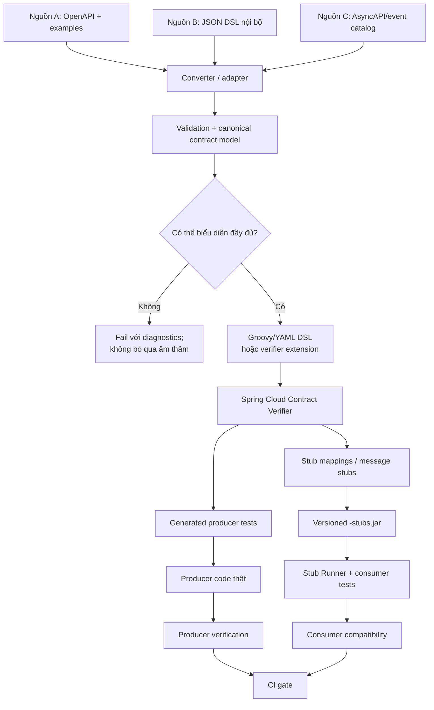
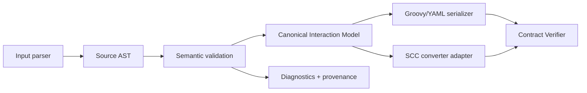
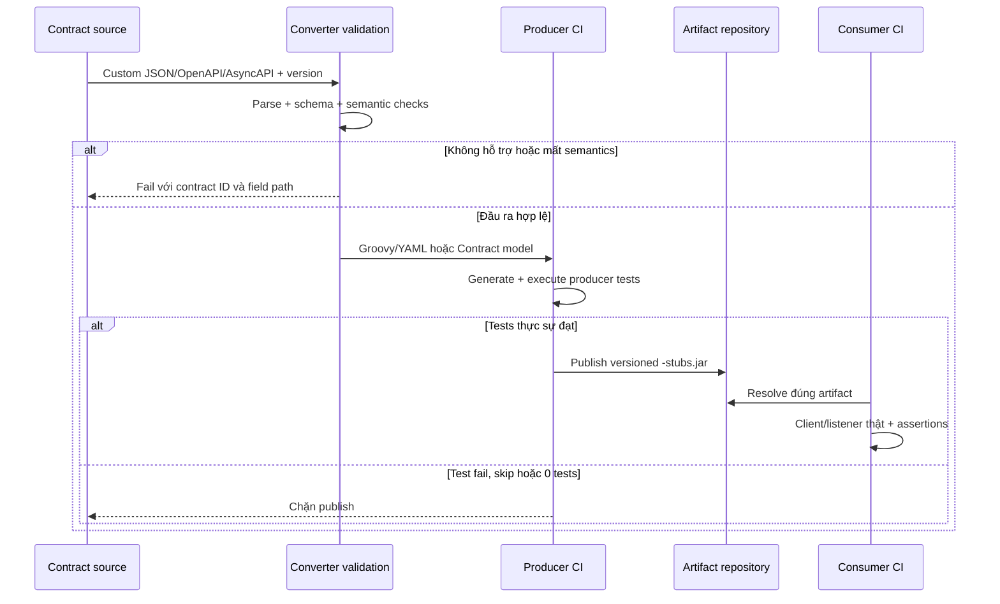

# Biến đổi hợp đồng và bổ sung định dạng nguồn

## 1. Khi Groovy/YAML chưa phải định dạng nguồn duy nhất

Trong **Spring Cloud Contract**, producer và consumer xác định những hành vi HTTP hoặc thông điệp mà hai phía phải tuân thủ. Các hợp đồng thường được viết bằng **Groovy DSL** hoặc **YAML DSL**; Verifier dùng chúng để sinh kiểm thử phía producer, tạo stub, rồi consumer dùng **Stub Runner** cùng CI để phát hiện thay đổi API không tương thích.

Thực tế một tổ chức có thể đã dùng các nguồn giao diện khác:

- Tài liệu **OpenAPI** mô tả endpoint, request, response và JSON Schema.
- **AsyncAPI** hoặc event catalog mô tả messages, channels và schemas.
- Một định dạng **JSON/YAML nội bộ** tích hợp với kho API của tổ chức.
- Hợp đồng từ một **hệ thống consumer-driven contract** khác.
- Những test cases được quản lý trong một registry có version và ownership.

Khi đó câu hỏi không đơn thuần là “đọc thêm đuôi file nào?”. Một phần mềm chuyển đổi phải giữ đúng **request matcher, response status/headers/body, trạng thái producer, dynamic values và message semantics** để generated producer tests và stub thực sự bảo vệ consumer.

Bài này thuộc chương **Tùy biến và mở rộng** và tập trung vào hai chiến lược:

1. **Chuyển đổi ngoại tuyến (preprocessing)**: định dạng nguồn tùy biến → contract Groovy/YAML được Spring Cloud Contract hỗ trợ.
2. **Tích hợp converter/extension point**: để pipeline Spring Cloud Contract nhận định dạng mới thông qua cơ chế mở rộng mà **phiên bản đang dùng** hỗ trợ.

Mục tiêu cuối cùng không phải tạo thêm nhiều định dạng. Mục tiêu là **không đổi ý nghĩa giao kèo**, sinh test producer thật, đóng gói stub có thể truy vết và để client consumer thật xác minh được thay đổi tương thích hay không.

Sau bài học, bạn sẽ biết cách thiết kế mô hình trung gian, ánh xạ một kịch bản HTTP và message, chọn hướng tích hợp, tổ chức build, kiểm chứng converter bằng golden tests và mutation tests, rồi đưa vào CI có quality gate.

## 2. Ba khái niệm dễ bị đánh đồng

| Khái niệm | Ví dụ | Vai trò |
|---|---|---|
| **Định dạng nguồn** | OpenAPI, JSON nội bộ, AsyncAPI, Groovy DSL, YAML DSL | Nơi nhóm khai báo kỳ vọng |
| **Biểu diễn contract dùng để generate** | Các đối tượng contract/spec được Verifier nhận hoặc Groovy/YAML hợp lệ | Nguồn tạo generated tests và stubs |
| **Artifact/kết quả** | Generated Java tests, WireMock mappings, `-stubs.jar` | Dùng xác minh producer và chạy consumer |

**Biến đổi hợp đồng** là chuyển thông tin từ biểu diễn này sang biểu diễn khác, có thể chuẩn hóa hoặc bổ sung metadata. **Bổ sung định dạng nguồn** là giúp pipeline hiểu một kiểu file đầu vào mới. Hai việc liên quan nhưng không giống hệt:

- Chuyển đổi một file JSON nội bộ thành YAML DSL **không bắt buộc** sửa lõi Spring Cloud Contract.
- Viết một converter mở rộng trong runtime có thể đòi thay đổi classpath, service discovery, plugin lifecycle và deployment.
- Một OpenAPI document chỉ có schema **chưa chắc** chứa đủ producer state, example body, trigger method hoặc consumer-specific assertion để tạo contract tests hữu ích.

Một converter chạy thành công về mặt cú pháp nhưng **làm rơi error code hoặc đổi JSON number thành string** là lỗi tương thích, không phải “thành công”.

### 2.1. Mục đích nào **không** thuộc phạm vi converter?

Converter không thay thế:

- Việc thống nhất semantics giữa producer và consumer.
- Code producer hoặc message publisher thực.
- Base class, fixture và test infrastructure của generated producer tests.
- HTTP client/listener của consumer.
- Chính sách release, versioning, review và deprecation.

Nó chỉ giúp đưa **một mô tả hợp đồng đã thỏa thuận** vào đường đi mà Spring Cloud Contract có thể hiểu và kiểm tra.

## 3. Kiến trúc tổng quát: nguồn → chuẩn hóa → xác minh



**Thứ tự đáng tin cậy:**

1. Parse nguồn và kiểm tra version của định dạng.
2. Đọc từng interaction có ID ổn định.
3. Chuẩn hóa **đúng kiểu dữ liệu và semantics**.
4. Từ chối trường không được hỗ trợ nhưng ảnh hưởng hợp đồng.
5. Render thành dạng Verifier hiểu, hoặc cung cấp contract objects qua extension.
6. Sinh và **thực thi** producer tests; không chỉ sinh file.
7. Đóng gói stub đúng artifact/version sau khi verification đạt.
8. Chạy consumer client/listener thật bằng stub tương ứng.

### 3.1. Hai đường tích hợp khác nhau

```text
Hướng A — Converter ngoại tuyến:
  source/*.order-contract.json
       |
       | preprocessor của dự án
       v
  target/generated-contracts/*.yml
       |
       | Verifier đọc contractsDirectory
       v
  tests + stubs

Hướng B — Runtime extension:
  source/*.order-contract.json
       |
       | custom converter được Verifier/plugin load
       v
  Contract model nội bộ
       |
       v
  tests + stubs
```

Hướng A thường dễ kiểm soát hơn vì có **đầu ra trung gian đọc được** và ranh giới build rõ. Hướng B thuận tiện khi nhiều module cần nhận file nguồn trực tiếp, nhưng phụ thuộc nhiều hơn vào API/SPI và classpath của Spring Cloud Contract trong phiên bản cụ thể.

## 4. Xác định chuẩn đầu vào trước khi viết converter

Không nên bắt đầu bằng một parser chấp nhận “JSON bất kỳ”. Hãy xác định một định dạng nguồn có version, contract ID và quy tắc rõ ràng.

### 4.1. Đề xuất cấu trúc nguồn JSON nội bộ

File minh họa `src/contract-input/orders/get-paid-order.order-contract.json`:

```json
{
  "formatVersion": 1,
  "id": "ORD-GET-PAID-001",
  "description": "Checkout lấy đơn hàng đã thanh toán",
  "protocol": "http",
  "producer": "order-service",
  "consumer": "checkout-service",
  "given": {
    "fixture": "order-42-paid"
  },
  "request": {
    "method": "GET",
    "path": "/api/orders/42",
    "headers": {
      "Accept": "application/json"
    }
  },
  "response": {
    "status": 200,
    "headers": {
      "Content-Type": "application/json"
    },
    "body": {
      "id": 42,
      "state": "PAID",
      "currency": "VND"
    }
  }
}
```

Đây là **định dạng do bài học tự định nghĩa để minh họa**; `formatVersion`, `given.fixture` và `protocol` **không phải** những property Spring Cloud Contract tự hiểu. Converter phải định nghĩa:

- `id` là ID stable dùng truy vết, không phải một HTTP header.
- `given.fixture` là yêu cầu tạo trạng thái producer trong base test hoặc fixture harness, **không tự biến thành dữ liệu database**.
- `request` và `response` là thông tin giao diện cần đưa vào DSL.
- `formatVersion` dùng kiểm soát thay đổi schema converter.
- `producer`/`consumer` hỗ trợ ownership, versioning và diagnostics; không nhất thiết thuộc DSL output.

### 4.2. Vì sao tách `source` khỏi generated files?

```text
order-service/
├── src/
│   ├── contract-input/
│   │   └── orders/get-paid-order.order-contract.json
│   └── test/
│       ├── java/com/example/orders/contract/
│       │   └── OrderContractBase.java
│       └── resources/
│           └── contract-fixtures/
└── target/
    └── generated-contracts/
        └── http/orders/get-paid-order.yml
```

Đây là cách bố trí **minh họa với Maven**. File nguồn thuộc version control; output có thể được tái tạo từ source trong build và **không sửa bằng tay**. Khi dùng Gradle, output tương đương thường nằm dưới `build/`.

Nếu output là thư mục `target/`, bước chuyển đổi phải chạy **sau clean và trước goal của Contract Verifier đọc contractsDirectory**. Nếu không, build sạch có thể xóa hết YAML rồi Verifier không tìm thấy contract nào.

### 4.3. Tập yêu cầu tối thiểu của định dạng mới

| Nhóm | Bắt buộc xác định | Ví dụ |
|---|---|---|
| Version nguồn | Schema đầu vào, compatibility của converter | `formatVersion: 1` |
| Identity | Stable ID và nguồn tham chiếu | `ORD-GET-PAID-001` |
| Protocol | HTTP hay message | `http` |
| Request matcher | Method/path/query/header/body | `GET /api/orders/42` |
| Expected outcome | Status/headers/body hoặc destination/message | `200` + JSON |
| Producer state | Fixture/trigger cần để test tái lập | `order-42-paid` |
| Data types | number/string/boolean/null/list/object | `id: 42` number |
| Dynamic value policy | Matcher, sample stub, type/format | UUID hoặc timestamp nếu cần |
| Consumer dependency | Field/error/status mà client dựa vào | `state=PAID` |
| Diagnostics | File/line/contract ID và lý do không hỗ trợ | “missing response.status” |

Không nhất thiết mọi contract đều dùng tất cả nhóm trên; ví dụ outbound message không có HTTP status. Nhưng converter phải **biết nhóm nào là cần thiết cho từng loại interaction**.

## 5. Ánh xạ JSON nguồn sang Spring Cloud Contract YAML DSL

Với input mục 4, một file YAML DSL đầu ra có thể là:

```yaml
description: Checkout lấy đơn hàng đã thanh toán
request:
  method: GET
  url: /api/orders/42
  headers:
    Accept: application/json
response:
  status: 200
  headers:
    Content-Type: application/json
  body:
    id: 42
    state: PAID
    currency: VND
```

**Đây là YAML DSL được Verifier dùng như nguồn contract**, khác với JSON nội bộ chứa `formatVersion` và `given.fixture`. Converter phải **lọc hoặc ánh xạ metadata riêng**, không thêm các key chưa được SCC DSL hỗ trợ vào YAML rồi giả định Verifier sẽ bỏ qua chúng.

### 5.1. Bảng ánh xạ cơ bản

| JSON nội bộ | YAML DSL | Ghi chú |
|---|---|---|
| `description` | `description` | Giữ ngữ nghĩa mô tả |
| `request.method` | `request.method` | Không đổi GET/POST... |
| `request.path` | `request.url` | Khi path là URL exact |
| `request.headers` | `request.headers` | Header names/case được HTTP xử lý phù hợp |
| `request.query` | `request.queryParameters` khi thích hợp | Phân biệt query lặp và query comma-separated |
| `request.body` | `request.body` | Bảo toàn JSON types |
| `response.status` | `response.status` | Giữ đúng status và semantics |
| `response.headers` | `response.headers` | Đặc biệt Content-Type/Location |
| `response.body` | `response.body` | Không ép number thành string |
| `given.fixture` | Base test/fixture resolver của dự án | Không có phép ánh xạ tự động sang database |
| `id`, `producer`, `consumer` | Tên file/metadata ngoài contract | Dùng traceability và ownership |

Một mapping table **không phải** bằng chứng rằng converter đã đúng. Cần kiểm tra output YAML/Groovy, generated test và stub để chắc chắn header/query matcher thực sự giữ đúng semantics.

### 5.2. Cách kiểm tra output đơn giản

Với contract mẫu:

```text
Input  : id=42(number), state="PAID"(string), status=200
Output : id=42(number), state="PAID"(string), status=200
Assert : JSON body đủ các field consumer phụ thuộc
```

Những lỗi không được phép chấp nhận:

```text
Sai: id: "42"         # đổi number thành string
Sai: state: ".*"      # bỏ ràng buộc business value
Sai: status: 201      # đổi 200 thành 201
Sai: request.url: /api/orders
                        # rơi mất path /42
Sai: thiếu Content-Type nếu client cần JSON decoder
```

Để phát hiện sai sót, so sánh **mô hình ngữ nghĩa** của source và output, không chỉ so sánh hai chuỗi text có thứ tự key khác nhau.

## 6. Groovy DSL: đầu ra tương đương khi cần logic biểu đạt phong phú

Một biểu diễn Groovy cho cùng tương tác:

```groovy
import org.springframework.cloud.contract.spec.Contract

Contract.make {
    description 'Checkout lấy đơn hàng đã thanh toán'

    request {
        method GET()
        url '/api/orders/42'
        headers {
            header 'Accept', 'application/json'
        }
    }

    response {
        status OK()
        headers {
            contentType(applicationJson())
        }
        body(
            id: 42,
            state: 'PAID',
            currency: 'VND'
        )
    }
}
```

**Không sinh cả Groovy và YAML cho cùng request predicate trong cùng tập contract**, trừ khi tổ chức có cơ chế chống trùng/định tuyến rõ ràng. Hai mappings đều khớp `GET /api/orders/42` có thể tạo response không ổn định khi một bản thay đổi.

### 6.1. Nên chọn Groovy hay YAML làm đích?

| Tiêu chí | Groovy DSL | YAML DSL |
|---|---|---|
| Người đọc quen code | Dễ dùng helper/matcher Groovy | Cần xem cấu trúc YAML |
| Tự sinh bằng máy | Cần escaping/cú pháp Groovy an toàn | Dễ serialize thành cây dữ liệu |
| Dữ liệu nested/list | Biểu đạt được | Biểu đạt tự nhiên |
| Dữ liệu động/matcher phức tạp | Có nhiều helper DSL | Có DSL matcher riêng theo version |
| Review diff | Có thể gọn nếu quy ước tốt | Dễ nhận ra thay đổi trường |
| Bảo mật khi nhận input không tin cậy | Không được đưa text tùy ý vào Groovy executable | Cũng phải validate input, nhưng không nên sinh code thực thi |

Nếu nguồn mới là dữ liệu có cấu trúc do hệ thống khác sinh, **YAML DSL thường dễ làm output trung gian** hơn; nhưng vẫn phải kiểm tra khả năng biểu đạt các matcher/dynamic values. Không tự động chèn raw input vào Groovy source mà không escape/validate vì Groovy có thể thực thi code ở thời điểm parse/evaluate.

## 7. Không làm mất kiểu dữ liệu, điều kiện request hoặc nhánh lỗi

Một converter có thể tạo file YAML đúng cú pháp nhưng sai hợp đồng. Các lỗi thường xuất hiện khi chuẩn hóa dữ liệu mà không phân biệt **semantic**:

| Input | Kỳ vọng cần bảo toàn | Lỗi chuyển đổi dễ mắc |
|---|---|---|
| `"id": 42` | JSON number | Ghi thành string `"42"` |
| `"active": false` | JSON boolean false | Ghi thành string `"false"` |
| `"items": []` | Mảng rỗng | Đổi thành `null` hoặc bỏ field |
| `"deliveryDate": null` | Có field với giá trị null | Xóa property khỏi response |
| Không có `deliveryDate` | Property vắng mặt | Tự thêm property null |
| `state=PAID` | Exact business enum | Biến thành wildcard `.*` |
| Hai query keys `tag=a&tag=b` | Hai giá trị cùng tên | Ghép thành `tag=a,b` |
| `Content-Type: application/json` | Client dùng JSON decoder | Bỏ header |
| `404 + ORDER_NOT_FOUND` | Business error | Bỏ body, chỉ giữ status |
| `POST 201 + Location` | Consumer điều hướng theo Location | Chỉ giữ body |
| JSON array có thứ tự | Thứ tự có ý nghĩa nếu API cam kết | Sắp xếp lại tự động |
| Header định danh tenant | Routing/authorization | Bỏ vì tưởng là metadata |

### 7.1. JSON number không phải lúc nào cũng là `double`

Khi input parser đưa mọi số về floating-point, mã `9007199254740993` có thể mất chính xác ở những môi trường dùng IEEE-754 double. ID dài nên được xử lý bằng kiểu số thích hợp hoặc string nếu **hợp đồng nguồn thực sự quy định string**. Converter không được tự đổi type mà không có quyết định từ API owner và consumer.

Với `BigDecimal`, cần làm rõ hành vi hiển thị và so sánh nếu số tiền có scale. `10.00` và `10` có thể tương đương về giá trị số nhưng một serializer/client hoặc rule nghiệp vụ có thể phụ thuộc vào cách biểu diễn. Không tự chuẩn hóa theo ý thích rồi gọi đó là “chỉ format”.

### 7.2. Missing, null, empty string và empty array

Các response:

```json
{"items":[]}
```

```json
{"items":null}
```

```json
{}
```

không tương đương với mọi consumer. Một DTO/validator có thể phân biệt cả ba. Trong bước biến đổi, phải giữ **sự hiện diện của key** và type của value; không nên loại bỏ tất cả `null` bằng một “cleanup” mặc định.

### 7.3. Tên header không đồng nghĩa phải khóa chữ hoa/chữ thường

HTTP header names không phân biệt chữ hoa/chữ thường theo giao thức, nhưng **giá trị header** có thể mang semantics riêng. Nếu consumer dựa vào `X-Tenant-Id`, converter phải giữ điều kiện; không được tự bỏ header đó khi tạo stub. Khi so sánh output, có thể canonicalize **tên header** để tránh false diff, nhưng phải tránh đổi giá trị và quy tắc matching đã cam kết.

## 8. Request matching: path, query, body và pattern

Khi nguồn mô tả:

```text
GET /api/orders?state=PAID&limit=20
Accept: application/json
```

converter cần biết `state` và `limit` là **query parameters**, không phải phần của path hay request body. Một YAML DSL ví dụ:

```yaml
description: Lọc đơn đã thanh toán
request:
  method: GET
  urlPath: /api/orders
  queryParameters:
    state: PAID
    limit: "20"
  headers:
    Accept: application/json
response:
  status: 200
  headers:
    Content-Type: application/json
  body:
    - id: 42
      state: PAID
      currency: VND
```

**Lưu ý cú pháp:** hãy đối chiếu output thực với **DSL parser và WireMock mapping được sinh bởi phiên bản Spring Cloud Contract đang chạy**. Các cấu trúc query nhiều giá trị, matcher và escaping URL có thể có những yêu cầu chi tiết tùy phiên bản.

### 8.1. Exact path và path template

Nguồn có thể ghi:

```text
Path template: /api/orders/{id}
Example id   : 42
Matcher      : id phải là số nguyên dương
```

Chỉ thay `{id}` bằng `.*` trong regex có thể khiến stub nhận cả đường dẫn không hợp lệ. Ngược lại, chỉ sinh `/api/orders/42` có thể quá hẹp nếu consumer test cần nhiều giá trị. Cần quy tắc tường minh:

1. **Example** để stub trả body cụ thể.
2. **Matcher** để Verifier/WireMock nhận các request hợp lệ.
3. **Producer-side assertion** kiểm tra route/controller với những giá trị representative/boundary phù hợp.
4. **Consumer behavior** kiểm tra client encode path parameter đúng.

Không đánh đồng “OpenAPI có `{id}`” với “đã có đủ matcher, fixture và producer test cho mọi ID”.

### 8.2. Body matcher không chỉ là JSON example

Với `POST /api/orders`:

```json
{
  "sku": "BOOK-1",
  "quantity": 2
}
```

Một consumer có thể gửi nhiều `sku` hợp lệ. Nếu contract source có quy tắc `sku` là string nonempty và `quantity` là số nguyên dương, converter cần phân biệt:

- **Example payload**: giá trị được sử dụng để sinh stub/test.
- **Request matcher**: ràng buộc dữ liệu consumer được phép gửi.
- **Validation branch**: khi `quantity=0`, producer trả `400 INVALID_QUANTITY`.

Một contract chỉ có success response không tự bao phủ validation. Converter không được tự bịa tất cả nhánh lỗi từ một JSON Schema; hãy tạo interactions có **kỳ vọng được producer và consumer đồng ý**.

### 8.3. Matchers phải giữ được khả năng bắt lỗi

Một thiết kế matcher hợp lý:

| Field | Ngữ nghĩa | Quy tắc gợi ý |
|---|---|---|
| `id` | Số định danh | Kiểm tra type/format và ví dụ ổn định |
| `state` | Trạng thái được consumer dùng | Exact `PAID` cho kịch bản tương ứng |
| `eventId` | ID biến động | Matcher UUID/format nếu API hứa như vậy |
| `createdAt` | Timestamp biến động | Matcher ISO-8601 hoặc time policy có chủ đích |
| `traceId` | Quan sát hệ thống | Không khóa giá trị cố định nếu không phải contract |

Trong Groovy DSL, một dạng response-side matcher thường gặp là:

```groovy
response {
    status OK()
    body(
        id: 42,
        state: 'PAID',
        currency: 'VND'
    )
    bodyMatchers {
        jsonPath('$.id', byType())
    }
}
```

**Giới hạn của đoạn minh họa:** chỉ thể hiện ý tưởng kiểm tra kiểu của `id`; tên helper và cách sinh matcher phía producer/stub cần được xác minh bằng generated test của version cụ thể. Nếu consumer cần đúng `id=42`, dùng `byType()` đơn lẻ có thể làm yếu assertion so với exact value. Không thay matcher chỉ để tránh test fail.

## 9. Ví dụ nhánh lỗi: converter không được chỉ giữ happy path

Nguồn JSON nội bộ mô tả lỗi:

```json
{
  "formatVersion": 1,
  "id": "ORD-NOT-FOUND-001",
  "protocol": "http",
  "description": "Không tìm thấy đơn hàng",
  "request": {
    "method": "GET",
    "path": "/api/orders/9999",
    "headers": {
      "Accept": "application/json"
    }
  },
  "response": {
    "status": 404,
    "headers": {
      "Content-Type": "application/json"
    },
    "body": {
      "code": "ORDER_NOT_FOUND",
      "message": "Order does not exist"
    }
  }
}
```

YAML DSL output:

```yaml
description: Không tìm thấy đơn hàng
request:
  method: GET
  url: /api/orders/9999
  headers:
    Accept: application/json
response:
  status: 404
  headers:
    Content-Type: application/json
  body:
    code: ORDER_NOT_FOUND
    message: Order does not exist
```

**Không** biến `404` thành mặc định cho mọi request không có mapping. WireMock có thể trả unmatched `404` khi client gọi sai path; consumer test chỉ assert status có thể pass giả. Hợp đồng cần **business error code** và request predicate đủ rõ để phân biệt lỗi nghiệp vụ với lỗi không khớp mapping.

### 9.1. Converter phải giữ dấu vết các nhánh

Ví dụ một API có `200`, `404`, `400` tùy input/state. Một entry OpenAPI `responses` có thể liệt kê ba mã trạng thái, nhưng không nhất thiết chứa **sample request/state cụ thể** để sinh ba producer tests hữu ích.

Quy tắc chuyển đổi an toàn:

1. Tạo từng **interaction case** riêng từ ví dụ/request-condition đã được thỏa thuận.
2. Nếu thiếu producer state cho `404` hoặc `409`, báo lỗi/đánh dấu cần bổ sung, không tự giả định DB trống.
3. Không tạo hai WireMock mappings cùng match request nhưng trả response khác nhau mà không có discriminator hoặc scenario rõ.
4. Ghi những trường không thể tự map vào diagnostic report để owner quyết định.

## 10. Message contracts: bổ sung định dạng nguồn phức tạp hơn HTTP

Nguồn event catalog có thể định nghĩa:

```json
{
  "formatVersion": 1,
  "id": "EVT-ORDER-PAID-001",
  "protocol": "message",
  "producer": "order-service",
  "description": "OrderPaid được phát sau thanh toán",
  "trigger": "publishPaidOrderForContract()",
  "output": {
    "destination": "orders.paid",
    "headers": {
      "eventType": "OrderPaid"
    },
    "body": {
      "eventId": "EVT-42",
      "orderId": 42,
      "state": "PAID"
    }
  }
}
```

Một Groovy contract tương ứng:

```groovy
import org.springframework.cloud.contract.spec.Contract

Contract.make {
    description 'OrderPaid được phát sau thanh toán'
    label 'order_paid'

    input {
        triggeredBy('publishPaidOrderForContract()')
    }

    outputMessage {
        sentTo('orders.paid')
        headers {
            header('eventType', 'OrderPaid')
        }
        body(
            eventId: 'EVT-42',
            orderId: 42,
            state: 'PAID'
        )
    }
}
```

`triggeredBy(...)` chỉ là tên method ở producer **base test** cần tồn tại để kích hoạt business flow phát message. Converter không tự tạo implementation của method đó, test binder, Kafka topic, RabbitMQ queue hay transaction handling. Nếu source chỉ có AsyncAPI channel/schema mà **không biết trigger hoặc điều kiện sinh event**, bạn phải bổ sung test fixture/trigger rõ ràng trước khi công nhận generated producer verification.

### 10.1. Khi chuyển AsyncAPI/event spec

| Thông tin nguồn | Đích có thể ánh xạ | Lưu ý |
|---|---|---|
| Channel/destination | `sentTo(...)` hoặc source message tùy hướng | Xác định producer/consumer của sự kiện |
| Message headers | `outputMessage.headers` | Không bỏ `eventType`/correlation nếu consumer dùng |
| Message payload example | `outputMessage.body` | Giữ JSON type và nested object/list |
| Trigger/cause | `triggeredBy(...)` hoặc inbound message setup | Không phải lúc nào spec nguồn cũng mô tả |
| Message key/partition | Metadata/adapter-specific mapping nếu hỗ trợ | Không được âm thầm bỏ nếu consumer phụ thuộc ordering |
| Retry/duplicate/idempotency | Consumer workflow test riêng | Một message contract không tự chứng minh exactly-once |
| Serialization (JSON/Avro) | Adapter/codec phù hợp | Không đánh đồng JSON example với Avro wire format |

**Đừng dùng WireMock HTTP standalone để chứng minh message contract đã hoạt động**. Messaging cần message verifier/test binder/adapter hoặc broker test environment phù hợp; consumer phải chạy listener và kiểm tra behavior thật.

### 10.2. Một format mới có thể chỉ hỗ trợ một phần giao diện

Converter v1 có thể hỗ trợ **HTTP request/response example** nhưng chưa hỗ trợ:

- Inbound message tạo outbound message.
- Dynamic `bodyMatchers`.
- Multipart upload.
- Stateful scenarios.
- Avro/Protobuf binary payload.
- Request streaming hoặc Server-Sent Events.

Đây không nhất thiết là lỗi kiến trúc nếu **phạm vi hỗ trợ được công bố và kiểm soát**. Nhưng khi input chứa một tính năng chưa hỗ trợ, phải **fail với thông báo rõ ràng** thay vì bỏ trường đó rồi trả về contract ít ràng buộc hơn.

## 11. Thiết kế canonical model để giảm phụ thuộc định dạng

Một adapter bền vững không nên trộn logic parse JSON, chuẩn hóa schema, chọn matcher và viết YAML trong cùng một method khổng lồ.



Một mô hình **khái niệm của dự án** (không phải API Spring Cloud Contract):

```java
// Pseudocode mô hình domain của converter, không phải SCC public API.
record HttpInteraction(
    String id,
    String description,
    String method,
    String path,
    Map<String, Object> requestHeaders,
    Map<String, Object> queryParameters,
    Object requestBody,
    int responseStatus,
    Map<String, Object> responseHeaders,
    Object responseBody,
    String fixtureRef
) {}

record MessageInteraction(
    String id,
    String destination,
    Map<String, Object> headers,
    Object body,
    String producerTrigger
) {}
```

Mục tiêu:

1. **Parser** chịu trách nhiệm syntax, schema version và nguồn file.
2. **Semantic validator** đảm bảo đủ method/path/status, không có kiểu không hỗ trợ và không mất matcher.
3. **Canonical model** giữ các interaction và metadata cần thiết.
4. **Renderer/adapter** chuyển sang YAML/Groovy hoặc đối tượng contract tương ứng của Verifier.
5. **Diagnostics** chỉ rõ source file, contract ID, field path và nguyên nhân lỗi.

Không tự đặt tên model nội bộ là `org.springframework.cloud.contract.spec.Contract` khi nó không phải lớp thực từ thư viện; phân biệt rõ **domain model của converter** với **SCC contract model** để giảm nhầm lẫn.

## 12. Chiến lược A: converter ngoại tuyến trước bước generate

Đây là phương án thường dễ triển khai và kiểm soát nhất khi muốn biến một định dạng nội bộ thành Groovy/YAML.

### 12.1. Workflow đề xuất

```text
Version-controlled source:
  src/contract-input/*.order-contract.json
              |
              v
Validate schema v1 + semantic fields
              |
              v
Generate deterministic YAML files:
  target/generated-contracts/**/*.yml
              |
              v
Spring Cloud Contract Verifier
  contractsDirectory = target/generated-contracts
              |
              +-- generated producer tests
              '-- WireMock/messaging stub resources
```

**Chú ý:** `target/generated-contracts` là output build, **không phải** thư mục nguồn. Sau `mvn clean`, bước converter phải tạo lại chúng **trước khi plugin Verifier tìm kiếm hợp đồng**. Nếu các task/goal chạy sai thứ tự, build có thể pass với **0 contracts**.

### 12.2. Pseudocode chuyển đổi một file

```text
convert(sourceFile):
    doc = parseStrict(sourceFile)
    require doc.formatVersion == 1
    require unique(doc.id)
    require doc.protocol in {"http", "message"}

    validateSchema(doc)
    validateSemanticRequirements(doc)
    validateFixtureReference(doc.given.fixture if present)

    interaction = normalizeToCanonicalModel(doc)
    failIfUnsupportedFeatures(interaction)

    output = serializeToSccYamlOrGroovy(interaction)
    parseOutputWithTargetContractParser(output)
    compareSemantics(interaction, output)

    writeDeterministically(output, byContractId(doc.id))
    reportMapping(sourceFile, doc.id, output.path)
```

**Pseudocode này không phải CLI hay API có sẵn.** Dự án phải triển khai các functions và bài test converter tương ứng; đặc biệt `validateFixtureReference` yêu cầu có registry hoặc thỏa thuận fixture ở producer base test, không được ngầm bỏ metadata `given`.

### 12.3. Một quy tắc fail-fast cụ thể

Giả sử source có:

```json
{
  "formatVersion": 2,
  "id": "ORD-GET-PAID-001",
  "protocol": "http",
  "request": {
    "method": "GET",
    "path": "/api/orders/42"
  },
  "response": {
    "status": 200
  }
}
```

Nếu converter chỉ hỗ trợ `formatVersion=1`, **phải từ chối** input này hoặc dùng logic migration v2 đã kiểm chứng. Không mặc nhiên bỏ các field v2 không nhận biết rồi sinh một contract success quá yếu.

Diagnostic tốt:

```text
CONTRACT_CONVERSION_FAILED
source : src/contract-input/orders/get-paid-order.order-contract.json
id     : ORD-GET-PAID-001
field  : $.formatVersion
reason : Unsupported version 2; supported versions: [1]
output : no contract generated
```

Một log chỉ ghi “parse error” mà không có file/ID/path khiến việc vận hành converter trên hàng trăm contracts khó khăn và dễ bỏ qua.

## 13. Chiến lược B: dùng extension point của Spring Cloud Contract

Spring Cloud Contract có cơ chế mở rộng để tùy biến cách đọc/biểu diễn các hợp đồng; trong các nhánh phiên bản có **contract converter SPI** (thường được nhắc tới với tên **`ContractConverter`**). **Tên package, chữ ký interface, kiểu đầu ra, cách đăng ký và cách classpath được nạp có thể thay đổi theo phiên bản**. Vì vậy, trước khi implement, phải kiểm tra **source/API/documentation của chính artifact Spring Cloud Contract đang dùng**, thay vì sao chép một interface từ ví dụ thuộc release khác.

Điều cần hiểu về mặt kiến trúc:

```text
Converter adapter của tổ chức
  - nhận diện định dạng nguồn của mình
  - parse thành các contract interactions
  - chuyển thành model mà Verifier version hiện tại hỗ trợ
  - tham gia cơ chế discover/register của plugin
  - báo lỗi rõ khi input không thể biểu diễn
```

Khi dùng SPI thực, hãy xác minh những câu hỏi:

1. Converter cần nhận **File, Path, InputStream** hay một model khác?
2. Một file đầu vào có được tạo **nhiều Contract objects** không?
3. Phải implement những thao tác chiều **source → contract** hay cả chiều **contract → source**?
4. Cơ chế discovery là service loader, configuration property hay plugin-specific hook?
5. Classpath nào chứa converter lúc **Maven/Gradle plugin generate tests**?
6. Có hỗ trợ định dạng file có đuôi custom không, và ưu tiên giữa các converters ra sao?
7. Phần nào của API là public/stable và phần nào là internal có thể đổi trong nâng cấp?

**Không nên phát hành converter vào production application chỉ để phục vụ build/test.** Tốt nhất giữ adapter ở **build/test tooling classpath** nếu nó không cần cho runtime nghiệp vụ.

### 13.1. Bản thiết kế adapter ở mức khái niệm

Mã sau mô tả trách nhiệm nội bộ, **không phải chữ ký SPI có thể biên dịch trực tiếp**:

```java
// Pseudocode: OrganizationSourceAdapter là API do dự án tự định nghĩa.
final class OrganizationSourceAdapter {

    boolean accepts(Path file) {
        return file.getFileName().toString()
            .endsWith(".order-contract.json");
    }

    List<CanonicalInteraction> parseAndValidate(Path file) {
        // 1. Validate formatVersion/required fields.
        // 2. Reject unknown semantic fields.
        // 3. Preserve JSON number/string/null/array.
        // 4. Resolve fixture/trigger metadata explicitly.
        // 5. Return one or more canonical interactions.
        throw new UnsupportedOperationException("Implementation required");
    }

    List<?> toVerifierContracts(
            List<CanonicalInteraction> interactions) {
        // Chuyển từ model dự án sang Contract API
        // của đúng Spring Cloud Contract version.
        throw new UnsupportedOperationException("Version-specific adapter");
    }
}
```

Các interface `CanonicalInteraction`/`OrganizationSourceAdapter` là **tên minh họa của dự án**, không phải package/class sẵn có. Không sao chép class trên như một plugin hoàn chỉnh; mục đích là thấy rõ ranh giới giữa parse/validate và lớp adapter phụ thuộc thư viện.

### 13.2. Converter JAR thuộc classpath nào?

Trong Maven, converter dùng cho plugin thường cần **truy cập được từ classpath/plugin realm của Maven plugin**, không chỉ thêm vào dependency ứng dụng dưới `<dependencies>`.

Ví dụ **sơ đồ POM có placeholder**:

```xml
<plugin>
    <groupId>org.springframework.cloud</groupId>
    <artifactId>spring-cloud-contract-maven-plugin</artifactId>
    <version>REPLACE_WITH_COMPATIBLE_CONTRACT_VERSION</version>
    <extensions>true</extensions>
    <dependencies>
        <dependency>
            <groupId>com.example.build</groupId>
            <artifactId>organization-contract-converter</artifactId>
            <version>REPLACE_WITH_CONVERTER_VERSION</version>
        </dependency>
    </dependencies>
</plugin>
```

Đoạn này chỉ minh họa việc đặt artifact converter vào **plugin dependencies**. Nó **không tự bảo đảm** custom format được hỗ trợ hoặc converter sẽ được discover. Còn phải đăng ký extension theo cơ chế hỗ trợ của phiên bản và kiểm tra plugin log cho thấy converter thật sự được dùng.

Trong Gradle, các build plugins/test generation tasks cũng có **classpath và configurations riêng**. Thêm thư viện converter vào `implementation` của production module không có nghĩa Gradle task generate contracts nhận được nó. Cần tích hợp theo configuration/plugin API được hỗ trợ và xác minh bằng generated outputs.

### 13.3. Đăng ký discovery an toàn

Một số extension mechanisms dựa trên **Java ServiceLoader** với descriptor `META-INF/services/<fully-qualified-interface>`. Nếu version đang dùng thực sự hỗ trợ kiểu đó, descriptor phải trỏ tới implementation đúng FQN và JAR phải nằm trên classpath nơi Verifier load service.

**Không tự suy ra tên descriptor hay method từ ví dụ này**. Hãy kiểm tra artifact và contract của phiên bản, tạo integration test để chứng minh một file `.order-contract.json` được adapter nhận diện, rồi kiểm tra generated producer test tương ứng. Nếu không có SPI phù hợp, **quay về phương án preprocessing** là lựa chọn ổn định hơn cố sửa class nội bộ của plugin.

### 13.4. Ưu nhược điểm của hai chiến lược

| Tiêu chí | Preprocessor → Groovy/YAML | Converter tích hợp vào Verifier |
|---|---|---|
| Phụ thuộc SCC internals | Thấp nếu output là DSL được hỗ trợ | Cao hơn, cần theo SPI/version |
| Đầu ra trung gian review được | **Có** | Tùy thiết kế adapter |
| CI task ordering | Phải gắn bước trước generator | Ít bước bên ngoài, nhưng cần discovery đúng |
| Dễ debug parser | Có thể so sánh input/output file | Cần log và tool chạy adapter riêng |
| Chạy nhiều modules | Dùng chung CLI/library | Dùng chung converter JAR, classpath đúng |
| Nâng Spring Cloud Contract | Kiểm tra DSL compat | Kiểm tra cả SPI/API compatibility |
| Tính di động giữa build tools | Tương đối dễ | Phụ thuộc đường tích hợp plugin |
| Khả năng “fail âm thầm” | Nếu preprocessor bỏ file | Nếu converter không được discover/accept |

**Gợi ý thực tế:** khởi đầu bằng preprocessor cho một định dạng nguồn mới nếu team cần quan sát/kiểm soát rõ ràng. Chỉ chọn SPI khi có lợi ích cụ thể và team sẵn sàng duy trì adapter theo phiên bản.

## 14. Tích hợp với Maven: thứ tự build là một phần của hợp đồng

Giả sử file source thuộc `src/contract-input` và preprocessor ghi YAML vào `target/generated-contracts`. Producer Maven Plugin cần đọc **đúng output ấy**.

Một đoạn POM minh họa:

```xml
<properties>
    <spring-cloud-contract.version>
        REPLACE_WITH_COMPATIBLE_VERSION
    </spring-cloud-contract.version>
</properties>

<build>
    <plugins>
        <plugin>
            <groupId>org.springframework.cloud</groupId>
            <artifactId>spring-cloud-contract-maven-plugin</artifactId>
            <version>${spring-cloud-contract.version}</version>
            <extensions>true</extensions>
            <configuration>
                <contractsDirectory>
                    ${project.build.directory}/generated-contracts
                </contractsDirectory>
                <baseClassForTests>
                    com.example.orders.contract.OrderContractBase
                </baseClassForTests>
                <testFramework>JUNIT5</testFramework>
                <testMode>MOCKMVC</testMode>
            </configuration>
        </plugin>
    </plugins>
</build>
```

Đây là **đoạn POM giới thiệu đường dẫn**, không phải một build hoàn chỉnh. Bạn vẫn cần:

1. Công cụ preprocessor thực tế được build/resolve trong pipeline.
2. Một Maven execution/task **chạy sau `clean` và trước Verifier generate goal**; nếu dùng chung lifecycle phase, cần xác minh execution ordering, không đoán.
3. Thư viện Spring Boot Test/JUnit 5/Rest Assured MockMvc hoặc adapter phù hợp.
4. Base class với fixture `order-42-paid` được nạp.
5. CI kiểm tra có **ít nhất số interactions mong đợi** trong output/generator và report.
6. Một bước không publish stub nếu converter/generator/producer tests thất bại.

### 14.1. Tại sao không nên trỏ tới output của build trước?

```text
Sai:
  mvn clean verify
  (converter chỉ chạy sau verify)

Hậu quả:
  clean xóa target/generated-contracts
  verifier nhìn thấy thư mục rỗng
  generated test có thể = 0
  build vẫn có khả năng xanh do unit tests khác
```

Trình tự đúng:

```text
clean → convert contracts → validate outputs
      → generate contract tests → testCompile
      → execute generated producer tests
      → package versioned stubs → publish (nếu gate đạt)
```

Bạn có thể thực hiện bằng một Maven plugin execution chuyên dụng trước phase generate contract tests hoặc bằng một bước CI có thứ tự rõ và cùng workspace. **Đừng nhầm một lệnh shell mô tả luồng với một Maven goal đã có sẵn**; phải kiểm tra execution lifecycle thật.

### 14.2. Maven multi-module

Với reactor:

```text
commerce-parent/
├── order-service/
│   ├── src/contract-input/
│   └── pom.xml
└── checkout-service/
    └── pom.xml
```

`${project.basedir}` và `${project.build.directory}` là **theo module**. Nếu mỗi producer module dùng một converter execution, outputs phải nằm trong **build directory riêng của module**, tránh hai modules ghi cùng tên file trong một thư mục shared. Parent chỉ quản lý version/config, không nên vô tình chạy converter cho module không có contract.

Nếu nguồn contract ở repository riêng, pin revision trước khi chuyển đổi; không lấy `main` mới nhất không truy vết khi xây một release cũ.

## 15. Tích hợp với Gradle: task dependency và cache

Với Gradle, ý tưởng tương đương:

```text
contractInputFiles
     |
     v
convertOrganizationContracts   (task do dự án tạo)
     |
     v
generatedContractsDirectory
     |
     v
Spring Cloud Contract test generation task
     |
     v
test / contract verification / stub generation
```

Một **phác thảo Kotlin DSL**, không phải cấu hình đầy đủ có thể chạy ngay:

```kotlin
// Task này do dự án tự tạo; adapter cần có executable/dependencies.
val convertOrganizationContracts by tasks.registering {
    inputs.dir("src/contract-input")
    outputs.dir(layout.buildDirectory.dir("generated-contracts"))

    doLast {
        // Gọi converter riêng của dự án để sinh YAML DSL.
        // Không được coi dòng comment này là implementation.
    }
}

// Sau khi xác định đúng tên task generate của plugin/version:
// tasks.named("TASK_NAME_FROM_YOUR_PLUGIN") {
//     dependsOn(convertOrganizationContracts)
// }
```

**Lưu ý:** cần trỏ extension `contractsDslDir` hoặc cấu hình contracts source tương đương **theo phiên bản Gradle plugin**, và đặt task dependency đến **đúng test generation task thực tế**. Nếu task name/plugin API thay đổi, build phải fail rõ hoặc được cập nhật, không âm thầm không generate test.

### 15.1. Build cache và tính tái lập

Nếu bật Gradle/Maven build cache, converter phải khai báo:

- **Inputs:** toàn bộ source files, schema version, configuration, template/serializer, converter binary version.
- **Outputs:** generated DSL files và manifest/provenance.
- **Determinism:** cùng inputs tạo cùng bytes/semantics.
- **Incremental policy:** xóa stale output khi một input contract bị xóa/đổi tên.
- **Isolation:** mỗi module/job không ghi chung output directory đang được task khác sửa.

Nếu converter thay đổi logic nhưng cache key không tính version của nó, CI có thể dùng **output cũ**. Nếu một input bị xóa mà file YAML output vẫn còn, test có thể chạy những contract không còn được sở hữu. Cả hai đều làm đánh giá chất lượng sai.

## 16. Tính quyết định, bảo mật và kiểm soát nguồn

Một converter phục vụ CI phải đủ an toàn để xử lý file nguồn có thể đến từ PR hoặc hệ thống bên ngoài.

### 16.1. Deterministic generation

Cùng input và converter version nên tạo cùng output theo semantic; tốt nhất cùng bytes:

- Sắp xếp file paths và keys theo quy ước ổn định.
- Không đặt `Instant.now()` hoặc random UUID vào expected body nếu không có matcher chính sách.
- Dùng encoding UTF-8, line endings ổn định, quoting YAML nhất quán.
- Tên output được suy từ **contract ID đã validate**, không dùng raw path không kiểm soát.
- Xóa hoặc ghi đè output cũ trong **đúng build directory**, tránh stale files.
- Lưu manifest ánh xạ source path/contract ID/output path/converter version.

Không cần bắt JSON object keys có đúng thứ tự byte-level nếu API không cam kết điều đó; nhưng output deterministic giúp review diff dễ hơn và hỗ trợ artifact provenance.

### 16.2. Không thực thi dữ liệu không tin cậy

Nguồn JSON/YAML có thể chứa string do bên ngoài cung cấp. Nếu convert thành **Groovy script** bằng nối chuỗi trực tiếp, một input không được escape có thể tạo cú pháp không hợp lệ hoặc đưa logic không mong muốn vào Groovy được thực thi ở build time.

Biện pháp:

1. Parse nguồn theo schema và giới hạn **kích thước file, số interactions và độ sâu nesting**.
2. Không dùng `eval` để diễn giải field input thành Groovy expression.
3. Escape strings và cấu trúc bằng serializer tin cậy; ưu tiên output DSL dữ liệu khi phù hợp.
4. Khi xử lý `$ref`/imports từ OpenAPI/AsyncAPI, giới hạn scheme/host/path; tránh SSRF, đọc file ngoài workspace hoặc recursive reference không giới hạn.
5. Không mang credentials, access token hoặc thông tin khách hàng thật vào contract fixtures/stubs.
6. Không chấp nhận path từ source ghi output vượt ra ngoài build directory.
7. Đối với custom converter JAR, pin version, nguồn phát hành và kiểm tra quyền tải artifact.

**Dữ liệu stub thường không có mức bảo vệ như production.** Không publish file mapping/body chứa PII, JWT hay secrets chỉ vì converter đọc được chúng từ sample.

### 16.3. Kiểm soát thay đổi nguồn schema

Nếu nguồn `formatVersion=1` không còn biểu diễn được một tính năng mới, có ba lựa chọn:

| Lựa chọn | Khi nào dùng | Bắt buộc |
|---|---|---|
| Mở rộng v1 tương thích | Thêm metadata tùy chọn không đổi semantics | Kiểm tra consumer của converter cũ |
| Nâng `formatVersion=2` | Đổi meaning hoặc cấu trúc bắt buộc | Converter có migration/compat policy |
| Giữ field chưa hỗ trợ ngoài source | Chưa muốn support | Không được coi coverage đầy đủ cho interaction ấy |

Mỗi phiên bản nguồn cần có schema, test fixtures và ghi chú migration. **Không thay đổi cách hiểu của cùng một `formatVersion` mà không nâng converter/review** nếu điều đó làm output contract đổi âm thầm.

## 17. Kiểm thử chính converter: từ parser đến semantic fidelity

Việc một file đầu ra parse thành công **chỉ chứng minh cú pháp**, chưa chứng minh hợp đồng vẫn đúng. Converter cần ít nhất bốn tầng test:

| Tầng | Mục tiêu | Ví dụ |
|---|---|---|
| **Parser/schema** | Nhận input hợp lệ, từ chối input sai | Thiếu status, sai formatVersion, field lạ |
| **Semantic mapping** | Giữ đúng type/request/response | `id` number, `404` error code |
| **Golden output** | Output DSL ổn định và review được | So sánh YAML chuẩn hóa với snapshot đã duyệt |
| **Verifier integration** | Output thật được sinh thành producer test/stub | Generated class xuất hiện, test chạy |
| **Consumer integration** | Stub tạo ra kiểm thử client thật | DTO/error mapping/decision đúng |

### 17.1. Những input tối thiểu phải có test

```text
converter-tests/
  valid/
    http-200-with-nested-body.json
    http-404-business-error.json
    http-post-with-query-and-headers.json
    http-empty-array.json
    message-order-paid.json
  invalid/
    missing-response-status.json
    unsupported-format-version.json
    unsupported-protocol.json
    duplicate-contract-id.json
    malformed-json.json
    ambiguous-matcher.json
    unsafe-output-path.json
```

Đây là danh sách đề xuất cho **dự án triển khai converter**, không phải thư mục đã được tạo bởi bài học. Khi định dạng mới chỉ hỗ trợ HTTP, `message-order-paid.json` phải bị từ chối rõ là unsupported, không được chuyển thành HTTP contract giả.

### 17.2. Golden test không nên khóa chi tiết không liên quan

Một golden test đơn giản:

```text
Given input get-paid-order.order-contract.json
When converter v1 xử lý
Then output:
  request.method = GET
  request.url = /api/orders/42
  response.status = 200
  response.body.id = 42(number)
  response.body.state = PAID(string)
  response.body.currency = VND(string)
And output YAML được SCC DSL parser của version hiện tại chấp nhận
```

Có thể so sánh YAML được **parse thành cây semantic** thay vì so raw bytes nếu serializer thay đổi thứ tự keys/quotes mà contract không đổi. Nhưng khi cần reproducible builds, cũng nên kiểm tra output deterministic theo serializer version đã chọn.

### 17.3. Negative tests phải fail rõ, không sinh contract thiếu

| Input lỗi | Hành vi converter mong đợi |
|---|---|
| `response.status` vắng mặt | Báo thiếu field, không tự mặc định `200` |
| `request.method=FETCH` chưa hỗ trợ | Báo unsupported method |
| `formatVersion=999` | Từ chối hoặc migrate có kiểm soát |
| JSON scalar `id` đổi type | Phát hiện type mismatch trong golden/semantic test |
| Source chứa matcher syntax không hỗ trợ | Báo lỗi chỉ rõ field path |
| Hai contracts cùng ID | Báo collision, không ghi đè file |
| Hai mappings cùng request predicate nhưng response khác | Báo ambiguity hoặc yêu cầu state/discriminator |
| Fixture reference không tồn tại | Fail trước generated producer tests |
| Output path `../../outside` | Reject traversal, không ghi ngoài output root |

**Không nên log “warning, skip contract” rồi để pipeline tiếp tục publish stubs**. Nếu một kịch bản đã thuộc tập hợp hợp đồng được cam kết, bỏ qua âm thầm có thể làm mất regression protection.

### 17.4. Mutation test cho converter

Thử cố ý tạo các lỗi trong nhánh test:

1. Đổi logic converter khiến `404` luôn thành `200`.
2. Ép `id` từ JSON number thành string.
3. Bỏ header `Content-Type`.
4. Đổi message destination `orders.paid` thành `orders.other`.
5. Không chuyển field `state` vào body.
6. Dùng matcher `.*` cho `state=PAID`.

Với từng mutation, cần chỉ rõ **test nào phát hiện**. Nếu golden test và generated producer test đều pass sau khi drop `state`, chứng tỏ bộ kiểm tra chưa bảo vệ dependency này. Không cố thay expected output cho khớp mutation; mục tiêu là thử **khả năng bắt lỗi của converter/tests**.

## 18. Kiểm tra producer thật sau khi chuyển đổi

Verifier nhận output DSL nhưng generated producer tests vẫn cần:

- Một Spring Boot application context hoặc test adapter phù hợp.
- Base class hỗ trợ fixture/mocks mà contract cần.
- Generated tests được **biên dịch, khám phá, thực thi** và assertions đạt.
- Error handler, JSON converter, routing hoặc message publisher **thực sự** nằm trong boundary được test.

### 18.1. Base test HTTP ví dụ

```java
package com.example.orders.contract;

import io.restassured.module.mockmvc.RestAssuredMockMvc;
import org.junit.jupiter.api.AfterEach;
import org.junit.jupiter.api.BeforeEach;
import org.springframework.beans.factory.annotation.Autowired;
import org.springframework.boot.test.autoconfigure.web.servlet.AutoConfigureMockMvc;
import org.springframework.boot.test.context.SpringBootTest;
import org.springframework.web.context.WebApplicationContext;

@SpringBootTest(webEnvironment = SpringBootTest.WebEnvironment.MOCK)
@AutoConfigureMockMvc
public abstract class OrderContractBase {

    @Autowired
    protected WebApplicationContext context;

    @BeforeEach
    protected void setUp() {
        RestAssuredMockMvc.webAppContextSetup(context);
        // Seed fixture order-42-paid từ registry của dự án.
    }

    @AfterEach
    protected void tearDown() {
        RestAssuredMockMvc.reset();
        // Dọn database/cache/mock state trong phạm vi test.
    }
}
```

Đây là **skeleton**, không chứa implementation fixture. Một build thật cần dependencies test tương thích và phương thức seed/reset thực. Nếu adapter lặng lẽ bỏ `given.fixture`, generated test `GET /api/orders/42` có thể trả `404` vì producer chưa có order `42`; đừng chỉnh expected status để che lỗi setup.

### 18.2. Generated source khác report thực thi

| Trạng thái | Bằng chứng | Có thể publish stub như đã verify? |
|---|---|---|
| Converter tạo YAML | Output có trên đĩa | **Chưa** |
| Verifier sinh Java test | Generated sources tồn tại | **Chưa** |
| Test compile | Không lỗi compile | **Chưa** |
| Maven/Gradle runner thực thi và đạt | Report chứa generated test, không skip, failures/errors = 0 | Có thể xét tiếp |
| Stub mappings được đóng gói | Có JAR với classifier `stubs` | Cần producer test đạt trước |
| Consumer client test đạt với stub mới | Consumer report có hành vi đúng | Hỗ trợ quyết định compatibility |

Tổng report `Tests run: 100, Failures: 0` không đủ nếu **100 tests đều là unit tests thường**. CI phải đối chiếu expected contract IDs với generated test classes/methods hoặc kiểm tra report của nhóm contract tests.

### 18.3. Khi source là OpenAPI

Một operation OpenAPI có thể chỉ mô tả:

```yaml
paths:
  /api/orders/{id}:
    get:
      responses:
        "200":
          description: Order found
        "404":
          description: Order absent
```

Thông tin trên **chưa đủ** để sinh contract tests có khả năng kiểm tra đầy đủ:

- Không có request example/ID/condition cho 200 và 404.
- Không có producer fixture xác định order nào tồn tại.
- Không có response body example/error code.
- Không có matcher/path variable rule đầy đủ.
- Không nêu consumer business dependency.

Nếu converter tự sinh những kỳ vọng tùy ý, test có thể không phản ánh cam kết thật. Nên bổ sung **contract examples và metadata được review** hoặc ghi các interactions thiếu dữ liệu là **unresolved**, không coi chúng là đã bao phủ.

## 19. Đóng gói stub và kiểm thử consumer với định dạng mới

Sau khi generated producer tests đạt, Verifier có thể tạo các resources dùng cho stub; producer phát hành versioned artifact như:

```text
com.example:order-service:1.4.0:stubs
        ↓
order-service-1.4.0-stubs.jar
        ↓
Consumer Stub Runner
        ↓
HTTP client / message listener thật
```

**Stub artifact version không phải converter version**. Trong release metadata nên giữ cả:

- Source contract revision/checksum.
- Converter artifact/version.
- Spring Cloud Contract plugin/runtime version.
- Producer build commit/version.
- Stub group/artifact/version/classifier.
- Generated producer test report.

### 19.1. Consumer test dùng đúng stub version

```java
import org.junit.jupiter.api.Test;
import org.springframework.boot.test.context.SpringBootTest;
import org.springframework.cloud.contract.stubrunner.StubRunnerProperties;
import org.springframework.cloud.contract.stubrunner.spring.AutoConfigureStubRunner;
import org.springframework.cloud.contract.stubrunner.spring.StubRunnerPort;

@SpringBootTest
@AutoConfigureStubRunner(
    ids = "com.example:order-service:1.4.0:stubs",
    stubsMode = StubRunnerProperties.StubsMode.LOCAL
)
class CheckoutContractTest {

    @StubRunnerPort("com.example:order-service")
    int orderStubPort;

    @Test
    void checkoutUnderstandsPaidOrder() {
        // Tạo hoặc cấu hình OrderClient thực của consumer
        // với http://localhost:<orderStubPort>.
        // Gọi GET /api/orders/42.
        // Assert id=42, state=PAID và quyết định xuất biên lai.
    }
}
```

Đây là **khung test**. `LOCAL` chỉ hoạt động khi `-stubs.jar` đã được install trong local Maven repository của test process. CI consumer lấy stub từ repository tập trung thường cần `REMOTE`, repository configuration và credentials được quản lý an toàn.

**Đừng chỉ assert Stub Runner đã start.** Client thật có thể fail vì Jackson strict mode, enum mapping, HTTP status/error decoder hoặc business policy. Consumer test cần đi qua **production HTTP client/listener code** và assert behavior mà consumer phụ thuộc.

### 19.2. Converter có thể đúng nhưng stub chưa chứng minh compatibility

Ví dụ converter tạo response:

```json
{
  "id": 42,
  "state": "PAID",
  "currency": "VND",
  "estimatedDeliveryDate": "2026-12-01"
}
```

Producer test P2 pass chưa chứng minh consumer C1 chấp nhận field mới: C1 có thể dùng exact JSON Schema hoặc Jackson strict. Cần chạy **C1 code với stub P2**; không chỉ dùng artifact P1 vì P1 thiếu field đó.

Với messaging, cần adapter/test binder phù hợp để đưa stub message tới **listener thật**. Một WireMock HTTP-only server không tự tạo broker event và không kiểm tra idempotency/retry semantics.

## 20. CI gate cho định dạng nguồn tùy biến



### 20.1. Tập quality gates đề xuất

| Gate | Điều kiện tối thiểu | Nếu không đạt |
|---|---|---|
| **Input ownership** | Source revision được pin, ID/owner rõ | Không biết contract nào được chuyển |
| **Schema version** | Converter hỗ trợ version nguồn | Fail, không bỏ qua |
| **Completeness** | Số interaction mong đợi khớp manifest, không collision | Fail nếu thiếu |
| **Semantic equivalence** | Method/path/status/body/headers/matcher giữ đúng | Fail với field path |
| **Parser acceptance** | YAML/Groovy được target Verifier nhận | Fail |
| **Generated producer tests** | Sinh, compile, execute và đạt; không 0/skipped | Chặn publish |
| **Stub artifact** | Chứa đúng mappings/body, version và classifier | Chặn publish |
| **Consumer compatibility** | Client/listener thật xử lý stub version mới đúng | Chặn rollout nếu breaking ngoài kế hoạch |
| **Determinism/provenance** | Cùng input + converter version cho output tương ứng | Điều tra cache/nondeterminism |
| **Security** | Không có secrets/unsafe refs/path traversal | Fail, cô lập input |

### 20.2. Một manifest giúp truy vết

```json
{
  "sourceRevision": "example-commit-sha",
  "converterVersion": "1.0.0",
  "contractFormatVersion": 1,
  "contracts": [
    {
      "id": "ORD-GET-PAID-001",
      "source": "orders/get-paid-order.order-contract.json",
      "generated": "http/orders/get-paid-order.yml",
      "protocol": "http"
    }
  ]
}
```

Đây là **manifest do tổ chức tự thiết kế**, không phải file metadata bắt buộc của Spring Cloud Contract. Trong CI thực, thay `example-commit-sha` bằng commit thực và lưu checksum hoặc artifact reference. Không thêm manifest này vào bất kỳ file bài học nào khi nhiệm vụ chỉ cho phép sửa Markdown và `status` của YAML.

### 20.3. Đếm interactions thay vì đếm file

Một file nguồn có thể chứa nhiều interactions; ngược lại một response example có thể cần nhiều request/state cases để bảo vệ consumer. Do đó **không cố áp quy tắc 1 file đầu vào = 1 generated test** trong mọi trường hợp.

Lập bảng:

```text
source interaction ID
    → generated contract source
    → generated producer test method/class
    → stub mapping/message definition
    → consumer contract test
```

Gate nên xác nhận các **critical interaction IDs** đã được kiểm chứng hai phía, thay vì tuyên bố coverage 100% chỉ vì tất cả file input đã parse được.

## 21. Chẩn đoán lỗi chuyển đổi và bổ sung định dạng

| Triệu chứng | Nguyên nhân có thể | Việc cần kiểm tra |
|---|---|---|
| Converter chạy nhưng không sinh file | Không match extension/path hoặc input rỗng | File discovery, suffix, source root |
| Generator thấy `0 contracts` | Task order sai, converter output sau Verifier | Lifecycle tasks, output directory |
| `mvn clean` làm mất output | Hợp đồng generated nằm trong `target` nhưng không được tái tạo | Preprocessing phải chạy trước generate |
| YAML parse fail | Output không đúng DSL hoặc quoting/indent lỗi | Đọc file generated và parser errors |
| `id: "42"` thay vì number | Serializer ép mọi scalar thành string | Type trong canonical model |
| Field optional `null` biến mất | Rule “omit nulls” không phù hợp | Missing/null semantics |
| HTTP test trả `404` không mong đợi | Converter làm mất path/query/header matcher | Generated WireMock mapping và request thật |
| Business `404` test pass khi client gọi sai path | Stub unmatched 404 bị hiểu là response nghiệp vụ | Assert JSON `code` và request journal |
| Hai mappings cùng match request | Hai nguồn/dạng DSL trùng hoặc response thiếu discriminator | Contract IDs, request predicates và scenario |
| Một response code trong OpenAPI không tạo test | Thiếu example/state hoặc converter skip | Interaction inventory và diagnostics |
| Missing producer fixture | `given.fixture` bị bỏ hoặc chưa có base test setup | Fixture registry và generated test |
| Message test timeout | Trigger/destination/adapter không được map | Base test, message verifier, broker test config |
| Custom converter không được gọi | JAR không ở plugin classpath hoặc discovery sai | Version SPI và plugin realm/log |
| Runtime lỗi `NoSuchMethodError` | Converter compile với SCC API khác runtime plugin | Dependency alignment và ABI compatibility |
| Local chạy, CI fail | Cache/working directory/locale khác | Input paths, charset, converter version |
| Contract nguồn bị xóa nhưng stub cũ vẫn còn | Stale output directory/cache | Clean generated directory theo scope |
| Stub P2 còn trả payload P1 | Publish/resolve nhầm artifact version | Resolved coordinates, JAR mappings |
| Converter fail chỉ trên nested arrays | Parser/model không hỗ trợ cấu trúc | Recursive type validation và golden tests |
| Không tái lập được output | Time/random/map iteration/ref từ mạng | Determinism, pin dependencies, checksum |
| Thông tin bí mật xuất hiện trong stub | Input samples không được lọc | Secret scanning và fixture policy |

### 21.1. Trình tự điều tra từ nguồn tới consumer

1. **Input file:** đúng file, đúng version và contract ID?
2. **Discovery:** adapter/CLI có thực sự đọc file đó không?
3. **Validation:** có warning/unsupported field nào bị bỏ qua không?
4. **Canonical model:** type, status, path, matcher, message metadata đúng?
5. **Output DSL:** generated Groovy/YAML có đủ interactions, không trùng mapping?
6. **SCC Verifier:** có parse và sinh generated producer tests không?
7. **Producer report:** generated tests đã chạy và assertions đạt chưa?
8. **Stub package:** artifact có đúng mapping/body và version mới không?
9. **Consumer test:** client/listener thật có nhận đúng payload và behavior không?
10. **CI provenance:** có thể tái hiện với cùng source revision/converter version không?

Đừng sửa consumer expected response ngay khi thấy test fail. Lỗi có thể xuất phát từ **converter làm mất trường**, từ **fixture thiếu**, từ **test bị skip**, hoặc từ **consumer gọi nhầm stub version**, chứ không nhất thiết API được phép thay đổi.

### 21.2. Log phải hữu ích nhưng an toàn

Một lỗi tốt:

```text
CONTRACT_CONVERSION_FAILED
contractId : ORD-CREATE-INVALID-002
source     : orders/create-invalid.order-contract.json
field      : $.request.body.quantity
problem    : Expected integer; received string
converter  : organization-converter 1.0.0
action     : Fix source type or update reviewed schema
```

Không log toàn bộ authorization headers, raw access tokens hoặc payload có PII. Đủ để xác định **file/field/lý do**, không cần tiết lộ dữ liệu nhạy cảm.

## 22. Bài thực hành: thêm một định dạng nguồn JSON cho Order API

**Bối cảnh:** Order Team hiện viết hợp đồng Groovy thủ công nhưng một nhóm kiến trúc vừa triển khai registry JSON nội bộ. Nhóm muốn dùng registry làm nguồn sự thật, chuyển sang YAML DSL cho Spring Cloud Contract Maven Plugin, publish `-stubs.jar` rồi để Checkout Team chạy client thật với Stub Runner.

### 22.1. Kết quả mong đợi

Sau bài tập cần có:

- Ít nhất ba nguồn JSON `formatVersion=1`: `GET 200 PAID`, `GET 404 ORDER_NOT_FOUND`, `POST 400 INVALID_QUANTITY`.
- Một adapter chuyển các nguồn đó thành YAML DSL trong output build directory.
- Diagnostics rõ với input sai và unsupported features.
- Một producer base test có state/fixture tương ứng.
- Generated producer tests thực sự chạy và đạt.
- Một stub artifact có version/classifier đúng.
- Checkout consumer test với Stub Runner chạy qua HTTP client thật.
- Một CI gate phát hiện nếu converter bỏ một critical interaction.

### 22.2. Bước 1 — Định nghĩa nguồn

Lấy JSON `ORD-GET-PAID-001` ở mục 4 làm mẫu; tạo thêm:

```json
{
  "formatVersion": 1,
  "id": "ORD-CREATE-INVALID-002",
  "description": "Quantity bằng 0 bị từ chối",
  "protocol": "http",
  "request": {
    "method": "POST",
    "path": "/api/orders",
    "headers": {
      "Content-Type": "application/json"
    },
    "body": {
      "sku": "BOOK-1",
      "quantity": 0
    }
  },
  "response": {
    "status": 400,
    "headers": {
      "Content-Type": "application/json"
    },
    "body": {
      "code": "INVALID_QUANTITY",
      "field": "quantity"
    }
  }
}
```

Khi viết file thật, hãy có unique IDs, schema test và source ownership. Nếu converter v1 chưa hỗ trợ request body, nó phải fail rõ với `ORD-CREATE-INVALID-002` thay vì chỉ sinh POST path + response `400` mà không match body.

### 22.3. Bước 2 — Ánh xạ sang DSL

Mục tiêu YAML cho interaction validation:

```yaml
description: Quantity bằng 0 bị từ chối
request:
  method: POST
  url: /api/orders
  headers:
    Content-Type: application/json
  body:
    sku: BOOK-1
    quantity: 0
response:
  status: 400
  headers:
    Content-Type: application/json
  body:
    code: INVALID_QUANTITY
    field: quantity
```

Đối chiếu:

- Request body `quantity` vẫn là JSON number `0`, không phải string `"0"`.
- Status vẫn là `400` và error code vẫn `INVALID_QUANTITY`.
- Không bỏ header Content-Type nếu Jackson/HTTP converter cần nó.
- Output path ổn định, không đè lên `GET 200` hoặc `GET 404`.

### 22.4. Bước 3 — Thử lỗi đầu vào

Lần lượt thử những lỗi **trong môi trường test của converter**:

1. Đổi `formatVersion` sang `2` khi adapter chỉ hỗ trợ v1.
2. Bỏ `response.status`.
3. Đổi `quantity: 0` thành `quantity: "0"`.
4. Lặp lại `id=ORD-CREATE-INVALID-002` ở một file khác.
5. Đặt output filename chứa `../`.
6. Thêm field `request.bodyMatcher` mà adapter chưa hiểu.

Mục tiêu là converter **fail đúng field với diagnostic hữu ích**, không emit YAML yếu hơn kỳ vọng. Sau thử nghiệm, khôi phục input hợp lệ.

### 22.5. Bước 4 — Tích hợp producer Maven/Gradle

Thiết lập pipeline theo thứ tự:

```text
Build clean
→ parse/validate JSON source
→ convert YAML DSL
→ verify output count + contract IDs
→ Spring Cloud Contract generate tests/stubs
→ compile + execute producer generated tests
→ kiểm tra test reports
→ package/publish -stubs.jar
```

Không được tuyên bố thành công khi plugin không tìm thấy file output hoặc generated tests bị skip. Mở generated Java source để xem đúng `OrderContractBase`, fixture và assertions; không sửa generated files trực tiếp.

### 22.6. Bước 5 — Xác minh consumer

Trong Checkout Team, pin stub version do producer phát hành:

```text
com.example:order-service:1.4.0:stubs
```

Chạy client thật với `GET /api/orders/42` và `GET /api/orders/9999`; kiểm tra quyết định xuất biên lai và xử lý `ORDER_NOT_FOUND`. Với `POST /api/orders` invalid quantity, kiểm tra error mapper của client.

Nếu converter đổi `id` thành string hoặc bỏ `code`, ít nhất một consumer/producer test phải phát hiện sai khác. Nếu không có test nào fail, đánh dấu **khoảng trống coverage** thay vì hợp thức hóa output converter.

### 22.7. Bước 6 — Thử một nguồn OpenAPI/AsyncAPI có thông tin thiếu

Đưa vào converter một OpenAPI operation chỉ có response schema mà **không có example hay producer state**. Yêu cầu học viên giải thích:

- Những dữ liệu nào còn thiếu để tạo interaction có thể kiểm chứng?
- Có nên tự sinh ID, body và status tùy ý không?
- Nên báo warning/require supplementation hay fail build?
- Ai (API owner/consumer) phải xác nhận examples và negative paths?

Với AsyncAPI, hãy tìm cách xác định **trigger method/destination/test adapter**. Nếu một định dạng không thể mô tả behavior quan trọng, converter phải ghi rõ limitation và yêu cầu thêm contract data, không tuyên bố đã bao phủ đầy đủ.

### 22.8. Câu hỏi tự đánh giá

| Câu hỏi | Trả lời |
|---|---|
| Viết JSON nội bộ có tự động khiến Spring Cloud Contract hiểu nó không? | **Không**, cần converter/preprocessor được tích hợp |
| Đổi đuôi `.json` thành `.yml` có đủ không? | **Không**, nội dung phải đúng SCC DSL |
| Có thể bỏ `response.body` nếu schema nguồn chưa có example rồi coi test đủ không? | **Không**, cần đánh giá coverage/semantics |
| `given.fixture` có tự tạo database fixture trong SCC không? | **Không**, cần base test/fixture binder |
| Một file nguồn có thể chứa nhiều interactions không? | **Có**, tùy schema và converter thiết kế |
| Có bắt buộc dùng SPI nếu đã có preprocessor sinh YAML hợp lệ không? | **Không** |
| Custom converter JAR trên production classpath có đủ để Maven plugin nhận nó không? | **Không mặc nhiên**, cần plugin classpath/discovery đúng |
| Converter sinh YAML thành công đã chứng minh producer code đúng chưa? | **Chưa**, phải chạy generated producer tests |
| Tạo `-stubs.jar` có chứng minh consumer thật tương thích không? | **Chưa**, phải chạy consumer client/listener tests |
| Một field mới không được hỗ trợ có thể bị bỏ qua âm thầm không? | **Không**, nếu nó ảnh hưởng semantics |
| JSON `null` và missing property có giống nhau trong mọi consumer không? | **Không** |
| Dùng version `+` luôn tải cùng stub artifact không? | **Không**, nên pin và ghi resolved version |

## 23. Checklist tùy biến và bổ sung định dạng nguồn

- [ ] Đã xác định **vì sao** cần format mới thay vì trực tiếp dùng Groovy/YAML DSL.
- [ ] Có schema đầu vào, `formatVersion`, contract ID ổn định, ownership và quy tắc sửa đổi.
- [ ] Đã chọn **preprocessor** hoặc **SPI converter** dựa trên khả năng hỗ trợ của phiên bản Spring Cloud Contract.
- [ ] Nếu dùng SPI, đã kiểm tra package/signature/discovery và classpath của đúng Maven/Gradle plugin version.
- [ ] Nếu dùng preprocessor, đã bảo đảm chạy **trước** contract test generation sau mỗi build clean.
- [ ] Có output directory/module namespace riêng, không đè output của test/job khác.
- [ ] JSON number/string/boolean/null/missing/array/object được giữ đúng semantic.
- [ ] HTTP method/path/query/header/body và response status/headers/body được ánh xạ đầy đủ.
- [ ] Những field consumer phụ thuộc, error status và business code không bị converter nới lỏng âm thầm.
- [ ] Dynamic values/matchers được map theo chính sách đã duyệt, không dùng regex quá rộng.
- [ ] Producer fixture/state/trigger được liên kết rõ; không bỏ metadata `given` mà không có xử lý.
- [ ] Message destination, headers, payload, direction và trigger được xác định trước khi generate.
- [ ] Các tính năng không hỗ trợ bị **từ chối rõ**, không “warn rồi skip” khiến coverage giảm.
- [ ] Đã kiểm tra duplicate IDs, duplicate request predicates và output filename collisions.
- [ ] Có golden tests, invalid-input tests, type-preservation tests và mutation tests cho converter.
- [ ] Output YAML/Groovy được **target Verifier parser** nhận, generated source đúng expectations.
- [ ] Generated producer tests đã **biên dịch, thực thi và đạt**, không phải chỉ có source/stubs.
- [ ] Stub artifact được đóng gói đúng version/classifier và chỉ publish sau verification.
- [ ] Consumer CI dùng **HTTP client/listener thật** với đúng stub version, assert behavior thực tế.
- [ ] Có test compatibility khi converter/source schema hoặc producer API thay đổi.
- [ ] Converter outputs deterministic, build cache có đầy đủ input/schema/converter version.
- [ ] Không thực thi string nguồn bằng `eval` hoặc chèn raw Groovy code không escape.
- [ ] Có giới hạn path traversal, external `$ref`, input size/depth và không đưa secrets/PII vào stub.
- [ ] Manifest/log truy được source revision → converter version → output contract → producer test → stub → consumer test.
- [ ] Khi nâng Spring Cloud Contract plugin/runtime, đã chạy lại converter integration tests và kiểm tra artifact compatibility.
- [ ] CI chặn publish nếu một critical interaction mất đi, bị skip hoặc đổi semantic không được duyệt.

**Ghi nhớ:** **Bổ sung định dạng nguồn** chỉ có ích khi **biến đổi giữ nguyên ý nghĩa giao kèo**. Hãy xem converter như một thành phần trong chuỗi kiểm chứng: **source có version → validate/normalize → Groovy/YAML hoặc contract model được hỗ trợ → generated producer tests thực thi → stub có version → consumer tests với client thật**. Việc parse và xuất file thành công chưa đủ; chính **bằng chứng producer–consumer và quality gate trên CI** mới quyết định định dạng mở rộng có giúp Spring Cloud Contract phát hiện thay đổi API không tương thích hay không.
