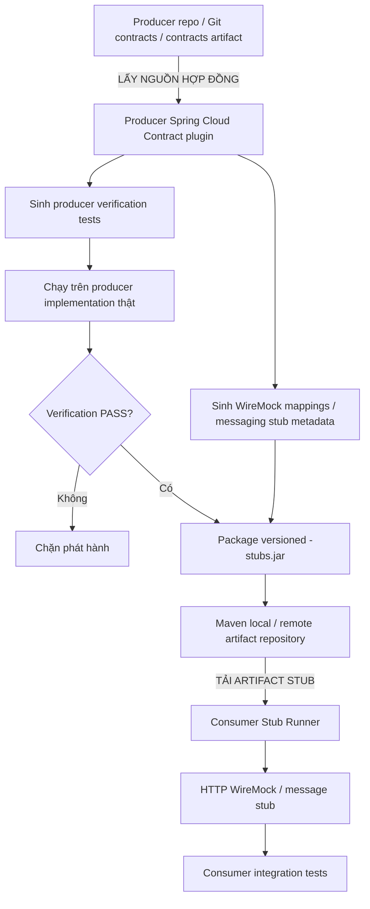
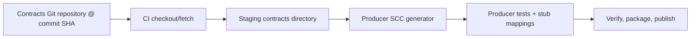
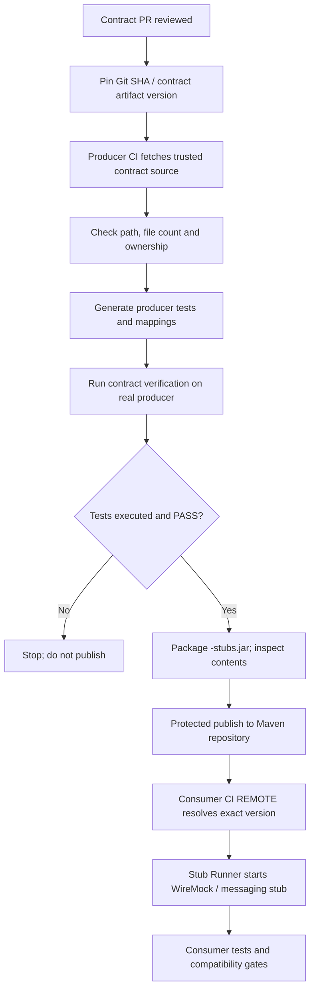

# Tùy biến cách lấy hợp đồng hoặc artifact stub

## 1. Bối cảnh: hợp đồng và stub có thể nằm ở nhiều nơi khác nhau

Trong hệ thống microservices, `Order Service` đóng vai trò **producer**, còn `Checkout Service` và `Reporting Service` là **consumer**. Các nhóm dùng **Spring Cloud Contract** để mô tả HTTP API hoặc message bằng Groovy/YAML DSL, sinh producer tests, phát hành stub artifact và chạy consumer tests qua **Stub Runner**.

Ở giai đoạn đầu, hợp đồng nằm ngay trong repository của `Order Service`:

```text
order-service/
  src/test/resources/contracts/
    checkout-service/
      get_order.groovy
    reporting-service/
      get_order_report.yml
```

Nhưng khi nhiều nhóm cùng đóng góp, tổ chức có thể quyết định:

- Giữ hợp đồng trong repository producer như cũ.
- Chuyển nguồn hợp đồng sang một **repository Git chung** để consumer tạo PR độc lập.
- Đóng gói hợp đồng thành **Maven artifact** rồi để producer tải theo một phiên bản rõ ràng.
- Lưu stub artifact trong Maven local, Nexus/Artifactory hoặc một kho nội bộ khác.
- Chạy consumer tests ở container hoặc runner CI không có sẵn Maven local của máy developer.
- Tích hợp một nguồn stub **không phải Maven** hoặc môi trường offline.

Đây là lúc cần phân biệt chính xác **tùy biến cách lấy nguồn hợp đồng** với **tùy biến cách lấy stub artifact**. Hai việc liên quan nhưng không đồng nhất, và chúng tác động đến hai thời điểm khác nhau trong pipeline.

Mục tiêu bài học thuộc chương **Tùy biến và mở rộng**:

1. Phân biệt các bước lấy **contract source**, sinh/đóng gói stub và tải **stub artifact**.
2. Biết khi nào dùng nguồn local, Git/SCM, Maven artifact, `CLASSPATH`, `LOCAL` hoặc `REMOTE`.
3. Hiểu những nhóm cấu hình Spring Cloud Contract Gradle/Maven plugin và Stub Runner thường được dùng.
4. Thiết kế bước checkout/copy hợp đồng có version, không tạo phụ thuộc mạng ẩn.
5. Chọn hướng tùy biến phù hợp khi kho stub không hỗ trợ Maven repository layout.
6. Bảo vệ credentials, checksum, provenance và cách publish trong CI.
7. Chẩn đoán các lỗi “không tìm thấy hợp đồng”, “tải sai JAR” và “WireMock không match request”.

## 2. Hai luồng khác nhau trong cùng một kiến trúc



Để thảo luận rõ ràng, dùng bốn thuật ngữ:

| Thuật ngữ | Nghĩa | Điểm cần nhớ |
| --- | --- | --- |
| **Nguồn hợp đồng** | Tệp Groovy/YAML DSL hoặc JAR chứa những tệp đó | Được producer đọc **trước khi sinh tests/stubs** |
| **Generated producer test** | Mã kiểm thử được sinh từ DSL | Phải chạy trên **producer thật** |
| **Stub artifact** | JAR đã đóng gói mappings và dữ liệu stub, thường classifier `stubs` | Consumer tải và cho Stub Runner chạy |
| **Stub Runner** | Công cụ resolve artifact, khởi động HTTP stub/message adapter | Không tự kiểm chứng implementation của producer |

**Sai lầm phổ biến:** cấu hình `spring.cloud.contract.stubrunner.repository-root` rồi nghĩ **producer generator** sẽ lấy nguồn hợp đồng từ đó. Thuộc tính này chủ yếu dành cho quá trình **Stub Runner tải artifact**, không thay thế cấu hình nguồn DSL của producer.

## 3. Bảng quyết định: cần tùy biến ở lớp nào?

| Nhu cầu | Lớp cần cấu hình | Điểm xuất phát |
| --- | --- | --- |
| Hợp đồng ở `src/test/resources/contracts` | Producer plugin | Đường dẫn local mặc định/đã cấu hình |
| Hợp đồng ở thư mục local khác | Producer plugin | `contractsDslDir` hoặc cấu hình source path tương ứng |
| Hợp đồng từ Git chung | SCM/CI + producer plugin | Checkout bản commit đã ghim vào staging directory |
| Hợp đồng đóng gói Maven artifact | Producer plugin | Contract dependency/repository/mode theo phiên bản plugin |
| Consumer lấy stub đã `mvn install` | Stub Runner | `stubs-mode: LOCAL` |
| Consumer lấy stub từ Nexus/Artifactory | Stub Runner | `stubs-mode: REMOTE`, `repository-root` |
| Stub resources nằm trên test classpath | Stub Runner | `stubs-mode: CLASSPATH` |
| Stub nằm trong registry không hỗ trợ Maven | CI adapter hoặc cơ chế downloader mở rộng | Ưu tiên mirror/chuẩn hóa thành Maven artifact |
| Chỉ cần mock HTTP fault riêng | WireMock native test | Không nhất thiết sửa hợp đồng hay downloader |

**Nguyên tắc ưu tiên:** sử dụng cấu hình chuẩn trước, sau đó mới cân nhắc extension. Thêm downloader tự viết đồng nghĩa phải chịu trách nhiệm về authentication, retry, metadata, cleanup, checksum, cache, version và khả năng tương thích khi nâng Spring Cloud Contract.

## 4. Cách mặc định: nguồn hợp đồng cùng repository producer

Một cấu trúc quen thuộc:

```text
order-service/
  src/
    main/java/...
    test/java/...
    test/resources/contracts/
      checkout-service/get_order.groovy
      reporting-service/get_report.yml
```

Hợp đồng Groovy ví dụ:

```groovy
import org.springframework.cloud.contract.spec.Contract

Contract.make {
    description 'Checkout lay thong tin don hang 42'
    request {
        method GET()
        url '/api/orders/42'
        headers {
            header('Accept', 'application/json')
        }
    }
    response {
        status OK()
        headers {
            contentType(applicationJson())
        }
        body(orderId: 42, status: 'CONFIRMED')
    }
}
```

Hợp đồng YAML khác:

```yaml
description: Reporting lay so tien cua don hang
request:
  method: GET
  url: /api/orders/42/report
response:
  status: 200
  headers:
    Content-Type: application/json
  body:
    orderId: 42
    totalAmount: 125000
    currency: VND
```

**Ưu điểm:** cùng commit với source producer; review và bisect dễ; không cần resolver mạng để tìm DSL. **Nhược điểm:** consumer thường phải tạo PR vào repo producer và khó quản trị nếu nhiều nhóm ở các repository khác nhau.

### 4.1. Đổi đường dẫn local không có nghĩa đổi nơi tải stub

Trong `build.gradle` Groovy DSL, một ví dụ **fragment cấu hình**:

```groovy
contracts {
    contractsDslDir = file('src/contractTest/resources/contracts')
}
```

Trong Spring Cloud Contract Maven plugin, tùy phiên bản có thể cấu hình đường dẫn tương đương:

```xml
<configuration>
    <contractsDslDir>${project.basedir}/src/contractTest/resources/contracts</contractsDslDir>
</configuration>
```

Các đoạn trên **không phải build file hoàn chỉnh** và cần được đối chiếu với API extension/plugin đúng phiên bản. Chúng chỉ thay **đường dẫn đọc DSL ở producer**. Consumer vẫn cần một stub artifact sau bước generate, verify và publish.

**Kiểm tra dễ bỏ sót:** Khi dùng đường dẫn ngoài default, hãy xem task generator có đọc cả `*.groovy`, `*.yml`, `*.yaml` trong các thư mục con mong đợi không; không suy rằng build xanh có nghĩa mọi contract đã được xử lý.

## 5. Khi nguồn hợp đồng nằm trong Git repository chung

Giả sử các nhóm có một kho mã nguồn riêng:

```text
contracts-repository/
  order-service/
    checkout-service/get_order.groovy
    reporting-service/get_report.yml
  payment-service/
    checkout-service/get_payment.groovy
```

Producer có thể lấy một **revision cụ thể** rồi đặt các contract vào thư mục staging của build:



### 5.1. Mô hình CI checkout rồi chuyển giao đường dẫn

Một ví dụ shell **mang tính thao tác**, chạy trong job CI có quyền đọc Git repository:

```bash
# CONTRACTS_SHA là commit đã review và có thể truy xuất.
git clone https://git.example.test/platform/contracts-repository.git external-contracts
git -C external-contracts checkout --detach "$CONTRACTS_SHA"

# Sau đó chỉ định DSL directory của producer tới
# external-contracts/order-service (hoặc copy vào staging directory).
```

`git.example.test` là hostname minh họa. Không đặt username/password trong URL đã commit hoặc ghi ra log. Nếu cần private Git, dùng **read-only deployment identity** hoặc token ngắn hạn, không dùng quyền push cho pipeline consumer.

**Vì sao ghim SHA thay vì branch `main`?** Nếu cùng một commit producer nhưng job A tải hợp đồng trước, job B tải sau một merge, đầu vào có thể khác nhau dù lệnh build giống nhau. Pin revision giúp tạo bằng chứng: *producer commit P đã được xác minh cùng contracts revision C*.

### 5.2. Cấu hình generator đọc đúng staging path

Giả sử CI checkout source contract vào:

```text
external-contracts/order-service/
  checkout-service/get_order.groovy
  reporting-service/get_report.yml
```

Trong Gradle project producer:

```groovy
contracts {
    contractsDslDir = file('external-contracts/order-service')
}
```

Không nên để generator tự download Git không khai báo bên trong task action nếu điều đó khiến Gradle không biết revision/input đã thay đổi. Cách dễ kiểm chứng là **bước lấy Git có provenance rõ ràng** chạy trước, rồi giao một tập file cụ thể cho generator.

### 5.3. Ba vấn đề của repo Git ngoài

1. **Availability:** nếu Git server hỏng, build có thể không lấy được hợp đồng; cần timeout, mirror hoặc cache có version rõ.
2. **Trust:** chỉ nạp hợp đồng/DSL từ revision đã được review; Groovy DSL là mã có khả năng thực thi trong ngữ cảnh build, không nên coi nguồn không tin cậy là dữ liệu vô hại.
3. **Lifecycle:** nếu bỏ một hợp đồng khỏi repo chung, producer/consumer owners phải đồng ý và generated mappings cũ phải biến mất khỏi artifact sau build.

Không sửa `contractsDslDir` sang toàn bộ repository Git nếu nó chứa hợp đồng cho nhiều producers. Giới hạn phạm vi theo đúng `order-service` để generator không nhầm endpoint hoặc message contract của dịch vụ khác.

## 6. Nguồn hợp đồng dưới dạng Maven artifact

Một tổ chức có thể đóng gói Groovy/YAML contracts vào một artifact versioned để producer tải bằng **Maven coordinates**:

```text
com.example.contracts:order-contracts:1.5.0:stubs
```

Tên group, artifact, version và classifier ở đây là **quy ước ví dụ**. Có dự án dùng một artifact chỉ chứa contracts, có dự án dùng JAR `stubs` chứa cả contracts và mappings; phải xem cấu trúc thực tế và cấu hình Spring Cloud Contract plugin đang dùng.

Đường dẫn Maven repository tương ứng với một JAR classifier `stubs`:

```text
com/example/contracts/order-contracts/1.5.0/
  order-contracts-1.5.0.pom
  order-contracts-1.5.0-stubs.jar
```

### 6.1. Chọn contract revision theo Maven coordinates

Lợi thế:

- Producer không cần clone Git ở mỗi build nếu artifact đã publish.
- Version có thể ghim, dễ audit và tái hiện.
- Cùng một contract artifact được sử dụng bởi nhiều pipelines theo một định danh chung.

Hạn chế:

- Cần một pipeline riêng để đóng gói và publish contracts.
- Có độ trễ giữa PR sửa contract và artifact version được công bố.
- Phải xác định rõ ownership: ai chấp nhận một contract mới, ai cho phép xóa nghĩa vụ cũ.
- Không được nhầm **contract artifact chưa được producer verify** với **stub artifact đã được producer verify**.

Một contract artifact chỉ mang DSL **không bảo đảm** Order Service thật đã đáp ứng chúng. Nó là **đầu vào để kiểm chứng**, không phải kết quả producer verification.

### 6.2. Gradle plugin: nhóm cấu hình contract dependency

Một số phiên bản Spring Cloud Contract Gradle plugin hỗ trợ cơ chế lấy external contracts qua các khối như `contractDependency`, `contractRepository` và `contractsMode`.

Ví dụ **mang tính tham khảo, cần đối chiếu DSL của phiên bản plugin**:

```groovy
contracts {
    contractsMode = 'REMOTE'
    contractDependency {
        stringNotation = 'com.example.contracts:order-contracts:1.5.0:stubs'
    }
    contractRepository {
        repositoryUrl = 'https://repo.example.test/repository/maven-releases/'
        username = providers.environmentVariable('CONTRACT_REPO_READ_USER').orNull
        password = providers.environmentVariable('CONTRACT_REPO_READ_TOKEN').orNull
    }
    contractsPath = '/order-service'
}
```

**Phân biệt rõ:**

- `contractsMode` là khái niệm **cách lấy nguồn hợp đồng của producer plugin**, không phải `stubrunner.stubs-mode`.
- `contractDependency` định danh artifact **chứa contracts** theo quy ước project.
- `contractRepository` mô tả **nơi lấy contracts** và credential đọc.
- `contractsPath` chỉ phần contract directory bên trong artifact nếu cơ chế/plugin version đó hỗ trợ.

Đường dẫn `/order-service` phải khớp layout của artifact thực tế. Nếu JAR chứa contracts dưới `META-INF/.../contracts/`, phải kiểm tra quy tắc tính root/path của plugin; không thể suy từ cây Git rồi copy nguyên vào `contractsPath`.

**Chú ý phiên bản:** Cách khai báo dependency, tên property và cách chuyển Provider sang kiểu String có thể khác giữa Gradle/Spring Cloud Contract versions. Ví dụ ở đây chỉ minh họa các nhóm cấu hình. Khi đưa vào project thật, kiểm tra tài liệu plugin phiên bản đang dùng và `./gradlew tasks --all` / logs generator; không kết luận copy nguyên snippet sẽ hoạt động trên mọi release.

### 6.3. Maven plugin: external contract dependency

Một dạng cấu hình thường gặp trong Spring Cloud Contract Maven plugin là:

```xml
<plugin>
    <groupId>org.springframework.cloud</groupId>
    <artifactId>spring-cloud-contract-maven-plugin</artifactId>
    <version>${spring-cloud-contract.version}</version>
    <extensions>true</extensions>
    <configuration>
        <contractsMode>REMOTE</contractsMode>
        <contractDependency>
            <groupId>com.example.contracts</groupId>
            <artifactId>order-contracts</artifactId>
            <version>1.5.0</version>
            <classifier>stubs</classifier>
        </contractDependency>
        <contractsRepositoryUrl>https://repo.example.test/repository/maven-releases/</contractsRepositoryUrl>
        <contractsPath>/order-service</contractsPath>
    </configuration>
</plugin>
```

Đây là **plugin fragment trong `pom.xml`**, không phải POM hoàn chỉnh. Một số release sử dụng những property hoặc biểu diễn contract repository khác, vì vậy cần kiểm tra API cấu hình **đúng phiên bản**. Property `${spring-cloud-contract.version}` phải được khai báo và tương thích với Spring Boot/Cloud.

Credential cho resolver external contracts phải được cấp qua **secret store/settings hoặc cấu hình được plugin hỗ trợ**. Không hard-code password trong POM. Không tự coi `settings.xml` credentials dùng cho Maven dependency resolution sẽ được mọi custom contract resolver tự sử dụng: xác minh cơ chế authentication của plugin.

## 7. Tránh nhầm source contract artifact với stub artifact

Cùng dùng Maven coordinates không có nghĩa chúng cùng chức năng:

| Thành phần | Ai tạo? | Khi nào dùng? | Có thể dùng để chạy WireMock trực tiếp? |
| --- | --- | --- | --- |
| Groovy/YAML source contracts | Consumer đề xuất, producer chấp nhận | **Trước** producer verification | Chưa, cần generator |
| JAR hợp đồng chung | Contract repository pipeline | Producer tải DSL | Chỉ khi có mappings phù hợp, không mặc định |
| Generated producer tests | Contract Verifier plugin | Chạy trên producer thật | Không |
| JAR `order-service-2.0.0-stubs.jar` | Build producer đã generate + package | Consumer Stub Runner | Có khi chứa HTTP mappings phù hợp |

Một tổ chức có thể sử dụng tên classifier `stubs` cho artifact chứa contracts theo convention riêng. Vì vậy, **đừng chỉ nhìn hậu tố `-stubs.jar` để suy ra nó được producer verify**. Phải biết artifact thuộc repository/pipeline nào, ai công bố, có generated tests và kết quả producer verification tương ứng hay không.

**Quy tắc:** Producer verification phải chạy trên **DSL revision đang được chọn** và **implementation producer tương ứng**; stub artifact phát hành phải có provenance gắn hai thứ đó.

## 8. Maven artifact `-stubs.jar`: đóng gói gì và đặt ở đâu?

Sau khi producer verification PASS, artifact stub có thể có tên:

```text
com.example:order-service:2.0.0:stubs
order-service-2.0.0-stubs.jar
```

Một layout minh họa:

```text
META-INF/
  com.example/
    order-service/
      2.0.0/
        contracts/
          checkout-service/get_order.groovy
          reporting-service/get_report.yml
        mappings/
          checkout-service/get_order.json
          reporting-service/get_report.json
```

Tên JSON và các thư mục trung gian trong ví dụ có tính khái niệm; generator có thể đặt tên khác hoặc tổ chức theo consumer/group. Với messaging, artifact có thể chứa contract metadata cần Stub Runner/message adapter thay vì tất cả được biểu diễn thành WireMock HTTP mappings.

### 8.1. Đọc JAR trước khi đổi downloader

Nếu Stub Runner tải được artifact nhưng consumer nhận `404`, nguyên nhân có thể **không nằm ở downloader**:

1. JAR có đúng `META-INF` namespace và mappings không?
2. Port stub đã chạy và client đang trỏ đúng port chưa?
3. `GET /api/orders/42` có khớp mapping request conditions không?
4. Có đang bật `stubsPerConsumer` và vô tình lọc bỏ mapping không?
5. Stub artifact có phải version mà producer vừa verify không?

Một lệnh kiểm tra trên artifact đã tải trong môi trường dự án:

```bash
jar tf ~/.m2/repository/com/example/order-service/2.0.0/order-service-2.0.0-stubs.jar
```

Không phải cứ sửa `repository-root` là sửa được WireMock request mismatch. Cần phân tách các tầng **resolve → extract → load → match → respond**.

## 9. Consumer tải stub: CLASSPATH, LOCAL và REMOTE

Stub Runner có ba chế độ thường gặp:

| Mode | Stub Runner lấy từ đâu? | Khi dùng |
| --- | --- | --- |
| `CLASSPATH` | Stub resources có trên test/application classpath | Test đã đóng gói tài nguyên phù hợp |
| `LOCAL` | Maven local repository của process hiện tại | Developer build/install producer trên cùng môi trường |
| `REMOTE` | Maven-compatible artifact repository hoặc resolver phù hợp | CI, container, nhiều nhóm dùng Nexus/Artifactory |

`LOCAL` không có nghĩa đọc thư mục `src/test/resources/contracts`; `REMOTE` không có nghĩa proxy request tới producer đang chạy. Đây là lựa chọn **nguồn lấy artifact stub**, không phải chọn behavior HTTP.

### 9.1. Stub Runner LOCAL

Giả sử producer đã cài artifact `com.example:order-service:2.0.0:stubs` vào Maven local của máy test:

```java
import org.junit.jupiter.api.Test;
import org.springframework.boot.test.context.SpringBootTest;
import org.springframework.cloud.contract.stubrunner.spring.AutoConfigureStubRunner;
import org.springframework.cloud.contract.stubrunner.spring.StubRunnerProperties;

@SpringBootTest(properties = {
    "order.client.base-url=http://localhost:8091"
})
@AutoConfigureStubRunner(
    ids = "com.example:order-service:2.0.0:stubs:8091",
    stubsMode = StubRunnerProperties.StubsMode.LOCAL
)
class CheckoutOrderClientTest {

    @Test
    void readsOrderFromStub() {
        // Gọi OrderClient thật tới localhost:8091.
        // Assertion cần kiểm tra dữ liệu đã deserialize và business behavior.
    }
}
```

Đây là **test skeleton**, chưa phải test hoàn chỉnh vì method mới là chú thích. Dùng stub artifact version cụ thể và cấu hình client thật để đọc `order.client.base-url`. Không mặc nhiên cho rằng Stub Runner sẽ tự chuyển mọi HTTP client sang stub server.

### 9.2. Stub Runner REMOTE

Trong `application-test.yml` của consumer:

```yaml
spring:
  cloud:
    contract:
      stubrunner:
        stubs-mode: REMOTE
        repository-root: "https://repo.example.test/repository/maven-releases/"
        ids:
          - "com.example:order-service:2.0.0:stubs:8091"
        username: "${STUB_REPO_READ_USER}"
        password: "${STUB_REPO_READ_TOKEN}"
```

Trong test environment còn cần cấu hình HTTP client, ví dụ:

```yaml
order:
  client:
    base-url: "http://localhost:8091"
```

**Hai URL có mục đích khác nhau:**

- `repository-root` trỏ tới nơi **tải JAR**; Stub Runner dùng authentication với artifact repository.
- `order.client.base-url` trỏ tới nơi **gửi HTTP request nghiệp vụ**; WireMock phục vụ request/response.

Nếu client ở Docker container khác, `localhost` trỏ tới **container consumer**, không phải Stub Runner. Khi đó phải cấu hình hostname/network thích hợp.

### 9.3. Stub Runner CLASSPATH

Nếu stub resources có trên classpath theo layout mà phiên bản Stub Runner hỗ trợ, có thể chọn `CLASSPATH`. Đừng đồng nhất:

- “JAR tồn tại trong `~/.m2/repository`”.
- “JAR là một test dependency”.
- “Các resource mappings của JAR nằm trên classpath và được Stub Runner nhìn thấy”.

Ba điều kiện không tương đương. Nếu dùng `CLASSPATH`, kiểm tra dependency scope/test classpath và cấu trúc resource cụ thể. Nếu chưa chắc, dùng `LOCAL`/`REMOTE` cùng Maven coordinates là đường đi dễ theo dõi hơn.

## 10. Tùy biến đường dẫn Maven local hoặc remote repository

### 10.1. Maven local không nằm cùng chỗ trên mọi môi trường

Đường dẫn mặc định thường là:

```text
Linux/macOS: ~/.m2/repository
Windows:      %USERPROFILE%\.m2\repository
```

Nhưng `settings.xml`, `maven.repo.local` hoặc cấu hình resolver có thể đổi vị trí. Một CI runner sạch hoặc Docker container **không tự dùng được thư mục local của host**.

Nếu cần dùng `LOCAL` trong Docker:

1. Build/install artifact vào một Maven local repository có thể truy cập được.
2. Mount đúng thư mục tới vị trí mà process Stub Runner đang dùng.
3. Cấp quyền đọc phù hợp.
4. Không mount toàn bộ thư mục home chứa secrets chỉ để nhận một JAR.

Nếu CI ở nhiều máy, `REMOTE` với versioned repository thường đơn giản và tái lập hơn.

### 10.2. Remote repository: URL, quyền và Maven layout

Nexus/Artifactory thông thường có:

```text
https://repo.example.test/repository/maven-releases/
https://repo.example.test/repository/maven-snapshots/
```

Domain là ví dụ. URL phải chỉ tới **repository Maven-compatible root**, không phải một trang web HTML hoặc đường dẫn trực tiếp tới file JAR.

Stub Runner cần khả năng tìm metadata/POM/JAR theo Maven coordinates và chiến lược version đang chọn. Khi dùng repository private, cần read-only credentials phù hợp; không dùng publisher/admin token trong consumer CI.

### 10.3. Repository mirror và proxy của tổ chức

Một môi trường có thể dùng Maven repository manager như mirror, nhưng không phải mọi đường tải qua **Stub Runner** đều giống hệt dependency resolution của Maven CLI. Nếu resolver của Stub Runner có `repository-root` và credential riêng, cần kiểm tra **nó thật sự đọc settings/mirror/proxy nào** theo phiên bản.

**Không tự suy** rằng chỉnh `~/.m2/settings.xml` luôn đủ cho Stub Runner, cũng không mặc định biến môi trường proxy được tôn trọng bởi mọi downloader extension.

## 11. Tùy biến cách chọn producer/consumer và subset contracts

Một stub artifact có thể chứa hợp đồng thuộc nhiều consumer:

```text
contracts/
  checkout-service/
    get_order.groovy
  reporting-service/
    get_report.yml
```

Stub Runner hỗ trợ cơ chế **stubs per consumer** trong những cấu hình phù hợp. Ví dụ:

```yaml
spring:
  application:
    name: checkout-service
  cloud:
    contract:
      stubrunner:
        stubs-mode: REMOTE
        repository-root: "https://repo.example.test/repository/maven-releases/"
        ids:
          - "com.example:order-service:2.0.0:stubs:8091"
        stubs-per-consumer: true
        consumer-name: checkout-service
```

**Đây không phải tùy biến nguồn tải JAR.** Artifact vẫn được resolve từ `repository-root`; tùy chọn chỉ tác động tới **tập stub mappings được nạp** theo consumer group.

Hai lỗi thường gặp:

- Thư mục trong artifact tên `checkout-api` nhưng cấu hình `consumer-name: checkout-service`, nên không có mapping được nạp.
- Hai consumer có kỳ vọng mâu thuẫn trên cùng request; bật filtering làm test riêng xanh, nhưng producer thật vẫn chỉ có một behavior. Phải sửa giao diện hoặc triển khai version/condition tường minh.

Với producer, vẫn cần chạy **tất cả generated tests của những hợp đồng được chấp nhận**, kể cả khi consumer chỉ tải một subset.

## 12. Khi stub nằm ở hệ thống không phải Maven

Ví dụ một tổ chức lưu stub theo đường dẫn không chuẩn:

```text
object-storage://test-artifacts/order-service/2.0.0/stub-bundle.zip
```

Đường dẫn trên chỉ là **một URI minh họa**, không phải scheme mà Stub Runner mặc định hiểu. Trước khi viết downloader tùy biến, có ba hướng:

### 12.1. Ưu tiên mirror/chuẩn hóa thành Maven repository

Nếu có thể, đưa artifact đã được verify vào Nexus/Artifactory hoặc một **Maven-compatible repository** với tọa độ ổn định. Ưu điểm:

- Stub Runner có cơ chế resolve sẵn (`REMOTE`).
- Có GAV, classifier, metadata, version/release policy.
- Có permission, audit và caching của repository manager.
- Giảm code tùy biến cần bảo trì khi Spring Cloud Contract được nâng cấp.

Nếu muốn CI mirror từ object storage, bước mirror cần **xác minh checksum/provenance**; không tự coi một ZIP bất kỳ là JAR stub đã có đúng layout.

### 12.2. Chuẩn bị Maven local trong job test

Nếu không thể mở remote Maven repository, pipeline có thể tải một stub JAR từ nguồn đã phê duyệt, xác minh nó, rồi **cài vào Maven local** với GAV/classifier chính xác trước khi chạy Stub Runner `LOCAL`.

Không được dùng cách này để biến một mapping chưa verify thành “verified stub”. Cần biết rõ artifact gốc được tạo ở đâu, có producer verification evidence không và checksum có đúng bản phát hành không.

Việc cài JAR phân phối vào Maven local cũng cần xử lý POM/metadata phù hợp. Không nên chỉ chép file tùy ý vào thư mục `~/.m2/repository` rồi mặc định Maven resolver sẽ nhận diện đầy đủ.

### 12.3. Dùng CLASSPATH khi phù hợp

Nếu stub resources được đóng gói sẵn trong test dependencies hoặc một ứng dụng standalone, `CLASSPATH` có thể phù hợp. Khi đó cần kiểm tra classpath/runtime resource layout, tránh vừa tải từ remote vừa vô tình dùng mappings cũ trên classpath.

## 13. Extension tùy biến downloader: khi nào thực sự cần?

Một số Spring Cloud Contract/Stub Runner releases cung cấp khả năng **mở rộng cách lấy stub** thông qua các điểm mở rộng của module Stub Runner. Tuy nhiên **tên interface, phương thức đăng ký và thứ tự chọn downloader thay đổi theo phiên bản**; không nên sao chép một class SPI tự suy đoán rồi coi là extension được hỗ trợ ổn định.

Chỉ cân nhắc custom downloader khi:

1. Không thể dùng Maven repository/mirror và không thể chuẩn bị local/classpath.
2. Có một **nguồn artifact đặc thù** như service nội bộ cần token exchange hoặc API riêng.
3. Có yêu cầu kiểm toán, provenance, checksum và permission không được đáp ứng bởi cách chuyển đổi trung gian.
4. Nhóm sẵn sàng bảo trì extension cùng lifecycle của Stub Runner.

### 13.1. Hợp đồng trách nhiệm của một custom downloader

Trước khi viết code, xác định những thứ cần thực hiện:

| Trách nhiệm | Hành vi mong muốn |
| --- | --- |
| **Parse coordinates** | Nhận đúng producer, version, classifier, artifact |
| **Version resolution** | Không tự chọn “latest” mơ hồ trong CI; pin version |
| **Authentication** | Dùng identity chỉ đọc, token ngắn hạn khi được hỗ trợ |
| **TLS / trust** | Xác thực certificate, không bỏ qua kiểm tra TLS |
| **Download** | Timeout, retry có giới hạn, xử lý 401/403/404 riêng |
| **Integrity** | Xác minh checksum/signature/provenance theo policy |
| **Caching** | Khóa cache theo artifact digest/version, không dùng dữ liệu cũ âm thầm |
| **Extraction** | Kiểm tra JAR/ZIP layout, ngăn path traversal khi giải nén |
| **Resource handling** | Dọn file tạm, không log secrets, giới hạn dung lượng |
| **Consumer grouping** | Không làm mất mappings/contract metadata theo consumer |
| **Observability** | Ghi rõ source URI, resolved version, hash và lỗi không nhạy cảm |

### 13.2. Pseudocode: adapter trước Stub Runner

Đây là **pseudocode kiến trúc**, không phải Java SPI thực thi trực tiếp:

```text
prepare_stubs(producerId, version):
    assert version is explicitly pinned
    auth = acquire_read_only_identity()
    bundle = download_with_timeout(source, producerId, version, auth)
    assert verify_expected_digest_and_origin(bundle)
    jar = validate_or_convert_to_supported_stub_jar(bundle)
    install_to_isolated_maven_local(jar, producerId, version, classifier="stubs")
    record_provenance(producerId, version, digest(bundle))

run_consumer_tests_with_stub_runner(mode="LOCAL")
```

Hướng adapter **trước** Stub Runner có lợi thế không cần can thiệp lifecycle downloader bên trong thư viện. Nếu artifact không tương ứng với Maven metadata/namespace và không thể chuyển hợp lệ, cần thiết kế tích hợp chuyên biệt hoặc đổi cách phân phối.

### 13.3. Nếu viết SPI downloader bên trong Stub Runner

Nên kiểm tra đúng tài liệu/source của phiên bản thư viện được chốt để biết:

- Interface/extension point có thực sự public và ổn định không?
- Cách đăng ký extension (service loader, Spring bean, cấu hình riêng) được phiên bản đó hỗ trợ?
- Có hỗ trợ nhiều producer IDs, classifier, dynamic port và contract metadata không?
- Ai tạo/đóng server WireMock và ai quản lý temp directory?
- Stub Runner Boot/consumer test có nạp extension trên classpath tương ứng không?
- Có test nào xác minh timeout, wrong checksum, missing artifact và credential rotation không?

Đừng dùng **một ví dụ SPI ở release cũ** như API bảo đảm cho mọi release Spring Cloud Contract. Nếu không có cam kết rõ ràng của thư viện, adapter/publishing Maven thường giảm rủi ro hơn.

## 14. Artifact resolution không giống HTTP response templating

Hai nhu cầu dễ bị gọi chung là “custom stub” nhưng khác hẳn:

- **Custom resolver/downloader:** chọn **JAR nào được tải** và lấy nó từ đâu.
- **Custom WireMock transformer/matcher:** quyết định **request nào match** và **response HTTP nào được trả** sau khi mapping được nạp.

Ví dụ `GET /api/orders/42` trả chậm để kiểm tra timeout là một trường hợp **WireMock response behavior**, không yêu cầu downloader mới. Ngược lại, Stub Runner không tìm thấy `order-service-2.0.0-stubs.jar` ở Nexus là vấn đề **artifact resolution**, không thể sửa bằng response templating.

**Điểm giao nhau:** Nếu artifact được tải có WireMock mappings chứa transformers hoặc scenarios, runtime phải hỗ trợ extension/version tương ứng. Nhưng việc tải JAR thành công **không bảo đảm** tất cả response transformers được đăng ký.

## 15. Cố định phiên bản, kiểm soát SNAPSHOT và tránh cache lỗi thời

Một câu hỏi quan trọng: **cùng một commit consumer có dùng cùng stub artifact qua hai lần CI không?**

| Cách chọn | Ví dụ | Mức tái lập |
| --- | --- | --- |
| Exact release | `com.example:order-service:2.0.0:stubs` | Cao nếu release immutable |
| Snapshot | `2.1.0-SNAPSHOT` | Phụ thuộc artifact timestamp/update policy |
| Dynamic version | `+` | Có thể thay đổi khi có bản mới |
| Git branch | `main` | Mutable nếu không pin commit |
| Git SHA | Commit cụ thể | Tái lập hơn, cần giữ khả năng truy xuất |
| Direct URL không có digest | `/latest/stubs.jar` | Rất khó đảm bảo |

**Trong pipeline release/compatibility, ưu tiên version/digest cố định.** Dynamic versions hữu ích khi khám phá nhưng không phải baseline tốt để phát hiện chính xác commit nào đã làm API hỏng.

### 15.1. Ba lớp cache có thể khiến kết quả cũ xuất hiện

1. **Maven local/Gradle dependency cache:** chứa artifact đã resolve trước đó.
2. **Remote repository proxy/cache:** có thể giữ metadata/snapshot theo update policy.
3. **Stub Runner/runtime cache hoặc mappings đã nạp:** có thể vẫn đang chạy phiên bản cũ đến khi restart/reload.

Khi debug “đã publish stub mới nhưng consumer vẫn nhận body cũ”, hãy ghi **resolved coordinates và checksum**, inspect JAR đang dùng và server mappings đã nạp. Không xóa mọi cache như phản xạ đầu tiên.

### 15.2. Artifact immutable và build reproducibility

Một bản `order-service:2.0.0:stubs` nên ánh xạ đến cùng nội dung đã được verify. Nếu repository cho phép overwrite release, hai CI jobs có thể dùng cùng GAV nhưng tải byte khác nhau. Nên:

- Hạn chế overwrite/redeploy release trên Nexus/Artifactory.
- Ghi producer commit, contract revision, plugin version và artifact SHA-256.
- Chỉ publish sau producer verification.
- Khi cần sửa release sai, tạo **version mới** thay vì thay thế artifact cũ.
- Không dùng Gradle task build cache thay cho Maven artifact repository.

## 16. Credentials và ranh giới tin cậy của hai tuyến tải

**Hai tuyến tải có thể dùng hai identities khác nhau**:

| Hoạt động | Identity tối thiểu | Không nên có |
| --- | --- | --- |
| Producer lấy source contracts từ Git | Git read-only deploy identity | Push/admin |
| Producer lấy external contract artifact | Artifact repository read-only | Publisher/admin |
| Producer publish verified stubs | Token ghi đúng producer namespace/repo | Quyền ghi mọi artifact |
| Consumer Stub Runner REMOTE | Artifact repository read-only | Quyền deploy/delete/overwrite |
| CI PR từ nguồn chưa tin cậy | Quyền đọc tối thiểu theo policy | Release publisher secrets |

Không đặt token vào:

- `pom.xml`, `build.gradle`, contract Groovy/YAML hoặc `application.yml` đã commit.
- Command line dạng `--password=secret` có thể bị ghi log hoặc hiện trong process list.
- Git URL có embedded credentials.
- Docker image layers, test reports hoặc `-stubs.jar`.

Ưu tiên secret manager/CI-protected variables và read-only service accounts. Tắt command tracing nếu nó có thể in các giá trị nhạy cảm. Dùng HTTPS và cấu hình trust store/CA phù hợp, **không tắt TLS verification** để “lấy được stub”.

### 16.1. Groovy contracts từ bên ngoài là đầu vào có nguy cơ cao hơn JSON

Groovy DSL thường được xử lý trong môi trường build và có thể chứa logic. Vì vậy:

- Chỉ cho producer build đọc contracts từ nguồn đã tin cậy, có review.
- Không để job có publisher token thực thi DSL từ untrusted PR.
- Pin revision/artifact version và kiểm tra nguồn gốc.
- Nếu hỗ trợ signing/attestation, xác minh provenance trước khi cấp quyền publish.

**Contract source governance là vấn đề an toàn build**, không chỉ tính đúng đắn của API.

## 17. CI tham khảo: từ external contracts đến verified stubs



### 17.1. Những gate cần có

1. **Source gate:** contract SHA/version đã được chấp nhận; không đọc trực tiếp branch không pin.
2. **Parse gate:** các tệp Groovy/YAML thực sự được generator đọc; không `NO-SOURCE` ngoài ý định.
3. **Producer verification gate:** generated tests **được chạy**, không chỉ sinh ra.
4. **Package gate:** JAR có đúng namespace, mappings và messaging metadata.
5. **Publish gate:** credential ghi chỉ có ở protected job; release không bị overwrite.
6. **Consume gate:** Stub Runner tải đúng artifact GAV/hash từ nguồn phù hợp.
7. **Compatibility gate:** HTTP client/message handler của consumer xử lý được response/event.

### 17.2. Một bản manifest provenance minh họa

Đây là **metadata CI riêng**, không phải cấu hình mà Spring Cloud Contract tự đọc:

```yaml
producer: order-service
producerCommit: a1b2c3d4
contracts:
  source: git
  revision: e5f6a7b8
  path: order-service
stubArtifact:
  groupId: com.example
  artifactId: order-service
  version: 2.0.0
  classifier: stubs
verification:
  generatedTestsExecuted: true
  result: PASS
```

Các SHA ngắn và version trong ví dụ là placeholder. Hệ thống thực nên lưu full commit SHA, artifact digest và link đến test report; trạng thái `PASS` phải xuất phát từ job verification thật, không phải do người viết YAML tự đặt.

### 17.3. Nếu dùng Gradle và source contracts từ thư mục staging

Nhớ phân biệt:

- Task checkout/copy phải hoàn thành **trước** generator.
- Tập file đã checkout là **input** của generator; Gradle phải phát hiện thêm/xóa/sửa file.
- Đường dẫn tương đối có thể ảnh hưởng package/base class mapping, không nên loại bỏ một cách tùy tiện.
- `--build-cache` không giải quyết một contract source mutable không được ghim revision.

Nếu một file contract bị xóa khỏi repo chung, generated test/stub tương ứng cũng cần biến mất; kiểm tra sạch outputs và nội dung artifact trước khi publish.

## 18. Chẩn đoán theo từng giai đoạn

| Triệu chứng | Tầng lỗi có thể | Hướng kiểm tra |
| --- | --- | --- |
| Producer không tìm thấy bất kỳ hợp đồng nào | DSL source path hoặc external contract resolver | `contractsDslDir`, artifact coordinates/path, logs generator |
| Hợp đồng Git mới không được lấy | Checkout ref, permissions, revision pin | Commit SHA đang checkout và source directory |
| External contract artifact tải được nhưng không có files | Artifact layout/path không khớp | Xem JAR contracts root và `contractsPath` |
| Maven contract resolver trả `401` | Token đọc sai/hết hạn | Kiểm tra read-only auth, không in token |
| Maven contract resolver trả `404` | GAV/version/classifier/path sai | Xem Maven metadata và tên JAR |
| Stub Runner LOCAL không thấy artifact | JAR chưa nằm trong Maven local của **process** | Maven local path, install/publication |
| Stub Runner REMOTE trả `403` | Identity không có quyền tải | Token scope, repository policy |
| Stub Runner REMOTE tải application JAR | Thiếu classifier `stubs` | Kiểm tra GAV và artifact content |
| Có JAR nhưng không có mapping | Producer packaging sai/contract source lỗi | Artifact inspection, generated mappings |
| HTTP client nhận `404` từ WireMock | Request không match hoặc stub trả business 404 | URL, method, query, headers, request journal |
| Consumer dùng response cũ | Artifact/version cache cũ, WireMock mappings chưa reload | Resolved version, hash, server lifecycle |
| Chỉ Checkout có stub, Reporting không | Filtering consumer group | `stubsPerConsumer`, `consumerName`, artifact layout |
| Producer test xanh nhưng API sai | Test bị skip hoặc contracts không được đọc | Test count, base class wiring, source revision |
| Local xanh, CI fail | Local/remote mode khác, network/certs/credentials | So effective properties và runtime user |
| Custom downloader fail ngẫu nhiên | Retry, timeout, caching hoặc concurrent download | Log không nhạy cảm, digest, atomic writes |

### 18.1. Cùng là `404`, nhưng hoàn toàn khác nguyên nhân

**A. Artifact repository 404:**

```text
https://repo.example.test/repository/maven-releases/
  com/example/order-service/2.0.0/order-service-2.0.0-stubs.jar
```

Không có artifact ở đúng GAV/classifier. Phải sửa publication, version hoặc root, không sửa request matcher.

**B. WireMock unmatched 404:**

```http
GET /api/orders/999
```

WireMock đã chạy nhưng không có mapping match request. Kiểm tra mapping request conditions, không đổi `repository-root`.

**C. Business 404:**

Contract chủ đích quy định `GET /api/orders/999` trả `404` cùng `ORDER_NOT_FOUND`. Đây là hành vi hợp lệ đã mô tả, khác lỗi unmatched.

### 18.2. Trình tự điều tra tối thiểu

1. Ghi lại **producer commit** và **contract source revision**.
2. Xem plugin có đọc đúng path/GAV và sinh đủ generated tests không.
3. Xác nhận **producer verification** trên implementation hiện tại đã pass.
4. Xem `-stubs.jar` đang phát hành có mappings cần thiết không.
5. Xác nhận consumer resolve đúng **version/classifier/digest**.
6. Xác nhận WireMock/message adapter đã nạp đúng stub và port.
7. So actual request/message với generated mapping/contract.
8. Chỉ sửa downloader nếu chứng cứ chỉ rõ lỗi nằm ở tầng artifact resolution.

## 19. Bài thực hành: chuyển từ local contracts sang nguồn chung

Giả sử `Invoice Service` (producer) có hợp đồng:

```text
invoice-service/src/test/resources/contracts/
  billing-service/get_invoice.groovy
```

Contract mô tả:

```http
GET /api/invoices/900
Accept: application/json
```

Response:

```json
{
  "invoiceId": 900,
  "totalAmount": 220000,
  "currency": "VND",
  "status": "ISSUED"
}
```

Nhóm muốn:

1. Lưu contracts ở Git repository chung, path `invoice-service/`.
2. Producer CI lấy một commit SHA cụ thể.
3. Build sinh và chạy producer tests trước khi công bố.
4. Publish `com.example:invoice-service:3.1.0:stubs` lên Nexus.
5. `Billing Service` chạy Stub Runner `REMOTE` ở port `8092` với credential read-only.
6. Sau này chuyển sang Maven artifact chứa contracts để giảm phụ thuộc Git checkout lúc build.

### 19.1. Câu hỏi

- Bước lấy hợp đồng từ Git thuộc **producer generator** hay **consumer Stub Runner**?
- Cần ghim Git commit hay chỉ dùng `main`?
- Nếu artifact contract Maven chưa được producer verify, có thể coi nó là verified stub không?
- Điều gì xảy ra khi `contractsPath` trỏ sai thư mục?
- Viết cấu hình consumer Stub Runner REMOTE cho `invoice-service:3.1.0:stubs:8092`.
- Nếu consumer nhận body cũ dù đã publish mới, bạn kiểm tra ba nơi nào trước?
- Nếu Nexus là private, nên dùng token publisher hay read-only cho Billing CI?
- Khi nào mới nên viết custom downloader?

### 19.2. Gợi ý cấu hình Stub Runner

```yaml
spring:
  application:
    name: billing-service
  cloud:
    contract:
      stubrunner:
        stubs-mode: REMOTE
        repository-root: "https://repo.example.test/repository/maven-releases/"
        ids:
          - "com.example:invoice-service:3.1.0:stubs:8092"
        username: "${STUB_REPO_READ_USER}"
        password: "${STUB_REPO_READ_TOKEN}"
```

Cấu hình HTTP client trong test:

```yaml
invoice:
  client:
    base-url: "http://localhost:8092"
```

Điều kiện: `InvoiceClient` thật phải đọc key `invoice.client.base-url`; nếu consumer chạy trong container riêng thì URL này cần thay bằng hostname/network phù hợp.

### 19.3. Gợi ý lời giải

| Câu | Trả lời |
| --- | --- |
| Nguồn Git thuộc đâu? | Đầu vào của **producer build** để sinh contract tests/stubs |
| Dùng `main` hay SHA? | Dùng SHA cụ thể để build/verification tái lập |
| Contract artifact đã verify chưa? | Chưa; producer phải chạy generated tests trên implementation |
| Sai `contractsPath`? | Không thấy/đọc thiếu contracts, nguy cơ `NO-SOURCE` và build xanh giả |
| Body cũ? | Resolved GAV/hash, nội dung JAR, mappings server đã nạp |
| Token cho Billing CI? | **Read-only**, không dùng publisher/admin token |
| Custom downloader? | Chỉ khi Maven mirror, LOCAL, CLASSPATH hoặc CI adapter không đáp ứng |

### 19.4. Bài tập âm tính để kiểm chứng thiết kế

Trong môi trường thử nghiệm riêng:

1. Cố tình ghim một `CONTRACTS_SHA` không tồn tại; pipeline phải fail ngay ở bước source fetch.
2. Đặt `contractsPath` sai; pipeline phải phát hiện **không có test/mapping cần thiết** chứ không pass im lặng.
3. Đổi `ids` sang version stub chưa publish; consumer phải fail ở **artifact resolution**, không gọi API production.
4. Gửi request `GET /api/invoices/901` không có mapping; phân biệt unmatched WireMock 404 với business 404.
5. Thử một artifact có checksum khác dự kiến; adapter phải từ chối trước khi nạp mappings.

Đây là các **bài tập gợi ý**, không phải lệnh đã thực hiện trên workspace trong quá trình biên soạn.

## 20. Checklist khi tùy biến nguồn hợp đồng hoặc stub

- Đã xác định chính xác đang đổi **nguồn DSL của producer** hay **nguồn JAR của consumer**?
- Cấu hình source contract có trỏ đúng producer subdirectory, đủ Groovy/YAML và consumer groups?
- Nếu lấy từ Git, có ghim SHA và dùng identity chỉ đọc?
- Nếu lấy từ Maven artifact, có đúng GAV/classifier, contracts root/path và version đã được review?
- Đã xác nhận **contract artifact không đồng nghĩa verified stub artifact**?
- Producer verification có sinh **và thực sự chạy** generated tests trên implementation tương ứng?
- Stub JAR có đúng mappings/metadata, version và provenance trước khi publish?
- Stub Runner đã chọn `CLASSPATH`, `LOCAL` hoặc `REMOTE` có chủ đích?
- Consumer test đang trỏ vào **WireMock stub port**, không phải `repository-root`?
- `stubsPerConsumer` và `consumerName` có lọc đúng mappings không?
- Nếu dùng container, đường dẫn Maven local, hostname/network và secrets có phù hợp?
- Repository sử dụng HTTPS/TLS, account chỉ đọc và không hard-code token?
- Pipeline không cấp publisher token cho untrusted PR hoặc external contract source chưa review?
- Artifact/version có cố định, không phụ thuộc `+`, snapshot mutable hoặc branch không pin trong release CI?
- Có thể xác minh resolved JAR checksum, producer commit và contract revision khi gặp lỗi?
- Chỉ viết downloader/extension riêng khi các cách cấu hình chuẩn và adapter đơn giản không đáp ứng?
- Extension có timeout, retry, caching, integrity, concurrency, temp cleanup và kiểm thử lỗi?
- Có phân biệt lỗi artifact repository `404` với WireMock unmatched/business `404`?

**Tài liệu tham khảo nên đối chiếu với phiên bản project đang dùng:**

- [Spring Cloud Contract — Reference](https://docs.spring.io/spring-cloud-contract/reference/).
- [Spring Cloud Contract — Gradle Project](https://docs.spring.io/spring-cloud-contract/reference/gradle-project.html).
- [Spring Cloud Contract — Maven Project](https://docs.spring.io/spring-cloud-contract/reference/maven-project.html).
- [Spring Cloud Contract — Stub Runner](https://docs.spring.io/spring-cloud-contract/reference/project-features-stubrunner.html).
- [Spring Cloud Contract — Stub Runner Common Properties](https://docs.spring.io/spring-cloud-contract/reference/project-features-stubrunner/stub-runner-common.html).
- [Maven — Introduction to Repositories](https://maven.apache.org/guides/introduction/introduction-to-repositories.html).
- [Gradle — Incremental Builds](https://docs.gradle.org/current/userguide/incremental_build.html).

**Ghi nhớ:** **Producer lấy nguồn hợp đồng** để sinh và chạy verification tests; **consumer lấy stub artifact** để Stub Runner mô phỏng HTTP hoặc messaging behavior. Git checkout, external contract artifact, `contractsDslDir` và `contractDependency` thuộc tuyến đầu; `stubs-mode`, `ids`, `repository-root` thuộc tuyến thứ hai. Ưu tiên Maven-compatible repositories, ghim version/revision, giữ credentials theo nguyên tắc ít quyền nhất và chỉ publish stub sau producer verification. Khi nhu cầu đặc biệt buộc viết adapter/downloader, phải kiểm soát provenance, cache, bảo mật và lifecycle thay vì chỉ làm cho một lần tải JAR thành công.
