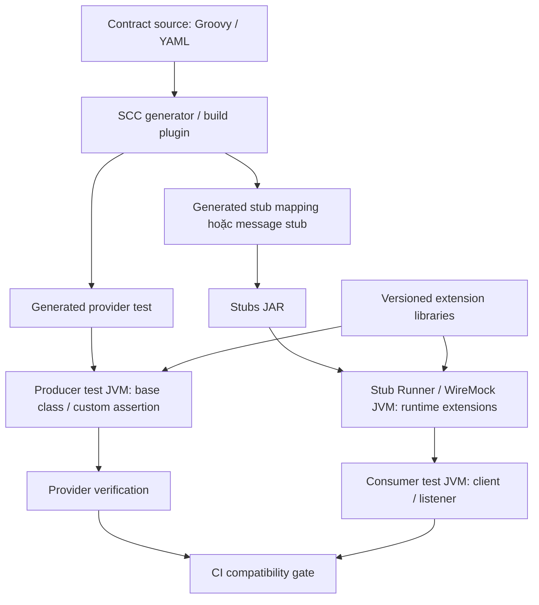
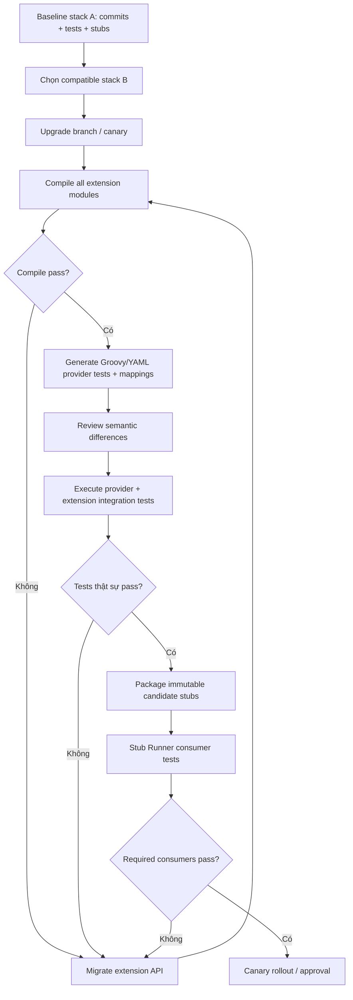

# Kiểm thử extension và tương thích khi nâng phiên bản Spring Cloud Contract

Khi một nhóm đã sử dụng **Spring Cloud Contract (SCC)** trong nhiều dự án, cấu hình mặc định đôi khi chưa đáp ứng đủ yêu cầu: producer cần **base test class** chuẩn bị dữ liệu riêng, matcher cần **custom assertion**, WireMock cần xử lý response bằng **extension**, hoặc consumer messaging cần **adapter** kết nối đúng transport. Các tùy biến này giúp hợp đồng sát nghiệp vụ hơn, nhưng cũng tạo một lớp phụ thuộc vào **API và cơ chế nội bộ của công cụ**. Khi nâng phiên bản Spring Cloud Contract, Spring Boot, WireMock, JUnit, Gradle hoặc Maven, những extension ấy có thể không còn biên dịch, không còn được nạp, hoặc vẫn chạy nhưng cho kết quả khác.

Bài thuộc chương **Tùy biến và mở rộng**, với chủ đề **Kiểm thử extension và tương thích khi nâng phiên bản**, trình bày cách kiểm chứng tùy biến theo từng tầng của quy trình contract testing: **Groovy/YAML DSL → generated provider tests → provider verification → stub mappings/JAR → Stub Runner → consumer tests và CI**. Chúng ta sử dụng `order-producer` và `checkout-consumer` làm ví dụ, trong đó API trả đơn hàng, có mã đơn dạng `ORD-1001` và phát sự kiện `OrderCreated`.

**Mục tiêu không phải “nâng được dependency mà build vẫn xanh”, mà là bảo đảm những hành vi đã cam kết vẫn được producer và consumer kiểm chứng trên đúng phiên bản công cụ mới.**

## 1. Mục tiêu học tập

Sau bài này, bạn có thể:

1. Phân biệt **extension point**, **helper của test**, **WireMock runtime extension** và **message transport adapter**.
2. Xác định extension chạy ở **giai đoạn nào** và **trong JVM/classpath nào**.
3. Thiết kế unit tests cho logic tùy biến, integration tests cho plugin/runtime và consumer tests cho stub cuối.
4. Kiểm tra bản nâng cấp có làm đổi **generated Java tests**, **WireMock mappings** hoặc **nội dung stubs JAR** hay không.
5. Xây dựng ma trận tương thích giữa SCC, Spring Boot/Spring Cloud, JDK, JUnit, WireMock và công cụ build.
6. Phát hiện lỗi “xanh giả”: 0 generated tests, task bị skip, extension không load, matcher quá rộng hoặc consumer dùng stub cũ.
7. Tổ chức canary, migration, rollback và lưu bằng chứng trước–sau nâng cấp.

Điểm then chốt: **cùng một hợp đồng nguồn không bảo đảm hai version của công cụ sẽ sinh đầu ra hoàn toàn giống nhau**. Cần kiểm tra **ngữ nghĩa hành vi** thay vì chỉ so tên tệp.

## 2. Một contract đi qua nhiều runtime khác nhau



Một extension có thể hoạt động ở ba vị trí rất khác nhau:

- **Generator/build time:** mở rộng cách contract được đọc, sinh test hoặc tạo mapping.
- **Producer test time:** base class, helper method, custom assertion hoặc test binder.
- **Consumer stub runtime:** WireMock extension, response transformer, request matcher hoặc message-trigger adapter.

Nếu library có mặt trong **producer `testImplementation`** nhưng không có trong **JVM chạy Stub Runner**, custom WireMock transformer không tự xuất hiện ở consumer. Ngược lại, thêm dependency vào Stub Runner không giúp generated provider test nhìn thấy một helper ở classpath producer.

### 2.1. Bốn câu hỏi trước khi nâng version

| Câu hỏi | Vì sao quan trọng? |
| --- | --- |
| Extension được nạp bởi component nào? | Xác định classpath và lifecycle cần test |
| Extension sử dụng API công khai hay API nội bộ? | API nội bộ dễ thay đổi khi nâng version |
| Generated output có phụ thuộc extension đó không? | Cần so source và kết quả của generator |
| Consumer test có thật sự chạy tính năng extension không? | Một test pass nhưng không kích hoạt extension là bằng chứng yếu |

**Không thể đánh giá mức độ tương thích chỉ qua việc Maven/Gradle resolve dependencies thành công.**

## 3. Phân loại tùy biến theo mức rủi ro

| Loại tùy biến | Ví dụ | Rủi ro khi nâng cấp | Điều cần kiểm tra |
| --- | --- | --- | --- |
| Base test class | Chuẩn bị MockMvc, fixture, message verifier | Medium | Generated tests kế thừa đúng, setup chạy |
| Helper assertion | Kiểm tra định dạng mã đơn, date/amount | Medium | Method signature, kiểu dữ liệu, assertion vẫn có hiệu lực |
| Groovy DSL matcher | `byRegex`, `byCommand` | Medium–High | Generator dịch đúng matcher sang test/mapping |
| YAML DSL converter | Parse matcher, headers, payload | High nếu custom | Input cũ vẫn đọc đúng và không mất field |
| WireMock extension | Response transformer, custom request matcher | High | Extension được load, gọi đúng và cấu hình tương thích |
| Message transport adapter | Trigger event và nhận message test | High | Destination, label, headers, binder hoạt động |
| Build plugin customization | Task/goal wiring, source sets, packaging | High | Generate → compile → run → package đúng |
| Test reporting/CI gate | Đọc XML, đếm tests, publish candidate | Medium–High | Không skip và không phát hành sai artifact |

Các mức trên là **ước lượng định tính phục vụ quản trị**, không phải bảng xếp hạng chính thức của SCC. Rủi ro thực phụ thuộc độ phức tạp, mức sử dụng internal API và phạm vi consumers.

### 3.1. Tùy biến càng gần internal API càng cần thử sớm

Một helper Java độc lập kiểm tra regex thường ổn định qua nhiều bản SCC nếu vẫn giữ chữ ký. Ngược lại, một extension kế thừa trực tiếp lớp nội bộ của WireMock hoặc generator có thể cần sửa ngay khi dependency major version đổi.

Nên **ưu tiên API extension được tài liệu của phiên bản hiện tại công bố**, giảm reflection vào class nội bộ và tránh phụ thuộc vào layout thư mục generated output nếu công cụ không bảo đảm ổn định.

## 4. Thiết lập baseline trước khi nâng cấp

Trước khi sửa version, chụp lại một **baseline có thể tái lập**:

1. Producer commit và contract revision.
2. SCC plugin/dependency version, Spring Boot/Spring Cloud BOM, JDK và build tool.
3. Danh sách extension cùng version của từng thư viện.
4. Số contract được phát hiện, số generated tests thực thi và skipped tests.
5. Mẫu generated test cho các DSL matcher quan trọng.
6. Generated HTTP mappings hoặc message stub resources.
7. Stubs JAR theo GAV/type/classifier và SHA-256.
8. Consumer test reports với **candidate artifact**.
9. Một bộ request hợp lệ và không hợp lệ để thử stub selection.
10. Những cảnh báo deprecation hoặc classpath conflicts trong log.

**Không chỉ lưu ảnh chụp dòng BUILD SUCCESS.** Nếu không biết bao nhiêu test chạy và artifact nào được sử dụng, không thể so sánh trước–sau một cách có căn cứ.

### 4.1. Baseline tối thiểu dạng bảng

| Hạng mục | Phiên bản hiện tại | Sau nâng cấp |
| --- | --- | --- |
| Build tool và JDK | Ghi version thật | Ghi version mới |
| SCC Gradle/Maven plugin | A | B |
| Spring Boot/Spring Cloud BOM | A | B |
| WireMock runtime | A | B hoặc bản được quản lý |
| Test engine | JUnit/Spock A | Engine thực chạy ở B |
| Contract count | N | N hoặc thay đổi có lý do |
| Generated test run count | N | N hoặc thay đổi có lý do |
| Required provider tests | PASS | PASS |
| WireMock mapping behavior | PASS/negative cases | PASS/negative cases |
| Consumer Stub Runner suites | PASS | PASS |
| Stubs JAR digest | H_A | H_B, cần giải thích |

Không bắt buộc `H_A == H_B` khi generator thay đổi; ZIP metadata hoặc cách serialize mapping có thể khác. **Đòi hỏi quan trọng hơn là hành vi giao diện và compatibility được chứng minh không đổi ngoài những thay đổi đã chấp thuận.**

## 5. Nâng phiên bản không phải chỉ đổi một dòng dependency

Spring Cloud Contract thường nằm trong hệ sinh thái:

```text
JDK
  └── Spring Boot / Spring Cloud release train
       ├── Spring Cloud Contract plugin/runtime
       ├── Test framework (JUnit / Spock / Groovy)
       ├── HTTP stack (RestAssuredMockMvc, MockMvc, WebTestClient...)
       └── WireMock / Stub Runner dependencies
Build tool (Maven hoặc Gradle) kết nối các thành phần trên
```

Khi thay SCC version, có thể thay đổi đồng thời các dependency transitives. Vì vậy không nên ghép tùy ý phiên bản SCC mới với một Spring Boot hoặc WireMock quá cũ chỉ để giữ mã extension không phải sửa.

### 5.1. Cách lập compatibility matrix

| Trục | Điều xác minh |
| --- | --- |
| JDK | Compiler bytecode level, reflection, TLS hoặc test engine |
| Spring Boot | Application/test context, auto-configuration, Security, Jackson |
| Spring Cloud BOM | Phiên bản SCC và các thư viện Cloud liên quan |
| SCC Gradle/Maven plugin | DSL parsing, generated code, stubs packaging |
| Groovy/YAML | Matchers, data types, default values, converter behavior |
| JUnit/Spock | Test discovery, annotations, lifecycle callbacks |
| WireMock | API extension, request matching, response templating, scenarios |
| Stub Runner | Resolve coordinates, start HTTP/message stubs, load extensions |
| Maven/Gradle | Plugin/task API, test source sets, build cache, publication |
| CI runners | OS/JDK/tools/secrets/repository source |

**Ma trận phải dựa trên compatibility guidance của các phiên bản mà dự án thực sử dụng**. Không suy đoán các major versions có thể trộn tự do. Bài này dùng nhãn A/B để tránh gán một tổ hợp phiên bản cụ thể chưa được kiểm chứng.

### 5.2. Đổi ít biến hơn trong mỗi vòng kiểm thử

Một cách migration hiệu quả là:

1. Ghi baseline tại version A.
2. Chọn target stack B đã được hỗ trợ.
3. Nâng bằng một nhánh riêng.
4. Sửa lỗi compile/extension API có căn cứ.
5. Chạy lại generation, provider tests, mapping tests và consumer tests.
6. Chỉ thêm thay đổi API nghiệp vụ sau khi stack mới ổn định, hoặc đánh dấu rõ thay đổi nào thuộc công cụ và thay đổi nào thuộc contract.

Điều này giúp phân biệt **lỗi do nâng toolchain** với **breaking change của producer**.

## 6. Một contract nền cho kiểm thử extension

Ví dụ `GET /api/orders/ORD-1001`:

```groovy
import org.springframework.cloud.contract.spec.Contract

Contract.make {
    description 'Đọc đơn hàng với mã public ORD-xxxx'

    request {
        method GET()
        url '/api/orders/ORD-1001'
        headers {
            header('Accept', 'application/json')
        }
    }

    response {
        status OK()
        headers {
            contentType(applicationJson())
        }
        body(
            id: 'ORD-1001',
            status: 'CREATED',
            currency: 'VND'
        )
    }
}
```

YAML tương đương:

```yaml
description: "Đọc đơn hàng với mã public ORD-xxxx"
request:
  method: GET
  url: /api/orders/ORD-1001
  headers:
    Accept: application/json
response:
  status: 200
  headers:
    Content-Type: application/json
  body:
    id: ORD-1001
    status: CREATED
    currency: VND
```

Đây là **hai cách mô tả cùng tình huống**, nên trong dự án thật chỉ chọn một bản cho cùng kịch bản để tránh generated tests và mappings trùng. Cả hai mô tả giá trị mẫu `ORD-1001`; chúng không tự chứng minh producer tuân thủ định dạng mã đơn với mọi ID.

### 6.1. Bản nâng cấp cần giữ những bất biến nào?

- Request method `GET` và URL path vẫn đúng.
- `Accept` header được consumer gửi theo contract.
- Response `200` và `Content-Type` phù hợp.
- Body fields có đúng tên/kiểu dữ liệu.
- Provider generated test có assert response.
- Stubs JAR chứa mapping HTTP cho request này.
- Consumer dùng client thật parse DTO và xử lý response.

Nếu generator version B viết JSON mapping khác formatting nhưng đáp ứng các bất biến trên, đó chưa phải regression.

## 7. Base class: một extension dễ gặp nhất của provider tests

Trong nhiều dự án, generated tests kế thừa một **base class** chuẩn bị Spring application context và test HTTP adapter.

```java
package com.example.order.contract;

import io.restassured.module.mockmvc.RestAssuredMockMvc;
import org.junit.jupiter.api.BeforeEach;
import org.springframework.beans.factory.annotation.Autowired;
import org.springframework.boot.test.autoconfigure.web.servlet.AutoConfigureMockMvc;
import org.springframework.boot.test.context.SpringBootTest;
import org.springframework.test.web.servlet.MockMvc;

@SpringBootTest
@AutoConfigureMockMvc(addFilters = true)
public abstract class OrderContractBase {

    @Autowired
    private MockMvc mockMvc;

    @BeforeEach
    public void setUpContractHttp() {
        RestAssuredMockMvc.mockMvc(mockMvc);
    }
}
```

Ví dụ này giả định generated tests sử dụng **RestAssuredMockMvc** và **JUnit Jupiter** với Spring Boot test context. Tùy SCC version, test mode khác có thể yêu cầu setup khác; **không coi đây là cấu hình mặc định cho mọi ứng dụng**.

### 7.1. Test cần có cho base class

- Generated test thực sự `extends OrderContractBase`.
- `@BeforeEach` chạy trước mỗi generated test.
- `MockMvc` không null và request đến đúng controller.
- Jackson serialization, Bean Validation và `@ControllerAdvice` được load khi thuộc scope.
- Nếu hợp đồng bao gồm auth/filter, không vô tình dùng `addFilters=false` rồi tuyên bố đã kiểm chứng bảo mật.
- Fixture được reset giữa tests, không phụ thuộc thứ tự.
- Nếu dùng web server thật, test context/port tương ứng phải được cấu hình chính xác.

**Chỉ compile được base class không chứng minh generated test đã kế thừa hoặc chạy phương thức setup của nó.** Cần mở generated source và đọc report.

### 7.2. Thay JUnit engine có thể khiến tests không được discover

Một plugin mới có thể sinh test theo JUnit Jupiter, trong khi build vẫn chỉ cấu hình JUnit 4 runner hoặc thiếu engine. Pipeline có thể chạy unit tests khác nhưng không chạy generated tests.

Đừng chỉ sửa cho build xanh; phải có **generated test count gate** và kiểm tra tên class trong report.

## 8. Helper assertion độc lập: test logic của extension trước

Ví dụ nhóm muốn dùng một assertion tái sử dụng cho `id` dạng `ORD-1001`. Nên tách logic thuần ra khỏi framework:

```java
package com.example.order.contract;

import java.util.regex.Pattern;

public final class OrderIdRules {
    private static final Pattern PUBLIC_ID =
        Pattern.compile("^ORD-[0-9]{4}$");

    private OrderIdRules() {}

    public static boolean isValidPublicId(Object value) {
        return value instanceof String text
            && PUBLIC_ID.matcher(text).matches();
    }
}
```

Unit test bằng JUnit Jupiter:

```java
import static org.junit.jupiter.api.Assertions.*;

import org.junit.jupiter.api.Test;

class OrderIdRulesTest {

    @Test
    void acceptsValidId() {
        assertTrue(OrderIdRules.isValidPublicId("ORD-1001"));
        assertTrue(OrderIdRules.isValidPublicId("ORD-9999"));
    }

    @Test
    void rejectsInvalidId() {
        assertFalse(OrderIdRules.isValidPublicId("ORD-42"));
        assertFalse(OrderIdRules.isValidPublicId("CUS-1001"));
        assertFalse(OrderIdRules.isValidPublicId(null));
        assertFalse(OrderIdRules.isValidPublicId(1001));
    }
}
```

**Ví dụ Java này cần JDK hỗ trợ pattern matching `instanceof`**. Nếu dự án còn dùng Java cũ hơn, thay bằng `instanceof String` rồi cast rõ ràng; đừng vì ví dụ mà nâng Java vượt ma trận được hỗ trợ.

### 8.1. Vì sao unit test riêng quan trọng?

Khi nâng SCC plugin, helper độc lập vẫn có thể pass. Nếu generated contract test fail, bạn biết lỗi có thể nằm ở **cách gọi helper/generated code**, không phải bản thân regex.

Ngược lại, nếu helper thay quy tắc nhưng generated test vẫn xanh vì không thực sự gọi helper, test count và các negative tests sẽ phát hiện rủi ro.

## 9. `byCommand`: kiểm tra chữ ký và đường gọi từ generated test

Một dạng tùy biến SCC là tham chiếu đến custom assertion trong **response body matcher**, tùy DSL/API version. Ví dụ thể hiện ý định:

```groovy
import org.springframework.cloud.contract.spec.Contract

Contract.make {
    request {
        method GET()
        url '/api/orders/ORD-1001'
    }

    response {
        status OK()
        body(
            id: 'ORD-1001',
            status: 'CREATED'
        )
        bodyMatchers {
            jsonPath('$.id', byCommand('assertValidPublicOrderId($it)'))
        }
    }
}
```

Ở base test class, một helper có thể gọi quy tắc thuần:

```java
import static org.junit.jupiter.api.Assertions.assertTrue;

protected void assertValidPublicOrderId(Object actual) {
    assertTrue(
        OrderIdRules.isValidPublicId(actual),
        "Public order ID must match ORD-xxxx"
    );
}
```

**Đây là mẫu tùy biến cần kiểm chứng với bản SCC đang dùng.** Chi tiết cách `$it` được chèn vào generated test, kiểu đối số của biểu thức JSONPath, khả năng gọi inherited method và cú pháp `byCommand` có thể thay đổi theo version/test mode. Không mặc định đoạn generated Java luôn có chữ ký y hệt snippet.

### 9.1. Bốn kiểm tra bắt buộc

1. **Generation:** contract chứa `byCommand` được parser hỗ trợ, sinh mã không lỗi.
2. **Compilation:** generated test gọi helper hợp lệ; có đúng import/inheritance và parameter type.
3. **Execution:** helper thật sự chạy và làm test fail khi `id` sai.
4. **Stub behavior:** WireMock mapping vẫn cho phép consumer nhận đúng response; custom assertion ở **provider test side** không tự trở thành request matcher trong Stub Runner.

### 9.2. Test mutation để chứng minh helper có hiệu lực

Trong nhánh kiểm thử, cho producer trả `id="BAD"` thay vì `ORD-1001`. Nếu provider test pass, cần tìm:

- Generated test không có `byCommand` assertion.
- Helper có bị gọi không?
- Test không được discover/run.
- Base class không phải lớp đang được generated test kế thừa.
- Matcher dùng sai JSONPath hoặc chỉ assert status.

Sau khi khôi phục implementation, suite phải xanh. **Đây là bằng chứng mạnh hơn việc chỉ thấy method tồn tại trong source.**

## 10. Khác nhau giữa helper kiểm tra producer và runtime extension

Hai đoạn code có thể cùng tên “extension” nhưng **có vòng đời khác nhau**:

| Thuộc tính | Provider helper | WireMock runtime extension |
| --- | --- | --- |
| Nơi chạy | Generated provider test JVM | Stub Runner/WireMock server JVM |
| Đầu vào | Assertion value, test fixture | HTTP request, response definition, parameters |
| Đầu ra | Test pass/fail | Response được phục vụ cho consumer |
| Cách nạp | Base class/test classpath | WireMock extension registration/runtime classpath |
| Tác động lên stub | Thường không trực tiếp | Có thể thay response/matching |
| Rủi ro nâng version | Generated Java signature/test framework | Extension API, runtime loading, mapping JSON |

**Không copy class helper của provider vào consumer rồi kỳ vọng Stub Runner tự gọi.** Nếu mapping tham chiếu một transformer tên `order-response-transformer`, đúng transformer phải được đăng ký trong runtime chạy stub.

## 11. WireMock extension: kiểm thử cả load, invocation và effect

Một số hệ thống dùng **WireMock response transformer**, **custom matcher** hoặc cơ chế templating để sinh response phụ thuộc request. Trước khi nâng WireMock/SCC, cần xác minh:

1. Extension class có tương thích API của WireMock target version?
2. Extension có được tạo và đăng ký trong server?
3. Mapping có tham chiếu đúng tên extension?
4. Extension có được gọi với request mong đợi?
5. Output có đúng status, headers, body và content type?
6. Extension có an toàn khi nhiều request chạy song song?
7. Nếu thiếu extension, test có **fail rõ ràng** thay vì âm thầm trả response mặc định?

Một mapping **minh họa dạng WireMock JSON**, không phải SCC Groovy/YAML DSL:

```json
{
  "name": "get-order-with-custom-response",
  "request": {
    "method": "GET",
    "urlPath": "/api/orders/ORD-1001"
  },
  "response": {
    "status": 200,
    "headers": {
      "Content-Type": "application/json"
    },
    "jsonBody": {
      "id": "ORD-1001",
      "status": "CREATED"
    },
    "transformers": ["order-response-transformer"]
  }
}
```

`order-response-transformer` là **tên ví dụ**. Để mapping hoạt động, cần một extension tương ứng được implement và đăng ký theo API WireMock version đang chạy. **Chỉ ghi tên trong JSON không làm WireMock tự tạo class transformer.**

### 11.1. Không trình bày một superclass extension cố định cho mọi version

WireMock có các thay đổi API giữa các nhánh major version; một số kiểu transformer, cách nhận parameters và cơ chế registration khác nhau. Khi nâng cấp:

- Xem extension API dành cho đúng WireMock version.
- Biên dịch extension trước khi dùng trong Stub Runner.
- Kiểm tra cách SCC/Stub Runner khởi động WireMock có hỗ trợ đưa custom extension vào hay không.
- Nếu cần launcher/plugin config riêng, kiểm tra classpath và registration trong consumer environment.
- Giữ tests cho output behavior thay vì khóa chặt vào tên class nội bộ của framework.

Không nên chép nguyên implementation `ResponseDefinitionTransformer` hoặc `ResponseTransformerV2` từ tutorial khác version rồi khẳng định nó luôn hợp lệ. Hãy xem **signature thực của dependency target** khi bảo trì extension.

### 11.2. Unit test logic transform nên tách khỏi WireMock API

Nếu transformer có logic “trả `requestId` theo header hợp lệ”, tách phần xử lý string/JSON thành một hàm thuần được unit test. Integration test sau đó xác minh **WireMock thật có gọi hàm ấy**.

Điều này giúp khi API extension thay đổi, nhóm chỉ cần sửa adapter mà không làm mất regression coverage cho nghiệp vụ.

## 12. Test tích hợp WireMock runtime trên cổng động

Một test đơn giản cho **request/response behavior** dùng API WireMock thông dụng, không cần custom extension:

```java
import static com.github.tomakehurst.wiremock.client.WireMock.*;
import static com.github.tomakehurst.wiremock.core.WireMockConfiguration.options;

import com.github.tomakehurst.wiremock.WireMockServer;
import java.net.URI;
import java.net.http.HttpClient;
import java.net.http.HttpRequest;
import java.net.http.HttpResponse;

WireMockServer server = new WireMockServer(options().dynamicPort());

try {
    server.start();

    server.stubFor(
        get(urlEqualTo("/api/orders/ORD-1001"))
            .willReturn(
                okJson("{\"id\":\"ORD-1001\",\"status\":\"CREATED\"}")
            )
    );

    HttpClient client = HttpClient.newHttpClient();
    HttpRequest request = HttpRequest.newBuilder(
        URI.create("http://localhost:" + server.port()
            + "/api/orders/ORD-1001")
    ).GET().build();

    HttpResponse<String> response = client.send(
        request,
        HttpResponse.BodyHandlers.ofString()
    );

    if (response.statusCode() != 200) {
        throw new AssertionError("Expected 200");
    }

    server.verify(1,
        getRequestedFor(urlEqualTo("/api/orders/ORD-1001")));
} finally {
    server.stop();
}
```

Đây là **đoạn tích hợp minh họa**, không phải JUnit class độc lập (cần setup dependency, `throws`/exception handling và test runner). Khi thay bằng extension thật, test phải thêm cấu hình đăng ký extension và assertions chứng minh hiệu ứng của nó.

### 12.1. Dùng cổng động và dọn dẹp

`dynamicPort()` giảm xung đột khi CI chạy song song. Dù dùng JUnit/Testcontainers hay test runner riêng, luôn stop server/reset mappings/scenario state/request journal theo thiết kế để tránh test chạy phụ thuộc thứ tự.

### 12.2. Tạo negative test cho lỗi không nạp extension

Một integration test tốt nên fail khi mapping yêu cầu transformer nhưng transformer không được đăng ký. Đừng cho test chỉ kiểm tra HTTP status 200 nếu phần có giá trị của extension là sửa body/header, bởi stub tĩnh cũng có thể trả 200 và che việc transformer không chạy.

## 13. So sánh generated mappings trước–sau nâng cấp

Nâng SCC hoặc WireMock có thể thay đổi JSON serialization, matcher syntax, mặc định priority hoặc cách xử lý JSONPath. **Một diff khác nhau không luôn đồng nghĩa regression**, nhưng cũng không thể chỉ bỏ qua mọi diff do generator.

So theo hai tầng:

**Tầng cú pháp:**

- Mapping JSON còn parse được bằng WireMock runtime target?
- Cấu trúc `request`/`response` hợp lệ?
- Có fields bị đổi tên hoặc không còn hỗ trợ?
- Name/id/priority/scenario fields có ý nghĩa mới?

**Tầng ngữ nghĩa:**

- Cùng request hợp lệ có nhận cùng response contract?
- Request sai có vô tình match hay không?
- Headers/query parameters/body matchers còn chặt đúng mức?
- JSON number/string, null/absent, dates và arrays có được xử lý đúng?
- Có mapping overlap hoặc scenario behavior thay đổi?
- Transformer được nạp và invoked như trước?

### 13.1. Bảng thử behavior quan trọng hơn diff

| Request | Mong đợi ở version A | Mong đợi ở B nếu không đổi contract |
| --- | --- | --- |
| GET đúng path | 200, JSON hợp lệ | 200, JSON hợp lệ |
| GET sai path | Không match success | Không match success |
| GET với Accept theo contract | Response media type đúng | Response media type đúng |
| Token/header thiếu (nếu required) | Không match success hoặc error mapping riêng | Hành vi tương đương |
| Body field number bị gửi thành string | Không match nếu type là contract | Không match |
| ID hợp lệ khác fixture | Match khi contract dùng regex | Match |
| ID không hợp lệ | Không match success | Không match |
| Nhiều mappings trùng URL | Chọn mapping theo priority đã định | Không đổi ngữ nghĩa |
| Scenario `503 → 200` | Chuyển state theo thiết kế | Vẫn chuyển đúng |
| Transformer output header | Giá trị theo extension | Tương đương |

**Không diễn giải WireMock unmatched 404 thành producer error contract 404.** Muốn kiểm tra 401/403/409/503 do producer cam kết, cần contract/mapping lỗi có điều kiện rõ.

## 14. Golden files và semantic assertions: dùng thế nào?

Có thể lưu **golden outputs** của generated tests/mappings ở test fixtures cho extension chuyên sâu. Khi version B tạo output khác, review sẽ thấy diff.

Nhưng một snapshot raw quá lớn thường gây nhiễu do:

- IDs hoặc tên file generated thay đổi.
- JSON key order, whitespace hoặc line endings khác.
- Import order/test formatting thay đổi.
- Tên class hoặc method được generator chuẩn hóa khác.
- File trong JAR có timestamps/ZIP metadata khác.

### 14.1. Hai lớp snapshot hợp lý

1. **Structure snapshot:** giữ cấu trúc quan trọng như các assertion/matcher names, status, paths và data types.
2. **Behavioral suite:** chạy input hợp lệ/không hợp lệ qua provider tests và WireMock, xem response/test results.

Không nên chỉ dùng một phép so sánh text toàn tệp rồi cho rằng “khác bytes = breaking change” hoặc “cùng text = chắc chắn không regression”. Nếu có diff, cần **đọc và giải thích tác động tới giao diện**.

### 14.2. Golden files không phải nguồn triển khai

Golden mapping là tài liệu kỳ vọng cho test; source được sửa vẫn là contract DSL/generator configuration. Nếu snapshot fail vì version mới có format khác, có thể cập nhật golden **sau khi review semantic behavior**, không tự động chấp nhận mọi thay đổi generated output.

## 15. Groovy DSL và YAML DSL: hai đường parse cần test riêng

Một team có thể dùng Groovy ở producer A và YAML ở producer B. Nâng plugin có thể ảnh hưởng parser hoặc conversion khác nhau. Cần một bộ **contract fixture tương đương** có request, response và matchers giống nhau.

Ví dụ YAML:

```yaml
description: "GET đơn hàng có mã public hợp lệ"
request:
  method: GET
  url: /api/orders/ORD-1001
  headers:
    Accept: application/json
response:
  status: 200
  headers:
    Content-Type: application/json
  body:
    id: ORD-1001
    status: CREATED
```

Các điểm dễ lệch khi parse:

- `id` có phải string hay YAML parser suy thành số?
- Date/time string có bị parse thành kiểu khác?
- `null` khác field vắng mặt ra sao?
- Regex có được escape đúng?
- Header `Content-Type` bị convert thế nào?
- Nested maps/arrays có giữ nguyên shape?
- Matchers trong YAML có được converter hỗ trợ ở bản mới?

### 15.1. Đừng để hai contract trùng chạy trong cùng build

Để test parity giữa Groovy và YAML, có thể dùng **hai test fixtures độc lập** hoặc chạy trên hai project/nhánh thử riêng, rồi so semantic output. Không vô tình để hai bản mô tả cùng request được gói vào stubs JAR production vì có thể tạo duplicate mappings.

### 15.2. Chuyển DSL phải có test

Nếu tổ chức tự viết converter Groovy → YAML hoặc YAML → JSON mapping, cần kiểm tra:

1. Parse hợp lệ.
2. Bảo toàn method/path/headers/query/body.
3. Bảo toàn regex/matcher và data types.
4. Bảo toàn status/response headers/body.
5. Bảo toàn message label/destination nếu có.
6. Round-trip hoặc normalized representation test khi khả thi.
7. Generated test/mapping thực tế dùng đúng output.

Không coi YAML text có cùng số dòng với Groovy source là bằng chứng tương đương.

## 16. Extension cho messaging: label, binder và runtime trigger

Một contract event:

```groovy
import org.springframework.cloud.contract.spec.Contract

Contract.make {
    description 'Phát OrderCreated v1'
    label 'order_created_v1'

    input {
        triggeredBy('publishOrderCreated()')
    }

    outputMessage {
        sentTo('orders.created')
        headers {
            messagingContentType(applicationJson())
        }
        body(
            eventId: 'EVT-1001',
            eventType: 'OrderCreated',
            schemaVersion: 1,
            orderId: 'ORD-1001'
        )
    }
}
```

Nếu producer hoặc consumer sử dụng **custom message adapter**, nâng SCC/Spring Cloud Stream/binder/JUnit có thể ảnh hưởng:

- Method `publishOrderCreated()` có còn được generated test gọi đúng không?
- Test binder/message verifier có được load trong producer test context không?
- Destination logic `orders.created` có bị đổi qua configuration không?
- Headers/`Content-Type` còn đúng shape?
- Message body serialization có đổi do Jackson/Groovy hoặc Java version?
- Label `order_created_v1` có được đóng gói vào stubs JAR?
- `StubTrigger` ở consumer có kích hoạt đúng event và listener nhận được không?

### 16.1. Phân biệt message stub với broker semantics

Một message contract test có thể chứng minh payload/header/destination theo setup. Nó **không tự chứng minh** Kafka offset commits, partition ordering, RabbitMQ ack/nack, DLQ, retry, outbox transaction hay exactly-once business processing.

Nếu custom adapter liên quan delivery semantics, phải có **broker integration tests** bên cạnh contract tests. Không nâng cấp binder rồi kết luận an toàn chỉ vì một StubTrigger test pass.

### 16.2. Test negative path của message adapter

Không chỉ trigger happy path. Thử:

- Event thiếu `schemaVersion` khi trường đó required.
- `eventType` hoặc `orderId` sai kiểu.
- Duplicate event theo `eventId`.
- Event gửi nhầm destination.
- Listener deserialize lỗi theo policy.
- Adapter không được đăng ký trong test runtime.

Các trường hợp nào là **contract** và trường hợp nào là **integration** phải được phân loại rõ để không đưa mọi broker behavior vào SCC DSL.

## 17. Maven và Gradle: đừng mất extension do task graph đổi

Với **Maven**, plugin configuration, test source generation, Surefire/Failsafe discovery và stubs packaging có thể ảnh hưởng nhau. Ví dụ minh họa lệnh:

```bash
./mvnw -B -ntp clean verify
```

Với **Gradle**, một số SCC plugin versions cung cấp các task như:

```bash
./gradlew tasks --all
./gradlew generateContractTests
./gradlew contractTest
./gradlew check --dry-run
./gradlew verifierStubsJar
```

**Tên task phải được kiểm tra trên đúng plugin version/project hiện tại.** `generateContractTests` sinh test, không tương đương việc chạy provider assertions; `--dry-run` chỉ in graph. Không đoán rằng `./gradlew test` luôn chạy mọi generated contract test.

### 17.1. Extension code phải nằm trên đúng classpath

| Thành phần | Classpath hoặc môi trường cần có |
| --- | --- |
| Base class/provider helper | Producer test compile + test runtime |
| SCC generator plugin extension | Plugin/build-time classloader theo cơ chế plugin |
| WireMock transformer | Runtime JVM tạo WireMock stub server |
| Consumer Stub Runner | Consumer test runtime + stub artifact resolution |
| Message adapter | Producer/consumer test app/binder phù hợp |
| CI report parser/gate | Runner có tool và reports đúng đường dẫn |

Một dependency ở `testImplementation` không tự được expose cho Gradle plugin classloader; một Maven plugin dependency không tự nằm trên application test runtime classpath. Đây là **vấn đề classloader isolation phổ biến**, cần giải quyết theo extension contract của build tool.

### 17.2. Up-to-date/cache có thể che việc extension chưa chạy

Khi nghi ngờ cache:

```bash
./gradlew clean generateContractTests
./gradlew contractTest --rerun-tasks --info
```

Các lệnh chỉ áp dụng nếu task thực sự tồn tại. Đây là bước chẩn đoán, không phải yêu cầu bật `--rerun-tasks` cho mọi build.

Với Maven, `clean verify` giúp tái tạo outputs nhưng vẫn phải kiểm tra test count, generated output mới và dependency resolution. **`NO-SOURCE`, `SKIPPED` hoặc 0 tests không được coi là provider verification pass** nếu module phải có hợp đồng.

## 18. Thử tương thích trước–sau bằng canary project

Một chiến lược ít rủi ro là tạo một **canary producer** nhỏ nhưng chứa những kiểu extension quan trọng nhất của tổ chức:

- Một HTTP contract dùng `byRegex`.
- Một provider test dùng helper `byCommand`.
- Một WireMock mapping dùng custom transformer đã được đăng ký.
- Một negative request để phát hiện mapping quá rộng.
- Một response có JSON number, null và timestamp.
- Một message contract có label/trigger.
- Một consumer test dùng Stub Runner với candidate stubs artifact.
- Một check xác minh generated tests thực sự được chạy.

### 18.1. Ma trận test chọn lọc

| Canh kiểm thử | SCC A | SCC B | Hành động khi khác |
| --- | --- | --- | --- |
| Groovy parsing | PASS | ? | Tìm DSL/parser migration |
| YAML parsing | PASS | ? | Xem schema/matcher conversion |
| Generated Java compilation | PASS | ? | Check test engine/helper signature |
| Custom `byCommand` invoked | PASS | ? | So generated call và unit test |
| WireMock transformer loaded | PASS | ? | Kiểm tra API/registration/classpath |
| WireMock negative matching | PASS | ? | So request matcher semantics |
| Message trigger | PASS | ? | Check binder, label, destination |
| Provider tests executed | N tests | ? | Không cho 0 tests/skip |
| Candidate stubs JAR contents | Valid | ? | Kiểm tra mapping/resources |
| Consumer Stub Runner test | PASS | ? | Check version/classifier/client |
| CI/reporting gate | PASS | ? | Cập nhật parser/path nếu cần |

Canary nên chạy **trước khi nâng hàng chục services**, nhưng **không thể thay** verification của từng producer/consumer thật, vì dự án có cấu hình, fixtures và API khác.

### 18.2. Điều kiện pass của canary phải có negative tests

Nếu extension bị loại khỏi classpath nhưng WireMock vẫn trả static body giống expected, một test chỉ assert status 200 vẫn có thể pass. Hãy có test chứng minh **transformer thật sự tạo một giá trị có điều kiện** hoặc một request sai thật sự bị từ chối, để canary phát hiện extension không được load.

## 19. Quy trình upgrade có cổng dừng rõ ràng



**Không nhảy từ “dependency resolve pass” sang “publish release”.** Cần chứng minh extension được nạp và invoked trong các tình huống mới.

### 19.1. Trước khi merge

- Upgrade notes/compatibility guidance được đọc và quyết định documented.
- Những API extension bị thay được liệt kê.
- Base test và plugin classpaths tương thích.
- Test generator không bỏ matcher/status/header quan trọng.
- Provider tests thật sự run, không có “zero tests”.
- Mapping positive/negative behavior pass.
- Artifact candidate đúng GAV/classifier/version/checksum.
- Consumer tests chạy **đúng candidate**.
- Rollback plan và owner rõ.

### 19.2. Sau khi merge

- Theo dõi build của các producer/consumer có extension.
- Theo dõi lỗi resolve stub, HTTP unmatched 404 và message label missing.
- Nếu phát hành theo đợt, không ép mọi service nâng cùng thời điểm khi vẫn có phiên bản tương thích.
- Ghi lại các version được hỗ trợ, thời điểm ngừng hỗ trợ và cách migrate.

## 20. CI: lưu bằng chứng từ extension tới candidate artifact

Một job chain có thể gồm:

```text
Job 1: extension-unit-tests
  - Kiểm tra logic helper, transformer pure functions, converters.
  - Fail nếu một rule đúng/sai bị đổi ngoài ý định.

Job 2: contract-generation-and-provider-verification
  - Parse Groovy/YAML contracts bằng SCC target version.
  - Sinh/compile/run generated tests.
  - Kiểm tra test count và reports.
  - Lưu representative generated Java sources.

Job 3: wiremock-and-message-runtime-tests
  - Khởi chạy WireMock với extension registration thật.
  - Positive/negative request matching.
  - Message trigger/listener tests.

Job 4: package-verified-stubs
  - Kiểm tra stubs JAR nội dung và classifier.
  - Ghi checksum SHA-256, source commit, tool versions.
  - Publish immutable candidate artifact sau quality gate.

Job 5: consumer-compatibility-tests
  - Stub Runner resolve đúng candidate GAV/type/classifier.
  - Gọi client/listener của consumer.
  - Assert success/error behavior.

Job 6: release-gate
  - Required tests và reports đều có.
  - Không có mismatch digest/versions.
  - Chỉ promote artifact đã được kiểm chứng.
```

Đây là **mô hình CI**, không phải workflow được SCC tự sinh. Project có thể gộp jobs miễn là dependency và bằng chứng được giữ đúng.

### 20.1. Manifest cho nâng phiên bản

```yaml
upgradeEvidence:
  producerCommit: REPLACE_WITH_FULL_GIT_SHA
  contractRevision: REPLACE_WITH_CONTRACT_SHA
  toolchain:
    java: "TARGET_SUPPORTED_JDK"
    springBoot: TARGET_BOOT_VERSION
    springCloudContract: TARGET_SCC_VERSION
    wireMock: TARGET_WIREMOCK_VERSION
    buildTool: TARGET_MAVEN_OR_GRADLE_VERSION
  verification:
    generatedProviderTests: REPLACE_WITH_NUMBER
    providerTestsStatus: FROM_ACTUAL_CI_RESULT
    extensionUnitTests: FROM_ACTUAL_CI_RESULT
    mappingBehaviorTests: FROM_ACTUAL_CI_RESULT
    consumerStubRunnerTests: FROM_ACTUAL_CI_RESULT
  candidateArtifact:
    groupId: com.example
    artifactId: order-producer
    version: 2.5.0-rc.1
    classifier: stubs
    sha256: REPLACE_WITH_VERIFIED_SHA256
```

Đây là **manifest minh họa do CI quản lý**, không phải Spring Cloud Contract DSL hay file được Stub Runner tự đọc. Giá trị trạng thái và hash phải lấy từ report/file có nguồn tin cậy, không tự đặt `PASSED` làm placeholder rồi coi là bằng chứng.

### 20.2. CI không được làm “xanh giả”

Các anti-pattern cần ngăn:

- Generation pass nhưng generated provider tests không được chạy.
- JUnit engine không discover tests và vẫn báo build xanh.
- Custom transformer không load nhưng test chỉ kiểm tra static 200.
- Plugin version mới không sinh mapping lỗi nhưng consumer tests không có negative cases.
- CI dùng `-DskipTests`, `-x contractTest` hoặc `--dry-run` như bằng chứng thành công.
- Consumer dùng `LATEST` hoặc artifact version cũ trong Maven cache.
- Job publish rebuild JAR khác với artifact đã test.
- Lỗi extension được “fix” bằng cách loại bỏ assertion quan trọng.

## 21. Stub Runner compatibility là cổng độc lập

Producer đã pass sau nâng version chưa đủ. Consumer cần tải **stubs JAR được sinh từ plugin target** và chạy logic client thật.

Ví dụ test Spring Boot consumer:

```java
import org.springframework.boot.test.context.SpringBootTest;
import org.springframework.cloud.contract.stubrunner.spring.AutoConfigureStubRunner;
import org.springframework.cloud.contract.stubrunner.spring.StubRunnerProperties;

@SpringBootTest(properties = {
    "order.api.base-url=http://localhost:8085"
})
@AutoConfigureStubRunner(
    ids = "com.example:order-producer:2.5.0-rc.1:stubs:8085",
    stubsMode = StubRunnerProperties.StubsMode.LOCAL
)
class CheckoutConsumerContractTest {
    // Test thực sự gọi OrderClient và assert các DTO/error branches.
}
```

### 21.1. Những gì consumer phải xác nhận

- Artifact được resolve có đúng group/artifact/version/classifier?
- Consumer có dùng chính JAR được producer verification và đóng gói?
- Header/query/path/body do HTTP client tạo có match mappings?
- Response status/headers/JSON types được deserialize đúng?
- Negative cases 400/401/403/404/409 có được thử theo contract đã thống nhất?
- Custom WireMock extension, nếu cần, có thật sự được load trong runtime Stub Runner?
- Message `StubTrigger` có hoạt động khi cần?
- Test reports có số tests thực, không chỉ khởi động Spring context?

### 21.2. Consumer version khác producer version có thể gây xung đột

Một producer có thể build stubs JAR bằng SCC version B còn consumer đang chạy Stub Runner version A. Artifact có thể tải được nhưng mapping/message format mới khiến runtime A không hiểu hoặc bỏ qua một phần.

Phải đưa **producer generator version × consumer Stub Runner/WireMock runtime version** vào compatibility matrix; chỉ nâng producer mà bỏ qua test consumer legacy có thể tạo breaking change không thấy ngay ở provider tests.

## 22. Rollback: trở về hành vi đã được kiểm chứng

Khi upgrade không đạt, **rollback có kiểm soát** thường tốt hơn việc xóa một matcher hoặc tắt test chỉ để build xanh.

Một rollback plan tối thiểu gồm:

1. Giữ branch/commit baseline stack A.
2. Giữ artifact stubs JAR A theo version/checksum bất biến.
3. Ghi thay đổi dependency và extension code ở branch B.
4. Biết consumer nào đã chuyển sang B và consumer nào chưa.
5. Chặn phát hành B nếu required gates fail.
6. Nếu B đã phát hành, đưa ra version mới/rollback deployment theo chính sách, không bí mật overwrite JAR B.
7. Chạy lại producer và consumer tests với đúng artifact rollback.
8. Ghi lỗi, root cause và migration action.

### 22.1. Vì sao không overwrite cùng version?

Nếu cùng `com.example:order-producer:2.5.0:jar:stubs` lúc đầu trỏ JAR B, sau rollback lại trỏ JAR A, các consumer với cache khác nhau có thể dùng bytes khác nhau dù tọa độ không đổi. Điều đó làm kết quả test không tái lập.

**Version pinning phải đi cùng repository no-redeploy và checksum/provenance.**

### 22.2. Giữ compatibility window khi nhiều nhóm nâng không đồng bộ

Trong hệ thống nhiều team, consumer có thể cập nhật Stub Runner chậm hơn producer. Khi cần, hỗ trợ một **compatibility window** có version matrix rõ:

| Producer stubs | Consumer runtime | Kết quả phải kiểm chứng |
| --- | --- | --- |
| Generator A | Stub Runner A | Baseline |
| Generator B | Stub Runner B | Target |
| Generator B | Stub Runner A | Consumer chưa nâng |
| Generator A | Stub Runner B | Tình huống rollback/compat |

Không mặc định mọi tổ hợp đều được hỗ trợ; ghi rõ giới hạn và thời hạn support. Nếu một tổ hợp không tương thích, phải có kế hoạch rollout/versioning thay vì để hệ thống tự chọn version động.

## 23. Troubleshooting khi extension ngừng hoạt động sau upgrade

| Triệu chứng | Cần kiểm tra |
| --- | --- |
| `NoSuchMethodError` hoặc `NoClassDefFoundError` | Dependency conflict, ABI/API major change, classpath isolation |
| Plugin build-time không load converter | Plugin classpath khác test runtime classpath |
| Generated test compile fail ở `byCommand` | Helper signature, inheritance, generated code/test framework |
| Tests không chạy dù build xanh | JUnit engine, source sets, task graph, report count |
| Custom WireMock transformer không invoked | Extension registration, mapping name, runtime classpath |
| Stub Runner start nhưng mapping không hoạt động | WireMock target version, JSON schema, transformers, priority |
| Consumer nhận 404 | Request unmatched hoặc artifact version cũ; xem WireMock journal |
| Regex matcher khác sau nâng | Groovy/YAML converter và JSONPath semantics |
| JSON number thành string | YAML parsing, Jackson serialization, matcher conversion |
| Negative test mất hiệu lực | Mapping quá rộng hoặc catch-all priority cao |
| Message `StubTrigger` không thấy label | Stubs JAR contents, label/destination, message integration |
| CI báo `NO-SOURCE` | Contract directory/generation task bị cấu hình sai |
| Stubs JAR chỉ có metadata | Mapping generation/packaging path |
| Cùng artifact coordinate nhưng bytes khác | Repository overwrite/cache; kiểm tra SHA-256 |
| Tên JUnit test/report đổi | Updated engine/naming/conventions; xác minh test count |
| Chỉ lỗi ở CI | JDK, timezone, ports, test fixture, parallel state hoặc cached deps |

### 23.1. Runbook chẩn đoán

```text
1. Xác định producer và consumer Git commits.
2. Ghi SCC, Boot, JDK, WireMock, test engine và build tool versions.
3. Xác định extension chạy ở generator, provider hay stub runtime.
4. Kiểm tra classpath/dependency tree và API signature tương ứng.
5. Chạy unit tests cho extension logic.
6. Sinh lại provider tests và mở generated source.
7. Xem provider reports: executed count, fail, skipped.
8. Xem generated mappings và full stub JAR contents.
9. Test positive/negative requests và kiểm tra extension invocation.
10. Xác nhận Stub Runner resolve đúng candidate GAV/hash.
11. Chạy client/listener consumer thật và xem request journal.
12. Phân biệt lỗi framework migration với thay đổi API nghiệp vụ.
13. Sửa nguồn extension/contract/build config, không sửa generated file.
14. Lưu regression test và rollback plan.
```

**Đừng gỡ lỗi bằng cách bỏ `byCommand` hoặc biến matcher thành `.*` rồi kết luận nâng cấp thành công.** Đó có thể là bỏ mất chính ràng buộc mà contract testing có nhiệm vụ bảo vệ.

## 24. Bài tập thực hành nâng version và kiểm chứng extension

Chuẩn bị `order-producer` có SCC Gradle/Maven plugin, `checkout-consumer` có Stub Runner và một extension tự chọn (custom assertion helper hoặc WireMock transformer). Chọn hai toolchain **đã được xác nhận tương thích** thay vì ghép các phiên bản ngẫu nhiên.

1. **Ghi baseline:** version A của Spring Boot, SCC, WireMock, JUnit, JDK và công cụ build.
2. **Tạo contract nguồn:** `GET /api/orders/ORD-1001` trả 200 JSON với `id/status/currency`.
3. **Viết unit helper:** Dùng `OrderIdRules` và kiểm tra cả valid/invalid IDs.
4. **Tạo custom assertion:** Thêm `byCommand` hoặc cơ chế tương đương được SCC version hỗ trợ, kiểm tra generated Java.
5. **Mutation:** Cho producer trả `BAD-ID`; provider test phải fail.
6. **Sinh mappings:** Xác minh WireMock mapping cho HTTP contract có method/path/headers/body đúng.
7. **Test request âm:** Gửi sai path/header hoặc ID theo rule; bảo đảm success mapping không match nếu contract yêu cầu.
8. **WireMock extension:** Nếu dùng transformer, viết test chứng minh extension được register và hiệu ứng xảy ra.
9. **Message contract:** Viết `OrderCreated` label, kiểm tra message verifier và StubTrigger khi hệ thống dùng messaging.
10. **Stubs JAR:** Package artifact classifier `stubs`, liệt kê contents và lưu SHA-256.
11. **Consumer baseline:** Dùng Stub Runner với artifact A; gọi client thật và lưu test report.
12. **Tạo upgrade branch:** Đổi stack sang B theo compatibility guidance của tổ chức.
13. **Compile extensions:** Phát hiện sớm class/method API thay đổi.
14. **Regenerate:** Sinh provider tests/mappings ở B, so semantic differences với A.
15. **Run provider tests:** Xác minh count và pass; không chấp nhận tests bị skip.
16. **Run extension runtime tests:** Verify WireMock extension được load và negative cases vẫn có hiệu lực.
17. **Consumer candidate:** Publish/install version B candidate khác A; dùng Stub Runner chạy chính artifact B.
18. **Cross-version:** Nếu cần hỗ trợ consumer runtime A, chạy B stubs trên runtime A và ghi kết quả.
19. **CI:** Tách unit, generation/provider verification, mapping/extension integration, consumer và release gate.
20. **Lưu manifest:** Producer commit, tool versions, artifact version/checksum, consumer reports.
21. **Thử rollback:** Giữ nguyên artifact A, không ghi đè B; chạy lại test với A.
22. **Viết report:** Liệt kê regression tìm thấy, lý do, cách sửa và loại kiểm thử đã bổ sung.

### 24.1. Checklist tự đánh giá

| Năng lực | Minh chứng đạt |
| --- | --- |
| Phân loại extension | Nêu được generator/provider/stub runtime |
| Nắm classpath | Biết helper và transformer cần xuất hiện ở đâu |
| Base class | Generated tests kế thừa và setup hoạt động |
| Custom assertion | Helper được gọi thật và fail khi dữ liệu sai |
| Groovy/YAML | Parser và matcher tương đương theo version |
| WireMock extension | Load/invoke đúng và test được behavior |
| Message adapter | Label/trigger/listener hoạt động |
| Version matrix | Ghi rõ tổ hợp Boot/SCC/WireMock/JDK |
| Semantic diff | Phân biệt thay format và thay hành vi |
| Stub Runner | Test được đúng candidate stubs artifact |
| CI | Không cho zero tests, skipped tests hoặc artifact mismatch |
| Rollback | Giữ version/digest không bị overwrite |

## 25. Kết luận: nâng dependency thành công chưa đủ, phải nâng bằng chứng tương thích

Trong **Spring Cloud Contract**, extension là công cụ giúp contract phù hợp với môi trường và quy tắc nghiệp vụ đặc thù. Nhưng khi nâng version, extension cũng có thể là điểm gây mất kiểm soát: **helper không còn được generated test gọi**, **transformer không còn load trong Stub Runner**, **YAML converter mất matcher**, hoặc **consumer đang kiểm tra một stubs JAR cũ**.

Một quy trình nâng cấp đáng tin cần giữ đủ **bốn lớp kiểm chứng**:

1. **Extension logic:** unit tests chứng minh quy tắc và adapters đúng.
2. **Generation + provider verification:** Groovy/YAML được chuyển đúng thành generated tests và producer thật đáp ứng hợp đồng.
3. **Stub runtime behavior:** mappings/message stubs chạy trên WireMock/Stub Runner target version, gồm positive và negative cases.
4. **Consumer + CI evidence:** client/listener thật dùng **đúng candidate version/checksum**, kết quả đủ điều kiện phát hành và có rollback plan.

**Kết quả cần bảo vệ là hành vi giao tiếp đã cam kết, không phải một định dạng generated file cố định hay một dòng BUILD SUCCESS.** Khi duy trì baseline, compatibility matrix, canary và chuỗi bằng chứng từ contract đến artifact, nhóm có thể nâng cấp SCC một cách có kiểm soát mà không vô tình loại bỏ những ràng buộc hợp đồng quan trọng giữa producer và consumer.
