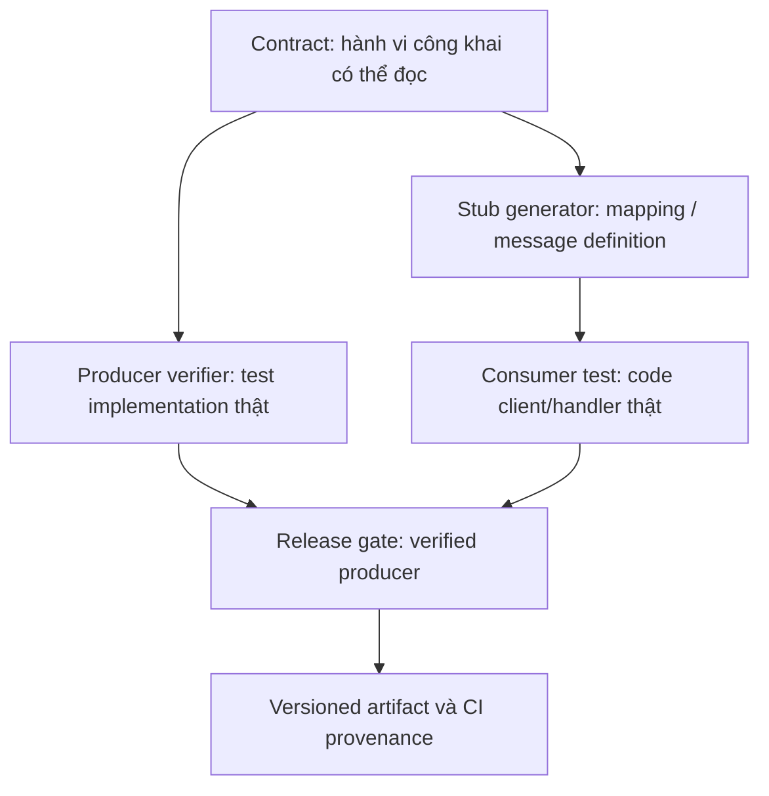
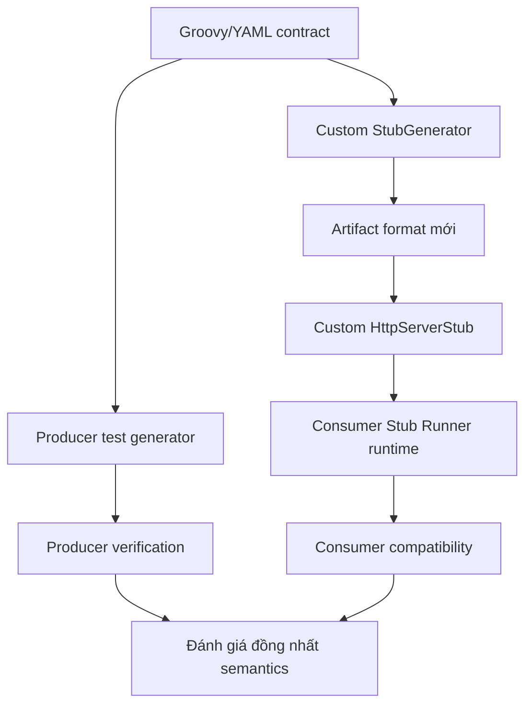
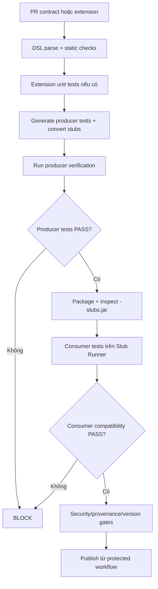
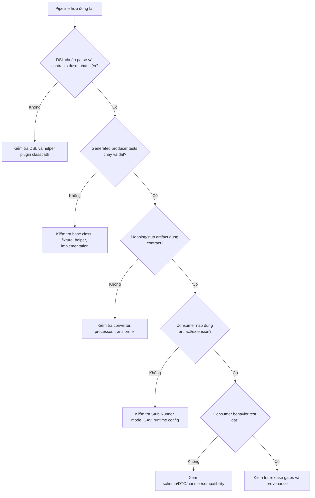

# Giới hạn mã tùy biến để quy trình hợp đồng dễ bảo trì

## 1. Vì sao càng nhiều mã tùy biến, hợp đồng càng dễ mất giá trị?

Trong module **SPRING_CLOUD_CONTRACT**, Spring Cloud Contract hỗ trợ kiểm thử hợp đồng giữa **producer** và **consumer**. Nhóm mô tả hành vi HTTP hoặc thông điệp bằng **Groovy/YAML DSL**; Contract Verifier sinh producer tests, chuyển hợp đồng HTTP thành stub, đóng gói artifact và cho consumer chạy qua **Stub Runner**. CI kiểm tra thay đổi API không tương thích trước khi phát hành.

Spring Cloud Contract có nhiều điểm mở rộng: tùy chỉnh test base class, matcher, helper cho Groovy DSL, WireMock extension, converter, generator và Stub Downloader. Khả năng này hữu ích khi hệ thống có yêu cầu đặc thù. Nhưng nếu mọi nhóm đều tự xây framework riêng phía trên framework, việc hiểu một hợp đồng đơn giản có thể yêu cầu đọc hàng loạt class, plugin, file cấu hình và mã nội bộ.

Ví dụ, một hợp đồng đáng lẽ chỉ mô tả:

```text
GET /api/orders/ord-1001
  -> 200 {"id":"ord-1001","status":"CREATED"}
```

lại được viết bằng một DSL tự chế:

```groovy
// PHẢN VÍ DỤ: các hàm sau là API TƯỞNG TƯỢNG của framework nội bộ.
contractsFor('orders') {
    onApiVersion(activeEnvironment()) {
        orderEndpoint(contextFromDatabase()) {
            assertUsing(CompanySpecificDynamicResponseRule('CREATED'))
        }
    }
}
```

Người đọc không còn thấy rõ **request nào** và **response nào** là lời cam kết thực. Khi nâng Spring Cloud Contract hoặc chạy consumer tests bằng công cụ khác, mã tùy biến có thể thiếu classpath, lệch phiên bản hoặc tạo mapping khác với generated producer tests.

**Nguyên tắc của bài:** *Chỉ tùy biến khi có một khoảng trống được chứng minh trong khả năng tiêu chuẩn; đặt mã tùy biến ở tầng thấp nhất cần thiết, có ownership, kiểm thử và lối quay lại cách chuẩn.*

### Kết quả học tập

Sau bài này, bạn có thể:

1. Phân biệt DSL mô tả **hành vi công khai** với mã tùy biến phục vụ **cách kiểm thử**.
2. Chọn mức can thiệp từ cấu hình mặc định, fixture/base test đến extension SPI.
3. Viết Groovy/YAML contracts đọc được mà không giấu business rules trong helper.
4. Tổ chức producer base classes theo HTTP/messaging hoặc domain với phạm vi rõ ràng.
5. Đánh giá khi nào WireMock metadata đủ, khi nào mới cần response transformer.
6. Hiểu chi phí của `ContractConverter`, `StubGenerator`, `SingleTestGenerator` và `StubDownloaderBuilder`.
7. Bảo đảm producer tests, generated stubs và consumer tests **không diễn giải hợp đồng khác nhau**.
8. Đưa giới hạn tùy biến vào PR review, CI, versioning và kế hoạch nâng cấp.

## 2. Cái gì cần giữ ổn định trong mọi quy trình hợp đồng?

Một contract có giá trị khi cả ba yếu tố sau liên kết với nhau:



Mã tùy biến không được tạo ra tình huống:

- Contract nói `404`, nhưng custom stub converter biến nó thành `200`.
- Producer tests chỉ kiểm tra `quantity` là số, còn custom response transformer trả chuỗi `"2"`.
- Test base class gọi thẳng một helper tự tạo response mà **không đi qua producer behavior** cần bảo vệ.
- Consumer Stub Runner dùng extension không có trên classpath, nên mapping không hoạt động.
- Một Groovy helper tải dữ liệu từ database đang chạy, làm cùng một contract cho kết quả khác nhau giữa CI và máy lập trình viên.
- Custom downloader luôn lấy bản “mới nhất”, khiến cùng một consumer commit thử với các stub versions khác nhau.

### 2.1. Tách ba loại thay đổi

| Thay đổi | Ví dụ | Nơi phù hợp |
| --- | --- | --- |
| **Thay đổi giao diện API** | Thêm status `409`, đổi schema message | Contract DSL + review của producer/consumer |
| **Thay đổi cách tạo fixture/test** | Seed order trước mỗi test, cấu hình MockMvc | Base test và test fixtures |
| **Thay đổi hạ tầng/toolchain** | Bộ tải stub riêng, server stub khác WireMock | Extension hoặc build configuration, có owner rõ |

Nếu một thay đổi thuộc nhóm thứ nhất, **đừng giấu nó trong nhóm thứ ba**. Consumer cần nhìn thấy thay đổi bằng contract diff, thay vì phát hiện thông qua output của một post-processor.

## 3. Thang mức độ tùy biến: ưu tiên mức thấp

| Mức | Giải pháp | Khi nào dùng | Chi phí bảo trì |
| --- | --- | --- | --- |
| **0** | Groovy/YAML DSL chuẩn, matcher chuẩn | HTTP/message cases thông thường | Thấp |
| **1** | Maven/Gradle plugin options, test mode, conventions | Đổi root, package, framework, ports | Thấp–vừa |
| **2** | Base class, test fixture, test-specific helpers | Chuẩn bị producer, trigger message | Vừa |
| **3** | Groovy DSL helper thuần, common test utilities | Quy tắc format tái sử dụng thật | Vừa–cao |
| **4** | WireMock metadata, stub customization có phạm vi | Delay, transformer của một mapping được cho phép | Cao |
| **5** | Custom converter/generator/server/downloader | Định dạng/hệ thống stub không được hỗ trợ | Rất cao |

**Không phải mọi team đều cần đi đến mức 5.** Nếu dùng HTTP JSON và WireMock, đa số nhu cầu nên ở mức 0–2. Điểm mở rộng càng sâu càng phải duy trì tương thích với phiên bản Spring Cloud Contract, WireMock, runtime consumer, build plugin và repository.

### 3.1. Quy tắc “ít tùy biến nhất có thể”

Trước khi thêm class/plugin:

1. Có thể diễn đạt bằng **hợp đồng DSL chuẩn** không?
2. Có thể giải quyết bằng **matcher** hoặc **tình huống fixture riêng** không?
3. Có thể đặt vào **base test** mà không thay đổi ý nghĩa contract không?
4. Có tùy chọn plugin hoặc WireMock **metadata** đáp ứng trực tiếp không?
5. Nếu cần custom code, nó có chạy ở **cả producer và consumer cần thiết** không?
6. Có test ngăn regression cho chính extension đó không?
7. Có đường quay về cấu hình chuẩn khi nâng cấp không?

Không phải vì tài liệu hỗ trợ một SPI mà đó là giải pháp đầu tiên nên sử dụng.

## 4. Giữ contract là tài liệu về hành vi, không phải chương trình nghiệp vụ

Một reviewer cần hiểu hợp đồng chỉ bằng những phần chính:

- HTTP: `request.method`, `url`/`urlPath`, query/header/body, `response.status`, headers/body/matchers.
- Messaging: `input`, `label`, `outputMessage.sentTo`, `body`, `headers`, content type.
- Giá trị mẫu và điều kiện nhận request.
- Tên kịch bản và phần mô tả ngắn giải thích nghiệp vụ.

### 4.1. Ví dụ Groovy DSL đơn giản, có thể review

```groovy
import org.springframework.cloud.contract.spec.Contract

Contract.make {
    name 'get_order_created'
    description 'Đọc đơn CREATED để Checkout quyết định thanh toán'

    request {
        method GET()
        url '/api/orders/ord-1001'
        headers {
            header 'Accept': 'application/json'
        }
    }
    response {
        status 200
        headers {
            contentType(applicationJson())
        }
        body([
            id     : 'ord-1001',
            status : 'CREATED',
            amount : 125000,
            currency: 'VND'
        ])
    }
}
```

Đọc hợp đồng trên không cần hiểu database schema, Spring bean graph hoặc tập helper nội bộ. Producer verification test phải gửi request tới producer boundary đã cấu hình; consumer stub sẽ trả response mẫu từ hợp đồng.

### 4.2. YAML DSL tương đương

```yaml
name: get_order_created
description: Đọc đơn CREATED để Checkout quyết định thanh toán
request:
  method: GET
  url: /api/orders/ord-1001
  headers:
    Accept: application/json
response:
  status: 200
  headers:
    Content-Type: application/json
  body:
    id: ord-1001
    status: CREATED
    amount: 125000
    currency: VND
```

Đây là **cách biểu diễn thay thế của cùng hợp đồng**, không nên đặt cả hai vào build để nhân đôi kịch bản trùng request/response.

### 4.3. Vì sao không để Groovy contract truy cập database?

```groovy
// PHẢN VÍ DỤ: đây không phải DSL chuẩn và không nên làm.
def order = DatabaseConnection.fromEnvironment().findAnyPaidOrder()

Contract.make {
    request { method GET(); url "/api/orders/${order.id}" }
    response { status 200; body([status: order.status]) }
}
```

Hợp đồng đang phụ thuộc:

- Database có sẵn/credential khi **đọc DSL**.
- Dữ liệu thay đổi theo môi trường.
- Một query không liên quan trực tiếp lời cam kết API.
- Thời điểm generator chạy, không phải hành vi producer cần verify.

**Cách tốt hơn:** contract có sample ổn định, còn test base/fixture khởi tạo dữ liệu `ord-1001` trong môi trường test. Nếu cần dữ liệu động, dùng matcher đúng mục đích; không dùng database production làm nguồn DSL.

## 5. Matcher chuẩn thay thế một phần lớn custom validator

Trước khi tạo một custom validation engine, hãy dùng khả năng của DSL:

- Matcher cho **method, path, query, headers** và JSON body.
- Quy tắc kiểu/regex/JSONPath ở response khi dữ liệu dynamic.
- Tách kịch bản cho những nhánh nghiệp vụ khác nhau.
- Phân biệt sample cần đưa vào fixture và matcher sẽ kiểm tra.

### 5.1. Định dạng khác giá trị cụ thể

Ví dụ producer cấp mã đơn mới:

```json
{
  "orderId": "ord-1001",
  "status": "CREATED"
}
```

Nếu `orderId` được sinh động, một contract có thể dùng matcher cho **format** thay vì ép mọi producer test nhận đúng literal `ord-1001`. Tuy nhiên, stub vẫn cần có ví dụ hợp lệ để consumer test giải mã.

Với một hợp đồng mà producer và consumer chỉ quan tâm **kiểu và định dạng** của ID, không cần viết:

```text
CustomOrderIdValidator
  -> DynamicCompanyOrderIdMatcher
  -> CustomJsonGenerator
  -> CustomWireMockResponseTransformer
```

Chỉ để kiểm tra một regex dạng `ord-[0-9]+`.

### 5.2. Nhưng matcher quá rộng cũng không bảo trì được

| Kiểm tra | Rủi ro | Cách làm phù hợp |
| --- | --- | --- |
| `status =~ /.*/` | Có thể chấp nhận cả trạng thái ngoài hợp đồng | Giới hạn enum thực sự |
| `amount` là bất kỳ chuỗi | Không bắt đổi number → string | Dùng assertion numeric type |
| URL `/api/orders/.*` luôn trả `200` | Che `404`, `PAID` và lỗi route | Tách request paths hoặc điều kiện tương ứng |
| Assert toàn bộ JSON text byte-for-byte | Fail vì field order, whitespace | Assert theo cấu trúc và dependency consumer |

**Tùy biến ít không có nghĩa kiểm thử lỏng.** Độ chặt phải đến từ semantics của contract; không phải từ lượng mã tự viết.

## 6. Đặt custom setup ở base test thay vì trong DSL

Một nơi tùy biến có chủ đích là **base class của generated producer tests**. Nó được dùng để cấu hình MockMvc, RestAssured, message verifier, fixture hoặc test clock, trong khi hợp đồng vẫn mô tả hành vi công khai.

### 6.1. Producer Spring MVC với một base class

```java
package com.example.orders.contract;

import io.restassured.module.mockmvc.RestAssuredMockMvc;
import org.junit.jupiter.api.BeforeEach;
import org.springframework.beans.factory.annotation.Autowired;
import org.springframework.boot.test.autoconfigure.web.servlet.AutoConfigureMockMvc;
import org.springframework.boot.test.context.SpringBootTest;
import org.springframework.test.web.servlet.MockMvc;

@SpringBootTest
@AutoConfigureMockMvc
public abstract class OrdersContractBase {

    @Autowired
    private MockMvc mockMvc;

    @Autowired
    private OrdersContractFixtures fixtures;

    @BeforeEach
    protected void setUpContractData() {
        fixtures.reset();
        fixtures.create("ord-1001", "CREATED", 125000L, "VND");
        fixtures.create("ord-2002", "PAID", 89000L, "VND");
        fixtures.ensureMissing("ord-missing");
        RestAssuredMockMvc.mockMvc(mockMvc);
    }
}
```

`OrdersContractFixtures` và các phương thức `reset`, `create`, `ensureMissing` là **helper do dự án tự hiện thực**, **không phải API Spring Cloud Contract**. Chúng phải tác động lên dữ liệu hoặc thành phần mà controller thực đọc, không đơn thuần tạo response mô phỏng rồi khẳng định producer đã được verify.

### 6.2. Cấu hình Maven plugin

```xml
<build>
  <plugins>
    <plugin>
      <groupId>org.springframework.cloud</groupId>
      <artifactId>spring-cloud-contract-maven-plugin</artifactId>
      <version>REPLACE_WITH_COMPATIBLE_VERSION</version>
      <extensions>true</extensions>
      <configuration>
        <testFramework>JUNIT5</testFramework>
        <testMode>MOCKMVC</testMode>
        <baseClassForTests>
          com.example.orders.contract.OrdersContractBase
        </baseClassForTests>
        <failOnNoContracts>true</failOnNoContracts>
      </configuration>
    </plugin>
  </plugins>
</build>
```

Đây là **POM fragment**. Phiên bản plugin phải được thay bằng phiên bản tương thích Spring Boot/Spring Cloud/JDK của dự án; producer còn cần các test dependencies như `spring-boot-starter-test`, `spring-cloud-starter-contract-verifier` và HTTP stack tương ứng.

### 6.3. Những gì một base test nên và không nên làm

| Nên làm | Không nên làm |
| --- | --- |
| Tạo/clear fixture xác định | Tìm bản ghi ngẫu nhiên trên database chung |
| Khởi tạo MockMvc hoặc HTTP test client | Chỉ mock toàn bộ response để mọi test xanh |
| Đặt test clock, locale, timezone có chủ đích | Lấy `LocalDateTime.now()` không kiểm soát |
| Tạo test identity/authorization phù hợp | Nhúng production credential |
| Reset trạng thái sau hoặc trước test | Phụ thuộc thứ tự test khác |
| Kích hoạt producer event thật qua helper rõ ràng | Dựng sẵn message trong verifier rồi giả là producer đã publish |

### 6.4. Giữ base class nhỏ

Một base class hơn một nghìn dòng chứa logic order, payment, inventory, fake broker, DB cleanup và custom HTTP middleware là dấu hiệu **mức tùy biến quá lớn**. Nó làm mọi contract phụ thuộc vào quá nhiều setup.

Hãy tách:

```text
OrdersContractBase
  -> OrdersContractFixtures      (test data)
  -> TestClockConfiguration      (nếu cần)
  -> HttpContractSecuritySetup   (nếu cần)

MessagingContractBase
  -> OrderEventTestDriver        (trigger producer thật)
  -> TestMessagingConfiguration  (binder/broker test)
```

Những class có tên trong sơ đồ là **đơn vị thiết kế của ứng dụng**, không phải extension bắt buộc Spring Cloud Contract cung cấp.

## 7. Khi một base class chưa đủ: dùng `baseClassMappings`

Spring Cloud Contract hỗ trợ ánh xạ **nhóm contracts → base class**. Đây là tính năng cấu hình, không cần tự viết custom test generator.

Ví dụ producer vừa có HTTP Orders vừa có event messaging:

```xml
<configuration>
  <testFramework>JUNIT5</testFramework>
  <baseClassForTests>com.example.contract.CommonContractBase</baseClassForTests>
  <baseClassMappings>
    <baseClassMapping>
      <contractPackageRegex>.*orders.*</contractPackageRegex>
      <baseClassFQN>com.example.contract.OrdersHttpBase</baseClassFQN>
    </baseClassMapping>
    <baseClassMapping>
      <contractPackageRegex>.*messaging.*</contractPackageRegex>
      <baseClassFQN>com.example.contract.OrdersMessagingBase</baseClassFQN>
    </baseClassMapping>
  </baseClassMappings>
</configuration>
```

**Đây là cấu hình minh họa**. Regex được so với **contract package** do generator xác định; phải kiểm tra generated tests thực sự `extends` đúng lớp. `CommonContractBase` cũng phải tồn tại nếu dùng làm fallback. Mappings chồng lấp/regex quá rộng khiến test có thể nhận sai setup.

### 7.1. Khi nào ánh xạ đáng giá?

- HTTP và messaging đòi các test infrastructure khác nhau.
- Hai domain có fixture/clock/auth policy khác nhau.
- Có thể phân nhóm contract theo thư mục/package một cách ổn định.

### 7.2. Khi nào không nên?

- Mỗi một contract lại cần một base class riêng chỉ vì một giá trị fixture.
- Team dùng `baseClassMappings` để né việc sửa tiền điều kiện chung.
- Regex phụ thuộc tên file không ổn định rồi âm thầm match sai.
- Lớp nền kế thừa sâu: `Base → CommonBase → CompanyBase → LegacyBase` khiến setup khó truy vết.

**Mục tiêu:** các lớp nền mô tả một số **hạ tầng thử nghiệm thật sự khác nhau**, không phải một mini-framework tùy biến cho từng request.

## 8. Groovy DSL helper: chỉ trừu tượng hóa thứ ổn định và có thể đọc

Tài liệu Spring Cloud Contract cho phép mở rộng **Groovy DSL** bằng helper functions nằm trong JAR dùng chung. Nhưng đây là **cơ chế Groovy-specific**: YAML không tự gọi các method Java/Groovy của helper ấy.

### 8.1. Ví dụ utility thuần

Khi nhiều hợp đồng cần cùng một ví dụ mã đơn **giả**:

```java
package com.example.contract.samples;

public final class ContractSamples {
    private ContractSamples() {}

    public static String createdOrderId() {
        return "ord-test-1001";
    }

    public static String missingOrderId() {
        return "ord-test-missing";
    }
}
```

Nếu nhóm đã cấu hình `ContractSamples` trên **classpath mà Groovy DSL converter nhìn thấy**, contract Groovy có thể tham chiếu:

```groovy
import org.springframework.cloud.contract.spec.Contract
import static com.example.contract.samples.ContractSamples.createdOrderId

Contract.make {
    name 'get_created_order'
    request {
        method GET()
        url "/api/orders/${createdOrderId()}"
    }
    response {
        status 200
        headers { contentType(applicationJson()) }
        body([id: createdOrderId(), status: 'CREATED'])
    }
}
```

**Điều kiện quan trọng:** class/helper phải có mặt khi **plugin xử lý Groovy DSL**, không chỉ khi `mvn test` chạy; một phương thức cần hỗ trợ static-compatibility phù hợp với cơ chế DSL. Code trên là **mô hình dùng utility thuần**, không tuyên bố mọi plugin version tự nạp các class này nếu thiếu dependency phù hợp.

### 8.2. Nhưng helper trên có thực sự cần?

Với một hoặc hai hợp đồng, viết trực tiếp:

```yaml
request:
  method: GET
  url: /api/orders/ord-test-1001
response:
  status: 200
  body:
    id: ord-test-1001
    status: CREATED
```

thường **dễ đọc và ít coupling hơn** tạo một JAR helper. Đừng trừu tượng hóa chỉ vì ba lần xuất hiện chuỗi `ord-test-1001`.

### 8.3. Checklist cho reusable Groovy helper

- [ ] Helper **thuần**: đầu vào → đầu ra xác định, không network/DB/file/time ngầm.
- [ ] Chỉ bao bọc format/mẫu dùng chung, **không giấu status/body/URL** quan trọng.
- [ ] Code và dependency version có owner rõ.
- [ ] Producer generator có classpath phù hợp.
- [ ] Consumer không bị bắt cài helper chỉ để đọc/run stubs nếu tránh được.
- [ ] Có kiểm thử unit cho helper và kiểm thử việc **parse contracts thật**.
- [ ] Hợp đồng vẫn dễ hiểu bằng mắt khi đọc PR.
- [ ] Có kế hoạch bỏ helper nếu nhu cầu biến mất.

### 8.4. Mối nguy từ “thông minh hóa” helper

```groovy
// PHẢN VÍ DỤ: các helper này là mã giả, không phải API framework.
body(CustomOrderTemplate.forCurrentEnvironment())
url(CompanyApiPathResolver.guessPathFromBranchName())
headers(ProductionSecrets.fetchAuthHeaders())
```

Chúng biến contract thành một script động theo môi trường, branch, secret và database, khó review và tái lập. CI có thể sinh stubs khác nhau từ cùng source commit. Đây là lý do nên hạn chế helper ở **logic thuần, ổn định và minh bạch**.

## 9. Phân biệt helper của DSL và helper của producer tests

Hai loại helper phục vụ hai thời điểm khác nhau:

| Loại | Chạy khi nào? | Công việc hợp lý |
| --- | --- | --- |
| **Groovy DSL helper** | Khi parser/converter xử lý contract | Cung cấp format pattern, sample bất biến |
| **Producer base helper** | Khi generated test chạy | Seed fixture, trigger behavior thật, cấu hình test client |

Nếu cần chuẩn bị database, **không làm ở DSL helper**. Nếu cần mô tả JSON schema/matcher, **không nên bắt producer base test tự đọc DSL và sửa response**.

### 9.1. Message producer: `triggeredBy` cần helper nhưng không cần generator mới

```groovy
import org.springframework.cloud.contract.spec.Contract

Contract.make {
    name 'order_created_event'
    label 'order_created'

    input {
        triggeredBy('publishOrderCreated()')
    }

    outputMessage {
        sentTo('orders.events')
        body([
            eventType: 'ORDER_CREATED',
            orderId  : 'ord-test-1001',
            quantity : 2
        ])
        headers {
            header('eventType', 'ORDER_CREATED')
            messagingContentType(applicationJson())
        }
    }
}
```

`publishOrderCreated()` là **method do producer test base định nghĩa**, không phải method có sẵn của Spring Cloud Contract.

Một cách thiết kế test base có thể gọi **đúng mã sản xuất**:

```java
package com.example.orders.contract;

import org.junit.jupiter.api.BeforeEach;
import org.springframework.beans.factory.annotation.Autowired;
import org.springframework.boot.test.context.SpringBootTest;
import org.springframework.cloud.contract.verifier.messaging.boot.AutoConfigureMessageVerifier;

@SpringBootTest
@AutoConfigureMessageVerifier
public abstract class OrdersMessagingBase {

    @Autowired
    private OrderEventTestDriver driver;

    @BeforeEach
    protected void prepare() {
        driver.clearTestState();
    }

    public void publishOrderCreated() {
        driver.createOrderThroughApplication("ord-test-1001", 2);
    }
}
```

`OrderEventTestDriver`, `clearTestState` và `createOrderThroughApplication` là **thành phần dự án tự viết**. Nó phải đi qua mã phát event thật; nếu helper chỉ gọi trực tiếp test broker `send("orders.events", sampleJson)` mà không thực thi producer, generated test không chứng minh producer biết tạo sự kiện.

`@AutoConfigureMessageVerifier` và binder/broker test phải tương thích phiên bản Spring Cloud Contract cùng messaging stack. **Không cần viết custom message generator** chỉ vì producer dùng Kafka/Rabbit; trước hết xem integration và message verifier hỗ trợ.

### 9.2. Kiểm tra mặt consumer

Consumer có thể dùng `StubTrigger.trigger("order_created")` với Stub Runner theo artifact version; cần xác nhận **handler thật** nhận và xử lý message, không chỉ assert `trigger` trả true.

```java
// Minh họa trong consumer test đã cấu hình Stub Runner + Awaitility.
readModel.deleteByOrderId("ord-test-1001");
assertThat(readModel.hasOrder("ord-test-1001")).isFalse();

assertThat(stubTrigger.trigger("order_created")).isTrue();

await().atMost(Duration.ofSeconds(5)).untilAsserted(() ->
    assertThat(readModel.hasOrder("ord-test-1001")).isTrue()
);
```

`readModel` là API giả định của consumer. Broker và credentials phải thuộc môi trường **test**, không dùng production resources. Điều chỉnh polling/timeout theo ứng dụng và bảo đảm test state được reset.

## 10. WireMock metadata: thử trước khi viết transformer

Trong những phiên bản Spring Cloud Contract hỗ trợ, contract `metadata` có thể chứa entry `wiremock` để tinh chỉnh phần **generated StubMapping**. Ví dụ phổ biến là mô phỏng một **delay** trong HTTP stub.

### 10.1. Khi có thể cần delay

Checkout muốn kiểm tra timeout fallback khi Orders phản hồi chậm. Nếu contract business vẫn quy định response:

```json
{"id":"ord-test-1001","status":"CREATED"}
```

thì **độ trễ giả lập** có thể được áp dụng ở **stub mapping** mà không cần đổi response body hoặc triển khai một server stub tự viết.

Ví dụ **phần JSON WireMock mapping sau sinh** (không phải DSL input):

```json
{
  "request": {
    "method": "GET",
    "url": "/api/orders/ord-test-1001"
  },
  "response": {
    "status": 200,
    "jsonBody": {
      "id": "ord-test-1001",
      "status": "CREATED"
    },
    "fixedDelayMilliseconds": 1500
  }
}
```

Đây là ví dụ WireMock JSON **mô tả kết quả mong muốn**, không khẳng định generator sẽ tạo đúng nội dung byte-for-byte. Khi dùng metadata trong contract thật, kiểm tra syntax theo Spring Cloud Contract version, inspect mapping được sinh và chạy Stub Runner test để xác nhận delay có hiệu lực.

### 10.2. Giới hạn quan trọng của metadata

Tài liệu Spring Cloud Contract nêu rằng chỉnh sửa bằng WireMock metadata áp dụng **phía stub**, **không tự sửa producer generated test**. Vì vậy:

- Nếu metadata chỉ tăng độ trễ để kiểm tra timeout của consumer, nó phục vụ **consumer resilience test**.
- Nếu metadata đổi status/body mà producer tests không biết, có thể làm **producer/consumer lệch hợp đồng**.
- Không coi stub metadata là một cách hợp lệ để âm thầm thay định nghĩa API đã được producer review.

**Quy tắc:** metadata cho hành vi stub có mục đích kiểm thử rõ ràng; semantics producer–consumer thực tế vẫn phải nằm trong contract tiêu chuẩn và được producer xác minh.

## 11. WireMock response transformer: chi phí vận hành hai phía

WireMock hỗ trợ custom extensions như response transformer. Spring Cloud Contract cung cấp cơ chế đăng ký các extension này trong một số cấu hình qua interface `WireMockExtensions` và service discovery `META-INF/spring.factories`.

### 11.1. Điều nhiều nhóm quên

Một transformer có thể được đăng ký khi generator/build chạy, nhưng khi **consumer Stub Runner** tải JAR, WireMock ở môi trường consumer phải biết extension tương ứng. Tài liệu chỉ rõ có trường hợp cần `HttpServerStubConfigurer` tùy biến (chẳng hạn lớp mở rộng `WireMockHttpServerStubConfigurer`) để đăng ký custom extension cho Stub Runner.

**Chỉ đặt tên transformer vào mapping không đảm bảo runtime consumer có class tương ứng.**

### 11.2. Checklist trước khi chấp thuận transformer

| Câu hỏi | Tiêu chí chấp thuận |
| --- | --- |
| Có giải pháp DSL/matcher/metadata chuẩn không? | Nếu có, ưu tiên phương án chuẩn |
| Có cần áp dụng cho **mọi mapping** không? | Tránh global transformer ngoài ý muốn |
| Transformer có dùng môi trường/secret/runtime state không? | Tránh non-determinism và rò thông tin |
| Consumer có đủ extension JAR/configurer không? | Bắt buộc chứng minh bằng test sạch |
| Có làm response khác producer verification không? | Nếu có, phải thiết kế lại |
| Có hoạt động với version WireMock/Contract hiện dùng không? | Ghim version và kiểm tra nâng cấp |
| Có test trường hợp **không có extension** không? | Phải fail rõ ràng, không trả response sai âm thầm |

### 11.3. Một anti-pattern: viết transformer để luôn tạo status đẹp

```text
Producer trả: 409 OUT_OF_STOCK
Custom transformer đổi thành: 200 {"available":false}
Consumer test với stub: PASS
Producer generated test cho 409: PASS
Thực tế consumer ngoài test: FAIL do nhận 409
```

Tình huống này tạo **hai định nghĩa hành vi**. Nếu consumer thật sự cần API `200 available=false`, phải thương lượng và cập nhật **contract/producer**, không giấu một protocol adapter vào WireMock transformer mà không kiểm chứng trên đường đi thực.

## 12. Khi nào mới cần pluggable architecture sâu?

Tài liệu Spring Cloud Contract công bố các điểm mở rộng như:

| SPI/điểm mở rộng | Giải quyết vấn đề | Câu hỏi trước khi triển khai |
| --- | --- | --- |
| `ContractConverter` | Đọc/ghi một **định dạng hợp đồng khác** | Có thể dùng Groovy/YAML chuẩn không? |
| `SingleTestGenerator` | Thay cách sinh producer tests | Test framework/language mặc định có đáp ứng không? |
| `StubGenerator` | Sinh format stub khác WireMock | Có thật sự cần stub server khác không? |
| `HttpServerStub` | Chạy một backend stub khác | Stub Runner + WireMock có thiếu khả năng cốt lõi nào? |
| `StubDownloaderBuilder` | Tải stub từ nguồn đặc thù | LOCAL/REMOTE/CLASSPATH hoặc repository chuẩn có đủ không? |
| `WireMockExtensions` | Đăng ký extension khi dùng WireMock | Metadata/mapping tiêu chuẩn có giải quyết được không? |
| `StubProcessor` | Post-process generated stub mapping | Có thể biểu diễn trong contract/WireMock metadata không? |

Những API này **có thật**, nhưng chữ ký/lớp/phương thức, quá trình auto-discovery và khả năng tương thích có thể thay đổi theo version. Không nên sao chép một ví dụ dành cho Spring Cloud Contract 3.x và mặc định nó hoạt động nguyên vẹn ở 4.x/5.x.

### 12.1. Chi phí thực của một extension

Một SPI chỉ có một class cũng kéo theo:

```text
Custom module source
  + module dependencies và plugin dependencies
  + META-INF/spring.factories (nếu SPI đó dùng)
  + generator runtime classpath
  + producer test runtime
  + stub artifact format
  + consumer Stub Runner runtime/configurer
  + CI package/publish/version pin
  + docs, ownership, upgrade tests và rollback
```

Nếu không có người chịu trách nhiệm kiểm tra chuỗi này, mã mở rộng trở thành **rủi ro chuỗi công cụ** thay vì giá trị sản phẩm.

## 13. `ContractConverter`: chỉ cho định dạng chưa có đường chuẩn

Một số nhóm có OpenAPI, Pact hoặc định dạng nội bộ đã tồn tại. Spring Cloud Contract có interface `ContractConverter` để chuyển một định dạng bên ngoài sang mô hình `Contract` và ngược lại.

### 13.1. Trách nhiệm của converter

- Quyết định file nào được converter nhận, thường dựa extension/schema.
- Chuyển input thành **các trường contract chuẩn** (request, response, messaging).
- Giữ nguyên semantics kiểu dữ liệu, header, matcher và nhánh lỗi.
- Chuyển lại nếu workflow thực sự yêu cầu hỗ trợ hai chiều.
- Có error message rõ nếu định dạng không được hỗ trợ.

Ví dụ registration qua `META-INF/spring.factories` (mang tính minh họa cấu trúc, cần kiểm tra SPI version):

```properties
org.springframework.cloud.contract.spec.ContractConverter=\
com.example.contract.converter.ExampleContractConverter
```

**Không có class `ExampleContractConverter` sẵn trong Spring Cloud Contract**. Đây là FQCN giả định của một implementation do nhóm tự viết và đóng gói vào JAR.

### 13.2. Vì sao không nên viết converter cho một vài trường?

Nếu team chỉ cần thêm `X-Trace-Id` hoặc đổi status `400` thành `422`, đó là **thay đổi contract DSL**. Viết một converter để âm thầm chèn header/status ở mọi hợp đồng sẽ:

- Che thay đổi khỏi PR diff.
- Làm các consumer không biết producer thực sự cam kết gì.
- Tạo khác biệt khi generated test và stub run qua plugin version khác.
- Khó debug khi một tập contract bị ảnh hưởng ngoài ý muốn.

Chỉ cân nhắc converter khi định dạng nguồn cần bảo tồn có số lượng/độ ổn định đủ lớn và **không có giải pháp chuyển đổi chuẩn đáp ứng yêu cầu**.

## 14. `SingleTestGenerator` và `StubGenerator`: rủi ro lệch producer–consumer

### 14.1. Custom producer test generator

`SingleTestGenerator` dùng khi cần tùy biến cách producer tests được sinh, ví dụ một test language/framework không được hỗ trợ.

Đòi hỏi tối thiểu:

1. Test generated class **compile** và được test runner thực thi.
2. Các assertion status/body/headers/message không bị bỏ qua.
3. Các matcher có ý nghĩa tương đương DSL chuẩn.
4. Failures gắn được với contract name/source.
5. Không tạo mã test chỉ assert fixture với fixture.
6. Có regression tests khi plugin/test framework nâng version.

Nếu mong muốn chỉ là đổi **base class, generated test package hoặc test mode**, hãy dùng plugin configuration trước khi tự thay generator.

### 14.2. Custom stub generator

`StubGenerator` cho phép sinh mapping của một stub server khác WireMock. Nhưng nếu consumer vẫn chạy **WireMock mặc định**, output đó không tự nạp được.

Một giải pháp hoàn chỉnh có thể phải gồm:



Chỉ viết một plugin converter rồi coi consumer đã có stub là **chưa đầy đủ**. Cần một kiểm tra toàn đường đi từ contract đến consumer.

### 14.3. Tại sao “tối ưu tốc độ test” thường không đủ lý do?

Nếu producer generated tests chạy chậm do nạp context/database, thường nên:

- Giảm test fixture setup quá rộng.
- Dùng test slicing hợp lý trong phạm vi contract cần xác minh.
- Tái sử dụng Spring context theo chính sách test.
- Sửa các external dependencies còn gọi mạng.
- Cô lập database/broker test.

Tránh viết `SingleTestGenerator` chỉ để sinh một test class mới bỏ đi những assertion đang tốn thời gian.

## 15. `StubDownloaderBuilder`: chỉ dùng khi repository chuẩn không phù hợp

Stub Runner có thể lấy stub theo những mode phổ biến:

| Mode | Nguồn | Khả năng |
| --- | --- | --- |
| `CLASSPATH` | Stubs có trên test classpath | Không cần downloader tùy biến nếu packaging phù hợp |
| `LOCAL` | Local Maven repository | Tốt cho developer/producer `mvn install` |
| `REMOTE` | Maven-compatible repository | Tốt cho CI với Nexus/Artifactory đã cấu hình |

Chỉ cần `StubDownloaderBuilder` khi nguồn artifact **thực sự khác biệt** và không thể sử dụng các lựa chọn chuẩn một cách hợp lý.

### 15.1. Ví dụ register downloader tùy biến

```properties
# META-INF/spring.factories, ví dụ registration cho SPI tương ứng.
org.springframework.cloud.contract.stubrunner.StubDownloaderBuilder=\
com.example.contract.stubs.InternalStubDownloaderBuilder
```

Class `InternalStubDownloaderBuilder` là **mã do nhóm tự xây**, không phải API Spring có sẵn. Nó cần trả artifact đã resolve đúng tọa độ, classifier và version, có checksum/provenance và quyền truy cập an toàn.

### 15.2. Một downloader dễ trở thành rủi ro

```text
Input: com.example:orders-producer:1.4.2:stubs
Custom downloader tự thay version thành 1.5.0 mới nhất
Consumer tests: PASS
Release pipeline khẳng định kiểm thử stub 1.4.2
```

Đó là false confidence. Downloader không được âm thầm phá version pin. Một implementation tốt phải:

- Ghi log tọa độ được **yêu cầu** và **resolve thực tế** (không in secret).
- Fail rõ nếu version không tồn tại.
- Không tự chọn latest trừ khi đây là chính sách được chấp thuận trong môi trường thử nghiệm không dùng cho release.
- Kiểm tra checksum/signature/provenance theo yêu cầu.
- Dùng credentials ít quyền qua secret store; không ghi trong Git.
- Tương thích cả local cache và clean CI.

## 16. Classpath và dependency: một extension có thể chạy ở nơi nào?

Khi mở rộng Groovy DSL hoặc công cụ sinh test/stub, một lỗi khó thấy là **class có mặt ở producer test runtime nhưng không nằm trên plugin classpath**.

### 16.1. Phân biệt các miền thực thi

| Miền | Ví dụ | Tải extension từ đâu? |
| --- | --- | --- |
| **Build plugin** | Groovy DSL converter, test/stub generator | Plugin dependencies, cơ chế plugin classloader |
| **Producer tests** | JUnit base class, fixture helpers | Test dependencies của project |
| **Artifact** | `-stubs.jar` chứa mapping, contracts, metadata | Artifact packaging |
| **Consumer test** | Stub Runner, custom WireMock extension | Consumer test dependencies/configuration |
| **Standalone Stub Runner** | Stub Boot/Docker process | Classpath và runtime config của process riêng |

Không thể kết luận rằng “đã thêm test dependency vào producer” thì consumer process chắc chắn có transformer class. **Mỗi miền thực thi có classloader và cách nạp code riêng.**

### 16.2. Cấu hình Maven khi dùng Groovy helper JAR

Một ứng dụng có thể khai báo helper dưới `scope=test` trong project, đồng thời thêm nó vào **plugin dependencies** nếu converter cần class lúc generate:

```xml
<dependencies>
  <dependency>
    <groupId>com.example.build</groupId>
    <artifactId>contract-samples</artifactId>
    <version>1.0.0</version>
    <scope>test</scope>
  </dependency>
</dependencies>

<build>
  <plugins>
    <plugin>
      <groupId>org.springframework.cloud</groupId>
      <artifactId>spring-cloud-contract-maven-plugin</artifactId>
      <version>REPLACE_WITH_COMPATIBLE_VERSION</version>
      <extensions>true</extensions>
      <dependencies>
        <dependency>
          <groupId>com.example.build</groupId>
          <artifactId>contract-samples</artifactId>
          <version>1.0.0</version>
        </dependency>
      </dependencies>
    </plugin>
  </plugins>
</build>
```

Đây là **minh họa cấu trúc dependency**, không phải một Maven project hoàn chỉnh. `com.example.build:contract-samples:1.0.0` là artifact giả định cần được tự xây/publish. Chỉ thêm hai dependency như trên **khi thực sự có Groovy helper đủ giá trị**; nếu không, contract literal thuần đơn giản và dễ quản lý hơn.

### 16.3. Nếu consumer không chạy được contract vì thiếu helper

Một rủi ro của việc phát hành Groovy DSL chứa custom helper là **consumer muốn parse lại contract nguồn nhưng thiếu class**. Tài liệu đề cập tùy chọn chuyển contracts sang YAML (`convertToYaml` ở một số phiên bản/plugin) để consumer không cần tự nạp helper Groovy; **phải thử generated artifact và consumer runtime thực tế**, không giả định đổi option là bảo đảm mọi custom extension hoạt động.

**Ưu tiên public artifact tự chứa đúng nội dung contract/stub đã được producer verify**, không buộc mọi consumer cài một “SDK nội bộ” chỉ để thực thi HTTP mapping đơn giản.

## 17. Chi phí bảo trì: đo bằng dấu hiệu thực tế

Thay vì tranh luận cảm tính “custom code nhiều hay ít”, có thể đo:

| Tín hiệu | Cách xem xét | Rủi ro khi tăng |
| --- | --- | --- |
| Số class/JAR mở rộng | Có mấy custom SPI, helper modules? | Nhiều điểm phải nâng version |
| Số công đoạn phụ thuộc custom code | Generator, mappings, consumer runtime | Thay đổi một nơi làm nhiều pipeline fail |
| Số contract không đọc độc lập được | Phải mở helper mới hiểu HTTP body? | Review chậm và dễ bỏ sót breaking change |
| Số config môi trường ảnh hưởng output | Branch, env var, database, timezone | Build không tái lập |
| Số consumer cần shared extension | Test JVM, non-JVM, standalone Boot | Khó phân phối và nâng cấp |
| Thời gian điều tra failure | Mất bao lâu để biết test fail vì DSL hay extension? | Tăng MTTR của CI |
| Version compatibility tests | Có test với các Spring Cloud Contract versions hỗ trợ? | Nâng cấp framework trở nên đắt |
| Ownership | Có owner, tài liệu, release/changelog? | Mã không ai sửa được |

### 17.1. Quy tắc ngân sách tùy biến

Một nhóm có thể tự đặt chính sách:

1. Mỗi custom SPI phải có **ADR/RFC ngắn** giải thích vì sao cách chuẩn không đủ.
2. Mỗi extension có **owner** và ít nhất một người backup.
3. Mọi thay đổi vào extension cần chạy cả **producer verification** và **consumer stub tests**.
4. Khi nâng framework, kiểm tra **compatibility matrix** trước khi merge.
5. Sau mỗi đợt nâng cấp, rà soát extension nào đã có giải pháp mặc định tương đương.
6. Không cho phép extension **thay đổi lời cam kết API** mà contract diff không thể hiện.

Chính sách trên là **gợi ý quản trị của bài học**, không phải ràng buộc do Spring Cloud Contract ép buộc.

## 18. Một lộ trình thay thế framework tùy biến bằng cách chuẩn

Giả sử nhóm đang có `CompanyOrderStubEngine` với các chức năng:

```text
CompanyOrderStubEngine
  1. Đọc Groovy DSL
  2. Chuẩn bị order database
  3. Sinh random response
  4. Chọn ngẫu nhiên HTTP status
  5. Đóng gói JSON mapping
  6. Tải stub vào consumer test
```

Nhóm muốn giảm phụ thuộc vào mã nội bộ.

### 18.1. Bước phân rã

| Tính năng cũ | Đưa về giải pháp |
| --- | --- |
| Đọc Groovy DSL | Spring Cloud Contract parser mặc định |
| Dựng dữ liệu kiểm thử | `OrdersContractFixtures` trong producer base |
| Sinh ID response | Sample/matcher chuẩn; giữ test deterministic |
| Chọn status tùy tình huống | Tách hợp đồng `200/404/409` |
| Tạo mapping HTTP | `convert` / WireMock generator mặc định |
| Đóng gói `-stubs.jar` | `generateStubs` / build plugin mặc định |
| Tải vào consumer CI | Stub Runner `LOCAL` hoặc `REMOTE` |

Thay đổi này không nhất thiết phải thực hiện đồng loạt. Di chuyển **một kịch bản đại diện** trước, so sánh producer tests và consumer tests của hệ thống cũ/mới, rồi mở rộng khi đã xác minh cùng semantics.

### 18.2. Chọn bài toán nhỏ trước

```text
GET /api/orders/ord-1001 -> 200 CREATED
GET /api/orders/ord-missing -> 404 ORDER_NOT_FOUND
```

Chuyển hai kịch bản thành DSL chuẩn, sử dụng fixture chuẩn, chạy generated producer tests và Stub Runner consumer tests. Nếu đã đạt, mới chuyển những kịch bản phức tạp hơn như eventual consistency, streaming hoặc message event.

### 18.3. Đừng xóa extension khi consumer vẫn dùng artifact cũ

Nếu một stub release cũ phụ thuộc vào custom transformer hoặc custom server runtime, bỏ JAR extension trong consumer ngay lập tức có thể làm test bản cũ fail. Cần inventory consumer/versions, kế hoạch migration và **giữ khả năng phục hồi** cho các bản còn hỗ trợ.

## 19. CI phải kiểm thử cả contract và custom code

Một extension dù nhỏ cũng phải có hai cấp kiểm thử:

1. **Unit/integration tests của extension**: logic helper/converter/transformer/downloader đúng.
2. **End-to-end contract pipeline**: chính contract sinh producer tests, tạo stub và được consumer sử dụng thành công.

### 19.1. Pipeline gợi ý



### 19.2. Những assertions riêng cho extension

| Extension | Test cần có |
| --- | --- |
| Groovy helper | Input/output ổn định, type đúng, không phụ thuộc environment |
| `baseClassMappings` | Generated class kế thừa đúng base cho từng nhóm |
| WireMock metadata | Mapping có delay/fault đúng, producer generated test **không đổi semantics** |
| Transformer | Chỉ mapping được chọn chịu ảnh hưởng; runtime consumer nạp được extension |
| Converter | File types đúng, map đủ request/response/message fields; round-trip nếu có |
| Generator | Output compile/load được, assertions không bị bỏ |
| Downloader | Resolve đúng GAV/classifier/version, error rõ, checksum/provenance đúng |
| Stub server riêng | Port lifecycle, mapping registration, start/stop và concurrent tests |

### 19.3. Maven lifecycle và bằng chứng

Trong một producer Maven được cấu hình đúng:

```text
generate-test-sources -> generateTests
process-test-resources -> convert
test -> generated tests thực thi qua Surefire (nếu được discover)
package -> generateStubs / stub artifact
verify -> các quality gates được cấu hình
install / deploy -> sau khi hoàn tất verification
```

`generateTests` không đồng nghĩa `test`. `generateStubs` tạo JAR không đồng nghĩa producer đã thỏa hợp đồng nếu tests bị skip. Nếu custom generator/test name làm Surefire chạy **0 generated tests**, pipeline có thể xanh giả.

```bash
# Hướng dẫn cho một dự án Maven đã cấu hình đúng.
./mvnw -B -ntp clean verify

# Xem entries trong stub artifact sau khi verification đạt.
jar tf target/orders-producer-1.4.2-stubs.jar
```

Không chỉ assert `jar tf` thấy file tồn tại; phải kiểm tra mappings, contract source, test report và mã consumer dùng version chính xác.

## 20. Kiểm soát version và nâng cấp Spring Cloud Contract

Spring Cloud Contract có thể thay đổi implementation hoặc SPI qua các dòng version. Một custom extension dùng package/internal class của version cũ có thể không compile hoặc runtime không phát hiện sau nâng cấp.

### 20.1. Ma trận kiểm tra nâng cấp

| Thành phần | Điều cần xác nhận khi nâng version |
| --- | --- |
| Groovy DSL | Custom helper vẫn parse, không lỗi static compatibility |
| YAML DSL | Format/matcher vẫn giữ đúng nghĩa |
| Maven/Gradle plugin | Version tương thích Boot/JDK, extension classpath đúng |
| `baseClassMappings` | Regex và generated package/`extends` không đổi bất ngờ |
| `ContractConverter` | Interface và discovery còn phù hợp |
| `SingleTestGenerator` | Generated sources compile và tests chạy |
| `StubGenerator` | Output format đúng, mappings đầy đủ |
| WireMock extension | API/registration/configurer và dependency version đúng |
| Stub Runner | Nạp artifact và runtime extension trong consumer |
| CI/artifact | Không xuất hiện skip, stale cache, version mismatch |

### 20.2. Thử trên bản phát hành hiện tại và bản ứng viên

Một chiến lược nâng cấp an toàn:

1. Ghim phiên bản Spring Cloud Contract hiện tại và lưu output mẫu.
2. Chạy cùng contracts qua toolchain mới trong một nhánh riêng.
3. So sánh generated test assertions, **không chỉ số lượng file**.
4. So sánh WireMock mappings hoặc message definitions ở **mức semantics**.
5. Chạy producer tests với fixtures và code thực.
6. Chạy các consumer được hỗ trợ với candidate stub.
7. Chỉ publish sau khi owner extension và API owners chấp thuận.

**Không nên dựa vào generated JSON byte-for-byte** nếu formatter hoặc thứ tự field thay đổi nhưng semantics giữ nguyên. Cần kiểm tra các field/matcher/status quan trọng và những thay đổi có thể phá compatibility.

### 20.3. Không publish extension mới đè lên version cũ

Mã extension là một dependency có phiên bản. Nếu phát hành lại `contract-samples:1.0.0` với nội dung khác, build caches có thể chạy hai bản không giống nhau. Ghim versions, phát hành bất biến và kiểm tra provenance như với stub artifact.

## 21. Bảo mật của custom code

Các extension có thể chạy **lúc Maven build**, có quyền đọc môi trường CI, filesystem hoặc repository credentials. Một DSL helper “tiện lợi” có thể vô tình gửi secret đến network khi parse.

### 21.1. Cần chặn

- DSL/helper đọc `System.getenv("PRODUCTION_TOKEN")` để ghép vào HTTP header.
- Stub downloader log nguyên repository password hoặc tự tải URL không được phép.
- Response transformer truy cập production database để làm response “thật hơn”.
- Contract processor sao chép raw production payload vào generated JAR.
- Test fixture chạy với broker hoặc webhook production.
- CI từ PR chưa tin cậy có quyền publish/release credentials.
- WireMock admin API được mở công khai để debug transformer.

### 21.2. Thiết kế an toàn

- Dùng **dữ liệu tổng hợp**, không đưa PII/secret thật vào Groovy/YAML.
- Các helper phục vụ parse nên thuần, không IO/network/secret.
- CI scanners kiểm tra source, generated tests, mappings, stub JAR và logs.
- Stub Runner và WireMock chỉ chạy trong **test network cô lập**.
- Custom downloader dùng read-only credentials, version pin và TLS/repository allowlist.
- Mọi extension có quyền cao được security review khi sửa.

**Vì custom code chạy trong build, việc kiểm soát dependency và review supply chain cũng quan trọng như chất lượng DSL.**

## 22. Troubleshooting: làm sao biết lỗi do contract hay customization?

| Triệu chứng | Nguồn gốc khả dĩ | Hướng kiểm tra |
| --- | --- | --- |
| Groovy DSL parse lỗi `ClassNotFound` | Helper JAR thiếu trên plugin classpath | Kiểm tra plugin dependencies và version |
| Local pass, CI fail khi xử lý Groovy | Environment-dependent helper hoặc cache | Bỏ logic phụ thuộc env, build sạch |
| Test class extends sai base | `baseClassMappings` regex không match | Kiểm tra generated source/contract package |
| Generated tests chạy 0 case | Test generator/naming/Surefire discovery | Kiểm tra test reports và generated class patterns |
| Producer tests PASS, consumer stub trả schema khác | Custom stub processor/transformer | So sánh DSL, generated tests và mapping |
| WireMock báo unknown transformer | Runtime consumer thiếu extension/configurer | Kiểm tra Stub Runner test classpath và registration |
| Stub Runner không tìm artifact | Custom downloader trả sai coordinates/version | Kiểm tra GAV/classifier, repository và logs |
| Test lúc pass lúc fail | Random/time/DB state trong DSL helper | Đưa dynamic state vào fixture có kiểm soát |
| Hợp đồng Groovy chạy được, YAML không dùng helper | Groovy-only extension | Dùng chuẩn YAML/convert phù hợp |
| Nâng Contract version rồi extension fail | SPI compatibility hoặc WireMock version | So sánh version APIs, chạy integration suite |
| Dọn code cũ gây fail consumer LTS | Stub cũ vẫn phụ thuộc custom extension | Inventory supported consumers và pin runtime |

### 22.1. Quy trình điều tra từng lớp



### 22.2. Phép thử phân biệt lỗi

Nếu một transformer có vẻ làm response sai:

1. Lấy **contract source** ở revision producer đã verify.
2. Đọc **generated producer assertions** và report.
3. Đọc **WireMock mapping** trong stub JAR đúng version.
4. Chạy consumer test với/không với extension trong **test setup cô lập**.
5. So sánh response/status/matcher và ghi đúng tầng thay đổi.
6. Nếu extension thay semantics, sửa hoặc loại extension; không làm lỏng contract để cho test xanh.

Không dùng một kết quả `curl 200` từ stub để chứng minh producer API đã đáp ứng.

## 23. Case study: ba nhóm cùng muốn “tùy biến cho nhanh”

### 23.1. Bối cảnh

Orders Producer phục vụ:

- **Checkout Consumer**: cần `GET /api/orders/{id}` với trạng thái `CREATED` hoặc `PAID`.
- **Inventory Consumer**: cần message `ORDER_CREATED` để dự kiến giữ hàng.
- **Mobile Gateway**: dùng Stub Runner standalone trong test pipeline.

Nhóm platform đề xuất một thư viện `company-contract-kit` gồm:

```text
1. Helper tự tìm order ID trên database
2. Custom JSON serializer cho mọi response
3. Response transformer tự thay status và timestamp
4. Downloader tự lấy stub latest
5. Base class chung cho HTTP + messaging
```

Mục tiêu được nêu là “giảm lặp code”.

### 23.2. Phân tích

| Ý tưởng | Nguy cơ | Quyết định đề xuất |
| --- | --- | --- |
| Tìm order ID từ DB ngay khi parse DSL | Non-deterministic, coupling | **Bỏ**; dùng fixture ở base test |
| Serializer riêng cho mọi response | Kiểu dữ liệu có thể khác API chuẩn | **Không làm** nếu Jackson/DSL đủ |
| Transformer thay status/timestamp | Producer/consumer mismatch | **Không dùng** để sửa contract behavior |
| Downloader lấy latest | Mất version pin và reproducibility | Dùng `REMOTE` + version cố định |
| Base HTTP/messaging chung | Setup cồng kềnh, khó debug | Tách `OrdersHttpBase` và `OrdersMessagingBase` |

Sau review, nhóm chỉ giữ:

- Hai base classes theo transport.
- Một fixture helper thuần cho dữ liệu Orders.
- Một common function tạo synthetic ID format **nếu thật sự lặp nhiều**.
- Maven plugin và Stub Runner chuẩn.

### 23.3. Cách đo kết quả

Trước và sau thay đổi, chạy:

1. Generated producer HTTP tests cho `CREATED`, `PAID`, `404`.
2. Generated producer messaging test cho `ORDER_CREATED`.
3. Consumer Checkout tests với Stub Runner đúng version.
4. Consumer Inventory handler test với event stub.
5. Standalone stub trong test network cô lập cho Mobile Gateway.
6. Clean CI build và đọc stub artifact contents.

Chỉ khi **tất cả cùng semantics và tests đạt**, việc loại custom framework mới được chấp thuận. Số dòng mã giảm là lợi ích phụ; **khả năng đọc và tái lập hợp đồng** là lợi ích chính.

## 24. Bài thực hành: quyết định mức tùy biến cho Payment Contracts

### 24.1. Đề bài

Payments Producer có hai hợp đồng:

```text
POST /api/payments
  request {orderId, amount, currency}
  201 {paymentId, status: "AUTHORIZED"}
  409 {code: "DUPLICATE_PAYMENT"}
```

Checkout Consumer dùng HTTP stub; Settlement Consumer nhận message `PAYMENT_AUTHORIZED`. Team đề xuất **bốn thay đổi kỹ thuật**:

1. Viết helper trong Groovy DSL lấy một payment ID từ staging database.
2. Tạo custom `ContractConverter` chỉ vì muốn thêm field `currency`.
3. Tách producer base test thành HTTP và messaging.
4. Thêm WireMock transformer để cố định một độ trễ test theo kịch bản timeout.

### 24.2. Phân loại

| Đề xuất | Quyết định gợi ý | Lý do |
| --- | --- | --- |
| Helper đọc staging database | **Từ chối** | DSL không nên phụ thuộc môi trường, dữ liệu thật |
| Converter thêm field `currency` | **Từ chối** | Field là semantics API, viết trực tiếp vào DSL |
| Hai base classes | **Chấp thuận có điều kiện** | Hai transport thật sự khác test infrastructure |
| Transformer delay | **Ưu tiên metadata trước** | Test resilience không nên mặc định cần custom Java code |

### 24.3. Hợp đồng HTTP ví dụ

```groovy
import org.springframework.cloud.contract.spec.Contract

Contract.make {
    name 'authorize_payment_success'
    request {
        method POST()
        url '/api/payments'
        headers { contentType(applicationJson()) }
        body([
            orderId : 'ord-test-1001',
            amount  : 125000,
            currency: 'VND'
        ])
    }
    response {
        status 201
        headers { contentType(applicationJson()) }
        body([
            paymentId: 'pay-test-1001',
            status   : 'AUTHORIZED'
        ])
    }
}
```

### 24.4. Hợp đồng YAML lỗi duplicate

```yaml
name: authorize_payment_duplicate
request:
  method: POST
  url: /api/payments
  headers:
    Content-Type: application/json
  body:
    orderId: ord-test-duplicate
    amount: 125000
    currency: VND
response:
  status: 409
  headers:
    Content-Type: application/json
  body:
    code: DUPLICATE_PAYMENT
```

**Yêu cầu fixture:** producer phải tạo trạng thái duplicate theo nghiệp vụ (chẳng hạn order đã có payment hoặc idempotency key đã được xử lý). Việc dùng chuỗi `ord-test-duplicate` trong request chỉ giúp stub phân biệt mapping; **không tự chứng minh producer có logic duplicate**.

### 24.5. Nhiệm vụ người học

1. Viết một PR giải thích vì sao không nên thêm custom converter cho field `currency`.
2. Vẽ ranh giới giữa `PaymentsHttpBase` và `PaymentsMessagingBase`.
3. Viết một test fixture có thể tái lập cho nhánh `201`.
4. Viết một test fixture cho `409` không phụ thuộc test order.
5. Định nghĩa hợp đồng `PAYMENT_AUTHORIZED` với `label`, `sentTo`, headers/body.
6. Tạo một consumer test gọi HTTP client thật, kiểm tra trạng thái thanh toán.
7. Tạo một consumer handler test với message stub, kiểm tra thay đổi state bất đồng bộ.
8. Mô tả cách mô phỏng delay mà không đổi status/body contract.
9. Lập bảng dependency nếu team **bắt buộc** dùng WireMock extension.
10. Đề xuất test dùng để phát hiện khi custom converter/transformer làm lệch producer–consumer semantics.
11. Soạn CI gate chặn 0 generated contract tests hoặc stub artifact sai version.
12. Nêu điều kiện để loại một extension cũ khi consumer LTS còn phụ thuộc.

### 24.6. Câu hỏi tự kiểm tra

**Câu 1.** Khi nào nên ưu tiên `baseClassMappings` thay vì viết custom generator?

**Đáp án:** Khi chỉ cần generated tests kế thừa **các base classes khác nhau** theo nhóm contract, còn cách sinh test chuẩn vẫn đáp ứng.

**Câu 2.** Nếu DSL helper chỉ được thêm vào producer `test` dependency, plugin chắc chắn thấy nó không?

**Đáp án:** Không được giả định. Groovy DSL được xử lý trong **plugin execution context**; có thể cần plugin dependency theo hướng dẫn đúng version.

**Câu 3.** WireMock metadata thay delay có tự kiểm tra latency của producer thật không?

**Đáp án:** Không. Đây là **stub-side behavior**, hữu ích cho consumer timeout test nhưng không tự tạo producer performance assertion.

**Câu 4.** Có thể dùng custom `StubDownloaderBuilder` để tự nâng mọi version đến latest trong release test không?

**Đáp án:** Không nên. Điều đó phá **pinning, reproducibility và provenance**, khiến kết quả test không gắn với candidate cụ thể.

**Câu 5.** Vì sao một `StubGenerator` mới có thể đòi custom `HttpServerStub`?

**Đáp án:** Vì Stub Runner mặc định chạy định dạng WireMock; nếu generator sinh định dạng server khác, cần runtime có thể nạp và phục vụ nó.

**Câu 6.** Dấu hiệu nào cho thấy custom code đã vượt quá giới hạn hợp lý?

**Đáp án:** Contract không đọc được độc lập, phụ thuộc DB/env/secret khi parse, generated producer tests và consumer stubs trả kết quả khác nhau, hoặc nâng framework luôn làm vỡ extension không có người sở hữu.

## 25. Checklist thực tế trước khi merge custom code

### A. Contract và use case

- [ ] Có use case producer/consumer cụ thể và contract diff vẫn thể hiện được hành vi công khai.
- [ ] Đã thử Groovy/YAML DSL, matcher, fixture, plugin configuration trước.
- [ ] Không đưa truy vấn DB/HTTP/secret vào thời điểm parse DSL.
- [ ] Các nhánh HTTP `200/404/409` hoặc message cần thiết được thể hiện bằng contract rõ.
- [ ] Không có matcher quá rộng gây false positives.
- [ ] Không có hai request matchers chồng lấp với response trái nhau.

### B. Mức tùy biến và ownership

- [ ] Có lý do chính đáng nếu dùng custom SPI hoặc transformer.
- [ ] Extension có owner, version, release notes và docs ngắn.
- [ ] Mã helper ưu tiên pure/deterministic; không chứa business implementation thay hợp đồng.
- [ ] Base classes được chia theo hạ tầng thực sự khác, không chia theo từng fixture tùy ý.
- [ ] Có kiểm tra generated `extends` đúng khi dùng `baseClassMappings`.
- [ ] Có kế hoạch migration/rollback và loại bỏ extension khi không cần.
- [ ] Đã kiểm tra license, dependency và khả năng upgrade của extension JAR.

### C. Hai phía của hợp đồng

- [ ] Producer generated tests **thực sự chạy** trên implementation cần bảo vệ.
- [ ] Stub mapping đúng request/status/body/headers theo contract đã duyệt.
- [ ] Metadata/transformer không âm thầm thay API semantics.
- [ ] Consumer Stub Runner có đủ extension/configurer khi cần.
- [ ] Consumer tests dùng HTTP client/message handler thật và assert tác động nghiệp vụ.
- [ ] Messaging test không chỉ assert `trigger(label) == true`.
- [ ] Có một clean CI job chạy đủ producer→artifact→consumer, không dựa vào cache cũ.

### D. Bảo mật, phát hành và nâng cấp

- [ ] Không có secret hoặc dữ liệu người thật trong DSL/fixture/generated artifact.
- [ ] Custom downloader dùng version pin, checksum/provenance và quyền tối thiểu.
- [ ] JAR artifact có version bất biến và gắn với source commit đã verify.
- [ ] Test reports ghi số generated cases run/pass/fail/skip.
- [ ] Release gate chặn `inProgress`/`ignored` không được chấp thuận.
- [ ] Các consumer/branches còn hỗ trợ được kiểm tra tương thích.
- [ ] Khi nâng Spring Cloud Contract/WireMock, có compatibility suite cho extension.
- [ ] Các phần tùy biến không biến Standalone Stub Runner thành dịch vụ production.

## 26. Tài liệu tham khảo

- [Spring Cloud Contract — DSL Customization](https://docs.spring.io/spring-cloud-contract/reference/customization/dsl-customization.html): khả năng tái sử dụng Groovy helpers, plugin dependencies và `convertToYaml`.
- [Spring Cloud Contract — WireMock Customization](https://docs.spring.io/spring-cloud-contract/reference/customization/wiremock-customization.html): `WireMockExtensions`, metadata, post-processing và giới hạn stub-side.
- [Spring Cloud Contract — Using the Pluggable Architecture](https://docs.spring.io/spring-cloud-contract/reference/customization/pluggable-architecture.html): `ContractConverter`, `SingleTestGenerator`, `StubGenerator`, `HttpServerStub` và `StubDownloaderBuilder`.
- [Spring Cloud Contract — Maven Project](https://docs.spring.io/spring-cloud-contract/reference/maven-project.html): `baseClassForTests`, `baseClassMappings`, test framework và plugin lifecycle.
- [Spring Cloud Contract — HTTP Contracts](https://docs.spring.io/spring-cloud-contract/reference/project-features-contract/http.html): DSL request/response và matcher tiêu chuẩn.
- [Spring Cloud Contract — Messaging](https://docs.spring.io/spring-cloud-contract/reference/project-features-messaging.html): message contract, trigger, body/header/content type và verifier.
- [Spring Cloud Contract — Stub Runner Core](https://docs.spring.io/spring-cloud-contract/reference/project-features-stubrunner/stub-runner-core.html): tiêu thụ stub theo artifact/version.
- [Maven — Introduction to the Build Lifecycle](https://maven.apache.org/guides/introduction/introduction-to-the-lifecycle.html): phân biệt generate/test/package/verify/install/deploy.

**Ghi nhớ:** mã tùy biến chỉ đáng dùng khi **mang lại giá trị không thể đạt dễ dàng bằng hợp đồng DSL, matcher, fixture hoặc cấu hình chuẩn**. Giữ phần công bố API rõ ràng trong Groovy/YAML; đưa setup động vào base test; chỉ dùng WireMock extension hoặc SPI khi có lý do, ownership, tests, versioning và kế hoạch bảo trì đầy đủ. Chất lượng mở rộng phải được đo bằng khả năng **producer tests và consumer stubs tiếp tục phản ánh cùng một hợp đồng** qua nhiều lần chạy CI và nâng cấp framework, chứ không phải bằng số lượng lớp tiện ích được viết thêm.
