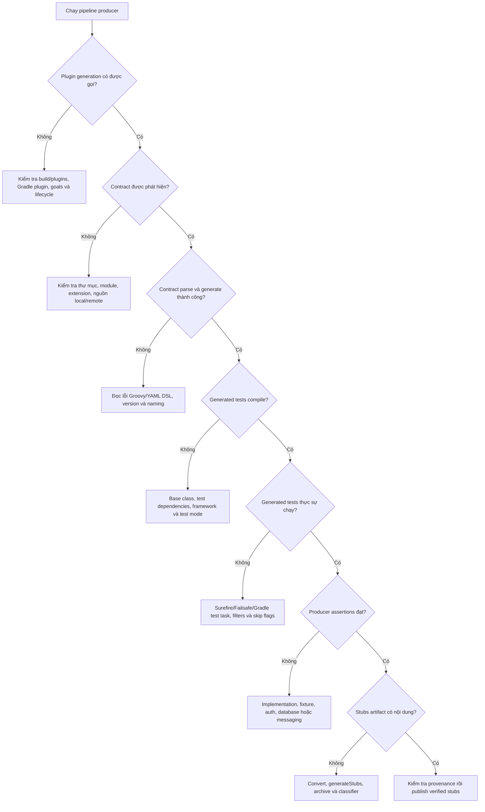

# Plugin không tìm thấy hợp đồng hoặc không sinh kiểm thử

Bạn thêm `spring-cloud-contract-maven-plugin` vào `pom.xml`, tạo file Groovy hoặc YAML trong repository rồi chạy `mvn verify`. Build có thể báo **BUILD SUCCESS**, nhưng thư mục generated tests trống, không có test case cho API vừa viết hoặc consumer vẫn dùng bộ stubs cũ. Ngược lại, build cũng có thể dừng với thông báo **không tìm thấy contract**, **lỗi parse DSL** hoặc **không biên dịch được generated test**. Đây là những nhóm sự cố khác nhau, cần chẩn đoán theo thứ tự thay vì sửa cả cấu hình, dữ liệu và code cùng lúc.

Trong lộ trình **SPRING_CLOUD_CONTRACT**, Spring Cloud Contract dùng **Groovy/YAML DSL** để mô tả HTTP hoặc thông điệp, sinh test cho **producer**, phát hành **stubs JAR**, cho **consumer** sử dụng **Stub Runner** và tích hợp **CI** để phát hiện thay đổi API không tương thích. Bài thuộc chương **Chẩn đoán sự cố**, tập trung giải quyết tình huống **plugin không tìm thấy hợp đồng hoặc không sinh kiểm thử** ở các dự án Maven/Gradle.

Sau bài học, bạn có thể xác định lỗi nằm ở **contract discovery, parsing, plugin activation, generation, test compilation, test execution hay stub packaging**; đọc đúng logs, effective POM và Gradle task graph; sửa cấu hình có mục tiêu; đồng thời thiết lập CI không đánh dấu thành công khi `0 producer contract tests` được thực thi.

## 1. Phân loại triệu chứng trước khi sửa

Từ “không sinh test” có thể mô tả ít nhất sáu trạng thái khác nhau:

| Nhóm | Quan sát | Kết luận ban đầu |
|---|---|---|
| **A. Không thấy contract** | Log ghi `No contracts found` hoặc số contracts bằng 0 | Kiểm tra đường dẫn, module, file extension, dependency nguồn |
| **B. Không thể parse contract** | Lỗi Groovy/YAML DSL, import hoặc cấu trúc contract | Có file nhưng nội dung không được chấp nhận |
| **C. Plugin không chạy** | Maven/Gradle log không có bước generate; source output trống | Plugin chưa kích hoạt hoặc goal/task không nằm trong lifecycle |
| **D. Sinh test nhưng không compile** | Có generated Java/Groovy files, lỗi class/import/base class | Lỗi test classpath, framework, test mode hoặc code generated |
| **E. Compile nhưng không execute** | Có `.class` files, Surefire/Gradle test reports không thấy contract tests | Test runner không discover hoặc tests bị skip |
| **F. Tests chạy nhưng stubs không có** | Producer test PASS, không có `-stubs.jar` hoặc mappings | Conversion/packaging/publication khác generation |

**Đừng gọi tất cả các nhóm là “plugin lỗi”.** Ví dụ thiếu `baseClassForTests` thường khiến test **không biên dịch** chứ không nhất thiết khiến plugin không tìm thấy Groovy DSL. Còn `Tests run: 0` là vấn đề **test execution**, không chứng minh bước generation thất bại.

### 1.1. Sơ đồ quyết định



Một cuộc điều tra hiệu quả luôn xác định **bước đầu tiên không đạt**, rồi chỉ kiểm tra cấu hình tác động tới bước đó.

## 2. Mục tiêu chẩn đoán: tạo một chuỗi bằng chứng

Muốn chứng minh producer đáp ứng hợp đồng, cần phân biệt các giai đoạn:

```text
Groovy/YAML contract files
          ↓
Plugin discovery
          ↓
DSL parsing/validation
          ↓
Generated producer test sources
          ↓
Test compilation
          ↓
JUnit/Spock execution trên producer thực
          ↓
Producer assertions PASS
          ↓
Convert contract → stub mapping
          ↓
Package và publish stubs artifact
          ↓
Consumer Stub Runner tests
```

Có **stubs JAR** không đồng nghĩa **generated producer tests đã chạy**. Có **generated test source** không đồng nghĩa **test đã được JUnit thực thi**. Có **BUILD SUCCESS** không đồng nghĩa **contract được phát hiện**.

### 2.1. Bảng bằng chứng theo giai đoạn

| Giai đoạn | Bằng chứng tối thiểu | Nếu thiếu |
|---|---|---|
| Source | Contract file đúng module và thư mục | Sai đường dẫn hoặc chưa commit |
| Discovery | Log/plugin output xác định contracts | Source path, nguồn local/remote hoặc plugin không chạy |
| Generation | Generated test files | DSL parse, generator config, plugin tasks |
| Compilation | Test classes hoặc compiler success | Base test, JDK, dependencies |
| Execution | Test runner reports có generated cases | Naming, includes/excludes, skip flags |
| Verification | Tests pass, failures/errors bằng 0 | Implementation, fixture, transport |
| Stub output | Mappings/contracts trong archive | Goal/task convert/package |
| Publication | GAV/version/classifier resolve được | Maven repository, credentials hoặc publication |

Đây là các bằng chứng **bổ sung cho nhau**. Một file bất kỳ trong `target/` chưa đủ để kết luận toàn bộ pipeline đúng.

## 3. Bước đầu: cố định môi trường và tái hiện lỗi

Trước khi chỉnh POM hoặc DSL:

1. Ghi chính xác **commit/branch** và **module producer**.
2. Ghi **Spring Boot, Spring Cloud và Spring Cloud Contract versions**.
3. Xác nhận JDK và Maven/Gradle version thực sự được CI sử dụng.
4. Ghi lại **lệnh build nguyên văn**, gồm `-pl`, profiles, flags và environment variables.
5. Tái hiện với một hợp đồng tối thiểu, không phụ thuộc network hoặc dữ liệu ngẫu nhiên.
6. Phân loại triệu chứng A–F ở phần 1.
7. Không chỉnh nhiều biến số trong cùng một lần thử.

Với Maven Wrapper:

```bash
./mvnw -version
./mvnw -B -ntp clean verify
```

Với Gradle Wrapper:

```bash
./gradlew --version
./gradlew clean check
```

**Đây là lệnh để người học thực hành trong project**, không phải lệnh đã được thực thi trong quá trình biên soạn bài. `clean` giúp loại bỏ generated output của lần build cũ, nhưng có thể xóa file dưới thư mục build; hãy kiểm tra build directory nếu project lưu thủ công dữ liệu ở đó. Không chạy `clean` trên môi trường dùng chung khi không biết tác động của nó.

### 3.1. Vì sao cần lệnh build chính xác?

Các lệnh không đồng nghĩa:

```bash
./mvnw test
./mvnw -pl order-service test
./mvnw -pl order-service -am clean verify
./mvnw -DskipTests package
./mvnw org.springframework.cloud:spring-cloud-contract-maven-plugin:generateTests
```

Chúng có thể tác động khác module, khác lifecycle phase hoặc bỏ qua test execution. Một người chạy `generateTests` có thể có generated source nhưng chưa chạy JUnit. Một người chạy `package -DskipTests` có thể nhận stubs artifact mà **không có bằng chứng producer verification**.

## 4. Vị trí hợp đồng mặc định và cấu trúc module

Trong nhiều cấu hình **Spring Cloud Contract Maven plugin**, nguồn contract local mặc định là:

```text
src/test/resources/contracts/
```

Một producer mẫu:

```text
order-service/
├── pom.xml
├── src/
│   ├── main/java/com/example/order/
│   │   ├── OrderServiceApplication.java
│   │   └── OrderController.java
│   └── test/
│       ├── java/com/example/order/contract/
│       │   └── OrderContractTestBase.java
│       └── resources/
│           └── contracts/
│               ├── checkout-service/
│               │   ├── get_paid_order_200.groovy
│               │   └── get_missing_order_404.yml
│               └── billing-service/
│                   └── order_paid_event.groovy
└── target/                       # Generated sau Maven build
```

**Thư mục mặc định được tính theo module**, không nhất thiết theo aggregator root. Nếu repository là monorepo và Maven đang chạy cho `checkout-service`, nó không tự tìm contracts trong `order-service/src/test/resources/contracts`.

### 4.1. Những lỗi đường dẫn phổ biến

| Vị trí thực tế | Vấn đề có thể gặp |
|---|---|
| `src/test/resource/contracts` | Thiếu `s` ở `resources` |
| `src/test/resources/contract` | Sai số ít/số nhiều |
| `src/main/resources/contracts` | Không phải path mặc định Maven plugin nếu chưa override |
| `contracts/` ở root repository | Plugin không biết nếu chưa cấu hình |
| `order-service/src/test/resources/contracts` | Chạy Maven từ module khác có thể không quét |
| `src/test/resources/contracts-old` | Folder không còn khớp configuration |
| Đường dẫn tuyệt đối của máy developer | CI dùng workspace khác nên không tìm thấy |
| Contracts chỉ nằm trong Git submodule chưa checkout | CI không có file local |
| Files bị `gitignore` hoặc chưa commit | Local có, CI không có |

Đừng vội chỉnh `contractsDirectory` theo một path tương đối tùy ý. Trước hết xác định `project.basedir`/project root và **thư mục mà plugin thực sự đang sử dụng**.

## 5. Tạo hợp đồng tối thiểu để kiểm tra discovery

Một hợp đồng nhỏ giúp xác định lỗi plugin hay lỗi DSL phức tạp.

File `src/test/resources/contracts/checkout-service/get_paid_order_200.groovy`:

```groovy
import org.springframework.cloud.contract.spec.Contract

Contract.make {
    name 'checkout_get_paid_order_200'
    description 'Checkout đọc đơn đã thanh toán'

    request {
        method GET()
        url '/api/orders/ORDER-42'
        headers {
            header 'Accept', 'application/json'
        }
    }

    response {
        status OK()
        headers {
            contentType(applicationJson())
        }
        body(
            id: 'ORDER-42',
            status: 'PAID',
            totalAmount: 125000
        )
    }
}
```

Nếu generator đọc được contract này, bước **discovery và parsing** có cơ sở đã hoạt động. Nhưng để **generated producer test chạy và đạt**, Order Service cần có endpoint và fixture trả response như trên. Tạo contract thành công **không** tự tạo controller hoặc dữ liệu `ORDER-42`.

### 5.1. Một YAML contract độc lập

File `src/test/resources/contracts/checkout-service/get_missing_order_404.yml`:

```yaml
name: checkout_get_missing_order_404
description: Đơn hàng không tồn tại
request:
  method: GET
  url: /api/orders/ORDER-MISSING
  headers:
    Accept: application/json
response:
  status: 404
  headers:
    Content-Type: application/json
  body:
    code: ORDER_NOT_FOUND
```

YAML này mô tả **case khác** với Groovy `200`. Không viết cùng một request/response một lần bằng Groovy và một lần bằng YAML rồi đưa vào cùng thư mục nếu không muốn duplicate tests hoặc stub mappings.

### 5.2. Những điều cần xác nhận sau khi thêm contract

- File extension được plugin version hỗ trợ (thường `.groovy` và `.yml`; kiểm tra `.yaml` theo version).
- File thực sự nằm dưới directory mà plugin đang đọc.
- Groovy DSL có `Contract.make` và đúng import/package.
- YAML có cấu trúc root `request` và `response` như DSL hỗ trợ.
- Thụt dòng YAML là khoảng trắng nhất quán, không có tab trộn.
- Các enum/helper methods `GET()`, `OK()`, `applicationJson()` đúng DSL của version.
- Không có dữ liệu mock/secret thật trong contract.
- Contract name duy nhất theo naming policy.
- Không có lỗi cú pháp ẩn do copy từ Markdown, smart quotes hoặc ký tự đặc biệt.

## 6. Maven plugin phải thật sự được kích hoạt

Một lỗi thường gặp là chỉ khai báo dependency:

```xml
<dependency>
    <groupId>org.springframework.cloud</groupId>
    <artifactId>spring-cloud-starter-contract-verifier</artifactId>
    <scope>test</scope>
</dependency>
```

Dependency này **không thay thế** Maven plugin generation. Trong producer `pom.xml`, cần có plugin phù hợp trong `build/plugins` hoặc cơ chế kích hoạt tương đương đã được xác minh.

### 6.1. Mẫu cấu hình Maven cho Spring MVC

```xml
<properties>
    <spring-cloud-contract.version>CONTRACT_VERSION_PHU_HOP</spring-cloud-contract.version>
</properties>

<dependencyManagement>
    <dependencies>
        <dependency>
            <groupId>org.springframework.cloud</groupId>
            <artifactId>spring-cloud-contract-dependencies</artifactId>
            <version>${spring-cloud-contract.version}</version>
            <type>pom</type>
            <scope>import</scope>
        </dependency>
    </dependencies>
</dependencyManagement>

<dependencies>
    <dependency>
        <groupId>org.springframework.boot</groupId>
        <artifactId>spring-boot-starter-test</artifactId>
        <scope>test</scope>
    </dependency>
    <dependency>
        <groupId>org.springframework.cloud</groupId>
        <artifactId>spring-cloud-starter-contract-verifier</artifactId>
        <scope>test</scope>
    </dependency>
</dependencies>

<build>
    <plugins>
        <plugin>
            <groupId>org.springframework.cloud</groupId>
            <artifactId>spring-cloud-contract-maven-plugin</artifactId>
            <version>${spring-cloud-contract.version}</version>
            <extensions>true</extensions>
            <configuration>
                <contractsDirectory>
                    ${project.basedir}/src/test/resources/contracts
                </contractsDirectory>
                <baseClassForTests>
                    com.example.order.contract.OrderContractTestBase
                </baseClassForTests>
                <testMode>MOCKMVC</testMode>
                <testFramework>JUNIT5</testFramework>
                <failOnNoContracts>true</failOnNoContracts>
            </configuration>
        </plugin>
    </plugins>
</build>
```

Đây chỉ là **POM fragment** cho producer Spring MVC, không phải POM đầy đủ. Cần Spring Boot parent/BOM, JDK, dependencies và phiên bản thực sự tương thích. Thay `CONTRACT_VERSION_PHU_HOP` bằng bản đã chọn theo release train; giữ version plugin và verifier tương thích.

### 6.2. Tại sao cần `extensions=true`?

Trong hướng dẫn Maven của Spring Cloud Contract, plugin thường được khai báo kèm:

```xml
<extensions>true</extensions>
```

để tích hợp plugin với Maven build như cấu hình được phiên bản hỗ trợ. Tuy vậy, **thuộc tính này không tự sửa** contracts directory sai, base class thiếu hoặc test runner đang skip. Nếu dự án có plugin executions tùy chỉnh, cần so với **effective POM** để không chạy trùng hoặc bỏ sót goals.

### 6.3. `failOnNoContracts` là hàng rào, không phải phép màu

`failOnNoContracts` trong những plugin versions hỗ trợ có thể khiến build fail khi generator không nhận diện contract. Tuy nhiên:

- Nếu plugin không chạy, parameter đó không có cơ hội được áp dụng.
- Nếu goal đang bị skip, fail-on-no-contracts không chứng minh tests chạy.
- Nếu plugin version không hỗ trợ hoặc cú pháp tham số khác, cấu hình có thể không hiệu quả.
- Nếu chỉ một phần contracts bị bỏ sót mà vẫn còn files khác, số contracts > 0 chưa bảo đảm đủ cases.

CI nên kiểm tra **inventory các hợp đồng kỳ vọng**, generated test classes và test report chứ không chỉ bật một flag.

## 7. `pluginManagement` khác `build/plugins`

Trong Maven, `pluginManagement` chủ yếu **quản lý version/configuration mặc định** cho plugin. Nó không có cùng ý nghĩa với việc khai báo plugin được sử dụng trong `build/plugins`.

Ví dụ parent POM:

```xml
<build>
    <pluginManagement>
        <plugins>
            <plugin>
                <groupId>org.springframework.cloud</groupId>
                <artifactId>spring-cloud-contract-maven-plugin</artifactId>
                <version>${spring-cloud-contract.version}</version>
            </plugin>
        </plugins>
    </pluginManagement>
</build>
```

Producer child module có thể cần kích hoạt:

```xml
<build>
    <plugins>
        <plugin>
            <groupId>org.springframework.cloud</groupId>
            <artifactId>spring-cloud-contract-maven-plugin</artifactId>
            <extensions>true</extensions>
            <configuration>
                <baseClassForTests>
                    com.example.order.contract.OrderContractTestBase
                </baseClassForTests>
            </configuration>
        </plugin>
    </plugins>
</build>
```

Version có thể được kế thừa từ parent pluginManagement. Nếu generated tests không xuất hiện, **đừng chỉ tìm chuỗi artifactId trong repository**; hãy xem plugin có thực sự được áp dụng trong **effective POM của producer module** hay không.

### 7.1. Kiểm tra effective POM

```bash
./mvnw -B -ntp help:effective-pom
```

Với multi-module có thể chọn producer:

```bash
./mvnw -B -ntp -pl order-service help:effective-pom
```

Khi đọc output, xác nhận:

1. `spring-cloud-contract-maven-plugin` nằm trong `build/plugins` của module cần verify.
2. Version không bị parent/profile override ngoài ý muốn.
3. `contractsDirectory` được resolve đúng.
4. `baseClassForTests` đúng FQN.
5. `testMode` đúng Spring stack.
6. `executions` và lifecycle binding đúng với phiên bản.
7. Không có `skip` flag hoặc profile làm plugin không hoạt động.

`help:effective-pom` có thể in nhiều thông tin cấu hình và repository URL. Khi chia sẻ CI logs, tránh để lộ secrets được chèn vào settings/environment.

## 8. Maven lifecycle: chạy đúng pha và goals

Maven plugin có một số goals quan trọng:

| Goal | Chức năng | Bằng chứng |
|---|---|---|
| `generateTests` | Sinh producer verification tests từ DSL | Generated test sources |
| `convert` | Chuyển DSL thành stub mappings | Generated mappings |
| `generateStubs` | Đóng gói contracts/mappings thành stubs JAR | Artifact `-stubs.jar` |
| `help` | Tra cứu parameters/goals theo plugin version | Metadata của plugin |
| `run` | Dùng stubs server cho kiểm thử | Không thay thế producer verification |
| `pushStubsToScm` | Publish stubs tới SCM theo cấu hình | Chỉ dùng ở workflow SCM cụ thể |

Trong nhiều Maven plugin versions, `generateTests` được gắn với pha `generate-test-sources` và `generateStubs` với pha `package`. **Mặc định và bindings phải kiểm tra theo version thực tế**; một parent POM hoặc custom execution có thể thay đổi cách chúng được gọi.

### 8.1. Các lệnh khác nhau trả lời câu hỏi khác nhau

```bash
# Xem phiên bản toolchain
./mvnw -version

# Tập trung kiểm tra goal generateTests
./mvnw -B -ntp \
  org.springframework.cloud:spring-cloud-contract-maven-plugin:generateTests

# Thực thi build lifecycle đến test phase
./mvnw -B -ntp clean test

# Thực thi lifecycle đến verify
./mvnw -B -ntp clean verify
```

Dùng **fully qualified plugin goal** giúp tránh vấn đề Maven không resolve được plugin prefix. Nhưng chạy `generateTests` trực tiếp **chưa chạy JUnit** và có thể thiếu bước chuẩn bị nếu dự án phụ thuộc lifecycle/execution khác.

### 8.2. Khi nào generation không xảy ra?

- Chỉ chạy một goal không đi qua phase cần thiết.
- Maven profile chứa plugin chưa được kích hoạt.
- Plugin nằm trong parent `pluginManagement` nhưng module không sử dụng.
- Plugin executions bị tắt, override hoặc bind sai phase.
- Plugin version không thể resolve.
- Plugin configuration có skip flag.
- Đang chạy trên **consumer module** chứ không phải producer.
- Build tool là Gradle nhưng người dùng chỉ sửa Maven POM không được dùng.

**Cách xử lý:** xác nhận plugin được gọi trong build log, rồi nhìn output của đúng goal. Không đặt một loạt executions thủ công nếu chưa biết plugin version đã có lifecycle binding gì.

## 9. Multi-module: lỗi nhìn nhầm thư mục là rất phổ biến

Một Maven reactor:

```text
commerce-platform/
├── pom.xml
├── order-service/
│   ├── pom.xml
│   └── src/test/resources/contracts/
├── checkout-service/
│   └── pom.xml
└── common-model/
    └── pom.xml
```

Khi chạy ở root:

```bash
./mvnw -B -ntp -pl order-service -am clean verify
```

Cần kiểm tra:

- Producer module `order-service` có được Maven chọn không?
- Plugin ở `order-service/pom.xml` hoặc được kế thừa/áp dụng hợp lệ?
- `project.basedir` trỏ tới **order-service**?
- Generated tests nằm ở `order-service/target/...` thay vì root `target/`?
- Test reports của chính `order-service` có generated classes?
- `common-model` có thể build theo reactor nhưng không nhất thiết phải chạy contract plugin.
- `checkout-service` là consumer không tự sinh producer tests của Order Service.

### 9.1. Dùng `contractsDirectory` theo module

Ví dụ:

```xml
<contractsDirectory>
    ${project.basedir}/src/test/resources/contracts
</contractsDirectory>
```

Trong module producer, `project.basedir` thường là thư mục module, không phải aggregator root. Không dùng đường dẫn tuyệt đối như `C:\Users\dev\workspace\...` hoặc `/home/alice/...` trong POM đã commit nếu CI dùng workspace khác.

### 9.2. Nhầm root build output

Nếu module con build được generated tests mà bạn chỉ kiểm tra:

```text
commerce-platform/target/generated-test-sources/contracts
```

bạn có thể kết luận sai rằng plugin không sinh test. Hãy nhìn **module producer output**, ví dụ:

```text
commerce-platform/order-service/target/generated-test-sources/contracts
commerce-platform/order-service/target/surefire-reports
```

Các path trên là ví dụ thường gặp của Maven; cấu hình thực tế có thể khác.

## 10. Không tìm thấy file do tên hoặc extension

Spring Cloud Contract hỗ trợ contract DSL theo các loại và versions nhất định. Nếu source directory đúng nhưng số contract bằng 0, kiểm tra:

| Vấn đề | Ví dụ | Hướng khắc phục |
|---|---|---|
| Extension không được version hỗ trợ | `.yaml` khi plugin chỉ nhận format/path cụ thể | Đối chiếu version, dùng extension đã được hỗ trợ |
| Tên file không có extension đúng | `get_order.groovy.txt` | Đổi thành `get_order.groovy` |
| File chỉ nằm trong README/snippet | Code fence Markdown thay vì file DSL | Tạo file contract thật |
| File không được commit | Có local, CI thiếu | Kiểm tra Git tracked files |
| File sai case trên Linux | `Contracts` so với `contracts` | Chuẩn hóa tên đường dẫn |
| Folder bị loại bởi cấu hình | Path/exclude pattern | Kiểm tra patterns và plugin config |
| File không readable | Quyền truy cập/encoding lỗi | Kiểm tra permissions/UTF-8 |
| Package layout bên trong artifact khác dự kiến | `contractsPath` không khớp | Mở archive contract dependency |

**Không nên đổi tên hàng loạt file** khi chưa xem plugin có đang dùng local directory hay external contract dependency. Một cấu hình nguồn ngoài có thể bỏ qua local path ngay cả khi file ở đó là hợp lệ.

### 10.1. Kiểm tra file có phải Groovy/YAML thật

Đôi khi IDE hoặc Windows Explorer ẩn extension. File được hiển thị là `get_paid_order.groovy` nhưng tên thật là `get_paid_order.groovy.txt`. Trên CI Linux, một file có ký tự hoa trong path cũng có thể không khớp case-sensitive filesystem.

Cần kiểm tra **tên đầy đủ và nội dung thật của file**, không chỉ file tree trong IDE. Tránh sử dụng contract folder có tên dựa vào temporary build outputs vì `clean` có thể xóa.

## 11. Groovy DSL: có file nhưng generator parse lỗi

Một Groovy contract hợp lệ thường cần import:

```groovy
import org.springframework.cloud.contract.spec.Contract

Contract.make {
    request {
        method GET()
        url '/api/orders/ORDER-42'
    }
    response {
        status OK()
    }
}
```

Một số lỗi:

### 11.1. Thiếu hoặc sai import

```groovy
// Phản ví dụ: chưa import Contract và không có binding tương ứng.
Contract.make {
    request {
        method GET()
        url '/api/orders/ORDER-42'
    }
}
```

Thông báo có thể liên quan `MissingPropertyException` hoặc `unable to resolve class`. Khắc phục bằng import đúng cho DSL version, không thêm dependency Groovy tùy tiện trước khi kiểm tra plugin version.

### 11.2. Dùng cú pháp Kotlin/Java DSL trong Groovy file

`.groovy` phải dùng Groovy DSL theo plugin version. Java/Kotlin DSL có API và cơ chế hỗ trợ riêng; không thể đổi extension một file Java thành `.groovy` để generator tự chuyển cú pháp.

### 11.3. Gọi matcher/helper không có trong version

Các helper như `byRegex`, `byType`, `bodyMatchers` hoặc methods thuộc request/response DSL có thể thay đổi giữa các release lines. Nếu stack trace báo `MissingMethodException`, cần tìm helper **trong tài liệu đúng version**, không mặc định tên method tương thích mọi bản.

### 11.4. Dùng Groovy code có side effect lúc parsing

Groovy DSL có thể chứa code tính toán động, nhưng không nên:

- Đọc production secrets/env để tạo token.
- Gọi network API khi generate contract.
- Phụ thuộc thứ tự file được parse.
- Sinh ID ngẫu nhiên không kiểm soát.
- Truy cập database thật trong file DSL.

Những hành vi đó khiến generation khác nhau giữa máy local/CI và làm chẩn đoán khó hơn. Hợp đồng nên biểu diễn **hành vi ổn định** và dữ liệu test có kiểm soát.

## 12. YAML DSL: lỗi cú pháp và schema

Một hợp đồng YAML đơn giản:

```yaml
name: checkout_get_paid_order_200
request:
  method: GET
  url: /api/orders/ORDER-42
response:
  status: 200
  headers:
    Content-Type: application/json
  body:
    id: ORDER-42
    status: PAID
    totalAmount: 125000
```

Những lỗi thường gặp:

| Lỗi | Ví dụ | Hậu quả |
|---|---|---|
| Thụt dòng sai | `response` lồng trong `request` | Parser/DSL không nhận cấu trúc |
| Tab ở nơi cần spaces | Tab trong indentation | Lỗi YAML parser |
| Viết sai key | `responses` thay `response` | Không tạo response như mong đợi |
| String/number type sai | `"125000"` thay số `125000` | Assertion có thể sai kiểu |
| Quên quote giá trị đặc biệt | Chuỗi chứa `: `, `#` hoặc ký tự cần escape | YAML hiểu sai dữ liệu |
| Root là danh sách khi DSL mong một contract object | `- name: ...` | Tùy parser/version có thể không được hỗ trợ |
| Dùng field DSL khác version | Key message/matcher không được nhận | Generation lỗi hoặc trường bị bỏ qua |
| Nhiều documents trong một file | `---` nhiều YAML docs | Tùy plugin parser; không mặc định hỗ trợ |

**Parser chấp nhận YAML syntax chưa có nghĩa semantic DSL đúng.** Có thể YAML hợp lệ nhưng plugin không biết một key nào đó. Đọc log lỗi và generated output để xác nhận toàn bộ kịch bản được nhận diện.

### 12.1. Đừng dùng một YAML validator chung làm bằng chứng duy nhất

Một YAML linter có thể xác minh indentation và syntax. Nhưng chỉ plugin tương ứng mới có thể xác nhận các keys `request.method`, `response.status`, `outputMessage.sentTo` và matcher structure đúng theo **Spring Cloud Contract DSL version**.

Khi điều tra, tách:

1. **File YAML có parse theo chuẩn không?**
2. **Contract DSL schema được plugin nhận không?**
3. **Generator có tạo test phù hợp không?**
4. **Generated test có assertions cần thiết không?**

## 13. Contracts nằm trong repository/artifact ngoài

Không phải producer nào cũng đặt contracts trong `src/test/resources/contracts`. Một số tổ chức lưu DSL ở Git hoặc artifact riêng và producer tải về trong build.

Trong các Spring Cloud Contract Maven plugin versions có hỗ trợ, cấu hình có thể dùng `contractDependency`, `contractsPath`, `contractsMode` và repository settings.

Ví dụ POM fragment mang tính định hướng:

```xml
<configuration>
    <baseClassForTests>
        com.example.order.contract.OrderContractTestBase
    </baseClassForTests>
    <contractDependency>
        <groupId>com.example.contracts</groupId>
        <artifactId>order-contracts</artifactId>
        <version>CONTRACT_SOURCE_VERSION_PHU_HOP</version>
    </contractDependency>
    <contractsPath>com/example/order-service</contractsPath>
</configuration>
```

**Đây không phải công thức đảm bảo chạy với mọi version.** Phải xác minh artifact có tồn tại, classifier/extension/layout đúng, plugin đang dùng chế độ tải phù hợp, Maven repositories/credentials cho phép truy xuất, và `contractsPath` khớp **path bên trong archive**.

### 13.1. Các nguyên nhân phổ biến khi lấy contract từ xa

- Artifact `com.example.contracts:order-contracts` chưa publish.
- Version mong đợi không tồn tại hoặc snapshot metadata chưa cập nhật.
- Repository URL trỏ sai endpoint Maven.
- Plugin dùng `LOCAL` trong khi contract chỉ có ở remote.
- Credentials không được inject vào CI.
- Download bị cache phiên bản cũ.
- `contractsPath` không khớp archive layout.
- Consumer-specific directory không khớp naming policy.
- Source artifact có contracts nhưng ở `META-INF/...` khác path plugin đang quét.
- Build chạy offline nên không tải được artifact lần đầu.

**Đừng nhầm `contractDependency` (nguồn DSL để producer generate) với stubs JAR** (artifact đầu ra cho Stub Runner). Nếu source contracts đã nằm trong artifact riêng, producer vẫn phải chạy generated verification trên **implementation thật**.

### 13.2. Khi nào cần mở artifact?

Nếu Maven resolve một contract dependency thành công nhưng generator báo 0 contracts, hãy mở **chính archive đã tải** để biết file DSL nằm ở đâu. Tên coordinates đúng chỉ bảo đảm tìm được file archive, **không bảo đảm bên trong có đúng thư mục và extension**.

Với một file archive biết chính xác đường dẫn:

```bash
jar tf path/to/order-contracts.jar
```

Đây là lệnh minh họa khi thực hành; không dùng nó để đọc các file ngoài phạm vi bài trong workflow biên soạn.

## 14. Gradle: lỗi cùng bản chất nhưng tên task khác

Nếu dự án dùng Gradle, sửa Maven POM sẽ không có tác dụng. Cần xem plugin Spring Cloud Contract Gradle đã được áp dụng cho **producer project** chưa và task graph có chạy generate.

Một số tasks theo những dòng Gradle plugin:

| Task | Vai trò |
|---|---|
| `generateContractTests` | Sinh producer tests |
| `contractTest` | Chạy các contract tests theo source set/plugin config |
| `generateClientStubs` | Chuyển DSL thành mappings |
| `verifierStubsJar` | Đóng gói stubs archive |
| `check` | Lifecycle verification; có thể phụ thuộc `contractTest` nếu cấu hình/plugin nối task đúng |

Kiểm tra danh sách tasks:

```bash
./gradlew tasks --all
```

Ví dụ chạy riêng generation nếu task hiện diện:

```bash
./gradlew generateContractTests
```

Và kiểm tra test execution:

```bash
./gradlew contractTest
./gradlew check
```

**Không giả định** `check` của mọi Gradle project luôn chạy `contractTest`, hay `verifierStubsJar` tự chứng minh contract tests đã đạt. Phải xem task dependencies và reports thực tế.

### 14.1. Đường dẫn contracts trong Gradle

Nhiều dự án Gradle Spring Cloud Contract lưu contract DSL ở thư mục như:

```text
src/contractTest/resources/contracts/
```

Một số phiên bản/cấu hình có thể dùng path khác. Plugin có tham số chọn contracts DSL directory (ví dụ `contractsDslDir` trong các dòng hỗ trợ). Nếu Maven path `src/test/resources/contracts` được copy nguyên sang Gradle mà không sửa plugin config, generator có thể không tìm thấy gì.

**Quy tắc chẩn đoán:** đọc source path **mà Gradle task thực sự quét**, không dựa vào trí nhớ về “default path” của bản khác.

### 14.2. Gradle source set và task execution

Sau `generateContractTests`, generated files có thể nằm dưới `build/generated-test-sources/contractTest/` hoặc path riêng. Điều cần xác nhận:

- Task `generateContractTests` được gọi.
- Task input files đúng nguồn DSL.
- Task output có generated tests.
- `contractTest` compile và chạy những tests đó.
- Test framework/JUnit engine tương thích.
- `UP-TO-DATE`/build cache không che trường hợp source input chưa được khai báo đúng.
- Producer module không bị bỏ qua bởi `onlyIf`, excludes, disabled tasks hoặc project selection.

Đừng xóa toàn bộ Gradle cache theo phản xạ; trước tiên kiểm tra task graph và input/output dependency configuration.

## 15. Plugin chạy, tìm thấy contracts, nhưng generated output trống

Đây là trường hợp cần chẩn đoán sâu:

1. Log có thật sự nói **contracts found** không?
2. Plugin có phân loại file đó là **producer contract hợp lệ**?
3. Có contract template/matcher nào làm generator skip toàn bộ hoặc từng case không?
4. File có chứa DSL expression nhưng không trả về contract object cần thiết?
5. Plugin có ghi generated code sang path khác với path bạn đang nhìn?
6. Generated source có bị xóa bởi một task/clean sau generation không?
7. Có nhiều modules cùng output và một module đang được kiểm tra nhầm?
8. Plugin configuration có filter hoặc source path override?
9. Có lỗi compilation/generation đã được Maven xử lý như warning/skip?
10. Có regression/behavior difference do đổi plugin version?

**Không suy đoán “plugin không sinh” chỉ vì thư mục mặc định trống** nếu project đã cấu hình `testSourceDirectory`/generated sources path riêng. Hãy đọc output directory từ plugin logs và effective configuration.

### 15.1. Một contract tối giản là phép thử phân biệt

Nếu plugin sinh được test cho hợp đồng `GET /health` hoặc `GET /api/orders/ORDER-42` đơn giản nhưng không sinh cho contract phức tạp, nguyên nhân nhiều khả năng nằm ở **DSL hoặc version-specific feature**.

Nếu ngay cả contract tối giản cũng không được nhận, ưu tiên **plugin activation/path**.

Đừng thêm hàng chục matcher hoặc test fixtures vào hợp đồng tối giản trước khi xác định được discovery/generation hoạt động.

## 16. Generated test có file nhưng không compile

Khi generation thành công, test compilation có thể fail vì lớp cơ sở hoặc dependencies.

Ví dụ configuration:

```xml
<baseClassForTests>
    com.example.order.contract.OrderContractTestBase
</baseClassForTests>
```

Nếu class thật nằm ở `com.example.order.testing.OrderContractBase`, generated test sẽ kế thừa một FQN không tồn tại.

### 16.1. Base class tối thiểu cho MVC

```java
package com.example.order.contract;

import io.restassured.module.mockmvc.RestAssuredMockMvc;
import org.junit.jupiter.api.BeforeEach;
import org.springframework.beans.factory.annotation.Autowired;
import org.springframework.boot.test.autoconfigure.web.servlet.AutoConfigureMockMvc;
import org.springframework.boot.test.context.SpringBootTest;
import org.springframework.test.web.servlet.MockMvc;

@SpringBootTest
@AutoConfigureMockMvc
public abstract class OrderContractTestBase {

    @Autowired
    MockMvc mockMvc;

    @Autowired
    OrderContractFixture fixtures;

    @BeforeEach
    protected void prepare() {
        fixtures.resetOrders();
        fixtures.insertPaidOrder("ORDER-42", 125000);
        fixtures.ensureAbsent("ORDER-MISSING");

        RestAssuredMockMvc.mockMvc(mockMvc);
    }
}
```

Đây là **ví dụ khung**. `OrderContractFixture` phải do dự án tự tạo; cần Spring Boot/Spring Test, Contract Verifier, RestAssured MockMvc và JUnit dependencies phù hợp.

Nếu generated test compile fail:

- Đọc error line trong generated source.
- Xác nhận FQN của base class.
- Xác nhận package/import và visibility.
- Kiểm tra JUnit version mà generator đang sinh.
- Kiểm tra test source root được thêm vào compiler.
- Kiểm tra `RestAssuredMockMvc` dependency/test scope.
- Kiểm tra JDK có hỗ trợ cú pháp Java được generate.
- Kiểm tra Spring Boot/Cloud/Contract version alignment.

**Không sửa generated Java files trực tiếp**. Mỗi lần generate lại, plugin có thể ghi đè chúng. Hãy sửa contract, base class, plugin configuration hoặc dependencies.

## 17. `testMode` không khớp HTTP stack

Một producer Spring MVC có thể dùng `MOCKMVC`. Producer Spring WebFlux-only hoặc JAX-RS cần adapter khác theo khả năng version.

| Test mode | Định hướng | Sự cố thường gặp |
|---|---|---|
| `MOCKMVC` | MVC request thông qua MockMvc | Base class không cấu hình RestAssuredMockMvc |
| `EXPLICIT` | HTTP thật tới embedded server/test port | Không khởi động server hoặc sai base URI/port |
| `WEBTESTCLIENT` | WebFlux WebTestClient nếu plugin version hỗ trợ | Dùng bản không hỗ trợ hoặc thiếu reactive test context |
| `JAXRSCLIENT` | JAX-RS mode nếu phiên bản hỗ trợ | Thiếu client/server infrastructure thích hợp |

**Đừng cấu hình `WEBTESTCLIENT` chỉ vì producer có WebFlux dependency** mà không kiểm tra plugin support và generated code. Nếu plugin không hỗ trợ mode đó, quá trình generate có thể fail hoặc không được cấu hình như dự kiến.

### 17.1. Khi lỗi thực chất là chạy test chứ không phải sinh test

Ví dụ generated test dùng RestAssured HTTP client và gọi `localhost:8080`, nhưng producer đang chạy trên random port khác. Test có thể nhận `Connection refused` hoặc lỗi cổng, dù generation hoàn toàn thành công.

Hãy phân biệt:

- **Generator** sinh request/assertion code.
- **Base test** thiết lập target application/HTTP adapter.
- **JUnit runner** thực thi generated request.
- **Producer implementation** trả response thật.

Nếu lỗi là `Connection refused`, sửa port/server setup; đừng đổi `contractsDirectory`.

## 18. Maven Surefire/Failsafe: generated tests có chạy thật không?

Một trường hợp đặc biệt nguy hiểm là generated Java files **tồn tại**, tests **compile**, nhưng test runner báo:

```text
Tests run: 0, Failures: 0, Errors: 0, Skipped: 0
BUILD SUCCESS
```

Nguyên nhân có thể gồm:

- Test classes không khớp naming convention/includes.
- JUnit Jupiter engine thiếu hoặc test framework version sai.
- Surefire/Failsafe plugin không nhận generated source.
- Tests bị `@Disabled`/`@Ignore`.
- Profile excludes generated packages.
- `-DskipTests` hoặc `-Dmaven.test.skip=true`.
- Test task không nằm trong selected Maven lifecycle.
- Một module khác đang chạy tests.
- Test code chỉ được compile ở source set riêng không được runner gọi.

### 18.1. Vì sao tổng tests > 0 vẫn có thể vô nghĩa?

Một producer có 80 unit tests nhưng 0 contract tests. Báo cáo `Tests run: 80` không chứng minh contract verification.

Cần tìm **class/method của generated producer tests** trong:

```text
target/surefire-reports/
target/failsafe-reports/
```

Các path khác nếu project cấu hình runner riêng. Đối chiếu với **contract cases kỳ vọng**, không chỉ số tổng.

### 18.2. Kiểm tra tên test và runner

Trong những bản Surefire phổ biến, các naming patterns như `*Test`, `*Tests` và `Test*` được nhận diện theo cấu hình mặc định/phổ biến. Nhưng người dùng có thể override includes/excludes.

Nếu generated class không khớp, cần cấu hình Surefire/Failsafe để chọn nó, hoặc chỉnh naming/generator config theo phiên bản được hỗ trợ. Không đổi class generated bằng tay.

### 18.3. Không dùng skip flags để “chữa” compilation errors

`-DskipTests` thường bỏ qua test execution; `-Dmaven.test.skip=true` có thể bỏ qua cả compilation/execution tùy plugin. Chúng có thể khiến build qua bước đang lỗi, nhưng làm mất bằng chứng producer verification.

Đặc biệt, **không phát hành verified stubs** từ build dùng skip tests. Nếu một job cần build nhanh không chạy test, hãy đánh dấu nó là **compile/smoke** thay vì contract verified release.

## 19. Plugin không resolve được: phân biệt môi trường với DSL

Thông báo lỗi có thể xuất hiện trước khi generator đọc bất kỳ file contract nào:

```text
Plugin ... could not be resolved
No plugin found for prefix ...
Could not find artifact ...
PKIX path building failed
401 Unauthorized / 403 Forbidden from repository
```

Những lỗi này thường là **plugin/dependency resolution, repository hoặc TLS**, không phải do Groovy/YAML contract.

### 19.1. Các bước kiểm tra

1. `groupId` phải là `org.springframework.cloud`.
2. `artifactId` phải là `spring-cloud-contract-maven-plugin`.
3. `version` phải tồn tại và phù hợp với Boot/Cloud release train.
4. Maven mirror/repository policy có cho tải plugin không?
5. CI dùng Maven settings và credentials đúng `server id`?
6. TLS certificate truststore/proxy có hợp lệ không?
7. Chạy trong offline mode hay repository bị chặn?
8. Plugin prefix có được Maven resolve không?

Khi cần chẩn đoán prefix, dùng tên goal đầy đủ:

```bash
./mvnw org.springframework.cloud:spring-cloud-contract-maven-plugin:generateTests
```

Nếu lệnh đầy đủ cũng không thể resolve artifact, hãy xử lý repository/version/credentials. **Không sửa nội dung contract** để chữa lỗi download plugin.

### 19.2. Đừng phá an toàn repository chỉ vì build bị lỗi

Không tắt TLS verification, không ghi username/password vào POM và không thêm repository không tin cậy vào dự án chỉ để generator chạy. Dùng Maven settings/CI secret injection, quản lý mirror/certificate theo quy trình hạ tầng.

## 20. Log level và debug output: lấy bằng chứng đúng mức

Khi output bình thường chưa đủ, Maven có chế độ debug:

```bash
./mvnw -B -ntp -X \
  org.springframework.cloud:spring-cloud-contract-maven-plugin:generateTests
```

Gradle cũng có các mức log:

```bash
./gradlew generateContractTests --info
./gradlew generateContractTests --stacktrace
```

**Cảnh báo:** `-X` và `--debug` có thể in nhiều thông tin môi trường, đường dẫn, tham số, repository URLs và đôi khi credentials nếu hệ thống log chưa được redact. Chỉ bật khi cần, chia sẻ log đã che secrets và không commit raw log vào repository.

### 20.1. Những dòng nên tìm trong log

| Dấu hiệu log | Diễn giải |
|---|---|
| Plugin goal/task đã chạy | Plugin activation cơ bản đúng |
| Contract source path được in | Xác nhận thư mục thực plugin đang đọc |
| Số contracts discovered | Có input được nhận diện |
| Parse/DSL exception | Có file nhưng syntax/semantics lỗi |
| Generated source output directory | Tìm đúng nơi tests được tạo |
| Test compile error | Generation xong nhưng code không build |
| Surefire/Gradle test runner summary | Execution xảy ra hay không |
| Convert mappings output | Mappings đã được sinh |
| Stubs JAR path/classifier | Artifact packaging đã hoàn tất |

Đừng chỉ tìm chuỗi `BUILD SUCCESS`. Kết luận chẩn đoán phải dựa vào **dòng chứng minh giai đoạn tương ứng**.

## 21. Tình huống thực hành 1: plugin đặt sai vị trí

**Triệu chứng:** Build Maven xanh, không thấy `generateTests` trong log, không có generated source.

**Cấu hình ban đầu:**

```xml
<build>
    <pluginManagement>
        <plugins>
            <plugin>
                <groupId>org.springframework.cloud</groupId>
                <artifactId>spring-cloud-contract-maven-plugin</artifactId>
                <version>CONTRACT_VERSION_PHU_HOP</version>
            </plugin>
        </plugins>
    </pluginManagement>
</build>
```

**Chẩn đoán:** Parent chỉ quản lý plugin, child module chưa thực sự khai báo sử dụng plugin.

**Cách sửa:** Kích hoạt plugin trong `build/plugins` của `order-service`; xác minh effective POM và rerun generation.

**Bằng chứng hoàn thành:**

- Log có plugin goal.
- File Groovy/YAML được phát hiện.
- Generated test source xuất hiện.
- Producer tests được test runner thực thi và đạt.

Không kết thúc điều tra chỉ vì thêm XML vào POM.

## 22. Tình huống thực hành 2: dùng sai `contractsDirectory`

**Triệu chứng:** Plugin goal chạy, nhưng log báo không tìm thấy contracts.

Ví dụ POM sai:

```xml
<contractsDirectory>
    ${project.basedir}/src/main/resources/contracts
</contractsDirectory>
```

trong khi files thực sự ở:

```text
order-service/src/test/resources/contracts/
```

**Cách sửa:**

```xml
<contractsDirectory>
    ${project.basedir}/src/test/resources/contracts
</contractsDirectory>
```

Hoặc di chuyển nguồn theo policy đã thống nhất. Hãy giữ một **single source of truth**; không copy một bộ contracts sang hai nơi để “plugin tìm kiểu gì cũng được”, vì dễ dẫn tới lệch phiên bản.

**Bằng chứng:** Log trỏ đúng path, generated test phản ánh hợp đồng mới nhất, không phải bản duplicate cũ.

## 23. Tình huống thực hành 3: YAML hợp lệ nhưng DSL sai

**Triệu chứng:** YAML parser không báo syntax error, nhưng generator lỗi hoặc không sinh case đúng.

Ví dụ sai về cấu trúc:

```yaml
name: checkout_missing_order
request:
  method: GET
  url: /api/orders/ORDER-MISSING
responses:
  status: 404
```

Vấn đề là key `responses` thay vì `response` theo DSL được minh họa.

**Sửa:**

```yaml
name: checkout_missing_order
request:
  method: GET
  url: /api/orders/ORDER-MISSING
response:
  status: 404
```

**Bằng chứng:** Plugin nhận case, generated source có status assertion `404`. Không chỉ chạy YAML linter rồi kết luận đã sửa xong.

## 24. Tình huống thực hành 4: source generated có nhưng base class thiếu

**Triệu chứng:** Generated test files xuất hiện, `testCompile` hoặc Maven test compilation fail vì:

```text
cannot find symbol: class OrderContractTestBase
```

**Nguyên nhân:** `baseClassForTests` trong POM khác package/class thật hoặc base class không có trên test classpath.

**Hướng sửa:**

1. Xác định FQN của base test class, ví dụ `com.example.order.contract.OrderContractTestBase`.
2. Kiểm tra class tồn tại dưới `src/test/java` hoặc test source set phù hợp.
3. Sửa POM mapping cho đúng.
4. Kiểm tra test dependencies/imports.
5. Generate lại và compile.
6. Chạy producer tests và đọc reports.

**Không** sửa từng generated class extends một tên khác; generator sẽ ghi đè.

## 25. Tình huống thực hành 5: test sinh nhưng chạy 0 case

**Triệu chứng:** Maven plugin đã generate test source, nhưng Surefire báo `Tests run: 0`.

Các nghi vấn:

- Generated class được đặt trong package riêng nhưng Surefire excludes.
- Thiếu Jupiter engine/Spock runner.
- Generated code có annotations/test framework không khớp dependency.
- Maven chạy từ wrong module.
- `skipTests` được bật ở parent/profile.
- Tên class khác naming pattern của Surefire.
- Test đã compile nhưng runner không được gắn vào phase.

**Cách chẩn đoán:**

```bash
# Build producer ở đúng module
./mvnw -B -ntp clean test

# Tìm generated source
find target/generated-test-sources/contracts -type f -print

# Tìm JUnit XML reports
find target/surefire-reports -name 'TEST-*.xml' -print
```

Với một repository real có nhiều unit tests, cần kiểm tra report của **generated class/method cụ thể**, không chỉ tổng số tests.

**Bằng chứng:** Bài test `checkout_get_paid_order_200` có report đã thực thi, không skip, và có thể fail nếu controller trả sai `200`/body.

## 26. Tình huống thực hành 6: messaging contract không sinh hoặc không chạy đúng

Một message contract có thể giống:

```groovy
import org.springframework.cloud.contract.spec.Contract

Contract.make {
    name 'billing_order_paid_v1'
    label 'billing_order_paid_event_v1'

    input {
        triggeredBy('publishOrderPaid()')
    }

    outputMessage {
        sentTo('orders.events')
        headers {
            header('contentType', 'application/json')
            header('eventType', 'ORDER_PAID')
        }
        body(
            orderId: 'ORDER-42',
            eventType: 'ORDER_PAID',
            totalAmount: 125000
        )
    }
}
```

Nếu generator parse được contract nhưng test compile fail vì `publishOrderPaid()` không tồn tại, **đó không phải vấn đề discovery**. Producer test base cần có hook hoặc method được generated test gọi.

Một base test minh họa:

```java
@SpringBootTest
@AutoConfigureMessageVerifier
public abstract class OrderMessageContractBase {

    @Autowired
    OrderPaymentService orderPaymentService;

    @BeforeEach
    void setUp() {
        // Seed test order, làm sạch output messages.
    }

    public void publishOrderPaid() {
        orderPaymentService.markPaid("ORDER-42");
    }
}
```

Cần imports, Spring Cloud Contract messaging integration, test binder/broker và implementation cụ thể. Hook `publishOrderPaid()` phải gọi **nghiệp vụ producer thật**, không trực tiếp gửi sẵn message mẫu vào test output.

### 26.1. Không đòi HTTP mapping từ mọi message contract

Message-only contracts có thể tạo generated message tests và message stubs, nhưng không nhất thiết tạo WireMock HTTP mapping JSON. Nếu kiểm tra thư mục `mappings/` trống rồi kết luận plugin không nhận hợp đồng, đó có thể là **sai tiêu chí kiểm tra**.

Đối với messaging, xác minh:

- Generated message test được sinh.
- Hook/`triggeredBy` được gọi.
- Message verifier/binder quan sát output.
- Destination, headers và body được assert.
- Producer thực phát đúng event.
- Stub Runner consumer test có label/sample tương ứng nếu workflow sử dụng.

## 27. Tình huống thực hành 7: stubs JAR không có nhưng tests chạy

**Triệu chứng:** Producer contract tests chạy và đạt, nhưng consumer không tải được artifact `stubs`.

Một build có thể có:

```text
target/order-service-1.4.0.jar
```

nhưng thiếu:

```text
target/order-service-1.4.0-stubs.jar
```

Điều tra:

1. Goal `convert` đã tạo mappings chưa?
2. Goal `generateStubs` đã được chạy/bind vào lifecycle chưa?
3. Đã chạy đến `package` hay chỉ đến `test`?
4. Plugin có bị skip ở bước packaging không?
5. Stubs artifact có classifier `stubs` và đúng version không?
6. Trong multi-module, archive có nằm ở module producer không?
7. Maven `install/deploy` đã attach và publish stubs artifact chưa?
8. Consumer dùng `LOCAL` hay `REMOTE` và version nào?

**`mvn test` thường chưa phải bước package artifact**. Không đòi `-stubs.jar` sau mỗi lệnh chỉ chạy đến test phase.

### 27.1. Không nhầm Stub Runner `ids` với Maven dependency notation

Stub Runner thường dùng:

```text
groupId:artifactId:version:classifier:port
```

Ví dụ:

```text
com.example:order-service:1.4.0:stubs:8085
```

`8085` là cổng HTTP stub server, **không phải** Maven artifact version/classifier. Maven artifact resolution thất bại không có nghĩa plugin generate producer tests thất bại; hai vấn đề cần được phân loại riêng.

## 28. CI: làm sao phát hiện sớm “0 contracts” và “0 tests”?

Một pipeline producer nên kiểm tra:

1. Source contracts đúng nơi và có các kịch bản tối thiểu mong đợi.
2. Plugin generation goal/task thực sự được gọi.
3. Generated sources có các test classes dự kiến.
4. Generated tests compile.
5. JUnit/Spock runner thực thi các generated tests.
6. Tests không bị skip.
7. Producer assertions pass.
8. Stubs artifact được package từ cùng build.
9. Artifact có version, classifier và content hợp lệ.
10. Không có secrets trong contracts/stubs.

### 28.1. Mẫu GitHub Actions Maven producer

```yaml
name: Producer Contract Verification

on:
  pull_request:
  push:
    branches: [main]

permissions:
  contents: read

jobs:
  verify:
    runs-on: ubuntu-latest
    steps:
      - uses: actions/checkout@v4

      - uses: actions/setup-java@v4
        with:
          distribution: temurin
          java-version: '17'
          cache: maven

      - name: Verify Maven producer
        run: ./mvnw -B -ntp clean verify

      - name: Confirm generated test source
        shell: bash
        run: |
          test -d target/generated-test-sources/contracts
          find target/generated-test-sources/contracts \
            -type f \( -name '*.java' -o -name '*.groovy' \) \
            -print -quit | grep -q .

      - name: Confirm test reports exist
        shell: bash
        run: |
          test -d target/surefire-reports
          find target/surefire-reports \
            -type f -name 'TEST-*.xml' \
            -print -quit | grep -q .

      - name: Upload reports
        if: always()
        uses: actions/upload-artifact@v4
        with:
          name: producer-contract-reports
          path: |
            target/surefire-reports/
            target/failsafe-reports/
          if-no-files-found: warn
```

**Giới hạn của workflow minh họa:** kiểm tra generated folder không rỗng và có JUnit reports **chưa chứng minh các reports đó thuộc generated contract tests**. Một module có unit tests thông thường có thể làm hai phép kiểm tra này đạt, ngay cả khi contract tests không được runner thực thi.

Một CI release gate đầy đủ hơn cần đọc JUnit XML/contract inventory để xác nhận đúng generated test cases đã được chạy và không skip. Cách parse JUnit XML phải phù hợp naming/conventions của plugin version, không chỉ kiểm tra số test tổng.

### 28.2. Chặn skip flags trong release

Những flags cần audit:

```text
-DskipTests
-Dmaven.test.skip=true
```

Ngoài ra kiểm tra plugin-specific skip properties, Gradle `enabled=false` hoặc `onlyIf`, JUnit `@Disabled`, Maven profiles và Surefire includes/excludes.

Đừng coi stubs artifact là verified nếu build sử dụng skip flags để vượt bước producer verification.

### 28.3. Mẫu tiêu chí release gate

| Điều kiện | Pass? |
|---|---|
| Contract inventory được phát hiện | Bắt buộc |
| Generated producer tests có đầy đủ | Bắt buộc |
| Test execution có đúng generated cases | Bắt buộc |
| Failures/errors = 0 | Bắt buộc |
| Skipped contract tests ngoài policy = 0 | Bắt buộc |
| Producer implementation đáp ứng HTTP/message contracts | Bắt buộc |
| Artifact stubs đúng version/classifier | Bắt buộc trước publish |
| Commit/build provenance rõ | Bắt buộc trước publish |
| Consumer compatibility matrix | Theo release policy |

Một pipeline tốt **fail closed** khi không tìm thấy bằng chứng, thay vì xem thiếu reports là thành công.

## 29. Bảng chẩn đoán nhanh theo lỗi

| Dấu hiệu | Gốc lỗi có thể | Thao tác đầu tiên |
|---|---|---|
| Không có log `generateTests` | Plugin không kích hoạt | Kiểm tra effective POM hoặc Gradle task graph |
| `No contracts found` | Sai path/module/extension | Xác minh source directory của goal |
| Chỉ CI không thấy contracts | Files chưa commit, case-sensitive path | Kiểm tra Git tracked files và Linux paths |
| Groovy `MissingMethodException` | DSL API sai version | Đối chiếu DSL theo plugin version |
| YAML syntax error | Indentation/quote | Sửa syntax rồi chạy generator |
| YAML parse OK nhưng case không được nhận | Key không thuộc DSL | Kiểm tra generated output và schema |
| Maven plugin not resolved | Version/repository/credentials | Sửa plugin coordinates hoặc Maven settings |
| Generated source trống nhưng đã tìm contracts | Generation config/DSL behavior | Thử contract tối giản, xem logs |
| Generated test compile fail | Base class/imports/dependencies | Đọc first compiler error và FQN |
| `cannot find symbol` base class | Sai `baseClassForTests` | Sửa đúng FQN/test source set |
| MockMvc error | Adapter/test mode không khớp | Chọn mode đúng MVC/WebFlux/server |
| `Connection refused` | Server test chưa chạy hoặc sai port | Kiểm tra base URI/random port |
| `Tests run: 0` | Surefire/JUnit discovery/skip | Đọc reports, framework, includes |
| Có unit tests nhưng không có contract tests | Chỉ nhìn tổng count | Cross-check generated class names |
| `404` từ producer test | Route/fixture/implementation sai | So request URL và test DB |
| `404` từ WireMock | Unmatched mapping | Kiểm tra stub mappings, method/path/headers |
| Messaging test không compile | Thiếu `triggeredBy` hook | Base class/message verifier setup |
| Messaging test không có event | Hook không gọi producer hoặc binder lỗi | Kiểm tra business code path |
| `-stubs.jar` không tồn tại | Chưa chạy package/generateStubs | Kiểm tra goals/lifecycle |
| Stubs JAR có nhưng không có HTTP mappings | Convert fail hoặc message-only | Phân biệt HTTP/message contracts |
| Consumer không resolve stub | Classifier/version/repository sai | Kiểm tra Maven artifact coordinates |
| Local pass, CI fail | JDK/CI profile/cache/DB khác | So toolchain và test infrastructure |
| Build xanh nhưng breaking change lọt qua | Contract test không chạy hoặc matcher quá rộng | Mutation test và generated assertions |

## 30. Quy trình điều tra theo từng lớp

Khi nhận một lỗi thực tế, dùng checklist có thứ tự:

### Lớp 1 — Đầu vào

- [ ] Đúng producer module.
- [ ] Contract files đã commit.
- [ ] Đúng folder và extension.
- [ ] Local hay external contract source được xác định rõ.
- [ ] Không có duplicate contract definitions ngoài ý muốn.

### Lớp 2 — Plugin

- [ ] Maven plugin nằm ở `build/plugins`/effective POM.
- [ ] Gradle plugin được apply cho đúng project.
- [ ] Plugin/version có thể resolve.
- [ ] Goals/tasks generation được thực thi.
- [ ] Không bị profile/skip flag tắt.

### Lớp 3 — DSL và generation

- [ ] Groovy/YAML hợp lệ theo plugin version.
- [ ] Contract discovery count phù hợp.
- [ ] Generated test files được tạo ở đúng output directory.
- [ ] Generated source thể hiện đúng request, response và assertions.
- [ ] Không có test names trùng hoặc file output bị ghi đè.

### Lớp 4 — Compilation/execution

- [ ] Base class FQN tồn tại.
- [ ] Test framework/test mode đúng.
- [ ] Test source root được compile.
- [ ] JUnit/Spock runner chạy đúng generated tests.
- [ ] Không có generated contract tests bị skip ngoài dự kiến.
- [ ] Reports có test cases thực thi và status.

### Lớp 5 — Producer behavior và stubs

- [ ] Producer implementation thật được gọi.
- [ ] Fixtures độc lập và ổn định.
- [ ] HTTP status/header/body hoặc message destination/header/body đạt.
- [ ] Stubs artifact được package khi lifecycle đến đúng phase.
- [ ] Classifier/version/contents đúng.
- [ ] Consumer Stub Runner dùng đúng artifact.

### Lớp 6 — CI và provenance

- [ ] JDK/Boot/Cloud/Contract versions được ghim phù hợp.
- [ ] Repository credentials an toàn.
- [ ] Release không skip tests.
- [ ] Artifact từ cùng commit đã verification.
- [ ] Có test mutation chứng minh breaking change quan trọng gây fail.
- [ ] Báo cáo đủ để xác định nguyên nhân khi lỗi tái diễn.

## 31. Bài thực hành: sửa một producer “không sinh test”

**Bối cảnh:** Order Service dùng Maven, Checkout cần `GET /api/orders/ORDER-42` trả `200` và `GET /api/orders/ORDER-MISSING` trả `404`. Một developer nói “đã thêm Spring Cloud Contract nhưng không thấy test nào”.

### Bước A — tái hiện baseline

1. Xác nhận JDK/Maven versions và Maven Wrapper.
2. Xác nhận đang ở đúng module `order-service`.
3. Xem trong `pom.xml` có Contract Verifier dependency và Maven plugin.
4. Xác định default hoặc configured contracts directory.
5. Chạy `./mvnw -B -ntp clean verify` trên môi trường test.
6. Ghi lại lỗi đầu tiên, không sửa ngẫu nhiên.

### Bước B — kiểm tra discovery

1. Tạo Groovy contract tối giản `checkout_get_paid_order_200`.
2. Tạo YAML contract độc lập `checkout_get_missing_order_404`.
3. Đặt đúng dưới `src/test/resources/contracts/checkout-service/`.
4. Nếu plugin không thấy, xác minh thư mục, extension và effective POM.
5. Nếu plugin thấy nhưng parse lỗi, xem stack trace Groovy/YAML.

### Bước C — kiểm tra generation

1. Chạy goal `generateTests` hoặc Maven lifecycle thích hợp.
2. Xem log output directory của generator.
3. Xác nhận generated test files chứa HTTP request và assertions tương ứng.
4. Kiểm tra tên test class và `extends OrderContractTestBase`.
5. Không sửa files generated bằng tay.

### Bước D — kiểm tra compilation

1. Tạo đúng base class FQN.
2. Cấu hình `MOCKMVC` cho producer Spring MVC.
3. Dùng test fixture seed `ORDER-42` và exclude `ORDER-MISSING`.
4. Kiểm tra Spring Boot Test/JUnit/RestAssured dependencies.
5. Chạy `clean test` và đọc compiler errors nếu có.

### Bước E — kiểm tra execution

1. Mở Surefire/Failsafe reports.
2. Xác nhận cả hai generated contract cases chạy.
3. Tạm sửa controller trả `202` thay vì `200` cho order đã thanh toán.
4. Producer contract test `200` phải fail.
5. Khôi phục implementation và xác nhận pass.
6. Nếu mutation không bị phát hiện, kiểm tra generated assertions và bean graph.

### Bước F — package và consumer

1. Chạy lifecycle đến `package` hoặc `verify` theo project.
2. Kiểm tra stubs JAR và mappings cho hai kịch bản.
3. Cài hoặc publish stubs artifact sau producer verification.
4. Consumer Checkout dùng Stub Runner với đúng GAV/classifier/version.
5. Test client Checkout đọc đúng `200` và xử lý `404 ORDER_NOT_FOUND`.
6. Đưa các kiểm tra vào CI gate.

**Tiêu chí hoàn thành:** người học phân loại đúng lỗi discovery/generation/compilation/execution, chứng minh generated tests có chạy qua producer thật và phát hiện mutation, đồng thời xác nhận stubs artifact chỉ được phát hành sau producer verification đạt.

## 32. Câu hỏi tự kiểm tra

1. **`No contracts found` có giống `Tests run: 0` không?** Không; một lỗi là discovery, lỗi kia là execution.
2. **Có `spring-cloud-starter-contract-verifier` dependency thì Maven tự sinh tests không?** Không; cần plugin được kích hoạt.
3. **`pluginManagement` có mặc định kích hoạt plugin ở child module không?** Không.
4. **Contracts Maven local thường nằm ở đâu?** `src/test/resources/contracts`.
5. **Vì sao phải kiểm tra `project.basedir`?** Để xác định path tương đối của module đang build.
6. **Đặt contract trong root repository có đủ không?** Không nếu plugin đang quét thư mục module khác.
7. **Groovy `Contract.make` thiếu import có thể gây gì?** Lỗi parse/resolve khi generator đọc file.
8. **YAML hợp lệ syntax đã chắc được Spring Cloud Contract hiểu chưa?** Chưa; DSL keys/semantics phải hợp lệ.
9. **`.groovy.txt` có được plugin nhận như `.groovy` không?** Không nên giả định; extension thật phải đúng.
10. **Thay `contractDependency` cần kiểm tra gì?** Artifact version, repository, path bên trong archive và chế độ tải.
11. **`generateTests` có chạy JUnit không?** Không, nó sinh source tests.
12. **Generated test có file mà compile fail nên kiểm tra gì đầu tiên?** Compiler error, baseClass FQN và dependencies.
13. **`MOCKMVC` và `WEBTESTCLIENT` có thể dùng thay nhau tùy ý không?** Không; phụ thuộc stack và plugin version.
14. **`Connection refused` chứng minh generator không sinh test không?** Không; thường liên quan runtime HTTP target.
15. **Vì sao cần kiểm tra test runner reports?** Xác nhận generated tests thật sự chạy, không skip.
16. **Tại sao `Tests run > 0` chưa đủ?** Có thể chỉ là unit tests.
17. **`-DskipTests` ảnh hưởng gì?** Bỏ qua test execution và làm mất bằng chứng producer verification.
18. **Có `-stubs.jar` chứng minh producer test pass không?** Không.
19. **Vì sao message-only contract có thể không có WireMock HTTP mapping?** Vì message contract không nhất thiết mô phỏng HTTP response.
20. **`triggeredBy` hook thiếu có phải discovery fail không?** Không, thường là compilation/runtime setup của generated message test.
21. **Vì sao cần version/toolchain tương thích?** DSL/generator/test imports/task behavior có thể khác.
22. **Nếu chỉ local pass mà CI không thấy contracts thì xem gì?** Git tracked files, path case sensitivity, module và checkout config.
23. **Một mutation status `200` → `202` giúp gì?** Chứng minh generated producer assertions nhạy với breaking change đó.
24. **Tại sao không chỉnh tay generated Java file?** Generator sẽ ghi đè; nguyên nhân gốc nằm ở DSL/base/config.
25. **Bài học quan trọng nhất của troubleshooting là gì?** Tìm bước đầu tiên không đạt trong chuỗi discovery → generation → compilation → execution → verification → packaging.

## 33. Tài liệu tham khảo và giới hạn phiên bản

Để áp dụng vào dự án thật, cần đối chiếu với **đúng dòng Spring Cloud Contract** đã ghim:

- [Spring Cloud Contract — Reference](https://docs.spring.io/spring-cloud-contract/reference/)
- [Spring Cloud Contract — Maven Project](https://docs.spring.io/spring-cloud-contract/reference/maven-project.html)
- [Spring Cloud Contract — Gradle Project](https://docs.spring.io/spring-cloud-contract/reference/gradle-project.html)
- [Spring Cloud Contract — Contract DSL](https://docs.spring.io/spring-cloud-contract/reference/)
- [Spring Cloud Contract — Messaging](https://docs.spring.io/spring-cloud-contract/reference/)
- [Spring Cloud Contract Maven Plugin — Goals](https://docs.spring.io/spring-cloud-contract/docs/current/spring-cloud-contract-maven-plugin/plugin-info.html)
- [Spring Cloud Contract Maven Plugin — generateTests](https://docs.spring.io/spring-cloud-contract/docs/current/spring-cloud-contract-maven-plugin/generateTests-mojo.html)
- [Spring Cloud Contract Maven Plugin — generateStubs](https://docs.spring.io/spring-cloud-contract/docs/current/spring-cloud-contract-maven-plugin/generateStubs-mojo.html)
- [Apache Maven — Introduction to the Build Lifecycle](https://maven.apache.org/guides/introduction/introduction-to-the-lifecycle.html)
- [Maven Surefire Plugin — Usage](https://maven.apache.org/surefire/maven-surefire-plugin/usage.html)
- [Gradle — Testing in Java & JVM Projects](https://docs.gradle.org/current/userguide/java_testing.html)

**Giới hạn theo phiên bản:** đường dẫn generated tests, plugin parameter names, test frameworks, `testMode`, hỗ trợ `.yaml`, Gradle task graph, contracts source locations và helper DSL có thể khác giữa các Spring Cloud Contract releases. Không trộn cấu hình 4.x với tài liệu 5.x khi chưa kiểm tra; những trang `docs/current` cũng có thể trỏ tới version khác `reference`. Bài này là phương pháp chẩn đoán và ví dụ cấu hình, **không phải báo cáo đã chạy Maven/Gradle trên một producer cụ thể**.

## Kết luận

Khi **Spring Cloud Contract plugin không tìm thấy hợp đồng hoặc không sinh kiểm thử**, điều hiệu quả nhất là **xác định chính xác giai đoạn lỗi**. Kiểm tra plugin có được kích hoạt trong đúng producer module không; source contracts đang được quét ở đâu; Groovy/YAML DSL có được parser chấp nhận không; generated test source có xuất hiện không; base class và test dependencies có biên dịch không; Surefire/Gradle có thực sự chạy generated cases không; và stubs artifact đã được package đúng lifecycle chưa.

**Đừng đánh đồng BUILD SUCCESS, generated source hay stubs JAR với producer verification thành công.** Một pipeline đáng tin cần bằng chứng **discovery → generation → compilation → execution → assertions PASS**, sau đó mới phát hành stubs đúng version/classifier cho Stub Runner. Khi CI fail nếu không có hợp đồng hoặc có `0 generated contract tests`, cộng thêm mutation checks cho những hành vi quan trọng, nhóm sẽ phát hiện thay đổi API hoặc thông điệp không tương thích trước khi consumer gặp lỗi thực tế.
