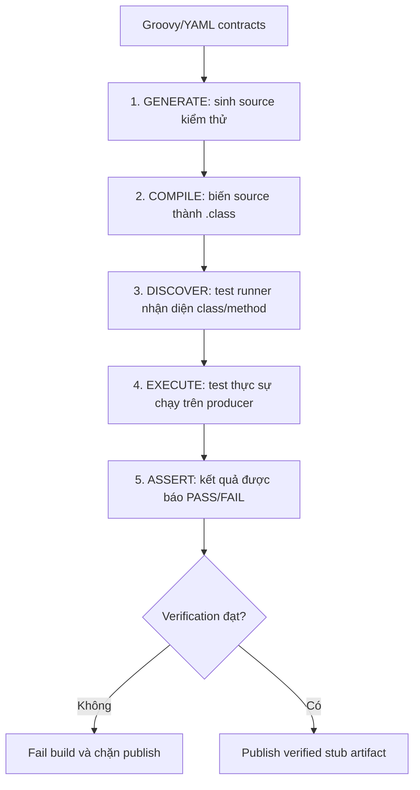
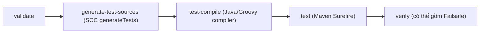
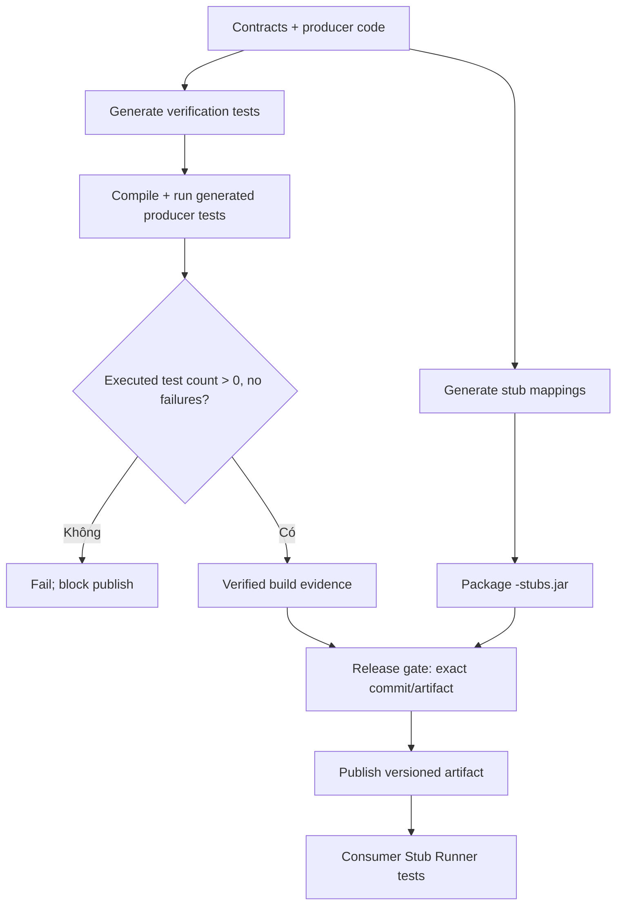

# Generated test được tạo nhưng không được công cụ build chạy

## 1. Sự cố: nhìn thấy file Java/Groovy nhưng CI vẫn “xanh”

Một nhóm dùng **Spring Cloud Contract** để kiểm thử cam kết giữa `Payment Service` (producer) với `Checkout Service` (consumer). Hợp đồng Groovy/YAML mô tả HTTP API `GET /api/payments/42`, build sinh producer verification test và WireMock stub mapping. Checkout dùng Stub Runner với artifact `payment-service-1.2.0-stubs.jar` để thử client.

Ngày hôm sau, developer cố tình sửa controller: thay response `status: PAID` thành `status: PENDING`. Kỳ vọng là **generated producer test** phải thất bại. Tuy nhiên:

- File Java/Groovy vẫn xuất hiện trong thư mục `build/generated-test-sources` hoặc `target/generated-test-sources`.
- Lệnh `./gradlew test` hay `./mvnw test` kết thúc thành công.
- Không có assertion nào về `PAID` trong test reports.
- CI vẫn có thể đóng gói stub và publish một version mà chưa kiểm chứng code producer thật.

Đây là một lỗi **đứt chuỗi thực thi**, không nhất thiết là lỗi DSL. **Sinh file kiểm thử không đồng nghĩa build tool đã biên dịch, khám phá, chạy và kiểm tra kết quả của nó.**

Bài thuộc chương **Chẩn đoán sự cố** của module **Spring Cloud Contract**. Mục tiêu là tìm đúng tầng xảy ra sự cố, áp dụng cách sửa tương ứng cho **Gradle** hoặc **Maven**, rồi thêm cổng kiểm tra để lỗi không âm thầm tái diễn.

Bạn sẽ học:

1. Phân biệt **generated → compiled → discovered → executed → asserted**.
2. Xác định các task/goal đúng: Gradle `generateContractTests` **khác** `contractTest`; Maven `generateTests` **khác** Surefire `test`.
3. Chẩn đoán source set, test-compile classpath, JUnit 4/5, Spock, Maven Surefire/Failsafe, test filters và skip flags.
4. Hiểu tại sao generated class có thể không khớp mặc định tên `*Test`.
5. Đọc task status, test reports và số test thực thi; tránh kết luận từ một dòng `BUILD SUCCESS`.
6. Thiết kế CI gate bắt buộc producer verification trước khi công bố `-stubs.jar`.

## 2. Năm tầng cần kiểm tra theo thứ tự

Một quá trình xác minh producer hoàn chỉnh phải đi qua:



Một số câu hỏi xác định nhanh:

| Tầng | Bằng chứng cần thấy | Nếu không có |
| --- | --- | --- |
| **Generate** | File `*.java`/`*.groovy` sinh ra từ contract đang xét | Sai source contracts/plugin configuration |
| **Compile** | Generated test class có trong test-classes output | Source root không được compile, dependency hoặc base class lỗi |
| **Discover** | Test engine/Surefire/Gradle ghi nhận class và methods | Naming/filter/test engine/test classpath |
| **Execute** | Báo cáo có test case đã chạy, không chỉ “tests found” | Task không được gọi, bị skip, bị cache hoặc disabled |
| **Assert** | Assertion thật kiểm tra response/message của producer | Test chưa nối implementation/trigger hoặc chỉ chạy test rỗng |

**Nói chính xác triệu chứng trước khi sửa**:

- “Có `GeneratedPaymentTest.java`, không có `.class`” → điều tra **compile**.
- “Có `.class`, Surefire báo `Tests run: 0`” → điều tra **discovery**.
- “Có test case trong report nhưng bị `skipped`” → điều tra **execution/conditions**.
- “Test pass nhưng không đi qua controller thật” → điều tra **test setup/semantic verification**, không chỉ task wiring.

## 3. Một contract làm mẫu để tái hiện vấn đề

Trong producer, hợp đồng HTTP minh họa:

```groovy
import org.springframework.cloud.contract.spec.Contract

Contract.make {
    description 'Tra cuu thanh toan da hoan tat'
    request {
        method GET()
        url '/api/payments/42'
        headers {
            header('Accept', 'application/json')
        }
    }
    response {
        status OK()
        headers {
            contentType(applicationJson())
        }
        body(paymentId: 42, status: 'PAID')
    }
}
```

YAML DSL có thể biểu đạt tương tác tương tự:

```yaml
description: Tra cuu thanh toan da hoan tat
request:
  method: GET
  url: /api/payments/42
  headers:
    Accept: application/json
response:
  status: 200
  headers:
    Content-Type: application/json
  body:
    paymentId: 42
    status: PAID
```

Không nên để **cả hai file** trong cùng bộ active contracts nếu chúng chỉ là ví dụ tương đương mà không có chủ đích kiểm tra hai nghĩa vụ: việc này có thể sinh duplicate mappings. Khi thực hành, chọn **một** định dạng.

Hình dung generated JUnit test sau khi plugin xử lý:

```java
// PSEUDOCODE minh họa ý nghĩa, KHÔNG phải mã sinh nguyên văn.
// Package và class name tùy cấu trúc thư mục contract/plugin version.
class Payment {
    @org.junit.jupiter.api.Test
    void shouldReturnPaidPayment() {
        // Gửi GET /api/payments/42 đến producer qua MockMvc
        // hoặc test mode đã chọn.
        // Assert status HTTP=200 và JSON status="PAID".
    }
}
```

**Điểm dễ bị bỏ sót:** Một số cấu trúc contracts được Spring Cloud Contract chuyển thành class tên theo **thư mục hợp đồng**. Ví dụ thư mục `payment/` có thể sinh class `Payment`, không kết thúc bằng `Test`. Do đó **Maven Surefire với mặc định `*Test`, `*Tests`, `Test*`, `*TestCase` có thể không chọn nó** nếu cấu hình plugin không mở rộng patterns. Đừng suy class generated luôn tên `PaymentTest`.

## 4. Phân biệt ba lệnh dễ nhầm

| Mục đích | Gradle với Spring Cloud Contract | Maven với Spring Cloud Contract |
| --- | --- | --- |
| **Chỉ sinh** producer tests | `generateContractTests` | Goal `spring-cloud-contract:generateTests` |
| **Chạy** generated producer tests | Task `contractTest` trong cấu hình plugin phổ biến | Lifecycle test qua Maven Surefire, sau `generate-test-sources`/`test-compile` |
| **Gói** HTTP stub mappings | `generateClientStubs`, `verifierStubsJar` | `convert`, `generateStubs` theo lifecycle/plugin config |

Tài liệu chính thức của Spring Cloud Contract Gradle hướng dẫn **`./gradlew contractTest`** để chạy generated tests. Kể từ cấu trúc source set `contractTest`, chạy `./gradlew test` **chỉ nhắm test source set thông thường**; nó không nhất thiết chạy generated contract tests. Ở Maven, `generateTests` mặc định gắn với phase `generate-test-sources`, nhưng phase đó chưa chạy test engine. Vì vậy lệnh chỉ gọi goal generator không thể chứng minh producer.

**Cẩn trọng về phiên bản:** Tên task, đường dẫn output, wiring vào `check` và cấu hình JUnit/Spock có thể khác giữa các release Spring Cloud Contract và build scripts đã customize. Luôn đối chiếu **task graph và test report thật** thay vì dựa vào một tên task đoán trước.

## 5. Quy trình chẩn đoán không phá dữ liệu và không sửa mã vội

Hãy thực hiện năm bước trong **producer module**, không phải consumer module:

1. **Xác định công cụ và module:** Maven hay Gradle, module nào chứa Spring Cloud Contract plugin?
2. **Đọc generated source:** class nào, package nào, phương thức test có annotation/Spock feature đúng?
3. **Tìm compiled class:** nó có được biên dịch vào test output của task cần chạy không?
4. **Xem test runner:** Surefire/Failsafe hay Gradle `Test` task nào đang quét class đó?
5. **Đọc test XML report:** số `tests`, `skipped`, `failures`, `errors`; test method nào thật sự chạy?

Không xóa generated tests hoặc tự sửa code sinh ra. Nếu cần thay đổi, hãy sửa **DSL source**, **plugin settings**, **test base class**, **source-set wiring** hoặc **test runner configuration**.

### 5.1. Một bảng ghi chép điều tra

| Trường cần ghi | Ví dụ minh họa |
| --- | --- |
| Producer/module | `payment-service` |
| Spring Cloud Contract plugin version | Bản resolved từ build |
| Contract file | `payment/get_payment.groovy` |
| Generated class | `org.example.contract.Payment` |
| Generated source path | `build/generated-test-sources/contractTest/java/...` |
| Compiled class path | `build/classes/java/contractTest/...` |
| Test runner | Gradle `:payment-service:contractTest` |
| Discovered/executed tests | `1 / 1` theo report |
| Actual producer behavior | `200, status=PENDING` |
| Expected behavior | `200, status=PAID` |
| Producer verification | Phải **FAILED** khi cố tình làm sai response |

Đường dẫn và class name đều là ví dụ. Quan trọng là dùng **actual path của project** thay vì chỉ tìm trong `src/test/java`.

## 6. Gradle: tại sao `test` không chạy generated contract tests?

Trong các phiên bản Spring Cloud Contract Gradle phổ biến, plugin dùng **source set `contractTest`**. Contracts thường nằm tại:

```text
src/contractTest/resources/contracts/
```

Base test classes tương ứng đặt tại:

```text
src/contractTest/java/
src/contractTest/groovy/
```

Generated JUnit/Groovy tests thường được viết vào những thư mục bên dưới `build/generated-test-sources/contractTest/`. Plugin nối chúng vào source set và tạo task `contractTest`.

Ở tài liệu Spring Cloud Contract từ 3.x, `src/test/resources/contracts` được hỗ trợ như **đường dẫn cũ dùng khi chuyển đổi** và có thể phát cảnh báo. Đừng nhầm default Maven (`src/test/resources/contracts`) với default Gradle (`src/contractTest/resources/contracts`).

### 6.1. Phân biệt `test`, `contractTest`, `check`

Giả sử build có các task:

```text
:payment-service:generateContractTests
:payment-service:compileContractTestJava
:payment-service:contractTest
:payment-service:test
:payment-service:check
```

Đây là **task names minh họa cần xác nhận tại runtime**. Chúng không cùng chức năng:

- `generateContractTests` sinh mã.
- `compileContractTestJava` biên dịch generated sources và source trong contract test source set.
- `contractTest` chạy producer verification tests.
- `test` chạy unit/integration tests thuộc source set `test` thông thường.
- `check` là lifecycle verification task, **có thể được plugin nối với contractTest** khi cấu hình mặc định phù hợp.

**Lệnh ưu tiên để xác minh trực tiếp:**

```bash
./gradlew :payment-service:contractTest --info --console=plain
```

Đường dẫn `:payment-service:` giả định đây là Gradle multi-project build. Trong single-module project, dùng `./gradlew contractTest --info`.

### 6.2. Kiểm tra task graph trước

```bash
./gradlew :payment-service:tasks --all --console=plain
./gradlew :payment-service:help --task contractTest
./gradlew :payment-service:check --dry-run
./gradlew :payment-service:contractTest --dry-run
```

Với `--dry-run`, Gradle chỉ mô phỏng task scheduling, **không thực thi kiểm thử**. Nó hữu ích để xem `check` có phụ thuộc `contractTest` hay không, nhưng không phải bằng chứng assertions đã chạy.

Nếu `check` không chứa `contractTest`, có thể do plugin chưa được áp dụng trong module cần thiết, task bị tùy biến, hoặc có source set/test suite riêng. **Không vội viết dependency thủ công** trước khi xác định graph hiện có vì có thể tạo wiring trùng hoặc sai.

### 6.3. Khi project đã tùy biến và cần nối `check` vào `contractTest`

Trong `build.gradle` Groovy DSL, **chỉ sau khi xác nhận task `contractTest` thực sự tồn tại và chưa được nối vào `check`**:

```groovy
// Fragment bổ sung cho một project đã áp dụng SCC Gradle plugin.
tasks.named('check') {
    dependsOn tasks.named('contractTest')
}
```

Cấu hình này làm `check` phụ thuộc task `contractTest`; nó **không tự cấu hình source set, test runtime classpath hoặc JUnit engine**. Trong các release đã có wiring mặc định, không cần thêm đoạn này. Với một test task đổi tên, thay bằng tên task thực tế.

### 6.4. Một lệnh gây hiểu lầm

```bash
./gradlew generateContractTests
```

Lệnh này có thể sinh file rất đầy đủ rồi trả `BUILD SUCCESSFUL` nhưng không chạy `contractTest`. Nên ghi rõ trong CI: “**generate**” là bước chuẩn bị; “**verify**” là task test thực thi.

## 7. Gradle: generated source có nhưng không được biên dịch

Nếu generated Java file hiện diện nhưng không có `.class`, kiểm tra:

1. `contracts.generatedTestJavaSourcesDir` hoặc biến thể tương ứng của phiên bản plugin.
2. `contracts.sourceSet` có bị override sang source set khác không.
3. Task `compileContractTestJava` hoặc `compileContractTestGroovy` có thật sự được lên lịch không.
4. Base class có nằm trên compile classpath **của contractTest source set** không.
5. Dependency như `spring-cloud-starter-contract-verifier`, JUnit, Spock và Groovy có đúng source-set configuration không.

Một ví dụ dự án thường dùng:

```groovy
plugins {
    id 'java'
    id 'org.springframework.cloud.contract' version '<compatible-scc-version>'
}

contracts {
    // Chỉ minh họa thiết lập; cần đối chiếu phiên bản plugin thực tế.
    testFramework = 'JUNIT5'
    contractsDslDir = file('src/contractTest/resources/contracts')
    baseClassForTests = 'com.example.payment.contract.PaymentContractBase'
}
```

Fragment này **không phải `build.gradle` hoàn chỉnh**: cần Spring Boot/Cloud dependency management, dependencies phù hợp và test base class thực. Nếu dùng `baseClassMappings` hoặc `packageWithBaseClasses`, chúng có thể **ưu tiên hơn `baseClassForTests`**.

### 7.1. Đường dẫn source roots không đồng bộ

Một project tùy biến:

```groovy
contracts {
    generatedTestJavaSourcesDir = file("$buildDir/custom-contract-tests")
}
```

nhưng task `contractTest` lại đang compile source ở một nơi khác theo configuration sai. File được tạo ra nhưng không nằm trong source input của compiler.

**Cách khắc phục:** dùng cấu hình chính thức của Spring Cloud Contract để generator và source set thống nhất; không tùy tiện đưa generated files vào `src/test/java` hoặc thêm trực tiếp mọi thư mục `build/` vào source set `test`. Việc này có thể tạo double compilation, test trùng hoặc stale generated tests.

### 7.2. Base class và package mapping

Generated test có thể trông như:

```java
package org.springframework.cloud.contract.verifier.tests;

public class Payment extends com.example.payment.contract.PaymentContractBase {
    // generated methods ...
}
```

Nếu `PaymentContractBase` đang đặt tại `src/test/java` nhưng `contractTest` không nhìn thấy class từ test source set, quá trình compile có thể thất bại. Trong cấu trúc Gradle `contractTest` riêng, hãy đặt base classes trong source set phù hợp hoặc khai báo dependencies/task wiring đúng cách.

**Phân biệt compile error với no-discovery:** khi lỗi base class khiến compiler fail, test **không được compile**; khi class compile thành công mà test runner không tìm thấy, mới điều tra JUnit engine/filters.

## 8. Gradle: `contractTest` được gọi nhưng không tìm thấy test

Task loại `Test` của Gradle cần:

- `testClassesDirs`: đường dẫn các compiled test classes.
- `classpath`: test runtime classpath, bao gồm test framework/engine.
- Test framework được chọn đúng (`useJUnitPlatform()` cho JUnit 5/Spock hiện đại).
- Không có include/exclude filter loại bỏ generated tests.

### 8.1. JUnit 5: chọn JUnit Platform cho đúng task

Trong project cấu hình JUnit 5, ví dụ:

```groovy
// Fragment build.gradle khi contractTest task tồn tại.
tasks.named('contractTest', Test) {
    useJUnitPlatform()
    testLogging {
        events 'passed', 'skipped', 'failed'
        exceptionFormat 'full'
    }
}
```

**Chú ý:** cấu hình `tasks.named('test', Test) { useJUnitPlatform() }` chỉ áp dụng cho task `test`, không nhất thiết áp dụng cho `contractTest`. Nếu mọi `Test` task đều cần JUnit Platform, có thể dùng `tasks.withType(Test).configureEach { useJUnitPlatform() }` **khi** toàn bộ test frameworks trong dự án tương thích; không dùng toàn cục một cách mù quáng nếu project vẫn cần JUnit 4 runner riêng hoặc TestNG.

Runtime của JUnit 5 cần test engine tương ứng; project Spring Boot thường dùng `spring-boot-starter-test` nhưng source set `contractTest` vẫn cần nhận dependency đúng cách. Với Gradle mới, nên đảm bảo `junit-platform-launcher` trên test runtime classpath theo tài liệu Gradle.

### 8.2. JUnit 4, JUnit 5 và Spock khác nhau

| Code được sinh | Runner/engine cần | Triệu chứng nếu lệch |
| --- | --- | --- |
| JUnit 4 (`org.junit.Test`) | JUnit 4 runner hoặc Vintage khi chạy trên JUnit Platform | Jupiter-only discovery không thấy test |
| JUnit 5 (`org.junit.jupiter.api.Test`) | Jupiter engine trên JUnit Platform | Có class nhưng không có engine phù hợp |
| Spock (`Specification`, features) | Groovy compile + Spock engine tương thích | Test Groovy không compile hoặc không được khám phá |

**Không tự sửa import annotation trong generated file.** Hãy điều chỉnh `testFramework`, dependencies và test task runner để thống nhất; regenerate và xác nhận output.

### 8.3. Include/exclude và test filtering

Kiểm tra các đoạn build logic có thể giới hạn test:

```groovy
tasks.named('contractTest', Test) {
    // Ví dụ MỘT cấu hình lọc có thể vô tình bỏ hết generated tests:
    exclude '**/*ContractSpec.class'
}
```

Các hệ thống còn có tag filters, `--tests`, project-specific include patterns, custom `onlyIf` hoặc `enabled=false`.

Để thử một class đã được xác nhận tồn tại:

```bash
./gradlew :payment-service:contractTest \
  --tests '*Payment*' \
  --info
```

`--tests` chỉ có ý nghĩa với Gradle `Test` task, và pattern phải khớp tên class/method đã compile. Nếu task không có compiled classes, filter không thể tạo ra chúng. **Không dùng `--tests` làm bằng chứng test đã chạy trừ khi report ghi nhận test case thực**.

## 9. Gradle: đọc đúng `UP-TO-DATE`, `FROM-CACHE`, `NO-SOURCE` và `SKIPPED`

| Trạng thái | Diễn giải | Chẩn đoán nên làm |
| --- | --- | --- |
| `UP-TO-DATE` | Inputs/outputs theo Gradle không đổi so với lần trước | Xác nhận task outputs/report của bản đúng |
| `FROM-CACHE` | Outputs được khôi phục từ build cache của task cacheable | Xác nhận task được phép cache và cache key đủ |
| `NO-SOURCE` | Task không thấy source/test classes để xử lý | Kiểm tra source set, contract path và generator outputs |
| `SKIPPED` | Có điều kiện bỏ qua, disabled, hoặc cách gọi đặc thù | Kiểm tra `onlyIf`, `enabled`, flags |
| Task không xuất hiện | Không thuộc selected task graph hoặc bị loại bằng `-x` | Xem `--dry-run`, task dependencies |
| Task chạy nhưng `0 tests` | Task khởi động nhưng test discovery không tìm case | Xem engine, classpath, filters |

Một dòng `UP-TO-DATE` **không có nghĩa chắc chắn bị lỗi**: nó có thể là tối ưu hợp lệ. Nhưng nếu vừa sửa producer implementation mà task verification vẫn được coi up-to-date và không có test reports phù hợp, cần điều tra input tracking và task graph.

### 9.1. Tách ảnh hưởng của build cache

```bash
./gradlew :payment-service:contractTest --info
./gradlew :payment-service:contractTest --no-build-cache --info
./gradlew :payment-service:contractTest --rerun-tasks --no-build-cache --info
```

- `--no-build-cache` tắt build cache, **không tự tắt up-to-date checks**.
- `--rerun-tasks` buộc thực thi lại task được chọn và dependencies liên quan.
- Không cần luôn chạy `clean` hoặc xóa cache global; hãy dùng những lệnh này **để phân biệt nguyên nhân**, không làm mặc định cho mọi CI.

Nếu generated test thật sự chạy với logic PENDING và assertion PAID, kết quả phải fail; nếu vẫn không fail, hãy kiểm tra generated test có đang gọi đúng endpoint/producer instance không.

## 10. Maven: `generate-test-sources` không phải `test`

Spring Cloud Contract Maven plugin thường gắn goal `generateTests` với phase `generate-test-sources`. Lifecycle giản lược:



Để vừa sinh vừa chạy JUnit tests trong producer Maven project đã cấu hình đúng, dùng lifecycle tới `test` hoặc `verify`:

```bash
./mvnw -B -ntp clean test
./mvnw -B -ntp clean verify
```

Nếu chỉ gọi:

```bash
./mvnw -B -ntp spring-cloud-contract:generateTests
```

thì mục tiêu chính là **sinh source**; nó không tự đi qua `test-compile` rồi `surefire:test`. Một lệnh gọi trực tiếp goal có thể thành công dù producer tests chưa được chạy.

### 10.1. Kiểm tra module đúng trong multi-module Maven

Một CI chỉ chạy aggregator POM hoặc module `api-contracts` có thể không chạy plugin/test của module `payment-service`.

```bash
./mvnw -B -ntp -pl payment-service -am verify
```

`-pl` chọn module và `-am` xây các module cần thiết theo reactor. Cần đảm bảo `payment-service` thật sự có plugin execution và generated tests, không chỉ module contract artifact. Nếu tọa độ module hoặc folder khác, điều chỉnh `-pl`.

### 10.2. `pluginManagement` không tự tạo execution

Một cấu hình Spring Cloud Contract nằm trong `<pluginManagement>` của parent POM chỉ quy định default cho plugin khi được sử dụng; nó **không tự tương đương** khai báo plugin đã áp dụng ở module producer.

Kiểm tra `<build><plugins>`, effective POM, executions và phiên bản plugin mà reactor module thực sự sử dụng. Các hệ thống có thể dùng `<extensions>true</extensions>` hoặc executions tùy release; không copy một đoạn cấu hình từ module khác rồi coi goal đã chạy.

## 11. Maven: có generated source nhưng compiler chưa nhìn thấy

Theo cách plugin được cấu hình, generated tests có thể nằm tại:

```text
target/generated-test-sources/contracts/
target/generated-test-sources/contractVerifier/
```

**Không có một tên directory bất biến cho mọi Spring Cloud Contract release.** Đọc cấu hình `generatedTestSourcesDir` và log `generateTests` của phiên bản thực tế. Maven phải đưa directory đó vào **test source roots** trước `testCompile`; file trong `target/` không mặc nhiên được biên dịch chỉ vì tồn tại.

### 11.1. Ví dụ kiểm tra test source roots

Trong producer Maven build:

```bash
./mvnw -B -ntp help:effective-pom
./mvnw -B -ntp test-compile
```

Xem Maven Compiler/GMavenPlus log, directory source đã đăng ký và compiled test classes dưới `target/test-classes`. Đừng chỉ nhìn IDE đã hiển thị source file hay chưa; IDE có thể cần reimport Maven nhưng **CLI build mới là căn cứ của CI**.

### 11.2. Khi cần `build-helper-maven-plugin`

Nếu plugin/build lifecycle không tự gắn generated directory và đã xác nhận cụ thể nguyên nhân là **missing test source root**, có thể dùng:

```xml
<!-- Fragment trong build/plugins; chỉ dùng khi source root chưa được tự đăng ký -->
<plugin>
    <groupId>org.codehaus.mojo</groupId>
    <artifactId>build-helper-maven-plugin</artifactId>
    <executions>
        <execution>
            <id>add-contract-generated-test-source</id>
            <phase>generate-test-sources</phase>
            <goals>
                <goal>add-test-source</goal>
            </goals>
            <configuration>
                <sources>
                    <source>${project.build.directory}/generated-test-sources/contracts</source>
                </sources>
            </configuration>
        </execution>
    </executions>
</plugin>
```

**Phải thay đường dẫn theo actual generator output**, ví dụ `contractVerifier` nếu đó là nơi plugin của bạn ghi Java test. Không thêm hai thư mục đoán bừa. Nếu plugin đã tự register directory, thêm lần nữa không phải cách chữa discovery problem.

### 11.3. Source file tồn tại nhưng compile thất bại

Các nguyên nhân:

- Base class FQN trong generated test không tồn tại hoặc package mapping sai.
- Dependency `spring-cloud-contract-verifier`, Rest Assured/MockMvc hoặc JUnit không có ở **test compile classpath**.
- Java toolchain/target version không tương thích.
- Generated Groovy cần plugin compile Groovy và source roots bổ sung.
- Một version plugin sinh imports cho framework khác với dependency đang dùng.

Compile lỗi phải khiến build fail. Nếu CI vẫn xanh, kiểm tra liệu CI có **chạy `test-compile` của module đó không**, hoặc đang dùng task `package`/goal riêng bỏ qua verification.

## 12. Maven Surefire: class đã compile nhưng `Tests run: 0`

Đây là vấn đề discovery nổi bật. Maven Surefire mặc định nhận một số tên lớp phổ biến:

```text
**/Test*.java
**/*Test.java
**/*Tests.java
**/*TestCase.java
```

Nhưng SCC có thể sinh class `Payment` từ `contracts/payment/`. Class `Payment` **không match** các pattern tên mặc định, dù chứa JUnit `@Test`. Với Spock, class `PaymentSpec` cũng có thể cần cấu hình include riêng.

**Chẩn đoán**:

1. Xem tên generated class và package thực tế, không suy từ tên file DSL.
2. Xác nhận `target/test-classes` chứa class đó.
3. Xem output của Surefire và `target/surefire-reports`.
4. Kiểm tra `<includes>`, `<excludes>`, `-Dtest`, tag/engine filters và các profile.
5. Thử chọn tường minh class phù hợp để xác nhận test engine có thể chạy.

### 12.1. Cấu hình Surefire để nhận generated package

Giả sử generated classes thuộc package `org.springframework.cloud.contract.verifier.tests`, và bạn **đã kiểm tra** path:

```text
target/test-classes/org/springframework/cloud/contract/verifier/tests/Payment.class
```

Một fragment Surefire:

```xml
<plugin>
    <groupId>org.apache.maven.plugins</groupId>
    <artifactId>maven-surefire-plugin</artifactId>
    <version>${maven-surefire-plugin.version}</version>
    <configuration>
        <includes>
            <!-- Giữ các unit tests thông thường -->
            <include>**/*Test.java</include>
            <include>**/*Tests.java</include>
            <include>**/Test*.java</include>
            <include>**/*TestCase.java</include>
            <!-- Thêm các class sinh từ DSL nằm trong package đã xác nhận -->
            <include>**/org/springframework/cloud/contract/verifier/tests/**/*.java</include>
        </includes>
        <failIfNoTests>true</failIfNoTests>
    </configuration>
</plugin>
```

**Quan trọng:**

- `${maven-surefire-plugin.version}` là property phải được xác định từ dependency management/plugin management dự án; không sao chép nguyên nếu chưa khai báo.
- Thay package path theo generated output thật, đặc biệt khi đã dùng `basePackageForTests`, `baseClassForTests` hoặc package mappings khác.
- Đây là cấu hình **mở rộng discovery**, không thay thế việc **biên dịch generated source**.
- Khi đã override `<includes>`, giữ những patterns cần thiết cho unit tests thông thường.
- `failIfNoTests` không đảm bảo **mỗi nhóm contract** có test; nếu module vẫn có unit tests, tổng số test không bằng 0 dù generated tests bị thiếu. Cần kiểm tra cụ thể report.

Nếu dùng Surefire 3.6.x, cơ chế chạy JUnit Platform và engine lựa chọn có thể khác các bản 2.x/3.0.x; phải dùng API/dependencies tương thích với phiên bản Surefire thực tế.

### 12.2. Chạy đúng một generated class khi debug

```bash
# Chỉ sau khi xác định generated class tên Payment và đã compile.
./mvnw -B -ntp -Dtest=Payment test
```

Tham số `-Dtest` là **bộ lọc class/method**, không phải lệnh tự sinh DSL test. Nếu Maven không tìm thấy class thì xem source compile; nếu chỉ định class nhưng không có JUnit engine phù hợp thì xem runtime dependencies.

**Không để `-Dtest=SomeUnitTest` trong CI release**, vì nó có thể khiến các generated contract tests khác bị loại khỏi quá trình verification.

### 12.3. Maven Spock: cần cả Groovy compilation và class selection

Với Spock, generated class thường là `*Spec`. Maven project cần Groovy test compiler, ví dụ **GMavenPlus**, để compile `src/test/groovy` và generated Groovy sources.

Nếu `Spock Specification` đã được compile nhưng Surefire không chọn class, thêm include phù hợp:

```xml
<!-- Fragment của maven-surefire-plugin khi chọn conventions Spock -->
<configuration>
    <includes>
        <include>**/*Test.java</include>
        <include>**/*Tests.java</include>
        <include>**/*Spec.java</include>
    </includes>
</configuration>
```

`*Spec.java` ở trên là **pattern Surefire cho class được compile**, không có nghĩa phải đổi generated `*.groovy` thành Java; Surefire hỗ trợ match tên compiled classes theo convention `*.java`. Nếu project dùng prefix, package hoặc class pattern khác, phải điều chỉnh. Đồng thời kiểm tra Spock engine đúng JVM/Groovy version.

**Lưu ý:** chỉ thêm `*Spec` vào Surefire không làm Maven tự compile Groovy. Đây là hai lỗi ở **hai tầng khác nhau**.

## 13. Maven Failsafe: khi contract tests bị chuyển sang integration-test

Một số nhóm muốn chạy contract verification như integration tests, đặt tên class `*IT` hoặc đưa chúng vào source set/phase riêng. Khi đó có thể dùng **Maven Failsafe Plugin** thay vì Surefire:

| Công cụ | Giai đoạn thường dùng | Mặc định quan trọng |
| --- | --- | --- |
| **Surefire** | `test` | Unit-like tests, patterns `*Test` / `*Tests` |
| **Failsafe** | `integration-test` và `verify` | Integration tests như `IT*` / `*IT` / `*ITCase` |

Nếu generated class được include bằng Failsafe mà pipeline chỉ gọi `./mvnw test`, nó **không chạy integration tests**. Ngoài ra, Failsafe cần goal `integration-test` để chạy test và `verify` để **đánh giá kết quả và fail build** theo convention của plugin.

Một ví dụ fragment:

```xml
<plugin>
    <groupId>org.apache.maven.plugins</groupId>
    <artifactId>maven-failsafe-plugin</artifactId>
    <version>${maven-failsafe-plugin.version}</version>
    <executions>
        <execution>
            <goals>
                <goal>integration-test</goal>
                <goal>verify</goal>
            </goals>
        </execution>
    </executions>
</plugin>
```

Đây chỉ là khung phù hợp khi project **chủ đích** dùng Failsafe và generated classes được nó nhận diện; cần xem `<includes>`, source roots, dependencies và test naming. Đừng cấu hình Surefire và Failsafe cùng chạy một class để “chắc ăn”, vì sẽ làm verification bị lặp và có thể làm sai side-effect tests.

## 14. Filter và flag: những cách làm test “biến mất”

| Công cụ | Điều kiện đáng nghi | Tác động |
| --- | --- | --- |
| Gradle | `-x contractTest` | Loại task khỏi graph |
| Gradle | `tasks.named('contractTest') { enabled = false }` | Task không thực thi |
| Gradle | `onlyIf { false }` | Task báo `SKIPPED` |
| Gradle | `--tests 'SomeUnitTest'` trên task khác | Không chọn generated classes |
| Maven | `-DskipTests` | Có thể compile test nhưng không chạy |
| Maven | `-Dmaven.test.skip=true` | Bỏ qua compile và execution test trong plugin có hỗ trợ |
| Maven | `-Dtest=SomeUnitTest` | Chỉ chọn một tập test được chỉ định |
| Maven | `<includes>`/`<excludes>` | Generated class có thể không được chọn |
| Maven | `-DskipITs` | Failsafe integration tests có thể bị bỏ qua |
| Cả hai | JUnit tags/engines, Spock filters | Tests được biên dịch nhưng không được engine chọn |
| Cả hai | Chỉ chạy goal sinh mã / packaging | Không đi tới verification |

**Tuyệt đối không thêm skip flag vào pipeline release để “giảm thời gian CI” nếu producer tests là điều kiện công bố stub.** Nếu test quá nặng, hãy tối ưu source set, caching và fixture, nhưng giữ gate xác minh tương thích.

### 14.1. “Test bị bỏ qua” khác “không tìm thấy test”

Một case có annotation `@Disabled`, JUnit assumption, Spock `@Ignore` hoặc test profile condition có thể được **discovered nhưng skipped**. Trong report thường vẫn có test case `skipped`; còn khi Surefire không match class name, class đó có thể **không xuất hiện trong report**.

Do đó cần xem cả:

- **Số tests được khám phá/thực thi**.
- **Số skipped** và lý do skip.
- **Tên case** đã xuất hiện, không chỉ tổng số tests.
- **Assertions**, để biết test có thật sự kiểm tra producer.

## 15. Test reports: cách chứng minh generated tests đã chạy

### 15.1. Gradle

Thông thường reports nằm dưới:

```text
build/test-results/contractTest/
build/reports/tests/contractTest/
```

Với một custom test task hoặc Gradle test suite khác, tên thư mục có thể thay đổi. Kiểm tra output properties của task thật, không hard-code path trong mọi project.

### 15.2. Maven

Thông thường:

```text
target/surefire-reports/
target/failsafe-reports/
```

Ví dụ XML report JUnit/Surefire:

```xml
<testsuite name="org.example.Payment"
           tests="1" failures="1" errors="0" skipped="0">
    <testcase name="shouldReturnPaidPayment"
              classname="org.example.Payment">
        <failure message="Expected PAID but was PENDING" />
    </testcase>
</testsuite>
```

Đây là **report mẫu** để đọc ý nghĩa, không phải output generated của Spring Cloud Contract. Một report không có case nào từ namespace hoặc tên generated tests cần kiểm tra **test runner inclusion**, ngay cả khi tổng số unit tests vẫn lớn hơn 0.

### 15.3. Bảng diễn giải số liệu

| Quan sát | Kết luận có thể | Bước tiếp theo |
| --- | --- | --- |
| Generated source tồn tại, report rỗng | Chưa compile/discover/run | Theo dõi từng tầng |
| Unit tests có 50 cases, contract tests có 0 | CI xanh giả đối với contract verification | Kiểm tra task riêng/source set/Surefire patterns |
| Contract tests có 10, skipped 10 | Không có assertion nào thực thi | Xem ignore/disabled/conditions |
| Contract tests có 10, failures 1 | Producer vi phạm ít nhất một contract | Sửa implementation hoặc thương lượng contract |
| Contract tests có 10, passed 10 | Những interactions được test đã đạt | Không đồng nghĩa mọi API/use case đều được phủ |

**Nên kiểm tra report theo nhóm generated tests**, không chỉ `Tests run > 0` của toàn module.

### 15.4. Khi muốn kiểm tra thủ công trên Windows

Trong PowerShell, người học có thể xem nhanh các report XML đã sinh:

```powershell
Get-ChildItem -Recurse -File build/test-results/contractTest -Filter '*.xml'
Get-ChildItem -Recurse -File target/surefire-reports -Filter 'TEST-*.xml'
```

Các lệnh này dành cho **project có report path tương ứng**; không phải lệnh áp dụng cho cả Maven và Gradle cùng lúc. Nếu không có report dir, cần kiểm tra task selection trước. Trên Linux/macOS có thể dùng `find` hoặc `ls` thay thế.

## 16. CI publish gate: stub JAR được sinh không bảo đảm verification

Vì Spring Cloud Contract có hai nhánh sinh tests và sinh stub mappings, pipeline có thể vô tình chạy **generateClientStubs/verifierStubsJar** nhưng không chạy `contractTest`. Khi đó JAR có thể chứa mapping nhìn hợp lệ nhưng chưa được xác minh trên producer implementation.



**Một build không thể chỉ nhìn `verifierStubsJar SUCCESS` rồi coi producer verification PASS.** Giai đoạn publish cần được bảo vệ bởi kết quả của test task/goal và báo cáo thực thi.

### 16.1. Gradle CI gợi ý

```bash
# Nếu plugin đã nối check -> contractTest, vẫn xác minh bằng --dry-run/report.
./gradlew :payment-service:check --info

# Cổng riêng rõ ràng cho generated producer tests:
./gradlew :payment-service:contractTest --info

# Chỉ sau verification PASS, đóng gói/publish theo release policy.
./gradlew :payment-service:verifierStubsJar
```

Nếu các bước chạy ở **jobs khác nhau**, cần đảm bảo artifact/commit hợp đồng không bị thay đổi giữa verify và publish. Một release gate có thể buộc publication phụ thuộc task verification trong cùng job hoặc tiêu thụ một artifact immutable đã verified, tùy hệ thống.

### 16.2. Maven CI gợi ý

```bash
# Đến verify thay vì dừng ở generate-test-sources.
./mvnw -B -ntp -pl payment-service -am clean verify

# Chỉ publish khi job verify của đúng commit/contract revision đã pass.
# Lệnh deploy thực tế và credentials do release pipeline quản lý.
```

Đừng gọi Maven/Gradle publish từ một job độc lập thiếu phụ thuộc và kỳ vọng công cụ “tự nhớ” tests đã pass ở job trước.

### 16.3. Gate phải bảo vệ số test tối thiểu

Một gate phù hợp:

1. Đọc manifest/catalog contracts active trong producer module.
2. Xác minh generator không báo `NO-SOURCE` ngoài ý định.
3. Xác nhận generated classes/methods dự kiến có mặt trong test reports.
4. Kiểm tra `tests - skipped` lớn hơn ngưỡng tối thiểu đối với nhóm contract quan trọng.
5. Nếu thiếu một nhóm consumer/HTTP/message, **fail release** dù unit tests khác đều pass.

Số `contracts` **không luôn bằng số test classes**: nhiều contract methods có thể nằm trong một class. Vì vậy gate nên đo **test case/contract IDs có thể đối chiếu**, không chỉ đếm số file `*.java`.

## 17. Test mode, base class và test setup sau khi runner đã chạy

Khi test runner đã **thực sự execute** một generated method, lỗi còn lại chuyển sang ngữ nghĩa test:

- `testMode=MOCKMVC`: generated tests dùng MockMvc/RestAssuredMockMvc trong context phù hợp.
- `testMode=EXPLICIT`: generated tests có thể dùng HTTP client thực tới server/port được cấu hình.
- Messaging contracts: base class trigger publisher và message verifier/adapter/binder phải hoạt động.

Nếu `PaymentContractBase` setup mock sai hoặc trỏ HTTP tới **WireMock stub thay vì producer**, test có thể pass mà không kiểm chứng controller implementation thật.

### 17.1. Ví dụ base class cho HTTP mode

```java
// SKELETON khái niệm, chưa có imports và test context hoàn chỉnh.
// Lựa chọn MockMvc/RestAssuredMockMvc phụ thuộc Spring Cloud Contract version.
@SpringBootTest
@AutoConfigureMockMvc
public abstract class PaymentContractBase {
    // Mỗi generated test phải dùng setup thực của producer.
    // Nếu có fixture, chuẩn bị paymentId=42 với trạng thái PAID.
}
```

Không đủ khi chỉ thêm annotations mà test client sinh ra chưa được nối vào MockMvc setup đúng. Dùng ví dụ **theo phiên bản** của Spring Cloud Contract để cấu hình base class và xác nhận request đã chạy qua implementation cần xác minh.

### 17.2. Negative control giúp phát hiện “test xanh giả”

Trong một nhánh thử nghiệm không publish:

1. Chạy generated producer tests với behavior đúng `PAID` → kỳ vọng PASS.
2. Cố ý đổi controller/fixture để trả `PENDING` với cùng request.
3. Chạy **đúng contract test task/goal** và yêu cầu assertion FAIL.
4. Hoàn nguyên thay đổi thử nghiệm.
5. Xác minh CI sẽ chặn publish nếu assertion FAIL.

Nếu bước 3 vẫn PASS, hãy xem test có chạy không, có dùng stub thay producer, matcher quá rộng hoặc fixture không đi qua đường code vừa đổi. Đây là phép kiểm chứng tính hiệu lực mạnh hơn chỉ quan sát file generated.

## 18. Troubleshooting theo triệu chứng

| Triệu chứng | Nguyên nhân hay gặp | Kiểm tra và sửa |
| --- | --- | --- |
| `generateContractTests` SUCCESS nhưng không có test report | Chỉ chạy task generate | Chạy `contractTest` |
| `./gradlew test` xanh nhưng contract tests không xuất hiện | Source set `contractTest` riêng | Chạy `:module:contractTest`, kiểm tra `check` wiring |
| `contractTest NO-SOURCE` | Không có compiled tests/source-set rỗng | Kiểm tra DSL path và generator/source roots |
| `contractTest SKIPPED` | `onlyIf`, `enabled=false`, flags | Đọc `--info`, bỏ skip không chủ đích |
| `contractTest FROM-CACHE` | Restore từ cache | Xác minh cache key; dùng `--rerun-tasks` khi debug |
| Maven `generateTests` SUCCESS, Surefire `0 tests` | Lớp sinh `Payment` không match naming pattern | Bổ sung Surefire include cho đúng package |
| Generated `*.java` tồn tại, `*.class` không | Directory không thuộc test source roots | Kiểm tra plugin wiring/build-helper |
| Spock generated `*.groovy` có nhưng không compile | GMavenPlus/Groovy source roots hoặc dependencies | Cấu hình compiler cho generated Groovy |
| JUnit 5 methods không được khám phá | JUnit Platform/Jupiter engine thiếu hoặc task không dùng platform | Cấu hình runner/engine đúng |
| JUnit 4 methods không được khám phá khi dùng platform | Không có Vintage engine hoặc filter bỏ qua | Cấu hình JUnit 4/Vintage có chủ đích |
| `*Spec` không được Surefire chọn | Naming default không có `*Spec` | Thêm include; kiểm tra Spock engine |
| `-Dtest=SomeUnitTest` trong CI | Filter chỉ chạy unit test cụ thể | Bỏ override khi release |
| `-DskipTests` hoặc `-x contractTest` | Test cố ý bị bỏ | Bảo vệ pipeline/gate |
| Maven `test` xanh nhưng Failsafe IT không chạy | IT nằm ở `integration-test` | Chạy `verify`, gắn Failsafe goals |
| Multi-module chỉ chạy parent | Chưa chọn producer module đúng | Xem `-pl`, Gradle project path |
| Generated test chạy nhưng assertion không fail | Test base sai, request đến stub hoặc matcher rộng | Negative control, kiểm tra actual request |
| JAR stub đã publish nhưng contract tests không chạy | Publication không được gate bằng verification | Chặn publish tới khi test report đạt |
| IDE chạy test nhưng CLI không chạy | IDE source roots/runner khác Maven/Gradle | Dùng CLI làm chuẩn và sửa build config |

## 19. Bộ câu hỏi chẩn đoán nhanh cho production incident

Hãy trả lời lần lượt:

1. **Tên task/goal nào đã sinh test?** `generateContractTests` hay `generateTests`?
2. **Build CLI thực sự gọi task/goal nào?** `contractTest`, `test`, `verify` hay `publish`?
3. **Compiled class có tồn tại không?** Đúng source set và đúng test output?
4. **Test framework/engine phù hợp không?** JUnit 4/JUnit 5/Spock?
5. **Naming/filter có chọn class không?** Surefire include/exclude, Gradle `--tests`, tags?
6. **Có skip flag hoặc onlyIf không?**
7. **Report có case nào từ generated tests không?** Bao nhiêu pass/fail/skipped?
8. **Test có đi qua producer thật không?** Hay đang gọi mock/stub/fixture sai?
9. **Artifact đã publish có gắn với verification của đúng commit không?**
10. **Consumer test đang dùng stub version nào?** Có đang lấy bản cũ từ local/remote cache?

Nếu câu 3 là “không”, tập trung compile. Nếu câu 3 “có” nhưng câu 7 là “không”, tập trung discovery/scheduling. Nếu câu 7 “có”, rồi câu 8 “không”, tập trung base class/test mode. Không sửa matcher hoặc contract DSL bừa bãi khi lỗi nằm ở build wiring.

## 20. Bài thực hành: ba ca lỗi riêng biệt

Giả sử `Inventory Service` (producer) có hợp đồng:

```yaml
description: Ton kho cua SKU BOOK-01
request:
  method: GET
  url: /api/stock/BOOK-01
response:
  status: 200
  headers:
    Content-Type: application/json
  body:
    sku: BOOK-01
    available: 12
```

Generated tests phải xác minh `available = 12` ở trạng thái fixture phù hợp.

### 20.1. Ca A — Gradle sinh test nhưng `test` vẫn xanh

Log minh họa:

```text
> Task :inventory-service:generateContractTests
> Task :inventory-service:test
BUILD SUCCESSFUL
```

Bạn thấy:

```text
build/generated-test-sources/contractTest/java/.../Stock.java
```

nhưng không có test report `contractTest`.

**Yêu cầu:**

1. Nêu tại sao `test` chưa chứng minh contract verification.
2. Đề xuất hai lệnh để xem task graph và chạy đúng task.
3. Nếu `check` cũng không gọi `contractTest`, xác định điều kiện trước khi thêm `dependsOn`.

**Gợi ý đáp án:** SCC Gradle có source set/task `contractTest`; xem `./gradlew :inventory-service:check --dry-run`, rồi chạy `./gradlew :inventory-service:contractTest --info`. Chỉ chỉnh wiring khi đã xác nhận plugin/task graph và source-set setup.

### 20.2. Ca B — Maven có class `Stock`, Surefire báo không có test

Trong project Maven:

```text
target/generated-test-sources/contractVerifier/.../Stock.java
target/test-classes/org/example/contract/Stock.class
target/surefire-reports/      # Không có Stock test case
```

**Yêu cầu:**

1. Giải thích vì sao compiled class không đủ.
2. Nêu các naming patterns mặc định Surefire.
3. Đề xuất include pattern cho **package `org.example.contract` đã xác nhận**.
4. Cần kiểm tra thêm điều gì ngoài pattern?

**Gợi ý đáp án:** Surefire mặc định tìm `Test*`, `*Test`, `*Tests`, `*TestCase`; `Stock` không match. Có thể thêm `<include>**/org/example/contract/**/*.java</include>` trong `maven-surefire-plugin` **sau khi kiểm tra đây là generated test package đúng**. Vẫn phải kiểm tra JUnit engine, test method annotations, skip flags và test XML report.

### 20.3. Ca C — Test chạy nhưng API sai vẫn pass

Generated test report có:

```xml
<testsuite tests="1" failures="0" errors="0" skipped="0">
    <testcase name="shouldReadStock" classname="org.example.contract.Stock"/>
</testsuite>
```

Tuy nhiên, developer đổi response controller từ `available: 12` thành `available: 0` mà test vẫn pass.

**Yêu cầu:**

1. Nêu ba nguyên nhân **ngoài test discovery**.
2. Mô tả cách dùng negative control để kiểm tra.
3. Gợi ý cách bảo vệ CI.

**Gợi ý đáp án:** Base test có thể đang gọi stub server hoặc mock khác thay vì Inventory controller; fixture `BOOK-01` không qua path vừa sửa; matcher/assertion quá rộng. Chạy lại contract test với behavior sai có kiểm soát, xem request đi tới đâu và assertion thực tế kiểm tra gì; CI phải fail publish khi generated test FAIL hoặc nhóm hợp đồng quan trọng không có case thực thi.

## 21. Checklist trước khi kết luận sự cố đã được sửa

- Đã phân biệt **generate, compile, discover, execute, assert** thay vì chỉ thấy file sinh ra?
- Với Gradle, đã gọi đúng `contractTest` (không chỉ `test`/`generateContractTests`) và xem `check` task graph?
- Với Maven, đã chạy lifecycle tới `test`/`verify` chứ không dừng ở `generate-test-sources`?
- Generated Java/Groovy source có nằm trong source roots của test compiler tương ứng?
- Base class, test framework, runtime dependencies và JUnit Platform/Spock engine có tương thích?
- Với Surefire/Failsafe, đã kiểm tra class naming/includes/excludes và cấu hình phase?
- Không có `skipTests`, `maven.test.skip`, `-x contractTest`, `enabled=false` hoặc `onlyIf` ngoài ý định?
- Đã phân biệt `UP-TO-DATE`, `FROM-CACHE`, `NO-SOURCE`, `SKIPPED`?
- Test reports có **generated test case thực thi**, không chỉ unit tests khác?
- Generated methods có assertions về status/header/body/message quan trọng?
- Negative control chứng minh producer implementation sai khiến generated test FAIL?
- CI bắt buộc producer verification cho **đúng commit và contract revision** trước khi publish `-stubs.jar`?
- Consumer Stub Runner tests có dùng artifact đúng version, và không thay thế producer verification?
- Không sửa generated source trực tiếp, không bỏ assertion/contract để làm build xanh?

**Tài liệu chính thức để đối chiếu theo phiên bản dự án:**

- [Spring Cloud Contract — Gradle Project](https://docs.spring.io/spring-cloud-contract/reference/gradle-project.html) — task `contractTest`, source set và `generateContractTests`.
- [Spring Cloud Contract — Maven Project](https://docs.spring.io/spring-cloud-contract/reference/maven-project.html) — `generateTests`, test compilation, Spock/GMavenPlus.
- [Spring Cloud Contract Maven Plugin — generateTests goal](https://docs.spring.io/spring-cloud-contract/docs/current/spring-cloud-contract-maven-plugin/generateTests-mojo.html).
- [Gradle — Testing in Java & JVM Projects](https://docs.gradle.org/current/userguide/java_testing.html) — test source sets, discovery, filtering, reports.
- [Maven Surefire — Test Inclusion and Exclusion](https://maven.apache.org/surefire/maven-surefire-plugin/examples/inclusion-exclusion.html) — class naming patterns.
- [Maven Surefire — Using JUnit Platform](https://maven.apache.org/surefire/maven-surefire-plugin/examples/junit-platform.html) — engines và runtime.
- [Maven Failsafe Plugin](https://maven.apache.org/surefire/maven-failsafe-plugin/).

**Ghi nhớ:** **Generated test xuất hiện trên ổ đĩa mới hoàn thành bước sinh mã.** Trong Gradle, hãy xác minh task `contractTest` và source set riêng; trong Maven, hãy xác minh `generate-test-sources → test-compile → Surefire/Failsafe`, đặc biệt các **pattern tên class** và **JUnit/Spock engine**. Chỉ coi producer được xác minh khi generated tests **đã được khám phá, thực thi và kiểm tra trên implementation thật**, có report chứa test cases liên quan và CI sẽ **chặn phát hành stub** nếu chúng không chạy hoặc thất bại.
