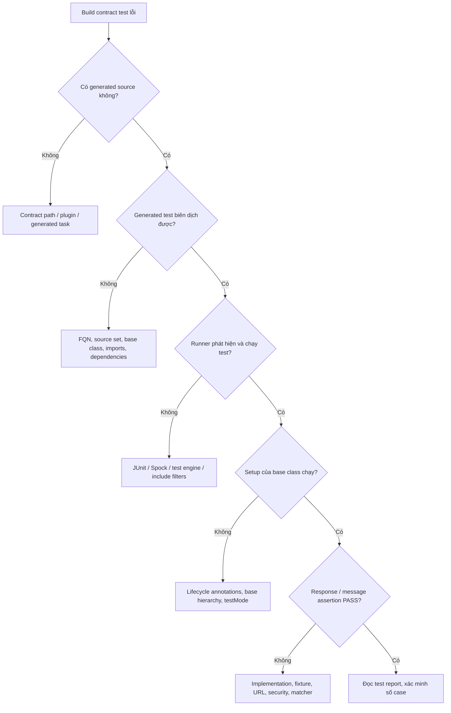
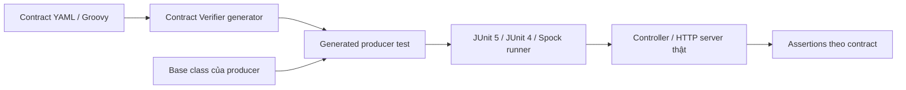
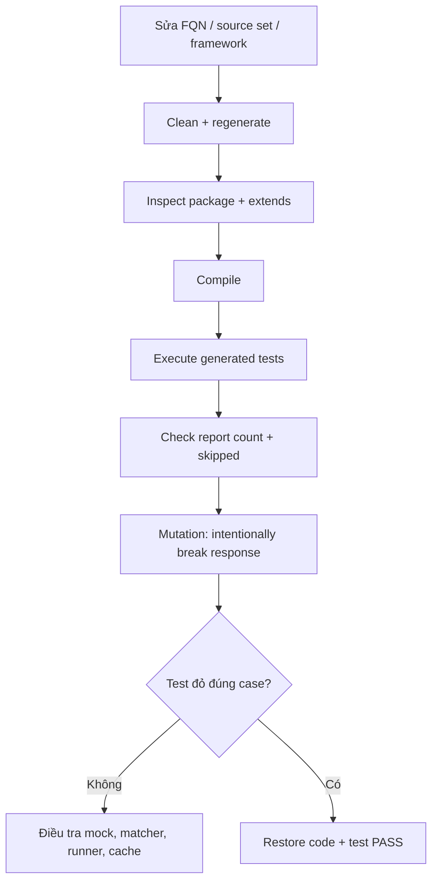

# Sai base class, package hoặc test framework

> **Chương:** Chẩn đoán sự cố  
> **Module:** `SPRING_CLOUD_CONTRACT` — học kiểm thử hợp đồng giữa producer và consumer bằng Groovy/YAML DSL cho HTTP hoặc thông điệp, sinh kiểm thử phía producer, phát hành stub, dùng Stub Runner và tích hợp CI để phát hiện thay đổi API không tương thích.

## Mục tiêu học tập

Sau bài học, bạn có thể:

1. Phân biệt ba nhóm lỗi dễ nhầm: **sai base class**, **sai package/source set** và **test framework/test engine không khớp**.
2. Từ một stack trace, xác định lỗi phát sinh ở **contract discovery, generation, compilation, test discovery, setup runtime hay assertion**.
3. Hiểu cách generated producer tests của Spring Cloud Contract **kế thừa base class**, vì sao tên đầy đủ (`FQN`) phải đúng, và tại sao contract directory không tự bằng Java package của base class.
4. Cấu hình `baseClassForTests`, `basePackageForTests`, `packageWithBaseClasses` và `baseClassMappings` đúng mục đích, nhận diện quy tắc ưu tiên.
5. Đặt base classes đúng nguồn Maven `src/test/java` hay Gradle `src/contractTest/java`, không nhầm source set `test` với `contractTest`.
6. Phối hợp đúng JUnit 5, JUnit 4 hoặc Spock với annotation lifecycle, test runner, dependencies và test engine.
7. Chẩn đoán khác biệt giữa HTTP `MockMvc`, `Explicit`, `WebTestClient` và messaging test setup; không sửa lỗi bằng cách tắt ngầm phần cần kiểm chứng.
8. Dùng generated source, task graph, Maven/Gradle test reports và một lỗi cố ý để chứng minh bài kiểm thử thật sự hoạt động.
9. Xây một checklist/CI gate ngăn tình trạng **BUILD SUCCESS với 0 generated contract tests** hoặc tests bị skip.
10. Biết lúc nào lỗi thuộc producer verification và lúc nào thuộc consumer Stub Runner, không đổi contract để chữa một lỗi build/classpath.

## 1. Một báo lỗi, ba nhóm nguyên nhân

Giả sử `inventory-service` là producer, `checkout-service` là consumer. Producer có hợp đồng:

```http
GET /api/stock/SKU-001 HTTP/1.1
Accept: application/json
```

Response cam kết:

```http
HTTP/1.1 200 OK
Content-Type: application/json

{
  "sku": "SKU-001",
  "available": true,
  "quantity": 4
}
```

Spring Cloud Contract Verifier sinh Java test để xác minh implementation của inventory. Developer chạy build nhưng nhận một trong các lỗi:

```text
[ERROR] cannot find symbol
  symbol: class InventoryContractBase

[ERROR] package com.example.inventory.contract does not exist

No tests found for given includes

java.lang.NullPointerException:
  RestAssuredMockMvc has not been initialized

Expected status code <200> but was <404>
```

Không phải cả bốn đều là "contract sai". Các nguyên nhân khác hẳn nhau:

- **Không tìm thấy base class**: generated Java test có `extends InventoryContractBase` nhưng compiler không resolve được tên class trên test classpath.
- **Sai package**: base class tồn tại nhưng `package` khai báo khác FQN mà plugin đã chọn, hoặc Java file đặt sai source root/module.
- **Sai framework/runner**: generated tests là JUnit Jupiter nhưng task chạy JUnit 4/Vintage, hoặc base dùng `@Before` JUnit 4 trong khi generated tests chạy JUnit 5; setup không được thực thi.
- **Sai test mode hoặc setup**: test được tìm thấy và chạy nhưng không có MockMvc context/port phù hợp, nên request nhận 404, connection refused hoặc NPE.

**Nguyên tắc đầu tiên: sửa ở tầng phát sinh lỗi.** Không đổi body của Groovy/YAML contract và không tắt test chỉ để compiler hoặc JUnit runner ngừng báo lỗi.

## 2. Bản đồ chẩn đoán: tìm bước đầu tiên bị hỏng



Khi đọc log, trước hết xác định **task/phase**:

| Thời điểm | Dấu hiệu | Kiểm tra chính |
| --- | --- | --- |
| Parse/generate | Không có generated test | `contractsDirectory`/`contractsDslDir`, plugin, ignored/inProgress |
| Java/Groovy compile | `cannot find symbol`, `package ... does not exist` | `extends`, FQN, file package, source root, test classpath |
| Test discovery | `No tests found`, 0 tests | JUnit Platform, Spock engine, filters, `Test` task |
| Setup runtime | `RestAssuredMockMvc` chưa init, `context == null` | `@BeforeEach`/`@Before`/`setup()` và base |
| HTTP execution | 404, 415, connection refused, 401 | `testMode`, controller, converter, security, server port |
| Messaging execution | `triggeredBy` method không tồn tại hoặc không nhận event | Messaging base, trigger, destination, binder |
| Assertion | Expected JSON/status khác actual | Producer implementation, fixtures, contract semantics |
| Build green but no tests | Report rỗng/`NO-SOURCE`/`SKIPPED` | Test count gate, lifecycle wiring, filters |

**Trình tự vàng:** mở chính **generated test Java/Groovy** và đọc phần `package`, `extends`, imports, annotations và method được sinh. Đây là bằng chứng plugin đã quyết định điều gì, mạnh hơn việc chỉ nhìn `pom.xml`/`build.gradle`.

## 3. Kiến trúc: contract → generated test → base class

Với producer HTTP, quy trình điển hình:



Generated test không tự biết:

- Controller đang nằm ở Spring context nào.
- Test có phải mở HTTP server không.
- Dữ liệu fixture nào phải sẵn sàng.
- Producer có cần giả lập một collaborator ngoài ranh giới hợp đồng không.
- Có cần inject message verifier hoặc setup binder không.

**Base class** là điểm đặt những setup cần thiết. Generated test có thể kế thừa trực tiếp hoặc thông qua phân cấp class theo cấu hình.

### 3.1. Ví dụ contract đơn giản

Đường dẫn Maven producer:

```text
src/test/resources/contracts/stock/stock_available.yml
```

Nội dung:

```yaml
name: stock_available
request:
  method: GET
  url: /api/stock/SKU-001
  headers:
    Accept: application/json
response:
  status: 200
  headers:
    Content-Type: application/json
  body:
    sku: SKU-001
    available: true
    quantity: 4
```

Một generated test JUnit 5 có thể **tương tự**:

```java
package com.example.inventory.contract;

import org.junit.jupiter.api.Test;

public class StockTest extends InventoryContractBase {

    @Test
    public void stock_available() throws Exception {
        // Generated HTTP request + assertions do plugin sinh.
    }
}
```

Đây là **phần mô phỏng cấu trúc**, không phải mã do một plugin version cụ thể thực sự sinh. Tên class, phương thức, imports và cách gọi HTTP phải được kiểm tra từ output hiện tại.

### 3.2. Ba thứ có thể khác nhau

1. **Đường dẫn contract file**: `src/test/resources/contracts/stock/stock_available.yml`.
2. **Package của generated test**: ví dụ `com.example.inventory.contract` do `basePackageForTests` hoặc cấu hình plugin ảnh hưởng.
3. **FQN của base class**: `com.example.inventory.contract.InventoryContractBase` hoặc một package khác được chọn từ `baseClassForTests`/mappings.

**Không suy ra `basePackageForTests` bắt buộc phải bằng package của base class.** Generated test ở package khác vẫn có thể `extends com.example.contractsupport.InventoryContractBase` khi class là `public`, dependency/import đúng và các method cần thiết truy cập được.

## 4. Phân biệt bốn tùy chọn dễ nhầm

| Tùy chọn | Làm gì? | Khi dùng |
| --- | --- | --- |
| `baseClassForTests` | Chỉ định **một base class FQN** cho generated tests | Đơn giản, chỉ một loại HTTP/message setup |
| `basePackageForTests` | Chọn **Java package của generated tests** | Muốn generated code có package rõ ràng |
| `packageWithBaseClasses` | Chọn package chứa **nhiều base class theo quy ước tên** | Nhiều nhóm contracts phân theo thư mục |
| `baseClassMappings` | **Regex contract package → base class FQN** | Mapping HTTP vs messaging hoặc v1 vs v2 rõ ràng |

Theo tài liệu Spring Cloud Contract, khi nhiều cơ chế cùng áp dụng, ưu tiên:

**`baseClassMappings` → `packageWithBaseClasses` → `baseClassForTests`**.

Vì vậy, bạn có thể sửa `baseClassForTests` nhưng generated test vẫn kế thừa lớp cũ nếu một `baseClassMappings` vẫn match.

### 4.1. Một base duy nhất

Maven plugin fragment:

```xml
<plugin>
  <groupId>org.springframework.cloud</groupId>
  <artifactId>spring-cloud-contract-maven-plugin</artifactId>
  <version>${spring-cloud-contract.version}</version>
  <extensions>true</extensions>
  <configuration>
    <testFramework>JUNIT5</testFramework>
    <testMode>MOCKMVC</testMode>
    <basePackageForTests>com.example.inventory.generated</basePackageForTests>
    <baseClassForTests>
      com.example.inventory.contract.InventoryContractBase
    </baseClassForTests>
  </configuration>
</plugin>
```

```java
package com.example.inventory.contract;

public abstract class InventoryContractBase {
    // Setup producer test.
}
```

Generated test có thể ở `com.example.inventory.generated`, còn base ở `com.example.inventory.contract`. Đây là thiết kế hợp lệ khi compiler nhìn thấy base class.

**Đừng đặt `baseClassForTests` là tên package** như `com.example.inventory.contract` nếu plugin cần **FQN của class**. Phải có tên class cụ thể, ví dụ `...InventoryContractBase`.

### 4.2. Quy ước tên theo packageWithBaseClasses

Giả sử contracts:

```text
src/test/resources/contracts/
└── api/
    ├── v1/
    │   └── stock_available.yml
    └── v2/
        └── stock_available.yml
```

Nếu cấu hình:

```xml
<packageWithBaseClasses>
  com.example.inventory.contractbase
</packageWithBaseClasses>
```

plugin có thể áp quy tắc **lấy hai thành phần cuối** của đường dẫn contract package, ghép CamelCase và thêm hậu tố `Base`. Với `api/v1` và `api/v2`, tên theo convention được kỳ vọng là:

```text
com.example.inventory.contractbase.ApiV1Base
com.example.inventory.contractbase.ApiV2Base
```

**Đừng đoán khi project có cấu trúc lồng nhiều thư mục.** Contract nằm sâu hơn hoặc plugin/version xử lý package/path khác có thể chọn tên khác; mở generated `extends` để xác nhận.

Một file đặt tại `contracts/api/v1/stock_available.yml` không yêu cầu base class đặt trong thư mục Java `api/v1`. Cấu hình chỉ định **package chứa các base classes**; đường dẫn contract dùng để suy ra **class name** theo convention.

### 4.3. baseClassMappings: phù hợp cho HTTP và messaging

Với hai ranh giới:

```text
contracts/
├── http/
│   └── stock_available.yml
└── messaging/
    └── stock_changed.yml
```

Bạn có thể muốn:

- HTTP test kế thừa `com.example.contractbase.HttpContractBase`.
- Messaging test kế thừa `com.example.contractbase.MessageContractBase`.

Gradle Groovy DSL (minh họa cú pháp được Spring Cloud Contract tài liệu hóa):

```groovy
contracts {
    testFramework = 'JUNIT5'
    testMode = 'MockMvc'
    basePackageForTests = 'com.example.generated'

    baseClassForTests =
        'com.example.contractbase.FallbackContractBase'

    baseClassMappings {
        baseClassMapping(
            '.*http.*',
            'com.example.contractbase.HttpContractBase'
        )
        baseClassMapping(
            '.*messaging.*',
            'com.example.contractbase.MessageContractBase'
        )
    }
}
```

Đường dẫn/contract package phải thực sự match regex. **Regex rộng** như `.*` sẽ match mọi package và có thể khiến nhiều contracts bất ngờ kế thừa cùng một base.

### 4.4. Maven baseClassMappings

Một XML fragment tương ứng:

```xml
<configuration>
  <testFramework>JUNIT5</testFramework>
  <baseClassForTests>
    com.example.contractbase.FallbackContractBase
  </baseClassForTests>
  <baseClassMappings>
    <baseClassMapping>
      <contractPackageRegex>.*http.*</contractPackageRegex>
      <baseClassFQN>
        com.example.contractbase.HttpContractBase
      </baseClassFQN>
    </baseClassMapping>
    <baseClassMapping>
      <contractPackageRegex>.*messaging.*</contractPackageRegex>
      <baseClassFQN>
        com.example.contractbase.MessageContractBase
      </baseClassFQN>
    </baseClassMapping>
  </baseClassMappings>
</configuration>
```

Đây là **fragment đặt trong `spring-cloud-contract-maven-plugin`**, không phải một `pom.xml` hoàn chỉnh. Khi dùng plugin version cũ/mới, kiểm tra schema/configuration của đúng version và generated code.

### 4.5. Lỗi do ưu tiên "ngoài dự kiến"

Ví dụ:

```groovy
contracts {
    baseClassForTests = 'com.example.contractbase.NewBase'
    baseClassMappings {
        baseClassMapping('.*', 'com.example.contractbase.OldBase')
    }
}
```

Developer tin tests sẽ kế thừa `NewBase`. Nhưng regex `.*` match mọi contract package và **ghi đè** fallback. Khi generated test vẫn `extends OldBase`, sửa `baseClassForTests` thêm lần nữa không giải quyết gì.

**Cách sửa:** bỏ/thu hẹp mapping quá rộng, hoặc cố ý đặt mapping đúng target. Sau đó regenerate và **đọc lại** `extends`.

## 5. Source layout Maven: base class nằm ở đâu?

Với dự án Maven producer thông thường:

```text
inventory-service/
├── pom.xml
├── src/
│   ├── main/java/com/example/inventory/
│   │   └── StockController.java
│   └── test/
│       ├── java/com/example/inventory/contract/
│       │   └── InventoryContractBase.java
│       └── resources/
│           └── contracts/stock/
│               └── stock_available.yml
└── target/
    ├── generated-test-sources/contracts/
    │   └── ... generated test source ...
    └── surefire-reports/
        └── TEST-...xml
```

Ở ví dụ này base có khai báo đầu file:

```java
package com.example.inventory.contract;
```

và nằm dưới root `src/test/java/com/example/inventory/contract/`. `baseClassForTests` phải là:

```text
com.example.inventory.contract.InventoryContractBase
```

### 5.1. "File tồn tại" chưa chắc compiler thấy

Các lỗi thường gặp:

- File nằm trong `src/main/resources` thay vì Java test source.
- File tên `InventoryContractBase.java` nhưng `package` khai báo `com.example.inventory.tests` khác FQN cấu hình.
- Base class thuộc **module Maven khác** chưa được thêm vào test classpath.
- Java class là **package-private** trong package khác generated test.
- Dependency chỉ có ở scope không phù hợp hoặc đã bị exclude.
- File được đặt trong `target/generated-test-sources` thủ công rồi bị `mvn clean` xóa.
- IDE thấy class vì manual source mapping, nhưng Maven CI không thấy class vì source roots khác.

### 5.2. Không sửa bằng cách copy class vào generated directory

Một sửa lỗi không bền:

```text
target/generated-test-sources/contracts/InventoryContractBase.java
```

Generated directories là **output của build**, có thể bị `clean` xóa hoặc plugin ghi lại. Hãy để base class trong source root do dự án quản lý; kiểm tra Maven test compilation classpath.

### 5.3. Nếu IDE báo đỏ nhưng Maven verify PASS

Đó có thể là **IDE source root/indexing problem**, không phải producer code sai. Kiểm tra Maven CLI có biên dịch/run tests không; nếu PASS nhưng IDE chưa nhận `target/generated-test-sources/contracts`, reimport Maven project hoặc cấu hình source mapping theo plugin.

Không sửa `pom.xml` bừa bãi nếu vấn đề chỉ ở IDE; ngược lại **IDE xanh không chứng minh Maven CI có test source root đúng**.

## 6. Source layout Gradle: đừng nhầm test với contractTest

Spring Cloud Contract Gradle plugin hiện đại dùng source set riêng `contractTest`.

```text
inventory-service/
├── build.gradle
├── src/
│   ├── main/java/com/example/inventory/
│   │   └── StockController.java
│   ├── test/java/com/example/inventory/
│   │   └── StockControllerUnitTest.java
│   └── contractTest/
│       ├── java/com/example/inventory/contract/
│       │   └── InventoryContractBase.java
│       └── resources/contracts/stock/
│           └── stock_available.yml
└── build/
    ├── generated-test-sources/contractTest/java/
    ├── test-results/contractTest/
    └── reports/tests/contractTest/
```

Theo tài liệu chính thức, plugin đã chuyển đường dẫn nguồn contract sang `src/contractTest/resources/contracts`, và vị trí `src/test/resources/contracts` là đường dẫn tương thích cũ đã **deprecated từ phiên bản 3.0.0**.

### 6.1. Sai vị trí, đúng tên vẫn fail

Một vấn đề thực tế:

- Generated test ở source set `contractTest`.
- Base class lại nằm ở `src/test/java`.
- `src/test/java` không tự động là nguồn của `contractTest`.
- Generated test compile fail: `cannot find symbol InventoryContractBase`.

**Cách ưu tiên:** chuyển base class đến `src/contractTest/java` hoặc cấu hình source set/classpath một cách có chủ đích và được kiểm thử. Đừng copy cùng một class vào cả hai source sets nếu làm thay đổi cách Gradle package/compile và khó bảo trì.

### 6.2. Cấu hình Gradle JUnit 5 có base class rõ ràng

Fragment `build.gradle` (Groovy DSL, dự án đã có Spring Boot/JDK/repositories phù hợp):

```groovy
plugins {
    id 'java'
    id 'org.springframework.cloud.contract' version '5.0.3'
}

dependencies {
    contractTestImplementation(
        'org.springframework.cloud:spring-cloud-starter-contract-verifier'
    )
}

contracts {
    contractsDslDir =
        file('src/contractTest/resources/contracts')

    testFramework = 'JUNIT5'
    testMode = 'MockMvc'
    baseClassForTests =
        'com.example.inventory.contract.InventoryContractBase'
    basePackageForTests =
        'com.example.inventory.generated'
    failOnNoContracts = true
}

tasks.named('contractTest', Test) {
    useJUnitPlatform()
    reports.junitXml.required = true
}
```

Đây là **fragment**, không phải build hoàn chỉnh; project cần plugin Spring Boot/Java, dependency management và starter web/test phù hợp với Spring Cloud Contract version.

**Quan trọng:** `tasks.test { useJUnitPlatform() }` chỉ áp dụng cho task `test`. Generated tests đang ở task `contractTest`, do đó phải đặt `useJUnitPlatform()` trên **đúng task**.

### 6.3. Đường dẫn output có thể được tùy chỉnh

Plugin có các tùy chọn `generatedTestJavaSourcesDir`/`generatedTestGroovySourcesDir`, một số dự án đổi nơi sinh code. Vì thế, đừng tìm file generated mãi ở một đường dẫn mặc định nếu config đã thay đổi.

Thay vì đoán, hãy xem Gradle task graph, logs của `generateContractTests` và generated source path mà plugin báo.

### 6.4. Multi-module: đang kiểm tra module nào?

Trong Gradle monorepo:

```text
:inventory-producer:generateContractTests
:inventory-producer:compileContractTestJava
:inventory-producer:contractTest
```

Đây là ba task của producer. `:checkout-consumer:test` PASS không bảo đảm producer generated tests chạy. Khi có nhiều subproject, class base phải nằm trên **test classpath của chính producer source set** cần compile.

## 7. Framework: JUnit 4, JUnit 5 và Spock không tự thay thế nhau

Spring Cloud Contract hỗ trợ nhiều test frameworks. Những configuration phổ biến:

| Framework | Giá trị `testFramework` | Generated test style | Base setup đúng kiểu |
| --- | --- | --- | --- |
| **JUnit 5** | `JUNIT5` | `org.junit.jupiter.api.Test` | `@BeforeEach`, Jupiter engine |
| **JUnit 4** | `JUNIT` | `org.junit.Test` | `@Before`, JUnit 4 runner |
| **Spock** | `SPOCK` | Groovy `Specification` | `def setup()` / Spock lifecycle |

Tài liệu được duy trì cho nhiều dòng Spring Cloud Contract và một số trang vẫn có ví dụ JUnit 4; thông tin **framework mặc định** cũng khác ở các version/docs. Trong dự án quan trọng, **hãy cấu hình tường minh `testFramework` và đọc annotation trong generated test**, không phỏng đoán từ một ví dụ cũ.

### 7.1. Lỗi điển hình: JUnit 5 test nhưng base JUnit 4

```java
package com.example.inventory.contract;

import org.junit.Before;

public abstract class InventoryContractBase {
    @Before
    public void setup() {
        // setup RestAssuredMockMvc
    }
}
```

Nếu generated tests dùng Jupiter (`org.junit.jupiter.api.Test`), `@Before` của JUnit 4 **không phải lifecycle callback của Jupiter**. Test có thể được phát hiện nhưng setup không chạy, dẫn đến NPE/404 hoặc request đi sai chỗ.

Sửa:

```java
import org.junit.jupiter.api.BeforeEach;

public abstract class InventoryContractBase {
    @BeforeEach
    public void setup() {
        // setup RestAssuredMockMvc
    }
}
```

Chú ý: `@BeforeEach` trong base class phải là method **không private**, được kế thừa/được JUnit Jupiter nhận diện. Dùng `public void` trong bài giúp minh bạch về khả năng truy cập.

### 7.2. Lỗi ngược: generated JUnit 4 nhưng base Jupiter

```java
import org.junit.jupiter.api.BeforeEach;

public abstract class InventoryContractBase {
    @BeforeEach
    public void setup() {
        // setup
    }
}
```

Nếu plugin sinh `org.junit.Test` và runner JUnit 4 thực thi, `@BeforeEach` không được gọi theo lifecycle JUnit 4. Sửa **một trong hai hướng**:

- Chuyển toàn bộ generated tests và runner sang `JUNIT5`/Jupiter; hoặc
- Dùng `JUNIT` và `org.junit.Before`/JUnit 4 runner nhất quán.

**Không trộn annotation lifecycle của hai framework rồi hy vọng một test engine bất kỳ sẽ thực hiện tất cả.** JUnit Vintage hỗ trợ chạy JUnit 4 tests trên Platform, nhưng không tự biến `@Before` thành callback Jupiter.

### 7.3. Không có test engine

Các triệu chứng:

```text
TestEngine with ID 'junit-jupiter' failed to discover tests

No tests found for given includes

Cannot resolve org.junit.jupiter.api.Test

NoClassDefFoundError: org/junit/jupiter/api/Test
```

Tùy thông điệp chính xác, có thể do:

- Có JUnit Jupiter API để compile nhưng thiếu Jupiter engine ở runtime.
- Gradle `contractTest` chưa gọi `useJUnitPlatform()`.
- Maven Surefire quá cũ/không tương thích JUnit 5 trong project.
- Test bị filter theo tên class sai, nên 0 tests được chạy.
- Dependencies lệch phiên bản do BOM/classpath conflict.
- Generated test thuộc một source set không được runner quét.

**Tách compile với discovery:** nếu `org.junit.jupiter.api.Test` không resolve lúc compile, kiểm tra dependency trước. Nếu compile thành công nhưng 0 tests discovered, kiểm tra runner/test engine/task/filter.

### 7.4. Ghi rõ phiên bản, đừng phụ thuộc default

Maven plugin XML:

```xml
<configuration>
  <testFramework>JUNIT5</testFramework>
  <testMode>MOCKMVC</testMode>
  <baseClassForTests>
    com.example.inventory.contract.InventoryContractBase
  </baseClassForTests>
</configuration>
```

Gradle Groovy:

```groovy
contracts {
    testFramework = 'JUNIT5'
    testMode = 'MockMvc'
    baseClassForTests =
        'com.example.inventory.contract.InventoryContractBase'
}
tasks.named('contractTest', Test) {
    useJUnitPlatform()
}
```

Nếu project dùng `SPOCK`, cần `groovy` plugin/Spock dependencies tương thích với Groovy/JDK hiện có và engine chạy Spock qua JUnit Platform theo version.

## 8. Cấu hình JUnit 5 + MockMvc: ví dụ chuẩn tối thiểu

### 8.1. Controller của producer

```java
package com.example.inventory;

import org.springframework.http.MediaType;
import org.springframework.web.bind.annotation.GetMapping;
import org.springframework.web.bind.annotation.PathVariable;
import org.springframework.web.bind.annotation.RequestMapping;
import org.springframework.web.bind.annotation.RestController;

@RestController
@RequestMapping("/api/stock")
public class StockController {

    @GetMapping(
        value = "/{sku}",
        produces = MediaType.APPLICATION_JSON_VALUE
    )
    public Stock get(@PathVariable String sku) {
        return new Stock(sku, true, 4);
    }

    public record Stock(
        String sku,
        boolean available,
        int quantity
    ) {}
}
```

Controller này chỉ mô phỏng **một interaction thành công**; nếu API có error contracts, cần bổ sung behavior tương ứng. Không dùng ví dụ này để kết luận SKU khác cũng có 4 đơn vị tồn kho.

### 8.2. Base test dùng standaloneSetup

Với test mode `MockMvc`:

```java
package com.example.inventory.contract;

import com.example.inventory.StockController;
import io.restassured.module.mockmvc.RestAssuredMockMvc;
import org.junit.jupiter.api.BeforeEach;

public abstract class InventoryContractBase {

    @BeforeEach
    public void setup() {
        RestAssuredMockMvc.standaloneSetup(
            new StockController()
        );
    }
}
```

Cần plugin sinh JUnit 5 test kế thừa `InventoryContractBase` và runtime có RestAssuredMockMvc. Khi base setup đúng, generated test sẽ gọi **controller thật** trong phạm vi MockMvc.

**Giới hạn:** `standaloneSetup` không tự chạy tất cả security filters, controller advices và converters của Spring Boot application context. Khi những thành phần ấy ảnh hưởng contract, dùng Spring context setup.

### 8.3. Base test dùng WebApplicationContext

```java
package com.example.inventory.contract;

import io.restassured.module.mockmvc.RestAssuredMockMvc;
import org.junit.jupiter.api.BeforeEach;
import org.springframework.beans.factory.annotation.Autowired;
import org.springframework.boot.test.autoconfigure.web.servlet.AutoConfigureMockMvc;
import org.springframework.boot.test.context.SpringBootTest;
import org.springframework.web.context.WebApplicationContext;

@SpringBootTest
@AutoConfigureMockMvc
public abstract class InventoryContractBase {

    @Autowired
    private WebApplicationContext context;

    @BeforeEach
    public void setup() {
        RestAssuredMockMvc.webAppContextSetup(context);
    }
}
```

Với Spring Boot có application class ở vị trí scan phù hợp, test này khởi tạo **Spring MVC context** phục vụ generated verification. Nếu `context == null`, xem test engine và Spring test integration, chứ không thay contract JSON ngay.

### 8.4. Khi nào cần test context thật?

Dùng context nếu hợp đồng phụ thuộc:

- `@ControllerAdvice` và error body.
- Jackson custom configuration/JSON converters.
- Validation và exception mapping.
- Spring Security filters/auth context.
- Controller wiring với Spring beans.
- Request filters/interceptors ảnh hưởng status/headers.

Với một controller đơn giản, `standaloneSetup` nhanh và có thể đủ. Chọn mức độ tích hợp phù hợp ranh giới test, không mở toàn bộ microservices nếu không cần.

### 8.5. Đừng mock controller cần kiểm chứng

Một anti-pattern:

```java
StockController controller = mock(StockController.class);
when(controller.get("SKU-001"))
    .thenReturn(new StockController.Stock("SKU-001", true, 4));

RestAssuredMockMvc.standaloneSetup(controller);
```

Generated test có thể PASS chỉ vì mock trả chính giá trị contract kỳ vọng, kể cả producer code thật đã sai. Hãy giữ controller/service chịu trách nhiệm tạo public response ở phạm vi **thật**, chỉ mock những collaborator ngoài ranh giới cần kiểm tra.

## 9. Test mode mismatch: lỗi trông giống base class

Framework kiểm thử (JUnit/Spock) và **test mode** (HTTP transport) là hai trục độc lập.

| `testMode` | Generated test gọi qua | Base setup phù hợp |
| --- | --- | --- |
| `MockMvc` / `MOCKMVC` | `RestAssuredMockMvc` | `standaloneSetup` hoặc `webAppContextSetup` |
| `Explicit` / `EXPLICIT` | HTTP thật qua socket | Embedded server chạy, cấu hình URI/port |
| `WebTestClient` | Reactive `WebTestClient` | WebFlux test setup/client phù hợp |
| `JaxRsClient` | JAX-RS client | Server/WebTarget theo chế độ hỗ trợ |

Đừng dùng `RestAssuredMockMvc.standaloneSetup(...)` trong base nhưng cấu hình `testMode='Explicit'`. Generated test sẽ dùng HTTP client/server thực; standalone MockMvc không mở cổng TCP.

### 9.1. Dấu hiệu sai mode

- `Connection refused` ở `localhost:8080` khi `EXPLICIT` nhưng không chạy server.
- `404` từ server khác đang chiếm cổng.
- `RestAssuredMockMvc` chưa được thiết lập khi `MOCKMVC`.
- Reactive test không tìm thấy client phù hợp vì base chỉ tạo Servlet MockMvc.
- Spring context khởi tạo được nhưng test vẫn gọi URI sai.

### 9.2. JUnit 5 + Explicit mode với random port

```java
package com.example.inventory.contract;

import io.restassured.RestAssured;
import org.junit.jupiter.api.BeforeEach;
import org.springframework.boot.test.context.SpringBootTest;
import org.springframework.boot.test.web.server.LocalServerPort;

@SpringBootTest(
    webEnvironment = SpringBootTest.WebEnvironment.RANDOM_PORT
)
public abstract class InventoryHttpContractBase {

    @LocalServerPort
    int port;

    @BeforeEach
    public void setup() {
        RestAssured.baseURI = "http://localhost";
        RestAssured.port = port;
    }
}
```

Base này chỉ phù hợp khi generated tests được cấu hình `testMode=EXPLICIT` và Spring Boot chạy embedded server. Một số phiên bản cần cấu hình thêm base URI/port hoặc test setup theo generator; **mở generated test để xem client gọi gì**.

Nếu mở server ở random port, đừng vẫn hard-code `8080` trong generated test hoặc environment. Với tests song song, `RestAssured` global static config có thể cần cô lập để tránh lẫn port giữa classes.

### 9.3. Chọn mode theo producer thực

- Spring MVC controller: thường bắt đầu với `MockMvc`.
- WebFlux endpoint: chọn `WebTestClient` nếu phù hợp.
- JAX-RS endpoint: xem `JaxRsClient`.
- Cần kiểm tra routing/network/real server: `Explicit`.

**Không đổi mode để "cho test xanh"** nếu bạn đang vô tình mất đi authentication, serialization hay behavior mà contract phải bảo vệ.

## 10. Spock: một kiểu base class khác hẳn JUnit

Nếu `testFramework='SPOCK'`, generated test thường là Groovy specification, không phải Java JUnit 5 test.

Ví dụ base Spock:

```groovy
package com.example.inventory.contract

import com.example.inventory.StockController
import io.restassured.module.mockmvc.RestAssuredMockMvc
import spock.lang.Specification

abstract class InventoryContractSpecBase extends Specification {

    def setup() {
        RestAssuredMockMvc.standaloneSetup(
            new StockController()
        )
    }
}
```

Ở đây `def setup()` là lifecycle của Spock; không cần đặt `@BeforeEach` lên method Spock. Base class phải `extends spock.lang.Specification` (trực tiếp hoặc gián tiếp) nếu generator sinh Spock `extends` từ nó.

### 10.1. Lỗi khi trộn JUnit test với Spock base

Một tình huống nguy hiểm:

```groovy
abstract class InventoryContractSpecBase extends Specification {
    def setup() {
        // Setup MockMvc cho Spock
    }
}
```

nhưng plugin cấu hình `JUNIT5` và generated Java test lại kế thừa `InventoryContractSpecBase`. Có thể gặp compile error hoặc behavior không tương thích vì Java/JUnit generated test không phải Spock specification.

**Giải pháp:** chọn một trong hai cấu hình nhất quán:

- `JUNIT5` → Java base class + `@BeforeEach` + JUnit Jupiter engine.
- `SPOCK` → Groovy `Specification` base + `setup()` + Spock dependencies/engine.

Không cố thêm một vài dependencies để "chạy được cả hai" mà chưa hiểu generated code.

### 10.2. Groovy source set

Với Gradle, Spock base ở `src/contractTest/groovy` theo plugin/source set đã cấu hình. Cần Groovy plugin và `contractTestGroovy` compilation. Nếu chỉ tạo base ở `src/contractTest/java` nhưng class cần Spock/Groovy API, kiểm tra compilation classpath và source sets tương ứng.

### 10.3. Spock trên JUnit Platform

Các bản Spock hiện đại chạy trên JUnit Platform; Gradle `useJUnitPlatform()` vẫn có thể cần với `contractTest`. Nhưng điều đó **không biến tests Spock thành Jupiter tests**. Test engine Spock và framework generator phải cùng version/khả năng tương thích với Groovy/JDK.

Nếu không tìm thấy specification, kiểm tra `spock-core`, Groovy runtime, engine và generated Groovy output.

## 11. Base class method visibility và Java package

Ngay cả khi generated test tìm được base, code vẫn có thể hỏng vì **khả năng truy cập**.

### 11.1. Package-private base

```java
package com.example.inventory.contract;

abstract class InventoryContractBase {
}
```

Nếu generated test ở `com.example.inventory.generated`, class này không `public`, Java compiler không cho truy cập từ package khác.

Sửa:

```java
package com.example.inventory.contract;

public abstract class InventoryContractBase {
}
```

### 11.2. Method custom assertion không thể gọi

Một số contracts dùng `by_command` hoặc `assertThat` để gọi method hỗ trợ trong base class.

Ví dụ method helper:

```java
package com.example.inventory.contract;

public abstract class InventoryContractBase {

    protected void assertValidStockCode(String value) {
        if (value == null || !value.matches("SKU-[0-9]{3}")) {
            throw new AssertionError("Invalid stock code");
        }
    }
}
```

Nếu generated test cần gọi method này mà method là `private` hoặc có signature sai, có thể gặp:

```text
cannot find symbol: method assertValidStockCode(String)
method ... has private access
```

**Cách sửa:** xem generated call expression để xác định **tên, tham số và kiểu giá trị chính xác**, rồi làm method `protected` hoặc `public` theo nhu cầu. Không sửa contract để xóa assertion nghiệp vụ chỉ nhằm che compile error.

### 11.3. Static vs instance

Nếu generated Java code gọi `assertValidStockCode(value)` như instance method, helper phải được truy cập ở instance context. Nếu custom command thực sự được sinh dưới dạng static call, API/signature phải theo cách generator dùng.

Không đoán dựa vào cú pháp contract DSL. **Generated source là sự thật về cách gọi.**

### 11.4. Constructor của base class

Nếu generated test kế thừa base nhưng base chỉ có constructor có tham số bắt buộc, subclass có default constructor có thể compile fail:

```text
constructor InventoryContractBase in class ...
cannot be applied to given types
```

Trong test base, ưu tiên no-arg constructor và dùng Spring dependency injection hoặc setup methods. Nếu cần constructor injection, xác minh generated test thực sự cung cấp constructor tương ứng; mặc định đừng kỳ vọng generator biết tạo argument của bạn.

## 12. Vì sao lỗi package có thể do generated package chứ không do base

Một pattern:

```text
src/test/resources/contracts/
└── inventory/
    └── stock_available.yml
```

Với `basePackageForTests='com.example.verifier.generated'`, generated class có thể xuất hiện ở:

```text
com.example.verifier.generated.Inventory
```

Nhưng trong một phiên bản/cấu hình có grouping khác, contract path sâu có thể ảnh hưởng generated package/class name.

Điều tra bằng thứ tự:

1. Xác định **contract root** thực tế, không chỉ đường dẫn file bạn muốn plugin đọc.
2. Kiểm tra plugin đã generate test cho file đó.
3. Đọc đầu generated class: `package` và `extends`.
4. Đọc `basePackageForTests`.
5. Kiểm tra `baseClassMappings`/`packageWithBaseClasses` có override FQN hay không.
6. Đọc package declaration của base class.
7. Kiểm tra compiler input source set.
8. Sau khi sửa, clean/regenerate và đọc lại.

**Đừng đổi tất cả base classes sang package của generated tests** chỉ vì compiler báo thiếu; sửa đúng FQN hoặc source-set visibility thường đủ và ít tác động hơn.

## 13. Messaging contract: base phải có trigger/setup riêng

Spring Cloud Contract hỗ trợ cả HTTP và message contracts. Một message contract có thể như sau:

```yaml
name: stock_changed
label: stock_changed
input:
  triggeredBy: publishStockChanged()
outputMessage:
  sentTo: inventory.events
  headers:
    contentType: application/json
    eventType: StockChanged
  body:
    eventType: StockChanged
    sku: SKU-001
    available: true
    quantity: 4
```

Generated producer test có thể gọi method `publishStockChanged()` ở base hierarchy và xác minh message được gửi đến destination. Nếu base class HTTP chỉ setup MockMvc, messaging test có thể fail:

```text
cannot find symbol: method publishStockChanged()

No message received on destination inventory.events
```

Đây là **hai lỗi khác loại**:

- `cannot find symbol`: method trigger không tồn tại/không accessible trong base đã chọn.
- `No message received`: trigger có thể chạy nhưng publisher/binder/adapter hoặc destination fixture sai.

### 13.1. Base messaging minh họa

```java
package com.example.inventory.contract;

import org.springframework.beans.factory.annotation.Autowired;
import org.springframework.boot.test.context.SpringBootTest;
import org.springframework.cloud.contract.verifier.messaging.boot.AutoConfigureMessageVerifier;

@SpringBootTest
@AutoConfigureMessageVerifier
public abstract class StockMessageContractBase {

    @Autowired
    StockEventPublisher publisher;

    public void publishStockChanged() {
        publisher.publish(
            "SKU-001",
            true,
            4
        );
    }
}
```

`StockEventPublisher` là **domain interface/class minh họa**, phải do ứng dụng định nghĩa; cần messaging dependencies/binder/adapter thích hợp. `@AutoConfigureMessageVerifier` chỉ giúp thiết lập verification messaging trong phạm vi Spring Cloud Contract, không tự tạo Kafka cluster hay bảo đảm broker thật.

Nếu dùng JUnit 5, có thể có thêm test configuration/lifecycle phù hợp. Method `publishStockChanged()` phải **public/protected** để generated test gọi được từ subclass khác package.

### 13.2. Vì sao nên map HTTP và messaging vào hai base classes?

- HTTP base setup `RestAssuredMockMvc`.
- Messaging base setup verifier, trigger và publisher.
- Mỗi contract cần đúng fixture/destination.
- Kế thừa nhầm HTTP base làm generated messaging test thiếu trigger.
- Kế thừa nhầm messaging base làm HTTP tests không có MockMvc context.

Dùng `baseClassMappings` theo thư mục `http`/`messaging` hoặc convention `packageWithBaseClasses` rõ ràng, **không phụ thuộc fallback duy nhất** khi hệ thống có nhiều test modes.

### 13.3. Đặt contract vào thư mục phân loại giúp debug

```text
contracts/
├── http/
│   └── stock_available.yml
└── messaging/
    └── stock_changed.yml
```

Khi generated test kế thừa nhầm base, kiểm tra regex `.*http.*`/`.*messaging.*` có match đúng contract package path mà plugin tính không.

## 14. Mẫu lỗi thực tế và cách đọc

### 14.1. cannot find symbol: class BaseClass

```text
target/generated-test-sources/contracts/StockTest.java:5:
  error: cannot find symbol
  public class StockTest extends InventoryContractBase {
                                 ^
  symbol: class InventoryContractBase
```

**Khả năng cao:**

- `baseClassForTests` sai FQN.
- Base class không trong test sources/source set.
- Lớp nằm trong module khác mà test classpath thiếu.
- Base class không public từ package khác.
- Mapping regex override sang class không có thật.

**Điều tra:** mở generated `extends`, xác nhận base `package`/class declaration, source roots và classpath.

### 14.2. package ... does not exist

```text
error: package com.example.inventory.contracts does not exist
```

Có thể do generated import sai package, base khai báo `package` khác đường dẫn FQN hoặc module dependencies thiếu. Không sửa path trong `src/main` khi base chỉ cần ở test source.

### 14.3. incompatible types hoặc cannot inherit from final

```text
cannot inherit from final InventoryContractBase
```

Generated test cần kế thừa base. `final` không phù hợp; dùng `public abstract class` hoặc class thường có thể kế thừa.

### 14.4. JUnit 5 không tìm thấy test

```text
No tests found for given includes: [*Stock*]
```

Có thể không có generated class, Gradle task `test` chạy nhầm thay vì `contractTest`, JUnit Platform chưa bật, test filter sai hoặc engine không có.

**Đừng giải quyết bằng cách bật `ignoreFailures=true`.** Lệnh tạo test và lệnh thực thi test phải có output reports thật.

### 14.5. Base setup không được gọi

```text
IllegalStateException: No RestAssuredMockMvc configuration found
```

Nếu generated tests dùng Jupiter nhưng base import `org.junit.Before`, lỗi có thể do lifecycle mismatch. Kiểm tra breakpoint/log an toàn trong `@BeforeEach` và xem annotations trong generated test.

Đôi khi setup method có tồn tại nhưng chưa chạy vì test khác override cùng tên/lifecycle, hoặc base không được kế thừa như tưởng tượng. Đọc call stack và `extends`.

### 14.6. 404 dù endpoint thật tồn tại

Nếu `RestAssuredMockMvc.standaloneSetup(new StockController())` chỉ đăng ký controller khác, generated test gọi `/api/stock/SKU-001` có thể nhận 404. Nếu thiếu `@ControllerAdvice`, error contract có thể nhận body/status khác.

Kiểm tra controller mapping và cách dựng context. **Đừng đổi contract URL thành URL sai của fixture** nếu public API thật đã cam kết đường dẫn khác.

### 14.7. Connection refused với Explicit

```text
java.net.ConnectException: Connection refused
```

Có thể server chưa start, base URI/port sai, `@LocalServerPort` chưa inject vì không có `@SpringBootTest(RANDOM_PORT)`, hoặc test gọi sang process khác. Sửa setup mode và kiểm tra port thực của embedded server.

### 14.8. 401/403 khi base không có auth fixture

Nếu generated test request bảo vệ bởi Spring Security nhưng base chỉ cung cấp token giả không hợp lệ, response 401/403 là hành vi hợp lý của app. Dùng test identity/mock JWT hoặc security test config phù hợp với mục tiêu; **không dùng token production** và không tắt filter rồi tuyên bố đã verify security.

### 14.9. "Tests run: 0" nhưng BUILD SUCCESS

Đây là dấu hiệu thiếu bằng chứng, không phải producer đã đúng contract. Đọc generated sources, test engine, includes/excludes và reports; thêm guard `0 tests = fail` khi expected scenarios tồn tại.

## 15. Quy trình chẩn đoán bằng Maven

Ví dụ các lệnh **người học có thể chạy trong producer project** đã cấu hình Spring Cloud Contract. Đây không phải lệnh được thực thi khi viết tài liệu STEP 4.

### 15.1. Sinh và xem mã

```bash
mvn -B clean spring-cloud-contract:generateTests
```

Tùy plugin binding và project configuration, có thể dùng lifecycle:

```bash
mvn -B clean generate-test-sources
```

Sau đó kiểm tra `target/generated-test-sources/contracts` và đoạn:

```java
package com.example.inventory.generated;

public class StockTest
    extends com.example.inventory.contract.InventoryContractBase {
    // ...
}
```

Nếu Maven thông báo không nhận prefix `spring-cloud-contract`, dùng **fully qualified goal**:

```bash
mvn -B org.springframework.cloud:spring-cloud-contract-maven-plugin:generateTests
```

Hãy chọn version/plugin phù hợp với BOM/project. **Plugin prefix resolution** là vấn đề Maven invocation, không phải contract body lỗi.

### 15.2. Chạy verification

```bash
mvn -B clean verify
```

Với lỗi cần log sâu hơn:

```bash
mvn -B clean verify -e
```

`-e` hiển thị exception stack traces; chỉ dùng `-X`/debug nếu cần và trong môi trường có quyền xem logs phù hợp (không lộ credentials).

### 15.3. Tìm report đúng vị trí

Trong dự án Maven thông thường:

```text
target/surefire-reports/TEST-*.xml
target/failsafe-reports/TEST-*.xml
```

Các report cụ thể phụ thuộc plugin/test naming/execution. Cần xác định generated tests do Surefire hay Failsafe chạy và test cases có thực sự được phát hiện.

Nếu `mvn verify` PASS nhưng số generated tests bằng 0, kiểm tra `skip`, test includes/excludes và lifecycle bindings; không dựa riêng vào exit code.

### 15.4. Khi nào cần effective POM?

Nếu parent POM hoặc profile ghi đè cấu hình plugin, xem **effective POM** trong chính project. Đây là kỹ thuật chẩn đoán để tìm `baseClassForTests`/`testFramework` cuối cùng sau inheritance/profiles. Đừng chỉ đọc một fragment POM con rồi giả định nó là cấu hình cuối.

## 16. Quy trình chẩn đoán bằng Gradle

Trong producer project dùng Gradle:

```bash
# Chỉ kiểm tra task graph, không thực thi test.
./gradlew clean build --dry-run --console=plain

# Sinh sources do Spring Cloud Contract plugin quản lý.
./gradlew generateContractTests --console=plain

# Thực thi đúng contract test source set.
./gradlew contractTest --console=plain

# Khi muốn một lượt mới không dùng output cache:
./gradlew clean contractTest \
  --rerun-tasks --no-build-cache \
  --console=plain --info
```

Với multi-module:

```bash
./gradlew :inventory-producer:clean \
  :inventory-producer:contractTest \
  --rerun-tasks --no-build-cache \
  --console=plain
```

### 16.1. Task outcomes quan trọng

| Gradle output | Ý nghĩa đối với troubleshooting |
| --- | --- |
| `generateContractTests SUCCESS` | Generator chạy; chưa khẳng định test compile/run |
| `compileContractTestJava FAILED` | Tập trung vào FQN/base/package/deps |
| `contractTest NO-SOURCE` | Không có test sources/classes phù hợp |
| `contractTest SKIPPED` | Task bị skip/disabled/filter hoặc điều kiện |
| `contractTest UP-TO-DATE` | Output trước đó được tái sử dụng |
| `contractTest FROM-CACHE` | Task output đến từ build cache |
| `contractTest FAILED` | Xem báo cáo/stack trace để tìm setup/HTTP/assertion |
| `contractTest SUCCESS` | Vẫn phải kiểm tra test count và skipped |

**`--dry-run` không chạy tests.** Nó chỉ chứng minh task nằm trong graph, không chứng minh method JUnit/Spock đã chạy.

### 16.2. Mở đúng report

```text
build/test-results/contractTest/TEST-*.xml
build/reports/tests/contractTest/index.html
```

Nếu project đổi `testResultsDir` hay test task, dùng cấu hình thực tế. Không nhìn `build/test-results/test` rồi kết luận producer contract verification.

### 16.3. Tại sao -x contractTest là nguy hiểm?

```bash
# KHÔNG dùng trong producer verification gate:
./gradlew build -x contractTest
```

Command có thể cho `BUILD SUCCESSFUL` nhưng generated contract tests không được thực thi. Nếu pipeline publish `verifierStubsJar` trong khi verification bị bỏ qua, consumer có thể dùng **stub chưa được producer code kiểm chứng**.

## 17. Bảng chẩn đoán nguyên nhân gốc

| Triệu chứng | Nhóm lỗi | Kiểm tra đầu tiên | Sửa ưu tiên |
| --- | --- | --- | --- |
| `cannot find symbol Base` | Base/FQN | Generated `extends`, package, source root | Sửa FQN/location/access |
| `package ... does not exist` | Package/classpath | Base package declaration, test classpath | Sửa imports/source set/dependency |
| `base is not public` | Visibility | Modifier của base | `public` base |
| `method ... has private access` | Helper visibility | Generated call và base method | `protected/public`, đúng signature |
| `constructor ... cannot be applied` | Base constructor | Constructors của base | No-arg/test setup hợp lý |
| JUnit test compiled, 0 discovered | Framework/runner | `@Test` import, task engine/filter | Jupiter + `useJUnitPlatform()` |
| `@BeforeEach` không chạy | Lifecycle | JUnit 4/5 mix, inheritance | Đúng annotation/framework |
| Spock `Specification` không được chạy | Spock engine | Groovy/Spock deps và runner | Đúng `SPOCK`/engine |
| `contractTest NO-SOURCE` | Gradle source set | Contract path/base path | `src/contractTest/...` |
| `generateTests` không sinh code | Contract discovery | `contractsDirectory`, ignored | Sửa source path/config |
| Wrong base dù đã sửa `baseClassForTests` | Config precedence | `baseClassMappings` / convention | Sửa mapping/convention |
| `RestAssuredMockMvc` chưa setup | Test mode/lifecycle | `testMode` và callback | Setup đúng mode |
| `Connection refused` | Explicit mode | Embedded server, port | Khởi động server và set port |
| 404/415 | HTTP wiring | Controller mapping/media type | Đúng controller/converter |
| 401/403 | Security | Filter chain/test identity | Auth fixture/integration |
| Message method not found | Messaging base | `triggeredBy` method | Đúng trigger/base mapping |
| No message received | Messaging runtime | Binder/destination/publisher | Fix adapter/fixture |
| Maven verify PASS, 0 tests | Build gate | Surefire/Failsafe reports | Count/required-case gate |

Đừng thay đổi contract mỗi khi gặp lỗi trong bảng. **Hầu hết lỗi này là wiring/classpath/test runner**, không phải điều khoản API cần viết lại.

## 18. Ca sửa lỗi theo trình tự thực tế

### Ca A — Base class đổi package khi refactor

Trước:

```java
package com.example.inventory.contract;
public abstract class InventoryContractBase {}
```

Sau refactor:

```java
package com.example.inventory.testsupport;
public abstract class InventoryContractBase {}
```

Nhưng Maven plugin vẫn:

```xml
<baseClassForTests>
  com.example.inventory.contract.InventoryContractBase
</baseClassForTests>
```

**Kết quả:** generated source tham chiếu FQN cũ → compile fail.

**Sửa:** cập nhật FQN trong cấu hình plugin (hoặc dùng mapping phù hợp); clean/regenerate; xác nhận generated `extends` chỉ class mới; compile + execute.

### Ca B — Gradle base class để ở src/test/java

```text
src/test/java/com/example/inventory/InventoryContractBase.java
src/contractTest/resources/contracts/stock/stock_available.yml
```

Plugin sinh `contractTest` sources, nhưng class base không thuộc source root của contract test.

**Sửa:** chuyển base sang `src/contractTest/java`, kiểm tra `contractTestImplementation` dependencies và compile task. Không vội thay project-wide test source set nếu chỉ cần một base class.

### Ca C — Bật JUNIT5 nhưng giữ @Before của JUnit 4

```text
testFramework=JUNIT5
Base setup: org.junit.Before
```

Generated test Jupiter gọi HTTP khi `RestAssuredMockMvc` chưa setup.

**Sửa:** chuyển base sang `org.junit.jupiter.api.BeforeEach`, bảo đảm runner Jupiter và test task đúng. Nếu có tests JUnit 4 khác, chúng có thể chạy song song nhưng không nên trộn lifecycle trong cùng base.

### Ca D — Regex override mọi base classes

```groovy
baseClassMappings {
    baseClassMapping('.*', 'com.example.OldBase')
}
baseClassForTests = 'com.example.NewBase'
```

**Kết quả:** generated tests vẫn dùng `OldBase`.

**Sửa:** bỏ mapping `.*` hoặc thu hẹp regex, xác minh class kế thừa từ generated source.

### Ca E — Spock base nhưng generator JUnit

```text
Generated: Java + org.junit.jupiter.api.Test
Base: InventorySpec extends spock.lang.Specification
```

**Sửa:** chọn thống nhất Java/Jupiter hoặc Groovy/Spock; không chỉ thêm dependency mà bỏ mặc source set/test engine sai.

### Ca F — Test mode Explicit với MockMvc setup

```text
testMode=EXPLICIT
Base: RestAssuredMockMvc.standaloneSetup(new StockController())
```

**Kết quả:** generated test dùng HTTP socket, không có server; connection refused.

**Sửa:** dùng embedded server `RANDOM_PORT` + `RestAssured.port`, hoặc đổi mode về `MOCKMVC` nếu ranh giới test không cần socket.

### Ca G — HTTP base được chọn cho messaging

```text
Contract: input.triggeredBy: publishStockChanged()
Generated test extends HttpContractBase
HttpContractBase không có publishStockChanged()
```

**Sửa:** mapping regex theo `messaging` → `StockMessageContractBase`, khai báo trigger đúng signature; setup message verifier/binder.

### Ca H — IDE báo đỏ, CI Maven xanh

**Nguyên nhân có thể:** IDE chưa đánh dấu generated test source root, không đồng bộ Maven profiles. Kiểm tra generated file và CLI reports trước khi thay đổi Java package.

### Ca I — CI Gradle xanh nhưng không chạy contract tests

**Nguyên nhân:** chạy `test` chứ không chạy `contractTest` hoặc `-x contractTest`. Sửa task graph/quality gate; không sửa code producer vì chưa có bằng chứng lỗi implementation.

## 19. Một quy trình kiểm chứng sau sửa

Mỗi lần sửa wiring, đừng dừng tại "compiler không báo nữa". Làm **bốn mức xác minh**:

1. **Generation:** contract được phát hiện và generated source xuất hiện.
2. **Compilation:** generated test kế thừa đúng base, imports và helpers compile.
3. **Execution:** JUnit/Spock runner thực thi các required test cases.
4. **Assertion sensitivity:** thay đổi producer output trái contract sẽ làm test FAIL.



### 19.1. Mutation đơn giản

Với contract `quantity: 4`, tạm đổi controller:

```java
return new Stock(sku, true, 0);
```

Generated test `stock_available` **phải FAIL** nếu code thật và contract assertion được nối đúng. Sau đó khôi phục `4` và chạy lại. Thử nghiệm này nên thực hiện trong branch riêng, **không** đưa thay đổi phá lên production.

### 19.2. Phân biệt test không chạy với test chạy rồi fail

- Không có generated test → chưa đến compilation.
- Compile fail → chưa đến runtime.
- 0 test executed → chưa có assertion.
- Test executed và fail → xem response/mode/fixture rồi mới xét contract semantics.
- Test executed và PASS nhưng mutation không đỏ → có thể mock quá rộng hoặc matcher yếu.

**Không coi "BUILD SUCCESS" là xong khi có 0 contract tests.**

## 20. CI quality gate chống sai base/framework tái xuất

Một quality gate producer nên xác nhận:

- Contract source directory đúng và có required scenarios.
- Plugin configuration có `testFramework`/`testMode` rõ ràng.
- `baseClassMappings` không có mapping regex vô tình trùm mọi contract.
- Base classes nằm trong source set thực sự được compile.
- Generated test `extends` đúng base dự kiến.
- JUnit/Spock test count lớn hơn 0 và đủ required scenarios.
- Không có required test `skipped`/`ignored`/`inProgress` không được phê duyệt.
- Test reports có case names, failures, runtime và artifact provenance.
- Publish verified stubs chỉ sau verification PASS.

### 20.1. Policy manifest do team tự định nghĩa

```yaml
producer: inventory-service

verification:
  testFramework: JUNIT5
  testMode: MOCKMVC
  expectedBase:
    http: com.example.inventory.contract.HttpContractBase
    messaging: com.example.inventory.contract.StockMessageContractBase

requiredScenarios:
  - stock_available
  - stock_changed

qualityGate:
  generatedTestsRequired: true
  executedTestsMinimum: 2
  skippedRequiredTests: 0
  failedRequiredTests: 0
```

Đây là **YAML minh họa cho CI policy**, không phải một Spring Cloud Contract config file tự được plugin đọc. Để sử dụng phải có script/tool đối chiếu manifest với generated source và JUnit XML thật.

### 20.2. Vì sao kiểm tra đúng base quan trọng?

Một generated test kế thừa base "có thể compile được" nhưng dựng mock controller trả fixture đúng có thể tạo **false green**. Vì vậy quality gate không chỉ kiểm tra class có tồn tại; cần kiểm tra test dùng **producer implementation** mà contract dự định bảo vệ và thử một mutation có chủ đích khi nâng cấp plugin/refactor setup.

### 20.3. Test count không đủ thay thế semantic checks

Hai tests `stock_available` và `stock_not_found` được yêu cầu. Pipeline có 2 tests từ module khác vẫn có thể báo tổng số bằng 2. Nên kiểm tra scenario names/FQN thực tế, không chỉ tổng count.

### 20.4. Test source phải thuộc đúng build

Trong monorepo, tránh gom report `:checkout-consumer:test` vào báo cáo của `:inventory-producer:contractTest`. Không publish stub JAR từ build producer chưa verify, dù consumer test với một stub cũ vẫn PASS.

## 21. Anti-pattern và cách cải thiện

| Anti-pattern | Hệ quả | Thay thế |
| --- | --- | --- |
| Thấy `cannot find symbol` thì sửa contract body | Không sửa nguyên nhân compile | Đọc generated `extends`/FQN/source set |
| Đổi `baseClassForTests` nhưng quên mappings | Generated test vẫn kế thừa class cũ | Kiểm tra precedence và regex |
| Để base Gradle ở `src/test/java` mặc định | `contractTest` có thể không thấy | `src/contractTest/java` |
| Chỉ bật `useJUnitPlatform()` cho `test` | `contractTest` có thể 0 tests | Cấu hình đúng task |
| Dùng `org.junit.Before` cho Jupiter | Base setup không được gọi | `@BeforeEach` |
| Dùng Spock setup trong base JUnit | Lifecycle không khớp | Chọn nhất quán framework |
| Base class `final`/package-private | Generated subclass không kế thừa được | Public/non-final/proper visibility |
| Thêm tất cả dependencies để "fix" | Classpath conflict, khó hiểu | Đọc first compiler/runtime error |
| Chạy Explicit mà không mở server | Connection refused | Embedded server + dynamic port |
| Tắt Security khi test cần xác minh auth | PASS giả | Security integration fixture |
| Mock controller trả sẵn response | Không kiểm tra producer thật | Mock collaborator ngoài ranh giới |
| Dựa vào IDE green | CI source roots có thể khác | Maven/Gradle CLI + reports |
| Chạy `generateContractTests` rồi gọi là verified | Chưa thực thi test | `contractTest`/`verify` + reports |
| Dùng `-x contractTest` để chữa lỗi | Mất producer verification | Sửa gốc, chặn publish |
| Test count = 0 nhưng build xanh | Không có bằng chứng | Fail-on-zero/required-case gate |

## 22. Bài tập thực hành

**Bài 1 — Phân loại lỗi.** Với các message `cannot find symbol InventoryBase`, `No tests found`, `Connection refused`, `Expected 200 but was 404` và `No message received`, xác định phase đầu tiên nên điều tra.

**Bài 2 — FQN.** Base class khai báo `package com.example.inventory.contract` và tên `InventoryContractBase`. Viết giá trị `baseClassForTests` chính xác. Vì sao `com.example.inventory.contract` một mình chưa đủ?

**Bài 3 — Maven source root.** Contract tại `src/test/resources/contracts/stock/stock_available.yml` và base ở `src/main/resources`. Hãy chuyển base đến source root đúng và mô tả cách kiểm chứng generated test compile.

**Bài 4 — Gradle source set.** Generated `contractTest` ở Gradle không tìm thấy base class đặt trong `src/test/java`. Hãy sửa layout/source set và giải thích vì sao `./gradlew test` PASS vẫn không có ý nghĩa với lỗi này.

**Bài 5 — Framework mismatch.** Plugin dùng `JUNIT5` nhưng base import `org.junit.Before`. Triệu chứng runtime có thể là gì? Viết annotation đúng và xác nhận runner nào phải thực thi tests.

**Bài 6 — Spock.** Viết một Groovy `Specification` base có `setup()` cho MockMvc. Các dependencies/source sets nào cần có? Vì sao test generator `JUNIT5` không nên kế thừa Spock base?

**Bài 7 — Base mappings.** Plugin có `baseClassForTests=NewBase` và `baseClassMappings('.*' → OldBase)`. Generated test sẽ chọn base nào? Cần sửa gì nếu chỉ HTTP contracts mới dùng NewBase?

**Bài 8 — HTTP mode.** Generated test dùng `EXPLICIT`, base chỉ chạy `standaloneSetup`. Đề xuất hai hướng sửa và giải thích sự đánh đổi kiểm thử qua socket vs MockMvc.

**Bài 9 — Messaging.** Contract `input.triggeredBy: publishStockChanged()` nhưng generated test kế thừa `HttpBase`. Đề xuất `baseClassMappings` và method trigger đúng để không phát sinh `cannot find symbol`.

**Bài 10 — Báo cáo zero tests.** Maven `verify`/Gradle `build` xanh nhưng test report không có generated cases. Lập ít nhất sáu bước kiểm tra từ contract discovery đến runner và CI gate.

**Bài 11 — Mutation.** Sau khi sửa FQN, producer luôn trả `quantity=4`. Cố ý đổi thành `0` trên branch test. Kỳ vọng của generated verifier là gì? Nếu test không đỏ, có thể là những nguyên nhân nào?

**Bài 12 — Kế hoạch refactor.** Một repo đổi base package và tách HTTP/messaging contracts. Viết checklist migration gồm source roots, FQN, mapping regex, test framework, test mode, generated tests, reports và candidate stubs.

### Đáp án gợi ý

1. `cannot find symbol`: compile; `No tests`: discovery/engine; `Connection refused`: server/Explicit; 404: controller mapping/setup; no message: publisher/binder.
2. `com.example.inventory.contract.InventoryContractBase`, phải đủ package + tên class.
3. Đặt Java base ở `src/test/java/...`, kiểm tra `mvn clean verify` và generated `extends`.
4. Dùng `src/contractTest/java` hoặc classpath setup rõ; `test` và `contractTest` là hai task khác nhau.
5. Dùng `org.junit.jupiter.api.BeforeEach`, chạy Jupiter; kiểm tra `contractTest.useJUnitPlatform()` nếu Gradle.
6. `extends spock.lang.Specification`, `def setup()`, Groovy/Spock deps và engine phù hợp.
7. Mapping `.*` ưu tiên `OldBase`; bỏ/thu hẹp mapping hoặc đặt HTTP regex đúng.
8. Dùng embedded server random port cho Explicit hoặc đổi mode sang MockMvc, chọn theo ranh giới cần verify.
9. Mapping `.*messaging.*` → `MessageContractBase`, method `public void publishStockChanged()` và setup message verifier.
10. Kiểm tra contract paths, plugin, generated files, compiled classes, `@Test` imports, engines, tasks, reports và filters.
11. Generated test phải FAIL; nếu không, điều tra mock quá rộng, contract bị skip, 0 tests hoặc matcher yếu.
12. Refactor có kiểm soát, clean/regenerate, đọc `extends` và report, mutation rồi mới publish stubs.

## 23. Checklist chẩn đoán nhanh

**Khi compilation fail:**

- [ ] Generated test có `package` và `extends` gì?
- [ ] Base class FQN trong plugin có đúng không?
- [ ] `baseClassMappings` có override `baseClassForTests` không?
- [ ] `packageWithBaseClasses` có áp convention không mong muốn?
- [ ] File Java/Groovy base nằm ở source set đúng?
- [ ] Base là `public`, không `final` và constructor hợp lệ?
- [ ] Helpers có tên/signature/visibility đúng generated calls?
- [ ] Test classpath có dependency Verifier/RestAssured/Spock/JUnit?

**Khi runtime/test discovery fail:**

- [ ] Generated `@Test` thuộc JUnit 4 hay 5, hay là Spock `Specification`?
- [ ] Base dùng `@Before`/`@BeforeEach`/`setup()` tương ứng?
- [ ] Gradle `contractTest` đã bật `useJUnitPlatform()`?
- [ ] Maven Surefire/Failsafe đang chạy generated tests thật?
- [ ] `testMode` đúng với cách setup HTTP transport?
- [ ] Spring context/controller/advice/security được dựng phù hợp?
- [ ] Messaging trigger/binder/destination tồn tại?
- [ ] Reports có executed cases, không 0/skip?

**Trước khi merge/release:**

- [ ] Clean build và generated sources readback được xác minh?
- [ ] Required contract tests đã chạy và PASS?
- [ ] Mutation đơn giản phá response khiến test đỏ?
- [ ] Không "chữa" lỗi bằng tắt test hoặc bỏ assertion?
- [ ] Artifact stub chỉ publish từ producer build đã verified?
- [ ] Consumer Stub Runner tests dùng đúng candidate sau khi producer pass?

## 24. Tổng kết

**Sai base class, package hoặc test framework là lỗi nối các tầng kiểm thử, không nhất thiết là lỗi hợp đồng.** Với Spring Cloud Contract, cần đọc đường đi **DSL → generated test → base class → runner → producer behavior → assertions** và tìm tầng đầu tiên hỏng.

Khi compiler báo `cannot find symbol`, hãy mở generated `extends` và đối chiếu **FQN, source set và tính public** của base. Khi test không chạy, kiểm tra `testFramework` (`JUNIT5`/`JUNIT`/`SPOCK`), lifecycle `@BeforeEach`/`@Before`/`setup()` và JUnit/Spock engine. Khi test chạy nhưng NPE/404/connection refused, so **testMode** với base HTTP setup: MockMvc không mở socket, còn Explicit cần server/port thật. Với messaging, trigger và verifier adapter phải nằm trong base tương ứng.

Đặc biệt, `baseClassMappings` có thể ghi đè `packageWithBaseClasses` và `baseClassForTests`; Gradle source set `contractTest` khác `test`. Vì thế **generated source và JUnit XML report là bằng chứng quan trọng nhất**. Sau khi sửa, cần clean/regenerate, biên dịch, thực thi đủ required tests và thử mutation để chắc producer vi phạm contract sẽ làm build đỏ. Chỉ khi đó mới có cơ sở công bố stubs đã được verify cho consumer/CI.

## Tài liệu tham khảo

- [Spring Cloud Contract 5.0.3 — Maven Project](https://docs.spring.io/spring-cloud-contract/reference/maven-project.html) — `baseClassForTests`, `basePackageForTests`, `packageWithBaseClasses`, `baseClassMappings`, generation và test modes.
- [Spring Cloud Contract 5.0.3 — Gradle Project](https://docs.spring.io/spring-cloud-contract/reference/gradle-project.html) — source set `contractTest`, base class naming, Gradle tasks, JUnit/Spock configuration.
- [Spring Cloud Contract — First Application](https://docs.spring.io/spring-cloud-contract/reference/getting-started/first-application.html) — cách generated tests kế thừa base, thiết lập RestAssuredMockMvc.
- [Spring Cloud Contract — How-to Guides](https://docs.spring.io/spring-cloud-contract/reference/howto.html) — troubleshooting request/response, setup test context và debugging.
- [Spring Cloud Contract — Messaging](https://docs.spring.io/spring-cloud-contract/reference/project-features-messaging.html) — messaging verifier, trigger/destination và test setup.
- [Spring Cloud Contract Maven Plugin — generateTests Parameters](https://docs.spring.io/spring-cloud-contract/docs/current/spring-cloud-contract-maven-plugin/generateTests-mojo.html) — FQN mappings, testFramework và fail-on-no-contract options (kiểm tra version plugin thực tế).
- [JUnit 5 — User Guide](https://junit.org/junit5/docs/current/user-guide/) — lifecycle inheritance và JUnit Platform.
- [Gradle — Testing in Java & JVM Projects](https://docs.gradle.org/current/userguide/java_testing.html) — `Test` task, test engines, `useJUnitPlatform()` và reports.
- [Maven Surefire Plugin](https://maven.apache.org/surefire/maven-surefire-plugin/) — test discovery, JUnit provider và XML reports.
- [Spock Framework — Documentation](https://spockframework.org/spock/docs/) — `Specification`, `setup()` và Spock engine.
