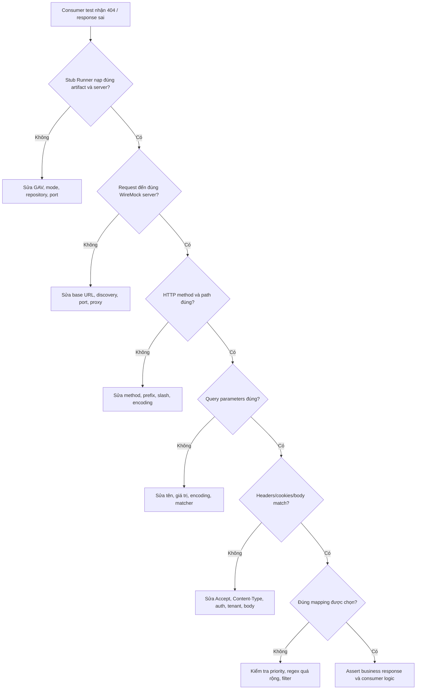
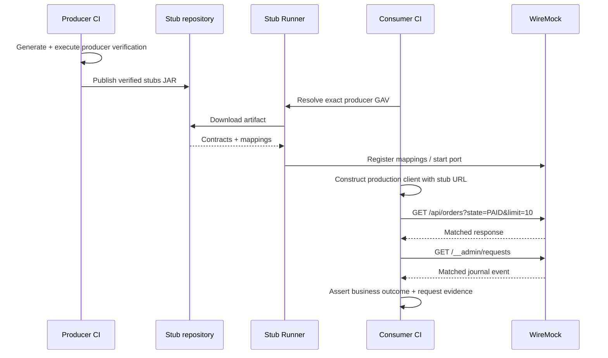

# Request không khớp stub do URL, query hoặc header

## 1. Nhận diện đúng sự cố: Stub Runner chạy nhưng HTTP trả 404

Trong **Spring Cloud Contract (SCC)**, producer và consumer thỏa thuận hành vi HTTP hoặc messaging bằng **Groovy/YAML DSL**. Producer sinh và chạy kiểm thử xác minh implementation, đóng gói stub artifact; consumer dùng **Stub Runner** để tải stub và kiểm thử HTTP client thật. CI kết hợp hai phía để phát hiện thay đổi API không tương thích.

Một lỗi phổ biến trong chương **Chẩn đoán sự cố** là: **Stub Runner đã khởi động, stub JAR đã tải, nhưng consumer nhận HTTP 404 hoặc response không mong đợi vì request không khớp mapping**.

Ví dụ contract yêu cầu:

```http
GET /api/orders?state=PAID&limit=10 HTTP/1.1
Accept: application/json
X-Tenant-Id: tenant-demo
```

Trong khi client thật gửi:

```http
GET /api/orders/?limit=10&state=PAID HTTP/1.1
Accept: */*
X-Tenant-Id: tenant-demo
```

Nếu stub được khai báo theo URL và headers chính xác, có thể có **nhiều sai khác đồng thời**:

- Path `/api/orders/` có dấu `/` cuối, khác `/api/orders`.
- Query order đảo ngược, có thể không khớp nếu mapping so sánh **toàn bộ URL**.
- Giá trị header `Accept: */*` không đáp ứng matcher `Accept: application/json` khi dùng equality.

**Đây là lỗi matching request**, chưa chắc là lỗi business logic của producer. Không nên thay response `404` trong contract thành `200` để che lỗi.

### Mục tiêu học tập

Sau bài học, bạn sẽ có thể:

1. Phân biệt **HTTP 404 của WireMock do unmatched request**, **404 nghiệp vụ của contract** và **404 do Maven repository không tìm thấy stub artifact**.
2. Hiểu WireMock khớp **method, full URL hoặc URL path, query parameters, headers** như thế nào.
3. Chẩn đoán lỗi do path prefix, dấu `/` cuối, encoding, query order, param thiếu/thừa, case, header default hoặc token/header matcher.
4. Viết Groovy/YAML DSL để tránh phụ thuộc vô ích vào thứ tự query nhưng vẫn giữ các điều kiện nghiệp vụ quan trọng.
5. Sử dụng `@StubRunnerPort`, `StubFinder`, `mappingsOutputFolder` và WireMock admin endpoints để thu bằng chứng.
6. Đọc request journal, danh sách unmatched và **near misses** để xác định thuộc tính nào lệch.
7. Kiểm tra mã HTTP client thật của consumer, không chỉ một `curl` hoặc Mockito mock.
8. Thiết kế test/CI đủ nhạy: khi request sai path, query hoặc header thì **phải fail đúng lý do**.

> **Nguyên tắc:** Trước khi sửa DSL, cần chứng minh **request nào đã tới server nào**, **mapping nào được đăng ký** và **thuộc tính nào làm request không match**.

## 2. Quy trình tìm lỗi theo các tầng



**Đừng nhảy từ A đến sửa producer controller.** Với contract testing, cần biết lỗi xuất hiện ở **artifact resolution**, **stub server**, **client routing**, **request matching** hay **response decoding**.

| Tầng | Dấu hiệu | Bằng chứng cần thu |
|---|---|---|
| Artifact | Stub Runner báo không tìm thấy `-stubs.jar` | `groupId:artifactId:version:classifier`, mode, repo |
| Server | Stub không khởi động hoặc port sai | Running port từ Stub Runner; mappings được nạp |
| Routing | Journal trống dù test gọi use case | Base URL/Feign/RestClient/WebClient thật |
| Method/path | Journal có `POST` hoặc path khác | Request `method`, `url`, `absoluteUrl` |
| Query | Thiếu/sai param; query order/encoding | Raw URL và parsed query parameters |
| Headers | Thiếu hoặc sai `Accept`/`X-Tenant-Id` | Headers thực tế và mappings expected |
| Matching | HTTP 404 mặc định, `wasMatched=false` | `/__admin/requests/unmatched`, near misses |
| Consumer logic | HTTP match nhưng domain outcome sai | DTO decoder, status/body, business assertions |

## 3. Cơ chế WireMock: request phải thỏa các điều kiện của mapping

SCC chuyển hợp đồng HTTP sang **WireMock stub mappings**. Một mapping điển hình đặt điều kiện cho:

- **HTTP method:** `GET`, `POST`, `PUT`, `DELETE`…
- **URL:** so khớp `url` (path và query), hoặc `urlPath` / `urlPathPattern` (chỉ path).
- **Query parameters:** `queryParameters` theo từng tên và matcher.
- **Headers:** `headers` theo tên và matcher của giá trị.
- **Cookies, form parameters, body patterns:** nếu contract có yêu cầu.
- **Matching priority:** khi có nhiều mappings phù hợp.

Các điều kiện là **phép giao (AND)**: một request khớp path nhưng sai header bắt buộc vẫn có thể bị từ chối. Với mỗi thuộc tính, matcher như `equalTo`, `contains`, `matches` mang ý nghĩa khác nhau. **Đừng chỉ đọc URL** rồi bỏ qua headers.

### 3.1. So sánh `url` với `urlPath`

WireMock cho phép ít nhất bốn kiểu thường gặp:

| Mapping key | Ý nghĩa | Tình huống |
|---|---|---|
| `url` | Bằng nhau trên **path + query string** | URL cố định, cần exact raw query |
| `urlPattern` | Regex trên **path + query string** | URL động cần so khớp toàn chuỗi |
| `urlPath` | Bằng nhau trên **path riêng** | Không phụ thuộc thứ tự query |
| `urlPathPattern` | Regex trên **path riêng** | Path variables theo pattern |

Ví dụ các ánh xạ WireMock minh họa:

```json
{"request":{"method":"GET","url":"/api/orders?state=PAID&limit=10"}}
```

khác với:

```json
{
  "request": {
    "method": "GET",
    "urlPath": "/api/orders",
    "queryParameters": {
      "state": {"equalTo": "PAID"},
      "limit": {"equalTo": "10"}
    }
  }
}
```

Ở dạng thứ nhất, request có URL query đảo thứ tự như `?limit=10&state=PAID` **không cùng chuỗi URL**. Ở dạng thứ hai, WireMock kiểm tra từng query parameter, nên **thứ tự giữa các tên parameter không phải một phần của matcher URL path**.

**Lưu ý:** `urlPath` chỉ kiểm tra path. Nếu **không** có `queryParameters` thì query có thể không được ràng buộc, kể cả khi nghiệp vụ cần chúng. Không bỏ query matcher chỉ để test xanh.

### 3.2. Không ràng buộc khác với yêu cầu “không có”

Nếu một mapping không nêu header `X-Trace-Id`, thông thường WireMock **không yêu cầu header đó phải vắng mặt**. Tương tự, mapping `urlPath=/api/orders` không khai báo `sort` thường không dùng `sort` để loại request.

Khi cần bắt buộc một query/header **không xuất hiện**, dùng matcher `absent` của WireMock hoặc biểu đạt DSL tương ứng nếu phiên bản hỗ trợ. Đừng suy từ việc field bị bỏ khỏi contract rằng client không được phép gửi nó.

### 3.3. HTTP 404 là tín hiệu, không phải chẩn đoán

Một `404` có thể là:

- **WireMock default 404**: không mapping nào match.
- **Contract response 404**: mapping match và intentionally trả lỗi `ORDER_NOT_FOUND`.
- **Application response 404**: test vô tình gọi producer thật.
- **Artifact repository HTTP 404**: Stub Runner chưa tải được JAR, thậm chí chưa có WireMock server.

Vì vậy, **chỉ assert status == 404 là không đủ** để chứng minh contract error path. Cần assert error body và/hoặc request journal matched mapping.

## 4. Ví dụ SCC YAML: path, query, header được khai báo tách rời

Đây là contract giả định cho consumer `checkout-service` gọi producer `order-service`.

File `list-paid-orders.yml` trong thư mục contracts **mà plugin SCC producer đã cấu hình**:

```yaml
name: list_paid_orders_for_tenant
description: "Checkout liệt kê tối đa 10 đơn đã thanh toán"
request:
  method: GET
  urlPath: /api/orders
  queryParameters:
    state: PAID
    limit: "10"
  headers:
    Accept: application/json
    X-Tenant-Id: tenant-demo
response:
  status: 200
  headers:
    Content-Type: application/json
  body:
    orders:
      - id: ORD-42
        state: PAID
    nextPage: null
```

Ý nghĩa:

- `urlPath` ràng buộc **path** `/api/orders`.
- `queryParameters` ràng buộc **tên** `state` và `limit` cùng các giá trị.
- `headers` buộc client gửi `Accept` và `X-Tenant-Id` phù hợp.
- Response body là dữ liệu **synthetic test**, không phải dữ liệu đơn hàng thật.
- Generated producer test sẽ gọi API thật của producer trong test environment; stub mapping cho consumer sẽ mô phỏng hành vi đã khai báo.

**Điểm cần kiểm chứng:** phiên bản plugin, DSL parser và generated mapping thực tế. SCC YAML hỗ trợ `request.urlPath`, `request.queryParameters` và `request.headers`; không nhất thiết generated JSON có thứ tự fields hoặc tên file giống YAML.

### 4.1. Groovy DSL tương đương về ý nghĩa

```groovy
import org.springframework.cloud.contract.spec.Contract

Contract.make {
    name('list_paid_orders_for_tenant')
    description('Checkout liệt kê tối đa 10 đơn đã thanh toán')
    request {
        method GET()
        urlPath('/api/orders') {
            queryParameters {
                parameter 'state': 'PAID'
                parameter 'limit': '10'
            }
        }
        headers {
            header 'Accept': 'application/json'
            header 'X-Tenant-Id': 'tenant-demo'
        }
    }
    response {
        status OK()
        headers {
            header 'Content-Type': 'application/json'
        }
        body(
            orders: [[id: 'ORD-42', state: 'PAID']],
            nextPage: null
        )
    }
}
```

Groovy/YAML là **hai cách khai báo cùng một hành vi**. Nếu project chọn một định dạng, không cần giữ hai file thực thi giống nhau rồi vô tình sinh mappings trùng.

### 4.2. Ví dụ generated WireMock mapping dễ đọc

Một JSON mapping minh họa (bỏ qua metadata `id`, `uuid` và chi tiết generator):

```json
{
  "request": {
    "method": "GET",
    "urlPath": "/api/orders",
    "queryParameters": {
      "state": {"equalTo": "PAID"},
      "limit": {"equalTo": "10"}
    },
    "headers": {
      "Accept": {"equalTo": "application/json"},
      "X-Tenant-Id": {"equalTo": "tenant-demo"}
    }
  },
  "response": {
    "status": 200,
    "headers": {"Content-Type": "application/json"},
    "jsonBody": {
      "orders": [{"id": "ORD-42", "state": "PAID"}],
      "nextPage": null
    }
  }
}
```

Đây là **mẫu minh họa cơ chế WireMock**, không cam kết plugin SCC sẽ xuất đúng byte JSON này ở mọi phiên bản. Khi lỗi, hãy xem **mapping thực tế Stub Runner đăng ký**, không tranh luận dựa trên giả định generator “chắc đã hiểu”.

## 5. Khác biệt giữa request hợp lệ và request không khớp

| Request HTTP thực tế | Với mapping ở mục 4 | Nguyên nhân |
|---|---|---|
| `GET /api/orders?state=PAID&limit=10` + 2 headers đúng | **Match** | Tất cả điều kiện đạt |
| `GET /api/orders?limit=10&state=PAID` + headers đúng | **Match** nếu query được khai báo riêng | Thứ tự tên query không ràng buộc trong `urlPath` + matcher |
| `GET /api/orders/?state=PAID&limit=10` | **Không match** | Path có dấu `/` cuối |
| `GET /API/orders?state=PAID&limit=10` | Thường **không match** exact path | Path case khác |
| `GET /api/orders?status=PAID&limit=10` | **Không match** | Sai tên `state` → `status` |
| `GET /api/orders?state=paid&limit=10` | **Không match** exact equality | Sai case giá trị |
| `GET /api/orders?state=PAID` | **Không match** | Thiếu `limit` bắt buộc |
| `GET /api/orders?state=PAID&limit=010` | **Không match** exact equality | Chuỗi `010` khác `10` |
| `GET /api/orders?state=PAID&limit=10`, `Accept: */*` | **Không match** nếu ràng buộc exact `Accept` | Giá trị header sai |
| `GET /api/orders?state=PAID&limit=10`, thiếu `X-Tenant-Id` | **Không match** | Thiếu header bắt buộc |
| `POST /api/orders?...` | **Không match** | Method khác |
| `GET /api/orders?state=PAID&limit=10&sort=createdAt` | Có thể **match** | Param không ràng buộc có thể được chấp nhận |

**“Match” trong bảng là kết quả dự kiến từ mapping minh họa**, không phải log một lần chạy đã thực thi. Nếu server có mappings khác, request không khớp mapping A có thể khớp mapping B và trả response khác. Vì vậy phải kiểm tra mapping đã phục vụ request khi có xung đột.

## 6. Xác nhận đúng stub artifact và đúng HTTP server trước khi xem URL

Giả sử consumer chạy:

```java
@SpringBootTest
@AutoConfigureStubRunner(
    ids = "com.acme.billing:order-service:1.4.2:stubs",
    stubsMode = StubRunnerProperties.StubsMode.REMOTE,
    repositoryRoot =
        "https://repo.example.org/repository/maven-releases/",
    failOnNoStubs = true,
    mappingsOutputFolder = "target/registered-stubs"
)
class CheckoutOrderContractTest {
    // Tests gọi OrderHttpClient và CheckoutService thật.
}
```

**Đây là khung cấu hình**, cần thêm Spring Boot/JUnit/Stub Runner dependencies. Đối với Maven, `target/registered-stubs` là một output debug phù hợp; với Gradle nên đặt dưới `build` hoặc thư mục tạm được quản lý.

### 6.1. Kiểm tra ba danh tính khác nhau

```text
Stub artifact:
  com.acme.billing:order-service:1.4.2:stubs

Artifact repository:
  https://repo.example.org/repository/maven-releases/

Running HTTP stub server:
  http://localhost:<stub-runner-selected-port>
```

`repositoryRoot` là **nơi tải stub JAR**, không phải nơi gửi request API. Stub Runner có thể chọn port động: không hard-code `18080` trừ khi cấu hình ID có port và môi trường bảo đảm port đó không bị chiếm.

### 6.2. Lấy port từ Stub Runner

```java
@StubRunnerPort("com.acme.billing:order-service")
int orderStubPort;
```

Hoặc:

```java
@Autowired
StubFinder stubFinder;

// Sau khi Stub Runner đã khởi chạy:
URL orderStubUrl =
    stubFinder.findStubUrl("com.acme.billing", "order-service");
```

Nếu test dùng `@StubRunnerPort` nhưng application `OrderHttpClient` vẫn lấy production URL từ profile khác, **server chạy đúng mà request vẫn không đến stub**. Đây là lỗi routing, không phải URL matcher.

**Lưu ý lifecycle:** Không giả định field `@StubRunnerPort` của test instance đã sẵn sàng khi Spring đang dựng client bean qua `@DynamicPropertySource`. Nếu cần inject động, hãy dùng test configuration có lifecycle rõ, hoặc dựng **production client class** bằng constructor sau khi có stub URL rồi kiểm tra riêng Spring wiring.

### 6.3. Dump mappings đã đăng ký

Tài liệu SCC cho phép dùng `mappingsOutputFolder` để ghi mappings của từng stub artifact/server và port ra disk. Có thể đối chiếu:

- Artifact/service name `order-service` có đúng không?
- Running port có trùng `orderStubPort` không?
- Registered mapping dùng `url` hay `urlPath`?
- Mapping có `queryParameters` và `headers` nào?
- Có bị lọc theo `stubsPerConsumer`/`consumerName` không?
- Có mappings trùng đường dẫn hoặc matcher quá rộng không?

**Mục tiêu:** biến giả định thành evidence. **Gói JAR tồn tại** không chứng minh **mapping cần thiết đã được nạp**; và **mapping đã nạp** không chứng minh **client đã gọi đúng server**.

## 7. URL/path mismatch: chỗ dễ sai nhất

### 7.1. Base URL cộng với request path

Ví dụ production client:

```text
order.api.base-url   = https://orders.example.internal
request path         = /api/orders
```

Trong contract test, nó cần trở thành:

```text
order.api.base-url = http://localhost:<order-stub-port>
request path       = /api/orders
```

Nếu consumer cấu hình:

```text
order.api.base-url = http://localhost:<order-stub-port>/api
request path       = /api/orders
```

thì tùy cách `RestClient`/`Feign`/`WebClient` xây URI, request có thể thành `/api/api/orders`, hoặc path bị thay thế theo quy tắc URI resolution. **Không đoán bằng cách nối chuỗi trên giấy**: đọc actual request URL trong journal để biết output chính xác của thư viện đang dùng.

### 7.2. Trailing slash

```text
Contract mapping:  /api/orders
Actual request:    /api/orders/
```

Với equality, hai path **khác nhau**. Một số server production có redirect hoặc tự chuẩn hóa slash nhưng WireMock mapping thì không nhất thiết bắt chước điều đó.

**Cách sửa đúng** phụ thuộc API contract:

- Nếu producer cam kết **một canonical path**, sửa consumer tạo đúng path.
- Nếu cả hai path được hỗ trợ có chủ đích, viết contract/test tương ứng, hoặc matcher đường dẫn phù hợp và không quá rộng.
- Không mặc định regex `/api/orders/?` cho mọi endpoint chỉ để test qua nếu API không hề cam kết optional slash.

### 7.3. Chữ hoa, dấu gạch, path version và context path

```text
/api/orders           ≠ /API/orders
/api/v1/orders        ≠ /api/v2/orders
/checkout/api/orders  ≠ /api/orders
/api/order            ≠ /api/orders
```

Những khác biệt này có thể đến từ `server.servlet.context-path`, API gateway rewrite, `@RequestMapping` trên controller, config base URL hoặc biến môi trường. **Stub Runner không tự sao chép tất cả rewrite rules của gateway production**. Khi cần kiểm tra gateway rewrite, dùng integration test riêng hoặc cấu hình stub theo request mà client thực sự gửi.

### 7.4. URL encoding và path variables

Giả sử order ID chứa dấu khoảng trắng hoặc ký tự đặc biệt:

```text
Logical ID:    "ORD A/1"
Encoded path:  /api/orders/ORD%20A%2F1   (minh họa)
```

Dấu `/` trong ID nếu không encode có thể bị hiểu là **path separator**; `%2F` và `/` là khác nhau khi match URL. Encoding còn có thể bị proxy/server decode hoặc chuẩn hóa nhiều lần.

Cần kiểm tra:

- URI builder có encode path variable theo thư viện/version chưa?
- Có tự encode trước rồi bị **double encoding** thành `%252F` không?
- Có normalize spaces thành `%20` hay ký tự khác theo quy tắc URL không?
- WireMock journal ghi **raw URL** nào?
- Contract có dùng exact path hay pattern phù hợp ID?

**Không nới regex thành `.*` để che sai encoding.** Nếu ID chứa `/` hợp lệ theo nghiệp vụ, thiết kế route/encoding nhất quán và có contract example cho ký tự đặc biệt.

### 7.5. Redirect và host khác

Một `301/302/307/308` từ proxy hoặc URL cũ có thể làm HTTP client đổi request method/path/host tùy client. WireMock mapping thường không xử lý thay bạn quá trình redirect của hạ tầng. Nếu journal trống nhưng client vẫn có response, cần xem redirect chain và host thực sự được gọi, không chỉ assertion cuối.


## 8. Query mismatch: tên, giá trị, thứ tự và cách mã hóa

Query parameters thường bị xem nhẹ vì khi đọc code, hai request trông “tương đương”. Nhưng WireMock so khớp **chuỗi raw URL** hoặc **từng query parameter** tùy mapping.

### 8.1. Thứ tự query parameter

```text
Expected:
  /api/orders?state=PAID&limit=10

Actual:
  /api/orders?limit=10&state=PAID
```

Nếu mapping dùng:

```json
{"request":{"method":"GET","url":"/api/orders?state=PAID&limit=10"}}
```

thì hai raw URL **không bằng nhau**, dù ứng dụng server có thể diễn giải cùng bộ tham số.

**Giải pháp:** nếu thứ tự không thuộc API contract, dùng `urlPath` và query matchers độc lập như mục 4. Đừng chỉ sửa client để ép thứ tự query cho test xanh nếu client/library có quyền sắp xếp khác nhau.

### 8.2. Thiếu hoặc thừa query parameter

Giả sử cần `state=PAID` và `limit=10`:

```text
/api/orders?state=PAID                   # thiếu limit
/api/orders?state=PAID&limit=10          # đủ
/api/orders?state=PAID&limit=10&debug=1  # thêm debug
```

Nếu mapping có equality matcher cho `state` và `limit`, request thiếu `limit` sẽ không match. Param `debug` không được liệt kê **có thể không ảnh hưởng matching**, bởi WireMock không mặc định cấm các param ngoài danh sách.

Điều cần làm:

1. Kiểm tra producer API thật có yêu cầu `limit` hay có default.
2. Nếu optional, thiết kế contract cho cả trường hợp **có** và **không có** `limit` khi consumer phụ thuộc.
3. Nếu `debug` không được phép theo API/security policy, đừng dùng absence of matcher làm bằng chứng nó bị từ chối; cần contract/test hoặc validation riêng.
4. Không biến matcher thành `.*` để bao hết query mà không hiểu business semantics.

### 8.3. Chữ số trong query vẫn là chuỗi trên wire

```text
limit=10
limit=010
limit=10.0
limit=ten
```

Ứng dụng backend có thể parse một số biểu thức thành cùng giá trị số, nhưng WireMock `equalTo("10")` kiểm tra **chuỗi**. SCC có thể sinh matcher với giá trị đã khai báo trong DSL; hãy xem JSON mapping đã đăng ký để biết chính xác.

Nếu API cho phép số nguyên dương bất kỳ, cân nhắc **regex matcher có giới hạn** khi DSL/plugin hỗ trợ, ví dụ `[1-9][0-9]*`. Nhưng nếu consumer **phải** gửi `10` vì giới hạn nghiệp vụ, giữ equality test.

### 8.4. Sai tên param hoặc thay đổi quy ước chữ hoa

```text
state=PAID      ≠ status=PAID
state=PAID      ≠ state=paid
includeClosed=1 ≠ include_closed=1
```

Không mặc định tên query hay giá trị là case-insensitive. Thực thi contract đúng chữ hoa/chữ thường theo producer API. Nếu production API chấp nhận nhiều biến thể, cần mô tả rõ trong contracts/tests.

### 8.5. URL encoding: dấu cách, dấu cộng và dấu phần trăm

```text
q=New%20York
q=New+York
q=New%2520York
```

Theo ngữ cảnh và quy tắc encode/decode, dấu `+` có thể được diễn giải là dấu cách trong query form-style; `%20` là percent-encoding của dấu cách; `%2520` có thể là trường hợp encode lần hai.

Khi gặp mismatch:

- Ghi **raw request URL** từ journal.
- Xem query đã parse mà WireMock nhận.
- Kiểm tra HTTP client `UriBuilder` và xem có gọi `encode` nhiều lần.
- So sánh giá trị ở **cùng tầng biểu diễn**: decoded query value với decoded value, hoặc raw URL với raw URL.
- Không sửa YAML đoán mò theo những ký tự được in ra ở một vị trí khác.

**Bẫy:** Tài liệu HTTP/client có các quy tắc encode khác nhau theo URI builder, query form, framework và proxy; phải dựa trên request thực tế và phiên bản thư viện cụ thể.

### 8.6. Parameter lặp lại và array

```text
/api/orders?tag=urgent&tag=vip
/api/orders?tag=urgent,vip
/api/orders?tag[]=urgent&tag[]=vip
```

Đây là **ba cấu trúc wire khác nhau**. Nếu backend nhận nhiều giá trị, phải xác định API quy định cách truyền là repeated key, comma-separated hay bracket notation.

WireMock có hỗ trợ các matchers cho query nhiều giá trị, ví dụ `havingExactly`/`including` trong Java DSL và các biểu đạt JSON tương ứng, nhưng **đừng tự giả định YAML DSL của SCC phiên bản đang dùng xuất đúng matcher đó**. Với các trường hợp nâng cao, xem khả năng của phiên bản plugin và generated mappings.

### 8.7. Giá trị rỗng, vắng mặt và null

```text
/api/orders                 # không có state
/api/orders?state           # state không có value tường minh
/api/orders?state=          # state có value rỗng
/api/orders?state=null      # state là chuỗi "null"
```

Những trường hợp này có thể được library parse khác nhau. Cần contract rõ nếu consumer phụ thuộc vào semantics **absent** và **empty**. Không thể dùng JSON `null` làm một quy ước ngầm cho query string.

## 9. Header mismatch: chính xác ở giá trị, không chỉ tên

Headers thường do HTTP client, API gateway, interceptor, security filter hoặc test config thêm vào. Đôi khi source code không chứa `Accept` nhưng request thực tế vẫn có `Accept: */*`.

### 9.1. `Accept` khác `Content-Type`

| Header | Bên gửi dùng để diễn đạt | Thường quan trọng khi |
|---|---|---|
| `Accept` | Những kiểu response media type client chấp nhận | GET và content negotiation |
| `Content-Type` | Kiểu media type của **request body** | POST/PUT/PATCH gửi JSON/XML |
| `Authorization` | Chứng thực/ủy quyền request | Endpoint yêu cầu auth |
| `X-Tenant-Id` | Tenant được chọn | Multi-tenant routing hoặc authorization |
| `X-Correlation-Id` | Truy vết request | Observability, thường optional |

Ví dụ:

```text
Contract expects:
  Accept: application/json

Client actually sends:
  Accept: */*
  Content-Type: application/json
```

Có `Content-Type: application/json` **không** làm điều kiện `Accept` trở thành đúng. Khi request `GET` không có body, client thậm chí có thể không gửi `Content-Type`; đừng yêu cầu nó chỉ vì response phải là JSON.

### 9.2. Chữ hoa/thường tên header và giá trị

Trong HTTP, **field names** là case-insensitive, nên `Accept` và `accept` thường đại diện cùng header. Nhưng **value matching** tùy matcher:

```text
Accept: application/json
Accept: application/*+json
Accept: */*
```

`equalTo("application/json")` không tự coi `*/*` là tương đương. Với media types có parameters như:

```text
Content-Type: application/json; charset=UTF-8
```

một matcher exact `application/json` có thể không match, dù cả hai thể hiện JSON theo semantics ứng dụng.

**Cách sửa:** nếu charset thực sự được phép biến thiên, dùng matcher đúng phạm vi (ví dụ prefix/regex về JSON media type) hoặc điều chỉnh client gửi canonical header; không loại bỏ kiểm tra Content-Type khi consumer phụ thuộc JSON decoder.

### 9.3. Groovy header matcher có chủ đích

Ví dụ **chỉ cho phép JSON response** nhưng không buộc exact string trên các media type parameters:

```groovy
import org.springframework.cloud.contract.spec.Contract

Contract.make {
    request {
        method GET()
        urlPath('/api/orders') {
            queryParameters {
                parameter 'state': 'PAID'
                parameter 'limit': '10'
            }
        }
        headers {
            header 'X-Tenant-Id': 'tenant-demo'
            header 'Accept': value(
                consumer(regex('application/json(?:;.*)?')),
                producer('application/json')
            )
        }
    }
    response {
        status OK()
        headers {
            contentType(applicationJson())
        }
        body(orders: [[id: 'ORD-42', state: 'PAID']])
    }
}
```

Đây là **cách diễn đạt ý tưởng hai phía**: producer verification dùng giá trị cụ thể `application/json` khi gửi request; consumer stub mapping có thể chấp nhận giá trị khớp regex đã khai báo. Cần xem generated test và stub JSON mapping vì DSL/client/server-side values phụ thuộc ngữ cảnh request/response và SCC version.

**Không nới thành `.*` hoặc `.*json.*` nếu contract thực sự yêu cầu `application/json` hợp lệ**; regex quá rộng có thể bắt cả những giá trị không có ý nghĩa.

### 9.4. Auth header và các giá trị động

Nếu contract định nghĩa:

```yaml
headers:
  Authorization: "Bearer TEST_TOKEN"
```

thì client gửi `Bearer REAL_TEST_TOKEN` sẽ không khớp nếu generated mapping dùng equality. Đừng paste token production vào contract để “sửa” mismatch.

Một hướng an toàn:

- Dùng **token synthetic** cố định trong test nếu chỉ cần kiểm tra HTTP header.
- Dùng regex matcher có ràng buộc format khi giá trị token thay đổi.
- Tách thử **quyền truy cập** thật sang security/integration tests thích hợp.
- Không log raw `Authorization` trong CI request journal.
- Phân biệt WireMock unmatched 404 với `401/403` do stub mapping nghiệp vụ hoặc security filter production.

### 9.5. Headers tự động và header nhiều giá trị

Client có thể tự thêm `User-Agent`, `Host`, `Accept-Encoding`; interceptor có thể thêm `Traceparent` hoặc nhiều giá trị `Accept`. Nếu contract không cần phân biệt chúng, **không ràng buộc chúng trong DSL** chỉ vì thấy xuất hiện ở một lần chạy.

Khi API yêu cầu một hoặc nhiều giá trị cụ thể, dùng matcher thích hợp. WireMock có cơ chế match multi-values (ví dụ includes/exactly) ở cấp WireMock, nhưng phải kiểm tra SCC generator hỗ trợ biểu đạt tương ứng.

### 9.6. Tenant header ảnh hưởng bảo mật và dữ liệu

`X-Tenant-Id` thường mang ý nghĩa nghiệp vụ/ủy quyền. **Không sửa contract bằng cách xóa matcher tenant** chỉ để request khớp. Nếu consumer gửi sai tenant, đó có thể là lỗi logic gây rò rỉ dữ liệu hoặc đọc sai đơn hàng.

Cần xác minh:

1. Client lấy tenant từ đúng security/session context?
2. Interceptor có thêm header ở test context?
3. Giá trị header có khớp tenant fixture?
4. Stub mapping có phản ánh cả success và tenant mismatch/error?
5. Producer verification có kiểm tra behavior thật khi tenant header thiếu/sai?

## 10. Quan sát request thật: WireMock request journal

Để tránh đoán request từ code, dùng **request journal** ở đúng WireMock server do Stub Runner khởi chạy.

Các admin endpoints hữu ích (theo WireMock version):

```text
GET     /__admin/mappings
GET     /__admin/requests
GET     /__admin/requests/unmatched
GET     /__admin/requests/unmatched/near-misses
POST    /__admin/near-misses/request
DELETE  /__admin/requests
```

Các endpoint này chạy trong **test environment** trên WireMock server; không dùng production API hoặc mở admin interface công khai.

### 10.1. Bắt đầu từ các request unmatched

Giả sử Stub Runner cung cấp port `orderStubPort`. Trong terminal test environment, chạy:

```bash
curl -s "http://localhost:18081/__admin/requests/unmatched"
```

`18081` chỉ là **port minh họa**. Với port động, thay bằng giá trị `@StubRunnerPort`/`StubFinder` trả về. Không mặc định 18081 là port mọi lần test.

Một response minh họa:

```json
{
  "requests": [
    {
      "url": "/api/orders/?limit=10&state=PAID",
      "method": "GET",
      "headers": {
        "Accept": "*/*",
        "X-Tenant-Id": "tenant-demo"
      }
    }
  ],
  "requestJournalDisabled": false
}
```

Nếu thấy `/api/orders/` và `Accept: */*`, bạn đã có ít nhất hai điểm khác contract mục 4. **Chưa cần đổi generator hoặc producer implementation.**

### 10.2. Near misses: mapping nào gần khớp nhất?

WireMock cung cấp near-miss diagnostics để tìm các mappings gần giống request đã nhận nhưng không match. Một endpoint tiện dụng:

```http
GET /__admin/requests/unmatched/near-misses HTTP/1.1
```

Kết quả có thể liệt kê request và request pattern gần nhất kèm khoảng cách/match result, giúp chỉ ra path, headers hoặc query khác nhau.

Có thể yêu cầu near misses cho request cụ thể:

```http
POST /__admin/near-misses/request HTTP/1.1
Content-Type: application/json

{
  "method": "GET",
  "url": "/api/orders/?limit=10&state=PAID",
  "headers": {
    "Accept": "*/*",
    "X-Tenant-Id": "tenant-demo"
  }
}
```

Đây là **ví dụ tối giản về trường quan trọng**; API và yêu cầu payload cụ thể phụ thuộc WireMock version. Hãy dùng response/journal request đầy đủ khi cần. **Near misses là gợi ý chẩn đoán theo độ gần, không phải xác nhận một mapping đã match.**

### 10.3. Xác nhận event matched trong journal

`GET /__admin/requests` có thể trả các serve events. Khi đã sửa request, hãy kiểm tra:

- Event có đúng `method=GET` và `url` mong đợi.
- Thuộc tính `wasMatched=true` khi request được phục vụ bởi mapping.
- Nếu có nhiều mappings, xem mapping/response details để biết **mapping nào** được chọn.
- HTTP status/body cuối đúng contract và consumer xử lý đúng.
- Không còn unmatched events liên quan.

**Đừng chỉ assert không có unmatched nếu không có request nào được gửi.** Cần assert **ít nhất một request thật** từ client đã tới đúng stub.

### 10.4. Reset journal và test isolation

Trước mỗi test scenario, có thể gọi:

```http
DELETE /__admin/requests HTTP/1.1
```

Nó xóa **request journal**, không đồng nghĩa xóa mappings. Sau đó gọi use case và đọc journal để tránh dùng requests từ test trước.

Nếu CI chạy song song trên cùng Stub Runner server, **không reset toàn cục** giữa các tests vì có thể xóa evidence của test khác. Dùng server riêng/test isolation hoặc correlation ID synthetic. Luôn redact Authorization và dữ liệu nhạy cảm khi lưu journal.

### 10.5. Request journal có thể tắt

WireMock cho phép tắt request journal để giảm memory trong một số workload. Nếu tắt, API verifying có thể không có dữ liệu/không hoạt động như mong đợi. Hãy bật journal trong **contract test environment** nếu test cần request assertions.

## 11. Code consumer: phân biệt URL cấu hình với request được gửi

Một consumer dùng Spring Framework `RestClient` có thể được viết:

```java
@Component
public class OrderHttpClient {
    private final RestClient http;

    public OrderHttpClient(
            RestClient.Builder builder,
            @Value("${order.api.base-url}") String baseUrl) {
        this.http = builder.baseUrl(baseUrl).build();
    }

    public OrderListDto listPaidOrders(String tenantId) {
        return http.get()
            .uri(uriBuilder -> uriBuilder
                .path("/api/orders")
                .queryParam("state", "PAID")
                .queryParam("limit", 10)
                .build())
            .accept(MediaType.APPLICATION_JSON)
            .header("X-Tenant-Id", tenantId)
            .retrieve()
            .body(OrderListDto.class);
    }
}
```

Ở đây:

- `baseUrl` đến từ Spring Environment của consumer; test phải trỏ tới Stub Runner.
- `path("/api/orders")` phải tạo đúng path, không dư slash/prefix.
- `queryParam` để URI builder thực hiện encode; tránh tự nối query bằng string thủ công.
- `accept(MediaType.APPLICATION_JSON)` gửi header `Accept` đúng expectation.
- `X-Tenant-Id` được truyền tường minh, cần test với giá trị synthetic.
- `OrderListDto` là DTO do consumer định nghĩa, không phải lớp SCC.

**Đoạn code cần imports, package và các Spring dependencies phù hợp**; là một ví dụ code production, không tự chạy độc lập trong bài.

### 11.1. Một DTO có ý nghĩa

```java
public record OrderListDto(
    List<OrderDto> orders,
    String nextPage
) {
    public record OrderDto(String id, String state) {}
}
```

Khi test gọi client thật và nhận JSON từ stub, Jackson/deserializer phải map đúng field names/types. Không mock `OrderHttpClient` rồi tuyên bố đã kiểm tra URL/query/header.

### 11.2. Nhận diện sai do manual string concatenation

Code dễ lỗi:

```java
String url = baseUrl + "/api/orders?state=" + state
    + "&limit=" + limit;
```

Nếu `baseUrl` đã có slash/path/query, hoặc `state` có ký tự đặc biệt, URL có thể sai. Dùng URI builder với encoding và base URL được thiết kế rõ, đồng thời kiểm tra **request journal** để bắt lỗi thực.

### 11.3. Client bị override bởi proxy/interceptor

Khi dùng Feign, `WebClient`, load balancer, service discovery, gateway, interceptors hoặc HTTP proxy, `baseUrl` trong source code **chưa phải URL thực sự**. Hãy kiểm tra:

- Spring profile nào đang active?
- Có cấu hình client riêng `url` hay service ID không?
- Interceptor có thêm/đổi header?
- URI template có encode path/query hai lần?
- Proxy có rewrite path hoặc redirect?
- Cache/fallback có khiến client không phát request?

**Nếu journal trống**, đừng vội đổi `urlPath`; trước tiên chứng minh request đã đến đúng Stub Runner server.


## 12. Consumer test: chứng minh client thật đã gửi đúng URL, query và header

Ví dụ này dùng **cổng động do Stub Runner cấp**, sau đó dựng **chính class production `OrderHttpClient`** để gọi HTTP. Cách này tránh việc truy cập cổng stub quá sớm trong lifecycle của Spring. Nếu dự án còn muốn kiểm tra **Spring bean wiring** cho `@Value`, cần thêm một test profile cấu hình rõ base URL hoặc test configuration có lifecycle phù hợp.

Trước khi chạy, producer cần publish/install artifact:

```text
com.acme.billing:order-service:1.4.2:stubs
```

trong đó đã có mapping `GET /api/orders` + query `state=PAID`, `limit=10` và headers cần thiết từ mục 4.

### 12.1. JUnit 5 với Stub Runner và production client

```java
import static org.junit.jupiter.api.Assertions.*;

import com.fasterxml.jackson.databind.JsonNode;
import java.util.stream.StreamSupport;
import org.junit.jupiter.api.Test;
import org.springframework.beans.factory.annotation.Autowired;
import org.springframework.boot.test.context.SpringBootTest;
import org.springframework.cloud.contract.stubrunner.spring.AutoConfigureStubRunner;
import org.springframework.cloud.contract.stubrunner.spring.StubRunnerPort;
import org.springframework.cloud.contract.stubrunner.spring.StubRunnerProperties;
import org.springframework.web.client.RestClient;

@SpringBootTest(webEnvironment = SpringBootTest.WebEnvironment.NONE)
@AutoConfigureStubRunner(
    ids = "com.acme.billing:order-service:1.4.2:stubs",
    stubsMode = StubRunnerProperties.StubsMode.LOCAL,
    failOnNoStubs = true
)
class OrderHttpRequestMatchingTest {

    @StubRunnerPort("com.acme.billing:order-service")
    int orderStubPort;

    @Autowired
    RestClient.Builder builder;

    @Test
    void sendsCorrectPathQueryAndHeaders() {
        assertTrue(orderStubPort > 0, "Stub Runner must start");

        String stubUrl = "http://localhost:" + orderStubPort;
        RestClient admin = RestClient.create(stubUrl);

        // Chỉ xóa request journal, không xóa mappings.
        admin.delete()
            .uri("/__admin/requests")
            .retrieve()
            .toBodilessEntity();

        // Đúng client class đang dùng ở production.
        OrderHttpClient realClient = new OrderHttpClient(
            builder, stubUrl
        );

        OrderListDto response = realClient.listPaidOrders(
            "tenant-demo"
        );

        assertNotNull(response);
        assertEquals(1, response.orders().size());
        assertEquals("ORD-42", response.orders().get(0).id());
        assertEquals("PAID", response.orders().get(0).state());

        JsonNode journal = admin.get()
            .uri("/__admin/requests")
            .retrieve()
            .body(JsonNode.class);

        assertNotNull(journal);
        boolean seenMatched = StreamSupport.stream(
            journal.path("requests").spliterator(), false
        ).anyMatch(event -> {
            JsonNode req = event.path("request");
            String url = req.path("url").asText();

            return event.path("wasMatched").asBoolean(false)
                && "GET".equals(req.path("method").asText())
                && url.startsWith("/api/orders?")
                && url.contains("state=PAID")
                && url.contains("limit=10")
                && req.path("headers")
                    .path("Accept").toString()
                    .contains("application/json")
                && req.path("headers")
                    .path("X-Tenant-Id").toString()
                    .contains("tenant-demo");
        });

        assertTrue(
            seenMatched,
            "Actual consumer call must match the expected stub"
        );
    }
}
```

**Đây là ví dụ giáo dục**: cần bổ sung imports cho production code và bảo đảm phiên bản Spring Boot/SCC tương thích. Phần kiểm tra `headers` dùng `toString().contains(...)` để gọn, **không phải matcher hoàn chỉnh cho production security**; trong dự án thật nên parse JSON WireMock header arrays theo cấu trúc thực tế và so khớp value chính xác.

### 12.2. Vì sao cần cả assertion response lẫn request journal?

- **Response assertion** chứng minh client đã decode dữ liệu mẫu và nhận được các fields có ý nghĩa.
- **Journal assertion** chứng minh request đã đến đúng WireMock server với method/path/query/header liên quan.
- **`wasMatched`** giúp phân biệt mapped response với unmatched default `404`.

Nếu chỉ assert body, client có thể trả dữ liệu từ cache/mock. Nếu chỉ assert journal, client có thể nhận body nhưng deserialize sai. Kết hợp hai phía cho bằng chứng mạnh hơn.

### 12.3. Kiểm tra query không lệ thuộc thứ tự

Ví dụ trên dùng `url.contains(...)` để minh họa nhanh, nhưng trong bài test nghiêm ngặt, **không nên** dựa vào `contains("limit=10")` vì nó cũng có thể khớp `limit=100`. Thay bằng **phân tích raw URI thành query params** và kiểm tra:

```text
method             == GET
path               == /api/orders
query["state"]     == ["PAID"]
query["limit"]     == ["10"]
header["Accept"]   includes application/json
header["X-Tenant-Id"] == tenant-demo
wasMatched         == true
```

Đây là **pseudocode tiêu chí**, không phải code Java. Dùng thư viện URI parser phù hợp và kiểm tra query list/multiple values theo hợp đồng thật.

### 12.4. Không reset journal khi các tests dùng chung Stub Runner song song

Nếu hai tests cùng xóa `/__admin/requests`, test A có thể xóa evidence của B. Cần:

- Chạy test matching nối tiếp hoặc dùng stub server riêng.
- Dùng correlation ID synthetic và lọc journal theo request ID nếu mappings cho phép.
- Cô lập cache và clock/fixtures.
- Xóa journal **trước** request của chính test, không xóa sau khi test khác bắt đầu.

Với consumer test chạy trong nhiều JVM/CI workers, cổng động giúp tránh conflict, nhưng request journal vẫn cần isolation đúng phạm vi server.

## 13. Khi request match sai mapping vì priority và regex

Sự cố không phải lúc nào cũng là `wasMatched=false`. Một request có thể match **mapping không đúng**, khiến response status/body sai.

Ví dụ có hai mappings:

```json
{
  "priority": 1,
  "request": {
    "method": "GET",
    "urlPathPattern": "/api/orders/.*"
  },
  "response": {"status": 200, "body": "{\"state\":\"PENDING\"}"}
}
```

và:

```json
{
  "priority": 5,
  "request": {
    "method": "GET",
    "urlPath": "/api/orders/ORD-42"
  },
  "response": {"status": 200, "body": "{\"state\":\"PAID\"}"}
}
```

Trong WireMock, mapping có **priority số nhỏ hơn được ưu tiên hơn**. Mapping regex rộng priority `1` có thể bắt `/api/orders/ORD-42` trước exact mapping priority `5`, nên client nhận `PENDING` dù path có vẻ đúng.

### 13.1. Điều cần kiểm tra

- Các mappings có cùng method/path pattern hay không?
- `urlPathPattern` có rộng đến mức “nuốt” nhiều endpoint?
- Có `priority` hay thứ tự registration khác không?
- Request journal/serve event có ghi mapping ID/`stubMapping` nào được chọn không?
- Contract đã xác định hành vi phân biệt bằng query/header/state chưa?
- Một matcher dùng `.*` có vô tình làm mất signal?

**Không chữa bằng cách tăng priority ngẫu nhiên** khi hai contract thực chất mô tả hai response mâu thuẫn cho cùng request. Cần xác định API thật phân biệt response bằng request attribute nào, ví dụ tenant, trạng thái dữ liệu hay version header.

### 13.2. `stubsPerConsumer`: mapping có nhưng không được đăng ký

Nếu producer tổ chức contracts:

```text
contracts/
  checkout-service/list-paid-orders.yml
  reporting-service/summary-orders.yml
```

và consumer bật:

```java
@AutoConfigureStubRunner(
    ids = "com.acme.billing:order-service:1.4.2:stubs",
    stubsPerConsumer = true,
    consumerName = "checkout-service"
)
```

Stub Runner có thể chỉ đăng ký mappings theo `consumerName`/layout. Mapping tồn tại trong JAR nhưng **không được nạp** nếu tên folder không khớp.

Bằng chứng cần xem:

- `consumerName` có bằng `checkout-service` hoặc `spring.application.name` dự kiến không?
- Mappings dump có `list-paid-orders` không?
- Bản stub artifact/version có chứa đúng thư mục consumer?
- Stub runner đã dùng đúng mode và classifier chưa?

**Phân biệt rõ:** `stubsPerConsumer` chọn nhóm mappings theo **consumer name**, không tự chọn version của checkout consumer.

## 14. Khi JSON body cũng là điều kiện matching

Đề bài tập trung URL/query/header, nhưng khi dùng `POST`/`PUT`, những điều kiện đúng ở ba nhóm trên **vẫn có thể không match vì request body**.

Ví dụ contract yêu cầu:

```yaml
name: create_order
request:
  method: POST
  urlPath: /api/orders
  headers:
    Content-Type: application/json
  body:
    productId: "SKU-100"
    quantity: 2
response:
  status: 201
  headers:
    Content-Type: application/json
  body:
    id: "ORD-501"
    state: CREATED
```

Một request gửi `Content-Type: text/plain` hoặc JSON body thiếu `quantity` có thể không khớp. Đừng xóa header matcher nếu API không chấp nhận text/plain. Thay vào đó:

1. Kiểm tra `Content-Type` thực tế client gửi.
2. Xác nhận serializer JSON và body raw WireMock nhận.
3. Xem generated `bodyPatterns` / JSON matchers.
4. Kiểm tra semantics của field optional, null, number/string.
5. Chạy producer verification bảo đảm contract phản ánh API thật.

**Không dùng exact raw JSON string** nếu nghiệp vụ không phụ thuộc field order/whitespace, nhưng cũng đừng nới JSON matcher quá rộng. SCC hỗ trợ body matchers bằng JSONPath/regex và các DSL tương ứng; cần chọn matcher đúng phía producer/consumer.

## 15. Phân biệt sửa client và sửa contract

Một request mismatch luôn nên được đặt câu hỏi: **client sai so với hợp đồng, hay hợp đồng quá chặt/sai so với API được thống nhất?**

| Tình huống | Nên sửa ở đâu? | Lý do |
|---|---|---|
| Contract yêu cầu `/api/orders`; client gọi `/api/order` | **Client** | Sai route đã cam kết |
| Contract yêu cầu `limit=10`; client gửi `limit=100` vì bug pagination | **Client** | Sai nghiệp vụ |
| Contract viết full URL exact query order nhưng thứ tự không có ý nghĩa | **Contract matcher** (sau review) | Tránh coupling không cần thiết |
| Client dùng `Accept: */*` khi API chính thức bắt buộc JSON | **Client** | Phải gửi Accept đúng |
| Contract yêu cầu `Content-Type` cho GET không body, API không yêu cầu | **Contract** (sau review) | Ràng buộc thừa |
| Contract bỏ kiểm tra tenant để test xanh | **Không được làm** | Mất kiểm tra security/multi-tenancy |
| Producer hỗ trợ optional `limit` nhưng contract chỉ có 10 | **Bổ sung scenario** | Bảo vệ cả trường hợp optional |
| Request khác vì path prefix gateway | **Thiết kế test layer rõ** | WireMock mô phỏng API nào, trước hay sau rewrite |
| Client encode query hai lần | **Client URL builder** | `%2520` có thể không đúng |
| Contract regex `.*` bắt mọi request | **Contract** | Matcher không còn phát hiện regression |
| Header Authorization dùng token thật không cố định | **Fixture/matcher và security tests** | Không nhúng secret production |

### 15.1. Quy trình khi nghi contract quá chặt

1. Thu request journal và generated mappings để chứng minh sai khác cụ thể.
2. Đọc API contract được nhóm producer/consumer thống nhất.
3. Xác định khác biệt nào là **business requirement**, khác biệt nào chỉ là serialization/URL ordering không quan trọng.
4. Đề xuất DSL matcher thay đổi có **review từ hai phía**.
5. Chạy generated producer tests để bảo đảm implementation vẫn đáp ứng contract mới.
6. Sinh/publish stub artifact phiên bản phù hợp.
7. Chạy consumer test với đúng artifact và negative controls.

**Không sửa JSON mapping trực tiếp trong consumer build rồi giả vờ đó là contract do producer đã xác minh.** Nếu dùng mapping tạm phục vụ phát triển, gắn nhãn test fixture độc lập và không coi là release contract proof.

## 16. Ba loại 404 cần tách trong log

| Nguồn 404 | Quan sát | Xử lý |
|---|---|---|
| **Repository 404** | Stub Runner fail tải `group:artifact:version:stubs` | Kiểm tra version, classifier, repository/credentials |
| **WireMock unmatched 404** | Stub server chạy; request vào `/__admin/requests/unmatched` | Chẩn đoán method/path/query/header/body |
| **Contract-defined 404** | Request có `wasMatched=true`; response body có error code domain | Assert consumer decode đúng `ORDER_NOT_FOUND` |

### 16.1. Contract 404 nghiệp vụ

```yaml
name: order_not_found
request:
  method: GET
  urlPath: /api/orders/ORD-404
  headers:
    Accept: application/json
response:
  status: 404
  headers:
    Content-Type: application/json
  body:
    code: ORDER_NOT_FOUND
    message: Order not found
```

Test chỉ kiểm tra `404` có thể **PASS giả** nếu client gọi sai `/api/order/ORD-404` và WireMock trả default `404`. Cần assert:

- Error body có `code = ORDER_NOT_FOUND`.
- Journal có request expected và `wasMatched=true`.
- Consumer xử lý lỗi thành business outcome chính xác.
- Không có unmatched request tương ứng.

### 16.2. Không nhầm producer 404 với WireMock 404

Nếu test config vô tình gọi staging/real producer, response 404 của application có thể có body rất giống contract. Vì thế cần **bằng chứng request ở WireMock server**; chỉ body đúng không chứng minh route test đúng.

## 17. Diagnostic checklist cho các HTTP clients phổ biến

### 17.1. Spring RestClient

- `baseUrl` nào được inject vào bean thật?
- `uri(uriBuilder -> ...)` có đúng path/query và encoding không?
- Có `accept(APPLICATION_JSON)` thay vì default `*/*`?
- Header/interceptor thêm `X-Tenant-Id` sau hay trước builder?
- `retrieve()` có tự ném exception khi 4xx, khiến test chỉ nhìn exception class?

### 17.2. Spring WebClient

- `baseUrl` trong `WebClient.Builder` và relative URI resolution?
- `queryParam` có bị append hai lần qua filters?
- `defaultHeader`/`headers` có bị override?
- Reactor `Mono` có được subscribe qua `block()` hoặc `StepVerifier` trong test?
- Retry/fallback có gọi lại request hoặc che 404 mismatch?
- Reactive client dùng service discovery hay URL tường minh?

### 17.3. Spring Cloud OpenFeign

- `@FeignClient(name = ...)` và `url` property có làm discovery bị bỏ qua?
- `@GetMapping`/`@RequestParam` có đúng query key?
- Feign `RequestInterceptor` có thêm/đổi headers không?
- `RequestTemplate` có encode path/query đúng?
- Service ID có map đúng artifact/service Stub Runner không?

### 17.4. HTTP client khác

Với JDK `HttpClient`, OkHttp hoặc Apache HttpClient, nguyên tắc vẫn giống nhau: ghi actual method/URL/headers, so với mapping đã đăng ký. **Không thay client chỉ để tránh debug**; giữ production code path được kiểm tra.

## 18. Cổng CI: làm sao không xuất hiện test xanh giả?

Một consumer contract test nên cung cấp **chuỗi bằng chứng**:



### 18.1. Những điều kiện tối thiểu để PASS có ý nghĩa

- Stub artifact pin đúng version/classifier và nguồn được phê duyệt.
- Stub Runner nạp đúng service/artifact, `failOnNoStubs` không bị tắt vô cớ.
- Có mapping cần thiết, đúng request fields.
- Client production code thật dùng stub URL do runner cung cấp.
- Test gửi ít nhất một request và journal ghi method/path/query/header.
- Event có `wasMatched=true` và response status/body phù hợp.
- Client decode và xử lý response đúng.
- Negative controls (sai query/header/path) khiến test fail.
- Generated producer verification tests của version được phát hành cũng đã chạy.
- JUnit/Gradle/Maven test runner không báo `0 tests` bất thường.

### 18.2. Khi CI chạy song song

- Dùng port động để tránh port collision.
- Tránh request journal global reset giữa các tests chia sẻ một server.
- Cô lập tenant/fixture, cache và service discovery.
- Nếu chạy nhiều Stub Runner artifacts, tra port bằng **groupId:artifactId** thay vì đoán theo thứ tự.
- Redact Authorization/cookie/PII trong logs và CI artifacts.

### 18.3. Không dùng regex rộng như một cách giảm flaky tests

Flaky test có thể do port, race, cache hoặc startup sequencing. Thay `urlPath` exact bằng `urlPathPattern: .*` để làm test xanh là **làm mất khả năng phát hiện sai request**. Phải sửa nguyên nhân gốc.

### 18.4. Lưu diagnostic evidence phù hợp

Báo cáo một failure hữu ích chứa:

```text
Consumer build/commit: checkout-service @ <commit>
Producer stub ID: com.acme.billing:order-service:1.4.2:stubs
Stub mode: REMOTE
Repository: approved Maven releases
Stub port: <dynamic-port>
Mapping name/ID: <from registered mappings>
Expected method/path/query/headers: ...
Actual method/path/query/headers (redacted): ...
WireMock unmatched/near-miss summary: ...
Producer contract verification report: <CI link>
Consumer test result: FAIL
Difference category: URL / query / header / body / wrong-server
```

Không đưa bearer token, cookies, customer identifiers hoặc payload thật vào logs/test artifacts. Khi debug auth header, chỉ log **presence/form** hoặc synthetic values.


## 19. Bài tập thực hành: tìm đúng nguyên nhân request unmatched

### 19.1. Bối cảnh

Nhóm Checkout dùng Spring Cloud Contract để test `OrderHttpClient` với stub artifact:

```text
com.acme.billing:order-service:1.4.2:stubs
```

Contract gốc:

```yaml
name: list_paid_orders_for_tenant
request:
  method: GET
  urlPath: /api/orders
  queryParameters:
    state: PAID
    limit: "10"
  headers:
    Accept: application/json
    X-Tenant-Id: tenant-demo
response:
  status: 200
  headers:
    Content-Type: application/json
  body:
    orders:
      - id: ORD-42
        state: PAID
```

Consumer test hiện báo:

```text
Expected: 200 with orders[0].id = ORD-42
Actual:   404 Not Found

Stub Runner:
  order-service started on port 18081
  mappings loaded: 3
```

WireMock journal nhận được:

```json
{
  "requests": [
    {
      "url": "/api/orders/?limit=10&state=PAID",
      "method": "GET",
      "headers": {
        "Accept": "*/*",
        "X-Tenant-Id": "tenant-demo"
      }
    }
  ]
}
```

**Lưu ý:** Một record unmatched tự nó không khẳng định **mappings hoàn toàn không có trong JAR**; nó chỉ cho biết request cụ thể không khớp. Với dữ liệu trên, có hai sai khác rõ (trailing slash và `Accept`), còn thứ tự query **không nên là lỗi** nếu mapping được sinh từ `urlPath + queryParameters` như dự kiến.

### 19.2. Yêu cầu

1. Liệt kê những tầng trong quy trình mục 2 đã chứng minh đạt và chưa đạt.
2. Giải thích vì sao `Stub Runner started on port 18081` không đủ để kết luận query/header khớp.
3. Chỉ ra **ít nhất hai mismatch độc lập** từ journal.
4. Với mapping dùng `urlPath` và `queryParameters` độc lập, cho biết **đảo thứ tự query** có làm request fail không.
5. Đưa ra cách sửa client để dùng canonical path `/api/orders` và `Accept: application/json`.
6. Nếu producer **cho phép** path có trailing slash, đề xuất contract/test bổ sung đúng semantics, không nới pattern thành `.*`.
7. Viết `OrderHttpClient` dùng URI builder có `queryParam`, `accept` và tenant header.
8. Dùng Stub Runner cổng động trong JUnit và kiểm tra journal sau khi gọi client thật.
9. Đề xuất cách dùng `/__admin/requests/unmatched/near-misses` khi có nhiều mappings.
10. Thêm một negative control: bỏ `X-Tenant-Id` hoặc đổi `state=PAID` thành `state=PENDING`; test phải phản ứng thế nào?
11. Nêu cách phát hiện tình huống response `404` là default WireMock chứ không phải contract nghiệp vụ.
12. Nêu cách chứng minh artifact `1.4.2` thực sự là gói producer verified, không chỉ dựa vào tên annotation.

### 19.3. Các biến thể để tăng độ khó

**Biến thể A — Query value khác nhưng body vẫn giống**

```text
Expected: limit=10
Actual:   limit=010
```

Nếu mapping dùng `equalTo("10")`, request không match. Hãy quyết định **chuỗi 010 có hợp lệ theo API không** trước khi sửa matcher.

**Biến thể B — Mapping dùng full URL**

```json
{
  "request": {
    "method": "GET",
    "url": "/api/orders?state=PAID&limit=10"
  }
}
```

Client gửi `?limit=10&state=PAID`. Hãy giải thích tại sao nó có thể fail dù không sai nghiệp vụ, và đề xuất `urlPath + queryParameters` làm giải pháp khi query order không quan trọng.

**Biến thể C — Header động**

Contract yêu cầu:

```text
Authorization: Bearer TEST_TOKEN
```

Client sử dụng token test được tạo ngẫu nhiên. Nêu cách thiết kế synthetic fixture hoặc format matcher phù hợp, không dùng token production thật và không xóa kiểm tra authorization trái yêu cầu.

**Biến thể D — Mapping ưu tiên nhầm**

```text
GET /api/orders?state=PAID&limit=10
  → request matched nhưng response của mapping regex chung
```

Hãy xem `priority`, mapping ID, matcher rộng và các conditions. Không coi `wasMatched=true` là đủ khi response đến từ mapping không được mong đợi.

### 19.4. Đáp án định hướng

1. **Artifact và server** có vẻ sẵn sàng theo log, nhưng phải đối chiếu đúng version/mappings; **matching** chưa đạt.
2. Journal cho thấy path **`/api/orders/` khác `/api/orders`**.
3. Header **`Accept: */*` khác `Accept: application/json`** nếu equality.
4. Thứ tự `state`/`limit` không phải vấn đề nếu mapping dùng independent query parameter matchers.
5. Sửa đường gọi thành đúng `/api/orders`, gửi `Accept: application/json` và giữ `X-Tenant-Id`.
6. Sau khi sửa, assert request journal có **request matched**, response đúng JSON và consumer domain outcome đúng.
7. Pin stub artifact version và ghi producer verification report. Không dùng `+` trong release gate.

**Đừng chỉ sửa YAML để bỏ `Accept` và tenant header cho test xanh.** Nếu API thật yêu cầu chúng, đó là mất coverage.

## 20. Những lỗi chẩn đoán hay gặp và cách tránh

| Sai lầm | Vì sao sai | Cách làm tốt hơn |
|---|---|---|
| Thấy `404` liền sửa response YAML thành `200` | 404 có thể do unmatched | Mở request journal/near misses |
| Thấy stub JAR trong Maven cache liền tin đúng version | Cache có thể cũ | Pin GAV và provenance |
| Dùng `url: /path?query` cho API có query order không quan trọng | Ràng buộc raw URL vô ích | `urlPath` + `queryParameters` |
| Bỏ toàn bộ queryMatchers | Không còn kiểm tra tham số nghiệp vụ | Chỉ giảm ràng buộc không cần thiết |
| Bỏ tenant header để match | Mất kiểm tra quyền/tenant | Sửa client hoặc contract sau review |
| Gắn `Accept: application/json` vào `Content-Type` | Hai headers khác mục đích | Xem request thực |
| Dùng regex `.*` cho path, query và header | Che sai path/data | Viết matcher giới hạn đúng API |
| Cho mọi HTTP 404 là `ORDER_NOT_FOUND` | Default unmatched 404 xanh giả | Assert error code, `wasMatched` |
| Dùng HTTP client riêng trong test thay production client | Không test app client | Gọi `OrderHttpClient` thật |
| Chỉ assert không có unmatched | Không có request cũng pass | Assert request expected **có xảy ra** |
| Reset journal sau khi gọi client | Xóa bằng chứng vừa tạo | Reset trước, assert sau |
| Dùng cổng cố định trong CI song song | Port collision/flaky | Cổng động và isolation |
| Bật `stubsPerConsumer` nhưng sai tên | Mapping không được đăng ký | Kiểm tra consumerName và dump |
| Sửa raw mapping JSON trong consumer | Artifact không còn phản ánh producer | Sửa DSL, verify, publish đúng gói |
| Bỏ generated producer tests vì stub phản hồi đúng | Stub chỉ mô phỏng | Giữ producer verification gate |
| Thấy `wasMatched=true` và bỏ qua mapping ID | Regex chung có thể bắt nhầm | Kiểm tra selected mapping/response |
| In Authorization trong journal CI | Lộ secret | Redact header, dùng synthetic values |
| Thử near misses trên port không phải stub | Diagnostic sai server | Lấy `@StubRunnerPort`/`StubFinder` |
| Giả định SCC tự rewrite API gateway path | Stub không mô phỏng hạ tầng đó | Thiết kế contract/test layer nhất quán |
| Cho CI PASS với `0 tests` | Không có assertion thực thi | Kiểm tra test report/count |
| Dùng default mock/fallback khi Stub Runner fail | Test xanh giả | Fail closed, `failOnNoStubs=true` |

## 21. Checklist trước khi đóng ticket “request không khớp stub”

- [ ] Đã phân biệt lỗi repository resolution với lỗi request matching.
- [ ] Đã ghi đúng `groupId:artifactId:version:classifier` và mode.
- [ ] Stub Runner thực sự khởi chạy đúng producer stub server, port đã đối chiếu.
- [ ] Application consumer HTTP client thật trỏ tới Stub Runner server URL.
- [ ] Đã kiểm tra active Spring profile, service discovery, gateway/proxy và URL configuration.
- [ ] Mappings registered đã được xem qua `/__admin/mappings` hoặc `mappingsOutputFolder`.
- [ ] Không có mappings bị lọc ngoài ý muốn bởi `stubsPerConsumer`.
- [ ] HTTP method thực tế khớp contract.
- [ ] Path thực tế khớp `urlPath`, không có sai prefix, slash, version hoặc case.
- [ ] Path variables được encode đúng, không double-encode.
- [ ] Query parameter **names** đúng.
- [ ] Query parameter **values** đúng, bao gồm type/string, case và empty/absent cases.
- [ ] Query order không bị biến thành ràng buộc vô ích nếu API không yêu cầu.
- [ ] Query multiple-values/repeated keys được kiểm tra nếu API sử dụng.
- [ ] Header `Accept` được phân biệt với `Content-Type`.
- [ ] Header values (media type/charset/tenant/auth) khớp quy định.
- [ ] Không đưa real secrets vào contracts, journal hoặc CI logs.
- [ ] Body matcher được kiểm tra nếu request có body.
- [ ] Request journal ghi ít nhất một **request thật** từ client.
- [ ] Event có `wasMatched=true`, mapping ID/priority đúng khi cần.
- [ ] Có kiểm tra unmatched requests và near misses để thấy chính xác sai khác.
- [ ] Default 404 không bị nhầm với contract-defined 404.
- [ ] Error body/code và consumer business outcome được assert.
- [ ] Test âm với URL/query/header sai có thể làm CI đỏ.
- [ ] Test được chạy thật, không bị skip, không có `0 tests` ngoài dự kiến.
- [ ] Producer verification tests của stub version đã phát hành được thực thi.
- [ ] Không còn fallback sang producer staging/local cache không kiểm soát.
- [ ] Kết quả chẩn đoán lưu artifact version, client request, mapping và nguyên nhân gốc **đã được chứng minh**.

## 22. Ghi nhớ và tài liệu tham khảo

Khi Spring Cloud Contract Stub Runner đã khởi chạy nhưng consumer nhận `404` hoặc response lạ, hãy chẩn đoán theo thứ tự:

**Artifact đúng → server đúng → client route đúng → method/path đúng → query đúng → headers đúng → mapping đúng → response và logic consumer đúng.**

- **URL:** Phân biệt full URL exact (`url`) với path-only (`urlPath`). Tránh phụ thuộc query order nếu không thuộc hợp đồng.
- **Query:** So khớp tên, giá trị, encoding, repeated keys, optional/absent cases; đừng xóa matcher cần thiết chỉ để test qua.
- **Headers:** Kiểm tra `Accept`, `Content-Type`, tenant và auth theo đúng semantics; không lộ secrets.
- **WireMock:** Dùng request journal, unmatched requests và near misses; khi đã match, kiểm tra **mapping được chọn**.
- **SCC:** So sánh generated mappings với Groovy/YAML DSL, chạy producer verification và pin version stub artifact.
- **Consumer:** Test production HTTP client thật, không mock luôn boundary; assert cả response và request được ghi nhận.
- **CI:** Khi request sai, test phải **fail rõ ràng**; mọi sửa đổi hợp đồng cần review và tái sinh stub từ producer.

### Nguồn tham khảo chính thức

- [Spring Cloud Contract — Contract DSL: URL, urlPath, queryParameters, headers](https://docs.spring.io/spring-cloud-contract/reference/project-features-contract.html).
- [Spring Cloud Contract — Stub Runner Core: artifacts, HTTP stubs](https://docs.spring.io/spring-cloud-contract/reference/project-features-stubrunner/stub-runner-core.html).
- [Spring Cloud Contract — Xem mappings đã đăng ký với mappingsOutputFolder](https://docs.spring.io/spring-cloud-contract/reference/howto/how-to-see-registered-stubs.html).
- [Spring Cloud Contract — Stub Runner JUnit, StubFinder và @StubRunnerPort](https://docs.spring.io/spring-cloud-contract/reference/project-features-stubrunner/stub-runner-junit.html).
- [Spring Cloud Contract — Stubs Per Consumer](https://docs.spring.io/spring-cloud-contract/reference/project-features-stubrunner/stub-runner-stubs-per-consumer.html).
- [Spring Cloud Contract — Stub Runner Configuration Properties](https://docs.spring.io/spring-cloud-contract/reference/configprops.html).
- [WireMock — Request Matching: URL, query, headers, body, priority](https://wiremock.org/docs/request-matching/).
- [WireMock — Verifying, Request Journal, Unmatched và Near Misses](https://wiremock.org/docs/verifying/).
- [WireMock — Admin API Reference](https://wiremock.org/docs/standalone/admin-api-reference/).
- [Spring Framework — RestClient](https://docs.spring.io/spring-framework/reference/integration/rest-clients.html).

**Phạm vi bằng chứng:** SCC consumer test với Stub Runner cho thấy consumer có thể sử dụng những hành vi mô phỏng bởi stub đã chọn. Chỉ **producer verification tests** của build tương ứng mới xác minh producer implementation; các kiểm tra gateway, load, security end-to-end và broker semantics có thể cần integration tests bổ sung.


