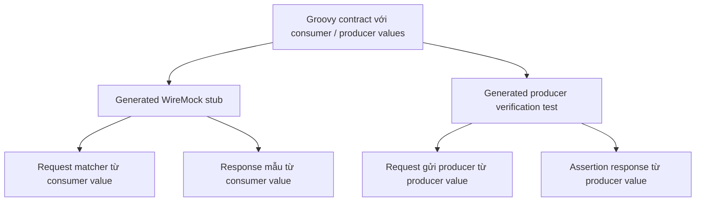
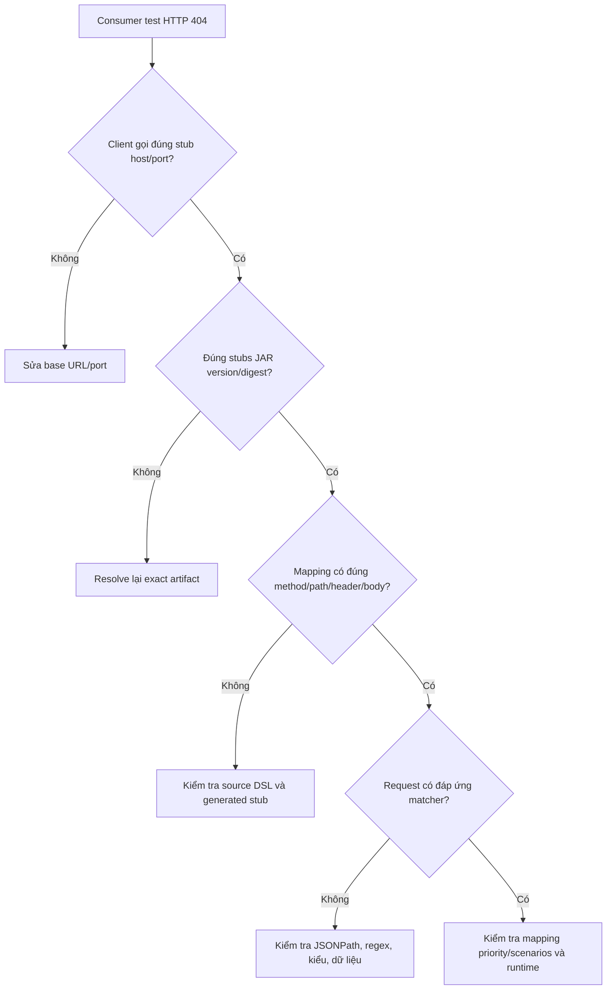
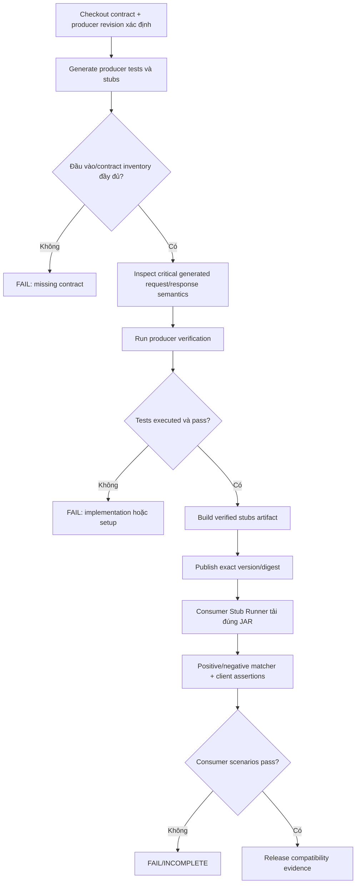

# Nhầm consumer value và producer value

## 1. Triệu chứng: stub xanh nhưng producer test đỏ

Trong **Spring Cloud Contract (SCC)**, producer và consumer thống nhất hành vi giao tiếp bằng **Groovy/YAML DSL**. Công cụ dùng hợp đồng để **sinh kiểm thử producer**, **sinh stub HTTP hoặc thông điệp**, chạy **Stub Runner** phía consumer và tích hợp **CI** nhằm phát hiện thay đổi API không tương thích.

Một lỗi khó nhìn thấy khi mới học DSL là **đảo `consumer(...)` và `producer(...)`** trong các giá trị động. Ví dụ team muốn:

- Consumer gửi `customerId` dạng `cust-` theo sau là chữ số bất kỳ.
- Generated producer test gửi một giá trị cụ thể, chẳng hạn `cust-42`, để có thể tái lập.
- Producer phản hồi `orderId` động theo dạng `ord-` theo sau là chữ số.
- HTTP stub trả một giá trị mẫu cụ thể, chẳng hạn `ord-101`, để consumer có dữ liệu ổn định.

Nếu hai phía của `$(consumer(...), producer(...))` được đảo ngược, ta có thể gặp:

1. WireMock stub chỉ match đúng `cust-42` thay vì các giá trị hợp lệ dạng `cust-[0-9]+`.
2. Generated producer test không có giá trị request cụ thể hợp lệ để gửi.
3. Producer test kiểm tra response bằng giá trị cứng dù producer phát sinh ID động.
4. Stub không có một ví dụ response cụ thể để trả cho client.
5. CI xanh ở một phía nhưng phía còn lại thất bại, hoặc hai phía chạy các tình huống không tương đương.

**Mục tiêu của bài:** hiểu chính xác ý nghĩa `consumer value` và `producer value`; phân biệt hướng **request** và **response**; chẩn đoán generated producer tests, WireMock mappings và client tests; sửa contract mà không làm yếu các ràng buộc API.

## 2. Tên gọi consumer và producer không đồng nghĩa “request đi về đâu”

Trong một contract HTTP:

- **Consumer** là phía **gọi** API, chẳng hạn `checkout-service`.
- **Producer** là phía **triển khai** API, chẳng hạn `order-service`.
- **Stub** mô phỏng producer cho consumer test.
- **Generated producer test** gọi triển khai producer thật và kiểm tra hành vi so với contract.

SCC cho phép một trường giá trị động có **hai góc nhìn**:

```groovy
$(consumer(...), producer(...))
```

Hai phần này không có nghĩa “request là consumer, response là producer”. Cả **request** và **response** đều có thể cần hai phía. Ta cần hiểu **mỗi phía sẽ được dùng ở output nào của generator**.



**Quy tắc nhớ:** `consumer(...)` cung cấp góc nhìn của **stub khi consumer tương tác**, còn `producer(...)` cung cấp góc nhìn của **test khi producer thực thi**. Vai trò cụ thể là **match một input**, **gửi một input**, **trả một output mẫu** hay **assert một output** tùy vị trí request/response.

## 3. Bảng chân lý: phía nào cần regex, phía nào cần ví dụ cụ thể?

| Vị trí trong contract | `consumer(...)` phục vụ | `producer(...)` phục vụ | Mẫu cấu hình phổ biến |
| --- | --- | --- | --- |
| **Request** | WireMock **match request** mà consumer gửi | Generated test **gửi request cụ thể** đến producer | `consumer(regex('cust-[0-9]+'))` và `producer('cust-42')` |
| **Response** | WireMock **trả response mẫu** cho consumer | Generated test **assert response** do producer tạo | `consumer('ord-101')` và `producer(regex('ord-[0-9]+'))` |

Đây là mô hình quan trọng nhất để sửa lỗi. Hãy đọc kỹ cả hai dòng:

**Request:**

```text
consumer(regex) --> stub matcher nhận các request hợp lệ
producer(example) --> producer test gửi một request tái lập được
```

**Response:**

```text
consumer(example) --> stub trả body cụ thể cho consumer test
producer(regex) --> producer test cho phép dữ liệu thật thay đổi theo pattern
```

Một contract có thể dùng literal giống nhau ở cả hai phía khi giá trị bất biến. Không phải **mọi trường đều cần** cặp `consumer/producer`. Chỉ dùng giá trị động khi cần **khác biệt có chủ đích** giữa matching/generation phía stub và phía producer verification.

### “Ai viết contract?” không quyết định phía giá trị

Một nhóm consumer có thể viết contract theo consumer-driven approach rồi gửi producer review. Nhưng `producer(...)` vẫn mang nghĩa **dành cho producer verification**, không đổi thành “giá trị do nhóm producer tự viết”. Tương tự, producer-owned contracts vẫn có `consumer(...)` vì **stub cần hoạt động theo góc nhìn consumer**.

## 4. Ví dụ Groovy đúng: customerId đầu vào và orderId đầu ra

Giả sử API `POST /api/orders` tạo đơn hàng. Consumer được phép gửi các customer ID dạng `cust-42`, `cust-805`... Producer tạo order ID mới dạng `ord-101`, `ord-9901`...

```groovy
import org.springframework.cloud.contract.spec.Contract

Contract.make {
    description 'Tạo đơn và nhận orderId động'

    request {
        method POST()
        url '/api/orders'
        headers {
            contentType(applicationJson())
        }
        body([
            customerId: $(consumer(regex('cust-[0-9]+')),
                          producer('cust-42')),
            quantity  : 2
        ])
    }

    response {
        status CREATED()
        headers {
            contentType(applicationJson())
        }
        body([
            orderId: $(consumer('ord-101'),
                       producer(regex('ord-[0-9]+'))),
            status : 'CREATED'
        ])
    }
}
```

### Đọc từng phần

| Biểu thức | Điều có thể kiểm tra | Kết quả mong đợi |
| --- | --- | --- |
| `request.customerId.consumer(regex(...))` | Consumer gửi `cust-777` | Stub match nếu các điều kiện khác đúng |
| `request.customerId.producer('cust-42')` | Test generate request | Gửi body chứa `"customerId":"cust-42"` |
| `response.orderId.consumer('ord-101')` | Consumer gọi stub | Nhận body có `"orderId":"ord-101"` |
| `response.orderId.producer(regex(...))` | Producer trả `ord-9901` | Test pass nếu giá trị match `ord-[0-9]+` |
| `request.quantity = 2` | Hai phía | Cùng giá trị literal, không cần cặp động |
| `response.status = CREATED()` | Hai phía | Producer phải trả 201; stub trả 201 |

### Ví dụ request và response thực

Consumer gửi:

```http
POST /api/orders HTTP/1.1
Content-Type: application/json

{"customerId":"cust-777","quantity":2}
```

Stub trả:

```http
HTTP/1.1 201 Created
Content-Type: application/json

{"orderId":"ord-101","status":"CREATED"}
```

Generated producer test, trong khi đó, có thể gửi `cust-42` và chấp nhận producer trả `ord-9901`, miễn các assertion khác đáp ứng contract.

**Điều kiện quan trọng:** `cust-777` phải match `request` sau khi WireMock xử lý JSON/body, headers và URL. Regex ở một trường **không tự bỏ qua** các trường khác; `quantity` vẫn là 2 và header `Content-Type` vẫn phải phù hợp.

## 5. Hai artifact được sinh có nhiệm vụ khác nhau

Ví dụ producer contract ở mục 4 có thể tạo:

### A. Stub-side WireMock mapping — minh họa cấu trúc

```json
{
  "request": {
    "method": "POST",
    "url": "/api/orders",
    "headers": {
      "Content-Type": {
        "matches": "application/json.*"
      }
    },
    "bodyPatterns": [
      {
        "matchesJsonPath": {
          "expression": "$.customerId",
          "matches": "cust-[0-9]+"
        }
      }
    ]
  },
  "response": {
    "status": 201,
    "headers": {
      "Content-Type": "application/json"
    },
    "jsonBody": {
      "orderId": "ord-101",
      "status": "CREATED"
    }
  }
}
```

**Đây là bản minh họa rút gọn, không phải generated JSON chính xác của mọi phiên bản SCC.** Generator có thể sinh thêm body matcher cho `quantity = 2`, dùng `equalToJson` hoặc một cách biểu diễn khác, và có thể lưu body dưới dạng chuỗi/file. Cần xem **generated mapping thực tế** để biết request matching đã được diễn giải đúng.

### B. Producer-side generated test — pseudocode

```java
// PSEUDOCODE: không phải source generator xuất ra nguyên văn.
void createOrderContract() {
    // Gửi request cụ thể đến producer thật:
    POST("/api/orders",
         "{\"customerId\":\"cust-42\",\"quantity\":2}");

    // Assert response của implementation:
    assertStatus(201);
    assertJsonPathMatches("$.orderId", "ord-[0-9]+");
    assertJsonPathEquals("$.status", "CREATED");
}
```

Nếu generated producer test thật chỉ assert `orderId == "ord-101"`, trong khi producer sinh ID động, hãy điều tra **phía `producer(...)` của response**, test generator/version và matcher. Nếu generated stub chỉ nhận `cust-42`, hãy điều tra **phía `consumer(...)` của request**.

**Không sửa tay file trong `build/generated-...` hoặc `target/generated-...`** làm biện pháp chính thức. Đó là output có thể bị ghi đè khi regenerate. Sửa contract DSL và cấu hình generator rồi sinh lại.

## 6. Lỗi thứ nhất: đảo giá trị của request

Developer muốn stub nhận nhiều `customerId`, nhưng lại viết:

```groovy
request {
    method POST()
    url '/api/orders'
    body([
        customerId: $(consumer('cust-42'),
                      producer(regex('cust-[0-9]+')))
    ])
}
```

**Sai ở đâu?**

- `consumer('cust-42')` làm phía stub thiên về **một giá trị cố định**, không phải mẫu động cần match.
- `producer(regex(...))` được dùng tại nơi generated producer test cần **request cụ thể để gửi**. Generator không thể gửi một đối tượng regex trừu tượng như một JSON customer ID hợp lệ theo ý định. Tùy version, có thể sinh lỗi, sinh dữ liệu không mong đợi hoặc tạo mã test không phù hợp.
- Vì vậy consumer gửi `cust-777` có thể bị WireMock từ chối, trong khi source nhìn thoáng qua vẫn có chuỗi regex đúng.

### Sửa theo hướng request

```groovy
request {
    method POST()
    url '/api/orders'
    body([
        customerId: $(consumer(regex('cust-[0-9]+')),
                      producer('cust-42'))
    ])
}
```

**Cách kiểm tra**, không chỉ nhìn source:

1. Generate stubs và đọc JSON mapping cho `POST /api/orders`.
2. Xác nhận `customerId` phía **request matcher** là regex `cust-[0-9]+`.
3. Generate producer test, xác nhận request **thật sự gửi `cust-42`**.
4. Với Stub Runner, gửi `cust-42` và `cust-777` (đều hợp lệ theo regex), quan sát mapping match.
5. Gửi `other-42` hoặc `cust-abc`, xác nhận **không match** hợp đồng đó.

Nếu request không match, WireMock thường trả 404 mặc định; **404 unmatched không phải bằng chứng producer trả lỗi nghiệp vụ**. Dùng request journal/mapping inspection để xem nguyên nhân.

## 7. Lỗi thứ hai: đảo giá trị của response

Developer muốn producer được phép tạo ID động, nhưng lại viết:

```groovy
response {
    status CREATED()
    body([
        orderId: $(consumer(regex('ord-[0-9]+')),
                   producer('ord-101'))
    ])
}
```

**Sai ở đâu?**

- Stub cần trả một **response mẫu cụ thể** cho consumer, nhưng phía `consumer(...)` lại có regex. Regex là **quy tắc**, không phải một order ID được tạo ra.
- Generated producer test dùng phía `producer(...)` để assert, nhưng ở đây lại ràng buộc **đúng `ord-101`**. Khi producer thật trả `ord-9901`, test có thể fail dù producer vẫn giữ định dạng đã thống nhất.

Tùy phiên bản generator, cách dùng regex sai phía có thể dẫn tới lỗi sinh stub hoặc nội dung không mong đợi. Không nên suy rằng WireMock sẽ “tự chọn” một số bất kỳ từ regex.

### Sửa theo hướng response

```groovy
response {
    status CREATED()
    body([
        orderId: $(consumer('ord-101'),
                   producer(regex('ord-[0-9]+')))
    ])
}
```

**Cách kiểm tra:**

- WireMock response body phải có giá trị ví dụ **`ord-101`**, không phải chuỗi regex.
- Generated producer test phải xác minh `orderId` **khớp pattern `ord-[0-9]+`**, không buộc bằng đúng ví dụ.
- Nếu producer trả `ord-9901`, test có thể pass.
- Nếu producer trả `abc-9901` hoặc bỏ field `orderId`, assertion phải fail.

### Đừng nới mọi response về `.*`

Một “cách sửa” sai thường gặp khi test đỏ là:

```groovy
orderId: $(consumer('ord-101'), producer(regex('.*')))
```

Regex quá rộng có thể chấp nhận chuỗi rỗng hoặc giá trị vô nghĩa, làm mất cam kết về định dạng ID. Hãy viết matcher **đúng phạm vi consumer thực sự dựa vào**; ví dụ `ord-[0-9]+` hoặc regex UUID phù hợp. Nếu producer dùng UUID thật, sửa contract để phản ánh schema đã được thỏa thuận, không cố giữ ví dụ `ord-...` chỉ vì tiện.

## 8. YAML DSL: cùng ngữ nghĩa, cách diễn đạt khác

Trong YAML contract, không nhất thiết viết trực tiếp `$(consumer(...), producer(...))`. Có thể dùng **giá trị mẫu** trong `body` và khai báo **matchers** ở hướng phù hợp.

### YAML cho cùng kịch bản tạo đơn

```yaml
description: Tạo đơn và nhận orderId động
request:
  method: POST
  url: /api/orders
  headers:
    Content-Type: application/json
  body:
    customerId: "cust-42"
    quantity: 2
  matchers:
    body:
      - path: $.customerId
        type: by_regex
        value: 'cust-[0-9]+'
response:
  status: 201
  headers:
    Content-Type: application/json
  body:
    orderId: "ord-101"
    status: "CREATED"
  matchers:
    body:
      - path: $.orderId
        type: by_regex
        value: 'ord-[0-9]+'
```

**Ý nghĩa cần đọc đúng:**

| Vị trí YAML | Giá trị mẫu | Matcher | Vai trò |
| --- | --- | --- | --- |
| `request.body.customerId` | `cust-42` | `request.matchers.body` regex | Test producer gửi ví dụ; stub chấp nhận input phù hợp regex |
| `request.body.quantity` | `2` | Không có matcher riêng | Giữ điều kiện literal trong contract |
| `response.body.orderId` | `ord-101` | `response.matchers.body` regex | Stub trả ví dụ; producer test assert pattern |
| `response.body.status` | `CREATED` | Không có matcher riêng | Giá trị cố định cần kiểm tra |

Cú pháp `type: by_regex` và `path: $.field` là kiểu matcher được dùng trong SCC YAML DSL. **Đối chiếu đúng phiên bản đang dùng** về matcher types, schema, escaping và khả năng áp dụng cho JSON body; không sao chép property của DSL khác vào YAML rồi mặc nhiên coi generator đã hiểu.

### Không tự động đặt matcher nhầm phía

Nếu vô tình đưa matcher `orderId` vào `request.matchers`, sẽ không tạo producer response assertion mong đợi. Tương tự, đặt matcher `customerId` dưới `response.matchers` không làm Stub Runner match input `customerId`.

Với YAML, kiểm tra **trường đang mô tả là request hay response** quan trọng không kém việc kiểm tra regex. Đây chính là lỗi đảo phía được biểu diễn dưới một cú pháp khác.

### YAML/Groovy chỉ là hai cách thể hiện

Không nên đưa **cả hai contract trùng method/path/behavior** vào cùng source root được quét, trừ khi chủ ý tạo hai kịch bản có điều kiện request phân biệt rõ. Duplicate WireMock mappings có thể tạo kết quả không ổn định; producer tests cũng có thể sinh trùng và khó hiểu.

## 9. Path, query và headers: lỗi đảo phía không chỉ nằm trong JSON body

Sự khác biệt `consumer`/`producer` cũng áp dụng khi giá trị động nằm ở **đường dẫn, query, header và những dạng body khác** mà DSL hỗ trợ.

### URL động: một matcher và một URL ví dụ

Ví dụ Groovy minh họa giá trị URL có thể biểu diễn hai phía bằng `value`:

```groovy
request {
    method GET()
    url value(
        consumer(regex('/api/orders/[0-9]+')),
        producer('/api/orders/42')
    )
}
```

Ý định: stub nhận `GET /api/orders/42` hoặc `GET /api/orders/900`; generated test dùng đường dẫn cụ thể `/api/orders/42`. Cần kiểm tra **generated WireMock request matcher** thực tế để biết regex được gắn vào URL hay `urlPath` đúng như mong muốn.

Không đặt phía `producer(...)` thành regex nếu generator cần một URL thật để gửi.

### Query parameters: tương tự request body

Một contract API có `?page=2` nhưng cho consumer gửi các giá trị trang khác:

```groovy
request {
    method GET()
    urlPath('/api/orders') {
        queryParameters {
            parameter 'page': $(consumer(regex('[0-9]+')),
                                producer('2'))
        }
    }
}
```

**Về ngữ nghĩa**, WireMock cần match giá trị `page` số và generated test cần một `page=2` cụ thể. Tùy cấu hình, DSL có thể biểu diễn `queryParameters` bằng cú pháp map/method khác; đây là ví dụ định hướng để người học **kiểm tra DSL/version và generated matcher**. Khi URL gồm nhiều query parameters, thứ tự query trong HTTP không luôn cố định; không dùng một regex raw URL quá chặt nếu DSL có matcher chuyên biệt.

### Header động: dữ liệu test phải hợp lệ

Nếu request cần `X-Request-Id` phù hợp format UUID, có thể dùng matcher ở **consumer side của request** và một UUID mẫu ở **producer side**. Với response chứa `X-Correlation-Id` động, đảo lại: stub phát một ví dụ và producer test kiểm tra regex/loại dữ liệu.

**Không đặt token production vào phía `producer(...)` của request** chỉ để generated test có dữ liệu cụ thể. Dùng credential sandbox hoặc test identity và phải đánh giá auth behavior bằng security integration tests phù hợp; WireMock so header không tự xác minh JWT/OAuth2.

### Bảng nhớ cho bốn vị trí

| Trường | Khi nằm trong request | Khi nằm trong response |
| --- | --- | --- |
| URL/path | Stub match từ `consumer`, test gửi `producer` | Không áp dụng như response URL |
| Query | Stub match từ `consumer`, test gửi `producer` | Không áp dụng trừ khi nằm trong body/link |
| Headers | Stub match từ `consumer`, test gửi `producer` | Stub trả `consumer`, test assert `producer` |
| JSON fields | Stub match từ `consumer`, test gửi `producer` | Stub trả `consumer`, test assert `producer` |

## 10. Kiểu dữ liệu, JSONPath và null: regex không sửa được mọi mismatch

Một regex `[0-9]+` match **chuỗi ký tự**, không tự có nghĩa JSON number. Ví dụ:

```json
{"quantity":2}
```

khác về kiểu so với:

```json
{"quantity":"2"}
```

Nếu consumer dùng parser chặt chẽ hoặc producer bắt kiểu integer, việc viết matcher string phù hợp regex không có nghĩa hai payload đã tương thích. Hãy dùng matcher đúng **kiểu giá trị** và kiểm tra generated assertions.

### Những trường hợp cần kiểm chứng thêm

- **Number vs string:** `2` khác `"2"`, đặc biệt khi deserializer strict.
- **Null vs missing field:** `"status": null` khác hoàn toàn việc không có `status`.
- **Empty vs absent array:** `[]` khác việc không có `items`.
- **Array count/order:** matcher từng phần tử không tự bảo vệ số lượng hoặc thứ tự nếu không khai báo.
- **Nested JSONPath:** `$.customer.id` khác `$.id`; path sai làm matcher áp dụng không đúng hoặc không được generate.
- **Date/UUID patterns:** regex hợp định dạng chưa chứng minh ngày tồn tại, timezone đúng hoặc UUID có semantics.
- **Enum value:** `CREATED`/`CONFIRMED` thường là contract quan trọng, không nên đổi thành matcher vô điều kiện.

### Minh họa nested field

```yaml
request:
  method: POST
  url: /api/orders
  headers:
    Content-Type: application/json
  body:
    customer:
      id: "cust-42"
    quantity: 2
  matchers:
    body:
      - path: $.customer.id
        type: by_regex
        value: 'cust-[0-9]+'
```

Nếu developer vô tình dùng `path: $.customerId`, matcher không bảo vệ đúng field nested. Generated matcher có thể không hoạt động như kỳ vọng, hoặc bước generate báo lỗi tùy version. Việc test xanh với một fixture cố định vẫn chưa đủ để chứng minh consumer có thể gửi các customer IDs hợp lệ khác.

**Kết luận của nhóm lỗi này:** đầu tiên xác định **phía consumer/producer**, sau đó xác định **kiểu JSON, JSONPath, regex và trường contract thật sự cần bảo vệ**. Một trong hai đúng nhưng bên còn lại sai vẫn có thể làm CI xanh giả hoặc fail khó hiểu.

## 11. Regex đúng cú pháp chưa chắc đúng nghĩa

Ngay cả khi `consumer`/`producer` đã đặt đúng phía, regex vẫn có thể gây lỗi hoặc làm yếu hợp đồng.

### Kiểm tra phạm vi match

| Pattern | Giá trị thường hợp lệ | Giá trị đáng xem lại | Nhận xét |
| --- | --- | --- | --- |
| `cust-[0-9]+` | `cust-42`, `cust-900` | `customer-42`, `cust-` | Phù hợp prefix + ít nhất một chữ số |
| `ord-[0-9]+` | `ord-101` | `abc-101` | Không dùng `.*` nếu cần prefix cụ thể |
| `[0-9]{4}-[0-9]{2}-[0-9]{2}` | `2026-11-24` | `2026-99-99` vẫn match hình thức | Regex không chứng minh ngày hợp lệ |
| `[a-zA-Z0-9_-]+` | `abc_12` | Giá trị Unicode tùy nghiệp vụ | Dễ rộng hơn domain thực |
| `.*` | Hầu hết chuỗi | Chuỗi rỗng, nội dung vô nghĩa | Thường quá rộng cho ID và enum |

**Không nên đồng nhất regex với validation domain.** Ví dụ `cust-000` có thể match regex nhưng bị business rule từ chối. Nếu consumer cần quy tắc riêng về độ dài, checksum hoặc trạng thái, cần mô tả và test quy tắc ấy ở lớp phù hợp.

### Escaping giữa DSL, regex và JSON

Trong một chuỗi Groovy/Java, backslash có thể cần escaping; trong YAML single-quoted scalar, cách diễn giải khác. Ví dụ một pattern dùng `\d+` có thể phải viết với backslash thích hợp theo ngôn ngữ chứa nó.

Để giảm nhầm lẫn trong tài liệu và bài tập, các ví dụ dùng `[0-9]+`, không dựa vào chuỗi escape đa tầng. Nếu dùng regex nâng cao, hãy kiểm tra:

1. Giá trị **trong DSL** sau khi parse.
2. Giá trị **trong generated WireMock mapping JSON** sau khi escape.
3. Matcher **trong generated producer test**.
4. Một số **positive/negative cases** như ID rỗng, ký tự thừa và prefix sai.

Nếu matcher fail khi JSON có `"cust-42"`, nhưng `"cust-42"` lại pass với một tool regex độc lập, có thể lỗi nằm ở **escaping/JSONPath/type conversion**, không nhất thiết do pattern ban đầu.

## 12. Producer verification: có thật sự kiểm tra phía producer value?

Generated producer test chạy trên mã producer, nên nó phải có một base class và môi trường test phù hợp. Ví dụ Spring MVC + JUnit 5:

```java
package com.example.orders.contract;

import io.restassured.module.mockmvc.RestAssuredMockMvc;
import org.junit.jupiter.api.BeforeEach;
import org.springframework.beans.factory.annotation.Autowired;
import org.springframework.boot.test.autoconfigure.web.servlet.AutoConfigureMockMvc;
import org.springframework.boot.test.context.SpringBootTest;
import org.springframework.test.web.servlet.MockMvc;

@SpringBootTest
@AutoConfigureMockMvc
public abstract class OrderContractBase {

    @Autowired
    MockMvc mvc;

    @BeforeEach
    void configureMockMvc() {
        RestAssuredMockMvc.mockMvc(mvc);
    }
}
```

Đây là **base class minh họa** cho một cấu hình Spring MVC tương thích với Rest Assured MockMvc. Cần phiên bản Spring Boot/JUnit/SCC, classpath và test mode phù hợp. Với JAX-RS, WebFlux hoặc HTTP server thật, base class phải dùng adapter/test mode tương ứng; đổi `producer(...)` không sửa được lỗi sai server/port.

### Điều tra generated test ở đúng thời điểm

Giả sử contract chứa:

```groovy
customerId: $(consumer(regex('cust-[0-9]+')),
              producer('cust-42'))
```

Hãy tìm **request body** generated test gửi. Nếu nó chứa `cust-42`, hướng request được diễn giải đúng. Sau đó tìm response assertion cho:

```groovy
orderId: $(consumer('ord-101'),
           producer(regex('ord-[0-9]+')))
```

Nếu assertion dùng regex phù hợp, hướng response được diễn giải đúng. Nếu test vẫn fail, cần xem **producer thực trả gì**, chẳng hạn:

```json
{"orderId":"order-9901","status":"CREATED"}
```

Giá trị này vi phạm `ord-[0-9]+`, nên failure có thể là **tín hiệu breaking change đúng**, không phải lỗi DSL. Đừng đổi `producer(regex('.*'))` để che việc producer đã đổi schema không được consumer chấp thuận.

### Phân loại lỗi producer test

| Lỗi | Nhóm nguyên nhân |
| --- | --- |
| Generated test không compile | DSL/generator, framework, classpath hoặc base class |
| Test chạy nhưng báo `Connection refused` | Test mode HTTP thật, server/port chưa đúng |
| Test gửi body sai giá trị | Request `producer value` hoặc cấu hình generator |
| Test nhận `400` thay `201` | Request/validation/auth hoặc fixture chưa phù hợp |
| Test nhận `201` nhưng sai `orderId` | Producer implementation hoặc response `producer matcher` |
| Test chạy 0 methods | Test runner/task selection/generation source root |

**Generated test đỏ chưa chắc do đảo phía.** Đầu tiên xác nhận nguồn hợp đồng, test input, actual response rồi mới kết luận.

## 13. Stub Runner: có đang dùng đúng consumer value?

Để kiểm tra consumer, `checkout-service` có thể nạp stubs artifact do producer phát hành:

```java
import org.junit.jupiter.api.Test;
import org.springframework.beans.factory.annotation.Autowired;
import org.springframework.boot.test.context.SpringBootTest;
import org.springframework.cloud.contract.stubrunner.StubRunnerProperties;
import org.springframework.cloud.contract.stubrunner.spring.AutoConfigureStubRunner;

import static org.assertj.core.api.Assertions.assertThat;

@SpringBootTest(properties =
    "clients.orders.base-url=http://localhost:9090")
@AutoConfigureStubRunner(
    ids = "com.example:order-service:1.7.0:stubs:9090",
    stubsMode = StubRunnerProperties.StubsMode.LOCAL
)
class CheckoutOrderClientContractTest {

    @Autowired
    OrderClient orderClient;

    @Test
    void acceptsDynamicCustomerId() {
        OrderView result = orderClient.createOrder("cust-777", 2);
        assertThat(result.orderId()).isEqualTo("ord-101");
        assertThat(result.status()).isEqualTo("CREATED");
    }
}
```

**Lưu ý về mã minh họa:** `OrderClient`, `OrderView`, `clients.orders.base-url` là API/property của ứng dụng, không phải class SCC có sẵn. Test cần bean client thật, dependency Stub Runner, artifact `1.7.0:stubs` trong Maven local và một contract mapping tương ứng. Không thể copy nguyên class mà không viết các kiểu ứng dụng rồi kỳ vọng compile.

### Điều kiện cần xác nhận

1. Stub Runner thực sự nạp **`com.example:order-service:1.7.0:stubs`**, không phải artifact 1.6.0 còn nằm trong cache.
2. Consumer HTTP client gọi **`localhost:9090`**, không gọi producer thật.
3. Mappings chứa matcher `customerId` dạng `cust-[0-9]+`.
4. Mapping trả `ord-101` và `status = CREATED` như response consumer sample.
5. Có assertion nghiệp vụ và test count, không chỉ kiểm tra WireMock startup.

Nếu consumer gửi `cust-777` nhận 404, trước khi đổi regex hãy kiểm tra **method**, URL, query, headers, body, version và JSONPath. Một WireMock 404 vì **không có mapping match** không có ý nghĩa giống 404 nghiệp vụ đã được contract mô tả.

### LOCAL, REMOTE, CLASSPATH không đổi ngữ nghĩa

- `LOCAL` tìm artifact ở Maven local repository.
- `REMOTE` giải quyết artifact từ registry tương thích Maven.
- `CLASSPATH` nạp resources từ classpath theo cấu hình.

Các mode chỉ quyết định **nơi tìm stub**. Chúng không thay `consumer(...)` thành `producer(...)`. Đặc biệt, **stub cũ** có thể chứa matcher sai ngay cả khi contract source hiện tại đã sửa; phải build/publish/nạp lại đúng version/digest để quan sát kết quả sửa.

## 14. Debug WireMock request matching theo bằng chứng

Một test fail với:

```text
Expected: HTTP 201
Actual:   HTTP 404
Request:  POST /api/orders
Body:     {"customerId":"cust-777","quantity":2}
```

Không nên ngay lập tức kết luận producer sai. Khi consumer dùng Stub Runner, request có thể chưa match bất kỳ WireMock mapping nào.

### Các dữ kiện cần so

| Dữ kiện | Từ đâu lấy | Câu hỏi |
| --- | --- | --- |
| Actual URL/method | Consumer HTTP client/test log | Gửi đúng `POST /api/orders` chưa? |
| Request headers | HTTP debug log đã che secrets | Có đúng `Content-Type: application/json` không? |
| Request body | Test input đã loại dữ liệu nhạy cảm | `customerId` nằm đúng JSONPath? Kiểu và `quantity` đúng? |
| Stubs artifact identity | Stub Runner logs/build manifest | Đã tải đúng version/digest chưa? |
| Generated mapping | Stubs JAR / WireMock mappings | Matcher dùng regex hay literal `cust-42`? |
| Request journal | WireMock Admin API trong test sandbox | Request thực được server nhận thế nào? |
| Nearest-match diagnostics | WireMock unmatched request output nếu có | Khác biệt nào lớn nhất giữa request và mapping? |

### Trình tự debug



### Quyền và an toàn khi dùng Admin API

Trong một test environment cô lập, WireMock thường cung cấp endpoints như `/__admin/mappings` và `/__admin/requests` để kiểm tra mappings/request journal. Các endpoint ấy có thể tiết lộ headers/body hoặc cho sửa/reset mappings; **không nên để chúng công khai** hoặc dump production tokens vào log. Dùng synthetic data, giới hạn truy cập và redaction khi điều tra.

### Trường hợp 201 nhưng body sai

Nếu WireMock trả:

```json
{"orderId":"ord-[0-9]+","status":"CREATED"}
```

thay vì một ID cụ thể, nhiều khả năng phía **`consumer value` của response** không có sample hợp lệ hoặc output bị biến đổi. Kiểm tra source DSL, generated mapping và các transformer được đăng ký. Không sửa consumer DTO để chấp nhận chuỗi regex như ID thật.

## 15. Với messaging contract, vẫn phải phân biệt test-side và stub-side

Spring Cloud Contract không chỉ hỗ trợ HTTP. Một producer có thể phát message `OrderConfirmed` khi gọi `confirmOrder()`:

```groovy
import org.springframework.cloud.contract.spec.Contract

Contract.make {
    description 'Phát event OrderConfirmed với eventId động'
    label 'order_confirmed'

    input {
        triggeredBy('confirmOrder()')
    }

    outputMessage {
        sentTo('orders.confirmed')
        headers {
            header('eventType', 'OrderConfirmed')
            messagingContentType(applicationJson())
        }
        body([
            eventId: $(consumer('evt-701'),
                       producer(regex('evt-[0-9]+'))),
            orderId: 'ord-42',
            status : 'CONFIRMED'
        ])
    }
}
```

Với **outputMessage**, phía consumer có thể cần một **message mẫu** có `eventId = evt-701` khi trigger stub; producer verification cần kiểm tra publisher tạo `eventId` phù hợp pattern `evt-[0-9]+`. Nếu đảo hai phía, producer test có thể bị ràng buộc vào một ID cố định và stub không có dữ liệu cụ thể hợp lệ.

### Các trường khác vẫn là một phần contract

- `label` là tên để consumer trigger stub event theo cơ chế hỗ trợ, không tự là header/payload.
- `input.triggeredBy` chỉ ra hành động producer cần gọi trong test. Base class phải có method triển khai đúng.
- `outputMessage.sentTo` là destination có ý nghĩa với consumer.
- Header `eventType` và content type phải khớp kỳ vọng.
- `eventId` có thể động; `orderId` và `status` có thể được giữ literal trong ví dụ.

**Phạm vi chứng cứ:** Consumer `StubTrigger` có thể phát message mẫu qua adapter, nhưng không chứng minh code producer mới thật sự publish. Cần generated messaging producer verification trên đúng revision và integration tests riêng cho broker routing, serializer, acknowledgment/retry/order nếu nghiệp vụ yêu cầu.

### Còn message đầu vào thì sao?

Nếu producer **nhận** message `input.messageFrom` và xử lý message body từ một consumer, dữ liệu đầu vào thường có tính chất gần **request**: stub matcher/consumer-facing input và producer test fixture cần được thiết kế theo DSL/backend hỗ trợ. Tuy nhiên, luồng trigger/destination, converter và việc sinh stub khác với HTTP; hãy kiểm tra generated messaging tests và adapter tương ứng thay vì bê nguyên mẫu HTTP JSONPath sang message transport rồi mặc định hoạt động.

## 16. Bảng chẩn đoán theo triệu chứng

| Triệu chứng | Nơi cần kiểm tra trước | Khả năng do đảo phía? | Hành động xác minh |
| --- | --- | --- | --- |
| Consumer gửi `cust-777` nhưng stub 404 | Request `consumer value` | **Có** | Xem mapping có literal `cust-42` thay regex không |
| Consumer nhận response `ord-[0-9]+` như text | Response `consumer value` | **Có** | Xem stub body và metadata/transformer |
| Producer test gửi request không hợp lệ | Request `producer value` | **Có** | Xem generated request cụ thể |
| Producer test fail vì ID động khác `ord-101` | Response `producer value` | **Có** | Xem generated assertion literal thay regex |
| Producer test pass nhưng consumer lỗi deserialization | Stub sample / DTO | **Có thể** | Kiểm tra response consumer sample và kiểu JSON |
| Consumer 404 với `Content-Type` sai | Header matching | **Có thể** | Đọc generated request matcher và actual header |
| Consumer 404 khi gửi `page=3` | Query consumer matcher | **Có thể** | Kiểm tra query matcher, URL encoding, default values |
| Producer test lỗi vì field null/missing | JSON type/contract semantics | Không nhất thiết | So response thực, JSONPath và nullability |
| Generated test không compile | DSL syntax/generator/framework | Có thể nhưng không chỉ | Đọc lỗi compilation và source generated |
| Không có generated tests | Source root/filter/task | **Không trực tiếp** | Kiểm tra contract inventory và test execution |
| Producer test trả 500 | Code/fixture/dependency | Không nhất thiết | Xem server logs, test base class, request input |
| Stub response đúng nhưng consumer không nhận | URL/port hoặc code client | Không nhất thiết | Xem actual endpoint và deserializer |
| Stub Runner nạp artifact cũ | Artifact provenance/cache | **Không trực tiếp** | So version/digest trước khi kết luận DSL sai |
| Messaging trigger thành công nhưng listener không nhận | Adapter/destination/headers | Không nhất thiết | Kiểm tra label, binding và listener |
| Ứng dụng thật trả ID khác regex | Producer implementation/schema | Không nhất thiết | Xác định có breaking change trước khi nới matcher |

### Đừng gộp mọi lỗi vào “contract sai”

Một failure có thể nằm ở một trong **sáu giai đoạn**:

```text
Contract source
    → Parsing / generation
    → Producer test compilation / execution
    → Stub mapping generation / packaging
    → Stub Runner loading / request matching
    → Consumer client handling / assertions
```

Lỗi do đảo `consumer`/`producer` thường lộ ra khi so **hai outputs**: generated producer test và generated stub. Nếu **cả hai đúng** nhưng consumer test vẫn fail, hãy tìm lỗi ở configuration/runtime/client thay vì đổi DSL ngẫu nhiên.

## 17. Quy trình điều tra có thể tái lập từ một contract

Thay vì sửa rồi chạy lại toàn bộ CI nhiều lần, hãy dùng một **minimal reproducer**:

1. Chọn **một contract** cụ thể có cặp giá trị động.
2. Ghi kỳ vọng rõ: request có thể biến thiên thế nào, producer test dùng ví dụ nào, response nào động và stub sample nào.
3. Sinh generated producer tests và stubs từ **đúng một source revision**.
4. Đọc generated test để xác định các giá trị request và matcher response.
5. Đọc generated WireMock mapping để xác định matcher request và sample response.
6. Chạy producer test trên code/fixture đúng revision và ghi actual request/response.
7. Chạy consumer test với exact stubs artifact, ghi actual request và response.
8. Gửi một positive request và một negative request có chủ đích để chứng minh matcher.
9. Chỉ sửa contract nguồn; generate lại rồi so kết quả.

### Bảng chứng cứ tối thiểu

| Câu hỏi | Bằng chứng PASS |
| --- | --- |
| Request `consumer value` đúng? | WireMock mapping match `cust-777`, reject `cust-abc` |
| Request `producer value` đúng? | Generated test gửi `cust-42` |
| Response `consumer value` đúng? | Stub body trả `ord-101` |
| Response `producer value` đúng? | Generated test match `ord-[0-9]+` |
| Producer code đúng? | Test trên implementation thực chạy và pass |
| Consumer code đúng? | Client thật xử lý response stub và assertion pass |
| Artifact đúng? | Version/digest stubs khớp build đã verify |

**Một log `BUILD SUCCESS` không chứa tất cả câu trả lời này.** Muốn kết luận producer–consumer tương thích, CI phải biết những test nào đã chạy và artifact nào đã được nạp.

### Pseudocode kiểm tra khung generated test

```text
Check producer generated test:
  outgoing request body.customerId == "cust-42"
  expected HTTP status == 201
  response $.orderId matches "ord-[0-9]+"
  response $.status == "CREATED"

Check generated stub:
  request body $.customerId matches "cust-[0-9]+"
  request body $.quantity == 2
  response $.orderId == "ord-101"
  response $.status == "CREATED"
```

Các dòng là **checklist/pseudocode**, không phải Java API thực tế của SCC. Với WireMock, matching JSON có nhiều kiểu output theo phiên bản; hãy so **ý nghĩa cuối cùng**, không chỉ tìm đúng một tên thuộc tính JSON.

## 18. Bài thực hành A: cố ý đảo request, tìm root cause

### Đề bài

Producer có endpoint `POST /api/orders`. Consumer sẽ gọi với:

```json
{"customerId":"cust-777","quantity":2}
```

Nhưng contract được viết nhầm:

```groovy
Contract.make {
    request {
        method POST()
        url '/api/orders'
        headers {
            contentType(applicationJson())
        }
        body([
            customerId: $(consumer('cust-42'),
                          producer(regex('cust-[0-9]+'))),
            quantity: 2
        ])
    }
    response {
        status CREATED()
        body([
            orderId: 'ord-101',
            status: 'CREATED'
        ])
    }
}
```

### Yêu cầu

1. Giải thích vì sao consumer gửi `cust-777` có thể không match stub.
2. Tìm generated WireMock mapping chứa matcher cho `customerId`.
3. Tìm generated producer test và xem nó định gửi giá trị nào.
4. Viết lại đúng cặp `consumer(regex(...)), producer(example)`.
5. Chạy lại với `cust-42` và `cust-777`, cả hai phải match nếu những điều kiện request khác cũng đúng.
6. Chạy negative input `cust-abc`, không được match contract này.
7. Đảm bảo producer test **thực sự gửi `cust-42`** và chạy pass với implementation.

### Sửa

```groovy
customerId: $(consumer(regex('cust-[0-9]+')),
              producer('cust-42'))
```

### Kết luận phải ghi

**Gốc lỗi:** regex đặt ở producer side của **request**, trong khi stub cần regex phía consumer để match dữ liệu do client gửi. Kết luận chỉ được xem là hoàn tất khi **generated stub** và **generated producer test** đều đã được kiểm tra sau sửa.

## 19. Bài thực hành B: cố ý đảo response, tìm root cause

### Đề bài

Producer tạo order ID tự động, có thể trả `ord-101`, `ord-102` hoặc `ord-9901`. Contract bị viết:

```groovy
response {
    status CREATED()
    headers {
        contentType(applicationJson())
    }
    body([
        orderId: $(consumer(regex('ord-[0-9]+')),
                   producer('ord-101')),
        status: 'CREATED'
    ])
}
```

### Yêu cầu

1. Dự đoán kết quả generated producer assertion khi producer trả `ord-9901`.
2. Dự đoán stub sẽ có giá trị body nào nếu generator cố xử lý regex ở consumer side.
3. Kiểm tra generated mapping thay vì giả định regex tự sinh ra dữ liệu mẫu.
4. Chuyển `consumer` thành ví dụ `ord-101` và `producer` thành regex `ord-[0-9]+`.
5. Chạy producer test với một ID khác sample; assertion phải chấp nhận nếu format đúng.
6. Cho implementation trả `not-an-order-id`; producer test phải fail.
7. Chạy consumer với Stub Runner, xác nhận body chứa `ord-101` và DTO deserialize đúng.

### Sửa

```groovy
orderId: $(consumer('ord-101'),
           producer(regex('ord-[0-9]+')))
```

### Kết luận phải ghi

**Gốc lỗi:** đặt regex vào consumer side của **response**, nơi stub cần ví dụ trả về; đặt literal vào producer side, nơi generated test cần matcher cho ID động. Sửa phía giúp **bảo vệ format thật** mà vẫn trả sample ổn định cho consumer.

## 20. Bài thực hành C: tìm matcher đặt nhầm trong YAML

### Đề bài

Team dùng YAML DSL cho `POST /api/orders`. Một developer thêm matcher cho `orderId` nhưng nhầm vào phía request:

```yaml
description: Tạo đơn có orderId động
request:
  method: POST
  url: /api/orders
  headers:
    Content-Type: application/json
  body:
    customerId: "cust-42"
    quantity: 2
  matchers:
    body:
      - path: $.orderId
        type: by_regex
        value: 'ord-[0-9]+'
response:
  status: 201
  headers:
    Content-Type: application/json
  body:
    orderId: "ord-101"
    status: "CREATED"
```

Ở đây `orderId` là **response field**, không tồn tại trong request body. Matcher `request.matchers.body` đang trỏ sai hướng/JSONPath. Kết quả cụ thể có thể là parse/generate lỗi, matcher không thỏa hoặc không có assertion mong đợi tùy phiên bản.

### Yêu cầu sửa

Chuyển matcher order ID sang `response.matchers.body`, đồng thời nếu muốn consumer gửi nhiều customer IDs, thêm matcher `customerId` đúng phía request:

```yaml
description: Tạo đơn có orderId động
request:
  method: POST
  url: /api/orders
  headers:
    Content-Type: application/json
  body:
    customerId: "cust-42"
    quantity: 2
  matchers:
    body:
      - path: $.customerId
        type: by_regex
        value: 'cust-[0-9]+'
response:
  status: 201
  headers:
    Content-Type: application/json
  body:
    orderId: "ord-101"
    status: "CREATED"
  matchers:
    body:
      - path: $.orderId
        type: by_regex
        value: 'ord-[0-9]+'
```

### Bộ dữ liệu tự kiểm tra

| Dữ liệu/thử nghiệm | Kỳ vọng |
| --- | --- |
| Consumer POST `cust-42`, quantity 2 | Stub match |
| Consumer POST `cust-777`, quantity 2 | Stub match |
| Consumer POST `bad-777`, quantity 2 | Không match contract |
| Consumer POST `cust-777`, quantity 9 | Cần kiểm tra điều kiện literal `quantity = 2` |
| Producer test gửi customerId | `cust-42` (sample) |
| Producer thật trả orderId `ord-9901` | Generated assertion pass |
| Producer thật trả orderId `other-9901` | Generated assertion fail |
| Consumer đọc stub response | `ord-101` và `CREATED` |

Các kết quả ở bảng là **kỳ vọng thiết kế**. Người học phải kiểm tra matcher thật trong generated JSON và generated test của phiên bản plugin sử dụng; không giả định một test runner đã tự chạy chỉ vì generator tạo được source.

### Câu hỏi: có thể chỉ sửa matcher rồi bỏ qua producer verification không?

**Không.** Một stub có thể trả `ord-101` đúng mẫu dù producer mới đã bắt đầu trả `other-9901`. Producer test cần chạy trên code/revision mục tiêu và kiểm tra định dạng response thật. Consumer stub test và producer verification là hai loại bằng chứng bổ sung nhau.

## 21. CI: chặn build xanh giả do sai phía hoặc thiếu test

Một quy trình kiểm tra đáng tin gồm:



### Producer CI cần kiểm tra gì?

- Source root, contract filters và số required scenarios phù hợp inventory.
- Generated producer test **gửi request concrete** theo `producer value` của request.
- Generated producer assertion **kiểm tra response động** theo `producer value` của response.
- Generated tests **đã compile và thực sự chạy** (không phải 0 tests).
- Code producer trả đúng HTTP status/headers/body/message theo contract.
- Stubs artifact sinh từ **cùng contract revision** đã verify.

### Consumer CI cần kiểm tra gì?

- Resolve đúng `group:artifact:version:stubs`, không dùng bản cũ trong local cache.
- Stub mapping dùng `consumer value` để match các request hợp lệ, không quá chặt vào một sample.
- Stub response có **giá trị ví dụ cụ thể** để client deserialize.
- Client thật gọi đúng stub server/port, hoặc listener thật nhận đúng message qua adapter.
- Có positive/negative tests cho request matcher và assertion với response.
- Runtime test report xác nhận các test bắt buộc đã chạy, không bị skip/filter.

### Những lệnh sinh/chạy theo công cụ build

Với Gradle producer đã cấu hình SCC plugin:

```bash
./gradlew generateContractTests
./gradlew contractTest
./gradlew generateClientStubs
./gradlew verifierStubsJar
```

Với Maven producer đã cấu hình lifecycle:

```bash
./mvnw -B clean verify
```

Đây là **lệnh tham khảo**, không phải lệnh đã chạy để viết bài. Các task/goal, output paths và việc attach stubs artifact tùy phiên bản plugin/build. Kiểm tra `tasks --all` của Gradle hoặc plugin/lifecycle Maven thực tế. Nếu `contractTest` hay `verify` báo build xanh nhưng generated tests không thực thi, release gate phải đánh dấu thiếu bằng chứng.

### Provenance của kết quả

Một record CI minh họa:

```yaml
producer:
  service: order-service
  revision: P-542
contracts:
  revision: C-128
  scenariosRequired: 2
producerVerification:
  status: PASS
  executed: 2
  failed: 0
stubs:
  coordinates: "com.example:order-service:1.7.0:stubs"
  sha256: "<computed-by-CI>"
consumer:
  service: checkout-service
  revision: K-322
  status: PASS
  scenariosExecuted: 3
```

Các ID, số liệu và checksum trong YAML là **giả định để học**, không phải metadata mặc định do SCC sinh. Chỉ ghi `PASS` nếu job thật sự chạy các scenarios; nếu producer verification chưa chạy, phải ghi `NOT_RUN`/`INCOMPLETE`.

### Khi một phía pass, phía kia fail

| Producer verifier | Consumer Stub Runner | Cách hiểu |
| --- | --- | --- |
| PASS | PASS | Bằng chứng tương thích trong phạm vi contract và version đã test |
| FAIL | PASS | Stub có thể đúng nhưng producer implementation sai, hoặc consumer nạp stub cũ |
| PASS | FAIL | Consumer client, stub mapping, artifact hoặc contract semantics không khớp |
| NOT_RUN | PASS | Không chứng minh producer revision hiện tại đáp ứng contract |
| PASS | NOT_RUN | Không chứng minh consumer version mục tiêu xử lý được stub |
| NOT_RUN | NOT_RUN | Chưa có bằng chứng từ hai phía |

**Không dùng trạng thái xanh của một phía để tự sửa kết luận phía còn lại.** Cần xác định nguồn input, artifact revision và test count trước khi quyết định release.

## 22. Câu hỏi thường gặp về consumer value và producer value

### 22.1. `consumer(...)` có phải lúc nào cũng là request?

**Không.** `consumer(...)` cũng xuất hiện ở **response**: ở đó nó thường cung cấp **giá trị mẫu mà stub trả cho consumer**. Nhầm nó với “request” là nguyên nhân trực tiếp của lỗi đảo phía.

### 22.2. `producer(...)` có phải lúc nào cũng là response?

**Không.** Trong **request**, `producer(...)` là dữ liệu cụ thể generated test gửi tới producer. Trong **response**, nó là matcher/assertion đối với dữ liệu producer thật trả ra.

### 22.3. Có bắt buộc dùng regex không?

**Không.** Nếu giá trị cố định, viết literal trong `body`/`headers` thường rõ ràng hơn. Dùng cặp consumer/producer khi cần thể hiện khác nhau giữa **request matching** và **test fixture**, hoặc giữa **stub response sample** và **producer output matching**.

### 22.4. Vì sao producer trả ID khác stub sample mà test vẫn pass?

Đó có thể là **hành vi đúng**: stub trả `ord-101` để consumer có dữ liệu ổn định, còn producer thực trả `ord-9901` và matcher `ord-[0-9]+` chấp nhận. Contract bảo vệ **hình dạng/semantics**, không nhất thiết bảo vệ ID ngẫu nhiên cố định.

### 22.5. Nếu contract chỉ có response regex thì stub tự sinh giá trị được không?

Không nên trông đợi vậy. Với trường động, stub thường cần một **consumer-side concrete example**. Nếu thiếu, generator có thể lỗi hoặc sinh dữ liệu ngoài ý định. Hãy xem generated stub thay vì suy rằng regex là công cụ phát sinh fixture.

### 22.6. Regex match trong test nhưng WireMock vẫn trả 404 vì sao?

Có thể method/path/query/header khác, JSONPath sai, kiểu JSON không khớp, mapping bị shadow bởi priority/scenario khác, hoặc Stub Runner tải **artifact cũ**. Cần so **actual request** với **generated mapping**, không chỉ nhìn regex.

### 22.7. Có thể sửa generated test file trực tiếp để unblock CI?

Không nên. File sinh ra dễ bị ghi đè và thay đổi ấy không sửa **source contract/stub** tương ứng. Sửa Groovy/YAML DSL hoặc generator config có review; generate lại và xác minh cả hai outputs.

### 22.8. Nếu consumer có deserializer strict thì nới response matcher có đủ không?

**Không.** Regex producer side chỉ ảnh hưởng producer assertion, không kiểm tra mọi giới hạn của DTO consumer. Consumer test cần chạy với **response mẫu/field/type** phù hợp từ stub và thực tế version consumer còn được hỗ trợ. Một trường mới có thể làm strict DTO fail dù producer contract test pass.

### 22.9. Có nên biến tất cả các ID thành `.*` để tránh flaky?

**Không.** Hãy xác định domain format cần bảo vệ (prefix, UUID, số, độ dài, nullability) và dùng matcher đủ chặt. Flaky do fixture hoặc generated test setup phải được sửa ở nguyên nhân, không phải xóa tiêu chí kiểm chứng.

### 22.10. Có phải YAML `request.matchers` luôn tương đương một cặp Groovy?

Đối với những loại matcher được backend hỗ trợ, chúng thể hiện **ý định tương ứng**: request mẫu cho producer test và matcher cho stub; response mẫu cho stub và matcher cho producer test. Nhưng DSL có khác biệt về syntax/type/khả năng biểu diễn theo version; phải kiểm tra generated artifacts khi di chuyển định dạng.

## 23. Checklist xử lý lỗi nhầm consumer value / producer value

### Contract source

- [ ] Đã xác định rõ **producer** và **consumer** của HTTP API/message.
- [ ] Đã ghi **request nào hợp lệ** và **response nào producer phải tạo**.
- [ ] Không nhầm tên `consumer` với “toàn bộ request” hoặc `producer` với “toàn bộ response”.
- [ ] Request `consumer value` được dùng để **match input của stub**.
- [ ] Request `producer value` là **ví dụ hợp lệ, cụ thể** mà generated producer test có thể gửi.
- [ ] Response `consumer value` là **ví dụ cụ thể** mà stub có thể trả.
- [ ] Response `producer value` kiểm tra **output thật** bằng literal/matcher phù hợp.
- [ ] Không dùng regex quá rộng `.*` để che lỗi schema hoặc breaking change.
- [ ] Đã kiểm tra kiểu JSON, nullability, JSONPath, array count/order và escaping.
- [ ] Những field bất biến giữ literal thay vì tạo cặp động không cần thiết.
- [ ] Không tạo hai mappings giống hệt request nhưng trả response mâu thuẫn.

### Generated artifacts và producer verification

- [ ] Generated producer test thực sự gửi request được mô tả ở **producer side**.
- [ ] Generated assertion phản ánh **producer side** của response, không chốt cứng giá trị động.
- [ ] Generated WireMock mapping dùng **consumer side** để match request.
- [ ] Stub response chứa **consumer-side sample** có kiểu/giá trị hợp lệ.
- [ ] Base class, test framework và test mode gọi đúng implementation của producer.
- [ ] Test report cho biết generated tests **đã thực thi**, không phải 0 test.
- [ ] Producer test fail khi cố ý trả ID sai định dạng hoặc thiếu field bắt buộc.
- [ ] Không sửa tay generated source để bỏ qua failure.

### Stub Runner và consumer tests

- [ ] Consumer test tải đúng stubs artifact version/digest từ producer đã verify.
- [ ] HTTP client gọi đúng WireMock host/port/method/path và gửi headers/body phù hợp.
- [ ] Đã thử positive input `cust-42` và `cust-777`, cả hai match nếu format đúng.
- [ ] Negative input `cust-abc` và `bad-777` không match contract dành cho `cust-[0-9]+`.
- [ ] Consumer nhận sample ID `ord-101` và deserialize được.
- [ ] Request journal/nearest-match diagnostics được đọc trong **môi trường test hạn chế quyền** khi cần.
- [ ] Không coi WireMock unmatched 404 là business 404.
- [ ] Messaging stub có đúng label/destination/header và listener được kiểm tra bằng side effect.
- [ ] Có assertion nghĩa vụ của consumer, không chỉ kiểm tra server start.

### CI và release

- [ ] Contract source revision và producer code revision có thể truy vết.
- [ ] Producer verification pass **trước** khi đánh dấu stubs artifact là verified.
- [ ] Consumer tests dùng đúng candidate stub, không fallback bản cũ khi resolve thất bại.
- [ ] Mọi required scenario đã chạy; các test bị skipped/NOT_RUN được báo rõ.
- [ ] Report phân biệt lỗi **contract/generator**, **producer implementation**, **artifact resolution** và **consumer behavior**.
- [ ] Những behavior ngoài contract (auth, DB, broker delivery, concurrency) có integration/E2E tests riêng khi cần.

## 24. Tóm tắt một trang và tài liệu đọc tiếp

Khi cần xác định phải viết `consumer(...)` hay `producer(...)`, hãy bắt đầu bằng **hai câu hỏi**:

**Câu hỏi 1: Giá trị nằm trong request hay response?**

- **Request:** consumer side là **điều kiện stub nhận request**; producer side là **dữ liệu generated test gửi producer**.
- **Response:** consumer side là **dữ liệu stub trả**; producer side là **điều kiện generated test kiểm tra producer response**.

**Câu hỏi 2: Giá trị cần là mẫu cụ thể hay quy tắc?**

- Để gửi một request thật hoặc trả một response mẫu, thường cần **giá trị cụ thể**.
- Để match input linh hoạt hoặc assert output động, thường cần **matcher/regex phù hợp**.

### Bảng ghi nhớ cuối cùng

| | Request | Response |
| --- | --- | --- |
| **consumer value** | **Matcher** phía stub: `regex('cust-[0-9]+')` | **Sample** stub trả: `'ord-101'` |
| **producer value** | **Sample** request test gửi: `'cust-42'` | **Matcher** test assert: `regex('ord-[0-9]+')` |

```groovy
// Request: stub match regex, test producer gửi concrete sample
customerId: $(consumer(regex('cust-[0-9]+')),
              producer('cust-42'))

// Response: stub trả concrete sample, test producer assert regex
orderId: $(consumer('ord-101'),
           producer(regex('ord-[0-9]+')))
```

### Đối chiếu tài liệu theo phiên bản

- [Spring Cloud Contract — Reference](https://docs.spring.io/spring-cloud-contract/reference/): khái niệm Contract Verifier, Stub Runner, Groovy/YAML DSL.
- [Spring Cloud Contract — HTTP Contract DSL](https://docs.spring.io/spring-cloud-contract/reference/project-features-contract/dsl-dynamic-properties.html): tài liệu về dynamic values và phía consumer/producer trong request/response; đường dẫn có thể thay đổi theo bản docs.
- [WireMock — Request Matching](https://wiremock.org/docs/request-matching/): request matchers, body patterns và JSONPath.
- [Spring Cloud Contract — Maven/Gradle](https://docs.spring.io/spring-cloud-contract/reference/): dùng phiên bản đúng plugin để xem generated tests, stubs và tasks/goals.

**Lưu ý:** Tên DSL method, regex/matcher, JSON mapping và test generator có thể khác theo phiên bản Spring Cloud Contract, WireMock, build tool hoặc HTTP/messaging integration. Các đoạn có nhãn `PSEUDOCODE` và mapping rút gọn trong bài là **minh họa ý nghĩa**, không phải output chính xác được bảo đảm của mọi công cụ. Khi gặp lỗi thật, dùng generated test/mapping **từ đúng dự án và revision** làm bằng chứng.

**Ghi nhớ:** Lỗi nhầm `consumer value` và `producer value` không được sửa bằng cách đổi tên tùy ý hay làm matcher rộng hơn. Hãy luôn kiểm tra **bốn vai trò**: **request consumer = stub matcher**, **request producer = test input**, **response consumer = stub sample**, **response producer = test assertion**. Sau đó đọc lại **generated producer tests**, **generated stubs**, chạy cả hai phía với artifact đúng revision và dùng positive/negative cases để xác nhận hành vi. Một CI xanh với stub sai hoặc generated test chưa chạy chưa đủ chứng minh producer–consumer tương thích.
