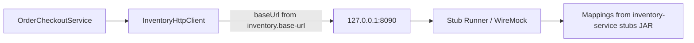
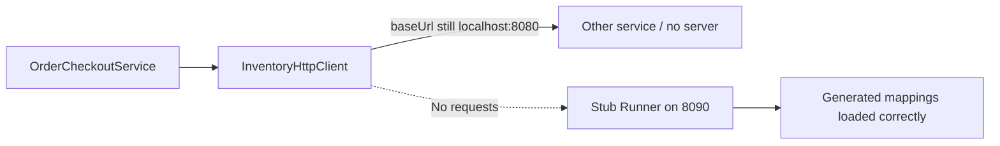
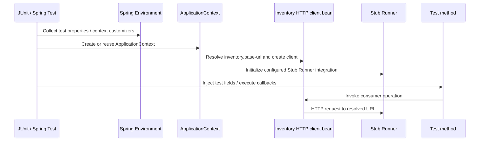
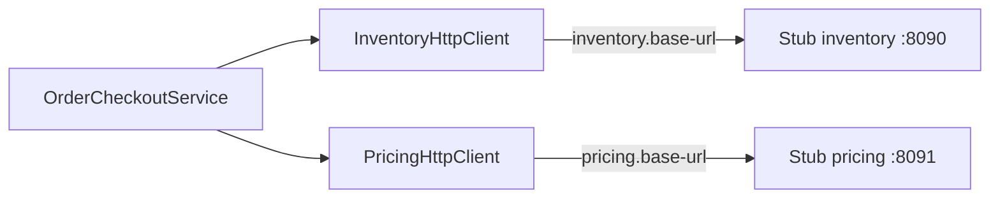
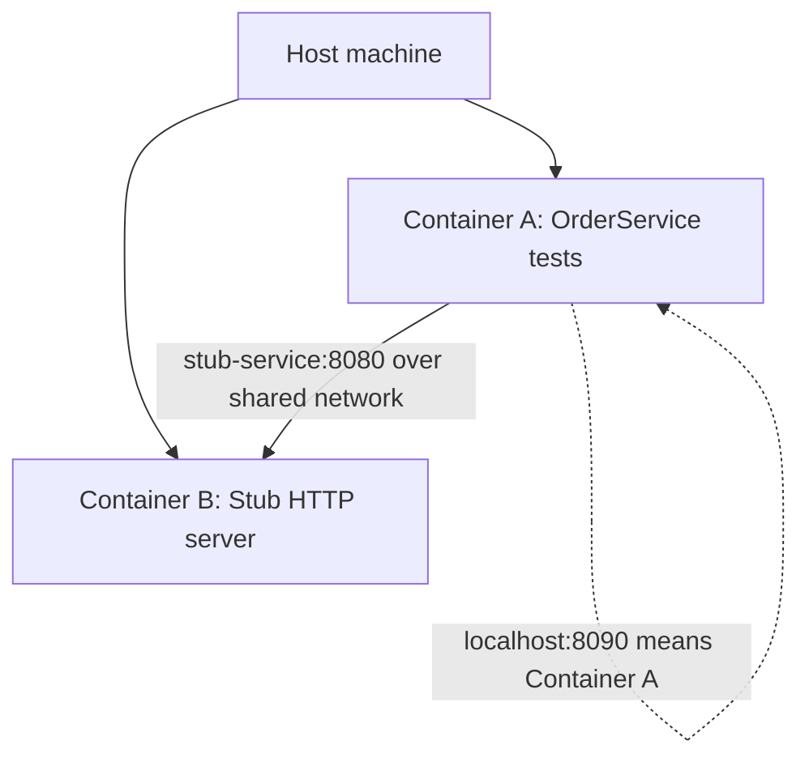
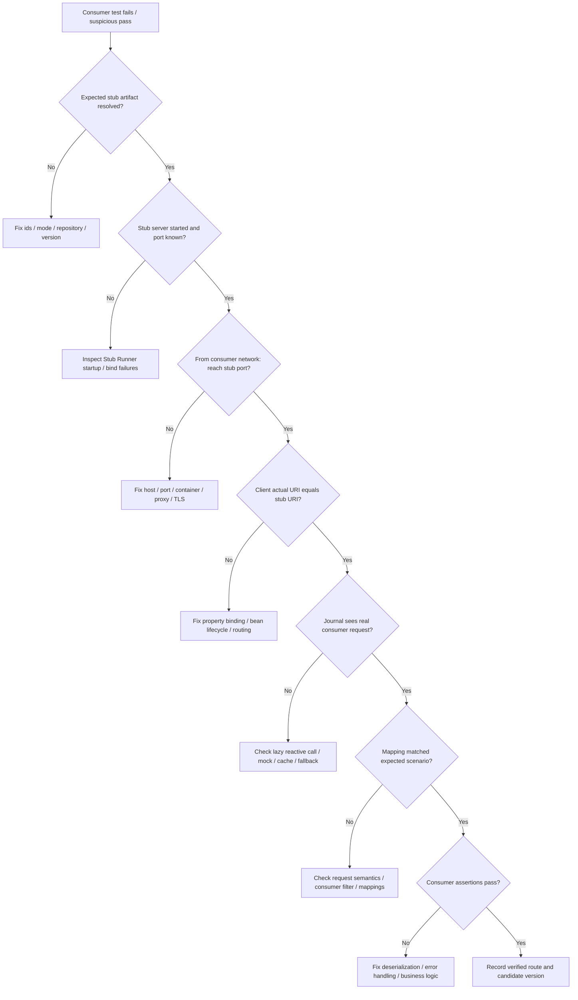
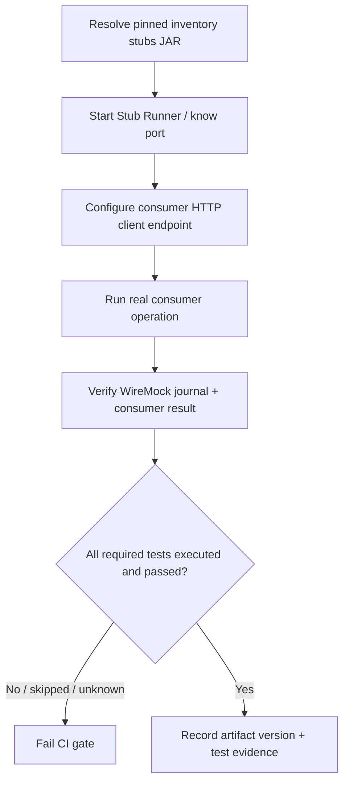

# Cổng stub không được truyền vào HTTP client của consumer

**Triệu chứng:** Spring Cloud Contract **Stub Runner** thông báo đã khởi động stub của `InventoryService`, nhưng bài kiểm thử `OrderService` vẫn gặp `Connection refused`, `UnknownHostException`, request đi tới dịch vụ thật hoặc trả về dữ liệu không khớp contract. Một khả năng đặc biệt dễ bỏ sót là: **cổng HTTP mà Stub Runner thực sự sử dụng chưa được truyền vào HTTP client của consumer**.

Đây không nhất thiết là lỗi của Groovy/YAML DSL, WireMock mapping hay bản thân producer. Stub có thể nạp thành công trên `127.0.0.1:8090`, trong khi `RestClient`, `WebClient`, `RestTemplate` hoặc Feign vẫn gửi request tới `localhost:8080` hoặc một URL từ `application.yml`. Đôi khi test gọi trực tiếp WireMock trên cổng đúng và xanh, nhưng **mã consumer thật** lại dùng một bean được tạo **trước khi test truyền cổng vào**.

Bài thuộc chương **Chẩn đoán sự cố** của module **SPRING_CLOUD_CONTRACT**. Theo mục tiêu module, chúng ta dùng contract Groovy/YAML để kiểm producer, phát hành stub, dùng Stub Runner cho consumer và đưa kết quả vào CI để phát hiện API không tương thích. Bài này tập trung vào **đường truyền cấu hình cổng từ Stub Runner tới HTTP client** và phương pháp tìm đúng nguyên nhân thay vì vô tình làm test xanh giả.

Trong toàn bài:

- `InventoryService` là **producer** cung cấp API giữ hàng.
- `OrderService` là **consumer** có HTTP client thật gọi API đó.
- `inventory.base-url` là **property do ứng dụng ví dụ tự định nghĩa**, không phải tên property chuẩn do Spring Cloud Contract bắt buộc.
- `com.example:inventory-service:1.4.2:stubs` là tọa độ stub artifact minh họa; cần thay bằng artifact đã build và xác minh của dự án.
- Ví dụ chủ yếu sử dụng Spring Boot/Spring Framework hiện đại, JUnit 5 và HTTP WireMock; signatures có thể thay đổi giữa các phiên bản Spring Cloud Contract/Stub Runner.

Sau bài, bạn có thể:

1. Phân biệt cổng producer thật, cổng ứng dụng consumer test và cổng stub của Stub Runner.
2. Đọc được chuỗi `stub artifact → stub server → port → base URL property → HTTP client → request thật`.
3. Khắc phục lỗi cấu hình **cổng tĩnh** và thiết kế hợp lý khi cần **cổng động**.
4. Hiểu vì sao `@StubRunnerPort` được tiêm vào test field nhưng bean HTTP client khởi tạo sớm vẫn có thể sai URL.
5. Tránh lạm dụng `@DynamicPropertySource` khi chưa có cơ chế khởi động stub trước Spring context.
6. Chẩn đoán các trường hợp Feign, WebClient, RestClient, RestTemplate, Docker/CI và nhiều stubs cùng lúc.
7. Kiểm request journal để chứng minh consumer code thực sự gọi **đúng instance Stub Runner**, không phải service thật hay fallback.
8. Gắn bằng chứng mạng, mapping, HTTP client configuration và test results vào quy trình CI.

## 1. Vấn đề nằm ở kết nối giữa hai phần kiểm thử

Spring Cloud Contract thường tạo ra **hai vòng kiểm thử bổ sung nhau**:

| Phía | Công cụ/đối tượng | Kiểm được điều gì? |
| --- | --- | --- |
| Producer | Contract Verifier, generated test, mã `InventoryService` | Producer đáp ứng những assertions được mô tả trong contract |
| Consumer | Stub Runner, WireMock, HTTP client thật của `OrderService` | Consumer gửi request và xử lý response theo stub được phát hành |

Với consumer, đường đi mong muốn là:



Đường đi sai thường gặp:



Điểm mấu chốt: **“Stub Runner started” không đồng nghĩa “consumer HTTP client đã được cấu hình để gọi nó”**. Stub Runner khởi động một HTTP server, còn Spring/application code của consumer quyết định host, port và base path của request.

## 2. Ba loại cổng thường bị nhầm lẫn

| Cổng | Ai sở hữu? | Công dụng | Cách biết |
| --- | --- | --- | --- |
| **Consumer application test port** | Spring Boot test của `OrderService` | Để test/client bên ngoài gọi ứng dụng consumer nếu có embedded web server | `@LocalServerPort` hoặc `server.port` trong test |
| **Stub Runner HTTP port** | WireMock do Stub Runner khởi động | Consumer HTTP client gọi thay producer thật | `ids` có port cố định, `@StubRunnerPort`, `StubFinder` hoặc stub-runner logs |
| **Producer real service port** | `InventoryService` đang deploy | API thực trên môi trường ngoài test | Service discovery/ingress/config của môi trường |

**Không thay `inventory.base-url` bằng `@LocalServerPort`** nếu port ấy thuộc embedded `OrderService`; như vậy client có thể gọi vòng về chính consumer thay vì stub.

Ví dụ:

```text
OrderService test application:   localhost:51783   (random server.port)
InventoryService stub server:   localhost:8090
InventoryService in staging:    inventory.staging.internal:8443
```

Trong consumer contract test, `InventoryHttpClient` cần dùng `http://127.0.0.1:8090`, **không phải** hai địa chỉ còn lại. Những con số trên chỉ minh họa.

## 3. Dấu hiệu chẩn đoán nhanh

| Dấu hiệu | Giả thuyết ưu tiên | Bằng chứng cần kiểm |
| --- | --- | --- |
| Stub Runner log báo port `8090` nhưng exception nhắc `8080` | Client giữ default URL | Giá trị property và URI tại thời điểm gửi |
| `curl` vào `8090` được, consumer test vẫn `Connection refused` | Client dùng host/port khác, hoặc network namespace khác | Request target và nơi process đang chạy |
| Test trả response thật thay vì fixture stub | Client dùng service discovery/URL staging | Feign/RestClient resolved base URL |
| Test nhận `404` ở cổng stub | Port đúng nhưng request chưa match, hoặc đây là WireMock 404 mặc định | `/__admin/mappings`, request journal, body/method/path |
| `@StubRunnerPort` có số đúng, HTTP client vẫn gọi số cũ | Client bean được tạo trước khi test gán port | Lifecycle và chỗ tạo builder/client bean |
| Test pass dù Stub Runner bị tắt | Mock/cache/fallback/hardcode che đường HTTP | Verify request count; negative control |
| CI fail ngẫu nhiên trên cổng tĩnh | Cổng bị chiếm hoặc tests chạy song song | Bind errors, test process/parallelism |
| `localhost` đúng trên host nhưng sai trong container | Mạng khác namespace | Vị trí stub server và client container |
| Chỉ một trong nhiều producers hoạt động | Dùng nhầm port/ID hoặc property chung | Mapping producer → port → base URL |

**Đừng chỉnh matcher hoặc regenerate JAR ngay khi thấy `Connection refused`.** Đây thường là dấu hiệu không có kết nối TCP tới đích được chọn, xảy ra **trước** bước WireMock so khớp DSL.

## 4. Một contract HTTP mẫu để giữ mục tiêu chẩn đoán ổn định

Producer đã thỏa thuận:

```http
POST /api/v1/reservations HTTP/1.1
Content-Type: application/json

{"sku":"SKU-001","quantity":2}
```

Response:

```http
HTTP/1.1 201 Created
Content-Type: application/json

{"reservationId":"RES-701","status":"HELD"}
```

Groovy DSL:

```groovy
import org.springframework.cloud.contract.spec.Contract

Contract.make {
    name 'create_reservation_success'

    request {
        method 'POST'
        url '/api/v1/reservations'
        headers {
            contentType(applicationJson())
        }
        body([
            sku: 'SKU-001',
            quantity: 2
        ])
    }

    response {
        status 201
        headers {
            contentType(applicationJson())
        }
        body([
            reservationId: $(consumer('RES-701'),
                             producer(regex('RES-[0-9]+'))),
            status: 'HELD'
        ])
    }
}
```

Giả sử producer generated test của contract này đã chạy và pass, và artifact `inventory-service:1.4.2:stubs` chứa mapping tương ứng. Bài toán ở đây **không phải** tạo contract mới, mà là bảo đảm consumer sử dụng đúng stub HTTP server.

Một bản YAML tương đương ở **mức literal**:

```yaml
name: create_reservation_success
request:
  method: POST
  url: /api/v1/reservations
  headers:
    Content-Type: application/json
  body:
    sku: SKU-001
    quantity: 2
response:
  status: 201
  headers:
    Content-Type: application/json
  body:
    reservationId: RES-701
    status: HELD
```

YAML trên **chưa có matcher động** giống Groovy; nếu cần, phải dùng YAML matcher syntax theo đúng phiên bản SCC. Đừng để cả hai file cùng mô tả một scenario trong cùng source directory rồi bất ngờ sinh hai mappings/tests.

## 5. Cấu hình cổng tĩnh: cách đơn giản nhất để kiểm toàn bộ bean wiring

Khi có thể kiểm soát cổng và chạy test cô lập, cách dễ hiểu là **chọn trước port cố định** cho Stub Runner, sau đó cấp **cùng host/port** vào property mà HTTP client của consumer thực sự đọc.

```java
import org.junit.jupiter.api.Test;
import org.springframework.beans.factory.annotation.Autowired;
import org.springframework.boot.test.context.SpringBootTest;
import org.springframework.cloud.contract.stubrunner.spring.AutoConfigureStubRunner;
import org.springframework.cloud.contract.stubrunner.spring.StubRunnerProperties;

@SpringBootTest(properties = {
    "inventory.base-url=http://127.0.0.1:8090"
})
@AutoConfigureStubRunner(
    ids = "com.example:inventory-service:1.4.2:stubs:8090",
    stubsMode = StubRunnerProperties.StubsMode.LOCAL
)
class OrderServiceContractTest {

    @Autowired
    OrderCheckoutService checkoutService;

    @Test
    void shouldReserveUsingInventoryStub() {
        ReservationResult result =
            checkoutService.prepareReservation("SKU-001", 2);

        // Assertions nghiệp vụ của consumer, không chỉ "stub started".
        org.assertj.core.api.Assertions.assertThat(result.status())
            .isEqualTo("HELD");
    }
}
```

Giả định: `OrderCheckoutService`/`ReservationResult` là mã ứng dụng thật của OrderService, cùng dependency/test config phù hợp. Stub JAR `1.4.2:stubs` đã được cài vào Maven local; WireMock có thể bind cổng `8090`.

Chuỗi `ids` minh họa gồm `groupId:artifactId:version:classifier:port`. **Đây là port của stub server, không phải cổng của consumer app**. Tên annotation/thuộc tính cụ thể cần đối chiếu version Stub Runner mà dự án đang dùng.

### Khi cổng tĩnh có ưu điểm

- Property sẵn sàng **trước khi Spring tạo HTTP client bean**.
- Spring injection, config classes và client builder dùng đường cấu hình thông thường.
- Test thực hiện đúng wiring của ứng dụng, không phải tự tạo client khác ở test method.
- Dễ kiểm trực tiếp `http://127.0.0.1:8090/__admin/mappings`.

### Khi cổng tĩnh có nhược điểm

- Hai suites song song có thể cùng bind `8090`, gây `Address already in use`.
- Trên CI shared host, cổng đã có service khác chiếm.
- Trong Docker hoặc trên các runner có namespace riêng, `127.0.0.1` có thể chỉ về container/process khác.

Không nên hardcode cùng port cho toàn bộ test jobs chạy song song mà không có cơ chế cô lập, cấp phát cổng hoặc bảo đảm không trùng.

## 6. Property của ứng dụng: hãy kiểm đúng *consumer* đọc gì

Ví dụ `OrderService` cấu hình client qua một property:

```yaml
# src/main/resources/application.yml của ứng dụng ví dụ
inventory:
  base-url: https://inventory.example.invalid
```

Đây là **cấu hình application**, không phải property mà Stub Runner tự động gán. URL `example.invalid` cố ý là địa chỉ không hoạt động trong ví dụ.

Một bean `RestClient` được tạo:

```java
package com.example.order;

import org.springframework.beans.factory.annotation.Value;
import org.springframework.context.annotation.Bean;
import org.springframework.context.annotation.Configuration;
import org.springframework.web.client.RestClient;

@Configuration
class InventoryClientConfig {

    @Bean
    RestClient inventoryRestClient(
            @Value("${inventory.base-url}") String baseUrl) {
        return RestClient.builder()
            .baseUrl(baseUrl)
            .build();
    }
}
```

Khi `@SpringBootTest(properties = "inventory.base-url=http://127.0.0.1:8090")` được xử lý trước khi tạo bean, builder sử dụng port stub đã chọn. `RestClient` ở đây là API Spring Framework 6.1+; các dự án Spring cũ có thể dùng `RestTemplate` hoặc `WebClient`.

### Lỗi cấu hình điển hình

```yaml
# Test property đã ghi:
inventory:
  base-url: http://127.0.0.1:8090

# Nhưng client code thật lại đọc:
external:
  inventory:
    url: http://127.0.0.1:8080
```

Đổi `inventory.base-url` không có tác dụng nếu client thực sự đọc `external.inventory.url`. Hãy truy lại từ **constructor/client builder** tới **property key** chính xác, kể cả các lớp cấu hình dùng `@ConfigurationProperties`.

**Đừng chỉ tìm từ “inventory” trong `application-test.yml` rồi kết luận URL đã được override.** Phải quan sát **giá trị được resolve tại chỗ tạo client hoặc chỗ gửi request**.

## 7. Nguyên nhân sâu hơn: thời điểm HTTP client được tạo

Một phiên kiểm thử với Spring có nhiều mốc thời gian:



Sơ đồ mô tả **mối quan hệ lifecycle**, không ấn định thứ tự mọi callback nội bộ của từng SCC/Spring Test version. Điểm quan trọng là: **client bean có thể đã được tạo trước khi `@BeforeEach` hoặc một field injection trong test class được sử dụng**. Nếu client giữ một `baseUrl` cố định tại construction, cập nhật biến ở test method **không tự đổi instance cũ**.

### Phản ví dụ: đọc port quá muộn

```java
@SpringBootTest
@AutoConfigureStubRunner(
    ids = "com.example:inventory-service:1.4.2:stubs",
    stubsMode = StubRunnerProperties.StubsMode.LOCAL
)
class OrderServiceContractTest {
    @StubRunnerPort("inventory-service")
    int stubPort;

    @Autowired
    OrderCheckoutService checkoutService;

    @BeforeEach
    void setUp() {
        // QUÁ MUỘN nếu InventoryHttpClient đã tạo RestClient
        // từ inventory.base-url trong ApplicationContext trước đó.
        System.setProperty(
            "inventory.base-url",
            "http://127.0.0.1:" + stubPort
        );
    }
}
```

Đoạn trên là **anti-pattern minh họa**. `System.setProperty` không đồng nghĩa mọi bean đã được khởi tạo sẽ tự đọc lại config; việc thay đổi system properties còn gây nhiễu giữa tests chạy song song trong cùng JVM.

### Ba kiểu “truyền cổng” khác nhau

| Cách | Khi nào port có mặt? | HTTP client đã tạo có đổi không? |
| --- | --- | --- |
| `@SpringBootTest(properties=...)` với port cố định | Trước khi context tạo bean | **Có thể**: bean nhận URL từ đầu |
| `@StubRunnerPort` gán vào test field | Khi test instance được xử lý/injected | **Không tự động** đổi bean đã tạo |
| Test đặt `System.setProperty` trong `@BeforeEach` | Sau nhiều bước context/bootstrap | **Không tự động** đổi bean đã tạo |
| Cấu hình URL qua supplier/late binding ở mỗi request | Trước từng lần gửi HTTP | Có, **nếu client được thiết kế rõ để đọc supplier** |
| Khởi động stub trước Spring context và đăng ký property từ sớm | Trước bean initialization theo thiết kế | Có thể, nếu thứ tự khởi động được bảo đảm |

Đừng chọn một cách “dynamically inject port” chỉ vì Java compile; nó phải bảo đảm **thời điểm và đối tượng nhận** đúng.

## 8. Cổng động và `@StubRunnerPort`

Khi `ids` không ấn định cổng, Stub Runner có thể cấp một cổng khả dụng. Trong những bản SCC hỗ trợ, annotation `@StubRunnerPort` cho phép test nhận cổng của artifact cụ thể.

```java
import org.junit.jupiter.api.Test;
import org.springframework.boot.test.context.SpringBootTest;
import org.springframework.cloud.contract.stubrunner.spring.AutoConfigureStubRunner;
import org.springframework.cloud.contract.stubrunner.spring.StubRunnerPort;
import org.springframework.cloud.contract.stubrunner.spring.StubRunnerProperties;

@SpringBootTest
@AutoConfigureStubRunner(
    ids = "com.example:inventory-service:1.4.2:stubs",
    stubsMode = StubRunnerProperties.StubsMode.LOCAL
)
class InventoryStubPortDiscoveryTest {

    @StubRunnerPort("inventory-service")
    int port;

    @Test
    void discoversStubPort() {
        org.assertj.core.api.Assertions.assertThat(port)
            .isBetween(1, 65535);
    }
}
```

Ví dụ này **chỉ minh họa nhận cổng**, chưa chứng minh consumer đã gọi đúng stub. Tùy SCC release, annotation có thể chấp nhận `artifactId` hoặc một định danh cụ thể của stub; đối chiếu chính xác với dạng `ids` và tài liệu version đang dùng.

### Cổng động hữu ích cho điều gì?

- CI chạy nhiều test classes hoặc modules đồng thời.
- Test không muốn giữ cố định một port trên host.
- Stub Runner khởi động nhiều producer stubs cùng lúc.
- IDE, Docker hoặc môi trường build khác nhau có tập port rảnh khác nhau.

Nhưng **chọn port động không tự cấp URL ấy cho HTTP client**. Nếu `InventoryHttpClient` lấy `inventory.base-url` từ property được bind khi tạo bean, test phải có **một cơ chế đưa port vào trước khi bean được tạo** hoặc client phải có **late-bound URL provider** được thiết kế rõ.

## 9. Sử dụng port động trong một test không phụ thuộc bean URL khởi tạo sớm

Một cách dễ chứng minh kết nối với cổng động là xây **instance thật của HTTP client ứng dụng** trong test sau khi Stub Runner trả port. Ví dụ một class adapter do dự án định nghĩa:

```java
package com.example.order;

import org.springframework.web.client.RestClient;

public final class InventoryHttpClient {
    private final RestClient restClient;

    public InventoryHttpClient(RestClient restClient) {
        this.restClient = restClient;
    }

    public ReservationResponse reserve(String sku, int quantity) {
        ReservationRequest request =
            new ReservationRequest(sku, quantity);

        return restClient.post()
            .uri("/api/v1/reservations")
            .contentType(org.springframework.http.MediaType.APPLICATION_JSON)
            .body(request)
            .retrieve()
            .body(ReservationResponse.class);
    }
}
```

`ReservationRequest` và `ReservationResponse` là các DTO/record của ứng dụng, không có sẵn trong SCC.

Sau khi nhận port:

```java
@SpringBootTest
@AutoConfigureStubRunner(
    ids = "com.example:inventory-service:1.4.2:stubs",
    stubsMode = StubRunnerProperties.StubsMode.LOCAL
)
class InventoryClientWithDynamicPortTest {

    @StubRunnerPort("inventory-service")
    int stubPort;

    @Test
    void sendsRealClientRequestToStub() {
        String baseUrl = "http://127.0.0.1:" + stubPort;
        RestClient restClient = RestClient.builder()
            .baseUrl(baseUrl)
            .build();

        InventoryHttpClient client =
            new InventoryHttpClient(restClient);

        ReservationResponse response =
            client.reserve("SKU-001", 2);

        assertThat(response.status()).isEqualTo("HELD");
    }
}
```

Các imports còn lại (`Test`, `RestClient`, `assertThat`, SCC annotations) giống phần trước. Test minh họa này kiểm **implementation thật của adapter HTTP client** với cổng động, không gửi request trực tiếp từ RestAssured test harness.

**Giới hạn cần ghi rõ:** vì test **tự tạo** `RestClient`/`InventoryHttpClient`, nó **chưa kiểm toàn bộ Spring bean wiring** của ứng dụng production. Nếu lỗi thực tế nằm ở `@FeignClient` hoặc `InventoryClientConfig` đang lấy sai property, test trên có thể vẫn xanh. Muốn kiểm wiring Spring thật, nên dùng cổng tĩnh từ đầu hoặc một cơ chế property injection **trước khi ApplicationContext tạo client bean**.

### Một lỗi thiết kế thường gặp

```java
@BeforeEach
void updateOnlyTheTestVariable() {
    String stubUrl = "http://127.0.0.1:" + stubPort;
    // Không có lệnh nào đưa stubUrl vào InventoryHttpClient.
}
```

Một biến test đúng giá trị không có tác dụng nếu **client dùng một biến khác**.

## 10. Khi phải giữ Spring-managed client và dùng cổng động

Có hai chiến lược rõ ràng:

1. **Đưa URL vào Environment trước khi client bean được tạo:** stub server phải được khởi động đủ sớm bởi một test infrastructure được kiểm soát, rồi property được đăng ký trong giai đoạn tạo context. Có thể dùng `ApplicationContextInitializer` hoặc `@DynamicPropertySource` **nếu** cơ chế quản lý stub bảo đảm URL/port khả dụng tại lúc property được resolve.
2. **Thiết kế client dùng một provider động:** bean `InventoryHttpClient` nhận `Supplier<URI>`/routing abstraction, đọc URL khi gửi request; test thiết lập provider sau khi nhận `@StubRunnerPort`. Cách này thay đổi thiết kế client, cần isolation và kiểm side effects.

Không có một annotation đơn lẻ bảo đảm giải quyết mọi phiên bản/plugin setup. Khi thiếu bằng chứng về thứ tự bootstrap, hãy **chọn cổng cố định ở integration test** thay vì kết hợp một static property callback với field injection muộn.

### Vấn đề với `@DynamicPropertySource`

Annotation của Spring Test hữu ích cho nguồn property động được tạo **trước** khi Spring ApplicationContext khởi tạo bean:

```java
// ĐÚNG về ý tưởng nếu server đã start sớm và port sẵn sàng.
@DynamicPropertySource
static void configureProperties(DynamicPropertyRegistry registry) {
    registry.add(
        "inventory.base-url",
        () -> "http://127.0.0.1:" + earlyStartedServer.port()
    );
}
```

`earlyStartedServer` trong ví dụ là **hạ tầng test tự khởi động sớm**; không phải một field `@StubRunnerPort` và không phải API SCC có sẵn. Ví dụ là **pseudocode cấu trúc callback**, chưa thể chạy nếu không có đối tượng test infrastructure đúng lifecycle.

**Không viết**:

```java
// SAI: static callback không thể lấy port từ field test instance
// được inject sau đó.
@StubRunnerPort("inventory-service")
int stubPort;

@DynamicPropertySource
static void register(DynamicPropertyRegistry registry) {
    // Không có biến stubPort static sẵn sàng ở đây.
}
```

Ngay cả khi một port được lưu vào biến static, **chưa chắc Stub Runner đã start lúc registry supplier được gọi**. Nếu dùng giải pháp này, phải có cơ chế startup/ordering cụ thể và integration test chứng minh bean cuối đã nhận đúng URL. Không suy rằng `@DynamicPropertySource` tự động “đợi `@StubRunnerPort`”.

## 11. Late-bound URL provider: chỉ khi ứng dụng thật sự cần thay đích động

Trong một số dự án, nhiều tenants hoặc test environments cần thay upstream URL trong runtime; client có thể cố ý lấy URI khi gọi:

```java
public final class InventoryHttpClient {
    private final RestClient restClient;
    private final java.util.function.Supplier<java.net.URI> baseUri;

    public InventoryHttpClient(
            RestClient restClient,
            java.util.function.Supplier<java.net.URI> baseUri) {
        this.restClient = restClient;
        this.baseUri = baseUri;
    }

    public ReservationResponse reserve(String sku, int quantity) {
        java.net.URI endpoint = baseUri.get()
            .resolve("/api/v1/reservations");
        return restClient.post()
            .uri(endpoint)
            .body(new ReservationRequest(sku, quantity))
            .retrieve()
            .body(ReservationResponse.class);
    }
}
```

Khi test nhận `stubPort`, một test-scope provider có thể trả URI tương ứng. Giải pháp này có thể kiểm Spring-managed client thật nếu provider là dependency của bean và đã được set **trước request đầu tiên**.

**Nhược điểm:** nó đưa khả năng thay địa chỉ runtime vào mã ứng dụng. Cần quản lý thread safety, config lifecycle, base path, retries và tránh shared mutable global state. Không nên sửa production architecture chỉ để giải quyết một test có thể dùng cổng cố định.

Nếu client đã hỗ trợ cấu hình endpoint động đúng chủ ý, `Supplier` là seam hợp lệ. Nếu không, hãy dùng `@SpringBootTest(properties=...)` với cổng cố định hoặc test infrastructure start sớm rõ ràng.

## 12. Tại sao `System.setProperty` và `@BeforeEach` thường không sửa được URL?

Ví dụ:

```java
@Configuration
class InventoryConfiguration {

    @Bean
    RestClient inventoryClient(
            @Value("${inventory.base-url}") String url) {
        return RestClient.builder().baseUrl(url).build();
    }
}
```

Khi Spring gọi phương thức `inventoryClient(...)`, `url` đã được resolve và lưu trong `RestClient`. Sau đó `@BeforeEach`:

```java
System.setProperty("inventory.base-url", "http://localhost:8090");
```

không tái gọi bean factory method, không rebuild `RestClient` và không bảo đảm mọi component được cập nhật. Nó còn có thể ảnh hưởng test khác dùng cùng JVM do `System` properties là global.

Nếu ứng dụng dùng `@ConfigurationProperties` với đối tượng bind một lần, lý do tương tự: **thay Environment không đồng nghĩa rebind/recreate bean**. Chỉ cơ chế refresh rõ ràng (nếu ứng dụng thực sự sử dụng và được test) mới thay đổi behavior.

Giải pháp không phải thêm nhiều lệnh `System.setProperty` hơn mà là **quyết định sớm nguồn URL và kiểm nơi client đọc nó**.

## 13. Phân biệt lỗi cổng với lỗi mapping WireMock

Khi request tới đúng server, WireMock phải kiểm method/path/headers/body theo các mappings đã tải. Trước khi sửa DSL, hãy phân biệt:

| Kết quả HTTP/network | Diễn giải ưu tiên |
| --- | --- |
| `Connection refused` | Không có process listen ở host:port **client đã chọn** hoặc network/routing không tới được |
| `UnknownHostException` | DNS/host của URL client không resolve, thường không phải lỗi mapping |
| `SSLHandshakeException` | HTTP/HTTPS/TLS config không khớp |
| `404` cùng WireMock unmatched report | Server nhận request nhưng không tìm mapping phù hợp |
| `201` từ mapping không mong đợi | Có fallback/priority/overlap; test có thể xanh giả |
| `200` từ real producer | Client có thể chưa route tới stub, cần xem URI và response headers |
| Timeout | Có thể sai route, stub delay, mạng, proxy, client timeout; chưa đủ để kết luận |

**Không giả định `404` luôn do path sai.** Nó có thể là response được **cố ý định nghĩa trong một contract lỗi**. Phải kiểm body, matched mapping hoặc serve event để phân biệt WireMock fallback 404 với response nghiệp vụ.

### Mẫu kiểm trực tiếp server stub

```bash
# Thực hiện ở đúng host/network namespace nơi stub chạy.
curl --verbose http://127.0.0.1:8090/__admin/mappings

curl --verbose \
  -H 'Content-Type: application/json' \
  -d '{"sku":"SKU-001","quantity":2}' \
  http://127.0.0.1:8090/api/v1/reservations

curl --verbose http://127.0.0.1:8090/__admin/requests
```

`/__admin/mappings` cho thấy server có mapping nào; `/__admin/requests` giúp nhìn requests đã nhận. Chỉ dùng WireMock Admin API trong môi trường test nội bộ, không mở ra Internet; journal có thể ghi headers/body chứa dữ liệu nhạy cảm.

Nếu `curl` trực tiếp pass nhưng consumer service vẫn fail, **giữ nguyên stub JAR** và điều tra client config/URI trước.

## 14. Chứng minh request đến đúng stub: kết hợp consumer code với journal

Một test chỉ assert `Stub Runner started` hoặc gọi `curl` trực tiếp **chưa kiểm được đường đi HTTP client của OrderService**. Test có giá trị cần:

1. Khởi tạo stub từ artifact đã xác định.
2. Reset **request journal** trước khi chạy hành vi consumer, nhưng không xóa mappings.
3. Gọi **mã consumer thật** (service/client được ứng dụng sử dụng).
4. Assert kết quả nghiệp vụ.
5. Verify chính WireMock instance ấy đã nhận request đúng.

Ví dụ với **cổng tĩnh 8090**:

```java
import static com.github.tomakehurst.wiremock.client.WireMock.*;
import static org.assertj.core.api.Assertions.assertThat;

import org.junit.jupiter.api.BeforeEach;
import org.junit.jupiter.api.Test;
import org.springframework.beans.factory.annotation.Autowired;
import org.springframework.boot.test.context.SpringBootTest;
import org.springframework.cloud.contract.stubrunner.spring.AutoConfigureStubRunner;
import org.springframework.cloud.contract.stubrunner.spring.StubRunnerProperties;

@SpringBootTest(properties =
    "inventory.base-url=http://127.0.0.1:8090")
@AutoConfigureStubRunner(
    ids = "com.example:inventory-service:1.4.2:stubs:8090",
    stubsMode = StubRunnerProperties.StubsMode.LOCAL
)
class OrderConsumerRouteVerificationTest {

    @Autowired
    OrderCheckoutService checkoutService;

    @BeforeEach
    void clearJournal() {
        configureFor("127.0.0.1", 8090);
        resetAllRequests();
    }

    @Test
    void shouldCallInventoryStubFromConsumerCode() {
        ReservationResult result =
            checkoutService.prepareReservation("SKU-001", 2);

        assertThat(result.status()).isEqualTo("HELD");

        verify(1, postRequestedFor(
                urlPathEqualTo("/api/v1/reservations"))
            .withHeader("Content-Type", containing("application/json"))
            .withRequestBody(
                matchingJsonPath("$.sku", equalTo("SKU-001")))
            .withRequestBody(
                matchingJsonPath("$.quantity", equalTo("2"))));
    }
}
```

`OrderCheckoutService`/`ReservationResult` là lớp ứng dụng giả định; test cần các dependencies WireMock tương thích SCC. `matchingJsonPath` và JSONPath matching behavior có thể phụ thuộc WireMock version; nếu cần xác minh JSON number **khác** string, hãy dùng matcher thích hợp (ví dụ `equalToJson` với cấu hình phù hợp) thay vì suy rằng JSONPath-to-string chứng minh kiểu.

**Cảnh báo về static WireMock client:** `configureFor` đặt endpoint trong static/global state. Khi chạy nhiều test classes/servers song song trong cùng JVM, cấu hình có thể bị thay chéo. Khi cần song song, ưu tiên một WireMock admin client/instance riêng, cô lập cổng và request journal, hoặc dùng test harness tương thích với SCC version.

### Hai câu hỏi test này trả lời được

- `prepareReservation(...)` có đi qua HTTP client thực và gửi request tới Stub Runner không?
- Stub server đã nhận đúng request method, path và dữ liệu quan trọng chưa?

Nó **không tự chứng minh** producer đang deploy đáp ứng contract. Điều đó thuộc producer Contract Verifier và integration/deployment tests.

## 15. Quan sát URL thực sự được HTTP client gửi

Trước khi đụng vào stub mapping, hãy ghi nhận ít nhất:

```text
expectedStubUrl = http://127.0.0.1:8090
resolvedProperty = http://127.0.0.1:8080
actualRequestUri = http://127.0.0.1:8080/api/v1/reservations
receivedByStub = 0 requests
```

Đây là **dữ liệu minh họa**, nhưng đã đủ chỉ ra lỗi property/client routing mà không cần regenerate JAR.

### Đọc Spring Environment

```java
@Autowired
org.springframework.core.env.Environment environment;

@Test
void shouldUseStubBaseUrlFromEnvironment() {
    String actual = environment.getProperty("inventory.base-url");

    assertThat(actual)
        .isEqualTo("http://127.0.0.1:8090");
}
```

Test này kiểm **Environment** sau khi Spring resolve properties. Nhưng **chưa chứng minh client bean đã sử dụng giá trị ấy**; client có thể đọc một key khác, được hardcode, bị override bởi customizer hoặc đã tạo ở context khác.

### Xác minh property từ bên trong client configuration

Một cách thực tế:

- Log hoặc expose **chỉ trong test** URI scheme, host, port tại nơi `RestClient`/`WebClient`/Feign được tạo.
- Gắn test interceptor/logging vào HTTP client để ghi **request target thực**.
- Ẩn `Authorization`, cookies, tokens và body nhạy cảm; không bật logging toàn bộ raw traffic ngoài môi trường test cô lập.
- So sánh URI quan sát được với port mà Stub Runner công bố.

Nếu test dùng `http://localhost:8090`, kiểm cả IPv4/IPv6 resolution nếu kết nối gặp lỗi khó hiểu: `localhost` có thể resolve thành `::1`, trong khi stub chỉ lắng nghe `127.0.0.1` hoặc ngược lại.

## 16. RestClient: kiểm chỗ xây bean, không chỉ kiểm thuộc tính

Một cấu hình Spring Framework 6.1+:

```java
@Configuration
class InventoryRestClientConfiguration {

    @Bean
    RestClient inventoryRestClient(
            @Value("${inventory.base-url}") String baseUrl) {
        return RestClient.builder()
            .baseUrl(baseUrl)
            .defaultHeader("Accept", "application/json")
            .build();
    }
}
```

Sai lầm dễ gặp:

```java
@Bean
RestClient inventoryRestClient() {
    // Hardcode URI cũ; mọi test property overrides đều vô tác dụng.
    return RestClient.builder()
        .baseUrl("http://127.0.0.1:8080")
        .build();
}
```

Một lỗi khác là method gọi `restClient.post().uri(absoluteUri)` với một URL tuyệt đối, **bỏ qua base URL mặc định**. Vậy nên:

1. Kiểm property nhận lúc bean construction.
2. Kiểm request URI được truyền vào từng call site có phải relative path không.
3. Kiểm customizer/interceptor nào có rewrite host hoặc scheme không.
4. Kiểm client bean được inject vào `OrderCheckoutService` có đúng qualifier không; app có thể có nhiều `RestClient`.

**Sửa đúng nơi:** cho client đọc đúng property và đảm bảo test property được cấp trước khi bean tạo. Không nên “sửa” bằng cách viết thêm mapping ở `localhost:8080`.

## 17. WebClient: client reactive cũng cần base URL đúng

Ví dụ bean:

```java
@Configuration
class InventoryWebClientConfiguration {

    @Bean
    WebClient inventoryWebClient(
            @Value("${inventory.base-url}") String baseUrl) {
        return WebClient.builder()
            .baseUrl(baseUrl)
            .build();
    }
}
```

Consumer reactive có thể gọi:

```java
public Mono<ReservationResponse> reserve(
        String sku, int quantity) {
    return inventoryWebClient.post()
        .uri("/api/v1/reservations")
        .contentType(MediaType.APPLICATION_JSON)
        .bodyValue(new ReservationRequest(sku, quantity))
        .retrieve()
        .bodyToMono(ReservationResponse.class);
}
```

Chú ý:

- `WebClient` thường xử lý I/O bất đồng bộ; **đừng assert journal trước khi publisher được subscribe/hoàn thành**.
- Dùng `StepVerifier` hoặc test await phù hợp để xác nhận Mono/Flux thật sự thực thi.
- Việc tạo `WebClient.builder().baseUrl(...)` không tự gửi request; `Mono` có thể là lazy.
- Kiểm URI cuối cùng, connector configuration, proxy và TLS nếu port đã đúng mà request vẫn không tới.

Ví dụ `StepVerifier`:

```java
StepVerifier.create(inventoryClient.reserve("SKU-001", 2))
    .assertNext(response ->
        assertThat(response.status()).isEqualTo("HELD"))
    .verifyComplete();
```

Sau khi publisher hoàn thành mới verify request journal. Với retry/timeout, cần quan sát số request thật, tránh viết `verify(1, ...)` nếu behavior được thiết kế có thể retry hợp lệ.

## 18. RestTemplate: `rootUri` và URL tuyệt đối

Với ứng dụng cũ dùng `RestTemplate`:

```java
@Bean
RestTemplate inventoryRestTemplate(
        RestTemplateBuilder builder,
        @Value("${inventory.base-url}") String baseUrl) {
    return builder.rootUri(baseUrl).build();
}
```

Khi client gọi đường dẫn tương đối:

```java
restTemplate.postForEntity(
    "/api/v1/reservations",
    request,
    ReservationResponse.class
);
```

root URI có thể được áp dụng theo cơ chế của `RestTemplateBuilder`. Nhưng khi code gọi URL tuyệt đối:

```java
restTemplate.postForEntity(
    "https://inventory.staging.example.invalid/api/v1/reservations",
    request,
    ReservationResponse.class
);
```

`rootUri` có thể bị bỏ qua; dù test property trỏ `8090`, request vẫn đi tới URL tuyệt đối. Kiểm call site và URI template handler thực tế của ứng dụng, đặc biệt khi có wrapper nhiều lớp.

### Không trộn các HTTP clients mà không biết bean nào đang dùng

Một dự án có thể có:

```text
InventoryClient (Feign)
LegacyInventoryTemplate (RestTemplate)
InventoryAvailabilityWebClient (WebClient)
```

Bạn thay `RestTemplate` config nhưng `OrderCheckoutService` đang inject Feign; kết quả không đổi là hợp lý. Hãy tìm **bean được gọi theo stacktrace hoặc instrumentation**, không sửa mọi HTTP clients cùng lúc.

## 19. OpenFeign: `name` không đảm bảo client dùng stub URL

Với Spring Cloud OpenFeign, ví dụ:

```java
@FeignClient(
    name = "inventory-service",
    url = "${inventory.base-url}"
)
interface InventoryFeignClient {
    @PostMapping("/api/v1/reservations")
    ReservationResponse reserve(
        @RequestBody ReservationRequest request);
}
```

Khi `inventory.base-url` đã được cấp đúng **trước khi Feign client bean được tạo**, URL có thể trỏ Stub Runner. Nếu không cấu hình `url`, một số thiết lập Feign sẽ dựa vào service discovery/load balancer theo `name`. Khi đó client có thể cố resolve `inventory-service` như một service name thay vì gọi `localhost:8090`.

Cần kiểm:

- Spring Cloud OpenFeign version và cách xử lý `url` placeholder.
- Có properties cấp URL ở `spring.cloud.openfeign.client.config.<client>.url` hay custom configuration khác không (tên đầy đủ phụ thuộc release)?
- Có Feign builder/target bean override URL sau annotation không?
- Có circuit breaker/cache/fallback che request thật không?
- `FeignClient` nào thực sự được `OrderCheckoutService` inject?

Không coi việc đặt `spring.application.name=inventory-service` trong consumer test là cách truyền stub port. Nó chủ yếu đặt **tên ứng dụng đang chạy**, không mặc nhiên đổi Feign target URL thành Stub Runner.

## 20. URI scheme, host, base path và port phải cùng đúng

Cổng đúng là **điều kiện cần, không đủ** để HTTP request đến đúng mapping.

| Thành phần | Ví dụ đúng | Sai thường gặp |
| --- | --- | --- |
| Scheme | `http` | `https` khi WireMock chỉ mở HTTP |
| Host | `127.0.0.1` trong cùng network namespace | `localhost` trong container khác |
| Port | `8090` | `8080` lấy từ default config |
| Base path | `/api/v1` | Bị thêm `/inventory` hoặc thiếu prefix |
| URI joining | `/api/v1/reservations` | `/api/v1/api/v1/reservations` |
| Headers | `Content-Type: application/json` | Sai media type, missing required header |
| Body | `quantity` là JSON number | Gửi `"2"` string hoặc object shape khác |

Ví dụ client base URL `http://127.0.0.1:8090/inventory` và request path `/api/v1/reservations`: cách ghép path tùy HTTP client và cách dùng absolute/relative URI; có thể làm mất hoặc nhân đôi prefix. **Log request URI thực** để xác nhận thay vì dựa vào tưởng tượng cách join.

### Dấu hiệu TLS mismatch

Nếu client gọi `https://127.0.0.1:8090` trong khi Stub Runner chỉ mở HTTP, lỗi có thể là `SSLHandshakeException` hoặc phản hồi bất thường. **Không tắt certificate validation trên toàn ứng dụng** chỉ để test pass. Sửa scheme/HTTPS config của stub theo mục đích test.

## 21. Nhiều producer stubs: mỗi client phải nhận đúng port

`OrderService` có thể gọi cả `InventoryService` và `PricingService`. Nếu Stub Runner khởi động hai HTTP stub servers trên hai cổng, **hai HTTP clients phải nhận hai base URLs riêng**.



Một cấu hình cổng tĩnh:

```java
@SpringBootTest(properties = {
    "inventory.base-url=http://127.0.0.1:8090",
    "pricing.base-url=http://127.0.0.1:8091"
})
@AutoConfigureStubRunner(
    ids = {
        "com.example:inventory-service:1.4.2:stubs:8090",
        "com.example:pricing-service:2.1.0:stubs:8091"
    },
    stubsMode = StubRunnerProperties.StubsMode.LOCAL
)
class OrderWithTwoProducerStubsTest {
    // Kiểm client Inventory dùng :8090, Pricing dùng :8091.
}
```

Đừng để cả hai `@FeignClient` hoặc `RestClient` đọc cùng một property `downstream.base-url` nếu ứng dụng thực sự cần hai upstreams. Cũng đừng nhầm `@StubRunnerPort("inventory-service")` với `@StubRunnerPort("pricing-service")` khi sử dụng dynamic ports.

### Chẩn đoán nhầm cổng giữa hai stubs

Nếu request tới `:8091/api/v1/reservations` và WireMock trả 404, có thể **Pricing stub hoàn toàn không có mapping Reservation**. Đó là lỗi routing của consumer. Trước khi sửa URL matcher, hãy xác minh:

1. Port `8091` thuộc producer nào trong Stub Runner log.
2. HTTP client bean nào đang gửi request.
3. Property nào được inject vào bean đó.
4. `/__admin/mappings` của từng cổng chứa những mappings gì.

Khi hai producer có endpoint giống tên, một request sai cổng có thể **vẫn trả 200** từ mapping khác; vì thế chỉ kiểm status là chưa đủ.

## 22. Stub artifact có thực sự được tải đúng phiên bản?

Port chỉ có ý nghĩa khi Stub Runner **khởi động server cho đúng artifact**. Nếu artifact resolution fail, test có thể chưa có server để nhận request.

| Chế độ | Nguồn artifact | Điều cần kiểm |
| --- | --- | --- |
| `CLASSPATH` | Stubs có trên test classpath | JAR/resources ở đúng classpath, tên producer |
| `LOCAL` | Repository local, thường Maven `.m2` | Đã build/install đúng `groupId:artifactId:version:classifier` |
| `REMOTE` | Repository URL được cấu hình | `repositoryRoot`, credentials, network, tọa độ/pin version |

Ví dụ:

```text
Expected:
  com.example:inventory-service:1.4.2:stubs

Accidentally resolved:
  com.example:inventory-service:1.4.1:stubs
```

Hai artifact có thể chứa mapping khác nhau. Nếu stub version cũ được tải, việc đổi port của client sẽ không sửa được nội dung response. Hãy chẩn đoán theo thứ tự:

1. **Artifact đã resolve đúng chưa?**
2. **Stub server đã bind host/port nào?**
3. **Client đã gọi đúng host/port chưa?**
4. **Request có match mapping không?**
5. **Consumer có xử lý response đúng không?**

Đừng dùng `+` hoặc `latest` trong release compatibility test cần tái lập khi có thể pin version bất biến. Với snapshot, lưu resolved artifact/build timestamp và checksum.

### Nếu annotation báo có port nhưng request vẫn thất bại

Port injection chỉ chứng minh Stub Runner biết một **server registration**; còn có thể xảy ra:

- Server vừa dừng hoặc test context đã bị đóng.
- Consumer chạy trong container khác, không tới được stub ở loopback.
- Client proxy/routing đổi địa chỉ.
- Mapping không match request.
- Artifact đang chứa stub không đúng phiên bản.

Một con số cổng hợp lệ (1–65535) **không tự chứng minh service có thể được consumer truy cập**.

## 23. Cổng tĩnh trên CI: xung đột và cô lập

Ví dụ hai suites cùng chạy:

```text
TestWorker A -> Stub Runner binds :8090
TestWorker B -> Stub Runner also tries :8090
```

Worker B có thể nhận lỗi `BindException: Address already in use` hoặc, trong trường hợp cấu hình cô lập kém, kết nối nhầm server của worker A. Điều này khác với “port không được truyền vào client” nhưng có cùng biểu hiện client fail hoặc nhận response bất ngờ.

### Các lựa chọn khắc phục

- **Dynamic port per test context**, rồi kết nối qua một cơ chế được truyền đúng.
- **Mỗi job/container có network namespace riêng**, cùng số port nhưng không tranh trên cùng host.
- **Phân bổ port cố định khác nhau** cho các suites khi điều phối chạy không song song.
- **Giảm parallelism** chỉ đối với những bài test cần cổng tĩnh nếu chi phí chấp nhận được.
- Kiểm teardown để stop stub server sau test, không dùng process còn sót từ lần chạy trước.

Không giải quyết bằng cách chọn ngẫu nhiên một port hardcode mới và hy vọng nó luôn rảnh. Nếu phải dùng dynamic port, hãy cấu hình toàn bộ đường đi của client chứ không chỉ thay annotation `ids`.

### Vì sao `server.port=0` không phải câu trả lời?

`server.port=0` bảo Spring Boot **consumer embedded server** tự chọn port. Nó **không buộc Stub Runner** dùng cổng ấy. Stub Runner quản lý server riêng, thường qua `@AutoConfigureStubRunner`/Stub Runner settings.

## 24. Docker và Testcontainers: `localhost` thuộc namespace nào?

Khi cả consumer test và Stub Runner đều chạy trong **cùng JVM/container**, `127.0.0.1:8090` có thể dùng được. Nhưng nếu Stub Runner hoặc consumer nằm trong **container khác**, `localhost` trỏ vào **chính container đang gửi request**.



Ví dụ với Docker Compose (cấu trúc minh họa):

```yaml
services:
  order-tests:
    image: example/order-test-runner
    environment:
      INVENTORY_BASE_URL: http://inventory-stub:8080
    depends_on:
      - inventory-stub
  inventory-stub:
    image: example/inventory-stub-runner
    ports:
      - "18090:8080"
```

Đây **không phải Compose file chạy được ngay**: images và command khởi động Stub Runner là placeholder. Mục đích là phân biệt:

- Từ **container `order-tests`**, có thể dùng `http://inventory-stub:8080` khi hai services cùng Docker network.
- Từ **host**, published mapping có thể là `http://127.0.0.1:18090`.
- `http://localhost:18090` từ **bên trong `order-tests`** thường là địa chỉ **sai**.

Ngoài ra, `INVENTORY_BASE_URL` chỉ map vào `inventory.base-url` nếu Spring Boot/application configuration của dự án nhận biến môi trường theo quy tắc binding tương ứng. Kiểm resolved property trong container; không coi việc có biến môi trường là đủ.

### Với Testcontainers

Nếu stub chạy trong container mà test code ở host JVM, dùng **mapped host/port** do Testcontainers cung cấp sau khi container start, không mặc định cổng container là cổng host. Nếu client cũng chạy trong container, cần đúng network alias và internal port.

Khi dùng Spring `@DynamicPropertySource` với một container do test tự quản lý, đây là trường hợp hợp lý để đăng ký host/port **sau khi container start và trước khi client bean được tạo**. Nhưng đừng trộn cơ chế port của Testcontainers với `@StubRunnerPort` nếu hai hệ thống không có cùng lifecycle.

## 25. Proxy, service discovery và load balancer có thể vượt URL test

Một số consumer không gửi HTTP trực tiếp bằng một client builder đơn giản. Request có thể đi qua:

- Spring Cloud LoadBalancer.
- Service discovery (Eureka, Consul, Kubernetes service name).
- Feign client target/resolver.
- HTTP/HTTPS proxy được cấu hình theo môi trường.
- Service mesh hoặc sidecar.
- Interceptor/routing filters của ứng dụng.

Ví dụ `FeignClient(name="inventory-service")` không có URL cụ thể có thể dựa vào discovery. Trong khi đó Stub Runner đã bind `localhost:8090`, nhưng không có ai đăng ký server ấy vào discovery mà client đang dùng.

### Hai chiến lược đúng, không trộn ngẫu nhiên

1. **Explicit URL route:** trong consumer contract test, đặt URL HTTP client trực tiếp tới stub instance; tránh service discovery cho client đó khi đang kiểm.
2. **Discovery-aware integration:** nếu mục tiêu là kiểm đúng service discovery/load balancer, cấu hình test discovery provider để trả stub address; cần test rằng client thực sự dùng nó.

Nếu chỉ cần kiểm client serialization/response handling, **explicit URL** thường đơn giản và đáng tin hơn. Chỉ đưa discovery vào phạm vi kiểm khi nó là một phụ thuộc cần được bảo vệ.

### Thận trọng với proxy

Một môi trường CI có `HTTP_PROXY`/`HTTPS_PROXY` có thể khiến request tới loopback đi qua proxy nếu `NO_PROXY` không phù hợp. Kết quả có thể là lỗi DNS, 502/503 hoặc response không như WireMock. Khi chẩn đoán, kiểm proxy settings **trong chính tiến trình JVM/client library**, không chỉ bằng `curl` ở terminal.

## 26. Kiểm cache, fallback và client mock trước khi kết luận đã sửa

Một test có thể xanh dù client **không gọi stub**:

```text
OrderCheckoutService
  -> cache trả RES-701
  -> không gửi HTTP
  -> assert(status == HELD) PASS
```

Hoặc:

```text
OrderCheckoutService
  -> HTTP timeout tới sai port
  -> fallback trả HELD
  -> assert(status == HELD) PASS
```

Đây là lý do phải kiểm **journal request count** và business outcome, không chỉ status.

### Negative control — phép thử phản chứng

Trong một nhánh test cô lập:

1. Xóa/reset request journal của đúng stub.
2. Gọi consumer service.
3. Bảo đảm journal có request mong đợi.
4. Đổi tạm base URL sang port không có server hoặc tắt stub.
5. Test route verification **phải fail** nếu mục tiêu là chứng minh request đi qua stub.

**Không nhất thiết mọi consumer fallback test phải fail khi stub tắt**: trong test về resilience, fallback có thể là hành vi đúng. Nhưng phép kiểm route cần có assertion **request đã được gửi** và response đến từ stub, không bị che bởi fallback.

Một kiểm tra chỉ `assertThat(result.status()).isEqualTo("HELD")` có thể không phát hiện nhánh cache/hardcode; bổ sung `WireMock.verify(...)` hoặc request event assertion là điều then chốt.

### MockBean và Mockito

Nếu test dùng `@MockBean InventoryHttpClient` hoặc Mockito mock cho dependency được định kiểm, có thể không có HTTP request nào. `@MockBean` còn là API đã được thay thế/deprecated ở một số Spring Boot versions mới; ví dụ cũ có thể được chuyển sang `@MockitoBean` tùy Spring version.

Với **consumer contract integration test**, không mock chính boundary client cần kiểm. Có thể mock những dependencies khác nếu phạm vi test cho phép; ghi rõ boundary và chứng minh request thật.

## 27. Chẩn đoán khi server nhận request nhưng matcher không chọn đúng mapping

Khi journal xác nhận request tới đúng stub:

1. Kiểm method `POST` hay `GET`.
2. Kiểm path: có thêm slash, context path hoặc query parameters khác?
3. Kiểm `Content-Type`/`Accept` và headers đã được contract yêu cầu.
4. Kiểm JSON body: field names, number/string, nested structures, nullable values.
5. Kiểm matchers, WireMock priorities, scenarios state và fallback mappings.
6. Kiểm artifact version/classifier đã load.

Ví dụ client gửi:

```json
{"sku":"SKU-001","quantity":"2"}
```

nhưng contract sample yêu cầu JSON number:

```json
{"sku":"SKU-001","quantity":2}
```

Nếu WireMock mapping kiểm kiểu/JSON body thích hợp, request sẽ không match hoặc match sai. **Đừng sửa port thêm lần nữa khi journal đã chứng minh đúng port**. Đây là lớp lỗi **request contract**, không phải lớp lỗi **transport route**.

### Stub Runner `stubsPerConsumer`

Nếu bật `stubsPerConsumer=true` và `consumerName=order-service`, Stub Runner có thể lọc HTTP mappings theo folder consumer trong JAR. Nếu folder path không trùng tên, stub server vẫn có thể chạy ở port đúng nhưng **không đăng ký mapping cần thiết**.

Hãy phân biệt:

- **Port exists, mapping empty:** kiểm artifact layout, consumer name/filter.
- **Port exists, mapping active, request unmatched:** kiểm HTTP request semantics.
- **Port missing/unreachable:** kiểm server startup, routing/client URL/network.

Đó là ba hướng xử lý rất khác nhau.

## 28. Quy trình chẩn đoán có thứ tự: từ artifact đến request

Không nên bắt đầu bằng cách sửa đồng thời `pom.xml`, `application-test.yml`, Feign config và WireMock mapping. Một quy trình hiệu quả là kiểm từng mắt xích và dừng ngay khi tìm thấy điểm gãy.



### Bước 1 — Xác nhận `ids`, stub mode và artifact

Ghi lại:

```text
groupId:     com.example
artifactId:  inventory-service
version:     1.4.2
classifier:  stubs
stubsMode:   LOCAL
```

Kiểm Stub Runner logs xem artifact nào đã resolve; nếu artifact thiếu, **đừng chẩn đoán cổng client trước**. Với remote repository, kiểm quyền đọc/network/proxy riêng; không dùng credential thật trong log.

### Bước 2 — Lấy cổng stub thực tế

Nguồn đáng tin là:

- Port cố định trong `ids` nếu đã bind thành công.
- `@StubRunnerPort`/Stub Finder của SCC khi dùng dynamic port.
- Log khởi động Stub Runner/WireMock của đúng test run.

Không lấy `@LocalServerPort` của ứng dụng consumer rồi đặt vào `InventoryHttpClient`.

### Bước 3 — Kiểm reachability từ đúng môi trường client

Trên host Linux/macOS có thể dùng:

```bash
curl -v http://127.0.0.1:8090/__admin/mappings
```

Trên Windows PowerShell:

```powershell
Test-NetConnection -ComputerName 127.0.0.1 -Port 8090
```

Nhưng nếu consumer chạy trong container, phải kiểm **bên trong container ấy** với tên mạng/cổng thích hợp. `curl` từ laptop/CI host không chứng minh network connectivity từ container khác.

### Bước 4 — Kiểm resolved property và actual request target

Đối chiếu:

```text
Stub server URL:       http://127.0.0.1:8090
Spring property:       inventory.base-url
Resolved property:     http://127.0.0.1:8090
HTTP client target:    http://127.0.0.1:8090/api/v1/reservations
```

Nếu giá trị cuối khác, điều tra **bean nào tạo client, lúc nào, đọc key nào, có absolute URI/proxy/discovery không**.

### Bước 5 — Chứng minh request đến stub thật

- Reset request journal của **đúng WireMock instance**.
- Gọi hành vi từ `OrderCheckoutService`.
- Verify method/path/header/body và số lượt gọi.
- Nếu reactive, đợi publisher completion đúng cách.
- Kiểm không có mock/cache/fallback vô tình bỏ qua boundary.

### Bước 6 — Chẩn đoán response/consumer logic

Chỉ sau khi xác nhận đúng route, mới kiểm mapping, body serializer, status/error handling, DTO và business outcome. Với HTTP `404`, phân biệt unmatched stub response với contract intentionally returning 404.

## 29. Bảng lỗi chi tiết và cách xác nhận

| Thông báo hoặc hiện tượng | Vì sao có thể xảy ra | Cách xác minh | Sửa đúng lớp |
| --- | --- | --- | --- |
| `Connection refused: localhost:8080` | Client dùng URL mặc định cũ | Log actual URI, property bean | Inject đúng `inventory.base-url` trước bean creation |
| `Connection refused: localhost:8090` | Stub không listen ở port đó; namespace khác | Admin endpoint, stub startup log | Sửa server startup/host/network |
| `Address already in use: bind` | Cổng tĩnh trùng giữa suites | Logs, tiến trình sử dụng port | Dynamic port hoặc cách ly jobs |
| `UnknownHostException: inventory-service` | Feign/discovery URL chưa override | Feign target, DNS/client config | Explicit stub URL hoặc test discovery |
| `SSLHandshakeException` | HTTPS client tới HTTP stub hoặc TLS config sai | Scheme, WireMock HTTPS port | Đồng bộ scheme/cert đúng |
| HTTP `502` từ proxy | Traffic không đi thẳng đến stub | Proxy logs, request journal trống | NO_PROXY/routing tương ứng |
| HTTP `404` từ WireMock | Đúng server nhưng không có matched mapping | Admin mappings, requests | Kiểm path/method/body/consumerName |
| HTTP `200` từ OrderService | HTTP request vòng lại chính consumer | So sánh `@LocalServerPort` vs stub port | Tách consumer/stub URLs |
| HTTP `201` nhưng journal = 0 | Đang gọi server khác hoặc mock/cache | Journal đúng instance, actual URI | Gọi consumer code thật, bỏ bypass |
| HTTP `201` nhưng mapping sai | Fallback/priority/overlap | Matched mapping/serve event | Thu hẹp matcher, sửa priority |
| Test pass local, fail CI | Port trùng, container host, profile khác | CI resolved values & network | Cô lập/đồng bộ config |
| `@StubRunnerPort` nhận 8095, bean dùng 8090 | Port được inject sau bean creation | Log constructor/client base URL | Early property hoặc late-bound provider |
| `@DynamicPropertySource` nhận 0/null | Server chưa start khi supplier chạy | Lifecycle tracing | Đảm bảo server start sớm, không dựa field muộn |
| Chỉ Pricing stub chạy đúng | Nhầm `ids`/port property | Mapping producer → port | Property tách riêng cho từng client |
| Stub JAR đúng nhưng mappings trống | Consumer filter hoặc packaging path sai | `/__admin/mappings`, `jar tf` | Sửa layout/filter; không sửa port |
| WebClient không tạo journal | Không subscribe hoặc mock publisher | StepVerifier/subscription | Chờ reactive pipeline thực thi |
| Timeout dù port đúng | Delay/timeout/retry/proxy hoặc mạng | Timing/headers/journal | Phân tích resilience, không vội đổi port |

### Đừng biến kết quả không khớp thành một “giải pháp”

Nếu client gọi sai cổng và gặp lỗi, việc **đổi assertion** thành chấp nhận response từ fallback hoặc thêm stub mapping ở cổng sai có thể khiến test xanh nhưng che lỗi wiring. Mục tiêu là **sửa đường gửi request để trỏ đúng stub**.

## 30. Tạo một test chống hồi quy routing

Sau khi sửa, một bài test đáng giữ trong CI nên kiểm đồng thời:

- Stub artifact được chọn rõ phiên bản.
- Base URL của HTTP client trỏ tới đúng server trong môi trường test.
- Client/service thật gửi request.
- Request journal của đúng stub có request kỳ vọng.
- Consumer hiểu response và đưa ra hành vi nghiệp vụ.
- Khi cố tình bỏ route đến stub, test có **tín hiệu fail rõ**.

Ví dụ test hành vi:

```text
Given Stub Runner loads inventory-service:1.4.2:stubs on port P
And OrderService's InventoryHttpClient points to P
When OrderCheckoutService prepares reservation SKU-001 quantity 2
Then Inventory stub receives exactly the expected POST request
And consumer obtains HELD response and reservation ID
```

**“Cùng port P” phải được kiểm từ thông tin runtime thực**, không chỉ viết giống nhau trong một comment.

### Khi dùng cổng cố định

Chọn `8090` cho cả `ids` và `inventory.base-url`; hạn chế chạy song song nếu không có network isolation. Test bean wiring hoạt động ở constructor thực, dễ đọc và đủ tốt cho nhiều dự án.

### Khi dùng cổng động

- Nhận port thật từ `@StubRunnerPort` hoặc Stub Finder.
- Nếu tạo client sau khi nhận port, kiểm được client adapter thật nhưng **không tự động kiểm Spring bean factory wiring**.
- Nếu muốn Spring-managed client, bảo đảm URL vào Environment **trước bean creation** hoặc chọn một URL provider động có chủ ý.
- Không dùng một global system property trong `@BeforeEach` để giả định “Spring sẽ tự làm mới client”.

### Negative control an toàn

Trên một test/branch cô lập, thay property sang cổng không listen rồi chạy route verification. Test phải thất bại ở assertion network/request journal **nếu scope là chứng minh HTTP đã đi qua stub**. Không thực hiện với production endpoint hay token thật.

## 31. Cổng CI cho consumer Stub Runner integration test

Trong CI/CD của hệ thống Spring Cloud Contract, producer phải verify contract trước khi công bố stubs; consumer phải test code thật với **đúng stub artifact**. Riêng bài này, test CI còn phải chứng minh **route đến stub đúng**, không chỉ đúng response mẫu.

Một pipeline consumer tối thiểu:



Ví dụ job GitHub Actions **minh họa** khi Maven local đã được chuẩn bị đúng artifact:

```yaml
name: Consumer stub connectivity

on:
  pull_request:

jobs:
  inventory-stub-test:
    runs-on: ubuntu-latest
    steps:
      - uses: actions/checkout@v4
      - uses: actions/setup-java@v4
        with:
          distribution: temurin
          java-version: '21'
      - name: Install or obtain verified stub candidate
        run: ./ci/install-verified-inventory-stub.sh
      - name: Test actual consumer client against Stub Runner
        run: mvn -B -ntp test
      - name: Retain test reports
        if: always()
        uses: actions/upload-artifact@v4
        with:
          name: consumer-test-reports
          path: target/surefire-reports/
```

`ci/install-verified-inventory-stub.sh` là **script giả định do dự án phải viết**, không phải lệnh có sẵn của Spring Cloud Contract. Nó phải lấy một artifact **đúng version/digest** từ kho đáng tin; không được thay bằng tải `latest` tùy ý hoặc dùng dữ liệu cũ của Maven cache. `mvn test` còn phải được cấu hình đúng để chạy **consumer Stub Runner suite**, không chỉ unit tests.

### Cổng fail-closed đối với routing

Nếu journal assertion không có request, phải fail. Nếu Stub Runner không tải được JAR hoặc port binding lỗi, phải fail. Nếu test bị skip hoặc không chạy, không được công bố “consumer compatibility PASS”. CI cần kiểm test report và số executed tests phù hợp.

Không publish producer stubs chỉ vì consumer test pass; producer Contract Verifier cũng phải verify đúng contract revision. Hai bằng chứng bổ sung nhau.

## 32. Checklist xử lý sự cố theo từng mắt xích

- [ ] Đã xác định producer artifact `groupId:artifactId:version:stubs` và stub mode.
- [ ] Stub Runner thật sự resolve được artifact từ LOCAL/REMOTE/CLASSPATH tương ứng.
- [ ] Cổng stub đã khởi động thành công, không bị tranh cổng.
- [ ] Không nhầm `@LocalServerPort` của consumer với Stub Runner port.
- [ ] Nếu cổng tĩnh, giá trị trong `ids` và HTTP client property khớp.
- [ ] Nếu cổng động, `@StubRunnerPort`/StubFinder trả đúng server registration.
- [ ] Client bean nhận property **trước khi khởi tạo**, hoặc có cơ chế late binding được test.
- [ ] Không dùng `System.setProperty` trong `@BeforeEach` để mong tự đổi client bean cũ.
- [ ] Không dùng `@DynamicPropertySource` với field test instance chưa được inject.
- [ ] Đã kiểm đúng property key từ client builder/`@ConfigurationProperties`.
- [ ] Không có URL hardcode hoặc absolute URI trong call site ghi đè base URL.
- [ ] Với Feign, URL test được sử dụng thay vì service discovery ngoài ý muốn.
- [ ] Với WebClient, publisher được subscribe/chờ hoàn thành.
- [ ] Với RestTemplate, `rootUri` không bị URL tuyệt đối bỏ qua.
- [ ] Scheme HTTP/HTTPS, host, port, context path và URI joining đều đúng.
- [ ] Nếu chạy Docker/Testcontainers, client dùng đúng hostname và internal/mapped port theo vị trí.
- [ ] Proxy, `NO_PROXY`, IPv4/IPv6 và TLS config không đổi đường đi.
- [ ] Khi nhiều producers, mỗi HTTP client dùng port riêng đúng artifact.
- [ ] `/__admin/mappings` chứa expected mapping của stub instance cần kiểm.
- [ ] `stubsPerConsumer`/`consumerName` không loại mất mapping cần thiết.
- [ ] Gọi **consumer service/client thật**, không chỉ curl trực tiếp WireMock.
- [ ] Request journal xác nhận method/path/headers/body và số lượt gọi.
- [ ] Không có mock/cache/fallback/hardcoded response che lỗi route.
- [ ] Có test nhánh lỗi quan trọng, không chỉ thành công `201`.
- [ ] Test count của consumer suite khác 0, không skipped ngoài policy.
- [ ] Stub candidate và producer contract revision được ghi nhận để tái lập.
- [ ] Các logs chẩn đoán không chứa Authorization, cookies hoặc secrets thật.
- [ ] Sau sửa đã có negative control để route verification thật sự phát hiện sai cổng.

## 33. Bài tập thực hành

Giả sử:

```text
Stub Runner:
  artifact = com.example:inventory-service:1.4.2:stubs
  actual port = 8090

OrderService:
  InventoryHttpClient uses inventory.base-url
  application.yml default = http://localhost:8080
  test expected = http://127.0.0.1:8090

Request:
  POST /api/v1/reservations
  Content-Type: application/json
  {"sku":"SKU-001","quantity":2}

Expected:
  HTTP 201
  {"reservationId":"RES-701","status":"HELD"}
```

**Bài tập A — Sửa lỗi cổng tĩnh**

1. Viết `@AutoConfigureStubRunner` với `ids` có port `8090`.
2. Dùng `@SpringBootTest(properties = ...)` cấp `inventory.base-url` trước khi context tạo `RestClient`.
3. Kiểm controller/client/service nào đang dùng property thực tế.
4. Bật journal verify và gọi `OrderCheckoutService` thật.
5. Giữ nguyên contract DSL và stub JAR, chỉ sửa URL wiring.

**Bài tập B — Chẩn đoán cổng động**

6. Bỏ port khỏi `ids` để Stub Runner tự cấp, đọc cổng qua `@StubRunnerPort`.
7. Tạo một `InventoryHttpClient` thật **sau khi** nhận port và gọi stub; ghi rõ test này chưa chứng minh Spring-managed bean wiring.
8. Thử đặt `System.setProperty` trong `@BeforeEach` sau khi bean đã tạo; giải thích tại sao client có thể tiếp tục gọi cổng cũ.
9. Thiết kế hai phương án sửa: (a) property được đăng ký trước context bằng infrastructure rõ lifecycle; (b) client được thiết kế với URI provider động.
10. Giải thích vì sao gọi `@DynamicPropertySource` không tự nhận một instance field `@StubRunnerPort`.

**Bài tập C — Phân biệt các loại lỗi**

11. Thay URL thành `https://127.0.0.1:8090` khi Stub Runner chỉ mở HTTP. Ghi nhận dấu hiệu TLS mismatch.
12. Gửi JSON có `quantity` là string thay vì number. Nếu request đã tới journal nhưng không match, giải thích đây không còn là lỗi cổng.
13. Bật `stubsPerConsumer` với consumer name không tồn tại. Kiểm server còn chạy nhưng mapping rỗng.
14. Bật cache hoặc mock cho `InventoryHttpClient` để test business outcome xanh mà journal rỗng; bổ sung negative control.
15. Cấu hình `PricingService` stub port `8091` và kiểm hai clients nhận đúng URLs.
16. Chạy hai suites dùng `8090` song song; phân tích xung đột port và đề xuất cách cô lập.

**Bài tập D — CI và mạng**

17. Đặt consumer test trong container khác stub server; sửa URL từ `localhost:8090` sang đúng service name/internal port.
18. So sánh `Test-NetConnection` trên host với request thực từ container; tại sao kết quả có thể khác?
19. Thêm test route verification bằng WireMock request journal và đánh dấu suite này là required trong CI.
20. Lưu artifact coordinates, Stub Runner port, HTTP client target URL (không có secrets) và test count vào báo cáo chẩn đoán.
21. Viết release condition: không tuyên bố consumer compatible nếu stub không nhận được request hoặc nếu suite không chạy.

**Tiêu chí hoàn thành:** bạn không chỉ chỉ ra **Stub Runner đang nghe ở cổng nào**, mà còn chứng minh được **mã consumer thật** đã gửi request đến **đúng host/port và đúng mapping**, và kết quả không bị che bởi mock/cache/fallback. Khi biết **đường đi gãy ở mắt xích nào**, bạn có thể sửa đúng lớp cấu hình mà không làm yếu contract.

## Tài liệu tham khảo

- [Spring Cloud Contract — Stub Runner](https://docs.spring.io/spring-cloud-contract/reference/project-features-stubrunner.html): sử dụng stubs, modes, artifact IDs và integration consumer.
- [Spring Cloud Contract — Stub Runner JUnit](https://docs.spring.io/spring-cloud-contract/reference/project-features-stubrunner/stub-runner-junit.html): chạy Stub Runner trong test và truy cập stub ports.
- [Spring Cloud Contract — Stub Runner Common](https://docs.spring.io/spring-cloud-contract/reference/project-features-stubrunner/stub-runner-common.html): thuộc tính Stub Runner và stub registrations.
- [Spring Cloud Contract — Stub Runner Core](https://docs.spring.io/spring-cloud-contract/reference/project-features-stubrunner/stub-runner-core.html): các lựa chọn CLASSPATH, LOCAL, REMOTE và HTTP stub server.
- [Spring Cloud Contract — Reference](https://docs.spring.io/spring-cloud-contract/reference/): Contract Verifier, HTTP DSL, stub generation và producer verification.
- [Spring Boot — Testing Spring Boot Applications](https://docs.spring.io/spring-boot/reference/testing/spring-boot-applications.html): `@SpringBootTest` và test configuration.
- [Spring Framework — Dynamic Property Sources](https://docs.spring.io/spring-framework/reference/testing/testcontext-framework/ctx-management/dynamic-property-sources.html): thời điểm đăng ký dynamic properties trong ApplicationContext.
- [Spring Framework — REST Clients](https://docs.spring.io/spring-framework/reference/integration/rest-clients.html): `RestClient`, `RestTemplate` và client URI configuration.
- [Spring Framework — WebClient](https://docs.spring.io/spring-framework/reference/web/webflux-webclient.html): reactive client, base URL và publisher execution.
- [Spring Cloud OpenFeign — Reference](https://docs.spring.io/spring-cloud-openfeign/reference/): Feign `url`, named clients và load balancing.
- [WireMock — Verifying Requests](https://wiremock.org/docs/verifying/): request journal và method/path/body assertions.
- [WireMock — Request Matching](https://wiremock.org/docs/request-matching/): các dạng matcher và cách request được chọn.
- [WireMock — Admin API](https://wiremock.org/docs/standalone/admin-api-reference/): kiểm mappings và received requests trong môi trường test.
- [Testcontainers — Networking](https://java.testcontainers.org/features/networking/): phân biệt container port và host mapped port.
