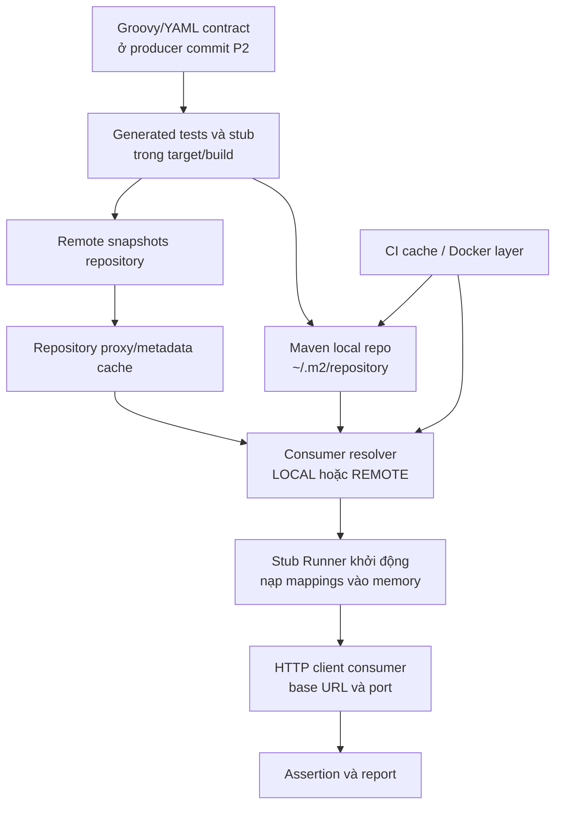
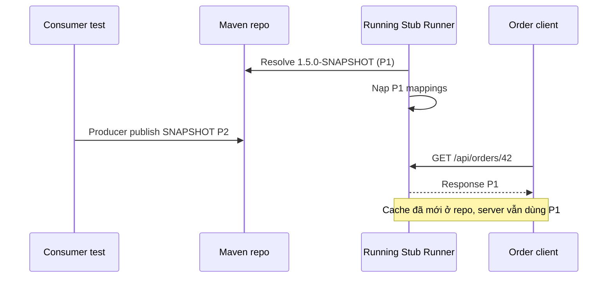
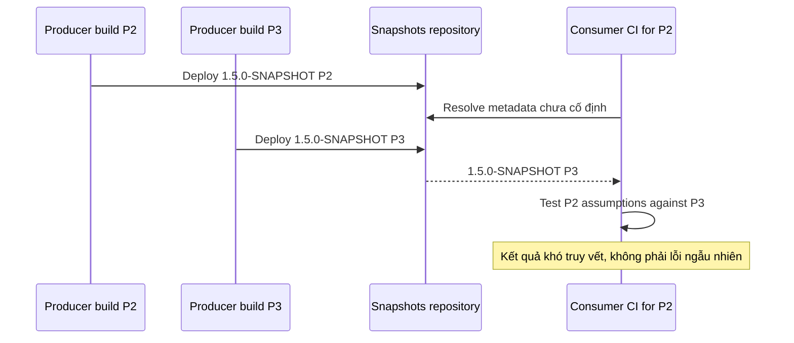
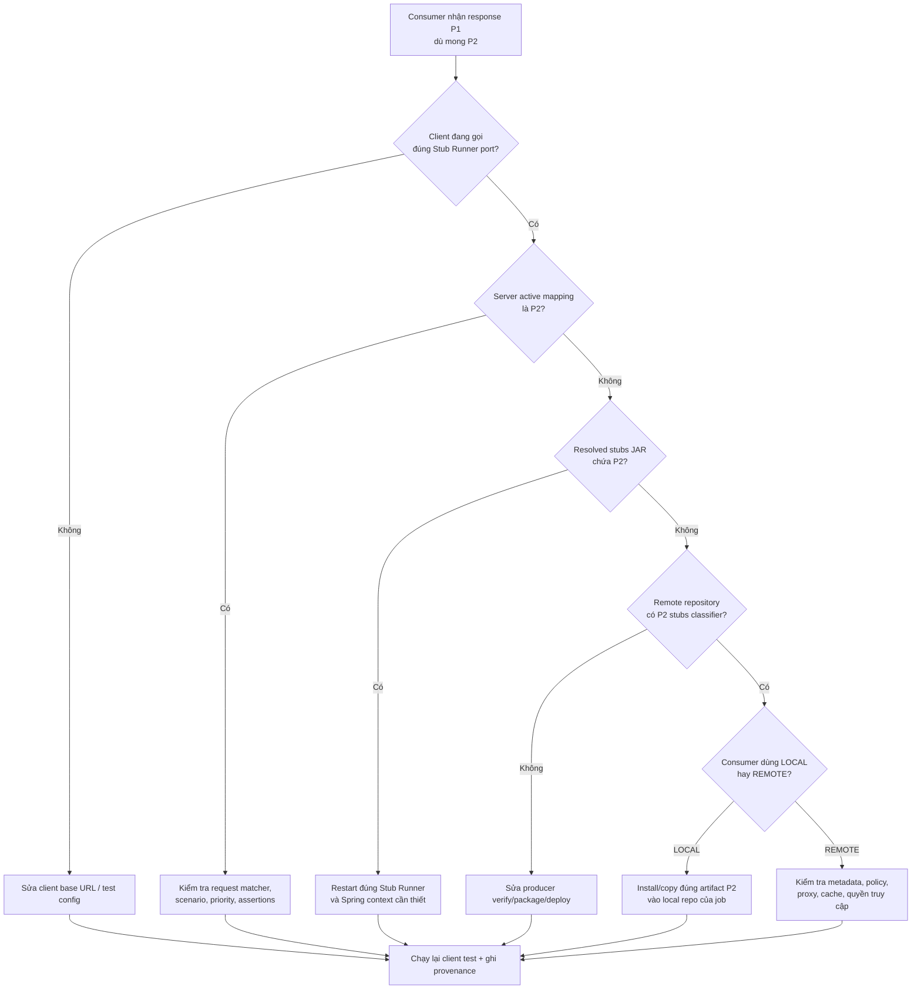

# Kiểm thử dùng cache SNAPSHOT cũ

## 1. Triệu chứng: producer đã sửa nhưng consumer vẫn thấy response cũ

Trong **Spring Cloud Contract**, producer và consumer mô tả giao diện HTTP hoặc thông điệp bằng **Groovy/YAML DSL**. Verifier sinh test chạy trên producer thật, sinh stub để đóng gói thành artifact và **Stub Runner** nạp stub vào môi trường kiểm thử consumer. CI thường chạy các bước này nối tiếp hoặc ở các job độc lập.

Khi dùng phiên bản `SNAPSHOT`, một lỗi rất dễ gây nhầm lẫn:

> Order Team đã sửa contract, generated producer test đạt và artifact `1.5.0-SNAPSHOT` đã được build. Nhưng Checkout Team vẫn nhận response cũ như chưa từng có thay đổi.

Ví dụ, contract mới yêu cầu `GET /api/orders/42` trả thêm `estimatedDeliveryDate`:

```json
{
  "id": 42,
  "state": "PAID",
  "currency": "VND",
  "estimatedDeliveryDate": "2026-12-01"
}
```

Consumer test vẫn nhận:

```json
{
  "id": 42,
  "state": "PAID",
  "currency": "VND"
}
```

Điều này **chưa chứng minh** producer mới không tuân thủ contract. Test có thể đang dùng **stub JAR cũ** được giữ trong local Maven repository, cache của runner, repository proxy, hoặc một Stub Runner server vẫn chạy từ trước. Cũng có thể client gọi **nhầm server**, hoặc bản SNAPSHOT mới **chưa bao giờ được publish**.

Bài thuộc chương **Chẩn đoán sự cố** và tập trung vào nguyên nhân **“Kiểm thử dùng cache SNAPSHOT cũ”**. Mục tiêu là truy vết đúng artifact, phân biệt từng tầng cache, tìm biện pháp làm mới phù hợp và thiết kế CI tránh xanh giả. Không nên xóa toàn bộ cache một cách cảm tính trước khi biết nơi giữ dữ liệu cũ.

### 1.1. Sau bài học có thể làm gì?

1. Giải thích vì sao `1.5.0-SNAPSHOT` **không phải nội dung bất biến**, dù tên phiên bản không đổi.
2. Tách biệt **source contract**, **generated stub**, **local Maven cache**, **remote repository metadata**, **CI cache** và **Stub Runner đang sống**.
3. Chẩn đoán khác biệt giữa `StubsMode.LOCAL` và `StubsMode.REMOTE`.
4. Hiểu đúng công dụng và giới hạn của `mvn -U`, `mvn clean` và các biện pháp làm sạch có mục tiêu.
5. Kiểm tra **classifier `stubs`**, checksum và WireMock mappings thực sự có trong JAR.
6. Chạy consumer client thật với đúng phiên bản stub, đối chiếu producer generated tests và CI evidence.
7. Cải tiến pipeline để tránh nhiều job cạnh tranh cùng một SNAPSHOT mutable.

## 2. Trường hợp xuyên suốt: Order Team và Checkout Team

Giả sử Order Team xuất bản:

```text
groupId    = com.example
artifactId = order-service
version    = 1.5.0-SNAPSHOT
classifier = stubs
extension  = jar
```

Tọa độ Stub Runner thường được viết:

```text
com.example:order-service:1.5.0-SNAPSHOT:stubs
```

Trong local Maven repository, tên file thường tương tự:

```text
~/.m2/repository/com/example/order-service/1.5.0-SNAPSHOT/
    order-service-1.5.0-SNAPSHOT-stubs.jar
    order-service-1.5.0-SNAPSHOT.pom
    maven-metadata-*.xml
    ...
```

Đây là **đường dẫn minh họa**, không được kết luận máy của bạn chắc chắn dùng `~/.m2`: Maven có thể được cấu hình `-Dmaven.repo.local`, `settings.xml` hoặc môi trường CI thay đổi vị trí cache.

### 2.1. Ba build, một chuỗi version

| Mốc | Commit producer | Nội dung response | Artifact version |
|---|---|---|---|
| Build P1 | `aaa111` | Ba field | `1.5.0-SNAPSHOT` |
| Build P2 | `bbb222` | Thêm `estimatedDeliveryDate` | `1.5.0-SNAPSHOT` |
| Consumer C1 | `ccc333` | Mong payload mới | Resolve `1.5.0-SNAPSHOT` |

**Cùng một chuỗi `1.5.0-SNAPSHOT` không xác định duy nhất nội dung.** Để biết C1 dùng P1 hay P2, phải tìm **artifact cụ thể đã resolve**, metadata/checksum và stub mapping được server thực sự nạp.

Nếu pipeline dùng một release bất biến như `1.5.0`, việc deploy lại **cùng tọa độ** với nội dung khác thường không nên được phép. Với SNAPSHOT, nội dung thay đổi theo build là đặc trưng của giai đoạn phát triển, nhưng cũng tạo rủi ro không tái lập khi consumer test dùng tọa độ động.

## 3. SNAPSHOT hoạt động thế nào trong Maven artifact repository?

Một Maven version có đuôi `-SNAPSHOT` được xem là phiên bản **đang phát triển**. Khi deploy lên Maven repository hỗ trợ unique snapshots, artifact có thể được lưu bằng tên có **timestamp và build number**, trong khi người dùng vẫn khai báo base version `1.5.0-SNAPSHOT`.

Ví dụ tên artifact trong repository:

```text
order-service-1.5.0-20261124.031504-7-stubs.jar
order-service-1.5.0-20261124.051122-8-stubs.jar
```

Các timestamp trên chỉ minh họa; cần đọc **metadata thực tế của repository** để biết build nào được chọn. Maven thường dựa vào `maven-metadata.xml` và chính sách cập nhật snapshot để tìm artifact mới.

### 3.1. Metadata có thể chỉ tới nhiều bản xây dựng

Một phần metadata **minh họa**, không phải file lấy từ repository thật:

```xml
<metadata>
  <groupId>com.example</groupId>
  <artifactId>order-service</artifactId>
  <version>1.5.0-SNAPSHOT</version>
  <versioning>
    <snapshot>
      <timestamp>20261124.051122</timestamp>
      <buildNumber>8</buildNumber>
    </snapshot>
    <lastUpdated>20261124051122</lastUpdated>
    <snapshotVersions>
      <snapshotVersion>
        <classifier>stubs</classifier>
        <extension>jar</extension>
        <value>1.5.0-20261124.051122-8</value>
        <updated>20261124051122</updated>
      </snapshotVersion>
    </snapshotVersions>
  </versioning>
</metadata>
```

Lưu ý có **classifier `stubs` và extension `jar`** trong phần `snapshotVersion`. Metadata của JAR ứng dụng không nhất thiết đồng nghĩa metadata của **JAR stubs** đang chỉ tới bản mới. Việc deploy chỉ ứng dụng hoặc chỉ POM chưa chứng minh artifact `-stubs.jar` mới đã xuất bản.

### 3.2. Vì sao metadata/caching làm test cũ?

Một resolver có thể dựa trên:

- Local copy của artifact đã tải.
- Local metadata ghi kết quả kiểm tra từ lần trước.
- Repository `updatePolicy` cho SNAPSHOT, ví dụ theo thời gian hoặc mỗi lần.
- Repository manager/proxy có cache metadata hoặc artifact của upstream.
- Chính sách offline, network access, authentication và lỗi tải.

Nếu bản mới được deploy nhưng resolver vẫn dùng metadata cũ, nó có thể tiếp tục chọn timestamp cũ. Nếu metadata mới nhưng artifact classifier `stubs` chưa được publish, resolver cũng không tự tạo stub JAR mới.

**Quy tắc:** thời gian sửa contract source, thời gian chạy producer test, thời gian cài đặt/deploy artifact, và thời gian consumer resolve **là bốn sự kiện khác nhau**.

## 4. Những tầng có thể giữ “cũ”

Không nên chỉ gọi chung tất cả là “Maven cache”. Trong một pipeline contract testing, có ít nhất sáu nơi đáng kiểm tra:



| Tầng | Dấu hiệu đang cũ | Cách xác minh ưu tiên |
|---|---|---|
| **Contract source** | Contract P2 chưa được checkout | Kiểm tra producer commit/revision |
| **Generated output** | Stub mapping trong `target` chưa phản ánh source | Build sạch đúng module; xem generated files |
| **Local Maven repo** | `-stubs.jar` tại `~/.m2` vẫn chứa body P1 | `jar tf`, inspect mapping, checksum |
| **Remote repository/proxy** | Metadata hoặc classifier `stubs` vẫn chỉ artifact P1 | So thời gian deploy, metadata và artifact |
| **Consumer resolver/CI cache** | Download/copy cũ dù repo mới | Ghi resolved location/version và cache key |
| **Running Stub Runner** | Đang phục vụ mappings nạp từ P1 | Kiểm tra port, active mapping, restart server đúng scope |
| **Consumer client configuration** | Gọi server khác hoàn toàn | Log URL thực, WireMock request journal |

### 4.1. “Cache cũ” và “client gọi sai nơi” cho triệu chứng giống nhau

Ví dụ Stub Runner P2 đã chạy ở `localhost:54321`, nhưng bean `OrderClient` vẫn giữ `http://localhost:8090` từ test config cũ. Response ở `8090` có thể là P1, tạo cảm giác cache P2 sai.

Trước khi động vào Maven cache, hãy xác nhận **địa chỉ thực sự được consumer gọi**, class/method test đang chạy và server nào nhận request. Giữ riêng `@StubRunnerPort`, `wiremock.server.port` và `server.port`; chúng không có nghĩa giống nhau.

## 5. Phân biệt “stub cũ” với thay đổi producer không được phát hành

Một chuỗi kiểm tra hợp lý:

```text
1. Contract P2 đã được commit/checkout?
2. Producer generated tests đã sinh, chạy và đạt?
3. Stub mappings P2 đã được tạo?
4. -stubs.jar P2 được install/deploy đúng tọa độ?
5. Consumer resolver đã chọn đúng artifact P2?
6. Stub Runner đang chạy có nạp mapping P2?
7. Consumer HTTP client có gọi đúng Stub Runner port?
8. Assertion có phản ánh yêu cầu P2 hay chưa?
```

Nếu dừng ở câu 2 hoặc câu 3 mà không có bằng chứng publish, **không nên kết luận remote cache lỗi**. Có thể pipeline chưa từng đưa `-stubs.jar` mới lên repository.

### 5.1. Producer tests phải chạy trên code thật

Một Groovy contract P2:

```groovy
import org.springframework.cloud.contract.spec.Contract

Contract.make {
    description 'Order PAID trả thêm ngày giao dự kiến'

    request {
        method GET()
        url '/api/orders/42'
        headers {
            header 'Accept', 'application/json'
        }
    }

    response {
        status OK()
        headers {
            contentType(applicationJson())
        }
        body(
            id: 42,
            state: 'PAID',
            currency: 'VND',
            estimatedDeliveryDate: '2026-12-01'
        )
    }
}
```

Đây là **bản thay thế P1 cho cùng request predicate**; không nên đặt hai versions với cùng request matching nhưng response khác nhau trong một tập mappings không có điều kiện phân biệt. Producer phải khởi tạo fixture order `42` phù hợp; generated test kiểm tra controller/serialization thật qua base test tương ứng.

### 5.2. YAML DSL tương đương

```yaml
description: Order PAID trả thêm ngày giao dự kiến
request:
  method: GET
  url: /api/orders/42
  headers:
    Accept: application/json
response:
  status: 200
  headers:
    Content-Type: application/json
  body:
    id: 42
    state: PAID
    currency: VND
    estimatedDeliveryDate: "2026-12-01"
```

Chỉ dùng **một biểu diễn thực** trong source để tránh trùng mapping. Đừng xem việc YAML file parse thành công là producer verification: phải có generated tests **được biên dịch, runner thực thi và assertions đạt**.

## 6. Chứng minh JAR stubs nào đã được tạo

Sử dụng tọa độ **đầy đủ**:

```text
groupId    = com.example
artifactId = order-service
version    = 1.5.0-SNAPSHOT
classifier = stubs
extension  = jar
```

Nếu chỉ kiểm tra `order-service-1.5.0-SNAPSHOT.jar` (không có classifier), bạn có thể đang nhìn **JAR ứng dụng**, không phải artifact Stub Runner nạp.

### 6.1. Kiểm tra nội dung JAR trước khi đổ lỗi cho cache

Lệnh tham khảo cho một máy đã có JDK/JAR tool:

```bash
jar tf "$HOME/.m2/repository/com/example/order-service/1.5.0-SNAPSHOT/order-service-1.5.0-SNAPSHOT-stubs.jar"
```

Quan sát tên resources, thường có những thư mục liên quan tới `mappings` và `__files` dưới cấu trúc `META-INF` của stub artifact. **Đường dẫn bên trong JAR phụ thuộc cách plugin đóng gói và phiên bản**, nên hãy liệt kê thực tế thay vì giả định mọi JAR đều có `/mappings` ở root.

Để xem response thực, có thể giải nén **bản sao JAR vào một thư mục tạm riêng**, rồi đọc các mapping JSON đã liệt kê. Không sửa JAR tại chỗ trong Maven cache, vì làm thay đổi artifact đang cần truy vết.

### 6.2. So sánh checksum với bản được phát hành

Trên máy Unix-like:

```bash
sha256sum "$HOME/.m2/repository/com/example/order-service/1.5.0-SNAPSHOT/order-service-1.5.0-SNAPSHOT-stubs.jar"
```

Trên PowerShell:

```powershell
Get-FileHash -Algorithm SHA256 "$HOME/.m2/repository/com/example/order-service/1.5.0-SNAPSHOT/order-service-1.5.0-SNAPSHOT-stubs.jar"
```

Checksum chứng minh **hai bản file byte-for-byte giống nhau hay khác nhau**. Nó không tự chứng minh API đúng; cũng không được suy ra khác checksum chắc chắn khác semantics nếu JAR chứa timestamp/build metadata. Vì vậy, để xác định lỗi cần **cả checksum lẫn nội dung mapping/expected behavior**.

### 6.3. Ba bằng chứng nên lưu cùng nhau

```text
Source  : producer commit bbb222, contract ORD-GET-PAID
Package : com.example:order-service:1.5.0-SNAPSHOT:stubs
Evidence:
  - generated producer test name + report
  - stubs JAR checksum + mapping path/response
  - build/deploy ID và thời điểm publish
```

Thiếu một trong các mắt xích, câu “stub đã mới” vẫn có thể chỉ là suy đoán.

## 7. `StubsMode.LOCAL`: chỉ dùng artifact hiện có ở máy chạy test

Một consumer test có thể cấu hình:

```java
import org.junit.jupiter.api.Test;
import org.springframework.boot.test.context.SpringBootTest;
import org.springframework.cloud.contract.stubrunner.StubRunnerProperties;
import org.springframework.cloud.contract.stubrunner.spring.AutoConfigureStubRunner;
import org.springframework.cloud.contract.stubrunner.spring.StubRunnerPort;

@SpringBootTest
@AutoConfigureStubRunner(
    ids = "com.example:order-service:1.5.0-SNAPSHOT:stubs",
    stubsMode = StubRunnerProperties.StubsMode.LOCAL
)
class CheckoutSnapshotContractTest {

    @StubRunnerPort("com.example:order-service")
    int orderStubPort;

    @Test
    void checkoutReadsOrder() {
        // Tạo/cấu hình client consumer thật với
        // http://localhost:<orderStubPort>.
        // Assert response có hành vi cần bảo vệ.
    }
}
```

`LOCAL` về nguyên tắc chỉ tìm các stubs đã được **install/có trong local artifact repository** của môi trường đang chạy. Nó không có nghĩa “luôn lấy bản SNAPSHOT mới nhất từ mạng”. Nếu local repo chỉ chứa P1, consumer sẽ tiếp tục dùng P1 hoặc báo không tìm thấy artifact theo cấu hình.

### 7.1. Quy trình local producer → consumer

Một trình tự phát triển **minh họa** trong cùng máy/môi trường chia sẻ Maven local repository:

```bash
# Ở project/module producer, với plugin đúng lifecycle:
mvn clean install

# Ở project consumer:
mvn test
```

Điều kiện để trình tự này đáng tin:

1. Producer `clean install` đã **sinh và chạy generated contract tests**, không bị `skipTests`/filters bỏ qua.
2. Plugin đã **attach/install artifact classifier `stubs`**, không chỉ main application JAR.
3. Producer và consumer thực sự sử dụng **cùng local Maven repository path**.
4. Consumer `Stub Runner` đã được khởi tạo lại sau khi artifact được cập nhật.
5. Test chạy đúng consumer client và assert field/hành vi mới.

**Đừng mặc định `mvn clean install` luôn tạo stub JAR** nếu Spring Cloud Contract plugin không được cấu hình/bind đúng. Xem build log, installed files và test report thực tế.

### 7.2. Hai CI jobs không mặc nhiên dùng chung local repository

```text
Producer Job A:
  ~/.m2/repository (... A)
  install order-service 1.5.0-SNAPSHOT stubs P2

Consumer Job B:
  ~/.m2/repository (... B)
  chỉ còn stubs P1 từ cache hoặc không có gì
```

Ngay cả khi hai jobs chạy cùng thời điểm, artifact cài trong A không tự xuất hiện trong B nếu runner/container riêng. Cần một bước **deploy đến repository dùng chung** hoặc truyền **build artifact** theo cơ chế CI có provenance rõ, rồi cấu hình consumer resolve đúng nơi.

Nếu hai jobs dùng **cùng thư mục Maven local repository trên shared runner**, có thể xảy ra tranh chấp ghi/đọc SNAPSHOT đang thay đổi. Dùng local cache theo job khi cần isolation; không biến một thư mục dùng chung có thể sửa thành “nguồn sự thật” cho mọi pipeline.

### 7.3. Đừng nhầm local Maven repository với project `target`

- `mvn clean` xóa output trong `target` của module build theo Maven lifecycle.
- Nó **không mặc nhiên xóa** `~/.m2/repository`.
- Cài lại producer vào local repo và tải lại artifact từ remote là hai hành động khác nhau.
- Khởi động lại Stub Runner để nạp JAR mới là bước **thứ ba**.

Nếu test đang dùng `LOCAL` mà bạn chỉ chạy `mvn -U test` trong consumer, đừng mặc định Stub Runner sẽ truy cập repository từ xa và thay bản local P1. Cần xác minh **mode** và nơi artifact được lấy.

## 8. `StubsMode.REMOTE`: metadata, repository URL và snapshot policy

Ở CI, consumer thường resolve artifact từ Maven repository chung:

```java
@SpringBootTest
@AutoConfigureStubRunner(
    ids = "com.example:order-service:1.5.0-SNAPSHOT:stubs",
    stubsMode = StubRunnerProperties.StubsMode.REMOTE,
    repositoryRoot = "https://artifacts.example.invalid/repository/snapshots"
)
class CheckoutRemoteSnapshotTest {
    @StubRunnerPort("com.example:order-service")
    int orderStubPort;
}
```

Địa chỉ `artifacts.example.invalid` là **placeholder**, không phải kho đang hoạt động. Cần cấu hình đúng repository URL, quyền truy cập và bảo mật theo môi trường. Tùy phiên bản Spring Cloud Contract/Stub Runner, cách chỉ định repository, downloader và tên property có thể thay đổi; kiểm tra tài liệu và log của artifact đang dùng.

### 8.1. REMOTE không đồng nghĩa bỏ qua mọi cache

`REMOTE` cho phép Stub Runner resolver tìm stub từ remote repository. Tuy nhiên, quá trình resolve có thể vẫn dùng **local cache**, local/remote metadata hoặc chính sách update. Vì thế:

- Bản deploy P2 phải có **JAR classifier `stubs`** và metadata tương ứng.
- Consumer phải cấu hình **đúng snapshots repository**, không trỏ nhầm releases repo hoặc mirror cũ.
- Resolver phải có quyền đọc artifact mới.
- Cache/update policy phải cho phép kiểm tra snapshot mới khi cần.
- Server Stub Runner phải được **tạo lại/nạp lại artifact** sau resolution.

Không giả định REMOTE luôn tải artifact mới trong mỗi test method. Thông thường stub được resolve và server được khởi động theo **scope test/context**, không theo từng HTTP request.

### 8.2. Cập nhật SNAPSHOT phụ thuộc metadata

Một repository có thể có các chính sách update snapshot như `always`, `daily`, `interval:N` hoặc `never`, theo khả năng resolver/repository. Ví dụ cấu hình Maven POM **minh họa**, không phải cách cấu hình bắt buộc cho mọi Stub Runner downloader:

```xml
<repositories>
    <repository>
        <id>internal-snapshots</id>
        <url>https://artifacts.example.invalid/repository/snapshots</url>
        <releases>
            <enabled>false</enabled>
        </releases>
        <snapshots>
            <enabled>true</enabled>
            <updatePolicy>always</updatePolicy>
        </snapshots>
    </repository>
</repositories>
```

**Đừng áp `always` vô điều kiện trên mọi pipeline**: nó làm tăng số lần gọi repository và không tự sửa artifact sai. Khi cần build tái lập, ưu tiên **version candidate bất biến** hoặc tọa độ rõ revision; chỉ dùng refresh snapshot có chủ đích cho workflow phát triển.

### 8.3. Repository manager/proxy có thể là một tầng riêng

Nếu producer deploy vào kho nội bộ A còn consumer resolve qua **repository group/proxy B**, metadata có thể chưa đồng bộ hoặc B giữ dữ liệu cũ. Khi điều tra, ghi nhận:

```text
Producer deploy target  : repository A
Consumer repositoryRoot : repository B
Resolved artifact       : timestamp/classifier/checksum thực tế
Expected artifact       : timestamp/checksum từ build producer P2
```

Nếu A có P2 nhưng B vẫn báo P1, cần kiểm tra **metadata và chính sách cache/replication của hệ thống repository** cùng quản trị viên. Việc xóa local repo trong consumer có thể khiến nó chỉ tải lại **vẫn P1 từ B**, không giải quyết gốc vấn đề.

### 8.4. Không kiểm tra nhầm dependency JAR thường

Khi dùng repository UI hoặc Maven CLI để tìm:

```text
com.example:order-service:1.5.0-SNAPSHOT
```

cần chọn **classifier `stubs` và extension `jar`**. Một ứng dụng JAR mới và một stub JAR cũ có thể cùng tồn tại trong repository nếu publish step của classifier bị bỏ qua hoặc thất bại.

## 9. `mvn -U`, `clean` và “xóa cache”: công dụng khác nhau

### 9.1. `mvn -U` làm gì?

Tham số Maven `-U` yêu cầu Maven **kiểm tra cập nhật SNAPSHOT theo hướng buộc refresh** đối với các dependency/artifact do Maven resolution quản lý (đồng thời ảnh hưởng retry những resolution trước đó thất bại). Ví dụ:

```bash
mvn -U -B -ntp clean verify
```

Ý nghĩa thực tiễn:

- Có ích khi **Maven** đang dùng cached SNAPSHOT metadata/dependency và remote đã có bản mới.
- Không tự làm producer **rebuild và publish** `-stubs.jar`.
- Không thay request/response trong WireMock server đã chạy.
- Không buộc một **independent Stub Runner downloader** hoặc custom resolver phải bỏ qua cache nếu nó có chính sách resolution riêng; phải xác minh phiên bản và log.
- Không biến `LOCAL` thành `REMOTE`.
- Không đảm bảo metadata trong **repository proxy** đã mới.

Đây là lý do không nên trả lời mọi sự cố bằng “cứ thêm `-U`”.

### 9.2. `mvn clean` làm gì?

`mvn clean` xóa build output của project (thường là `target`). Nó **không mặc nhiên làm mới** Maven local repository hay remote metadata, cũng không restart một service WireMock/Stub Runner độc lập.

Nếu lỗi nằm ở `target/generated-contracts` chưa được tái tạo, clean + generate đúng lifecycle là cần thiết. Nếu lỗi nằm ở `~/.m2`, chỉ clean project có thể vẫn dùng lại JAR cũ.

### 9.3. Khi nào cần purge local artifact?

Chỉ sau khi đã xác minh:

1. Đúng tọa độ `group/artifact/version/classifier`.
2. Remote đã thực sự có JAR mới.
3. Resolver đang dùng local bản cũ hoặc metadata cache cũ.
4. Job/test không có một tiến trình khác đang dùng hoặc ghi cùng file.

Thay vì xóa toàn bộ `~/.m2`, hãy dùng cơ chế **purge có mục tiêu** của Maven/dependency tooling hoặc một **repository local tạm, sạch** cho phiên chẩn đoán. Các lệnh purge của Maven Dependency Plugin có hành vi phụ thuộc option/version và thường xử lý tập dependencies được khai báo; **không nên cho rằng nó chắc chắn purge mọi stub artifact được Stub Runner resolve ở runtime**.

Nếu phải thao tác trực tiếp trên filesystem, **xác minh đường dẫn thực, chỉ chọn đúng coordinate version và bảo toàn bản sao/checksum phục vụ điều tra**. Tránh xóa một local repo đang được CI jobs khác sử dụng, hoặc xóa cả cache khi chưa có bằng chứng.

### 9.4. Một repository local tạm để tái hiện

Một lệnh Maven minh họa khi muốn cô lập resolver Maven của build:

```bash
mvn -U -Dmaven.repo.local="$PWD/.m2-contract-debug" -B -ntp test
```

Thư mục `.m2-contract-debug` chỉ là **ví dụ** về local repository tạm được chọn có chủ đích; lệnh có thể phải download nhiều dependencies. Cần xác nhận **Stub Runner version đang dùng có tuân theo cùng local repo setting hay không**, bởi không phải mọi custom resolver đều lấy tham số Maven CLI này.

Lợi ích của cách này là thử một môi trường **không dính những artifact đã install trước đây**, thay vì xóa bằng chứng trong cache gốc. Nếu lỗi biến mất, khả năng stale local state tăng; vẫn cần đối chiếu checksum/mappings để chứng minh.

## 10. Tìm đúng cache: Maven settings, môi trường và CI restore

Một lỗi “xóa local JAR rồi vẫn thấy cũ” thường do bạn xóa **không đúng local repository** mà test thật dùng.

### 10.1. Những cấu hình có thể thay đường dẫn

- Maven `settings.xml` có `<localRepository>`.
- Maven CLI/system property `-Dmaven.repo.local`.
- CI wrapper/Maven toolchain đặt repository path riêng theo job.
- Docker image tạo sẵn `/root/.m2` hoặc `/home/runner/.m2`.
- IDE/test task dùng JVM/environment khác shell vừa kiểm tra.
- Stub Runner downloader cấu hình repository location riêng.

Một ví dụ CLI chỉ phục vụ truy vết:

```bash
mvn help:effective-settings
```

Lệnh từ Maven Help Plugin có thể giúp xem cấu hình Maven hiệu lực khi phù hợp, nhưng **đừng log settings với credentials** vào artifact công khai. Nếu cần chia sẻ log, che mọi password/token/server credential và tập trung vào repository ID/URL, localRepository.

### 10.2. CI cache key có thể khôi phục artifact cũ

```text
CI job start
  → restore cache ~/.m2 từ job/commit cũ
  → chạy consumer tests với StubsMode.LOCAL
  → P1 SNAPSHOT được nạp
  → cache vẫn được lưu lại khi job kết thúc
```

Nếu consumer dùng `LOCAL`, cache hit có thể **được xem như nguồn artifact hợp lệ**, dù producer vừa build P2 ở job khác. Cache dependency giúp tăng tốc nhưng không thay thế **cơ chế phát hành và pin version**.

Một số hệ thống CI tách cache và artifacts:

- **Cache**: tối ưu hiệu năng, có thể bị ghi đè/khôi phục, không nên coi là nguồn sự thật.
- **Build artifact**: output cụ thể của một job/commit, có provenance và retention.
- **Maven repository release/snapshot**: nơi publisher đưa artifact lên theo version/classifier với metadata.

Khi muốn consumer test chính P2 trong cùng pipeline, hãy dùng **artifact P2 với provenance rõ** hoặc deploy P2 vào repository đã thống nhất; không hy vọng một cache shared tự biết phải thay đổi.

### 10.3. Offline mode và network errors

Khi Maven hoặc downloader ở chế độ offline, nó có thể tiếp tục dùng local copy hoặc fail do thiếu artifact. Nếu network/authentication bị lỗi, một vài resolver có thể báo không resolve được remote rồi fallback local tùy mode và configuration.

**Không tuyên bố “REMOTE đã mới” chỉ vì test không fail network**. Phải kiểm tra resolved path/checksum và log cho thấy artifact mới thật sự được chọn; chú ý phân biệt lỗi 401/403, 404 artifact chưa tồn tại, timeout và metadata stale.

## 11. Stub Runner đã khởi động: cập nhật JAR chưa chắc thay mapping đang phục vụ

Giả sử `Stub Runner` đã resolve P1 rồi start WireMock ở `localhost:54321`. Sau đó Order Team publish P2 và bạn làm mới file JAR trong local repo. **Server đang chạy thường vẫn giữ mappings đã nạp từ P1 trong bộ nhớ**; nó không tự quan sát mọi thay đổi trên Maven repository.



### 11.1. Thao tác đúng sau khi artifact thay đổi

1. Kết thúc **đúng test context/server instance** đang nạp P1.
2. Xác minh resolver sẽ tìm P2 ở local/remote theo mode đã chọn.
3. Tạo context/Stub Runner instance mới hoặc restart service độc lập.
4. Lấy **runtime port mới** (nếu dùng cổng động), cập nhật client base URL trước lúc client sử dụng.
5. Gọi một request đại diện, kiểm tra response/mapping thật có field P2.

Nếu Spring Test **cache application context** giữa các classes, hai tests có thể tái sử dụng cùng Stub Runner instance. `@DirtiesContext` có thể hữu ích khi cần buộc tạo context lại, nhưng gây tăng startup time và **không tự làm mới local Maven repository**. Không rải `@DirtiesContext` khắp suite để chữa sai artifact root cause.

### 11.2. Không reset toàn bộ mappings tràn lan

WireMock `resetAll()` có thể xóa mappings/journal/scenarios hiện có. Nếu server do Stub Runner sở hữu, gọi reset-all từ một test khác có thể làm mất mappings đã nạp từ JAR. Việc đó gây unmatched `404` nhưng **không phải** lỗi SNAPSHOT cache.

Nếu nhiều tests dùng cùng Stub Runner instance, cần thống nhất lifecycle/state isolation. Khi cần kiểm tra P2, **restart với đúng artifact** đáng tin hơn “reset mappings rồi hy vọng reload”.

## 12. Kiểm tra server thực tế bằng cổng và WireMock Admin API

Đừng chỉ xem file JAR trên đĩa. Hãy biết server nào được consumer gọi.

### 12.1. Lấy đúng cổng Stub Runner

```java
@StubRunnerPort("com.example:order-service")
int orderStubPort;
```

Nếu có nhiều upstream stubs, mỗi client dùng **cổng của đúng artifact**. Đừng cố định `localhost:8080` chỉ vì producer thật dùng cổng đó.

### 12.2. Request probe có ý nghĩa

Một phép thử HTTP có thể là:

```bash
curl --fail --silent --show-error \
  -H "Accept: application/json" \
  "http://localhost:54321/api/orders/42"
```

`54321` là port minh họa; dùng **runtime port từ Stub Runner**. Kiểm tra payload có `estimatedDeliveryDate`. Status `200` đơn lẻ không chứng minh đã nạp mapping P2.

### 12.3. Kiểm tra mapping đã nạp

Trên WireMock HTTP stub server khi Admin API được bật và truy cập được trong **môi trường test an toàn**:

```bash
curl --silent --show-error \
  "http://localhost:54321/__admin/mappings"
```

Đọc mapping chứa `GET /api/orders/42`, body/bodyFileName, priority và scenario conditions. Nếu mapping đang có ba field P1 trong khi JAR P2 trên đĩa có bốn field, có thể server chưa restart hoặc bạn đang gọi **instance/port khác**.

**Bảo mật:** WireMock Admin API cho phép xem hoặc thay đổi cấu hình stub; không expose công khai hoặc log toàn bộ response có token/PII. Khi điều tra, chỉ trích phần ID/path/response cần thiết và ẩn secrets.

### 12.4. Unmatched `404` không đồng nghĩa “đang dùng bản cũ”

Nếu client gửi `GET /api/order/42` (thiếu chữ `s`) hoặc header/query khác mapping, WireMock có thể trả unmatched `404`. Khác với response nghiệp vụ `404 ORDER_NOT_FOUND` có body/error code.

Để phân biệt, kiểm tra **request journal** (nếu được bật, trong môi trường test), matched/unmatched mapping và assert body/error code. Một mismatch path có thể làm bạn nghĩ bản SNAPSHOT cũ trong khi vấn đề thực là **client request sai**.

## 13. Gradle, IDE và Docker: cache khác Maven vẫn có thể ảnh hưởng

Trong một hệ thống dùng Gradle hoặc chạy test từ IDE, có thể xuất hiện thêm lớp cache:

- **Gradle dependency cache** cho các dependencies do Gradle resolve.
- **Gradle task/build cache** giữ output của task generate/test ở những điều kiện được khai báo.
- **IDE test runner** reuse environment, classpath hoặc Spring context.
- **Docker image layer** chứa sẵn `~/.m2` hoặc các generated stub files.
- **CI workspace cache** chứa output của lần chạy khác.
- **Stub Runner downloader** có cơ chế repository/cache riêng với build tool.

### 13.1. `--refresh-dependencies` không phải “xóa sạch mọi cache”

Trong Gradle, lệnh tham khảo:

```bash
./gradlew --refresh-dependencies test
```

yêu cầu Gradle làm mới dependency resolution theo cơ chế Gradle. Nó **không bảo đảm** một Stub Runner resolver hoạt động riêng, hoặc một WireMock server đã khởi động, sẽ bỏ cache và tự reload mappings.

Nếu plugin hoặc test framework dùng một resolver dựa trên Maven/Aether, cần biết **resolver thực sự nào tải JAR stubs**. Đừng suy luận “đã chạy `--refresh-dependencies` nên toàn bộ integration tests dùng stub mới”.

### 13.2. Gradle changing modules

Một version `-SNAPSHOT` có thể được Gradle coi là **changing module** trong những cấu hình thông dụng, chịu chính sách cache riêng. Khi cần kiểm thử build mới, xác minh:

1. Dependency có được resolve bởi Gradle hay bởi Stub Runner runtime.
2. Repository URL và artifact version được chọn.
3. Cache policy của changing modules ở build đó.
4. Stub JAR checksum/mappings trước khi chạy test.

Nếu một plugin lấy JAR qua Aether độc lập, chỉnh `cacheChangingModulesFor` của Gradle **không nhất thiết** thay hành vi của plugin. Cần kiểm thử thực tế thay vì áp một mẹo chung.

### 13.3. Container images giữ local SNAPSHOT cũ

Ví dụ Dockerfile hoặc CI image chứa trước:

```text
/root/.m2/repository/com/example/order-service/1.5.0-SNAPSHOT/
    order-service-1.5.0-SNAPSHOT-stubs.jar
```

Nếu consumer job dùng `LOCAL`, image mới được start nhưng **filesystem bên trong đã có P1**. Rebuild source checkout-service không tự ghi đè file này. Cần tái tạo image/artifact theo quy trình hoặc chuyển sang resolve từ repository/artifact pipeline rõ ràng; đừng ngầm tin cache layer đúng vì container vừa được tạo.

Để điều tra, kiểm tra **từ bên trong cùng container/JVM môi trường chạy test**, không chỉ nhìn `~/.m2` trên host.

## 14. Dấu hiệu phân biệt stale JAR, stale server và client sai URL

| JAR P2 trên máy test? | Stub Runner đang trả P2? | Client test nhận P2? | Nhận định đầu tiên |
|---|---|---|---|
| **Không**, chỉ có P1 | Không | Không | Resolver/local cache hoặc publish chưa cập nhật |
| **Có** | **Không** | Không | Server đang dùng mapping P1, context chưa restart hoặc trỏ file khác |
| **Có** | **Có** | **Không** | Client gọi sai port/server, proxy hoặc đường request khác |
| **Có** | Có | Có nhưng test fail | Consumer expectation/parser/behavior cần kiểm tra |
| Không rõ | Không rõ | Có 404 | Chưa đủ bằng chứng; kiểm tra artifact, port, request match |

Một lần chẩn đoán tốt ghi **ba dấu vết riêng**:

```text
Artifact:
  coordinate = com.example:order-service:1.5.0-SNAPSHOT:stubs
  checksum   = SHA-256 của file đã resolve
  body       = response mapping P1 hay P2?

Stub Runtime:
  process/context ID
  runtime port
  active mapping ID / body / source

Consumer Invocation:
  test class/method
  base URL thực
  request method/path/headers
  actual response + assertion
```

Nếu không có ít nhất các chứng cứ này, một lỗi “test dùng stub cũ” còn có thể là lỗi base URL, mapping priority, URL encoding hoặc test client cache.

### 14.1. Khi có nhiều mappings khớp cùng request

Giả sử trong JAR P2 có cả mapping P1 và P2 cho `GET /api/orders/42` với cùng điều kiện. WireMock có thể chọn mapping dựa trên **priority và quy tắc matching/ordering**, tạo cảm giác P2 bị cache dù JAR mới đã nạp.

Vì vậy kiểm tra:

- JAR có **bao nhiêu mappings** cho cùng request predicate?
- Có một `priority` hoặc `scenarioState` khiến mapping P1 được chọn không?
- Converter/generator có vô tình để lại output P1 bên cạnh P2 không?
- Có test nào đăng ký mapping động override artifact mapping không?

Giải pháp là sửa **nguồn contract, generator output hoặc state isolation**, không tăng refresh interval của Maven.

### 14.2. Kiểm tra response thật bằng request journal

Nếu được bật, WireMock request journal giúp quan sát client có gửi đúng `GET /api/orders/42` không. Cần giới hạn dữ liệu log, vì journal có thể chứa authorization headers hoặc request bodies nhạy cảm.

Một consumer test nên assert cả **field mới cần kiểm tra** và **business behavior**, thay vì chỉ `HTTP 200`:

```java
// Trích đoạn trong JUnit test có OrderClient thật.
OrderDto order = orderClient.findById(42L);

assertThat(order.state()).isEqualTo("PAID");
assertThat(order.estimatedDeliveryDate())
    .isEqualTo("2026-12-01");
```

Đoạn trên giả định `OrderDto` phiên bản consumer mới có field `estimatedDeliveryDate` và JSON decoder phù hợp. Nếu mục tiêu là kiểm tra consumer cũ không dùng field này, assertion đúng là **hành vi của client cũ vẫn không đổi khi stub P2 có trường bổ sung**.

## 15. SNAPSHOT cho messaging: có thể cũ ở cả payload và transport

Lỗi cũ không chỉ xảy ra với HTTP WireMock. Với message contract, producer có thể thay đổi event:

```groovy
import org.springframework.cloud.contract.spec.Contract

Contract.make {
    description 'Thanh toán thành công phát OrderPaid'
    label 'order_paid'

    input {
        triggeredBy('publishPaidOrderForContract()')
    }

    outputMessage {
        sentTo('orders.paid')
        headers {
            header('eventType', 'OrderPaid')
        }
        body(
            eventId: 'EVT-42',
            orderId: 42,
            state: 'PAID',
            currency: 'VND'
        )
    }
}
```

Giả sử SNAPSHOT P1 không có `currency`, P2 có. Notification Team chạy consumer test nhưng vẫn nhận message P1.

**Cần tách ba lớp:**

1. Stub artifact P2 có **message definition** mới chưa?
2. Stub Runner/message stub adapter có nạp **đúng artifact** và đăng ký message label/destination mới chưa?
3. Broker/test binder/consumer listener có đọc **đúng message** và không nhận event cũ còn trong queue không?

Với messaging, artifact đã mới nhưng test dùng cùng queue/topic có **message P1 tồn đọng** cũng gây cảm giác cache. Điều tra payload `eventId`, correlation ID, timestamps (nếu có) và destination để phân biệt **artifact stale** với **message transport state stale**.

### 15.1. Không nhầm `messageFrom` với `triggeredBy`

- `triggeredBy('publishPaidOrderForContract()')`: generated producer test cần gọi một method của base test kích hoạt business flow phát message.
- `messageFrom('source.destination')`: thường mô tả một input message do producer được test nhận trước khi phát output.

Converter hoặc sửa contract không được hoán đổi hai kiểu input chỉ để test xanh. Đổi semantics có thể làm test không còn bao phủ đường đi sản xuất thực.

### 15.2. Stub Runner HTTP không tự trở thành Kafka/RabbitMQ

Nếu consumer integration cần message broker, phải dùng message verifier/test binder/adapter hoặc broker test environment phù hợp. Không khắc phục lỗi event cũ bằng cách kiểm tra `GET` trên một WireMock server không liên quan.

Khi chạy song song, message consumer groups, queue names và topic test data cần được cô lập; việc purge toàn bộ queue dùng chung là nguy hiểm vì có thể xóa sự kiện của test khác.

## 16. Cách giảm thiểu về lâu dài: đừng dùng một mutable SNAPSHOT làm release oracle

`1.5.0-SNAPSHOT` có vai trò trong phát triển nhanh, nhưng là một nhãn **có thể thay đổi nội dung**. Khi cần pipeline đáng tin và audit:

1. **Dùng artifact bất biến** cho release gate: version release hoặc candidate có ID/commit duy nhất theo chính sách repository.
2. **Pin producer revision và stub artifact coordinates**, không chỉ dùng keyword “latest”.
3. **Lưu checksum/mapping provenance**, để biết được consumer đã dùng những bytes nào.
4. **Không publish hai nội dung khác nhau lên cùng tọa độ release**; với snapshot cần ghi build/timestamp.
5. **Phân tách build candidate và latest dev snapshot**, không dùng cùng mutable key cho mọi job.
6. **Có bước producer verification thực sự**, không publish stub khi test bị skip.
7. **Chạy consumer với đúng candidate artifact**, tránh đợi cache snapshot tự cập nhật.

### 16.1. Candidate version theo commit

Một phương án tổ chức có thể dùng tên version candidate riêng:

```text
Producer commit: bbb222
Candidate version: 1.5.0-rc-bbb222
Stub coordinate: com.example:order-service:1.5.0-rc-bbb222:stubs
```

Tên version này chỉ là **quy ước minh họa**, phải phù hợp chính sách Maven repository của tổ chức. Ưu điểm: test C1 dùng candidate P2 **không bị tác động khi một build P3 xuất hiện**.

Nếu vẫn muốn dùng unique timestamped SNAPSHOTs, cần đảm bảo consumer resolve **đúng build đã xác định** theo cơ chế repository/metadata của hệ thống, chứ không chỉ cùng base version `1.5.0-SNAPSHOT`.

### 16.2. Version bất biến giúp phân biệt regression với cache

Khi P2 có coordinate riêng, log:

```text
Expected: com.example:order-service:1.5.0-rc-bbb222:stubs
Resolved: com.example:order-service:1.5.0-rc-bbb222:stubs
SHA-256 : <checksum cụ thể từ build output>
```

Trình tự trở nên dễ audit: nếu content mismatch thì artifact pipeline sai; nếu content đúng nhưng server trả response cũ thì runtime state/client routing sai. Không cần phỏng đoán “SNAPSHOT vừa thay đổi lúc nào”.

## 17. Hai pipelines song song có thể đua nhau publish SNAPSHOT

Một race condition:



Hai build có thể đều hợp lệ; lỗi nằm ở chỗ **consumer C định kiểm tra P2 nhưng dùng base version không pin đúng bản P2**.

### 17.1. Biện pháp chống race

- **Candidate artifact per commit:** truyền đúng tọa độ từ producer job sang consumer job.
- **Promotion:** chỉ sau producer + consumer verification mới promote bản candidate.
- **Concurrency control:** serialize bước publish mutable snapshot khi repository/policy yêu cầu, hoặc không ghi đè cùng key.
- **Repository isolation:** môi trường staging theo branch/job nếu thực sự cần, có cleanup và hạn chế quyền.
- **CI artifacts:** truyền JAR cụ thể giữa jobs, giữ checksum và commit ID.
- **Failure diagnostics:** ghi timestamped resolved version, repository URL và checksum từ consumer job.

Một cache hit ở consumer có thể cho P1; một metadata refresh giữa chừng có thể cho P3. Chỉ dựa trên việc P2 “vừa publish” là không đủ.

### 17.2. Không dùng `+` làm version release gate

Trong một số cơ chế Stub Runner, `+` có thể mang nghĩa chọn phiên bản mới nhất. Điều đó hữu ích cho **compatibility canary** nhưng không có tính tái lập nếu repository được cập nhật trong lúc CI chạy.

Đối với release gate, pin version cụ thể hoặc resolved candidate; nếu thực sự dùng `+` thì **ghi lại version đã resolve** và không coi “test pass với latest hôm nay” là bằng chứng cho một artifact khác.

## 18. Xây pipeline CI bảo vệ provenance

### 18.1. Các bước producer phải có

```text
Producer CI (commit P2)
  [1] Checkout đúng commit và Groovy/YAML contracts
  [2] Generate producer contract tests
  [3] Compile + execute generated contract tests
  [4] Assert số/kịch bản cần bảo vệ đã chạy, không skipped
  [5] Package -stubs.jar, inspect mappings/body files
  [6] Compute artifact checksum và ghi build metadata
  [7] Publish candidate/unique snapshot sau verification
```

Một lệnh Maven minh họa:

```bash
mvn -B -ntp clean verify
```

Trong dự án thực, cần bảo đảm plugin lifecycle tạo và attach stub artifacts. `verify` chỉ là **phase**, không đảm bảo tất cả kịch bản được chạy nếu plugin cấu hình sai. Nếu dùng `install`/`deploy`, chỉ tiếp tục **sau khi** generated tests và gate đạt.

### 18.2. Các bước consumer phải có

```text
Consumer CI (test P2)
  [1] Nhận tọa độ/checksum P2 từ producer pipeline
  [2] Resolve đúng -stubs.jar từ artifact source đã quy định
  [3] So sánh checksum với artifact expected (nếu có)
  [4] Khởi động một Stub Runner instance mới
  [5] Log runtime port và artifact version, không log secrets
  [6] Inject base URL vào client thật
  [7] Chạy HTTP/message compatibility tests và behavior assertions
  [8] Archive reports + resolved provenance, cleanup
```

### 18.3. Cách truyền candidate artifact giữa jobs

Một workflow CI **pseudocode**, không phải cú pháp chạy trực tiếp của GitHub Actions/GitLab/Jenkins:

```yaml
producer_job:
  source_revision: bbb222
  verify_generated_contract_tests: true
  fail_if_contract_test_count_zero: true
  publish_candidate_artifact: true
  outputs:
    stub_coordinate: "com.example:order-service:1.5.0-rc-bbb222:stubs"
    stub_sha256: "<build-output-sha256>"

consumer_job:
  needs: producer_job
  input_coordinate: producer_job.outputs.stub_coordinate
  input_checksum: producer_job.outputs.stub_sha256
  start_new_stub_runner: true
  verify_http_client_behavior: true
  archive:
    - resolved_stub_metadata
    - test_reports
```

Trong implementation thật, phải chọn bước CI provider tương ứng để lưu/truyền artifacts/outputs, auth an toàn, kiểm tra checksum và xử lý race. Pseudocode trên chỉ thể hiện **giao kèo giữa hai jobs**.

### 18.4. Dùng SNAPSHOT nhưng vẫn cần tính tái lập

Nếu chính sách team bắt buộc dùng SNAPSHOT trong daily integration:

- Chỉ định **build producer/timestamp** mà consumer cần kiểm tra, không lấy một bản ngẫu nhiên.
- Ghi checksum, source commit, artifact repository và resolved metadata.
- Chạy test với Stub Runner instance mới.
- Cấu hình snapshot update policy phù hợp để phát hiện build mới khi workflow cần.
- Không chia sẻ cache Maven mutable giữa những CI jobs không phối hợp.
- Giữ ít nhất một release/candidate gate dùng artifact bất biến để kết quả đáng tin lâu dài.

**Lưu ý:** pipeline có thể nhanh hơn nhờ cache, nhưng tính đúng đắn phải được xác nhận bằng **artifact identity và hành vi thực**, không phải “cache đã được bật/tắt”.

## 19. Playbook chẩn đoán: bắt đầu bằng chứng, không bắt đầu bằng xóa cache

Một playbook tiêu chuẩn nên giúp cả producer lẫn consumer cùng nói về **một artifact và một request cụ thể**.

### 19.1. Từ triệu chứng đến nơi cần sửa



**Không có nhánh “xóa hết `~/.m2` ngay”**. Hành động đầu tiên là xác minh target đang được gọi, active mapping và artifact được resolve.

### 19.2. Bước 1 — ghi chính xác điều đang kỳ vọng

Một báo cáo sự cố nên bắt đầu:

```text
Consumer test:
  project       : checkout-service
  test          : CheckoutContractTest#readsEstimatedDeliveryDate
  consumer code : commit ccc333

Expected stub:
  group         : com.example
  artifact      : order-service
  version       : 1.5.0-SNAPSHOT
  classifier    : stubs
  producer code : commit bbb222

Expected interaction:
  GET /api/orders/42
  HTTP 200
  JSON estimatedDeliveryDate = "2026-12-01"
```

Trước khi debug, xác nhận có test thật sự assert field mới hoặc behavior bị ảnh hưởng. Nếu test chỉ assert `200`, nó có thể pass cả P1 lẫn P2 và **không phát hiện cache cũ**.

### 19.3. Bước 2 — kiểm tra đầu producer

Ở producer build P2:

1. Contract source P2 chứa yêu cầu mới.
2. Generated producer tests được tạo đúng class/method.
3. Tests **thực thi và đạt** (không skip).
4. Stub mapping P2 được tạo với body/header mong đợi.
5. `-stubs.jar` được attach và **install/deploy** đúng version/classifier.
6. Có build ID, checksum hoặc timestamped repository artifact để truy vết.

Nếu chỉ có `BUILD SUCCESS` nhưng Maven chạy `-DskipTests` hoặc Surefire không chọn generated tests, đừng coi stub đã được xác minh là đáng tin. **Lỗi gốc có thể ở producer pipeline**, không ở consumer cache.

### 19.4. Bước 3 — kiểm tra nơi consumer lấy artifact

Đối chiếu bốn dữ kiện:

```text
stubsMode        = LOCAL hoặc REMOTE
repositoryRoot   = remote URL nếu có
effective local repo = nơi downloader dùng thực tế
resolved artifact   = file/version/checksum cụ thể
```

Nếu `LOCAL`, ưu tiên kiểm tra file local và bước install/transfer giữa jobs. Nếu `REMOTE`, ưu tiên remote metadata, timestamp/classifier và download logs. Nếu local và remote có checksum khác nhau, xác định **bản nào đúng với producer P2**, không tự mặc định bản remote luôn đúng.

### 19.5. Bước 4 — kiểm tra Stub Runner runtime

Ghi:

- Port thực từ `@StubRunnerPort` hoặc log startup.
- Server/context được start lúc nào, trước hay sau khi P2 được publish.
- Active mapping của `GET /api/orders/42` qua WireMock Admin API khi có quyền.
- Có mappings khác cùng predicate/priority/scenario không.
- Test nào có thể gọi `resetAll()` hoặc override mapping.

Nếu JAR đã là P2 nhưng active mapping vẫn P1, **restart server/test context** đúng phạm vi sau khi bảo đảm resolver sẽ dùng P2.

### 19.6. Bước 5 — chạy client thật, không chỉ ping stub

Test cần dùng **HTTP client/DTO/error decoder của consumer** và kiểm tra quyết định nghiệp vụ. Một response có field mới không tự bảo đảm client C1 strict tiếp tục parse được nó; đó có thể là **breaking change độc lập với lỗi cache**.

Lưu lại:

```text
request URL     = http://localhost:<runtime-port>/api/orders/42
actual status   = 200
actual payload  = có/không có estimatedDeliveryDate
client result   = parse OK / JSON exception / business assertion failure
stub artifact   = coordinate + checksum + build ID
```

Không coi lỗi deserialization trên payload P2 là lý do phải quay về stub P1. Nếu consumer đang phụ thuộc vào parser strict, cần **compatibility review** trước khi rollout producer P2.

## 20. Bảng lỗi nhanh: phân biệt nguyên nhân giống nhau

| Triệu chứng | Nguyên nhân khả dĩ | Bằng chứng phân biệt | Sửa đúng tầng |
|---|---|---|---|
| Consumer vẫn có body P1 | `LOCAL` cache P1 | Local JAR mapping P1, remote P2 | Install/transfer P2 có kiểm chứng |
| `REMOTE` nhưng vẫn thấy P1 | Metadata/cache update policy | Resolved timestamp P1, remote P2 | Refresh metadata/cache ở đúng resolver |
| Repository UI cho thấy P2 nhưng consumer là P1 | Proxy/group repository cũ | Direct repo A ≠ repo B | Kiểm tra mirror/proxy replication |
| P2 app JAR có mà stub JAR không có | Publish thiếu classifier | `stubs` snapshotVersion chưa cập nhật | Sửa attach/deploy của producer |
| `mvn clean` không giải quyết | Local repo giữ P1 | `target` mới, `~/.m2` cũ | Phân biệt build output/local cache |
| `mvn -U` không giải quyết `LOCAL` | Không có fetch remote | Downloader chỉ lấy local | Cập nhật artifact local/cấu hình mode |
| JAR P2 đúng nhưng test nhận P1 | Stub Runner chưa restart | Active mapping P1 | Tạo lại runtime/context |
| JAR P2 và mapping P2 đúng nhưng client nhận P1 | Base URL trỏ server khác | Client gọi port khác `@StubRunnerPort` | Inject URL runtime đúng |
| P2 mapping có nhưng body P1 | Trùng mapping/priority/scenario | Nhiều mappings match same request | Sửa generator/source/state |
| Test nhận `404` | Request không match | Journal có path/header khác | Sửa client request hoặc mapping predicate |
| Consumer parse fail khi đã nhận P2 | Strict deserializer | Payload đúng P2, exception unknown field | Review compatibility, không dùng cache cũ để che |
| CI chạy job mới vẫn thấy P1 | Docker/CI cache cũ | Local repo trong container là P1 | Sửa cache key/artifact handoff |
| Producer và consumer cùng SNAPSHOT nhưng khác kỳ vọng | Race nhiều builds publish | Timestamp P3 ≠ expected P2 | Pin candidate/commit-specific version |
| `-stubs.jar` đúng nhưng message vẫn cũ | Broker/queue còn message P1 | Event ID/correlation không thuộc test | Isolate broker state, đúng adapter |
| Build có tests pass nhưng contract thiếu | Generated tests không chạy | Report chỉ có unit tests | Kiểm tra plugin/filter/skip flags |
| Remote trả 401/403 | Quyền repository sai | Resolve error, không có artifact mới | Sửa credentials/permissions an toàn |
| Offline test pass khi remote đã có P2 | Resolver dùng cached local P1 | Offline mode + old checksum | Chạy lại với artifact P2 xác định |
| Test chỉ fail lúc chạy song song | Shared local repo/server/state | Race timestamp/reset/mapping | Tách job cache, server và mutable state |

### 20.1. Cách phân loại mức độ

- **Repository/transport incident:** không thể tải được artifact chính xác vì auth/network/mirror.
- **Artifact provenance defect:** artifact được tải không khớp producer build định kiểm tra.
- **Stub runtime defect:** artifact đúng nhưng running server nạp mapping cũ/sai.
- **Client contract failure:** server trả đúng P2 nhưng consumer client không xử lý được.
- **Producer contract failure:** code producer thật không đáp ứng Groovy/YAML P2.

Phân loại giúp gửi vấn đề đến **đúng team**: Order Team sửa producer/stub packaging; platform/repository owner sửa metadata/proxy; Checkout Team và API owner xử lý client compatibility; test infrastructure owner sửa server/state isolation. Không nên đổ mọi trường hợp cho “Maven lỗi”.

## 21. Ví dụ điều tra từng bước: cùng SNAPSHOT, hai response

### 21.1. Tình huống ban đầu

Producer P1 build lúc trước:

```json
{
  "id": 42,
  "state": "PAID",
  "currency": "VND"
}
```

Producer P2 build hiện tại:

```json
{
  "id": 42,
  "state": "PAID",
  "currency": "VND",
  "estimatedDeliveryDate": "2026-12-01"
}
```

Cả hai cùng base version `1.5.0-SNAPSHOT`, nhưng commit và artifact checksum khác nhau. Consumer C1 chạy:

```java
@AutoConfigureStubRunner(
    ids = "com.example:order-service:1.5.0-SNAPSHOT:stubs",
    stubsMode = StubRunnerProperties.StubsMode.LOCAL
)
```

Và vẫn thấy P1.

### 21.2. Điều tra bước 1 — kiểm tra producer P2

Order Team xác nhận:

```text
Source contract P2 contains estimatedDeliveryDate: YES
Generated producer test for GET /42 executed: YES
Generated assertions passed against producer P2: YES
New stub JAR in producer build output: YES
Stub JAR classifier installed/deployed: NOT YET VERIFIED
```

Điểm cần kiểm tra tiếp không phải cache consumer ngay, mà là **artifact -stubs.jar đã thực sự được install/deploy chưa**.

### 21.3. Điều tra bước 2 — local cache có gì?

Trong môi trường **chạy consumer test**, liệt kê stub JAR:

```bash
jar tf "$HOME/.m2/repository/com/example/order-service/1.5.0-SNAPSHOT/order-service-1.5.0-SNAPSHOT-stubs.jar"
```

Từ danh sách tìm mapping liên quan `GET /api/orders/42`, đọc body file hoặc JSON inline theo cấu trúc thực tế. Kết quả cho thấy **ba field P1**. Vì test đang `LOCAL`, không có lý do kỳ vọng nó tự tải P2 từ remote.

Hành động: producer cài đặt **bản stub mới đã verify** vào đúng local repository consumer dùng, hoặc truyền artifact build candidate qua CI và cấu hình resolver đọc đúng copy ấy.

### 21.4. Điều tra bước 3 — test vẫn P1 dù local đã cập nhật

Sau khi local JAR thực sự chứa P2, consumer test trong **context cũ** vẫn nhận P1. Kiểm tra:

```text
Local JAR content : P2
Stub Runner active mapping on port 54321 : P1
Consumer base URL : http://localhost:54321
```

Đây là **stale running server**, không còn là stale Maven local artifact. Kết thúc context/server cũ và khởi động lại với artifact mới; đồng thời xác nhận port runtime không bị client giữ sai sau restart.

### 21.5. Điều tra bước 4 — bản mới làm test C1 fail

Sau restart:

```text
Local JAR content : P2
Active mapping    : P2
HTTP response     : P2, có estimatedDeliveryDate
Consumer C1       : strict DTO deserialization exception
```

Đây là **khả năng không tương thích thật** của C1 với payload P2. Không được phục hồi P1 cache để test trở lại màu xanh. Phải:

1. Xem consumer có yêu cầu từ chối unknown JSON fields chính đáng không.
2. Nếu có thể, nâng consumer DTO/parser và chạy lại compatibility test.
3. Nếu schema đóng là cam kết, version hóa response hoặc giữ format cũ cho C1.
4. Chỉ rollout producer P2 khi tất cả consumer cần hỗ trợ được kiểm tra.

**Kết quả quan trọng:** việc sửa cache có thể **bộc lộ một breaking change thật** mà trước đó stub cũ đã che giấu.

### 21.6. Các điểm kiểm soát nên đưa vào CI sau sự cố

```text
Producer:
  - verify generated tests thực thi
  - package -stubs.jar P2
  - lưu checksum và source commit
  - publish candidate/version có provenance

Consumer:
  - resolve đúng artifact/checksum P2
  - start Stub Runner mới
  - inject cổng runtime vào client
  - assert field và business behavior
  - lưu logs/reports khi fail
```

Nếu vẫn phát hành base SNAPSHOT mutable, consumer cần ít nhất **timestamped resolved version hoặc checksum** để biết test đang dựa vào build nào; đừng chỉ lưu mỗi chuỗi `1.5.0-SNAPSHOT`.

## 22. Bài thực hành: sửa test đang dùng SNAPSHOT cũ mà không xóa mù cache

**Bối cảnh:** `order-service` vừa thay đổi contract cho `GET /api/orders/42`. Producer build P2 được đánh dấu `SUCCESS` và nhóm nói đã publish `1.5.0-SNAPSHOT`. Checkout CI có hai jobs:

- **Job A** dùng `StubsMode.LOCAL` và restore Maven cache cũ.
- **Job B** dùng `StubsMode.REMOTE` qua một repository proxy.

Cả hai jobs đều báo “không thấy `estimatedDeliveryDate`”, nhưng khi bạn chạy test bằng tay trên một máy khác, response mới lại xuất hiện. Mục tiêu là điều tra **bằng chứng cụ thể**, không dùng `mvn -U` hoặc xóa `~/.m2` như đáp án mặc định.

### 22.1. Bước 1 — chốt thông tin cần so

Điền một bảng trước khi thay đổi môi trường:

| Thông tin | Producer P2 | Consumer Job A | Consumer Job B |
|---|---|---|---|
| Commit/build ID | `bbb222` | `ccc333` | `ccc333` |
| Artifact coordinate | `order-service:1.5.0-SNAPSHOT:stubs` | Cùng tọa độ | Cùng tọa độ |
| Mode | Publish | **LOCAL** | **REMOTE** |
| Local Maven repo thực tế | Kiểm tra | Kiểm tra | Kiểm tra |
| Remote repositoryRoot | Đích deploy | Không sử dụng | Proxy B |
| JAR checksum | Ghi từ producer | Tính tại job A | Tính tại job B |
| Mapping chứa field mới? | Cần có | Chưa rõ | Chưa rõ |
| Active Stub Runner port | Không áp dụng | Runtime port A | Runtime port B |
| Actual response | Producer code P2 | P1 | P1 |

**Không được điền “cùng version nên cùng file”** vào cột checksum. Hai SNAPSHOT builds có thể khác bytes dù cùng base version.

### 22.2. Bước 2 — xác minh artifact P2 thực sự tồn tại

Ở producer build output:

1. Mở generated test report cho contract `GET /42`.
2. Xác nhận test **đã chạy và đạt**; không bị filter/skip.
3. Liệt kê nội dung `-stubs.jar` bằng `jar tf`.
4. Tìm mapping response có `estimatedDeliveryDate`.
5. Ghi SHA-256 của JAR và nơi/version đã được publish.
6. Kiểm tra repository có metadata entry cho **classifier `stubs`**, không chỉ main application JAR.

**Đầu ra bắt buộc:** một cặp `(source commit P2, artifact checksum P2)`. Nếu chưa có, dừng xử lý consumer vì chưa biết bản nào là đúng.

### 22.3. Bước 3 — xử lý Job A dùng `LOCAL`

Job A restore `~/.m2` từ cache và đang dùng P1. Thử:

1. Kiểm tra local repository path trong **container Job A**, không phải host khác.
2. Liệt kê JAR classifier `stubs` và đọc mapping.
3. Nếu mapping P1, **install/transfer P2 artifact từ producer job** đến chính local repo mà Stub Runner dùng.
4. Xác minh checksum/file mapping mới bằng cách so với producer.
5. Restart Stub Runner/consumer test context để nạp P2.
6. Chạy lại client thật; lưu runtime port và response.

**Câu hỏi:** chạy `mvn -U test` có chắc sửa Job A không? **Không**: mode LOCAL và artifact được restore từ cache có thể không fetch remote. Cần kiểm tra đường đi của artifact thực.

### 22.4. Bước 4 — xử lý Job B dùng `REMOTE`

Job B resolve qua repository proxy B. So:

```text
Producer deploy repository A:
  P2 stubs artifact exists?
  P2 metadata timestamp/classifier exists?

Consumer repositoryRoot B:
  metadata points to P1 or P2?
  accessible artifact checksum?
  credentials and snapshot policy?
```

Nếu B chỉ còn metadata P1:

- Kiểm tra update policy, mirror/group proxy cache và replication.
- Nếu repository manager có thao tác invalidate/refresh chính thức, dùng theo quyền/quy trình của đội vận hành.
- Chạy lại resolution có chủ đích sau khi metadata đúng; có thể dùng `mvn -U` nếu **Maven resolver đang quản lý chính dependency đó**, nhưng phải xác minh downloader của Stub Runner có thực sự chịu tác động.
- Không xóa local repository của cả runner pool khi nguyên nhân nằm ở upstream proxy.

Nếu B đã trả P2 nhưng server vẫn P1, chuyển sang bước runtime.

### 22.5. Bước 5 — xác minh running Stub Runner

Ghi port từ `@StubRunnerPort("com.example:order-service")`. Kiểm tra active mappings qua Admin API nếu được phép. Nếu JAR là P2 mà mapping vẫn P1:

1. Xem Spring Test context cache có reuse Stub Runner P1 không.
2. Dừng đúng server/context cũ; tránh stop một server đang dùng bởi test khác.
3. Tạo server mới, xác nhận nó resolve P2.
4. Inject **cổng mới** vào client thật.
5. Kiểm tra request `GET /api/orders/42` và response mới.

Đừng gọi `resetAll()` bừa bãi trên một server chia sẻ; thao tác đó có thể xóa mappings mà Stub Runner đã nạp và tạo lỗi mới không liên quan cache.

### 22.6. Bước 6 — thử breaking change thật

Giả sử P2 đã được phục vụ nhưng Checkout dùng Jackson strict và từ chối `estimatedDeliveryDate`. Yêu cầu học viên:

- Giải thích vì sao **đây không còn là lỗi stale SNAPSHOT cache**.
- Xác định có thể cho client bỏ qua unknown properties hay không.
- Nếu consumer cần schema đóng, đề xuất nâng phiên bản API hoặc giữ response cũ có chủ đích.
- Chạy consumer compatibility test với **P2**, không trả lại P1 để làm test xanh.
- Ghi approval và regression test mới để cùng lỗi không tái diễn.

### 22.7. Kết quả mong đợi

| Trường hợp | Bằng chứng | Hành động đúng |
|---|---|---|
| Job A local có P1 | Checksum + mapping local P1 | Cài/truyền đúng P2 và restart |
| Job B proxy chỉ thấy P1 | Metadata/checksum proxy P1 | Sửa refresh/proxy ở đúng tầng |
| Job B JAR P2 nhưng server P1 | Active mapping P1 | Tạo Stub Runner mới |
| Client gọi nhầm port | Client URL không phải Stub Runner port | Sửa injection/routing |
| Server P2, C1 strict fail | Actual response P2 + exception | Xử lý compatibility thật |
| P2 artifact không có classifier stubs | Repository thiếu `-stubs.jar` | Sửa producer package/deploy |

### 22.8. Câu hỏi tự đánh giá

| Câu hỏi | Đáp án |
|---|---|
| `1.5.0-SNAPSHOT` có xác định duy nhất một JAR không? | **Không**, nội dung có thể thay đổi qua các builds |
| `mvn clean` có xóa `~/.m2` không? | **Không mặc nhiên** |
| `mvn -U` có tự publish stub P2 không? | **Không** |
| `StubsMode.LOCAL` có tự lấy remote SNAPSHOT mới không? | **Không mặc nhiên** |
| `StubsMode.REMOTE` có chắc bypass mọi local/proxy cache không? | **Không** |
| Chỉ nhìn main `order-service.jar` đủ biết stub mới chưa? | **Không**, cần classifier `stubs` |
| JAR P2 có trên đĩa thì Stub Runner đang sống tự reload P2 không? | **Không mặc nhiên** |
| `@StubRunnerPort` có giúp xác nhận runtime port không? | **Có** |
| Stub trả `404` có luôn nghĩa là SNAPSHOT cũ không? | **Không**, có thể unmatched mapping |
| SHA-256 khác nhau có chứng minh semantics khác nhau không? | **Không**, cần inspect mappings |
| Consumer test vẫn pass với P1 có chứng minh P2 compatible không? | **Không** |
| Hai jobs cùng `1.5.0-SNAPSHOT` có chắc cùng một build không? | **Không** |
| Vì sao nên pin candidate artifact trong release CI? | **Tránh mutable version và giữ khả năng tái lập** |

## 23. Checklist xử lý và phòng ngừa SNAPSHOT cache cũ

### Trước khi sửa cache

- [ ] Xác định đúng **contract interaction** và response/message đang kỳ vọng.
- [ ] Biết source commit, producer build ID và stub group/artifact/version/**classifier**.
- [ ] Chứng minh generated producer tests **được thực thi và đạt**, không bị skipped.
- [ ] Kiểm tra `-stubs.jar` thật có mapping/payload mới.
- [ ] Có checksum/build provenance đủ để so artifact ở producer và consumer.
- [ ] Xác định consumer thật dùng `LOCAL`, `REMOTE` hay một downloader custom.
- [ ] Xác định local Maven repository **trong đúng môi trường test**.
- [ ] Kiểm tra remote repositoryRoot/mirror/proxy và snapshot metadata classifier `stubs`.
- [ ] Biết cổng Stub Runner runtime, client base URL thực và mapping đang phục vụ.

### Khi khắc phục

- [ ] Không xóa toàn bộ Maven cache nếu chưa biết bản nào sai và vì sao.
- [ ] Nếu `LOCAL` stale, cài/truyền artifact mới vào đúng local repo; kiểm tra checksum.
- [ ] Nếu `REMOTE` stale, xác minh repository metadata/updatePolicy/proxy trước khi xóa local files.
- [ ] Không coi `mvn -U` là giải pháp cho mọi downloader, đặc biệt khi mode là LOCAL.
- [ ] Không coi `mvn clean` là thao tác làm mới remote SNAPSHOT metadata.
- [ ] Tạo Stub Runner server/context mới sau khi artifact thực sự thay đổi.
- [ ] Inject cổng mới vào client; không gọi nhầm server/port.
- [ ] Nếu có trùng mappings hoặc scenario state, sửa state/matching thay vì đổ lỗi cho cache.
- [ ] Nếu test vẫn trả `404`, phân biệt business error với unmatched WireMock request.
- [ ] Với messaging, xác minh message adapter/broker queue không giữ event cũ.
- [ ] Lưu first-failure evidence và logs đã được redaction, không che lỗi bằng test retry.

### Để CI đáng tin hơn

- [ ] Producer pipeline chỉ publish stubs khi generated contract tests thực thi và đạt.
- [ ] Consumer pipeline pin **candidate/artifact build cụ thể**, không mù quáng lấy mutable latest.
- [ ] Ghi source commit, artifact checksum và resolved snapshot timestamp/build khi có.
- [ ] Dùng artifact handoff/repository có version rõ giữa những CI jobs độc lập.
- [ ] Không coi Maven/Gradle/Docker cache là nguồn sự thật cho output contract đã phát hành.
- [ ] Với parallel builds, tránh hai jobs publish đồng thời nội dung khác nhau dưới cùng một mutable key khi consumer cần một bản cụ thể.
- [ ] Tests dùng HTTP client/message listener thật và assert field, status, error hoặc business behavior quan trọng.
- [ ] Có compatibility test consumer cũ với stub producer mới, kể cả khi thay đổi chỉ thêm response field.
- [ ] Stub Runner và tài nguyên test có lifecycle/isolation để không reuse mappings cũ ngoài ý định.
- [ ] CI lưu test report cùng coordinates/provenance và có thể tái hiện chính artifact đã kiểm tra.
- [ ] Khi nâng Spring Cloud Contract/Stub Runner/Maven plugin, đánh giá lại cơ chế resolution và snapshot update policy.

**Ghi nhớ:** Với Spring Cloud Contract, **“test dùng cache SNAPSHOT cũ” là một vấn đề về chuỗi provenance**, không chỉ là việc có hay không có `mvn -U`. Hãy truy theo thứ tự **contract source → producer generated tests → JAR classifier `stubs` → local/remote metadata và cache → Stub Runner đang chạy → URL và hành vi consumer thật**. Làm mới **đúng tầng** và giữ một artifact candidate có thể truy vết sẽ giúp phân biệt lỗi cache với **breaking change thật**, từ đó tránh cả build xanh giả lẫn thao tác xóa cache không cần thiết.
