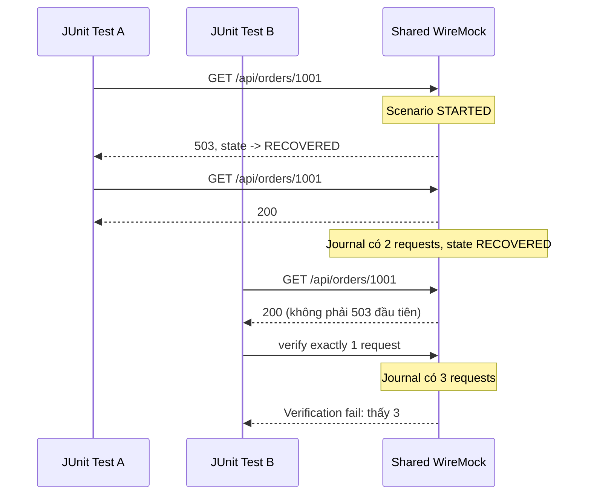
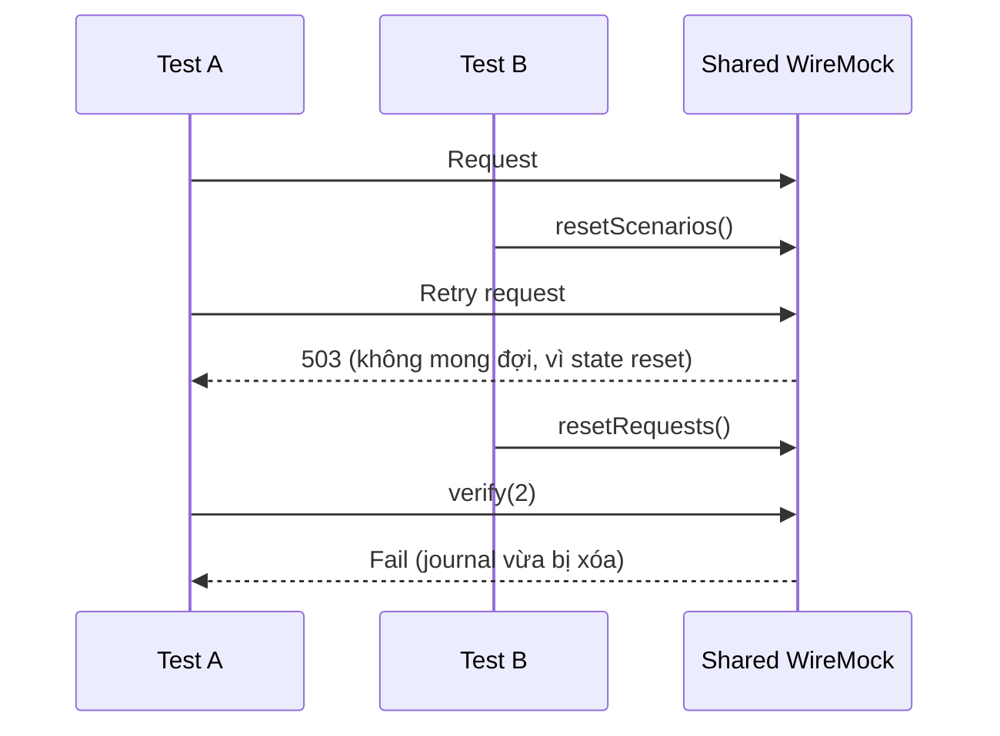

# Scenario hoặc request journal gây ảnh hưởng chéo giữa các test trong Spring Cloud Contract

**Spring Cloud Contract (SCC)** cho phép producer mô tả giao diện HTTP hoặc thông điệp bằng Groovy/YAML DSL, sinh kiểm thử phía cung cấp, đóng gói stubs và dùng **Stub Runner** để consumer kiểm tra sự tương thích. Với các contract HTTP, Stub Runner thường khởi chạy **WireMock** để phục vụ mappings tương ứng với request mà consumer gửi.

Một lỗi chẩn đoán khó chịu xuất hiện khi **từng test đều pass nếu chạy riêng, nhưng fail khi chạy cả suite, đổi thứ tự hoặc chạy song song**. Ví dụ: test A dự kiến nhận `503` ở lần gọi đầu và `200` ở lần thứ hai; sau khi test A chạy, test B cũng muốn thấy `503` đầu tiên nhưng lại nhận `200`. Trường hợp khác, test B xác minh `GET /api/orders/1001` được gọi đúng một lần nhưng WireMock báo ba lần, dù test B chỉ tạo một request.

Hai nguyên nhân thường bị gộp nhầm là **WireMock scenario state** và **request journal**. Chúng cùng sống trong runtime stub server nhưng có nhiệm vụ khác nhau:

- **Scenario state** có thể **thay đổi mapping nào được áp dụng**, nên trực tiếp ảnh hưởng response.
- **Request journal** mặc định **ghi lại các request đã nhận** để tra cứu và verify số lần gọi; nó không tự đổi response chỉ vì đã có nhiều request, nhưng lịch sử tồn đọng có thể làm assertion sai hoặc gây nhiễu việc phân tích. Nếu có extension tùy biến đọc journal để quyết định response thì đó là hành vi bổ sung phải kiểm thử riêng.

Bài thuộc chương **Chẩn đoán sự cố**, chủ đề **Scenario hoặc request journal gây ảnh hưởng chéo giữa các test**, tập trung vào cách tái hiện, xác định nguyên nhân, cô lập trạng thái, reset đúng phạm vi và thiết kế các bài test HTTP/messaging an toàn trong JUnit, Spring Test, Stub Runner và CI.

## 1. Mục tiêu học tập

Sau bài này, bạn có thể:

1. Phân biệt **mapping definitions**, **scenario state**, **request journal** và **client/application state**.
2. Giải thích vì sao các test WireMock có thể phụ thuộc thứ tự dù source contract không đổi.
3. Tái hiện lỗi `503 → 200` do scenario chưa được reset.
4. Tái hiện lỗi `verify(1, ...)` bị sai do request journal ghi cả các request từ test trước.
5. Dùng đúng các cơ chế như `resetScenarios()`, `resetRequests()`, `resetAll()` hoặc tạo server mới theo mức cô lập cần thiết.
6. Biết khi nào **không nên gọi resetAll** vì có thể ảnh hưởng mappings do Stub Runner đăng ký.
7. Chẩn đoán request không match, mapping priority và scenario collision mà không nhầm với lỗi contract của producer.
8. Cô lập test dưới Spring context caching và chạy song song trong CI.
9. Lưu bằng chứng đủ để phân biệt state leakage, artifact cũ và breaking change thật.
10. Chuyển một lỗi flaky đã tìm được thành regression test ổn định.

## 2. Mô hình trạng thái WireMock: bốn kho thông tin khác nhau

Một WireMock server phục vụ các thành phần có vòng đời riêng:

| Thành phần | Chứa gì? | Có thể ảnh hưởng response? | Ảnh hưởng chéo thường gặp |
| --- | --- | --- | --- |
| Mapping definitions | Request matchers, response, priority, scenario constraints | Có | Mapping cũ/chồng lấp che mapping mới |
| Scenario state | Tên scenario và trạng thái như `Started`, `RECOVERED` | **Có** | Test sau bắt đầu ở state còn sót |
| Request journal | Lịch sử requests/serve events, thông tin unmatched | Mặc định **không tự quyết định response** | `verify(n)` đếm cả request trước; log nhiễu |
| Client/application state | Retry counter, cookie jar, cache, session, DB/mock state | Có, tùy logic | Client không gửi cùng request hoặc dữ liệu đầu vào khác |

Đây là bốn nơi cần kiểm tra **riêng**, không gọi tất cả là “cache WireMock”.

### 2.1. Vòng đời của từng trạng thái

- **Mapping:** được đăng ký từ stubs JAR, JSON files hoặc Java DSL; một test có thể sửa/thêm mapping và ảnh hưởng test khác khi dùng chung server.
- **Scenario:** khi mapping có `inScenario(...)`, `whenScenarioStateIs(...)` và `willSetStateTo(...)`, server lưu state theo tên scenario trong **instance** đó.
- **Journal:** ghi nhận requests được phục vụ hoặc không được match, nếu tính năng journal đang bật.
- **Ứng dụng consumer:** có thể giữ access token, base URL, DNS, HTTP connection pool, retry policy hoặc circuit breaker qua nhiều test.

**Reset request journal không reset scenario state. Reset scenario state không xóa request journal.** Đây là điểm chẩn đoán quan trọng nhất của bài.

## 3. Triệu chứng đặc trưng và giả thuyết ban đầu

| Triệu chứng | Giả thuyết ưu tiên | Kiểm chứng nhanh |
| --- | --- | --- |
| Test mong 503 đầu tiên nhưng nhận 200 | Scenario đang ở `RECOVERED` | Xem `/__admin/scenarios` |
| Test mong 1 request nhưng verify thấy 3 | Request journal chưa reset | Xem `/__admin/requests` |
| Khi chạy riêng pass, chạy suite fail | Dùng chung WireMock instance hoặc Spring context | In server URL/port và lifecycle |
| Test khác bị 404 sau khi reset | `resetAll` đã thay đổi mappings | Xem `/__admin/mappings` |
| Chạy song song có response bất thường | Cùng scenario/server bị test khác reset hoặc chuyển state | Xác định server ownership và parallel groups |
| Test retry không đủ 2 calls | Retry policy/client hoặc scenario transition | Xem timeline request journal và state |
| 404 xuất hiện dù có contract 404 | Có thể là unmatched 404 của WireMock | Xem matched mapping/near misses |
| Local pass, CI fail | Reuse process/context, cache, port race, test order | Kiểm tra JUnit/runner parallel và artifact version |
| Request count tăng sau khi test đã xong | Async/retry/background call còn chạy | Dừng nguồn tác vụ và chờ điều kiện xác định |
| Scenario sau reset vẫn “lạ” | Mapping khác cùng tên scenario hoặc extension | Kiểm tra toàn bộ mappings/registrations |

Các giả thuyết là **điểm bắt đầu**, chưa phải chẩn đoán cuối. Một test nhận 200 thay vì 503 cũng có thể do mapping priority, request URL khác, Stub Runner chọn nhầm artifact hoặc một mock server khác đang nghe trên port cũ.

## 4. Scenario trong WireMock: phản hồi phụ thuộc lịch sử khớp mapping

WireMock hỗ trợ mô phỏng dịch vụ có trạng thái thông qua **scenarios**. Một scenario thường bắt đầu ở state hằng `STARTED` của Java API (trong Admin API có thể hiển thị tên ban đầu theo dạng `Started`, tùy biểu diễn/version).

Ví dụ API đơn hàng có retryable failure:

```text
Scenario: order-api-retry

Trạng thái ban đầu: STARTED
  GET /api/orders/1001
    -> HTTP 503
    -> chuyển state sang RECOVERED

Trạng thái RECOVERED
  GET /api/orders/1001
    -> HTTP 200 {"id":1001,"status":"CREATED"}
```

Đây là một **mô hình stub để thử retry**. Nó không chứng minh producer production sẽ tự phục hồi sau đúng một request, không xác minh SLA hay các lỗi mạng thực.

### 4.1. WireMock Java DSL tạo scenario

```java
import static com.github.tomakehurst.wiremock.client.WireMock.*;
import static com.github.tomakehurst.wiremock.stubbing.Scenario.STARTED;

wireMockServer.stubFor(
    get(urlEqualTo("/api/orders/1001"))
        .inScenario("order-api-retry")
        .whenScenarioStateIs(STARTED)
        .willSetStateTo("RECOVERED")
        .willReturn(aResponse()
            .withStatus(503)
            .withHeader("Content-Type", "application/json")
            .withBody("{\"code\":\"TEMPORARY_UNAVAILABLE\"}"))
);

wireMockServer.stubFor(
    get(urlEqualTo("/api/orders/1001"))
        .inScenario("order-api-retry")
        .whenScenarioStateIs("RECOVERED")
        .willReturn(okJson(
            "{\"id\":1001,\"status\":\"CREATED\"}"
        ))
);
```

Đây là **đoạn đăng ký stub cho một WireMockServer đã khởi chạy**, không phải một JUnit class đầy đủ. Tên phương thức và import cần phù hợp WireMock version mà dự án thực sử dụng.

**Quan trọng:** state chuyển khi request **khớp mapping có thiết lập chuyển state**. Chỉ nhìn thấy request trong journal không tự gây chuyển state nếu request không match mapping đó.

### 4.2. Tên scenario dùng chung trong cùng server

Nếu hai mapping khác nhau cùng viết:

```text
.inScenario("order-api-retry")
```

thì chúng cùng tham gia **một state machine trong WireMock instance**, không có state riêng theo test method. Khi một test đổi state sang `RECOVERED`, test khác dùng cùng instance và cùng scenario name sẽ chịu ảnh hưởng.

Đặt tên scenario có namespace theo use case, chẳng hạn `checkout-order-retry` và `billing-order-retry`, giúp giảm collision giữa các mappings. Tuy nhiên **đổi tên không thay thế việc reset hoặc cô lập server** nếu các test cố ý dùng cùng scenario.

## 5. Request journal: ghi nhận lịch sử, không phải state machine

Request journal là dữ liệu để xác minh request và tìm nguyên nhân không match:

- Method, URL, query, headers, body của request.
- Kết quả phục vụ và mapping có liên quan theo API/version.
- Requests matched hoặc unmatched.
- Số lần gọi để dùng `verify(...)`.
- Timeline phục vụ phân tích retry, timeout và unexpected calls.

Với journal mặc định, hai test dùng chung server:

```text
Test A:
  GET /api/orders/1001 -> ghi journal entry #1

Test B:
  GET /api/orders/1001 -> ghi journal entry #2

Test B:
  verify(1, GET /api/orders/1001) -> FAIL
  Vì journal đang có 2 request phù hợp.
```

**Journal không khiến request thứ hai được trả khác request thứ nhất.** Nó chỉ làm `verify(1)`, “zero interactions”, near-miss diagnostics hoặc các báo cáo dựa trên lịch sử **nhìn thấy dữ liệu của test trước**.

### 5.1. Khi journal có thể gián tiếp ảnh hưởng behavior

Nếu dự án viết custom WireMock extension hoặc test helper đọc số request trong journal rồi trả response theo số lần gọi, lúc đó journal tham gia logic tùy biến. Nhưng đây **không phải cơ chế mặc định thay thế scenario**; extension đó phải được kiểm thử và reset dữ liệu nguồn tương ứng.

Để mô phỏng `503 → 200`, ưu tiên **scenario rõ ràng** hoặc một stateful test component có lifecycle xác định, thay vì ngầm dựa vào số dòng journal.

### 5.2. Vì sao journal cũng có thể gây vấn đề tài nguyên?

Một server dùng chung, chạy nhiều test/retry và lưu quá nhiều requests có thể tăng bộ nhớ hoặc làm diagnostics chậm. Có thể cấu hình giới hạn/vô hiệu hóa journal tùy WireMock version, nhưng **nếu tắt journal, các phép verify dựa vào lịch sử requests có thể không còn hoạt động**.

Không “sửa” lỗi `verify(1)` bằng cách vô hiệu hóa journal rồi bỏ luôn assertion quan trọng. Hãy cô lập/reset đúng phạm vi.

## 6. Sơ đồ cơ chế ảnh hưởng chéo



Ở đây **có hai lỗi cùng lúc nhưng khác nguyên nhân**:

1. Response sai do **scenario state chưa reset**.
2. Request count sai do **request journal chưa reset**.

Gọi riêng `resetRequests()` sẽ giải quyết lỗi thứ hai nhưng **không đưa state về STARTED**. Gọi riêng `resetScenarios()` đưa scenario về ban đầu nhưng **không xóa ba request đã ghi**.

## 7. Anti-pattern: test vô tình phụ thuộc thứ tự chạy

Một suite dễ lỗi:

```java
// Minh họa anti-pattern: các test dùng chung server và không reset.
@Test
void firstCallReturns503() throws Exception {
    assertEquals(503, sendGet().statusCode());
}

@Test
void nextCallReturns200() throws Exception {
    assertEquals(200, sendGet().statusCode());
}
```

Vấn đề: JUnit thông thường **không bảo đảm** hai test sẽ chạy theo thứ tự tên method. Mỗi method là một bài test và nên tự chuẩn bị trạng thái đầu vào, không dùng state còn lại của method khác làm điều kiện.

Có thể thêm `@TestMethodOrder` để ép thứ tự, nhưng cách đó chỉ **che dependence**. Nó không giải quyết việc suite chạy với một test class khác, một runner khác hoặc re-run fail case riêng.

### 7.1. Mẫu đúng: một kịch bản retry trong một test

Thay vì chia 503 và 200 ra hai test phụ thuộc nhau, gom những bước liên quan vào **một test tự chứa**:

```text
Given: scenario STARTED

When: consumer gọi order API và retry theo policy
Then: attempt 1 nhận 503, attempt 2 nhận 200
And: consumer hoàn thành use case
And: WireMock nhận đúng số requests theo policy

Cleanup: stop/reset server theo ownership của test
```

Nếu test suite cần thử riêng hai state, mỗi test phải **explicitly establish scenario state** hoặc dùng server mới, không dựa vào kết quả test chạy trước.

## 8. Ví dụ JUnit 5: một WireMockServer riêng cho mỗi test

Một giải pháp cô lập rõ ràng là khởi tạo server ở `@BeforeEach` và stop ở `@AfterEach`.

```java
import static com.github.tomakehurst.wiremock.client.WireMock.*;
import static com.github.tomakehurst.wiremock.core.WireMockConfiguration.options;
import static com.github.tomakehurst.wiremock.stubbing.Scenario.STARTED;
import static org.junit.jupiter.api.Assertions.assertEquals;

import com.github.tomakehurst.wiremock.WireMockServer;
import java.net.URI;
import java.net.http.HttpClient;
import java.net.http.HttpRequest;
import java.net.http.HttpResponse;
import org.junit.jupiter.api.AfterEach;
import org.junit.jupiter.api.BeforeEach;
import org.junit.jupiter.api.Test;

class OrderRetryStubIsolationTest {

    private WireMockServer wireMock;
    private HttpClient http;

    @BeforeEach
    void startAndRegister() {
        wireMock = new WireMockServer(options().dynamicPort());
        wireMock.start();
        http = HttpClient.newHttpClient();

        wireMock.stubFor(
            get(urlEqualTo("/api/orders/1001"))
                .inScenario("order-api-retry")
                .whenScenarioStateIs(STARTED)
                .willSetStateTo("RECOVERED")
                .willReturn(aResponse().withStatus(503))
        );

        wireMock.stubFor(
            get(urlEqualTo("/api/orders/1001"))
                .inScenario("order-api-retry")
                .whenScenarioStateIs("RECOVERED")
                .willReturn(okJson(
                    "{\"id\":1001,\"status\":\"CREATED\"}"
                ))
        );
    }

    @AfterEach
    void stopServer() {
        if (wireMock != null) {
            wireMock.stop();
        }
    }

    private int getStatus() throws Exception {
        HttpRequest request = HttpRequest.newBuilder(
                URI.create(
                    "http://localhost:" + wireMock.port()
                    + "/api/orders/1001"
                ))
            .GET()
            .build();
        return http.send(
            request,
            HttpResponse.BodyHandlers.discarding()
        ).statusCode();
    }

    @Test
    void firstAttemptFailsThenSecondSucceeds() throws Exception {
        assertEquals(503, getStatus());
        assertEquals(200, getStatus());
        wireMock.verify(
            2, getRequestedFor(urlEqualTo("/api/orders/1001"))
        );
    }

    @Test
    void anotherTestAlsoStartsFrom503() throws Exception {
        assertEquals(503, getStatus());
        wireMock.verify(
            1, getRequestedFor(urlEqualTo("/api/orders/1001"))
        );
    }
}
```

Đây là **ví dụ JUnit 5 cho hành vi WireMock**, dùng Java HTTP Client và WireMock version có API tương ứng. Mỗi test có **instance, port, mappings, scenario state và journal mới**, do đó không cần dựa vào thứ tự.

**Giới hạn quan trọng:** Ví dụ gọi WireMock trực tiếp để chứng minh isolation; nó **chưa kiểm thử retry của `OrderClient` production**. Bài integration/consumer test thật cần gọi client/use case thực, cho retry xảy ra tự nhiên và assert kết quả/side effects.

### 8.1. Vì sao port động quan trọng?

Nếu nhiều test classes cố khởi động WireMock trên `8085` đồng thời, một server có thể không bind được hoặc client gọi nhầm instance cũ. `dynamicPort()` cấp port khả dụng cho instance tại thời điểm khởi động, nhưng **client phải nhận đúng port thực** trước khi gửi request.

Không sử dụng một `static final String BASE_URL="http://localhost:8085"` khi server dùng dynamic port. Truyền URL qua test configuration đúng với client thực.

## 9. Dùng chung server: reset scenarios và journal đúng phạm vi

Trong một số suite, khởi động server cho mỗi test quá tốn chi phí. Có thể sử dụng **server chung** nếu test chạy tuần tự và mỗi test khôi phục trạng thái trước khi thực thi.

Ví dụ với một `WireMockServer` do chính test suite sở hữu:

```java
@BeforeEach
void resetTransientState() {
    wireMockServer.resetScenarios();
    wireMockServer.resetRequests();
}
```

Hai phương thức trên là **API thường dùng với WireMockServer tương ứng**; kiểm tra API phiên bản WireMock project đang dùng.

Ý nghĩa:

- `resetScenarios()` đưa các scenario về trạng thái ban đầu.
- `resetRequests()` xóa lịch sử request journal.
- Hai thao tác **không nhằm xóa mappings đã đăng ký**.
- Nếu test A thêm một mapping khác, hai lệnh này **không loại bỏ mapping đó**. Cần có chiến lược kiểm soát mapping lifecycle.

### 9.1. Chọn loại reset theo dạng rò rỉ

| Tình huống | Thao tác thường phù hợp | Không giải quyết được gì? |
| --- | --- | --- |
| State `RECOVERED` còn sót | `resetScenarios()` | Journal và mappings còn giữ |
| `verify(1)` thấy requests cũ | `resetRequests()` | Scenario state không đổi |
| Cả hai cùng rò rỉ | Gọi hai thao tác | Dynamic mappings cũ vẫn còn |
| Test đã thêm mappings tạm | Xóa/reset mappings theo ownership hoặc tạo server mới | Các state khác phải xem thêm |
| Server không rõ ai sở hữu | Cô lập instance hoặc context | Reset toàn cục có thể phá test khác |
| Suite chạy song song cùng server | **Không đủ nếu chỉ reset** | Test khác có thể gọi đúng lúc reset |

### 9.2. Đặt reset ở trước hay sau test?

**Reset trong `@BeforeEach`** giúp từng test tự thiết lập precondition, kể cả khi test trước crash trước cleanup. Có thể kết hợp `@AfterEach` để dọn dữ liệu nhạy cảm hoặc giảm bộ nhớ, nhưng không chỉ dựa vào after hook của test trước làm bảo đảm duy nhất.

Nếu một test cần xác minh journal sau request, **đừng reset giữa bước gọi và bước verify**. Reset nên diễn ra ở ranh giới rõ ràng, sau khi mọi assertions của test trước hoàn tất và trước khi test sau bắt đầu.

### 9.3. Một shared server không an toàn khi reset giữa các thread

Giả sử test A vừa gửi 503 và sắp retry, trong khi test B gọi `resetScenarios()`. Attempt thứ hai của A có thể lại nhận 503 vì state đã bị đưa về STARTED. Đồng thời B gọi `resetRequests()` sẽ xóa request mà A chuẩn bị verify.

**Dùng chung server + reset từng method chỉ an toàn khi không có truy cập đồng thời vào cùng state**, hoặc đã có isolation/serialization phù hợp.

## 10. Cẩn trọng với `resetAll()`: có thể mất mappings

WireMock còn có các thao tác reset rộng hơn, chẳng hạn `resetAll()` hoặc reset mappings tùy API version. Chúng không tương đương `resetRequests()`.

Trong suite tự khởi tạo mappings mỗi test, một full reset có thể hợp lý. Nhưng trong môi trường **Stub Runner đã nạp mappings từ stubs JAR**, full reset có thể thay đổi hoặc xóa những mapping động đã đăng ký; test tiếp theo đột nhiên nhận **404 unmatched**.

### 10.1. Quy tắc ownership

| Ai quản lý server/mapping? | Chiến lược an toàn |
| --- | --- |
| Test tự tạo server và tự tạo mappings | Mỗi test server mới hoặc full reset rồi đăng ký lại |
| Test fixture dùng chung có mappings cố định | Reset state/journal, kiểm soát mapping thay đổi |
| Stub Runner sở hữu WireMock instance | Tránh full reset mù quáng; chỉ reset phần cần thiết hoặc khởi tạo test context riêng |
| Server test dùng chung nhiều service | Không cho một suite reset toàn cục khi suite khác đang dùng |
| Remote stub server không do test sở hữu | Cần hợp đồng quản lý lifecycle riêng; không tự gọi admin reset |

**Đừng dùng `resetAll()` như một “nút sửa flaky test” mặc định** nếu chưa biết nó ảnh hưởng tới mappings nào và WireMock version đang dùng xử lý default mappings thế nào.

### 10.2. Khi cần full reset, phải đăng ký lại mapping

Mô hình:

```text
Before each test:
  reset mappings + scenarios + journal
  register all required mappings
  configure client URL
  execute test
  verify results

After each test:
  release server or clean owned state
```

Nếu mapping được tạo bởi SCC/Stub Runner, nên để **component sở hữu mappings** khởi tạo lại theo lifecycle phù hợp thay vì test tự xóa rồi tự đoán cách nạp từ JAR.

## 11. Dùng Admin API để xác minh trạng thái đang sống

Khi dùng WireMock trên HTTP local `http://localhost:8085`, có thể xem dữ liệu qua Admin API (nếu được bật và truy cập được trong cấu hình/test version):

```bash
# Mappings hiện tại
curl -s http://localhost:8085/__admin/mappings

# Scenario states hiện tại
curl -s http://localhost:8085/__admin/scenarios

# Request journal / serve events
curl -s http://localhost:8085/__admin/requests

# Các request không khớp mapping
curl -s http://localhost:8085/__admin/requests/unmatched
```

Các endpoint trên là dạng **WireMock Admin API thông dụng**, không phải endpoint của `order-producer`. Trong dự án thật cần kiểm tra phiên bản, quyền truy cập và môi trường.

### 11.1. Reset đúng loại bằng HTTP Admin API

Ví dụ chỉ dùng **trên WireMock test server mà bạn quản lý**, không phải server dùng chung:

```bash
# Reset scenario states về ban đầu
curl -X POST http://localhost:8085/__admin/scenarios/reset

# Xóa lịch sử các request đã ghi
curl -X DELETE http://localhost:8085/__admin/requests
```

Hai thao tác phải được thực hiện **trước test và không có các test khác đang dùng server cùng lúc**. Nếu bạn chạy trên một Stub Runner instance có mappings được nạp từ JAR, việc reset scenario/journal thường ít xâm lấn hơn full reset, nhưng vẫn có thể ảnh hưởng test đang chạy đồng thời.

### 11.2. Admin API và bảo mật

Request journal có thể lưu `Authorization`, `Cookie`, `Set-Cookie`, email hoặc payload nhạy cảm. Chỉ truy cập Admin API trong môi trường test được kiểm soát, hạn chế quyền truy cập, **ẩn credentials khi chụp log** và không đưa raw request journal của dữ liệu thật lên issue tracker/CI artifact công khai.

## 12. Case study 1: test retry thứ hai nhận 200 thay vì 503

**Bối cảnh:** consumer dùng retry policy khi producer tạm thời trả 503. Mapping WireMock có state `STARTED → RECOVERED`.

**Kịch bản lỗi:**

```text
Test A: shouldRetryOn503
  state ban đầu = STARTED
  request #1 -> 503, state = RECOVERED
  request #2 -> 200
  PASS

Test B: shouldShowTemporaryErrorOnFirstCall
  test giả định state ban đầu = STARTED
  request #1 -> 200 (vì state vẫn RECOVERED)
  FAIL: expected 503
```

### 12.1. Cách xác định nguyên nhân

1. Ghi WireMock instance/port test A và B đang dùng.
2. Kiểm tra scenario name và state trước khi B chạy.
3. Đối chiếu mappings: mapping 503 chỉ match `STARTED`, mapping 200 match `RECOVERED`.
4. Xem request journal để biết test nào đã chuyển state.
5. Chạy B riêng với server mới: nếu nhận 503, có cơ sở nghi ngờ state leak.
6. Thêm setup reset scenario hoặc server-per-test.
7. Chạy lại cả suite với thứ tự đảo và song song theo policy.

### 12.2. Sửa đúng và sửa sai

**Sửa đúng:** mỗi test tự tạo state ban đầu bằng isolation/reset; nếu test A và B cùng tác động shared server song song, chuyển sang server riêng hoặc serial execution có kiểm soát.

**Sửa sai:** thay expected của B thành 200 chỉ vì suite hiện chạy A trước; thêm `Thread.sleep` để “đợi scenario reset”; hoặc ép test order nhưng không quản lý state.

## 13. Case study 2: `verify(1)` báo có ba request

**Bối cảnh:** consumer test muốn bảo đảm chỉ gọi API một lần.

```java
orderClient.getOrder("1001");

wireMockServer.verify(
    1,
    getRequestedFor(urlEqualTo("/api/orders/1001"))
);
```

Nếu một test trước đã gửi hai request cùng đường dẫn, journal còn ba request phù hợp. Assertion fail dù `orderClient.getOrder` ở test hiện tại chỉ gọi một lần.

### 13.1. Chẩn đoán

- Gọi `GET /__admin/requests` và lọc theo method/path.
- So thời điểm và request headers/test correlation ID nếu có.
- Kiểm tra retry interceptor có tự gửi nhiều lần không.
- Kiểm tra background job hoặc health check có gọi cùng endpoint không.
- Kiểm tra journal được reset khi nào.
- Nếu journal disabled, xác minh phép `verify` có được hỗ trợ theo cấu hình đó không.

**Đừng suy ngay rằng consumer có bug retry** chỉ từ `expected 1, got 3`. Có thể là rò rỉ journal; cũng có thể chính consumer đang gọi ba lần thật do retry. Cần phân biệt bằng log timeline và state từ test hiện tại.

### 13.2. Giải pháp

Với server riêng cho test: journal mới là cách rõ ràng nhất. Với server chung nhưng chạy tuần tự, gọi `resetRequests()` **trước khi thực thi test hiện tại** và không gọi test khác xen vào.

Nếu test cần đếm toàn bộ số request qua một use case retry, nên giữ journal trong phạm vi test ấy tới khi verify xong.

### 13.3. Không loại bỏ assertion số lần gọi khi nó bảo vệ nghiệp vụ

Ví dụ gửi thanh toán, đặt hàng hoặc email: assert “đúng một side effect” có thể quan trọng. Không chữa lỗi `verify(1)` bằng cách đổi thành `atLeast(1)` nếu hợp đồng/logic cần ngăn duplicate. Hãy sửa isolation rồi kiểm tra lại số requests thật.

## 14. Spring Test context caching và Stub Runner dùng chung runtime

Spring Test có thể **cache ApplicationContext** giữa các test classes có cấu hình tương đương. Trong nhiều cấu hình, Stub Runner/WireMock được khởi tạo trong vòng đời context hoặc các bean liên quan; vì vậy các test có thể **vô tình dùng chung stub server** lâu hơn một test method.

Ví dụ:

```java
import org.springframework.boot.test.context.SpringBootTest;
import org.springframework.cloud.contract.stubrunner.spring.AutoConfigureStubRunner;
import org.springframework.cloud.contract.stubrunner.spring.StubRunnerProperties;

@SpringBootTest(properties = {
    "order.api.base-url=http://localhost:8085"
})
@AutoConfigureStubRunner(
    ids = "com.example:order-producer:1.4.0:stubs:8085",
    stubsMode = StubRunnerProperties.StubsMode.LOCAL
)
class OrderConsumerContractTest {
    // Client thật gọi Stub Runner.
}
```

Cấu hình này là ví dụ về **client dùng stub server**. Nó không tự tạo mỗi test một WireMockServer mới; lifecycle cụ thể tùy SCC/Spring Test version và test configuration.

### 14.1. Các câu hỏi cần kiểm tra

1. Hai test classes có cùng `ApplicationContext` được cache không?
2. Stub Runner đang quản lý một hay nhiều WireMock instances?
3. Server URL/port có giống nhau giữa classes không?
4. Có JUnit parallel execution đang bật không?
5. Có test nào gọi Admin API reset hoặc đăng ký mapping động không?
6. Có scenario name dùng chung giữa các contract/test suites không?
7. Mỗi test có setup trạng thái trước khi gọi client không?

### 14.2. `@DirtiesContext` là một công cụ có chi phí

Trong một số tình huống, đánh dấu Spring context “dirty” để nó được đóng/tạo lại có thể giúp cô lập lifecycle Stub Runner:

```java
import org.springframework.test.annotation.DirtiesContext;

@DirtiesContext(
    classMode = DirtiesContext.ClassMode.AFTER_CLASS
)
class OrderConsumerContractTest {
    // Các tests của class này được quản lý theo lifecycle context.
}
```

**Không coi `@DirtiesContext` là giải pháp mặc định cho mọi flaky test**: nó có thể làm suite chậm vì tạo lại context, và **không bảo đảm cô lập một remote/shared stub server ngoài context**. Nếu các test vẫn chia sẻ một server độc lập, dirty context chưa chắc giải quyết được gì.

### 14.3. Reset thông qua Admin API phải theo ownership

Với WireMock được Stub Runner quản lý, test có thể truy cập Admin API ở URL stub server nếu cấu hình cho phép; tuy nhiên, **đừng gọi full reset rồi vô tình xóa mappings được SCC nạp**. Nếu cần reset state/journal, xây test fixture quản lý đúng URL và chỉ gọi những API phù hợp.

## 15. Test song song: race conditions khiến reset mất hiệu lực

Một shared WireMock instance có thể bị truy cập từ nhiều test threads:



Ở đây, **cả A và B đều có thể đang viết setup/teardown “đúng” nếu chạy tuần tự**, nhưng vẫn sai khi chạy song song cùng server. Reset không tạo transaction isolation giữa các tests.

### 15.1. Các phương án xử lý

| Phương án | Điểm mạnh | Hạn chế |
| --- | --- | --- |
| Mỗi test một WireMockServer/port động | Cô lập scenario, journal và mappings mạnh | Tốn thời gian khởi động |
| Mỗi test class một server | Ít overhead hơn | Các methods trong cùng class vẫn cần reset |
| Server theo một test group được serialize | Giảm số server | Giảm mức song song, phải bảo đảm mọi test dùng chung lock |
| Tên scenario riêng + request matching riêng | Giảm collision | Journal và reset vẫn chia sẻ |
| `@ResourceLock` trên JUnit shared resource | Ngăn những test được gắn cùng lock chạy đồng thời | Cần áp dụng nhất quán cho **mọi test liên quan** |
| `@DirtiesContext` và context isolation | Có thể cô lập Stub Runner theo Spring context | Tốn chi phí; không bảo vệ remote shared server |

### 15.2. Ví dụ JUnit resource lock

```java
import org.junit.jupiter.api.parallel.ResourceLock;
import org.junit.jupiter.api.parallel.ResourceAccessMode;

@ResourceLock(
    value = "shared-wiremock-order",
    mode = ResourceAccessMode.READ_WRITE
)
class OrderConsumerTest {
    // Tất cả test suites dùng chung WireMock phải tuân thủ cùng lock.
}
```

Đây là **một biện pháp JUnit Jupiter** khi các tests dùng chung một JVM/test engine. Nó không khóa một WireMock server trước các **CI jobs hoặc JVM processes khác**. Khi cần cô lập giữa processes, dùng server/port/repository riêng hoặc một cơ chế điều phối tài nguyên cấp cao hơn.

### 15.3. `@Execution(SAME_THREAD)` không đủ cho mọi class

`@Execution(SAME_THREAD)` có thể điều khiển cách JUnit thực thi các tests trong một phạm vi nhất định, nhưng không mặc nhiên ngăn một test class khác ở thread/process khác cùng gọi shared WireMock server. Cần hiểu scope của cấu hình song song thực tế.

## 16. Tên scenario trùng giữa mappings và test suites

Scenario state được gắn với **scenario name trong cùng server**. Nếu nhóm Checkout và nhóm Billing đều dùng `"retry"`, các mapping của họ có thể ảnh hưởng lẫn nhau dù URL khác.

Một cách đặt tên tốt hơn:

```text
checkout:order-api:retry-503-once
billing:invoice-api:retry-503-once
notification:order-created:delivery-demo
```

Tuy nhiên, **tên riêng không thay thế reset**:

- Test vẫn có thể chạy lại cùng scenario name trong lần kế tiếp.
- Mapping runtime có thể bị đăng ký trùng.
- Một extension có thể dùng state ngoài scenario map.
- Request journal vẫn ghi tất cả requests trong instance.

### 16.1. Đọc toàn bộ mappings khi debug

Đừng chỉ mở JSON mapping của contract đang fail. Cần xem:

- Có bao nhiêu mapping cùng method/path?
- Có mapping generic catch-all không?
- `priority` có khiến response khác được chọn không?
- Những mappings nào cùng `scenarioName`?
- Có custom transformer hoặc webhook nào thay đổi output không?
- File stubs từ hai version có bị nạp đồng thời không?

**Số priority nhỏ hơn thường có độ ưu tiên cao hơn trong WireMock**. Một mapping tổng quát ưu tiên cao có thể che mapping scenario cụ thể, gây response sai mà reset state không sửa được.

## 17. Unmatched 404 không phải contract 404 của producer

Khi request không match bất cứ WireMock mapping nào, server có thể trả **404 mặc định**. Điều đó khác với một hợp đồng đã thống nhất quy định producer trả:

```http
HTTP/1.1 404 Not Found
Content-Type: application/json

{"code":"ORDER_NOT_FOUND"}
```

Nếu scenario state còn ở `RECOVERED` nhưng chỉ có mapping 503 cho `STARTED`, hoặc mapping path/header không khớp, request có thể không được phục vụ như mong đợi. Điều tra bằng **request journal, unmatched requests, mappings và scenario state** trước khi sửa code consumer.

### 17.1. Bảng chẩn đoán 404

| Hiện tượng | Ý nghĩa có thể |
| --- | --- |
| 404 có body `ORDER_NOT_FOUND` theo mapping đã thỏa thuận | Lỗi domain theo contract |
| 404 mặc định của WireMock, request unmatched | Không tìm thấy mapping phù hợp |
| 404 do gọi sai port/base URL | Client không đến đúng Stub Runner instance |
| 404 sau `resetAll()` | Mapping runtime đã bị reset/xóa |
| 404 chỉ ở một scenario state | Không có mapping phù hợp trạng thái hiện tại |
| 404 chỉ khi thiếu header | Success mapping yêu cầu header, nhưng chưa có error mapping |

**Không tạo một catch-all mapping 200 để “chữa” 404**. Điều đó có thể làm request sai hợp đồng cũng được chấp nhận, khiến consumer test xanh giả.

## 18. Retry và client thực: phải tách stub behavior với ứng dụng

Ví dụ WireMock Java DSL `503 → 200` chỉ chứng minh stub có thể phục vụ hai lần theo scenario. Một consumer thật có thể:

- Retry tối đa hai lần.
- Chỉ retry GET/idempotent operations.
- Áp dụng exponential backoff.
- Không retry 401/403.
- Tôn trọng `Retry-After` khi thuộc policy.
- Có circuit breaker hoặc timeout.
- Tạo request với header khác ở lần retry.
- Gọi thêm health-check/refresh-token endpoint.

### 18.1. Bài consumer test cần assert điều gì?

```text
Given:
  Stub scenario STARTED, journal trống
  OrderClient dùng đúng Stub Runner URL

When:
  CheckoutService gọi OrderClient.getOrder("1001")

Then:
  CheckoutService nhận DTO hợp lệ
  WireMock ghi đúng số GET theo retry policy
  Không có duplicate business side effects
  Không có extra request tới production endpoint

Cleanup:
  Isolate state trước test tiếp theo
```

Không dùng một `HttpClient` thử nghiệm riêng rồi khẳng định retry interceptor của Feign/WebClient/RestClient trong ứng dụng đã hoạt động.

### 18.2. Retry bất đồng bộ có thể viết journal sau assertions

Một consumer có background retry/task scheduler đôi khi tiếp tục gửi request sau khi test method gần hoàn tất. Test tiếp theo gọi reset rồi background task cũ lại ghi journal vào server.

**Cần chờ điều kiện nghiệp vụ xác định và dừng executor/scheduler theo lifecycle**, không chỉ `Thread.sleep(200)`. Nếu dùng Awaitility hoặc polling có timeout phù hợp, đảm bảo assert cuối cùng phản ánh trạng thái ổn định, không tạo race với cleanup.

## 19. Spring Cloud Contract: contract nguồn và scenario stub là hai vấn đề

Một contract HTTP đơn giản:

```groovy
import org.springframework.cloud.contract.spec.Contract

Contract.make {
    description 'Đọc đơn hàng 1001 thành công'

    request {
        method GET()
        url '/api/orders/1001'
        headers {
            header('Accept', 'application/json')
        }
    }

    response {
        status OK()
        headers {
            contentType(applicationJson())
        }
        body(
            id: 1001,
            status: 'CREATED',
            currency: 'VND'
        )
    }
}
```

YAML tương đương:

```yaml
description: "Đọc đơn hàng 1001 thành công"
request:
  method: GET
  url: /api/orders/1001
  headers:
    Accept: application/json
response:
  status: 200
  headers:
    Content-Type: application/json
  body:
    id: 1001
    status: CREATED
    currency: VND
```

Hai ví dụ mô tả **cùng kịch bản**, nên trong build thực tế chọn một DSL để tránh generated tests/mappings trùng.

### 19.1. Contract DSL không tự tạo `503 → 200` trong một stub stateless

Contract trên mô tả một response 200 cho request. Nếu muốn mô phỏng trạng thái lần đầu 503, lần sau 200, cần **WireMock scenario mappings hoặc cơ chế stateful được công cụ hỗ trợ**, đồng thời xác minh chúng thực sự được đưa vào test server.

Không suy ra chỉ vì có hai contract riêng cho cùng `GET /api/orders/1001` với response 503 và 200 thì WireMock sẽ tự luân phiên giữa chúng. Nếu cùng request conditions, chúng có thể **chồng lấp** và được chọn theo priority/registration behavior.

### 19.2. Scenario mappings được đóng gói thế nào?

Có những cách tổ chức tùy dự án:

- Test trực tiếp đăng ký WireMock scenario mappings qua Java DSL.
- Dùng JSON mappings riêng trong fixture WireMock.
- Có một cơ chế tùy biến để đưa scenario JSON vào stub artifact.
- Stub Runner nạp mappings từ stubs JAR theo cấu trúc plugin và version.

**Không khẳng định SCC DSL mặc định tự chuyển mọi cặp contract thành WireMock scenarios.** Khi vận hành, phải mở **JAR thực tế** và xem scenario JSON/mappings có được đóng gói hay chưa; nếu mapping chỉ nằm ở `src/test` nhưng không được đưa vào artifact, Stub Runner consumer không thể dùng nó.

## 20. Kiểm tra stubs JAR và version để tránh chẩn đoán nhầm

Một test lỗi state leakage có thể thực ra dùng **stub artifact khác** với bản vừa sửa.

Ví dụ consumer:

```java
import org.springframework.boot.test.context.SpringBootTest;
import org.springframework.cloud.contract.stubrunner.spring.AutoConfigureStubRunner;
import org.springframework.cloud.contract.stubrunner.spring.StubRunnerProperties;

@SpringBootTest(properties = {
    "order.api.base-url=http://localhost:8085"
})
@AutoConfigureStubRunner(
    ids = "com.example:order-producer:1.4.0:stubs:8085",
    stubsMode = StubRunnerProperties.StubsMode.LOCAL
)
class CheckoutConsumerContractTest {
    // Gọi OrderClient thật và assert kết quả.
}
```

Nếu producer PR đã sinh candidate `1.5.0-rc.1` nhưng test vẫn pin `1.4.0`, reset scenarios/journal không sửa được **sai version**. Phải kiểm tra:

1. `ids` chọn đúng group/artifact/version/classifier?
2. LOCAL repository có stubs JAR của candidate không?
3. REMOTE mode có repositoryRoot và credentials đúng không?
4. JAR có mappings/scenario JSON mới không?
5. SHA-256 của JAR consumer tải có khớp manifest producer?
6. Stub Runner server thực đang dùng đúng port/base URL không?

### 20.1. Artifact và Java server instance là hai tầng cần định danh

```text
Artifact identity:
  com.example:order-producer:1.5.0-rc.1:jar:stubs
  repository + SHA-256

Runtime identity:
  WireMock server instance
  host/port
  context/job ID
  mappings loaded
  scenario states
  journal entries
```

Hai test có thể dùng **cùng artifact** nhưng **khác server** và hoàn toàn cô lập. Ngược lại, hai test với artifact mong đợi khác nhau có thể vô tình gọi **cùng server cũ** vì base URL/port chưa cập nhật.

## 21. Request journal không phải log của broker hoặc database

Với messaging contract, SCC có thể phát mẫu event qua Stub Runner/`StubTrigger`. Nhưng WireMock HTTP request journal **không ghi nhận đầy đủ**:

- Kafka offsets/partition commits.
- RabbitMQ ack/nack hoặc redelivery.
- DLQ/DLT records.
- Database transaction commits.
- Outbox dispatcher retries.
- Side effects của listener.

Nếu hai messaging tests ảnh hưởng nhau, hãy điều tra **broker topic/queue state, consumer group IDs, test binder, listener concurrency, idempotency store và DB fixtures**, không chỉ xóa WireMock journal.

### 21.1. Một kịch bản message contract

```groovy
import org.springframework.cloud.contract.spec.Contract

Contract.make {
    description 'OrderCreated v1 được phát sau khi tạo đơn'
    label 'order_created_v1'

    input {
        triggeredBy('publishOrderCreated()')
    }

    outputMessage {
        sentTo('orders.created')
        headers {
            messagingContentType(applicationJson())
        }
        body(
            eventId: 'EVT-1001',
            eventType: 'OrderCreated',
            schemaVersion: 1,
            orderId: 'ORD-1001'
        )
    }
}
```

Nếu test listener dùng cùng `eventId` qua nhiều lượt và có idempotency store thật, test sau có thể bỏ qua message như duplicate. Đây là **state trong consumer/database**, không phải WireMock scenario.

### 21.2. Cách cô lập messaging tests

- Unique test topic/queue/group IDs khi cần.
- Reset broker/container state theo quy trình an toàn.
- Tạo event IDs riêng theo test hoặc reset idempotency store.
- Đợi handler hoàn thành trước cleanup.
- Tránh listener background của test trước còn chạy sang test sau.
- Xác minh StubTrigger label và payload đúng candidate artifact.

Không coi một bài test message stub pass là bằng chứng broker delivery semantics hoàn chỉnh.

## 22. Cách chọn chiến lược isolation theo chi phí và độ an toàn

| Môi trường | Cách ưu tiên | Khi nào tăng isolation? |
| --- | --- | --- |
| Unit test WireMock nhỏ | Server riêng mỗi test, dynamic port | Khi setup đắt và cần tối ưu |
| HTTP consumer test một class | Reset scenario/journal trước test nếu không parallel và mappings cố định | Khi tests thêm mappings hoặc có async calls |
| Nhiều test classes cùng Spring context | Group hoặc isolated context, reset có điều phối | Khi context cache làm rò rỉ state |
| CI parallel với nhiều JVM | Server riêng mỗi job/process | Khi shared remote stub server gây race |
| Stub Runner với stubs JAR | Giữ mapping do runner sở hữu, reset state có kiểm soát | Khi cần scenario mapping custom phức tạp |
| Full E2E environment | Namespace/resources riêng, teardown có ownership | Khi nhiều teams dùng chung broker/DB |
| Troubleshooting tạm thời | Chạy riêng, đảo thứ tự, tắt parallel để xác nhận giả thuyết | Sau khi xác định phải sửa isolation lâu dài |

### 22.1. Khi nào reset không đủ?

Reset không giải quyết:

- Một request background đến sau reset.
- Circuit breaker/retry state nằm trong client.
- Cookie/session cache phía consumer.
- Database hoặc broker còn state.
- Shared port đang trỏ tới server khác.
- Mapping chồng lấp/priority sai.
- Artifact JAR version cũ.
- Custom extension giữ static state riêng.

Nếu hai lần reset vẫn fail, **đừng thêm nhiều sleep hoặc reset lặp vô hạn**. Xác định đúng state owner rồi cô lập hoặc quản lý lifecycle của owner ấy.

## 23. Quy trình chẩn đoán từng bước

Khi suite flaky, đi theo chuỗi:

```text
1. Ghi tên test, seed/parallel config, thứ tự và CI job.
2. Xác định exact WireMock host/port/instance của test lỗi.
3. Ghi Stub Runner GAV/classifier/version và source repository.
4. Xem mapping nào match, priority và scenarioName.
5. Xem trạng thái scenario trước request và sau request.
6. Xem request journal trước test: còn bao nhiêu entries?
7. Chạy test lỗi một mình với server/context mới.
8. Chạy cặp test A -> B và B -> A để tái hiện leakage.
9. Thử resetScenarios riêng rồi resetRequests riêng.
10. Đọc response code, matched/unmatched journal events.
11. Kiểm tra async retry, client cache, shared Spring context.
12. Kiểm tra JUnit parallel, shared resource locks và ports.
13. Chọn reset có kiểm soát hoặc server-per-test.
14. Chạy lại suite với thứ tự ngẫu nhiên và parallel policy.
15. Lưu regression test, fixture ownership và evidence.
```

### 23.1. Bảng phân tích nguyên nhân gốc

| Chứng cứ | Kết luận ưu tiên | Hướng sửa |
| --- | --- | --- |
| State trước B là `RECOVERED`, B chỉ pass trên server mới | Scenario leakage | Reset scenarios/server mới |
| Journal trước B có hai GET, verify kỳ vọng một GET | Journal leakage | Reset requests/server mới |
| State STARTED, journal trống nhưng trả sai | Mapping/priority/client URL | Kiểm tra full mappings và target |
| Chỉ fail khi parallel | Race trên shared server/reset | Isolate hoặc serial theo resource |
| Chỉ fail khi CI reuse context | Context lifecycle và static state | Scope lại Spring context/server |
| Request thiếu `Accept` hoặc path sai | Consumer client/request mismatch | Sửa client/contract, không reset |
| Stubs JAR không có scenario JSON | Packaging/configuration | Đưa mapping vào artifact đúng cách |
| Consumer tải version cũ | Artifact resolution | Pin đúng candidate, kiểm tra checksum |
| Test fail sau khi gọi lại async | Background retry còn chạy | Chờ/dừng tác vụ và cleanup |
| Message duplicate bị bỏ qua | Idempotency store/broker | Reset đúng state ngoài WireMock |

## 24. CI: biến lỗi ảnh hưởng chéo thành regression test

Một cổng CI đáng tin nên:

1. Chạy generated producer tests thật, không chỉ tạo source.
2. Kiểm tra số contract/tests được discover; từ chối 0 tests bất thường.
3. Chạy consumer tests với đúng stubs JAR candidate, không dùng version động.
4. Dùng unique/dynamic server port khi parallel.
5. Tránh shared mutable WireMock state giữa CI jobs.
6. Thử chạy một subset hai thứ tự `A → B` và `B → A`.
7. Khi nghi flaky, chạy lại cùng input/version để phân biệt race và artifact mismatch.
8. Lưu test reports, matched/unmatched request diagnostics **đã redact**.
9. Lưu WireMock server version, scenario names, state trước/sau nếu có.
10. Lưu Stub Runner `ids`, repository, artifact SHA-256.
11. Chặn release khi consumer/provider required tests thất bại, không “retry đến xanh”.
12. Sau khi fix, giữ negative regression case để không tái xuất hiện.

### 24.1. Thử đảo thứ tự nhưng đừng ép thứ tự như giải pháp

Một test đúng isolation phải đạt:

```text
Run A alone: PASS
Run B alone: PASS
Run A then B: PASS
Run B then A: PASS
Run A and B concurrently (nếu suite cho phép): PASS
```

Nếu policy chủ động tắt parallel cho shared resource, cần ghi rõ đó là một **ràng buộc test infrastructure**, không che giấu bằng cách chỉ chạy một order duy nhất mãi mãi.

### 24.2. Evidence cần lưu sau fail

| Evidence | Mục đích |
| --- | --- |
| Test class/method và JUnit report | Biết case thất bại và count thực |
| Scenario name/state | Phân biệt state leakage |
| Số journal entries theo request pattern | Phân biệt stale history và retry thật |
| Matched mapping ID/name | Kiểm tra priority/overlap |
| URL/port/server lifecycle | Phát hiện gọi nhầm stub instance |
| Stub Runner GAV/classifier | Xác định đúng contract artifact |
| SHA-256 của stubs JAR | Phát hiện cache/overwrite |
| Retry client config và timeline | Xác định background requests |
| Spring context cache/parallel settings | Phát hiện share state |
| Sanitized logs | Điều tra mà không lộ token/PII |

**Không upload raw bearer token, cookie hoặc dữ liệu khách thật lên request journal artifacts.**

## 25. Bài tập thực hành: cố tình tạo và sửa hai loại leakage

Chuẩn bị một project test có JUnit Jupiter, WireMock, HTTP client Java và (nếu có) Spring Cloud Contract/Stub Runner. Sử dụng fixture JSON tổng hợp, không dùng credentials production.

1. **Tạo server chung:** Dùng WireMockServer trên cổng động ở `@BeforeAll`.
2. **Đăng ký scenario:** Request đầu `GET /api/orders/1001` trả 503 và chuyển `RECOVERED`; request sau trả 200.
3. **Tái hiện state leak:** Viết test A gọi hai lần; test B mong 503 ở lần đầu nhưng không reset scenario.
4. **Chạy thứ tự A → B:** Ghi state trước và sau bằng Admin API hoặc API trực tiếp.
5. **Chạy B một mình:** Đối chiếu kết quả để chứng minh test phụ thuộc state ngoài method.
6. **Reset scenario:** Thêm `resetScenarios()` ở setup; chạy lại hai thứ tự.
7. **Tái hiện journal leak:** Cho test A tạo hai GET, test B gọi một GET rồi `verify(1)`.
8. **Chỉ reset journal:** Thêm `resetRequests()`; xác minh count đúng nhưng state scenario vẫn không đổi nếu chưa reset riêng.
9. **Reset cả hai:** Thêm hai lệnh vào `@BeforeEach` và đảm bảo tests không chạy song song trên server chung.
10. **Thử full reset:** Trong project disposable, gọi `resetAll()` rồi quan sát mappings còn hay không; đăng ký lại mappings theo version đang dùng.
11. **Chuyển sang server-per-test:** Dùng `@BeforeEach`/`@AfterEach` và `dynamicPort()` theo ví dụ phần 8.
12. **So sánh tốc độ/cô lập:** Ghi chi phí khởi động và mức ổn định, chọn strategy phù hợp suite.
13. **Chạy parallel:** Cố ý chạy hai tests cùng shared server để tái hiện race nếu môi trường cho phép.
14. **Thử ResourceLock:** Áp dụng khóa cùng tên cho mọi test dùng shared instance trong cùng JVM.
15. **Mapping overlap:** Thêm catch-all GET priority cao, quan sát response sai dù scenario đã reset.
16. **Unmatched 404:** Gửi request thiếu header/path sai; phân biệt WireMock 404 với contract 404.
17. **Request journal:** Ghi timeline hai request retry, kiểm tra matched mapping và redact headers.
18. **Spring Test caching:** Tạo hai test classes có cấu hình `@AutoConfigureStubRunner` tương tự; xác định có dùng chung runtime không.
19. **Artifact candidate:** Nếu có SCC, build stubs JAR, kiểm tra mappings bằng `jar tf`, pin classifier `stubs`.
20. **Test consumer thực:** Gọi `OrderClient` và assert retry/error handling, không chỉ gọi HttpClient giả lập.
21. **Messaging thử nghiệm:** Gửi hai `OrderCreated` cùng eventId vào test listener, xác định idempotency state ngoài WireMock.
22. **CI regression:** Chạy suite nhiều thứ tự, giữ report về state/journal và cấm pass khi test count bằng 0.
23. **Tổng kết:** Viết một runbook phân biệt scenario state, journal, mappings, client state và artifact version.

### 25.1. Bảng tự đánh giá

| Năng lực | Minh chứng đạt |
| --- | --- |
| Scenario state | Giải thích được `STARTED → RECOVERED` ảnh hưởng response |
| Request journal | Giải thích được stale history ảnh hưởng verify count |
| Phân biệt reset | Biết `resetScenarios` khác `resetRequests` |
| Chọn full reset | Không xóa mappings do Stub Runner quản lý tùy tiện |
| Cô lập JUnit | Test pass ở hai thứ tự và khi chạy riêng |
| Parallel | Không có reset race trên shared server |
| Admin API | Đọc được scenarios, mappings và requests |
| Stub Runner | Biết runtime và artifact version thực đang dùng |
| Negative cases | Không nhầm unmatched 404 với error contract |
| Retry | Test client thực và số lần gọi đúng policy |
| Messaging | Không nhầm WireMock journal với broker/DB state |
| CI | Có regression và sanitized evidence |

## 26. Kết luận: reset đúng trạng thái, không sửa sai hợp đồng

Khi một bài kiểm thử **Spring Cloud Contract + Stub Runner/WireMock** thất bại không ổn định, điều đầu tiên cần xác minh là **test đang chia sẻ thành phần có trạng thái nào**:

- **Scenario state** quyết định mapping nào có thể match ở từng giai đoạn của kịch bản. State còn sót có thể biến lần gọi “đầu tiên” thành lần gọi ở trạng thái tiếp theo.
- **Request journal** mặc định lưu lịch sử. Nó không tự đổi response, nhưng có thể khiến `verify(1)` hoặc phân tích retry sử dụng request từ test khác.
- **Mappings** có thể bị thêm, trùng, xóa bởi full reset hoặc che nhau theo priority.
- **Client, Spring context, broker/DB và artifact version** là những nguồn thay đổi khác mà reset WireMock không tự giải quyết.

Chiến lược an toàn nhất về mặt cô lập là **mỗi test sở hữu server và trạng thái của mình**. Khi cần shared server để giảm thời gian chạy, hãy quản lý ownership, chỉ reset đúng phần cần thiết, tránh parallel races và bảo đảm mappings vẫn được giữ nguyên. Với Stub Runner, luôn xác minh **stubs JAR/classifier/version** mà consumer thực sử dụng.

**Một test xanh đáng tin phải lặp lại được khi chạy một mình, đổi thứ tự và trong mô hình song song đã công bố**, đồng thời giữ nguyên những cam kết thực của producer và consumer. Khi tách rõ scenario, request journal và các trạng thái bên ngoài, nhóm sẽ sửa được nguyên nhân gây ảnh hưởng chéo mà không cần làm lỏng matcher, đổi expected status hoặc che mất regression API thật.
