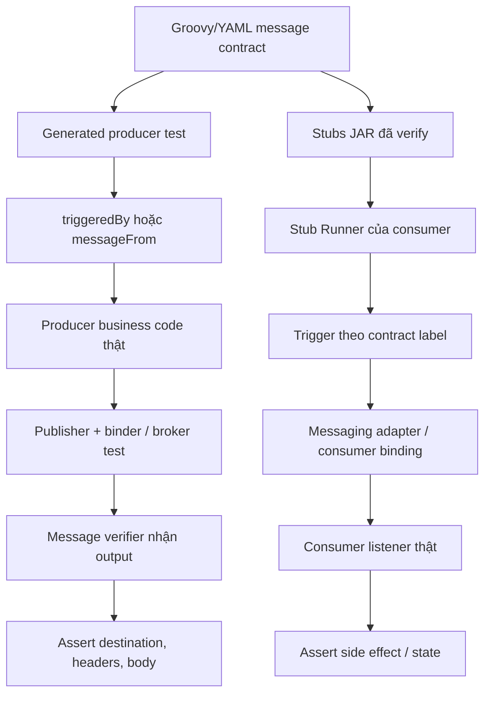
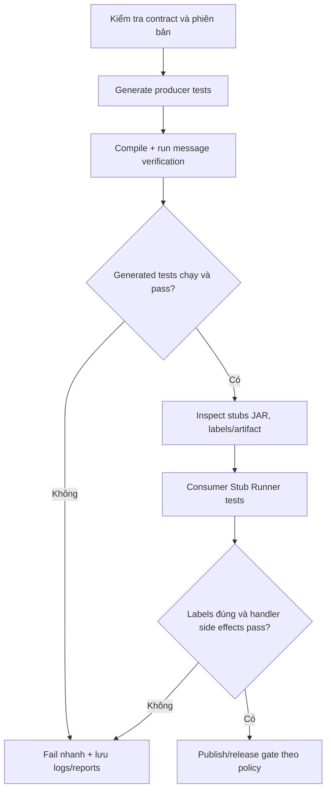

# Messaging test không nhận được thông điệp hoặc chờ quá lâu

Một producer contract test chạy gần hết rồi dừng ở bước nhận thông điệp. Một consumer test gọi `StubTrigger.trigger("billing_order_paid_v1")` nhưng listener của Billing không ghi nhận sự kiện. Có lúc test đạt trên máy cá nhân, sang CI lại hết thời gian chờ. Những triệu chứng này đều giống “**không nhận được message**”, nhưng nguyên nhân có thể nằm ở **business trigger, Spring Cloud Contract message verifier, binder, destination, serializer, listener, broker, race condition hoặc cách chờ bất đồng bộ**.

Trong lộ trình **SPRING_CLOUD_CONTRACT**, hợp đồng HTTP hoặc messaging được mô tả bằng **Groovy/YAML DSL**; **Contract Verifier** sinh kiểm thử cho producer, stubs được đóng gói/phát hành, **Stub Runner** giúp consumer thử nghiệm độc lập, và **CI** phát hiện thay đổi API/message không tương thích. Bài này thuộc chương **Chẩn đoán sự cố**, tập trung vào chủ đề **Messaging test không nhận được thông điệp hoặc chờ quá lâu**.

Mục tiêu là xử lý sự cố có hệ thống, **không chữa bằng cách tăng timeout vô hạn**. Ta sẽ phân biệt producer verification và consumer stub test; xác định nơi message bị mất trên đường từ trigger tới assertion; kiểm tra destination và Spring Cloud Stream binding; nhận diện lỗi JSON headers/schema; thiết kế test bất đồng bộ có deadline và dữ liệu cô lập; đồng thời xây dựng bằng chứng trong CI.

## 1. Phân biệt hai hướng kiểm thử trước khi debug

Trong Spring Cloud Contract messaging, một hợp đồng thường có phần **input** (cách kích hoạt) và **outputMessage** (message được mong đợi).

**Producer-side verification:**

- Generated test gọi hook nghiệp vụ `triggeredBy(...)` **hoặc** gửi một input message được mô tả bằng `messageFrom(...)`.
- Producer **thật trong test context** phải xử lý hành vi và phát output.
- Message verifier quan sát output ở destination theo hợp đồng.
- Test assert headers và body của message vừa quan sát.

**Consumer-side Stub Runner:**

- Consumer tải **stubs artifact** của producer.
- Test gọi `StubTrigger`/`StubFinder` với **label** được công bố trong contract.
- Stub Runner phát **message mẫu** vào môi trường messaging của consumer.
- Listener/handler **thật của consumer** nhận và xử lý message.
- Test assert kết quả xử lý của consumer, chẳng hạn một bản ghi hóa đơn.

**Hai hướng không chạy cùng implementation.** Nếu producer test không quan sát được message, sửa hook/binder/producer. Nếu consumer Stub Runner đã trigger nhưng handler không nhận được, sửa stub resolution/label/routing/consumer. Một lời khuyên chung như “thử tăng sleep lên 30 giây” có thể che mất lỗi cấu hình.

### 1.1. Sơ đồ hai đường đi



### 1.2. Hỏi ngay năm câu

1. **Test đang chạy phía producer hay consumer?**
2. **Message phải được gửi từ đâu đến đâu?** Ví dụ `orders.events`, `inventory.commands`.
3. **Điểm kích hoạt là gì?** Hook Java, input message, HTTP request hay Stub Runner label?
4. **Đã quan sát được sự kiện ở tầng nào?** Publisher log, output channel, broker, consumer listener hay database?
5. **Timeout xảy ra ở tầng nào?** Generator, receive message, test assertion, broker startup hay consumer side effect?

Chỉ sau khi trả lời mới nên sửa cấu hình.

## 2. Ma trận triệu chứng và gợi ý nguyên nhân

| Triệu chứng | Khả năng cao | Cần kiểm tra trước |
|---|---|---|
| Generated producer test không nhận output | Hook không gọi publisher, sai `sentTo`, verifier không gắn vào channel | Hook, message verifier và binding |
| Test treo trước khi bắt đầu assert | Producer chờ dependency/broker hoặc deadlock | Thread dump, transaction, logs |
| Producer phát nhưng verifier timeout | Đang quan sát sai destination hoặc message bị tiêu thụ nơi khác | Binding name/destination/consumer group |
| Stub Runner `trigger(label)` trả `false` | Label không có, artifact sai hoặc route chưa đăng ký | `labels()` và GAV của stubs |
| Trigger trả `true` nhưng consumer không nhận | Stub phát vào destination khác, adapter/binder không tương thích | Binding, subscriber, handler |
| Listener nhận nhưng assertion timeout | Side effect chưa commit, sai test database/key, exception bị nuốt | Logs, transaction, repository |
| Chỉ chạy song song mới fail | Message test khác bị tiêu thụ nhầm hoặc dữ liệu dùng chung | Test isolation và correlation |
| Chỉ CI fail | Broker khởi động chậm, config/profile khác, CPU hoặc cache artifact | Readiness, pinned versions |
| JSON body nhận được nhưng parse lỗi | Content type, JSON shape, serializer, schema ID | Headers và payload bytes |
| Message đến hai lần | Retry/redelivery hoặc dual publishing | Ack, idempotency, test consumer group |
| Test pass khi tăng timeout | Có race/tải chậm, chưa chắc đã sửa nguyên nhân | Phân tích thời gian từng đoạn |
| Message-only stubs không có HTTP mappings | Điều này có thể bình thường | Kiểm tra contract/label, không đòi WireMock JSON |

**Lỗi “không nhận message” có thể là “đã nhận nhưng không ghi kết quả”.** Cần đặt điểm quan sát rõ ở từng chặng để xác định đoạn hỏng đầu tiên.

## 3. Case study xuyên suốt: Order Service và Billing Service

Giả sử Order Service (producer) phát event khi đơn hàng được thanh toán; Billing Service (consumer) nhận event để tạo hóa đơn.

Contract dự kiến:

```text
Producer:    order-service
Trigger:     markPaid("ORDER-42")
Destination: orders.events
Header:      eventType = ORDER_PAID
ContentType: application/json
Body:
  eventId    = EVT-42
  orderId    = ORDER-42
  totalAmount= 125000
Consumer:    billing-service
Side effect: invoice cho ORDER-42 được tạo đúng một lần
```

Ta cần hai bằng chứng độc lập:

- **Producer verification:** Order Service thực phát một event đúng contract.
- **Consumer verification:** Billing thực xử lý message stub đúng contract.

Một consumer Stub Runner test xanh không tự động chứng minh producer thật phát event. Ngược lại, producer test xanh không chứng minh Billing đã subscribe đúng topic và deserialize thành công.

### 3.1. ID để theo dõi message

Nên dùng dữ liệu giả, ổn định:

```json
{
  "eventId": "EVT-42",
  "eventType": "ORDER_PAID",
  "orderId": "ORDER-42",
  "totalAmount": 125000,
  "currency": "VND"
}
```

Ở mỗi bước, có thể log **eventId và orderId giả** (không log PII/token). Khi có nhiều messages, eventId giúp phân biệt test nhận đúng message hay chỉ tình cờ đọc một event khác.

## 4. Groovy message contract: producer chủ động phát sự kiện

File ví dụ `src/test/resources/contracts/billing-service/order_paid_event.groovy`:

```groovy
import org.springframework.cloud.contract.spec.Contract

Contract.make {
    name 'billing_order_paid_event_v1'
    label 'billing_order_paid_v1'

    input {
        triggeredBy('publishOrderPaid()')
    }

    outputMessage {
        sentTo('orders.events')
        headers {
            header('contentType', 'application/json')
            header('eventType', 'ORDER_PAID')
        }
        body(
            eventId: 'EVT-42',
            eventType: 'ORDER_PAID',
            orderId: 'ORDER-42',
            totalAmount: 125000,
            currency: 'VND'
        )
    }
}
```

**Ý nghĩa từng phần:**

- `name` nhận diện kịch bản.
- `label` là khóa giúp consumer **Stub Runner** kích hoạt message stub.
- `triggeredBy('publishOrderPaid()')` cho biết **generated producer test sẽ gọi hook nào**.
- `sentTo('orders.events')` là destination mà verifier cần quan sát.
- `headers` và `body` mô tả dữ liệu producer phải gửi.

**Một contract không tự phát message.** Nếu hook không tồn tại, không gọi đúng business code hoặc publisher bị tắt, generated test không thể nhận event chỉ bằng cách có file Groovy.

### 4.1. YAML DSL tương đương — dùng để so sánh, không tạo trùng case

```yaml
name: billing_order_paid_event_v1
label: billing_order_paid_v1
input:
  triggeredBy: publishOrderPaid()
outputMessage:
  sentTo: orders.events
  headers:
    contentType: application/json
    eventType: ORDER_PAID
  body:
    eventId: EVT-42
    eventType: ORDER_PAID
    orderId: ORDER-42
    totalAmount: 125000
    currency: VND
```

Đây là **cùng kịch bản được biểu diễn bằng YAML để học cú pháp**. Khi tạo project thực, chỉ chọn **một trong hai file** cho cùng test case để tránh contract/test/message stub trùng lặp. Cú pháp YAML, headers và generated adapter phải đối chiếu theo Spring Cloud Contract version đang dùng.

## 5. Kiểm tra hook `triggeredBy` có chạy business code không

Một base test minh họa:

```java
@SpringBootTest
@AutoConfigureMessageVerifier
public abstract class OrderMessagingContractBase {

    @Autowired
    OrderPaymentService orderPaymentService;

    @Autowired
    OrderContractFixture fixture;

    @BeforeEach
    void prepare() {
        fixture.resetTestData();
        fixture.insertUnpaidOrder("ORDER-42", 125000);
        fixture.clearCapturedMessages();
    }

    public void publishOrderPaid() {
        orderPaymentService.markPaid(
            "ORDER-42",
            "EVT-42"
        );
    }
}
```

Đoạn này cần **imports, test dependencies, fixture, service và test binder/broker** do project cung cấp. `@AutoConfigureMessageVerifier` là annotation được tài liệu Spring Cloud Contract khuyến nghị cho base class messaging verification trong các dòng hỗ trợ.

Khi generated test gọi `publishOrderPaid()`:

1. Fixture phải tạo Order `ORDER-42` có thể thanh toán.
2. `OrderPaymentService.markPaid` thực thi logic nghiệp vụ.
3. Producer adapter thực phát message.
4. Message verifier nhận output qua cơ chế tích hợp được cấu hình.
5. Assertion kiểm tra event theo contract.

### 5.1. Phản ví dụ: hook chỉ tự tạo message mẫu

```java
// PHẢN VÍ DỤ: không xác minh publisher thật.
public void publishOrderPaid() {
    testOutputChannel.send(
        MessageBuilder.withPayload(
            "{\"eventType\":\"ORDER_PAID\",\"orderId\":\"ORDER-42\"}"
        ).build()
    );
}
```

Đoạn trên giả sử có `testOutputChannel`; nó là **phản ví dụ minh họa**, không phải code đầy đủ. Nếu test hook tự đưa message đúng hợp đồng vào chỗ verifier đang nghe, producer business code có thể không chạy mà test vẫn xanh.

**Nguyên tắc:** test có thể **giả lập dữ liệu đầu vào** và **broker boundary**, nhưng không được vô tình thay thế **kết quả đầu ra** cần xác minh.

### 5.2. Các dấu hiệu hook không hoạt động

- Generated Java test gọi `publishOrderPaid()` nhưng compiler báo không tìm thấy method.
- Hook chạy nhưng không có log/call trace của `markPaid`.
- Hook sử dụng sai order ID nên business code thoát sớm.
- Transaction chưa commit, logic gửi event trong `@TransactionalEventListener(phase = AFTER_COMMIT)` không được kích hoạt.
- Publisher được tắt bởi profile/feature flag.
- Hook gọi `CompletableFuture` rồi không chờ hoàn tất theo contract.
- Publisher bean bị mock/`@Primary` fake thay thế ngoài dự kiến.
- Event thật phát tới binding khác với `sentTo`.

**Cách thử phân biệt:** đặt breakpoint/spy/trace tại business method và publisher adapter; nếu chúng không được gọi, đừng tăng receive timeout.

## 6. Vấn đề transaction: event `AFTER_COMMIT` không đến

Một case phổ biến khi sử dụng Spring events và messaging:

```java
@Transactional
public void markPaid(String orderId) {
    Order order = repository.findById(orderId).orElseThrow();
    order.markPaid();
    repository.save(order);
    eventPublisher.publishEvent(
        new OrderPaidDomainEvent(orderId)
    );
}
```

Ở cấu hình nào đó, một listener chỉ xuất message sau commit:

```java
@TransactionalEventListener(
    phase = TransactionPhase.AFTER_COMMIT
)
public void onOrderPaid(OrderPaidDomainEvent event) {
    publisher.publish(event);
}
```

Nếu test base đánh dấu toàn bộ generated test là `@Transactional` và Spring TestContext **rollback transaction** vào cuối test, sự kiện `AFTER_COMMIT` có thể không được phát như mong đợi.

### 6.1. Triệu chứng và cách điều tra

| Triệu chứng | Câu hỏi |
|---|---|
| Service method được gọi nhưng không có output message | Transaction có commit hay rollback? |
| Integration test không phát message, còn production thì có | Có `@Transactional` trên test class/base không? |
| Event chỉ đến khi bỏ `@Transactional` | Listener có dùng `AFTER_COMMIT` không? |
| DB state nhìn thấy trong test nhưng listener không chạy | Test transaction khác transaction của service? |
| Message đến sau khi assertion timeout | Commit/async event listener được thực hiện khi nào? |

**Cách xử lý** phụ thuộc mục tiêu kiểm thử. Có thể cho business method sở hữu transaction và commit thật trong **test database**, hoặc xây test có kiểm soát thời điểm commit. Không tự động bỏ `@Transactional` ở mọi nơi; cần hiểu transaction boundary và dọn dữ liệu sau test.

## 7. `messageFrom`: khi producer phản hồi một message đầu vào

Không phải mọi contract chỉ có `triggeredBy`. Một số contract diễn tả **message input → message output**, ví dụ Inventory nhận lệnh giữ hàng rồi phát event kết quả.

Ví dụ:

```groovy
import org.springframework.cloud.contract.spec.Contract

Contract.make {
    name 'inventory_reserve_stock_success'

    input {
        messageFrom('inventory.commands')
        messageHeaders {
            header('contentType', 'application/json')
            header('commandType', 'RESERVE_STOCK')
        }
        messageBody(
            commandId: 'CMD-42',
            orderId: 'ORDER-42',
            sku: 'SKU-42',
            quantity: 2
        )
    }

    outputMessage {
        sentTo('inventory.events')
        headers {
            header('contentType', 'application/json')
            header('eventType', 'STOCK_RESERVED')
        }
        body(
            eventId: 'EVT-STOCK-42',
            commandId: 'CMD-42',
            orderId: 'ORDER-42',
            status: 'RESERVED'
        )
    }
}
```

Đây là **ví dụ kiến trúc**. Trong generated producer test, framework phải gửi input vào destination được chỉ định, producer handler thật xử lý và verifier nhận output. Khả năng dùng `messageFrom`, `messageBody`, `messageHeaders` và cách chuyển body/header phụ thuộc DSL và adapter của plugin version.

### 7.1. Các lỗi riêng của input→output

- `messageFrom` trỏ `inventory.commands` nhưng function input binding nối `orders.commands`.
- Input đã gửi nhưng không có subscriber/consumer group đang lắng nghe.
- Body deserialization fail, handler không được gọi.
- Header `commandType` không khớp router.
- Handler xử lý async nhưng output verifier bắt đầu chờ ở sai channel.
- Input và output cùng destination khiến test đọc nhầm input cũ.
- Producer trả error event vào dead-letter/error channel nhưng contract chỉ chờ success event.
- Consumer group cạnh tranh tiêu thụ input trước handler được test.

Đừng chỉ nhìn đầu ra. Với dạng này cần kiểm tra **đã gửi vào input đúng chưa và handler có nhận không**.

## 8. `sentTo` không phải lúc nào cũng là tên bean/channel

Một trong những nguyên nhân lớn nhất của message timeout là hiểu sai destination.

Trong Spring Cloud Contract, ý nghĩa của `messageFrom` và `sentTo` **phụ thuộc messaging integration**. Với Spring Cloud Stream và Spring Integration, tài liệu mô tả cơ chế ưu tiên phân giải destination của channel, sau đó có thể phân giải theo channel name; với Camel/JMS, semantics lại khác. Không tự suy một tên bất kỳ sẽ được tìm đúng.

### 8.1. Ba tên cần phân biệt trong Spring Cloud Stream

Ví dụ function `reserveStock`:

```yaml
spring:
  cloud:
    function:
      definition: reserveStock
    stream:
      bindings:
        reserveStock-in-0:
          destination: inventory.commands
        reserveStock-out-0:
          destination: inventory.events
```

Trong ví dụ:

- `reserveStock`: tên function bean.
- `reserveStock-in-0`: **input binding name** theo functional model.
- `inventory.commands`: **external destination** của input.
- `reserveStock-out-0`: **output binding name**.
- `inventory.events`: **external destination** của output.

Đừng hoán đổi `reserveStock-out-0`, `inventory.events` và một queue name của RabbitMQ/Kafka rồi kỳ vọng plugin tự suy đúng ở mọi adapter.

### 8.2. Bảng mismatch thường gặp

| Contract | Application binding | Hậu quả |
|---|---|---|
| `sentTo('orders.events')` | `orderPaid-out-0.destination=orders.event` | Khác một ký tự, verifier không thấy |
| `sentTo('inventory.events')` | Output binding chỉ có bean name `reserveStock-out-0` | Phải xác minh cách adapter resolve |
| `messageFrom('inventory.commands')` | App chỉ nhận `order.commands` | Input không đến handler |
| Message dùng `eventType` trong header | Handler định tuyến theo `type` | Dispatcher bỏ qua |
| Consumer subscribe `payments.events` | Stub Runner phát `orders.events` | Không có message tới consumer |
| Kafka key khác dự kiến | Handler lọc theo partition/key | Message đến partition/route khác |

**Nguyên tắc:** ghi rõ **contract destination → binding name → broker destination/queue/topic → handler method** thành một bảng trước khi sửa timeout.

## 9. Spring Cloud Stream functional model: kiểm tra function được bind

Một function:

```java
@Bean
Function<ReserveStockCommand, StockReservedEvent> reserveStock(
        StockService stockService) {
    return command -> stockService.reserve(command);
}
```

Chỉ khi Spring Cloud Stream được cấu hình với đúng function/bindings và binder thì input/output được kết nối theo mong đợi.

### 9.1. Lỗi thường gặp

- `spring.cloud.function.definition` không trùng bean name.
- Function bean tồn tại nhưng không được kích hoạt do có nhiều function beans.
- Binding name được viết sai `-in-0` hoặc `-out-0`.
- Dự án dùng annotation-based code cũ nhưng copy config functional binding mới.
- Sử dụng `Consumer<T>` không có output mặc định, trong khi contract chờ output.
- Code xử lý có side effect nhưng event được phát từ bean khác/StreamBridge chưa setup.
- Input/outcome type không tương thích với converter.
- Test profile override destination khiến producer và verifier nhìn hai channel khác nhau.

**Đặc biệt:** một bean kiểu `Consumer<T>` có thể nhận message mà không sinh output. Nếu contract đòi output, phải có đường publisher tương ứng, không thể chỉ thêm `sentTo` vào DSL để tạo ra output.

## 10. Kiểm tra `@AutoConfigureMessageVerifier` và messaging adapter

Tài liệu Spring Cloud Contract messaging yêu cầu cấu hình **message verifier** ở producer test base khi dùng các integration được hỗ trợ.

Một base test tối thiểu:

```java
@SpringBootTest
@AutoConfigureMessageVerifier
public abstract class ProducerMessagingContractBase {

    @Autowired
    OrderPaymentService orderPaymentService;

    public void publishOrderPaid() {
        orderPaymentService.markPaid("ORDER-42", "EVT-42");
    }
}
```

Cần imports, test dependencies, fixture và messaging integration thực tế. Nếu thiếu `@AutoConfigureMessageVerifier` hoặc message transport không được hỗ trợ/không có adapter, generated test có thể không gửi/nhận đúng dù hợp đồng hợp lệ.

### 10.1. Những câu hỏi phải trả lời

1. Project dùng **Spring Cloud Stream**, **Spring Integration**, **Spring JMS**, **Spring AMQP** hay **Apache Camel**?
2. Plugin/version hỗ trợ integration đang chọn không?
3. Có nhiều frameworks trên classpath, khiến auto-detection chọn sai loại route không?
4. Message verifier sender/receiver được cấu hình tự động hay custom?
5. Test framework có nạp auto-configuration của verifier không?
6. `sentTo` được hiểu là destination hay channel name theo adapter?
7. Có producer channel/consumer subscriber thực ở test context không?
8. Serializer/deserializer đang dùng loại message nào?
9. Test đang cố kết nối broker thật hay một in-memory test binder?
10. Có logs/exception từ adapter trước khi receiver timeout không?

**Không thêm một dependency tùy ý để “plugin nhận được message”**. Trước tiên xác nhận framework đang dùng và plugin version; nhiều binder trên classpath có thể khiến adapter lựa chọn không như ý.

### 10.2. Interface mở rộng khi dùng adapter riêng

Spring Cloud Contract cung cấp các abstractions như:

```java
org.springframework.cloud.contract.verifier.messaging.MessageVerifierSender
org.springframework.cloud.contract.verifier.messaging.MessageVerifierReceiver
```

Chúng đại diện cho việc gửi và nhận message ở producer verification. Chỉ tự viết adapter khi tích hợp của framework hiện tại không đáp ứng và nhóm hiểu rõ contract của interface theo phiên bản. Một custom receiver đọc sai channel/correlation có thể timeout vô hạn dù producer phát đúng.

## 11. Test binder và broker thật: khác nhau về mức kiểm chứng

Spring Cloud Stream có **test binder** để kiểm tra ứng dụng mà không cần Kafka/RabbitMQ thật. Nó có thể phù hợp producer contract tests nhanh, ổn định. Nhưng không thể chứng minh mọi broker-specific behavior.

| Test infrastructure | Ưu điểm | Không bao phủ |
|---|---|---|
| Spring Cloud Stream test binder | In-memory, nhanh, ít network | Kafka partitions, RabbitMQ routing/ACL/TLS thực |
| Spring Integration channel test | Kiểm soát send/receive dễ | Middleware durability và network |
| Testcontainers Kafka | Gần Kafka thật hơn | Vẫn cần version/configuration phù hợp production |
| Testcontainers RabbitMQ | Test exchange/queue/binding/ack | Không tự bảo đảm toàn bộ production topology |
| Shared development broker | Có môi trường thực | Dễ flaky, chéo nhóm và state cũ |
| Production broker | Không phù hợp test thường xuyên | Nguy cơ dữ liệu/side effects thật |

### 11.1. Dependency của test binder phụ thuộc release train

Trong tài liệu Spring Cloud Stream mới, test binder thường có artifact:

```xml
<dependency>
    <groupId>org.springframework.cloud</groupId>
    <artifactId>spring-cloud-stream-test-binder</artifactId>
    <scope>test</scope>
</dependency>
```

Ở một số dòng Spring Cloud Contract/Stream cũ, có ví dụ dùng classifier `test-binder` của `spring-cloud-stream`. **Không trộn hai kiểu này từ tài liệu hai version khác nhau**. Chọn đúng dependency và cách `TestChannelBinderConfiguration` được nạp theo Boot/Cloud Stream release train.

### 11.2. Không trộn test binder với broker binder tùy tiện

Tài liệu Spring Cloud Stream lưu ý rằng khi test binder nằm trên test classpath, nó có thể được dùng cho các hoạt động messaging test thay cho binder thực; việc kết hợp hai loại binder trong cùng module/test có thể cần tổ chức riêng. Một test tưởng đang dùng Kafka nhưng thật ra chạy qua in-memory binder **không chứng minh Kafka connectivity**.

Nếu cần cả hai mức:

- Chạy **producer contract tests** qua test binder.
- Chạy **Kafka/RabbitMQ integration suite** riêng với binder thật/Testcontainers.
- Ghi rõ suite nào kiểm tra contract và suite nào kiểm tra middleware.
- Không suy kết quả của test binder sang ACL, partitioning hoặc message redelivery production.

## 12. Ví dụ test binder kiểm tra input→output độc lập

Trước khi đổ lỗi cho Contract Verifier, có thể viết một **Spring Cloud Stream integration test** để xác nhận function/bindings hoạt động.

Ví dụ minh họa theo Spring Cloud Stream test binder:

```java
@SpringBootTest
@Import(TestChannelBinderConfiguration.class)
class ReserveStockStreamTest {

    @Autowired
    InputDestination input;

    @Autowired
    OutputDestination output;

    @Test
    void emitsStockReserved() {
        byte[] command = (
            "{\"commandId\":\"CMD-42\"," +
            "\"orderId\":\"ORDER-42\"," +
            "\"sku\":\"SKU-42\",\"quantity\":2}"
        ).getBytes(StandardCharsets.UTF_8);

        input.send(
            MessageBuilder.withPayload(command)
                .setHeader(
                    MessageHeaders.CONTENT_TYPE,
                    MimeTypeUtils.APPLICATION_JSON
                )
                .build(),
            "reserveStock-in-0"
        );

        Message<byte[]> actual = output.receive(
            5000,
            "reserveStock-out-0"
        );

        assertThat(actual).isNotNull();
        String json = new String(
            actual.getPayload(),
            StandardCharsets.UTF_8
        );
        assertThat(json).contains("ORDER-42");
    }
}
```

**Đây là khung minh họa, không phải file Java đầy đủ**: cần imports, function bean, test binder version phù hợp, JSON conversion/schema, cấu hình bindings và assertions đầy đủ. `InputDestination.send(..., bindingName)` và `OutputDestination.receive(timeout, bindingName)` có thể thay đổi API theo version.

Test này chỉ trả lời **binding input/output có hoạt động không**. Nó **không phải generated Spring Cloud Contract test** và `contains("ORDER-42")` chưa bảo vệ toàn bộ payload schema. Sau khi test binder cơ bản pass, quay lại Contract DSL và verifier adapter.

### 12.1. Nếu output.receive trả null

Kiểm tra:

- Function definition đã được bind chưa?
- Input name `reserveStock-in-0` có tồn tại?
- Binding output có đúng `reserveStock-out-0`?
- Body convert sang `ReserveStockCommand` có fail không?
- `StockService.reserve` có throw exception?
- Function có tạo output ngay hay gửi async qua publisher khác?
- Test binder có thực sự được nạp?
- Message đã bị một test khác lấy khỏi output trước chưa?

Không vội tăng `5000` thành `60000` khi function không được cấu hình.

## 13. Headers và `contentType` khiến handler bỏ qua message

Một message có thể đến đúng queue nhưng không được handler xử lý do **headers**.

Contract yêu cầu:

```text
contentType = application/json
eventType   = ORDER_PAID
```

Nhưng producer thực gửi:

```text
contentType = text/plain
eventType   = ORDER_COMPLETED
```

Nếu consumer route theo `eventType` hoặc converter dựa vào `contentType`, handler có thể bị bỏ qua hoặc deserialize lỗi.

### 13.1. Nhìn đúng payload representation

So sánh:

```json
{
  "eventType": "ORDER_PAID",
  "orderId": "ORDER-42",
  "totalAmount": 125000
}
```

với các byte/kiểu thực tế:

- `byte[]` chứa UTF-8 JSON.
- `String` JSON.
- Java DTO đã được converter tạo sẵn.
- Avro/Protobuf binary với schema ID.
- JSON được serialize **hai lần**, ví dụ một JSON string chứa nội dung JSON.

Một consumer mong DTO `OrderPaidEvent` có thể không xử lý String payload nếu message converter không được cấu hình. Đừng chỉ log `payload.toString()`; cần biết **runtime type, contentType, encoding và converter**.

### 13.2. Bảng lỗi serializer/converter

| Triệu chứng | Khả năng | Cần kiểm tra |
|---|---|---|
| `MessageConversionException` | Không chuyển được body sang DTO | JSON shape, contentType, trusted types |
| `ClassCastException` | Handler nhận String thay DTO | Function generic type và converter |
| Header eventType sai | Router không chọn handler | Header mapping và business type |
| Header `contentType` không được truyền | Converter chọn mặc định ngoài ý muốn | MessageHeaders và binder config |
| JSON number thành string | Validation hoặc deserialization sai | Typed JSON/schema |
| Unknown enum/event type | Dispatcher bỏ qua hoặc throw | Schema version và fallback policy |
| Avro schema ID không tìm thấy | Không resolve schema | Test Schema Registry/config |
| Timestamp format sai | Parser exception | Contract matcher và timezone |

**Không đổ lỗi cho timeout khi trong logs đã có conversion exception.** Vấn đề xảy ra sớm hơn: message được gửi/nhận nhưng không thể xử lý.

## 14. Message destination, consumer group và broker routing

Kafka và RabbitMQ có semantics khác nhau; một tên destination sai có thể dẫn tới hiện tượng message “biến mất”.

### 14.1. Kafka

Các điểm cần kiểm tra:

- Producer topic đúng?
- Consumer subscribe topic đúng?
- Có dữ liệu được publish và broker ack?
- Consumer group ID có bị dùng chung với test khác?
- Offset cũ/mới được xác định thế nào?
- `auto.offset.reset` có tác dụng trong điều kiện nào?
- Partition key làm message đi tới partition nào?
- Test có đợi consumer assignment xong trước khi publish?
- Poll loop có exception/rebalance?
- Dead-letter/retry topic có chứa message?

**Không mặc định `auto.offset.reset=earliest` khiến consumer luôn đọc lại mọi record**. Nó chủ yếu được dùng khi group/partition chưa có committed offset phù hợp; group cũ có committed offset sẽ có hành vi khác.

### 14.2. RabbitMQ

Các điểm cần kiểm tra:

- Producer publish tới exchange nào?
- Exchange, routing key và binding key có khớp?
- Queue có được declare/bind trước khi publish?
- Consumer listen đúng queue?
- Message có bị dead-letter/nack/requeue?
- Prefetch/ack settings có khiến consumer khác chiếm message?
- Queue/exchange có TTL hoặc auto-delete?
- Virtual host/vhost đúng?
- Test có gửi trước khi queue binding sẵn sàng?

Một producer gửi đúng exchange nhưng sai routing key có thể không tới queue. Hãy kiểm tra **exchange → binding → queue → listener**, không chỉ tên exchange.

### 14.3. Dùng consumer group riêng cho mỗi test run

Nếu nhiều test jobs cùng subscribe một queue/consumer group:

- Một job có thể nhận event do job khác phát.
- Một consumer có thể ăn mất message trước listener đang assert.
- Tests lúc pass lúc fail tùy thời điểm.
- Test chạy song song trở nên không tái hiện được.

Dùng **namespace, topic/queue hoặc consumer group độc lập** tùy broker và test policy; gắn run ID vào consumer group khi phù hợp và cleanup sau run.

## 15. Khi nào timeout chỉ là triệu chứng?

Một message test có thể chờ:

```text
T_total =
  T_broker_ready
  + T_bindings_ready
  + T_trigger
  + T_business_processing
  + T_publish
  + T_delivery
  + T_consumer_processing
  + T_assertion
```

Không phải tất cả bước đều xảy ra tuần tự, nhưng sơ đồ giúp đặt câu hỏi: **thời gian đang bị tiêu ở đâu?**

### 15.1. Phân biệt những loại timeout

| Loại timeout | Điểm xảy ra | Cách xử lý |
|---|---|---|
| Broker startup timeout | Chưa có connection/binding | Readiness và Testcontainers startup |
| Producer event trigger timeout | Business operation chưa hoàn tất | Thread/transaction trace |
| Message verifier receive timeout | Không thấy output trên channel | Kiểm tra destination/adapter |
| Consumer listener receive timeout | Không nhận event từ Stub Runner | Label/binder/topic/group |
| Side-effect assertion timeout | Handler chạy nhưng DB chưa cập nhật | Transaction/async processing |
| JUnit global test timeout | Test runner hủy toàn test | Xem phases và tổng budget |
| CI job timeout | Cả job bị kill | Resources, deadlock, infra readiness |

Tăng một timeout chỉ có tác dụng nếu **sự kiện sẽ đến và nguyên nhân thật là độ trễ hữu hạn**. Nó không sửa label sai, destination sai, missing subscriber hay parser exception.

### 15.2. Deadline phải có giới hạn và log thông tin hữu ích

Một bài test tốt:

- Có **thời gian chờ tối đa hữu hạn**.
- Chờ theo **điều kiện**, không theo số giây cố định.
- Khi timeout, báo **eventId, destination, binding, phase và last observed state**.
- Không log token/PII/sensitive payload.
- Dùng budgets khác nhau cho local in-memory và broker integration.
- Có cleanup/finally nếu test tự tạo topic/queue/consumer group.
- Không thay đổi thời gian chờ chỉ để làm CI xanh mà không điều tra.

## 16. Tránh `Thread.sleep` mù; chờ bằng điều kiện

Phản ví dụ:

```java
triggerOrderPaid();
Thread.sleep(30000);
assertThat(invoiceRepository.findByOrderId("ORDER-42"))
    .isPresent();
```

Vấn đề:

- Test luôn chờ 30 giây dù handler hoàn tất sau 30 ms.
- Nếu event đến sau 31 giây, test vẫn fail.
- Nếu event không bao giờ đến, test chỉ tốn thời gian.
- Không cho biết **giai đoạn nào** đã bị kẹt.
- Khi nhiều tests cùng chạy, tổng thời gian CI tăng mạnh.

### 16.1. Dùng Awaitility cho consumer side effect

Một hướng có điều kiện:

```java
import static org.awaitility.Awaitility.await;
import static org.assertj.core.api.Assertions.assertThat;

import java.time.Duration;

@Test
void createsInvoiceAfterOrderPaidEvent() {
    stubTrigger.trigger(
        "com.example:order-service",
        "billing_order_paid_v1"
    );

    await()
        .pollInterval(Duration.ofMillis(100))
        .atMost(Duration.ofSeconds(8))
        .untilAsserted(() ->
            assertThat(
                invoiceRepository.findByOrderId("ORDER-42")
            ).isPresent()
        );
}
```

Đây là code minh họa trong test class có `StubTrigger` và `InvoiceRepository` được inject, dữ liệu test đã được cô lập, dependency Awaitility có trên test classpath.

**Điều quan trọng:** lời gọi `trigger(...)` trả về boolean; nên **assert kết quả trigger**, nếu không test có thể chờ 8 giây cho một label không tồn tại. Một phiên bản tốt hơn ở phần consumer test sẽ kiểm tra cả trigger và side effect.

### 16.2. Không nhầm polling timeout với listener timeout

Awaitility chỉ đợi **điều kiện do test đưa ra**. Nếu Binder không kết nối hoặc handler ném exception và rollback, polling vẫn hết hạn. Hãy ghi nhận logs/exception của listener để không biến một lỗi deserialize thành “chờ quá lâu”.

## 17. Consumer Stub Runner: kiểm tra artifact, label rồi mới chờ

Một consumer test Spring Boot có thể dùng:

```java
import org.springframework.boot.test.context.SpringBootTest;
import org.springframework.cloud.contract.stubrunner.spring.AutoConfigureStubRunner;
import org.springframework.cloud.contract.stubrunner.spring.StubRunnerProperties;

@SpringBootTest
@AutoConfigureStubRunner(
    ids = "com.example:order-service:1.4.0:stubs",
    stubsMode = StubRunnerProperties.StubsMode.LOCAL
)
class BillingMessageContractTest {
    // Inject StubTrigger và Billing listener dependencies.
}
```

Đây là **khung**; thêm test dependencies, Spring messaging integration, đúng artifact version, test binder và fixture.

### 17.1. Kiểm tra danh sách labels

`StubTrigger` có API kích hoạt theo label hoặc theo producer coordinates. Một ví dụ:

```java
@Autowired
StubTrigger stubTrigger;

@Test
void stubContainsExpectedLabel() {
    Map<String, Collection<String>> knownLabels =
        stubTrigger.labels();

    assertThat(knownLabels.toString())
        .contains("billing_order_paid_v1");
}
```

Việc dùng `toString()` chỉ để minh họa kiểm tra nhanh; production-grade tests nên **truy cập collection thật** và match label/producer chính xác, tránh phụ thuộc cách format Map.

Nếu label không có trong `labels()`, cần kiểm tra:

1. Consumer đã resolve đúng `groupId:artifactId:version:classifier`?
2. Stubs archive có chứa message contract đó?
3. `label` trong DSL có trùng với tên test gọi?
4. Stub Runner đã enable đúng messaging framework integration?
5. Có nhiều stubs artifacts có cùng label gây nhầm không?
6. Consumer-specific stubs filtering có loại contract?
7. `LOCAL` đang đọc artifact mới hay bản cũ trong Maven local?
8. Test profile/classpath có đúng binder/adapter không?

**Không tăng timeout khi Stub Runner đã xác nhận label không tồn tại.**

### 17.2. Trigger có kết quả rõ ràng

Một test nên kiểm tra kết quả trước khi chờ side effect:

```java
@Test
void processesStubOrderPaid() {
    boolean triggered = stubTrigger.trigger(
        "com.example:order-service",
        "billing_order_paid_v1"
    );
    assertThat(triggered).isTrue();

    await()
        .atMost(Duration.ofSeconds(8))
        .untilAsserted(() ->
            assertThat(
                invoiceRepository.findByOrderId("ORDER-42")
            ).isPresent()
        );
}
```

Method signature `trigger(String ivyNotation, String labelName)` có trong tài liệu Stub Runner; định danh có thể dùng `groupId:artifactId` hoặc `artifactId` tùy trường hợp. Ví dụ trên không thể chạy độc lập nếu thiếu imports, test context và beans.

**Trigger thành công chưa chứng minh consumer nhận/xử lý message.** Nó chỉ xác nhận Stub Runner đã thực hiện yêu cầu trigger theo contract route; assert side effect mới là bằng chứng của listener.

## 18. Stub Runner messaging: chọn đúng framework adapter

Một source test classpath có thể chứa nhiều frameworks:

- Spring Cloud Stream;
- Spring Integration;
- Spring AMQP;
- Apache Camel;
- Spring JMS.

Tài liệu Spring Cloud Contract lưu ý Stub Runner có thể cần cấu hình **chọn framework messaging** khi nhiều integration cùng có trên classpath.

Ví dụ cấu hình **tắt những adapter không dùng** trong tình huống muốn dùng Spring AMQP, ở các version có thuộc tính tương ứng:

```yaml
spring:
  cloud:
    contract:
      stubrunner:
        stream:
          enabled: false
        integration:
          enabled: false
```

Đây là ví dụ có điều kiện, **không phải cấu hình bắt buộc cho mọi ứng dụng**. Cần xem auto-configuration và tên properties theo phiên bản đang dùng.

### 18.1. Triệu chứng chọn nhầm adapter

- `StubTrigger` báo true nhưng message đi vào in-memory channel, trong khi consumer lắng nghe RabbitMQ.
- Consumer dùng Spring Cloud Stream test binder nhưng Stub Runner gửi trực tiếp Spring Integration channel khác.
- App có Kafka binder thật nhưng test profile vô tình chọn test binder.
- Classpath có Spring AMQP và Stream, Stub Runner định tuyến message theo integration ngoài dự kiến.
- Một adapter đăng ký label/route nhưng destination resolution không khớp.

Giải pháp là **lập sơ đồ framework đang được dùng và nơi message thực sự đến**, rồi disable adapter ngoài phạm vi hoặc chia suites theo từng transport.

## 19. Consumer-side trigger với input-driven contracts

Không phải contract nào cũng có `triggeredBy`. Với input→output, Stub Runner có thể đăng ký stub routes theo nguồn message mà consumer cần giả lập.

Ví dụ:

```text
Consumer gửi command vào inventory.commands
         ↓
Stub route nhận input theo contract
         ↓
Stub Runner phát STOCK_RESERVED vào inventory.events
         ↓
Consumer listener của Checkout nhận kết quả
```

Trong tình huống này, gọi `StubTrigger.trigger("some-label")` có thể **không phải cơ chế phù hợp** cho mọi loại message contract; cần xác định hợp đồng dùng **input-driven stub** hay **triggered outbound-only stub**.

### 19.1. Phân biệt hai kịch bản

| Loại contract | Producer-side trigger | Consumer-side hành vi cần test |
|---|---|---|
| `triggeredBy` → `outputMessage` | Gọi hook nghiệp vụ trong producer | Dùng label để phát message stub nếu route hỗ trợ |
| `messageFrom`/`messageBody` → `outputMessage` | Gửi input command vào producer | Consumer gửi command vào stub route và quan sát output |
| Chỉ input hoặc chỉ output | Phụ thuộc DSL/version/adapter | Không suy cùng một cách trigger cho tất cả |

Hãy đọc Groovy/YAML DSL gốc và danh sách routes/labels được Stub Runner đăng ký trước khi chọn API test.

## 20. Test data và state isolation: nguyên nhân flaky hàng đầu

Một message test có thể nhận **đúng loại event nhưng của test khác**. Khi chạy parallel, chúng chia sẻ topic và dùng chung dữ liệu `ORDER-42`, dẫn tới test lúc pass lúc timeout.

### 20.1. Quy tắc cô lập

- Mỗi test có `eventId`/`commandId` xác định, hoặc unique test-run ID.
- Không dùng production customer/order IDs.
- Reset test database và message capture state trước mỗi test.
- Nếu sử dụng cùng broker, dùng test-specific consumer group/topic/queue khi khả thi.
- Không chia sẻ mutable in-memory queue giữa test methods không khóa.
- Nếu test cần dùng chung context, có chiến lược cleanup/reset rõ.
- Không bật parallel execution trước khi chứng minh isolation.
- Tránh consumer group tồn tại từ job CI trước đó.
- Kiểm tra event trùng, late delivery và order-of-execution assumptions.
- Giới hạn side effect, không gửi email/thanh toán thật.

### 20.2. Không kiểm tra mỗi “message count > 0”

Một assertion yếu:

```java
await().until(() -> receivedMessages.size() > 0);
```

Có thể pass vì một event cũ nằm trong queue. Tốt hơn:

```java
await()
    .atMost(Duration.ofSeconds(8))
    .untilAsserted(() ->
        assertThat(receivedEvents)
            .anySatisfy(event -> {
                assertThat(event.getEventId())
                    .isEqualTo("EVT-42");
                assertThat(event.getOrderId())
                    .isEqualTo("ORDER-42");
                assertThat(event.getType())
                    .isEqualTo("ORDER_PAID");
            })
    );
```

Đây là code minh họa trong bối cảnh một collection thread-safe được listener cập nhật. Khi xử lý bất đồng bộ, nên dùng `BlockingQueue`/test probe thread-safe thay vì `ArrayList` không đồng bộ.

## 21. Race condition: gửi trước khi subscriber/binder sẵn sàng

Một lỗi thường xảy ra trong CI:

1. Test context bắt đầu khởi tạo broker/bindings.
2. Test gọi `publishOrderPaid()` ngay.
3. Producer phát event trong khi consumer/test probe chưa đăng ký.
4. Event bị bỏ lỡ (tùy transport).
5. Verifier chờ timeout.

### 21.1. Readiness thay vì sleep cố định

Cần kiểm tra:

- Spring application context đã start hoàn toàn?
- Binder connections/consumer subscriptions đã sẵn sàng?
- Kafka consumer group đã được assign partitions?
- RabbitMQ queue/exchange/binding đã declare?
- Testcontainers healthcheck/sẵn sàng network chưa?
- Test output probe đã subscribe trước trigger chưa?
- Khi sử dụng ephemeral/in-memory channels, subscriber có được đăng ký đúng lúc?
- Message gửi trong `@BeforeAll` có thể đến trước listener không?

Không phải transport nào cũng có cùng cơ chế readiness. Dùng API/broker-specific readiness probes; không coi `Thread.sleep(2000)` là bằng chứng.

### 21.2. Nếu phải chờ readiness có deadline

Ví dụ pseudocode:

```text
await broker/container healthy (deadline 30s)
await binding/subscriber ready (deadline 10s)
record eventId and clear test probe
trigger producer/business action
await expected event/message (deadline 8s)
assert payload/headers and side effect
cleanup
```

Các số giây chỉ là **ví dụ ngân sách test**, không phải mặc định do Spring Cloud Contract yêu cầu.

## 22. Retry, redelivery, ack và dead-letter queue

Một message có thể được gửi nhưng consumer không xử lý thành công:

- Handler ném exception.
- Broker retry/redelivery.
- Message bị chuyển sang dead-letter topic/queue.
- Test assertion nhìn DB trước khi transaction commit.
- Retry chỉ xảy ra sau backoff dài hơn test timeout.
- Consumer ack sớm rồi lỗi phía sau.
- Consumer xử lý trùng và chặn bằng idempotency key.
- Error handler swallow exception, không ghi rõ trong test logs.

### 22.1. Không nhầm “không nhận” với “đã xử lý thất bại”

Nếu có broker:

1. Kiểm tra message đã vào topic/queue chưa.
2. Kiểm tra consumer đã poll/deliver chưa.
3. Kiểm tra listener method có chạy không.
4. Kiểm tra exception logs và retry count.
5. Kiểm tra DLQ/DLT.
6. Kiểm tra transaction commit/rollback.
7. Kiểm tra side effect và idempotency.
8. Chỉ sau đó kết luận timeout do mất message.

Một timeout ở `await().untilAsserted(invoice exists)` có thể do **database constraint violation**, chứ không liên quan Stub Runner.

### 22.2. Test duplicate delivery có mục đích

Trong các hệ thống event-driven, ít nhất một lần delivery có thể làm consumer nhận trùng. Có thể thêm consumer integration test bảo vệ:

```text
Cùng eventId EVT-42 được giao hai lần
        ↓
Billing xử lý idempotently
        ↓
Chỉ một invoice cho ORDER-42
```

Đây không phải nguyên nhân của mọi timeout, nhưng khi dual publish/retry xảy ra, test phải phân biệt **không nhận được** với **nhận nhưng bỏ qua duplicate đúng chính sách**.

## 23. Producer verification: đọc generated test trước khi sửa runtime

Một message contract source hợp lệ không chứng minh generated test đã được chạy.

Trong Maven producer đã cấu hình plugin:

```bash
./mvnw -B -ntp clean verify
```

Các nơi thường cần xem:

```text
target/generated-test-sources/contracts/
target/surefire-reports/
target/failsafe-reports/
```

Đường dẫn có thể khác theo plugin/version và build configuration.

### 23.1. Ba bằng chứng bắt buộc

1. **Source được sinh:** generated test có phần gọi `publishOrderPaid()` hoặc gửi `messageFrom`.
2. **Test được chạy:** Surefire/Failsafe/JUnit/Spock report ghi test case thực thi, không skipped.
3. **Message assertion có mặt:** generated test thực sự chờ và assert destination/header/body được contract mô tả.

Nếu tests chạy 0 cases, **không phải messaging timeout**; đó là vấn đề generation/test discovery. Nếu test compile fail vì thiếu hook, cũng chưa đến bước receive timeout.

### 23.2. Xem generated test gọi đúng base class không

Trong producer Maven POM có thể khai báo:

```xml
<configuration>
    <baseClassForTests>
        com.example.order.contract.OrderMessagingContractBase
    </baseClassForTests>
</configuration>
```

Nếu HTTP và messaging contracts dùng base khác, cần mapping theo contract package/path tương ứng được plugin version hỗ trợ. Một generated messaging test kế thừa HTTP MockMvc-only base có thể thiếu `@AutoConfigureMessageVerifier` và hooks.

Không sửa file trong `target/generated-test-sources` trực tiếp; hãy sửa DSL, base class hoặc plugin mappings rồi generate lại.

## 24. Cấu hình multi-module và classpath có thể làm sai test transport

Ví dụ Maven reactor:

```text
commerce-platform/
├── pom.xml
├── order-service/
│   ├── pom.xml
│   └── src/test/resources/contracts/
├── billing-service/
│   └── pom.xml
└── common-event-model/
    └── pom.xml
```

Producer verification phải chạy ở **order-service**, không phải Billing:

```bash
./mvnw -B -ntp -pl order-service -am clean verify
```

Kiểm tra reports và generated tests trong `order-service/target`. Consumer Stub Runner tests thuộc `billing-service`, có dependencies khác.

### 24.1. Một lỗi classpath dễ bị bỏ sót

Nếu root test dependencies chứa cả RabbitMQ, Spring Integration, Stream test binder và Kafka binder, adapter auto-selection có thể khác giữa modules/profiles. Tách dependencies theo scope hoặc tổ chức suites riêng giúp tránh một test nhận message qua nhầm transport.

**Không đổi toàn bộ dependencies chỉ vì test timeout.** Đọc auto-configuration report và hiệu lực của profile trước khi sửa.

## 25. Logging và quan sát để tìm điểm mất message

Đặt các mốc quan sát theo một `eventId` chung:

```text
T0   test invokes publishOrderPaid(EVT-42)
T1   OrderPaymentService.markPaid entered
T2   DB transaction committed
T3   Publisher prepared ORDER_PAID
T4   Binder publish acknowledged
T5   Broker/topic/queue contains EVT-42
T6   Consumer listener received EVT-42
T7   Consumer handler completed EVT-42
T8   Invoice for ORDER-42 committed
T9   Test assertion observed invoice
```

Nếu có T3 nhưng không có T4, kiểm tra publisher/binder. Có T4 nhưng không có T6, kiểm tra routing/subscription. Có T6 nhưng không có T8, kiểm tra handler/transaction. Có T8 nhưng test timeout, kiểm tra test datasource/query/visibility.

### 25.1. Các trường nên log an toàn

| Trường | Lợi ích |
|---|---|
| `testRunId` | Phân biệt CI jobs/test methods |
| `eventId`/`commandId` | Correlate message |
| Producer service/module/version | Xác định artifact nguồn |
| Destination/topic/queue/binding | Phát hiện sai route |
| Message type/schema version | Phân biệt handler |
| Timestamp theo từng phase | Biết giai đoạn chậm |
| Exception class/error code | Tách lỗi parse khỏi timeout |
| Test binder hay real broker | Biết mức integration |
| Test name/contract label | Gắn lỗi với kịch bản |

Không log bearer tokens, customer PII, dữ liệu thanh toán thật, toàn bộ broker credentials hoặc raw secrets.

### 25.2. Bật log có chủ đích

Ví dụ test profile:

```yaml
logging:
  level:
    org.springframework.cloud.contract: DEBUG
    org.springframework.cloud.stream: DEBUG
    org.springframework.integration: INFO
```

Cấu hình trên chỉ minh họa. Với broker-specific tests, có thể cần logs của Kafka/RabbitMQ binder/client. Tránh bật `TRACE` toàn bộ trong CI thường xuyên: log có thể quá lớn, thay đổi timing và vô tình in payload nhạy cảm.

## 26. Ba kiểu kiểm tra độc lập để khoanh vùng

Một cách debug hiệu quả là tách đường đi:

### 26.1. Producer service test

Gọi `OrderPaymentService.markPaid` với fixture và verify publisher adapter/test spy nhận đúng event. Nếu fail ở đây, vấn đề nằm **trước broker**.

### 26.2. Transport binding test

Dùng `InputDestination` và `OutputDestination` hoặc broker test consumer để gửi/nhận message **không phụ thuộc business logic phức tạp**. Nếu fail, nghi ngờ binder/destination/converter.

### 26.3. Consumer handler test

Đưa một message hợp lệ trực tiếp vào listener/binder, assert invoice side effect. Nếu fail, nghi ngờ handler/DTO/repository/transaction.

Khi cả ba test riêng đạt nhưng end-to-end contract vẫn timeout, kiểm tra **sự phối hợp**: readiness, path resolution, event ID/correlation, transaction và version/config differences.

**Không thay producer contract bằng ba test riêng này.** Chúng là công cụ khoanh vùng; sau khi sửa vẫn phải chạy lại generated contract tests.

## 27. Lỗi “đợi mãi” do thread/deadlock hoặc blocking trong handler

Không phải mọi timeout là message bị mất. Một handler có thể kẹt:

- Gọi HTTP upstream không có read timeout.
- Gọi blocking `.get()` trên future trong cùng executor.
- Dùng thread pool một worker rồi self-submit task và chờ.
- Deadlock khóa database hoặc lock in-memory.
- Retry vô hạn vì lỗi persistent.
- Subscriber dùng scheduler không có threads còn trống.
- Reactor pipeline không được subscribe hoặc blocked event loop.
- Callback hoàn thành trên executor đã bị shutdown.

### 27.1. Chẩn đoán trước khi tăng timeout

1. Lấy thread dump khi test bị kẹt trong **môi trường test của bạn**.
2. Xem handler thread đang RUNNABLE, WAITING hay BLOCKED.
3. Kiểm tra network I/O/read timeout.
4. Kiểm tra thread pool saturation.
5. Kiểm tra reactive blocking operations và scheduler.
6. Kiểm tra DB locks/transactions.
7. Kiểm tra retry loop/backoff policy.
8. Xem có callback hoặc completion signal không đến.
9. Đặt timeout rõ cho **từng external operation**, không chỉ JUnit total timeout.

**Không dùng một vòng chờ vô hạn trong test helper.** Nếu upstream treo, test phải thất bại có deadline và log giai đoạn.

## 28. Testcontainers: broker chưa sẵn sàng

Nếu dùng Kafka/RabbitMQ Testcontainers:

- Container “running” chưa chắc service bên trong đã ready.
- Bootstrap servers/ports do container cấp có thể khác hard-coded `localhost:9092`.
- CI có thể chậm vì download image, network và cold startup.
- Nếu test binder nằm trên classpath, app có thể **không dùng container** dù container đã start.
- Profiles/properties có thể bị đọc trước khi container tạo endpoint.
- Shared container giữa suites có thể giữ messages và consumer groups cũ.

### 28.1. Readiness checklist

- [ ] Container start thành công và có health/readiness signal phù hợp.
- [ ] App được cung cấp đúng bootstrap servers/host/port từ container.
- [ ] Producer kết nối được và publish được message test.
- [ ] Consumer/binding đã subscribe trước khi trigger.
- [ ] Topic/queue được declare/initialized.
- [ ] Consumer group/test namespace riêng.
- [ ] Không có test binder ngoài ý muốn thay real binder.
- [ ] Timeout budget cho startup khác với receive timeout.
- [ ] Resource cleanup/stop container có kiểm soát.
- [ ] Broker version/image được ghim theo policy.

Đừng sửa timeout receive 5 giây thành 90 giây nếu nguyên nhân là **bootstrap address sai**. Khi đó event không bao giờ đến.

## 29. Bảy tình huống debug thực tế

### 29.1. Case A — hook không phát event thật

**Triệu chứng:** `triggeredBy` được gọi nhưng producer verifier timeout.

**Quan sát:** `OrderPaymentService.markPaid` không được gọi; hook chỉ tự tạo message mẫu ở chỗ khác.

**Cách xử lý:** sửa hook để gọi nghiệp vụ thật, seed fixture phù hợp, chắc publisher không bị mock mất.

**Bằng chứng:** mutation `eventType` hoặc destination trong implementation khiến generated producer test fail.

### 29.2. Case B — sai destination một ký tự

**Triệu chứng:** Producer logs báo publish `orders.events` nhưng contract `sentTo('orders.event')`.

**Cách xử lý:** thống nhất contract với behavior đã thỏa thuận và cấu hình binding. Nếu behavior production sai contract, sửa producer, không tự “nới” DSL để che breaking change.

**Bằng chứng:** verifier nhận đúng destination, assertions headers/body pass.

### 29.3. Case C — `@TransactionalEventListener(AFTER_COMMIT)` không chạy

**Triệu chứng:** Service chuyển state trong test nhưng không có event.

**Quan sát:** generated test/base mở test transaction và rollback, listener đợi commit.

**Cách xử lý:** cho transaction nghiệp vụ commit trong test DB hoặc thiết kế test kiểm soát commit; dọn state sau test.

**Bằng chứng:** event xuất hiện sau commit, test không phụ thuộc timing tùy ý.

### 29.4. Case D — Stub Runner label không tồn tại

**Triệu chứng:** `trigger("billing_order_paid_v1")` trả false.

**Cách xử lý:** kiểm tra `labels()`, stubs artifact GAV/classifier/version, message contract có `label`, consumer-specific filtering, và auto-config.

**Bằng chứng:** label được đăng ký, trigger trả true, consumer listener nhận được event mẫu.

### 29.5. Case E — handler nhận nhưng deserialize lỗi

**Triệu chứng:** Broker có record, listener logs nêu `MessageConversionException`, test chờ invoice rồi timeout.

**Cách xử lý:** sửa `contentType`, JSON shape, event DTO hoặc converter/schema registry theo contract.

**Bằng chứng:** listener parse event, handler hoàn thành, invoice state được ghi nhận.

### 29.6. Case F — parallel tests cạnh tranh tiêu thụ

**Triệu chứng:** chạy một test pass, chạy cả suite bị timeout ngẫu nhiên.

**Cách xử lý:** tách test-run IDs, consumer group, topic/queue/DB fixture; dọn shared state, quản lý parallel execution.

**Bằng chứng:** suite lặp lại nhiều lần đạt, không đọc nhầm `eventId` từ test khác.

### 29.7. Case G — “fix” bằng tăng timeout

**Triệu chứng:** từ 5 giây tăng lên 60 giây, test có lúc pass nhưng CI chậm và vẫn flaky.

**Quan sát:** binder registration hoặc transaction timing không ổn định.

**Cách xử lý:** readiness probe, phase-specific deadlines và condition polling; đo thời gian thực tế, không sleep cố định.

**Bằng chứng:** test có deadline hợp lý, ổn định, log chỉ ra giai đoạn nếu fail.

## 30. Bảng chẩn đoán nhanh symptom → cause → action

| Symptom | Gốc lỗi có thể | Kiểm tra / sửa đầu tiên |
|---|---|---|
| `triggeredBy` method không tồn tại | Base class sai | Generated test extends/base mapping |
| Generated test không có message assertion | DSL/contract chưa được nhận đúng | Source contract và generated code |
| Producer service không chạy | Hook chỉ dựng event mẫu | Trace business code |
| Output chỉ có sau commit | `AFTER_COMMIT` + rollback | Transaction boundary |
| Verifier bean không có | Thiếu messaging integration | `@AutoConfigureMessageVerifier`/classpath |
| Receiver null/timeout | Sai channel hoặc không đăng ký | Sender/receiver adapter |
| `sentTo` khác binding | Sai destination | Binding/destination mapping |
| Function không nhận input | Sai `spring.cloud.function.definition` | Bean name và bindings |
| Consumer bean không có output | Dùng `Consumer<T>` nhưng contract chờ output | Bổ sung publisher đúng thiết kế |
| Header type không khớp | Router lọc theo key khác | Header name/value |
| Deserialize fail | Sai `contentType`/schema | Converter logs |
| Kafka record có nhưng listener không nhận | Group/partition/subscription | Assignment/offset |
| RabbitMQ publish có nhưng queue trống | Sai exchange/routing key | Binding/topology |
| Listener chạy nhưng DB không đổi | Exception/rollback/side effect bị bỏ | Handler logs và transaction |
| Trigger label trả false | Stubs artifact/label sai | `labels()` và GAV |
| Trigger true, listener im lặng | Sai adapter/destination | Stub Runner route + consumer binding |
| Message-only stub không có WireMock JSON | Bình thường với messaging | Kiểm tra contract/label |
| CI chậm hơn local | Cold broker/startup/resources | Readiness và phase timing |
| Chạy parallel fail | Shared group/queue/fixture | Isolation |
| Duplicate event | Retry/redelivery/dual publish | Idempotency |
| Consumer chờ 8s dù handler chạy | Test query DB sai hoặc commit chậm | Side-effect visibility |
| JUnit timeout giết test | Total timeout nhỏ hơn budget | Xây budget có hạn |
| Message test được generate nhưng không execute | Test runner/skip flags | Surefire/Failsafe reports |
| Test binder không phản ánh Kafka | Suite dùng in-memory binder | Tách real-broker integration |
| Broker container start nhưng producer connect fail | Sai bootstrap endpoint | Dynamic property mapping |
| Logs không có eventId | Thiếu correlation observability | Test-run ID/event ID |
| Đã tăng timeout nhưng vẫn fail | Lỗi cấu hình/logic không tự hết | Tìm bước đầu tiên không đạt |

## 31. CI: fail có thông tin, không treo job dài

Một CI pipeline có thể đặt:



### 31.1. Những dữ liệu nên lưu khi timeout

- Producer/consumer module và source commit.
- Spring Boot/Cloud/Contract/Stream versions.
- Contract name/label.
- Stubs artifact GAV/classifier/version.
- Test binder hay Kafka/RabbitMQ integration.
- Input/output binding names và destination.
- Correlation/event ID giả.
- Phase timestamps; exception class.
- JUnit/Surefire/Failsafe reports.
- Broker/container startup status (nếu có).
- Thread dump chỉ khi cần, được xử lý an toàn.

### 31.2. Không để tests treo vô hạn

Ở test-level:

- Dùng Awaitility hoặc async test condition.
- Có **deadline hữu hạn**.
- Fail với message rõ label/eventId/destination.
- Không dùng `Thread.sleep(60000)` trên mỗi test.
- Tạo và cleanup test resources cẩn thận.
- Nếu cần retry test infrastructure, phân biệt với retry business message.

Ở CI-level:

- Đặt timeout cho job lớn hơn tổng startup + tests một cách hợp lý.
- Lưu reports kể cả khi fail.
- Không publish stubs khi producer contract tests không đạt.
- Không bật `continue-on-error` cho producer verification bắt buộc.
- Không tăng global timeout để giấu một bài test đang chờ sai destination.

### 31.3. Workflow Maven producer tham khảo

```yaml
name: Verify producer messaging contracts

on:
  pull_request:
  push:
    branches: [main]

permissions:
  contents: read

jobs:
  messaging-contracts:
    runs-on: ubuntu-latest
    steps:
      - uses: actions/checkout@v4

      - uses: actions/setup-java@v4
        with:
          distribution: temurin
          java-version: '17'
          cache: maven

      - name: Run producer verification
        run: ./mvnw -B -ntp clean verify

      - name: Upload reports
        if: always()
        uses: actions/upload-artifact@v4
        with:
          name: messaging-test-reports
          path: |
            target/surefire-reports/
            target/failsafe-reports/
          if-no-files-found: warn
```

Đây là **CI skeleton**, không phải workflow đầy đủ. Phải bổ sung infrastructure setup (nếu dùng broker), generated test coverage gate, XML report analysis, artifact checks, dependency version pinning và bảo mật theo repository cụ thể.

**Một workflow xanh khi không chạy generated messaging tests không phải producer verification PASS.** Cần đối chiếu contract inventory với tests thực thi, không chỉ `BUILD SUCCESS`.

## 32. Bài thực hành: giải quyết test Billing chờ vô hạn

**Bối cảnh:** Order Service phát `ORDER_PAID`, Billing dùng Stub Runner kiểm thử listener tạo invoice. Một lần chạy chỉ chờ 8 giây, lần khác 60 giây rồi fail.

### Giai đoạn A — xác định test direction

1. Chỉ ra test hiện tại thuộc producer verification hay consumer Stub Runner.
2. Ghi contract name `billing_order_paid_event_v1` và label `billing_order_paid_v1`.
3. Ghi destination `orders.events`, header `eventType`, body `eventId/orderId`.
4. Ghi artifact coordinates và Spring Cloud Contract/Stream versions.
5. Xác định message infrastructure là in-memory binder hay broker thật.

### Giai đoạn B — producer baseline

1. Tạo Groovy contract `triggeredBy('publishOrderPaid()')`.
2. Tạo base class với `@AutoConfigureMessageVerifier`.
3. Hook gọi `OrderPaymentService.markPaid` thực.
4. Seed order test và dọn messages trước test.
5. Chạy generated producer contract test và xem reports.
6. Xác minh output message đến đúng destination/header/body.

### Giai đoạn C — khoanh vùng mutation

1. Cố ý đổi implementation `eventType=ORDER_PAID` thành `ORDER_CANCELLED`.
2. Generated producer message test phải fail.
3. Khôi phục implementation.
4. Cố ý đổi publisher destination thành `wrong.events`.
5. Generated test phải fail vì không thấy message đúng destination.
6. Nếu vẫn pass, kiểm tra hook có phát message mẫu thay implementation không.

### Giai đoạn D — consumer Stub Runner

1. Cài/publish đúng stubs JAR sau producer verification.
2. Cho Billing dùng Stub Runner `LOCAL` hoặc `REMOTE` với đúng GAV.
3. Assert `StubTrigger.labels()` có `billing_order_paid_v1`.
4. Assert `trigger(...)` trả true.
5. Chờ invoice theo `orderId` bằng Awaitility có deadline.
6. Kiểm tra listener log và DB nếu invoice không xuất hiện.

### Giai đoạn E — cố ý gây lỗi

1. Sửa một chữ trong destination, quan sát test fail với lý do rõ.
2. Sửa eventType header, quan sát handler routing.
3. Thay contentType khiến converter lỗi và xác định log.
4. Chạy hai test song song dùng chung consumer group, quan sát nguy cơ cạnh tranh.
5. Khôi phục cấu hình đúng, cô lập test resources.
6. Không dùng tăng timeout như cách sửa mặc định.

### Giai đoạn F — CI

1. Ghim toolchain và plugin/binder versions.
2. Có readiness khi dùng broker/Testcontainers.
3. Ghi eventId/correlation theo từng phase.
4. Lưu test reports khi timeout.
5. Chặn publish nếu generated producer tests fail/skip.
6. Cho consumer CI kiểm tra đúng stubs artifact version mục tiêu.

**Tiêu chí hoàn thành:** người học xác định được message mất ở trigger, publisher, binder, broker, listener hay side effect; phân biệt label sai và timeout thật; thay `Thread.sleep` bằng condition-based waiting; và tạo bằng chứng producer/consumer tests độc lập.

## 33. Checklist troubleshooting trước khi sửa timeout

- [ ] Đã xác định test phía producer hay consumer.
- [ ] Đã biết chính xác contract/label và artifact version.
- [ ] Generated producer test có được sinh và chạy không?
- [ ] Hook `triggeredBy` thực sự gọi business code?
- [ ] Với `messageFrom`, input đã đến handler?
- [ ] Transaction cần commit đã thực sự commit?
- [ ] `@AutoConfigureMessageVerifier` và adapter đúng version?
- [ ] Message framework được chọn đúng (Stream, Integration, JMS, AMQP, Camel)?
- [ ] Test binder hay real broker đã được xác nhận?
- [ ] `sentTo` trùng destination/binding mà receiver quan sát?
- [ ] Function definition và `-in-0/-out-0` đúng?
- [ ] Header `contentType/eventType` đúng?
- [ ] Body/schema deserialization không lỗi?
- [ ] Broker topic/exchange/queue và routing/consumer group đúng?
- [ ] Subscriber/bindings ready trước trigger?
- [ ] Không có message cũ từ test khác?
- [ ] Consumer listener có chạy và side effect commit?
- [ ] Retry/DLQ/redelivery đã được kiểm tra?
- [ ] `StubTrigger.labels()` có label mong đợi?
- [ ] `trigger(...)` đã được assert trả true?
- [ ] Test có deadline hữu hạn, polling theo điều kiện?
- [ ] Khi timeout, logs có eventId và phase cuối cùng đã đi qua?
- [ ] CI có lưu reports và chặn release nếu test fail?
- [ ] Có mutation test để biết contract bảo vệ đúng output?
- [ ] Không để lộ token/PII trong payload và logs?

## 34. Câu hỏi tự kiểm tra

1. **Producer messaging verification khác Stub Runner consumer test thế nào?** Producer kiểm tra output từ implementation thật; consumer kiểm tra handler với message stub.
2. **`triggeredBy` có tự phát message không?** Không, generated test gọi hook do base class cung cấp.
3. **`label` có tác dụng gì?** Cho phép Stub Runner kích hoạt outbound stub phù hợp.
4. **`sentTo` có thể khác channel bean name không?** Có, ý nghĩa tùy integration/binding resolution.
5. **Vì sao hook tự gửi message mẫu là nguy hiểm?** Có thể test xanh dù producer không phát event thật.
6. **`AFTER_COMMIT` có thể không chạy khi nào?** Khi transaction test rollback mà không commit.
7. **`messageFrom` dùng cho tình huống gì?** Mô tả input message được gửi vào producer để kích hoạt output.
8. **Vì sao `Consumer<T>` không tự sinh output?** Vì đây là consumer function không có return value; cần publisher riêng nếu contract đòi output.
9. **`reserveStock-out-0` và `inventory.events` khác gì?** Một là binding name, một là external destination.
10. **`@AutoConfigureMessageVerifier` giúp gì?** Cấu hình messaging verification integration trong base test theo framework/version.
11. **Test binder có chứng minh Kafka ACL/TLS không?** Không, phải có broker integration tests.
12. **`StubTrigger.trigger(...)` trả true đã chứng minh Billing xử lý thành công chưa?** Chưa, cần assert listener side effect.
13. **Nếu `labels()` không có label cần làm gì?** Kiểm tra contract label và đúng stubs artifact/version.
14. **Vì sao tăng timeout không chữa được destination sai?** Vì message không bao giờ đến receiver.
15. **ContentType sai có thể biểu hiện thế nào?** Converter exception hoặc handler không xử lý.
16. **Tại sao Kafka group ID dùng chung gây flaky?** Consumers cạnh tranh/offset state khác nhau.
17. **Vì sao RabbitMQ exchange đúng nhưng queue vẫn trống?** Routing key/binding sai hoặc queue chưa bind.
18. **`auto.offset.reset=earliest` có đọc lại mọi record bất kể committed offset không?** Không.
19. **Test nhận message nhưng invoice không có là lỗi gì?** Handler/transaction/DB side effect hoặc visibility.
20. **Vì sao cần eventId?** Correlate đúng message và tránh nhận nhầm event cũ.
21. **`Thread.sleep` khác Awaitility thế nào?** Sleep đợi cố định; Awaitility chờ điều kiện với deadline.
22. **Khi nào cần Testcontainers broker?** Khi cần kiểm chứng routing/ack/serializer hoặc middleware behavior thực.
23. **Nhiều frameworks messaging cùng classpath gây gì?** Adapter auto-selection có thể chọn ngoài ý muốn.
24. **Message-only contract nhất thiết có WireMock HTTP mapping không?** Không.
25. **Bằng chứng quan trọng nhất khi timeout là gì?** Điểm cuối cùng eventId đã được quan sát và giai đoạn đầu tiên không đạt.

## 35. Tài liệu tham khảo và giới hạn phiên bản

Nên đối chiếu với tài liệu chính thức của **đúng Spring Cloud Contract/Cloud Stream release train**:

- [Spring Cloud Contract — Messaging](https://docs.spring.io/spring-cloud-contract/reference/project-features-messaging.html)
- [Spring Cloud Contract — Stub Runner Core](https://docs.spring.io/spring-cloud-contract/reference/project-features-stubrunner/stub-runner-core.html)
- [Spring Cloud Contract — Maven Project](https://docs.spring.io/spring-cloud-contract/reference/maven-project.html)
- [Spring Cloud Contract — Configuration Properties](https://docs.spring.io/spring-cloud-contract/reference/configprops.html)
- [Spring Cloud Stream — Reference](https://docs.spring.io/spring-cloud-stream/reference/)
- [Spring Cloud Stream — Binder Abstraction](https://docs.spring.io/spring-cloud-stream/reference/spring-cloud-stream/overview-binder-abstraction.html)
- [Spring Cloud Stream — Testing and Test Binder](https://docs.spring.io/spring-cloud-stream/reference/)
- [Spring Integration — Reference](https://docs.spring.io/spring-integration/reference/)
- [Awaitility — Documentation](https://github.com/awaitility/awaitility/wiki/Usage)

**Giới hạn phiên bản:** DSL `messageFrom/triggeredBy/outputMessage`, `@AutoConfigureMessageVerifier`, `StubTrigger`, binder auto-configuration, tính năng `InputDestination/OutputDestination`, dependency test binder, timeout APIs và mapping destination có thể khác giữa các dòng Spring Boot/Spring Cloud Contract/Stream. Các code blocks trong bài dùng để **minh họa phương pháp debug**, không phải một project hoàn chỉnh đã build hoặc benchmark. Khi áp dụng, hãy kiểm tra generated test, effective binding configuration và messaging adapter của bản thực tế.

## Kết luận

Khi **messaging test không nhận được thông điệp hoặc chờ quá lâu**, đừng bắt đầu bằng việc tăng timeout. Trước hết hãy xác định **producer verification hay consumer Stub Runner test**, rồi đi qua đường **trigger → business code → publisher → binder/broker → receiver/listener → side effect → assertion**. Thông điệp có thể không được phát, đến sai destination, bị converter từ chối, bị consumer khác nhận hoặc được xử lý nhưng chưa commit state.

Một bài test đáng tin cậy dùng **Groovy/YAML contracts chính xác**, hook **`triggeredBy` gọi producer implementation thật**, message verifier/binder phù hợp, `label` và stubs artifact đúng ở consumer, **readiness checks**, polling **có deadline** và **eventId correlation**. Kết hợp generated producer tests, Stub Runner consumer tests, broker integration tests khi cần và **CI fail-fast có logs/reports**, nhóm sẽ xác định được lỗi ở tầng nào và phát hiện thay đổi thông điệp không tương thích **mà không biến toàn bộ test suite thành một chuỗi chờ đợi khó kiểm soát**.
