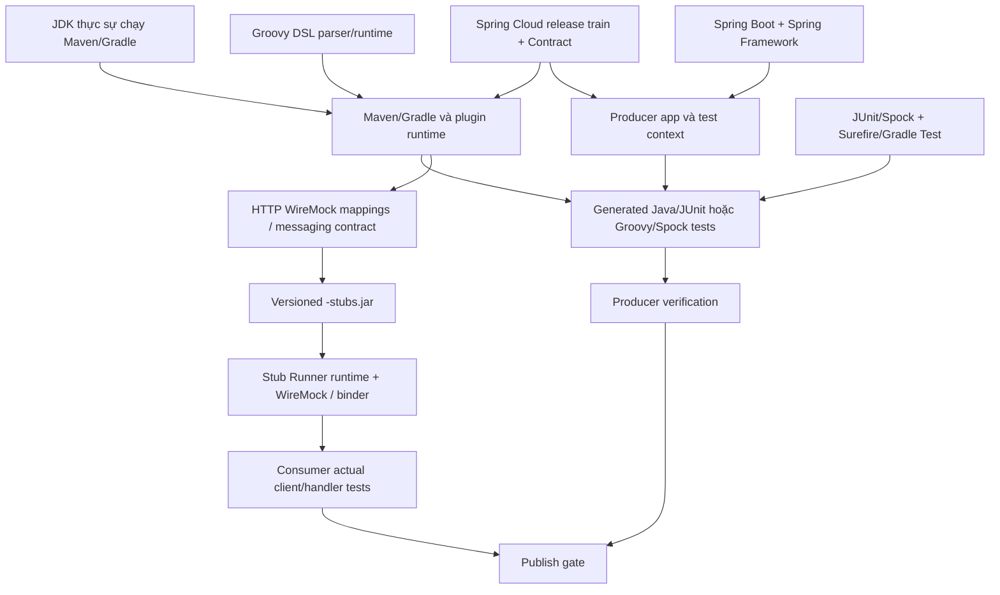
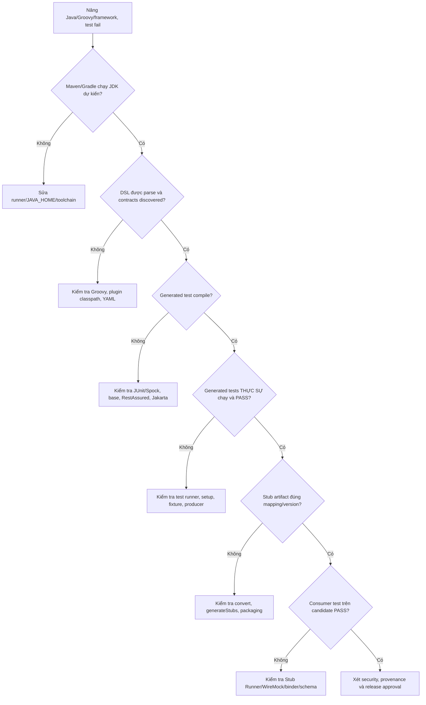

# Kiểm tra thay đổi Java, Groovy và framework kiểm thử

## 1. Vì sao một thay đổi công cụ có thể phá vỡ hợp đồng không đổi?

Trong **Spring Cloud Contract** (module `SPRING_CLOUD_CONTRACT`), producer và consumer mô tả hành vi HTTP hoặc thông điệp bằng **Groovy/YAML DSL**, sinh kiểm thử phía producer bằng Contract Verifier, đóng gói stub và dùng **Stub Runner** trong consumer CI. Bộ công cụ này không chạy riêng lẻ: nó phụ thuộc vào **Java/JDK, Groovy, Spring Boot/Cloud, JUnit hoặc Spock, Maven/Gradle, Rest Assured, WireMock và thư viện messaging**.

Một nhóm có thể không sửa bất kỳ contract nào nhưng sau khi nâng JDK hoặc Spring Boot lại gặp:

- File `.groovy` không parse được: lỗi bytecode, classpath hoặc thiếu thư viện Groovy.
- Generated Java tests không biên dịch: import JUnit cũ, class base sai hoặc package của Rest Assured đã đổi.
- Build Maven báo `BUILD SUCCESS` nhưng không chạy contract tests.
- Generated tests chạy được nhưng WireMock mappings hoặc `-stubs.jar` không được tạo.
- Producer tests đạt nhưng consumer không tải được stub, không giải mã JSON hoặc không kích hoạt được message theo `label`.
- Một máy lập trình viên chạy tốt nhờ JDK/Maven cache, còn CI sạch thất bại.

Đây có thể là **lỗi tương thích toolchain**, không nhất thiết là breaking change của API. Ngược lại, chỉ sửa cho build compile lại mà không chạy consumer contract tests có thể **che mất breaking change thật**.

**Mục tiêu bài học:** có một quy trình kiểm tra trước, trong và sau khi thay đổi **Java, Groovy hoặc test framework**, bảo đảm cùng hợp đồng vẫn tạo được **producer tests và consumer stubs có ý nghĩa tương đương**.

### Sau bài này, bạn có thể

1. Vẽ được các lớp phụ thuộc trong toolchain Spring Cloud Contract.
2. Lập ma trận tương thích trước khi nâng Java, Spring Boot/Cloud, Groovy, JUnit/Spock và build plugins.
3. Tách **JDK chạy Maven/Gradle**, **Java source/target**, **Groovy chạy trong plugin** và **runtime của consumer**.
4. Chuyển base tests từ JUnit 4 sang JUnit 5 và xác minh generated tests thực sự chạy.
5. Phát hiện xung đột giữa Groovy runtime, Spock variant và plugin classloader.
6. Kiểm tra HTTP `MOCKMVC`/`EXPLICIT`/`WEBTESTCLIENT` và messaging verifier theo stack đang dùng.
7. Dùng clean CI matrix, artifact provenance và consumer tests để phát hiện regression.
8. Phân loại lỗi theo tầng, quyết định rollback hoặc tiếp tục nâng cấp.

## 2. Mô hình các lớp tương thích

Một build Spring Cloud Contract không chỉ có “version Spring Cloud Contract”. Cần xác định nhiều thành phần cùng lúc:



Không phải mũi tên nào cũng là dependency Maven trực tiếp; sơ đồ cho thấy **quan hệ ảnh hưởng khi nâng phiên bản**.

### 2.1. Những khác biệt dễ nhầm

| Thành phần | Ý nghĩa | Ví dụ cần kiểm tra |
| --- | --- | --- |
| **JDK build** | JVM đang chạy Maven hoặc Gradle | `java -version`, `./mvnw -version` |
| **Java target/release** | Bytecode mà `javac` tạo | `maven.compiler.release` hoặc Gradle toolchain |
| **JDK chạy tests** | Runtime dùng để nạp generated tests | Surefire/Gradle test JVM, fork/toolchain |
| **Groovy DSL runtime** | Groovy dùng parse `Contract.make` | Plugin classloader/dependency version |
| **Groovy test runtime** | Groovy dùng chạy Spock specs | `groovy` cùng variant của Spock |
| **Spring Boot/Framework** | Application/test context và web stack | Boot/BOM, MVC/WebFlux, Jakarta |
| **Spring Cloud Contract plugin** | Sinh tests, convert, package stubs | Version plugin + cấu hình |
| **Stub Runner** | Tải và chạy stub ở consumer | Spring Cloud Contract consumer dependency |
| **WireMock/runtime binder** | Phục vụ HTTP hoặc gửi message | API, extension, content type, destination |

Ví dụ **biên dịch Java 17** với `--release 17` không có nghĩa bạn đang **chạy Maven bằng Java 17**. Một plugin parse Groovy vẫn sử dụng JVM chạy Maven, có thể là Java 21 hoặc Java 25.

### 2.2. Một thay đổi có thể ảnh hưởng mấy tầng?

| Thay đổi dự kiến | Tầng chắc chắn phải kiểm tra |
| --- | --- |
| Nâng JDK 17 → 21 | Build tool, plugin bytecode/Groovy parsing, generated test compile/run |
| Nâng Java source/target | Producer code, test classes, deploy runtime |
| Nâng Groovy major | DSL parsing, custom helpers, Spock variant, plugin runtime |
| JUnit 4 → JUnit 5 | Generated test framework, base annotations, Surefire/JUnit Platform |
| Spock 1.x → 2.x | Groovy variant, JUnit Platform discovery, fixture lifecycle |
| Spring Boot 2.x → 3.x | Java baseline, `javax.*` → `jakarta.*`, Spring Security/Test libs |
| Spring Boot 3.x → 4.x | Spring Framework 7, module/dependency migration, integration changes |
| Spring Cloud release train | BOM compatibility và các Contract/Stream components |
| WireMock major | Stub mapping/API/extension dependencies, Stub Runner runtime |
| Maven/Gradle plugin | Contract discovery, test generation, stubs packaging và phase binding |

**Không kết luận tương thích chỉ vì Maven resolve được dependencies.** Tải được JAR không chứng minh tests compile, execute hoặc trả behavior đúng.

## 3. Bắt đầu bằng baseline: ghi lại hệ đang chạy tốt

Trước khi nâng một phiên bản, cần giữ **điểm so sánh có thể tái lập**. Không cần copy hàng loạt file dự án vào tài liệu; chỉ cần thu thập metadata từ chính build/CI.

### 3.1. Lệnh kiểm kê an toàn

```bash
# JDK đang được shell dùng.
java -version

# JVM thực sự chạy Maven Wrapper.
./mvnw -version

# Effective dependency tree của producer.
./mvnw -B -ntp dependency:tree

# Baseline producer verification.
./mvnw -B -ntp clean verify
```

Với Gradle, có thể dùng:

```bash
./gradlew --version
./gradlew dependencies
./gradlew clean check
```

**Đây là lệnh hướng dẫn người học**, không phải yêu cầu chạy build trong bước viết tài liệu. Trong dự án thật, Gradle plugin có thể cung cấp các tasks riêng cho generated contracts; kiểm tra đúng version/plugin thay vì giả định `check` đã bao gồm tất cả chúng.

### 3.2. Mẫu baseline record

```yaml
# TÀI LIỆU KIỂM KÊ, không phải Spring Cloud Contract DSL.
baseline:
  sourceCommit: a1b2c3d4
  buildJdk: "17"
  bytecodeTarget: "17"
  buildTool: "Maven Wrapper (pinned distribution)"
  springBoot: "VERSION_FROM_EFFECTIVE_BUILD"
  springCloudTrain: "TRAIN_FROM_EFFECTIVE_BUILD"
  springCloudContractPlugin: "VERSION_FROM_EFFECTIVE_BUILD"
  groovyRuntime: "VERSION_FROM_DEPENDENCY_ANALYSIS"
  producerTestFramework: "JUNIT5"
  producerTestMode: "MOCKMVC"
  testRunner: "Surefire version from effective POM"
  consumerStubRunner: "VERSION_FROM_CONSUMER_BUILD"
  expectedContractCount: 3
  expectedGeneratedTests: 3
  expectedArtifact: "com.example:orders-producer:1.4.2:stubs"
```

Các chuỗi `VERSION_FROM_*` là **placeholder**; không được coi là phiên bản có thật. Trong thực tế, cần gắn **commit**, báo cáo generated tests run/pass/fail/skip, SHA-256 artifact và consumer test result.

### 3.3. Đặt ba câu hỏi trước nâng cấp

1. **Thay đổi nhằm giải quyết gì?** Bản vá bảo mật, hỗ trợ JDK LTS mới, cập nhật Groovy/Spock hay migrate JUnit?
2. **Phiên bản nào thuộc phạm vi?** Producer, consumer, shared build plugins, repository contract source và standalone Stub Runner?
3. **Làm sao chứng minh không làm mất hợp đồng?** Generated tests, mapping/stub inspection và consumer behavior tests trên cùng candidate artifact.

Không nên gộp nâng Java, Groovy, Boot, JUnit, WireMock và HTTP semantics vào cùng một commit khi có thể tách. Các thay đổi độc lập làm việc phân loại lỗi dễ hơn.

## 4. Chọn phiên bản theo compatibility matrix, không tự ghép số

Spring Cloud có **release train** được thiết kế để làm việc với một thế hệ Spring Boot cụ thể. Spring Cloud Contract nằm trong hệ sinh thái đó. Khi chọn version:

1. Xác định Spring Boot và Spring Cloud release train được **chính thức hỗ trợ cùng nhau**.
2. Xác nhận Spring Cloud Contract plugin, verifier và Stub Runner tương thích với stack ấy.
3. Đọc **system requirements** của Spring Boot và Java đang dùng.
4. Đối chiếu Groovy/Spock/JUnit/test dependencies thực tế do BOM quản lý.
5. Kiểm tra build tool wrapper và test runner có hỗ trợ JDK mới không.
6. Ghi lại tập versions đã thử nghiệm trong CI; không phụ thuộc mỗi một bảng tài liệu.

### 4.1. Ví dụ quan hệ Boot–Cloud cần kiểm tra

Theo trang Spring Cloud project và release compatibility, một số cặp **thế hệ** được công bố:

| Spring Boot generation | Spring Cloud release train | Lưu ý |
| --- | --- | --- |
| `3.4.x` | `2024.0.x` | Dòng dành cho Boot 3.4 |
| `3.5.x` | `2025.0.x` | Dòng dành cho Boot 3.5 |
| `4.0.x` | `2025.1.x` | Dòng dành cho Boot 4.0 |
| `4.1.x` | `2025.1.x` với các bản maintenance tương thích | Cần kiểm tra bản maintenance tối thiểu |
| `4.2.x` | Dòng release train tương ứng theo tài liệu tại thời điểm nâng | Không tự suy ra từ số major |

Bảng thể hiện **quan hệ thế hệ**, không phải lời đảm bảo mọi bản patch đều tương thích hoặc còn trong thời gian hỗ trợ. Với Boot `4.2.x`, phải kiểm tra trang tương thích hiện hành thay vì dùng một bảng tĩnh trong tài liệu này. **Cả Spring Cloud Contract, Stream, WireMock và các test plugins cũng cần được thử riêng**. Tham khảo: [Spring Cloud Project](https://spring.io/projects/spring-cloud/) và [Spring Cloud Supported Versions](https://github.com/spring-cloud/spring-cloud-release/wiki/Supported-Versions).

### 4.2. Vì sao không “nâng riêng Contract plugin lên bản cao nhất”?

Plugin mới có thể yêu cầu Java hoặc Spring dependencies khác, trong khi producer application vẫn dùng BOM cũ. Khi đó:

- Groovy parser có thể biên dịch DSL bằng runtime khác.
- Generated Java test có thể import APIs không còn phù hợp với dependency cũ.
- WireMock mapping hoặc Stub Runner runtime có version lệch.
- Maven dependency mediation có thể che classpath conflict.

**Giải pháp:** quản lý version như một **tập hợp tương thích**, dùng BOM/version catalog phù hợp, và kiểm chứng cả producer/consumer. Không cần ép mọi thành phần có **cùng số version** nếu chính tài liệu của chúng định nghĩa versioning độc lập.

## 5. Nâng Java: tách ba tầng JDK, target bytecode và runtime

Giả sử tổ chức muốn chuyển JDK chạy CI từ Java 17 sang Java 21. Một bước cập nhật `JAVA_HOME` **không đủ**.

### 5.1. Cấu hình Maven cho target rõ ràng

```xml
<properties>
  <!-- Giá trị minh họa: chọn theo runtime producer thực tế. -->
  <maven.compiler.release>17</maven.compiler.release>
</properties>
```

Lựa chọn này yêu cầu **javac hỗ trợ `--release`**, và tạo bytecode/API tương thích mục tiêu Java 17. Tuy nhiên:

- Maven vẫn có thể chạy bằng **JDK 21**.
- Compiler plugin phải hỗ trợ cấu hình tương ứng.
- Plugin Spring Cloud Contract và Groovy DSL parser phải hoạt động trên **JDK chạy Maven**.
- Generated contract tests cũng được compile trong build.
- Nếu test JVM được cấu hình riêng (fork/toolchain), phải kiểm tra nó đang dùng JDK nào.

### 5.2. Gradle Java toolchain

```groovy
// build.gradle, minh họa cho một Java project có Gradle toolchains.
java {
    toolchain {
        languageVersion = JavaLanguageVersion.of(17)
    }
}
```

Gradle toolchain thường điều khiển JDK cho compile/tests theo plugin và cấu hình. **Gradle daemon vẫn chạy trên JVM riêng**, nên build plugin/Groovy compiler compatibility cần kiểm tra thêm. Không kết luận rằng `./gradlew --version` báo JDK 21 thì task compile nhất định cũng dùng JDK 21 nếu toolchain đã chọn 17.

### 5.3. Lỗi điển hình và ý nghĩa

| Lỗi | Nguyên nhân khả dĩ | Phép kiểm tra |
| --- | --- | --- |
| `Unsupported class file major version` | Groovy/ASM/test framework không đọc được bytecode JDK mới | JDK build, Groovy/ASM/plugin versions |
| `invalid target release: 21` | Compiler/JDK quá cũ để target Java 21 | `./mvnw -version`, toolchain |
| `class file has wrong version` | Runtime cũ nạp class compile cho Java mới | JDK đang chạy test/app |
| `InaccessibleObjectException` | Reflection vào JDK internals bị chặn | Thư viện liên quan, thay phiên bản thay vì mở module bừa |
| `NoSuchMethodError` | Runtime deps/API bị lệch | Effective dependency tree, classpath |
| Local pass, CI fail | JDK/toolchain/cache khác nhau | So sánh build metadata và clean runner |

Không dùng `--add-opens` như cách chữa lâu dài cho mọi lỗi reflective access. Nó có thể hữu ích trong một giai đoạn chuyển tiếp có kiểm soát, nhưng nên thay thư viện không còn tương thích và lưu lý do cùng hạn loại bỏ flag.

## 6. Nâng Groovy: DSL parser không phải chỉ là thư viện test

Contract Groovy DSL được **thực thi/parse ở thời điểm generate/convert**, không chỉ khi producer JUnit test chạy. Vì vậy Groovy có thể xuất hiện trong **plugin runtime**, **test dependencies** và **Spock runtime** với những phiên bản khác nhau.

### 6.1. Các thay đổi cần biết

- Groovy 4 chuyển module Maven chính từ `org.codehaus.groovy` sang `org.apache.groovy`; source package phổ biến vẫn thuộc namespace `groovy.*`.
- Groovy 5 có yêu cầu JVM tối thiểu khác Groovy 4; khi nâng cần kiểm tra **JDK và Groovy runtime chính xác**.
- Spock xuất bản **artifact variants theo thế hệ Groovy**, ví dụ có hậu tố `-groovy-4.0` hoặc `-groovy-5.0`.
- Maven/Gradle plugin có thể giữ Groovy version riêng trong plugin classloader.
- Groovy DSL chứa custom imports, helper JAR hoặc AST transforms thường nhạy cảm hơn YAML DSL thuần.

Xem [Apache Groovy — Download/System Requirements](https://groovy.apache.org/download) và [Spock Framework](https://spockframework.org/spock/docs/current/).

### 6.2. Ví dụ DSL chuẩn để làm regression baseline

```groovy
import org.springframework.cloud.contract.spec.Contract

Contract.make {
    name 'get_order_created'

    request {
        method GET()
        url '/api/orders/ord-1001'
        headers {
            header 'Accept': 'application/json'
        }
    }

    response {
        status 200
        headers {
            contentType(applicationJson())
        }
        body([
            id    : 'ord-1001',
            status: 'CREATED'
        ])
    }
}
```

Một contract như vậy cần được parse thành công trên cả toolchain cũ và mới. Nhưng **parse PASS chưa đủ**: phải so sánh generated assertions và stub mappings xem có còn cùng ý nghĩa hay không.

### 6.3. YAML làm giảm phụ thuộc vào Groovy DSL source, nhưng không loại bỏ mọi rủi ro

Hợp đồng tương đương:

```yaml
name: get_order_created
request:
  method: GET
  url: /api/orders/ord-1001
  headers:
    Accept: application/json
response:
  status: 200
  headers:
    Content-Type: application/json
  body:
    id: ord-1001
    status: CREATED
```

YAML không thực thi Groovy helper do người dùng viết trong lúc parse, nên thuận lợi khi muốn tránh phụ thuộc vào một bộ helper Groovy. Tuy nhiên, **Spring Cloud Contract plugin, generated tests và cả runtime dependencies vẫn có yêu cầu phiên bản**. Không kết luận “đổi sang YAML là có thể nâng Java/Groovy tùy ý”.

### 6.4. Không vô tình biến YAML scalar thành kiểu dữ liệu khác

Khi chuyển giữa Groovy và YAML, review kiểu:

| Giá trị mong muốn | Groovy example | YAML example | Rủi ro |
| --- | --- | --- | --- |
| Boolean | `true` | `true` | Tránh `"true"` nếu cần boolean |
| Number | `12` | `12` | Tránh `"12"` nếu cần numeric |
| Chuỗi ID | `'00123'` | `"00123"` | Mất số 0 đầu nếu YAML hiểu numeric |
| Null | `null` | `null` | Phân biệt null với field vắng |
| Timestamp | `'2026-01-01T00:00:00Z'` | `"2026-01-01T00:00:00Z"` | Quote để giữ string semantics |

Đừng chỉ so sánh văn bản DSL. Cần kiểm tra JSON/messaging body thực tế sau generator và test phía consumer.

## 7. Groovy classpath và custom helpers

Một file Groovy contract có thể import helper:

```groovy
import org.springframework.cloud.contract.spec.Contract
import static com.example.contract.TestSamples.orderId

Contract.make {
    name 'lookup_order_with_helper'
    request {
        method GET()
        url "/api/orders/${orderId()}"
    }
    response {
        status 200
        body([id: orderId(), status: 'CREATED'])
    }
}
```

`TestSamples` là **helper do dự án tự viết**. Nếu sau khi nâng plugin xuất hiện `MissingPropertyException` hoặc `ClassNotFoundException`, hãy kiểm tra classpath **lúc convert/generate**, không chỉ classpath của JUnit tests.

### 7.1. Hai classpath không thể đánh đồng

| Tầng | Ví dụ | Cách kiểm tra |
| --- | --- | --- |
| Maven plugin/Groovy parser | `spring-cloud-contract-maven-plugin` và plugin dependencies | Effective POM, plugin resolution/build log |
| Producer test | `spring-cloud-starter-contract-verifier`, JUnit, Rest Assured | Test dependency tree, test compilation |
| Consumer test | Stub Runner/WireMock, HTTP client hoặc binder | Consumer test dependency tree |

Một dependency được khai báo `<scope>test</scope>` trong producer **không tự chứng minh** helper có sẵn trên Maven plugin classloader. Cần cấu hình plugin dependency phù hợp với phiên bản đang dùng, hoặc tránh custom helper khi nó không mang lợi ích lớn.

### 7.2. Dấu hiệu nên bỏ helper khi nâng cấp

- Helper gọi database/network trong lúc parse hợp đồng.
- Helper lấy thời gian/ngẫu nhiên không seed, gây output khác mỗi build.
- Helper dùng internal Groovy AST/compiler APIs phụ thuộc version.
- Chỉ để tránh lặp lại hai chuỗi sample đơn giản.
- Consumer cần thêm một JAR nội bộ chỉ để giải mã contract source.

Ưu tiên **DSL rõ ràng, sample ổn định và fixtures trong producer base tests**. Có thể chuyển dữ liệu dùng chung sang YAML hoặc test helper thuần tùy trường hợp, nhưng phải giữ semantics.

## 8. JUnit 4 → JUnit 5: thay import chưa đủ

JUnit 4 và JUnit 5 (Jupiter) có **annotations và cơ chế phát hiện/chạy tests khác nhau**. Đây là thay đổi đặc biệt quan trọng vì Spring Cloud Contract **sinh test source**, còn Surefire/Gradle test task phải **tìm và thực thi** tests ấy.

### 8.1. Bảng chuyển đổi thường gặp

| JUnit 4 | JUnit Jupiter | Ghi chú |
| --- | --- | --- |
| `org.junit.Test` | `org.junit.jupiter.api.Test` | Annotation test khác package |
| `@Before` | `@BeforeEach` | Chạy setup trước mỗi test |
| `@BeforeClass` | `@BeforeAll` | Mặc định static trừ khi cấu hình lifecycle thích hợp |
| `@After` | `@AfterEach` | Dọn test state |
| `@RunWith(SpringRunner.class)` | `@ExtendWith(SpringExtension.class)` hoặc Spring Boot test integration | Không chép JUnit 4 runner sang Jupiter |
| `@Rule`/`@ClassRule` | Jupiter extensions hoặc API tương ứng | Không phải thay tên máy móc |
| `org.junit.Assert` | `org.junit.jupiter.api.Assertions` hoặc AssertJ | Rà soát semantics |
| JUnit 4 runner | JUnit Platform + Jupiter engine | Surefire/Gradle phải hỗ trợ discovery |

**Không phải mọi `@Rule` đều có bản tương đương trực tiếp.** Khi migrate, thay bằng Jupiter extension/testing utility thích hợp và chạy lại generated tests.

### 8.2. Base test JUnit 4 cũ (minh họa)

```java
import org.junit.Before;
import org.junit.runner.RunWith;
import org.springframework.test.context.junit4.SpringRunner;

@RunWith(SpringRunner.class)
public abstract class OldOrdersContractBase {

    @Before
    public void setup() {
        // Cấu hình MockMvc và dữ liệu thử nghiệm.
    }
}
```

Class trên **chỉ là ví dụ khung JUnit 4**. Nó không đủ chạy contract test nếu chưa có MockMvc/client và fixture thật.

### 8.3. Base test JUnit 5 với MockMvc

```java
package com.example.orders.contract;

import io.restassured.module.mockmvc.RestAssuredMockMvc;
import org.junit.jupiter.api.BeforeEach;
import org.springframework.beans.factory.annotation.Autowired;
import org.springframework.boot.test.autoconfigure.web.servlet.AutoConfigureMockMvc;
import org.springframework.boot.test.context.SpringBootTest;
import org.springframework.test.web.servlet.MockMvc;

@SpringBootTest
@AutoConfigureMockMvc
public abstract class OrdersContractBase {

    @Autowired
    private MockMvc mockMvc;

    @Autowired
    private OrdersContractFixtures fixtures;

    @BeforeEach
    protected void setup() {
        fixtures.reset();
        fixtures.createOrder("ord-1001", "CREATED");
        fixtures.ensureMissing("ord-missing");
        RestAssuredMockMvc.mockMvc(mockMvc);
    }
}
```

`OrdersContractFixtures`, `reset`, `createOrder` và `ensureMissing` là **test helper do ứng dụng tự triển khai**, không phải API Spring Cloud Contract. Nó phải tạo tiền điều kiện để controller/service **thật** trả đúng response. Dùng `protected` giúp setup có nghĩa kế thừa rõ khi generated test nằm ở package khác.

**Khác biệt cần kiểm tra:** nếu generated test của plugin được tạo theo JUnit 4 nhưng base dùng `@BeforeEach`, test có thể không chạy setup tương ứng. Ngược lại, generated JUnit 5 test kế thừa base JUnit 4 có thể compile nhưng không gọi lifecycle đúng như kỳ vọng.

## 9. Cấu hình producer plugin tường minh thay vì tin vào default

Tài liệu Spring Cloud Contract ở các thời kỳ có những ví dụ **JUnit 4**, **Spock** hoặc **JUnit 5**; default của Maven plugin cũng có thể khác giữa các phiên bản. Vì thế khi migrate hãy **chọn rõ** framework/mode thay vì dựa vào mặc định.

### 9.1. POM fragment dành cho JUnit 5 + MockMvc

```xml
<dependencies>
  <dependency>
    <groupId>org.springframework.boot</groupId>
    <artifactId>spring-boot-starter-test</artifactId>
    <scope>test</scope>
  </dependency>
  <dependency>
    <groupId>org.springframework.cloud</groupId>
    <artifactId>spring-cloud-starter-contract-verifier</artifactId>
    <scope>test</scope>
  </dependency>
</dependencies>

<build>
  <plugins>
    <plugin>
      <groupId>org.springframework.cloud</groupId>
      <artifactId>spring-cloud-contract-maven-plugin</artifactId>
      <version>REPLACE_WITH_COMPATIBLE_VERSION</version>
      <extensions>true</extensions>
      <configuration>
        <testFramework>JUNIT5</testFramework>
        <testMode>MOCKMVC</testMode>
        <baseClassForTests>
          com.example.orders.contract.OrdersContractBase
        </baseClassForTests>
        <failOnNoContracts>true</failOnNoContracts>
        <failOnInProgress>true</failOnInProgress>
      </configuration>
    </plugin>
  </plugins>
</build>
```

Đây là **fragment**, không phải POM chạy độc lập. Phải thay `REPLACE_WITH_COMPATIBLE_VERSION` theo Boot/Cloud/JDK thực tế. `spring-boot-starter-test` và `spring-cloud-starter-contract-verifier` cần được quản lý version phù hợp; tùy thế hệ Boot hoặc module hóa test dependencies, có thể phải điều chỉnh test starters.

### 9.2. Vì sao lại bật các gate?

- `failOnNoContracts`: tránh một build “xanh” vì không tìm thấy hợp đồng.
- `failOnInProgress`: tránh release có contract đánh dấu `inProgress` mà producer verification không được sinh.
- `testFramework=JUNIT5`: bảo đảm sinh dạng JUnit Jupiter được dự án chủ ý sử dụng.
- `testMode=MOCKMVC`: xác định cách generated test gọi HTTP boundary.
- `baseClassForTests`: generated tests dùng đúng test context và fixtures.

Không coi riêng các option này là đủ: CI vẫn phải kiểm tra **số contract tests thực tế được runner chạy**.

### 9.3. Kiểm tra generated source, đừng suy đoán

Sau `generateTests`, cần xem các dấu hiệu:

```java
// Minh họa đoạn cấu trúc generated JUnit 5 test, không phải output byte-for-byte.
import org.junit.jupiter.api.Test;

public class OrdersContractTest extends OrdersContractBase {

    @Test
    public void getOrderCreated() throws Exception {
        // Generated request và assertions nằm ở đây.
    }
}
```

Nếu vẫn xuất hiện `org.junit.Test` hoặc class kế thừa `spock.lang.Specification` ngoài ý định, có thể plugin config bị override, class cũ chưa `clean` hoặc build đang dùng artifact plugin khác.

## 10. Surefire, Failsafe và JUnit Platform: nguồn lỗi “xanh giả”

Spring Cloud Contract sinh source trong phase phù hợp, nhưng Maven **Surefire** hoặc **Failsafe** mới thực sự chạy tests theo cấu hình project.

### 10.1. Maven lifecycle ở mức liên quan

```text
generate-test-sources
  -> Contract Verifier generateTests

process-test-resources
  -> Contract Verifier convert (HTTP mappings)

test-compile
  -> Java/Groovy generated source compilation

test
  -> Surefire thực thi các producer tests được discover

package
  -> Contract Verifier generateStubs, đóng gói classifier stubs

integration-test / verify
  -> Failsafe/integration gates nếu project cấu hình

install / deploy
  -> chỉ sau các gate được yêu cầu
```

Với Gradle, **task graph và lifecycle tên khác**, không dùng bảng phase Maven để suy ra Gradle tự chạy cùng thứ tự.

### 10.2. Những trường hợp tạo BUILD SUCCESS sai

| Tình huống | Build có thể thành công? | Producer đã được xác minh? |
| --- | --- | --- |
| `generateTests` tạo Java nhưng không chạy | Có | **Chưa** |
| Surefire chạy unit tests nhưng 0 generated contract tests | Có | **Chưa** |
| Dùng `-DskipTests` hoặc profile skip | Có | **Chưa** |
| JUnit 4 test chỉ có Jupiter engine, thiếu Vintage khi còn cần | Có thể tests bị bỏ | **Không được giả định PASS** |
| Spock specs không được test runner discover | Có thể | **Chưa** |
| Generated JUnit 5 tests thực thi và assertions đạt | Có | **Có trong phạm vi hợp đồng** |
| Producer pass nhưng stub JAR không có mapping | Có thể | **Chưa đủ để publish** |

Một `failIfNoTests` chỉ phát hiện *toàn suite không có tests*; nó có thể không nhận ra trường hợp unit tests chạy còn generated contracts biến mất. Cần **kiểm đếm generated contract cases** từ báo cáo và expected contract inventory.

### 10.3. Kiểm tra test reports

```text
Expected HTTP contracts: 3
Expected generated producer test cases: 3
Actually executed generated cases: 3
Failed: 0
Skipped: 0
Stub package: present, correct classifier/version
```

Đây là **số liệu minh họa**. Các hợp đồng messaging, `ignored` hoặc `inProgress` cần được tính theo chính sách và config; không được áp dụng máy móc “số file bằng số Java tests” nếu nhiều contracts trong một file hoặc converter có quy tắc riêng.

### 10.4. Không chữa bằng cách giữ cả engine mà không kiểm tra

Trong giai đoạn chuyển đổi, dự án có thể chạy song song JUnit Jupiter và JUnit Vintage để hỗ trợ JUnit 4 cũ. Điều này **có thể hữu ích tạm thời** nhưng phải phân biệt rõ:

- Generated tests nào đang chạy bằng Jupiter?
- Test nào chỉ chạy nhờ Vintage?
- Có test cũ nào trùng execution không?
- Khi loại Vintage, còn test quan trọng nào bị bỏ?

Đặt lộ trình loại bỏ các dependencies chuyển tiếp khi đã migrate hoàn tất.

## 11. Spock và Groovy: chọn đúng variant

Spock 2.x chạy trên **JUnit Platform**, không phải JUnit 4 runner truyền thống. Các Spock versions có variants tương ứng **Groovy major**.

### 11.1. Ví dụ dependency (không ghim một version dùng cho mọi môi trường)

```xml
<!-- Minh họa chỉ phần Spock. Chọn version/variant phù hợp Groovy runtime. -->
<dependency>
  <groupId>org.spockframework</groupId>
  <artifactId>spock-core</artifactId>
  <version>REPLACE_WITH_SPOCK_GROOVY_VARIANT</version>
  <scope>test</scope>
</dependency>
```

Một artifact có hậu tố `-groovy-4.0` được xây cho Groovy 4, không nên coi tương đương artifact dành Groovy 3 hoặc 5. Khi mở nguồn hướng dẫn cũ:

- Xác nhận đúng **Spock generation**.
- Xác nhận **Groovy variant**, JVM và plugin chạy Groovy.
- Thử test discovery trên **JUnit Platform**.
- Đối chiếu Spring test integration (`spock-spring`) nếu dùng Spring context.
- Kiểm tra dependency convergence tránh đồng thời hai Groovy majors trong cùng runtime.

### 11.2. Khi nào không nên migrate JUnit và Groovy cùng lúc?

Nếu ứng dụng đang dùng JUnit 4 generated tests và thêm một số Spock tests, nên quyết định **đường chuyển đổi chính**:

1. Chốt Spring Boot/Cloud/Contract version mục tiêu.
2. Chọn JUnit 5 **hoặc** Spock version/variant đã hỗ trợ.
3. Chuyển test base và test runner, giữ hợp đồng HTTP/messaging nguyên.
4. Chạy producer/stub/consumer suite.
5. Chỉ sau đó nâng Groovy major hoặc mở rộng hỗ trợ Java runtime khác, nếu có thể tách.

Việc sửa nhiều trục version cùng lúc làm mất khả năng xác định liệu lỗi đến từ Groovy parser, Spock runtime, JUnit Platform hay business logic.

## 12. Test mode phải phù hợp với HTTP stack

Spring Cloud Contract có nhiều chế độ HTTP producer verification. Tên mode có thể xuất hiện trong enum/cấu hình plugin; việc hỗ trợ chi tiết phụ thuộc phiên bản.

| Test mode | Đặc điểm | Khi cần chú ý |
| --- | --- | --- |
| `MOCKMVC` | Spring MVC request qua MockMvc | Ứng dụng Servlet/MVC, Rest Assured MockMvc setup |
| `WEBTESTCLIENT` | Test HTTP theo WebTestClient | Ứng dụng reactive/WebFlux hoặc test client tương ứng |
| `EXPLICIT` | Gửi HTTP thực tới app chạy cổng test | Embedded server/port, base URI, startup timing |
| `JAXRSCLIENT` | Test JAX-RS với client phù hợp | Chỉ khi stack/framework hỗ trợ, thường cần server |

### 12.1. Nâng Java/Boot có đồng nghĩa phải đổi testMode không?

**Không.** Nếu producer vẫn dùng Spring MVC, có thể giữ `MOCKMVC` khi nâng Java hoặc test framework. Nếu đội chuyển từ Servlet sang WebFlux, mới cần đánh giá lại `WEBTESTCLIENT` và base setup.

Đổi test framework từ JUnit 4 sang JUnit 5 là **trục khác** với đổi mode từ MockMvc sang Explicit. Không nhầm:

```xml
<testFramework>JUNIT5</testFramework>
<testMode>MOCKMVC</testMode>
```

### 12.2. Ví dụ Explicit mode (minh họa)

```java
import io.restassured.RestAssured;
import org.junit.jupiter.api.BeforeEach;
import org.springframework.boot.test.context.SpringBootTest;
import org.springframework.boot.test.web.server.LocalServerPort;

@SpringBootTest(webEnvironment = SpringBootTest.WebEnvironment.RANDOM_PORT)
public abstract class OrdersExplicitContractBase {

    @LocalServerPort
    private int port;

    @BeforeEach
    protected void setup() {
        RestAssured.baseURI = "http://localhost";
        RestAssured.port = port;
    }
}
```

Class này thuộc ví dụ stack Spring Boot hỗ trợ các imports nêu trên; khi nâng một thế hệ Boot lớn, **xác minh lại package của `@LocalServerPort` theo version**. Với tests chạy song song, mutable static state của `RestAssured` cần isolation/cấu hình phù hợp.

**Lưu ý:** không chạy trên cổng production; `RANDOM_PORT` giúp tách test instance khỏi server thật.

### 12.3. Sai mode gây ra kiểu failure gì?

| Triệu chứng | Khả năng |
| --- | --- |
| `No MockMvc instance found` | Base test chưa khởi tạo MockMvc phù hợp |
| Generated test dùng RestAssuredMockMvc nhưng base chỉ set RestAssured HTTP port | `MOCKMVC` và `EXPLICIT` bị trộn |
| `Connection refused localhost:8080` | Explicit mode app không chạy hoặc base URI/port sai |
| WebFlux app nhưng chỉ có MVC test dependencies | Chọn sai test stack |
| Test compile nhưng response body không được decode | HTTP converter/Content-Type hoặc stack khác |

Kiểm tra **generated code** để biết nó gọi client nào, không chỉ nhìn config trong POM.

## 13. Rest Assured và package import thay đổi

Nhiều hướng dẫn Spring Cloud Contract cũ chứa import:

```java
// Ví dụ cũ ở một số tài liệu:
import com.jayway.restassured.module.mockmvc.RestAssuredMockMvc;
```

Trong những dòng Rest Assured mới hơn, import phổ biến là:

```java
// Ví dụ tương ứng với nhiều build mới:
import io.restassured.module.mockmvc.RestAssuredMockMvc;
```

Không sửa package bằng thao tác tìm/thay duy nhất rồi coi đã xong. Kiểm tra:

- Version Rest Assured do Spring Cloud Contract/Boot BOM quản lý.
- Dependency `rest-assured-mock-mvc` có hiện diện không.
- Generated test import nào, base class import nào.
- Các `assertThat`/matcher APIs còn đúng không.
- JUnit setup có thực sự gọi `RestAssuredMockMvc.mockMvc(mockMvc)` hoặc phương thức tương thích.

### 13.1. Vì sao lỗi `package does not exist` có thể chỉ là hậu quả?

Nguyên nhân có thể là **generated test import một version khác** với package trong dependencies. Thay vì thêm cả `com.jayway` và `io.restassured` artifacts vào project, xác định **một bộ versions tương thích** rồi rebuild sạch.

## 14. Spring Boot migration: test annotations và Jakarta

Khi chuyển Boot 2.x sang Boot 3.x, cần kiểm tra việc chuyển nhiều API Java EE cũ từ namespace `javax.*` sang `jakarta.*`. Ví dụ:

```java
// Trước migration Jakarta EE:
import javax.validation.Valid;

// Sau migration, trong stack Jakarta tương ứng:
import jakarta.validation.Valid;
```

Không mọi `javax.*` đều đổi (chẳng hạn `javax.crypto` thuộc JDK). Chỉ thay các Jakarta EE API mà framework/dependency mới yêu cầu. Producer fixture/test config, controller và generated tests có thể cần thích nghi.

Boot 4.x dựa trên thế hệ Spring Framework/Jakarta mới hơn và có thay đổi module hóa. Do đó cùng câu lệnh `@SpringBootTest` có thể cần starter/dependency khác tùy web/test stack. Đọc migration guide và xác minh imports **thực tế trên version mục tiêu**.

### 14.1. Contract DSL có thể không đổi trong khi test base phải đổi

Ví dụ hợp đồng:

```yaml
name: get_order_created
request:
  method: GET
  url: /api/orders/ord-1001
response:
  status: 200
  headers:
    Content-Type: application/json
  body:
    id: ord-1001
    status: CREATED
```

Vẫn mô tả cùng hành vi dù producer đã nâng framework. **Không cần tự đổi contract chỉ vì framework nâng version**, trừ khi API behavior thật sự thay đổi. Rủi ro nằm ở test base, test framework, serializer và implementation.

### 14.2. Khi schema đổi vì serializer

Nâng Boot/Jackson hoặc message converter có thể khiến:

- LocalDateTime/Instant được serialize khác.
- Enum được viết dưới format khác.
- `null` fields bị thêm/loại.
- BigDecimal scale/number formatting thay đổi.
- HTTP `Content-Type` khác charset hoặc media type.

Những điểm đó có thể ảnh hưởng consumer thật. Lúc này cần **hợp đồng và consumer tests** phát hiện behavior change, chứ không chỉ sửa generated test cho compile.

## 15. Messaging: Java và framework nâng cấp cũng ảnh hưởng broker/binder

Với messaging contracts, generated producer tests thường kiểm tra message được publish theo **destination, headers, body và content type**. Consumer Stub Runner có thể kích hoạt message bằng label nếu tích hợp được cấu hình.

### 15.1. Groovy messaging contract mẫu

```groovy
import org.springframework.cloud.contract.spec.Contract

Contract.make {
    name 'order_created_event'
    label 'order_created'

    input {
        triggeredBy('publishOrderCreated()')
    }

    outputMessage {
        sentTo('orders.events')
        body([
            eventType: 'ORDER_CREATED',
            orderId  : 'ord-1001',
            quantity : 2
        ])
        headers {
            header('eventType', 'ORDER_CREATED')
            messagingContentType(applicationJson())
        }
    }
}
```

`publishOrderCreated()` là **method producer test base phải tự hiện thực**; không phải API tự có. `label` là giao diện kích hoạt stub trong consumer tests, còn `sentTo` là destination của message. Việc nâng Spring Cloud Stream hoặc binder có thể đổi cách mapping logical destination tới queue/topic runtime.

### 15.2. Producer base class minh họa

```java
import org.junit.jupiter.api.BeforeEach;
import org.springframework.beans.factory.annotation.Autowired;
import org.springframework.boot.test.context.SpringBootTest;
import org.springframework.cloud.contract.verifier.messaging.boot.AutoConfigureMessageVerifier;

@SpringBootTest
@AutoConfigureMessageVerifier
public abstract class OrderMessageContractBase {

    @Autowired
    private OrderEventTestDriver driver;

    @BeforeEach
    protected void setup() {
        driver.reset();
    }

    public void publishOrderCreated() {
        driver.createOrderThroughApplication("ord-1001", 2);
    }
}
```

`OrderEventTestDriver` và các method `reset`/`createOrderThroughApplication` là **thành phần dự án tự viết**. Chúng phải kích hoạt luồng ứng dụng thật (tại boundary phù hợp) để producer test quan sát message. Không chỉ dựng sẵn một JSON event vào queue rồi khẳng định producer implementation đã được kiểm chứng.

### 15.3. Consumer message test

```java
// Snippet trong test có Stub Runner, message binder/broker và Awaitility.
readModel.deleteByOrderId("ord-1001");
assertThat(readModel.hasOrder("ord-1001")).isFalse();

assertThat(stubTrigger.trigger("order_created")).isTrue();

await().atMost(Duration.ofSeconds(5)).untilAsserted(() ->
    assertThat(readModel.hasOrder("ord-1001")).isTrue()
);
```

`readModel` là API giả định của consumer. Test phải kiểm tra **handler thật** sau khi trigger; không seed sẵn read model rồi assert nó tồn tại. Sau khi nâng broker/binder, phải kiểm tra **destination mapping, message converter và content type** chứ không chỉ khả năng parse DSL.

### 15.4. Ma trận lỗi messaging khi đổi framework

| Dấu hiệu | Tầng cần xem |
| --- | --- |
| `@AutoConfigureMessageVerifier` không được nhận | Contract/message verifier deps và annotation package |
| `triggeredBy` method không tìm thấy | Base class/visibility/generator test framework |
| Producer test không quan sát được message | Binder/test broker/destination |
| Consumer `StubTrigger.trigger(label)` trả false | Label không có, artifact sai hoặc runtime integration thiếu |
| Message tới nhưng handler không chạy | Binding/converter/consumer config |
| Deserialize error sau khi nâng Boot | Serializer/content type/schema types |

Một stub event không tự chứng minh delivery order, retry, exactly-once hoặc bảo mật broker production; những đặc tính đó cần test tích hợp thích hợp.

## 16. Migrate Maven và Gradle mà không bỏ sót contract tasks

Spring Cloud Contract có plugin cho Maven và Gradle, nhưng **cú pháp và lifecycle khác nhau**. Khi chuyển build tool, không chỉ đổi `pom.xml` thành `build.gradle`.

### 16.1. Một bảng đối chiếu ý tưởng

| Mục tiêu | Maven (theo cấu hình plugin) | Gradle (theo plugin/tasks hiện hành) |
| --- | --- | --- |
| Source contracts | `contractsDirectory` thường dưới test resources | `contractsDslDir` hoặc cấu hình plugin tương ứng |
| Chọn test framework | `<testFramework>JUNIT5</testFramework>` | `contracts { testFramework = ... }` theo version |
| Chọn mode | `<testMode>MOCKMVC</testMode>` | `contracts { testMode = ... }` |
| Sinh tests | `generateTests` goal | Tasks do Gradle Contract plugin cung cấp |
| Convert mappings | `convert` goal | Gradle plugin conversion task |
| Package stubs | `generateStubs` goal | Gradle plugin stubs task |
| Runner | Surefire/Failsafe | Gradle `Test` tasks/JUnit Platform |
| Artifact publication | Maven install/deploy | Gradle publication configuration |

Tên Gradle task và cách nối chúng vào `check/build` có thể thay đổi theo plugin version. **Đọc output task graph của version thực tế**; không đoán tất cả tasks đều chạy qua `test`.

### 16.2. Gradle JUnit Platform

```groovy
// build.gradle: dùng khi project chạy JUnit Jupiter hoặc Spock 2.x.
tasks.withType(Test).configureEach {
    useJUnitPlatform()
}
```

Đây là một mảnh cấu hình Gradle, **không bao gồm** toàn bộ plugins/dependencies cần thiết. Nếu project dùng Gradle Kotlin DSL, cú pháp khác. Cần kiểm tra plugin contract sinh test đúng source set và task thực sự chạy generated cases.

### 16.3. Các rủi ro khi đổi Gradle wrapper

- Gradle version mới/cũ có chính sách chạy JVM khác.
- Groovy tích hợp trong Gradle daemon **không nhất thiết** là Groovy mà Spring Cloud Contract plugin dùng để parse DSL.
- Java toolchains và Gradle daemon có thể dùng JDK khác nhau.
- Spock/Groovy variant phải khớp runtime của tests.
- Custom Contract Gradle tasks có thể cần cập nhật cấu hình hoặc plugin version.

Mọi thử nghiệm nên chạy bằng **Wrapper được commit và pin** (`./mvnw`, `./gradlew`), không dựa vào Maven/Gradle cài ngẫu nhiên trên máy.

## 17. Stub artifact tương thích: không chỉ producer compile là đủ

Sau producer verification, Maven có thể tạo:

```text
com.example:orders-producer:1.4.2:stubs
```

Trong Maven repository, artifact tương ứng là JAR classifier:

```text
orders-producer-1.4.2-stubs.jar
```

Stub Runner IDs có thể thêm cổng:

```text
com.example:orders-producer:1.4.2:stubs:8090
```

Cổng `8090` không thuộc tọa độ artifact. Nếu cần Maven `dependency:get`, thứ tự tham số khác:

```bash
./mvnw -B -ntp dependency:get \
  -Dartifact=com.example:orders-producer:1.4.2:jar:stubs
```

Lệnh có thể thành công do **local cache** đã có artifact, nên muốn kiểm tra remote sau nâng plugin thì dùng runner sạch hoặc repository API thích hợp.

### 17.1. Đọc JAR sau khi nâng plugin

```bash
jar tf target/orders-producer-1.4.2-stubs.jar
```

Kiểm tra:

- Đúng GAV, version, extension, classifier.
- Contracts nguồn có trong artifact theo cấu trúc plugin.
- Các HTTP WireMock mappings vẫn có method/path/header/body/status đúng.
- Messaging definitions vẫn có label, destination và payload.
- Response-body files được mapping tham chiếu vẫn được package.
- Không còn tài nguyên cũ do build cache/stale `target`.
- Artifact vẫn đọc được bằng Stub Runner của consumer được hỗ trợ.

**`jar tf` chỉ liệt kê entries**, không xác minh mapping semantics. Cần kiểm tra nội dung và chạy consumer test.

### 17.2. Có phải mọi consumer đều phải dùng cùng version thư viện?

Không nhất thiết producer và consumer phải nâng đồng thời mọi Spring dependencies. Nhưng **stub format**, repository resolution và runtime WireMock/Stub Runner của consumer phải **tương thích trên thực tế**. Nếu producer nâng Contract generator tạo mapping mà consumer runtime cũ không hiểu, cần:

- Kiểm tra mapping syntax/extension/metadata.
- Chạy **consumer CI với đúng artifact mới**.
- Cân nhắc upgrade consumer test dependencies theo một lộ trình riêng.
- Không buộc consumer nâng production framework chỉ để chạy stubs nếu có thể giải quyết trong test scope, nhưng phải kiểm tra constraints thực tế.

Không khẳng định tương thích hai chiều giữa mọi major versions nếu chưa có tài liệu và kết quả test.

## 18. Kiểm tra tương thích bằng ma trận hai chiều

Một upgrade có thể làm các producer tests hiện tại vẫn PASS nhưng khiến consumer cũ FAIL. Vì vậy nên chạy cả:

1. **Producer mới với hợp đồng đã chấp thuận**.
2. **Consumer còn hỗ trợ với stub candidate** từ producer mới.

### 18.1. Ví dụ ma trận

| Producer toolchain | Consumer/runtime | Kiểm tra | Kết quả minh họa |
| --- | --- | --- | --- |
| Java 17 + Boot thế hệ A + Contract cũ | Checkout main cũ | Baseline | PASS |
| Java 21 build + target 17 + Contract mới | Checkout main cũ | Stub candidate | PASS |
| Java 21 build + target 17 + Contract mới | Checkout LTS | Stub candidate | FAIL: strict JSON mapping |
| Java 21 build + target 17 + Contract mới | Inventory messaging | Event stub | NOT_TESTED |
| Java 21 build + target 17 + Contract mới | Mobile standalone Stub Runner | HTTP stub | PASS |

Đây là **tình huống giả định**, không phải kết quả kiểm thử của một hệ thống thật. Dòng `FAIL` hoặc `NOT_TESTED` của consumer còn hỗ trợ phải được đánh giá trước release. Không được ghi toàn bộ compatibility PASS chỉ vì producer build xanh.

### 18.2. Cách chọn số tổ hợp hợp lý

Không nhất thiết xây ma trận Cartesian của mọi JDK × mọi Boot × mọi Contract × mọi Groovy × mọi consumer. Tập trung:

- **Baseline được hỗ trợ** của hiện tại.
- **Candidate phiên bản mục tiêu**.
- **Các consumer/branch LTS** đang sử dụng API/event.
- **Java runtimes** mà công cụ thực sự cần hỗ trợ.
- Từng **test framework/mode** đang dùng trong tổ chức.
- Một **clean runner** không dùng cache cũ.

Thêm các tổ hợp chỉ khi có lý do: yêu cầu triển khai đa JDK, artifact tiêu thụ bởi nhiều test runtimes, hoặc extension có rủi ro riêng.

### 18.3. Bằng chứng mỗi hàng cần lưu

```yaml
# BÁO CÁO MINH HỌA, không phải schema do Spring Cloud Contract bắt buộc.
candidate:
  producerCommit: abcd1234
  buildJdk: "21"
  bytecodeTarget: "17"
  springCloudContractVersion: "PINNED_ACTUAL_VERSION"
  contractRevision: abcd1234
  artifact: "com.example:orders-producer:1.5.0-rc1:stubs"
  artifactSha256: "COMPUTE_FROM_ARTIFACT"
  producerGeneratedTestsRun: 3
  producerGeneratedTestsFailed: 0
  consumerCheckoutMain: PASS
  consumerCheckoutLts: FAIL
  consumerInventoryMessaging: NOT_TESTED
  releaseDecision: BLOCKED
```

Đừng thay `COMPUTE_FROM_ARTIFACT` bằng một checksum tự đoán; cần tính từ file được build và chuyển cùng artifact sang consumer jobs để bảo toàn provenance.

## 19. CI matrix cho Java/JDK và contract verification

Ví dụ GitHub Actions dưới đây chỉ minh họa **cơ chế ma trận JDK**, không phải pipeline release hoàn chỉnh:

```yaml
name: Contract toolchain compatibility

on:
  pull_request:
    branches: [main]

permissions:
  contents: read

jobs:
  producer-verification:
    runs-on: ubuntu-latest
    strategy:
      fail-fast: false
      matrix:
        java: ['17', '21']

    steps:
      - uses: actions/checkout@v4

      - uses: actions/setup-java@v4
        with:
          distribution: temurin
          java-version: ${{ matrix.java }}
          cache: maven

      - name: Record active JVM
        run: |
          java -version
          ./mvnw -version

      - name: Verify producer contracts
        run: ./mvnw -B -ntp clean verify

      - name: Upload reports
        if: always()
        uses: actions/upload-artifact@v4
        with:
          name: producer-contract-reports-java-${{ matrix.java }}
          path: target/surefire-reports/
          if-no-files-found: error
```

Lưu ý: đây là **mẫu** cho project Maven một module; cần điều chỉnh Maven modules, JDK versions mà stack hỗ trợ, Failsafe reports, contract count và artifact packaging. Sau khi render thành file YAML, biểu thức GitHub Actions phải có đúng dạng `${{ matrix.java }}`. Đối với release thực tế cần **pin Actions theo commit SHA** theo security policy, không cấp deploy secrets cho PR từ nguồn không tin cậy.

### 19.1. Nếu chỉ target Java 17, sao phải thử JDK 21?

Nếu tổ chức dự định cho developers/CI chạy Maven bằng 21, test matrix giúp phát hiện lỗi Groovy parser, plugin reflection, test runner và ASM **dù bytecode target vẫn là Java 17**. Điều đó không nhất thiết có nghĩa ứng dụng production sẽ chạy bằng 21.

### 19.2. Thêm cổng chống false-green

Workflow trên phải bổ sung trong CI thật:

```text
assert contracts discovered > 0
assert generated contract tests compiled
assert generated contract tests executed and skipped == 0
assert required negative cases ran
assert no inProgress contracts at release
assert -stubs.jar exists and contains required mappings/contracts
assert candidate digest is recorded
assert supported consumer tests PASS with EXACT candidate
```

Danh sách là **logic gate**, không phải một script thực thi sẵn. Đếm đúng generated tests cần dựa trên report format và cấu hình tên generated tests trong plugin version của dự án.

## 20. CI matrix có phải luôn nên chạy tất cả JDK không?

Không. Một ma trận quá lớn có thể tốn chi phí và gây chậm PR. Dùng phương pháp **risk-based**:

| Nhánh/job | Mục tiêu | Cadence đề xuất |
| --- | --- | --- |
| PR quick gate | JDK mục tiêu chính, producer generated tests | Mỗi PR |
| Compatibility gate | JDK hiện tại + mục tiêu mới | Mỗi PR nâng toolchain hoặc nightly |
| Consumer full gate | Các consumer/branches còn được hỗ trợ | Trước release |
| Dependency upgrade validation | Boot/Cloud/Groovy/Spock candidate | Khi đổi BOM/plugin |
| Post-release smoke | Artifact tải được và môi trường test hoạt động | Sau publish |

**Cadence là gợi ý vận hành**, không phải chính sách bắt buộc. Các module phụ thuộc quy định bảo mật hoặc chuỗi phát hành nhanh có thể cần gate nghiêm ngặt hơn.

### 20.1. Quản lý caching

Một bug chuyển phiên bản rất dễ bị che bởi:

- Local Maven `~/.m2` còn JAR cũ.
- Gradle build cache giữ generated sources.
- Stub Runner `LOCAL` chạy bản đã install từ trước.
- Pipeline dùng profile bỏ qua convert/generate.

Trong test quan trọng cần `clean` và **môi trường Maven local repository cô lập**. Không cần xóa cache của cả đội để chứng minh; tạo một clean CI runner hoặc cache namespace theo toolchain.

## 21. So sánh generated tests và mappings theo semantics

Nâng plugin có thể làm output Java và JSON **đổi tên file, thứ tự hoặc format** mà API behavior không đổi. Không dùng byte-for-byte diff làm **tiêu chí duy nhất**.

### 21.1. So sánh đúng những gì?

| Tầng | Những điều nên đối chiếu |
| --- | --- |
| Contract input | Request method/path/query/headers/body, response status/body, messages |
| Generated producer test | Các assertions còn có mặt, test framework/mode đúng, base class đúng |
| Actual execution | Test count, pass/fail/skip, fixture, no false-green |
| Stub mappings | Request matchers, response headers/body, content type, error status |
| Message stub | Label, destination, payload, headers, content type |
| Consumer behavior | DTO parsing, error mapping, business state, async handler |

### 21.2. Lỗi thay kiểu dữ liệu từ JSON number sang string

Ví dụ trước:

```json
{"id":"ord-1001","amount":125000}
```

Sau:

```json
{"id":"ord-1001","amount":"125000"}
```

Một serializer sau nâng framework có thể thay biểu diễn mà không sửa DSL. Producer test phải bắt nếu contract khóa type; consumer strict deserializer càng phải được kiểm tra bằng candidate stub. Nếu matcher chỉ chấp nhận mọi chuỗi, thay đổi có thể bị bỏ qua. **Đừng nới matcher chỉ để qua upgrade** khi type là nghĩa vụ của API.

### 21.3. Nhánh lỗi đặc biệt quan trọng

Nếu consumer gọi:

```text
GET /api/orders/ord-missing
```

và mong đợi `404` với body `{"code":"ORDER_NOT_FOUND"}`, không chỉ assert status `404`. WireMock có thể trả `404` khi **không có mapping**, khiến consumer test xanh giả sau khi stub generator thay đổi.

## 22. Bảng chẩn đoán lỗi theo thứ tự ít tốn nhất

| Triệu chứng | Nghi vấn đầu tiên | Cách xác minh |
| --- | --- | --- |
| `Unsupported class file major version` | JDK/Groovy parser/ASM không tương thích | JVM Maven/Gradle, plugin/Groovy version |
| `Invalid target release` | Compiler toolchain sai | `./mvnw -version`, compiler release |
| `ClassNotFoundException: groovy...` | Groovy major/dependencies lệch | Build/plugin/test dependency classpaths |
| `NoSuchMethodError` trong Groovy/Spock | Runtime deps xung đột | Dependency tree/Spock variant |
| `package org.junit does not exist` | Generated JUnit 4 vs JUnit 5 runtime | Generated imports và test dependencies |
| `@BeforeEach` không chạy | JUnit engine/base class mismatch | Generated `@Test`, Surefire test run |
| `0 tests executed` | Generated tests không được discover | Test framework/config, Surefire/Gradle |
| `RestAssuredMockMvc` không tồn tại | Package/dependency thay đổi | `io.restassured` vs `com.jayway` |
| `No MockMvc instance` | Base setup sai hoặc test mode sai | `MOCKMVC` và base class |
| `Connection refused` | Explicit test không start server hoặc port sai | `RANDOM_PORT`/baseURI |
| `javax.validation.*` missing | Jakarta migration | Source imports + deps |
| `StubRunner cannot load mappings` | WireMock/version/metadata khác | JAR entries, runtime logs |
| `StubTrigger.trigger` trả false | Label/transport/contract artifact sai | Label, GAV, binder setup |
| Consumer JSON parse fail | Type/content type thay đổi | Stub response thực tế và DTO |
| Local pass, CI fail | Cache, JDK, profile, runner khác | Clean build metadata |

### 22.1. Sơ đồ phân loại



### 22.2. Phép thử quyết định tầng lỗi

Một cách điều tra có ích là giữ cùng **contract source revision** và:

1. Chạy producer baseline với toolchain cũ.
2. Chạy producer candidate với toolchain mới trên runner sạch.
3. So sánh **generated source, test report, stub mappings**.
4. Chạy consumer với **chính candidate artifact**, không lấy version latest.
5. Phân loại: *build/DSL compatibility*, *test execution*, *stub representation*, *real API incompatibility*.
6. Chỉ sửa đúng tầng phát hiện vấn đề, chạy lại cả chuỗi.

Không sửa expected status/field chỉ để hết một lỗi compile.

## 23. Case study: Java 17 → 21 và JUnit 4 → JUnit 5

### 23.1. Tình huống

Orders Producer có:

```text
Producer:
  Java build/runtime: 17
  Spring Boot/Cloud: các version tương thích hiện tại
  Contract plugin: version hiện tại
  Generated test: JUnit 4
  Test mode: MOCKMVC

Consumer:
  Checkout (HTTP Stub Runner, version pin)
  Inventory (messaging stub trigger)
  Mobile Gateway (standalone stubs)
```

Nhóm muốn:

- Chạy Maven với JDK 21.
- Vẫn deploy bytecode Java 17 trong giai đoạn đầu.
- Chuyển generated producer tests sang JUnit 5.
- Giữ HTTP/messaging contracts nguyên nghĩa.

### 23.2. Kế hoạch có thể kiểm chứng

| Bước | Thay đổi | Kiểm tra cần qua |
| --- | --- | --- |
| 1 | Ghi baseline JDK17/contract plugin/test reports | Producer & consumer PASS |
| 2 | Chọn Cloud/Boot/Contract version hỗ trợ JDK21 | Compatibility docs + dependency review |
| 3 | CI thêm job JDK21 nhưng target17 | DSL parse, generated source compile |
| 4 | Đổi `testFramework=JUNIT5` | Generated imports `org.junit.jupiter` |
| 5 | Chuyển base `@Before` sang `@BeforeEach` | Fixture chạy trước mỗi generated test |
| 6 | Cấu hình Surefire/JUnit Platform | Generated tests count không giảm |
| 7 | Build stub candidate duy nhất | JAR đúng mapping/version |
| 8 | Chạy Checkout/Inventory/Mobile | Mọi consumer còn hỗ trợ PASS |
| 9 | Nâng production runtime khi đã sẵn sàng | Kiểm tra deploy/runtime riêng |

### 23.3. Lỗi đầu tiên: Java/JUnit mismatch

Build với JDK 21 cho `generateTests` thành công, nhưng generated tests có `org.junit.Test` trong khi test runtime chỉ có Jupiter. CI có thể báo 0 generated cases. Cách xử lý:

1. Kiểm tra effective plugin config và generated imports.
2. Đặt `testFramework=JUNIT5` tường minh.
3. Cập nhật test base lifecycle.
4. Đảm bảo test runner hỗ trợ JUnit Platform.
5. Khởi chạy lại `clean verify`, kiểm đếm generated cases.

**Không** đổi status thành PASS khi `generateTests` tạo file nhưng generated tests không được chạy.

### 23.4. Lỗi thứ hai: consumer messaging bị bỏ qua

HTTP Checkout PASS, nhưng Inventory job không kích hoạt được event do label/binder khác sau nâng plugin. Một thử nghiệm chỉ nhìn HTTP WireMock mappings không phát hiện được. Cần kiểm tra:

- Contract message vẫn có `label 'order_created'`.
- Stub artifact chứa đúng message contract.
- Consumer Stub Runner/binder runtime tương thích.
- Handler thật nhận event và cập nhật state sau trigger.

### 23.5. Quyết định release

```text
JDK 21 producer build: PASS
Generated JUnit 5 producer tests: PASS (3/3)
HTTP stub packaging: PASS
Checkout main consumer: PASS
Checkout LTS consumer: PASS
Inventory messaging consumer: FAIL
Mobile standalone Stub Runner: NOT_TESTED

Release decision: BLOCKED
```

Đây là **báo cáo tình huống giả định**. Dù nâng JDK/producer đã xanh, không publish khi những consumer bắt buộc còn FAIL/NOT_TESTED. Nhóm cần sửa binder/label hoặc quyết định migration/waiver minh bạch theo chính sách trước khi chốt.

## 24. Bài thực hành: lập kế hoạch nâng Boot, Groovy và test framework

### 24.1. Đề bài

Payments Producer có API:

```text
POST /api/payments
201 {"paymentId":"pay-test-1001","status":"AUTHORIZED","amount":125000}
400 {"code":"INVALID_AMOUNT"}
409 {"code":"DUPLICATE_PAYMENT"}
```

Hợp đồng message `PAYMENT_AUTHORIZED` được Settlement Consumer dùng qua Stub Runner. Hệ hiện có Java 17, một bản Groovy cũ cùng Spock, và producer test base kiểu JUnit 4 (mô hình giả định). Nhóm muốn dùng Java 21, Spring Boot/Cloud versions mới, Groovy major mới và JUnit 5.

### 24.2. Nhiệm vụ

1. Viết **baseline inventory**: JDK, target, BOM, plugin, Groovy, Spock, JUnit, Stub Runner và report.
2. Chọn một **compatibility matrix** nhỏ: JDK17 baseline và JDK21 candidate; không đoán version Boot/Cloud.
3. Viết Groovy contract HTTP `201` với `amount` đúng kiểu số.
4. Viết YAML contract `400 INVALID_AMOUNT` cho request amount bằng 0.
5. Viết contract `409 DUPLICATE_PAYMENT` với fixture idempotency rõ ràng.
6. Viết message contract cho `PAYMENT_AUTHORIZED`, có `label` và `sentTo`.
7. Migrate base class JUnit 4 `@Before` sang JUnit 5 `@BeforeEach`.
8. Đảm bảo generated tests là Jupiter và test runner discover đúng.
9. Chọn Spock/Groovy variant nếu nhóm vẫn giữ specs Groovy.
10. Đề xuất cách kiểm tra generated test report và JAR classifier `stubs`.
11. Thiết kế consumer tests cho Checkout `main`/LTS và Settlement messaging.
12. Tạo bảng phân loại ba lỗi: Groovy unsupported bytecode, 0 tests, consumer schema mismatch.
13. Đặt release decision nếu Checkout LTS FAIL hoặc Settlement NOT_TESTED.

### 24.3. Groovy contract HTTP mẫu

```groovy
import org.springframework.cloud.contract.spec.Contract

Contract.make {
    name 'authorize_payment_success'

    request {
        method POST()
        url '/api/payments'
        headers {
            contentType(applicationJson())
        }
        body([
            orderId : 'ord-test-1001',
            amount  : 125000,
            currency: 'VND'
        ])
    }

    response {
        status 201
        headers {
            contentType(applicationJson())
        }
        body([
            paymentId: 'pay-test-1001',
            status   : 'AUTHORIZED',
            amount   : 125000
        ])
    }
}
```

### 24.4. YAML contract cho nhánh invalid amount

```yaml
name: authorize_payment_invalid_amount
request:
  method: POST
  url: /api/payments
  headers:
    Content-Type: application/json
  body:
    orderId: ord-test-2002
    amount: 0
    currency: VND
response:
  status: 400
  headers:
    Content-Type: application/json
  body:
    code: INVALID_AMOUNT
```

**Đây là hai nhánh khác nhau**, có request bodies phân biệt được. Producer fixture phải đưa controller thực tới tình huống `201` hoặc validation `400`; không mock cứng toàn bộ response để qua test.

### 24.5. Câu hỏi tự kiểm tra và đáp án

**Câu 1.** JDK 21 chạy Maven với `maven.compiler.release=17` có đủ để khẳng định plugin/Groovy tương thích JDK21?

**Đáp án:** Không. `release` điều khiển Java compilation target; plugin/Groovy vẫn chạy trong JVM build. Cần chạy parse/generate/compile/tests trên JDK21.

**Câu 2.** Groovy contract dùng `Contract.make` có cần đổi sang YAML chỉ vì nâng JUnit 4 lên JUnit 5 không?

**Đáp án:** Không. DSL format và generated test framework là **hai trục khác nhau**. Có thể giữ Groovy DSL và sinh JUnit 5 tests nếu các phiên bản tương thích.

**Câu 3.** Một Spock `-groovy-4.0` variant có thể mặc định chạy với mọi Groovy 3 hoặc Groovy 5 runtime không?

**Đáp án:** Không. Cần chọn variant tương ứng Groovy major và đối chiếu JDK/test runtime; không bỏ qua version check cho release.

**Câu 4.** Vì sao `BUILD SUCCESS` có thể không chứng minh producer contract?

**Đáp án:** Generated tests có thể không được discover, bị skip hoặc chỉ được sinh source mà không thực thi.

**Câu 5.** Vì sao phải giữ stub candidate version riêng?

**Đáp án:** Để consumer test đúng artifact gắn với producer commit đã verify, không bị cache/latest làm thay đổi kết quả.

**Câu 6.** Nếu producer tests PASS nhưng Settlement messaging test FAIL sau nâng binder, có nên publish không?

**Đáp án:** Không khi Settlement còn là consumer được yêu cầu bảo vệ. Phải xử lý binder/label/schema hoặc migration/waiver được phê duyệt.

## 25. Checklist trước khi merge upgrade

### A. Java và build tool

- [ ] Ghi rõ JDK chạy Maven/Gradle trong local và CI.
- [ ] Ghi rõ Java source/target hoặc `maven.compiler.release`.
- [ ] Đã xem Spring Boot system requirements cho JDK mục tiêu.
- [ ] Maven/Gradle Wrapper và plugins tương thích JDK mới.
- [ ] Không có lỗi bytecode/ASM/reflection bị che bằng flags không kiểm soát.
- [ ] Có clean CI runner để tránh cache làm kết quả sai.

### B. Spring Boot, Cloud và Contract

- [ ] Spring Cloud release train phù hợp thế hệ Spring Boot.
- [ ] Spring Cloud Contract plugin và verifier/stub runner test dependencies được quản lý version.
- [ ] Migrations về `javax`/`jakarta`, module/test starters đã được xem xét khi cần.
- [ ] Build hiệu lực không có hai versions xung đột của cùng module.
- [ ] Không phụ thuộc default test framework nếu đang migrate.
- [ ] Có release notes/owner/rollback plan cho thay đổi lớn.

### C. Groovy, JUnit, Spock và base tests

- [ ] Groovy DSL được parse trên toolchain mới.
- [ ] Custom Groovy helpers và plugin classpath tương thích.
- [ ] Spock artifact variant khớp Groovy major, nếu dùng.
- [ ] `testFramework=JUNIT5` khi chọn Jupiter; không còn import/runner cũ ngoài ý định.
- [ ] Base tests dùng `@BeforeEach` và setup MockMvc/HTTP mode đúng.
- [ ] Generated Java/Groovy tests compile và được runner phát hiện.
- [ ] Generated contract test cases **thực sự chạy**, skipped count được kiểm tra.
- [ ] Test mode phù hợp MVC/WebFlux/explicit runtime.

### D. Stub và consumer compatibility

- [ ] `convert`/`generateStubs` tạo output đúng định dạng/version.
- [ ] Stub JAR đúng groupId, artifactId, version và classifier.
- [ ] HTTP request/response mappings không đổi semantics vô ý.
- [ ] Message `label`, `sentTo`, body, headers và content type vẫn tương thích.
- [ ] Consumer Stub Runner dùng **exact candidate version**.
- [ ] Các consumer/branches còn hỗ trợ có PASS hoặc waiver hợp lệ.
- [ ] CI có provenance: source commit, contract revision, test report, artifact digest.
- [ ] Không có secret/PII thật trong generated tests/mappings/JAR.
- [ ] Release không chạy khi còn required consumer FAIL/NOT_TESTED.

### Tài liệu tham khảo

- [Spring Cloud — Project and Release Train Compatibility](https://spring.io/projects/spring-cloud/): lựa chọn Spring Cloud theo thế hệ Spring Boot.
- [Spring Cloud — Supported Versions](https://github.com/spring-cloud/spring-cloud-release/wiki/Supported-Versions): support policy, release train và liên kết tới tài liệu tương thích.
- [Spring Boot — System Requirements](https://docs.spring.io/spring-boot/system-requirements.html): yêu cầu Java, Spring Framework, Maven/Gradle của phiên bản Boot hiện hành.
- [Spring Boot — Migration Guide](https://github.com/spring-projects/spring-boot/wiki/Spring-Boot-4.0-Migration-Guide): các thay đổi khi nâng lên Boot 4.
- [Spring Cloud Contract — Maven Project](https://docs.spring.io/spring-cloud-contract/reference/maven-project.html): `testFramework`, `testMode`, base classes và test generation.
- [Spring Cloud Contract — Gradle Project](https://docs.spring.io/spring-cloud-contract/reference/gradle-project.html): Gradle plugin, source sets và Spock/Groovy dependencies.
- [Spring Cloud Contract Maven Plugin — generateTests Goal](https://docs.spring.io/spring-cloud-contract/docs/current/spring-cloud-contract-maven-plugin/generateTests-mojo.html): các option hiện hành và default cần kiểm tra theo version.
- [Spring Cloud Contract — Stub Runner Core](https://docs.spring.io/spring-cloud-contract/reference/project-features-stubrunner/stub-runner-core.html): artifact IDs, modes và consumer setup.
- [Apache Groovy — Download/System Requirements](https://groovy.apache.org/download): yêu cầu JVM và thế hệ Groovy.
- [Spock Framework — Documentation](https://spockframework.org/spock/docs/current/): Spock 2.x, Groovy variants, JUnit Platform.
- [Apache Maven — Build Lifecycle](https://maven.apache.org/guides/introduction/introduction-to-the-lifecycle.html): phase generate/test/package/verify/install/deploy.

**Ghi nhớ:** khi nâng Java, Groovy hoặc framework kiểm thử, mục tiêu không chỉ là **biên dịch lại thành công**. Phải xác định JDK thật, Groovy/plugin classpath, JUnit/Spock engine, generated tests được thực thi, stub artifact đúng version và **consumer còn được hỗ trợ xử lý được output**. Giữ nguyên ranh giới giữa *lỗi tương thích công cụ* và *thay đổi API thật*, kiểm tra bằng một pipeline producer → candidate stub → consumer có provenance; đó là cách nâng toolchain mà vẫn tin cậy được kiểm thử hợp đồng.
