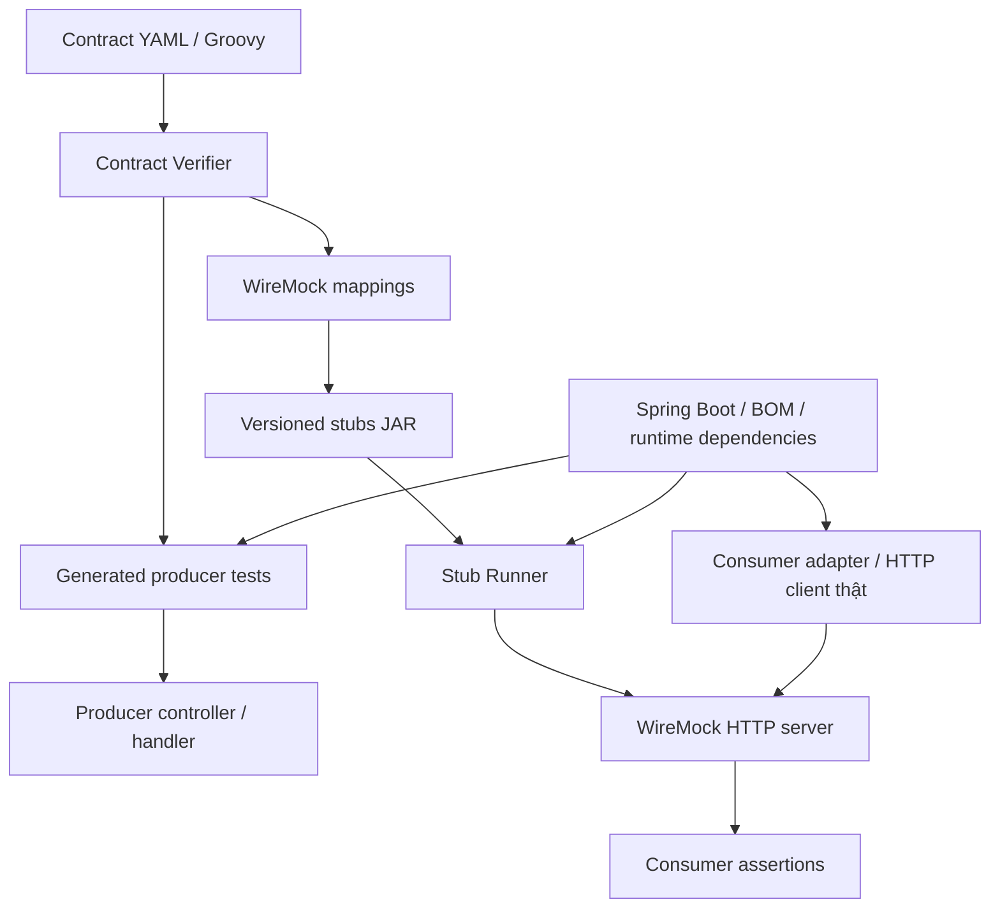
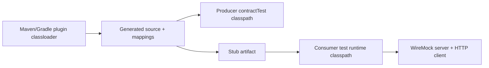
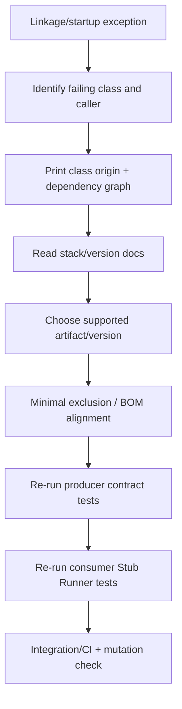
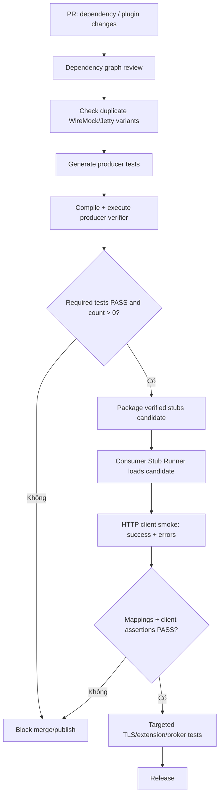

# Rà soát WireMock, HTTP client và xung đột dependency

> **Chương:** Tương thích công cụ  
> **Module:** `SPRING_CLOUD_CONTRACT` — kiểm thử hợp đồng giữa producer và consumer bằng Spring Cloud Contract, mô tả hành vi HTTP hoặc thông điệp với Groovy/YAML DSL, sinh producer tests, phát hành stubs, dùng Stub Runner và tích hợp CI để phát hiện API breaking changes.

## Mục tiêu học tập

Sau bài này, bạn có thể:

1. Phân biệt **Spring Cloud Contract Verifier**, **WireMock**, **Stub Runner**, **HTTP client của ứng dụng** và các thư viện hỗ trợ test; xác định đúng thành phần chịu trách nhiệm khi một kiểm thử thất bại.
2. Rà soát tương thích theo **Java/JDK, Spring Boot, Spring Framework, Spring Cloud release train, Spring Cloud Contract, WireMock, Jetty, Groovy, RestAssured, JUnit và Apache HttpClient** mà không đoán phiên bản.
3. Dùng `mvn dependency:tree`, `dependencyInsight` và test runtime classpath để tìm thư viện bị chọn sai version hoặc bị loại trừ không chủ đích.
4. Giải thích ý nghĩa của `NoSuchMethodError`, `NoClassDefFoundError`, `ClassNotFoundException`, `UnsupportedClassVersionError`, `LinkageError` và lỗi Servlet/Jetty khởi động.
5. Phân biệt `org.wiremock:wiremock`, `org.wiremock:wiremock-standalone`, `org.wiremock:wiremock-jetty12` và các tọa độ WireMock đời cũ; quyết định cách xử lý xung đột **có cơ sở**.
6. Nắm điểm khác giữa generated producer test ở mode `MOCKMVC`, mode `EXPLICIT`, `WEBTESTCLIENT` và consumer test thật qua WireMock.
7. Kiểm tra cấu hình `base URL`, cổng động, path, headers, charset, redirect, HTTPS, TLS certificate và timeout khi consumer dùng `RestClient`, `RestTemplate`, `WebClient`, Feign hoặc JDK `HttpClient`.
8. Điều tra stub mappings không khớp, mappings đời cũ, custom extension, dữ liệu JSON/response transformers và sự khác biệt giữa test code producer với test code consumer.
9. Xây dựng một **quy trình nâng cấp dependency có thể tái lập**, có versions/BOM, dependency lock, reports, test counts và một mutation có chủ đích.
10. Thiết kế quality gates CI để không publish verified stubs khi producer contract tests bị lỗi hoặc không chạy, cũng không cho consumer test xanh nhờ artifact/cổng/server sai.

## 1. Vì sao cùng một contract, máy A chạy được còn CI B thất bại?

Giả sử hệ thống gồm:

- `inventory-service`: **producer** cung cấp API tồn kho.
- `checkout-service`: **consumer** cần biết còn hàng trước khi đặt đơn.
- `Spring Cloud Contract Verifier`: đọc Groovy/YAML contract và sinh test phía producer.
- `Stub Runner`: tải `inventory-service-...-stubs.jar`, khởi động WireMock cho consumer.
- `RestClient` hoặc `WebClient`: HTTP client thực của `checkout-service`.

Hợp đồng:

```http
GET /api/stock/SKU-001 HTTP/1.1
Accept: application/json
```

Response:

```http
HTTP/1.1 200 OK
Content-Type: application/json

{"sku":"SKU-001","available":true,"quantity":4}
```

Local developer chạy test thành công. Nhưng CI báo:

```text
java.lang.NoSuchMethodError: ...MockHttpServletRequestBuilder.header(...)
```

Một runner khác báo:

```text
java.lang.NoClassDefFoundError: jakarta/servlet/DispatcherType
```

Và ở consumer:

```text
Connection refused: localhost/127.0.0.1:8080

Expected: 200
Actual:   404
```

Ba lỗi này có thể xảy ra **mà contract JSON hoàn toàn đúng**:

- `NoSuchMethodError`: thư viện gọi một phương thức **không tồn tại trong class được nạp ở runtime**.
- `NoClassDefFoundError`: một class cần thiết không có hoặc không tải được; thường gặp khi runtime classpath/Servlet/Jetty không tương thích.
- `Connection refused`/`404`: client gọi sai host/port, server chưa chạy hoặc WireMock không có mapping khớp.

**Kết luận đầu tiên:** đừng sửa nội dung contract theo mọi lỗi test. Phải xác định lớp lỗi nằm ở **API behavior, transport, server stub, generated test, build wiring hay dependency graph**.

## 2. Sơ đồ các thành phần và chiều kiểm chứng



| Thành phần | Nhiệm vụ | Khi lỗi, kiểm tra trước |
| --- | --- | --- |
| **Contract DSL** | Định nghĩa request/response hoặc message behavior | Method/path/header/body, syntax, matcher |
| **Verifier generator** | Sinh producer verification tests và mappings | Plugin config, generated source, test framework |
| **Producer HTTP test mode** | Gửi request đến controller/server thật trong test | `MockMvc` vs `Explicit`, base class, context |
| **WireMock** | Mô phỏng HTTP endpoint theo mappings | Startup, Jetty, mapping schema, unmatched requests |
| **Stub Runner** | Tìm artifact, chạy mock servers, cung cấp port | `ids`, `stubsMode`, repository, selected version |
| **HTTP client thật** | Serialization, headers, URL, TLS, timeout, xử lý status | Client adapter và configuration |
| **Dependency resolver** | Chọn JAR ở test/runtime classpath | Maven effective POM, Gradle insight, BOM |
| **Test engine** | Thực thi JUnit/Spock assertions | Jupiter/Vintage/Spock, filters, zero-test checks |

### 2.1. Producer PASS và consumer PASS chứng minh khác nhau

**Producer verification PASS:** code producer trong test đáp ứng những contracts đã tạo ra generated tests.

**Consumer Stub Runner PASS:** consumer client/handler xử lý **các stub mappings đã chọn**.

Không điều nào một mình chứng minh toàn bộ kết nối production hoạt động: TLS thật, auth, service discovery, database và retry cần integration/smoke tests phù hợp.

### 2.2. Thứ tự chẩn đoán phải theo bằng chứng

1. Test **không compile**: kiểm tra linkage/dependencies/source set, chưa điều tra response JSON.
2. Test **không chạy**: engine/task filters, không kết luận implementation đúng.
3. Stub server **không khởi động**: WireMock/Jetty/servlet/classpath.
4. Server chạy nhưng request **không tới**: URL/host/port/SSL/proxy.
5. Request tới nhưng **404 unmatched**: mappings/method/path/query/headers/body.
6. Mapping matched nhưng **payload sai**: contract/stub version, serialization, response transformer.
7. Test chạy và fail **đúng assertion**: xử lý khác biệt contract vs producer/client.
8. Build xanh: kiểm tra số **generated producer tests thực thi**, reports và artifact đã dùng.

## 3. Rà soát phiên bản theo một ma trận, không theo tin đồn

Các thư viện bên dưới có những nhịp phát hành độc lập:

| Tầng | Ví dụ cần ghi rõ | Dấu hiệu sai version |
| --- | --- | --- |
| JDK | Java compiler/toolchain và JVM chạy tests | `UnsupportedClassVersionError` |
| Spring Boot | Parent/BOM/plugin version | Dependency management khác test runtime |
| Spring Framework | Spring MVC/Test, WebFlux, Servlet APIs | `NoSuchMethodError`/`NoClassDefFoundError` |
| Spring Cloud train | BOM gồm Contract/LoadBalancer/OpenFeign… | Khác release train của Boot |
| Spring Cloud Contract | Maven/Gradle plugin, Verifier, Stub Runner | Generator/runtime mismatch |
| WireMock | Core/server/standalone/Jetty module | Jetty, mappings, extension APIs |
| Jetty/Servlet | Jetty 11/12, Jakarta APIs | Lỗi Servlet class/server startup |
| RestAssured | `rest-assured`, `spring-mock-mvc` | Lỗi khi generated request chạy |
| Apache HttpClient | HttpClient 4 và 5 là API khác | Class/method/transport khác nhau |
| Jackson/JsonPath/JsonUnit | Serializer và JSON assertions | Conversion/matcher runtime errors |
| JUnit/Spock/Groovy | Generator/test engine/source set | 0 discovered tests, `NoClassDef` |

**Không suy ra** "Spring Cloud Contract 5 nghĩa là phải dùng WireMock 5" hoặc "Boot 4 thì tự nâng WireMock lên bản beta mới nhất". Mỗi hệ có versioning riêng. Hãy lấy **tập phiên bản tương thích đã được quản lý bởi BOM/docs** của stack thực tế, rồi xem dependency graph đã resolve.

### 3.1. Ma trận kiểm kê trước khi sửa

Một bản ghi nhóm tự điền:

```yaml
runtimeInventory:
  javaToolchain: "<actual-java-version>"
  springBoot: "<boot-version>"
  springCloudReleaseTrain: "<cloud-train>"
  springCloudContractPlugin: "<contract-plugin-version>"
  verifierRuntime: "<resolved-version>"
  stubRunnerRuntime: "<resolved-version>"
  wireMockRuntime: "<resolved-version-and-artifact>"
  jettyRuntime: "<resolved-version-if-used>"
  restAssuredRuntime: "<resolved-version-if-used>"
  junitOrSpockEngine: "<actual-test-engine>"
  httpClientImplementation: "<RestClient/WebClient/Feign/JDK/other>"
  producerTestMode: "<MOCKMVC/EXPLICIT/WEBTESTCLIENT>"
```

Đây là **manifest tự rà soát**, không phải định dạng Spring Cloud Contract tự đọc. Số phiên bản phải lấy từ **effective/resolved graph**, không chỉ copy từ `pom.xml` hay `build.gradle`.

### 3.2. Tách ba loại "version"

- **Plugin version** dùng để sinh test/mapping trong build.
- **Runtime/test dependency version** mà JUnit/Spock/Stub Runner thực sự nạp.
- **Producer stub artifact version** như `com.example:inventory-service:1.3.0:stubs`.

Một build có plugin `5.0.3` nhưng test runtime bị ép dùng thư viện khác đời vẫn có thể fail. Một consumer dùng đúng runtime nhưng tải `stubs:1.2.0` trong khi muốn kiểm tra producer `1.3.0` cũng có thể xanh sai.

## 4. WireMock: chọn đúng artifact, tránh chồng nhiều biến thể

Trang WireMock hiện tại mô tả dòng **3.x** và một dòng **4.x beta**; API và dependency của bản beta có thể thay đổi. Đối với bài học này, ví dụ WireMock 3.x dùng các tọa độ chính:

| Artifact | Mục đích | Điểm lưu ý |
| --- | --- | --- |
| `org.wiremock:wiremock` | WireMock 3.x tiêu chuẩn | Phụ thuộc vào những thư viện runtime ở classpath |
| `org.wiremock:wiremock-standalone` | Uber JAR, nhiều dependencies được **shaded** | Hữu ích khi có xung đột transitives; kiểm tra tương thích extension |
| `org.wiremock:wiremock-jetty12` | Biến thể dành cho môi trường Jetty 12 | Cần Java 17+, phù hợp stack/runtime cụ thể |
| `com.github.tomakehurst:wiremock-jre8` và artifact đời cũ | Dự án WireMock 2.x/legacy | Không ép vào stack mới khi không có lý do |

Đừng thêm **cả ba WireMock 3.x variants** vào cùng test classpath chỉ để "chắc chắn có đủ". Chúng không phải ba tính năng độc lập cần được cài đồng thời; có thể mang lớp trùng hoặc dependencies tranh chấp.

### 4.1. WireMock standard và standalone khác thế nào?

- **Standard JAR:** có runtime dependencies thông thường; phù hợp khi dependency management đã tương thích.
- **Standalone/uber JAR:** đóng gói nhiều dependencies và chuyển package (shading) để giảm xung đột với thư viện bên ngoài.
- **Không tuyệt đối:** shading giảm một số xung đột, nhưng custom extension hoặc integration dựa vào class/package bên ngoài có thể cần được kiểm tra. Thay artifact không tự sửa URL, mapping hay classloader của ứng dụng.

Ví dụ Maven standalone cho một test module **chủ động sở hữu WireMock server riêng**:

```xml
<dependency>
  <groupId>org.wiremock</groupId>
  <artifactId>wiremock-standalone</artifactId>
  <version>3.13.2</version>
  <scope>test</scope>
</dependency>
```

Đây là **ví dụ tọa độ trong tài liệu WireMock 3.x**, không phải hướng dẫn bắt mọi project dùng version 3.13.2. Nếu Spring Cloud Contract/Boot BOM quản lý WireMock, cần kiểm tra tương thích **trước khi override**.

### 4.2. Jetty 11 và Jetty 12

Tài liệu WireMock 3.x giải thích WireMock standard có nền tảng Jetty 11, trong khi nhiều ứng dụng Spring dùng Jetty 12. Có thể xuất hiện:

```text
java.lang.ClassNotFoundException: jakarta.servlet....
java.lang.NoClassDefFoundError: org/eclipse/jetty/...
java.lang.NoSuchMethodError: org.eclipse.jetty....
```

**Đừng thấy chữ Jetty là lập tức xóa toàn bộ Jetty dependencies.** Hãy đọc:

1. WireMock artifact nào đang được resolve?
2. Có cả Jetty 11 và 12 trên **cùng test runtimeClasspath** không?
3. App thật có dùng Tomcat, Undertow hay Jetty?
4. Dependency nào kéo vào Jetty version đang thắng conflict resolution?
5. Nếu cần Jetty 12, biến thể `wiremock-jetty12` có tương thích với Spring Cloud Contract/Stub Runner version của bạn không?

Một fragment Gradle **chỉ khi project dùng WireMock Jetty12 trực tiếp và đã kiểm tra tương thích**:

```groovy
dependencies {
    testImplementation 'org.wiremock:wiremock-jetty12:3.13.2'
}
```

WireMock docs ghi bản Jetty 12 có vài khác biệt: reason phrase tùy chỉnh có thể không được trả, multipart decode và redirect với directory paths có hạn chế. Nếu contract phụ thuộc hành vi ấy, **đừng coi hai Jetty variants hoàn toàn tương đương**.

### 4.3. Đừng nâng lên WireMock 4.x beta chỉ để sửa một NoClassDef

WireMock 4.x beta thay đổi module layout (`wiremock-core`, `wiremock-junit5`, `wiremock-jetty`, …). Nếu Spring Cloud Contract đang dùng extension/server API của WireMock 3, ép WireMock 4 beta có thể phát sinh lỗi mới.

Chỉ nâng major khi có **compatibility statement** và test đầy đủ cho Contract Verifier, Stub Runner, custom extensions cùng mappings. "Bản mới hơn" không đồng nghĩa "classloader đúng hơn".

### 4.4. Hai phiên bản WireMock trên classpath

Trong dự án migration, một starter có thể kéo WireMock 3, trong khi POM cũ khai báo WireMock 2. Kết quả có thể là:

- Một bản thắng Maven dependency mediation/Gradle conflict resolution.
- Class có cùng FQN nhưng method signature khác.
- Một extension compile theo một đời, runtime nạp đời khác.
- Test local và CI khác nhau do profiles/locks/caches.

**Cách sửa:** tìm dependency path gây ra artifact cũ rồi loại trừ **có mục tiêu**, không tuyên bố bản được chọn là đúng chỉ vì build compile.

## 5. Maven: kiểm tra effective dependency graph

Khi project dùng Maven, phân biệt:

- **Project dependencies**: thư viện trên compile/test/runtime classpath.
- **Plugin dependencies**: thư viện trong classloader của Maven plugin.
- **BOM/dependencyManagement**: quy tắc chọn version, không nhất thiết tự thêm dependency vào classpath.
- **Profiles và parent POM**: có thể đổi graph ở CI so với local.

### 5.1. Các lệnh chẩn đoán cho người học

```bash
# Chạy trong producer hoặc consumer module đang lỗi:
./mvnw dependency:tree

# Lọc nhóm dễ gây xung đột; dấu ngoặc kép giữ list nguyên vẹn.
./mvnw dependency:tree \
  -Dincludes="org.wiremock:*,com.github.tomakehurst:*,org.eclipse.jetty:*,io.rest-assured:*,org.apache.httpcomponents.client5:*"

# Xem cấu hình cuối cùng sau parent, profiles và dependencyManagement.
./mvnw help:effective-pom

# Khi Maven đã đủ dependencies nhưng test vẫn lỗi:
./mvnw -B clean verify -e
```

Lệnh được viết để **người học chạy trong project thật**; theo phạm vi STEP 4 của bài này không thực thi Maven/Gradle. Tùy Maven Dependency Plugin version, định dạng filter/verbose output có thể thay đổi; nếu filter không thấy gì, chạy `dependency:tree` đầy đủ rồi tìm đường dẫn transitive.

### 5.2. Một cây dependency minh họa

```text
[INFO] com.example:checkout-service:jar:2.0.0
[INFO] +- org.springframework.cloud:spring-cloud-starter-contract-stub-runner:test
[INFO] |  \- org.wiremock:wiremock:jar:3.x:test
[INFO] \- com.example:test-tools:jar:1.0.0:test
[INFO]    \- com.github.tomakehurst:wiremock-jre8:jar:2.x:test
```

Đây là **graph giả để học phân tích**, không phải kết quả thực của phiên bản Spring Cloud Contract nhất định.

Cần trả lời: khi cùng class FQN có mặt ở nhiều JAR, runtime load **lớp nào**? Maven tree cho biết mediation/exclusion nhưng classpath còn có plugin isolates, test runner và shaded code. Với xung đột khó, kiểm tra **class origin** ở runtime.

### 5.3. BOM giúp đồng bộ, nhưng không thể làm mọi thứ tự tương thích

Một POM fragment:

```xml
<properties>
  <spring-cloud-contract.version>5.0.3</spring-cloud-contract.version>
</properties>

<dependencyManagement>
  <dependencies>
    <dependency>
      <groupId>org.springframework.cloud</groupId>
      <artifactId>spring-cloud-contract-dependencies</artifactId>
      <version>${spring-cloud-contract.version}</version>
      <type>pom</type>
      <scope>import</scope>
    </dependency>
  </dependencies>
</dependencyManagement>
```

Trong ứng dụng thật cần Spring Boot parent/BOM, Spring Cloud release train tương thích và plugin version phù hợp; đây **không phải POM hoàn chỉnh**. `5.0.3` chỉ là phiên bản minh họa theo tài liệu đang tham khảo, không được copy vào project chưa kiểm tra Boot/JDK.

Một dependency Verifier ở producer:

```xml
<dependency>
  <groupId>org.springframework.cloud</groupId>
  <artifactId>spring-cloud-starter-contract-verifier</artifactId>
  <scope>test</scope>
</dependency>
```

Một dependency Stub Runner ở consumer:

```xml
<dependency>
  <groupId>org.springframework.cloud</groupId>
  <artifactId>spring-cloud-starter-contract-stub-runner</artifactId>
  <scope>test</scope>
</dependency>
```

Phiên bản có thể được quản lý bằng BOM; không cần chèn version vào từng dependency nếu BOM đã quản lý đúng.

### 5.4. Khi nào thêm exclusion?

**Không** làm kiểu:

```xml
<!-- Không nên copy kiểu exclusion này khi chưa điều tra. -->
<exclusions>
  <exclusion>
    <groupId>org.eclipse.jetty</groupId>
    <artifactId>*</artifactId>
  </exclusion>
</exclusions>
```

Nó có thể loại bỏ Jetty mà WireMock thực sự cần.

Quy trình đúng:

1. Xem full dependency path kéo vào bản gây xung đột.
2. Xác định artifact và version được **resolve ở test runtime**.
3. Chọn cặp thư viện được hỗ trợ.
4. Thêm **exclusion tối thiểu** tại dependency mang artifact sai, hoặc thay adapter WireMock có chủ đích.
5. Rerun test khởi động WireMock và xác minh URL/mappings.
6. Đọc tree sau sửa để chắc không xóa một dependency khác cần thiết.

## 6. Gradle: đừng chỉ nhìn dependencies của test

Với Spring Cloud Contract Gradle plugin hiện đại, producer thường có source set `contractTest`. Đây là khác biệt cốt lõi:

- `testRuntimeClasspath` dùng cho test task thông thường.
- `contractTestRuntimeClasspath` dùng cho generated producer contract tests.
- Plugin classpath có thể khác cả hai.
- Consumer Stub Runner tests thường nằm trong `test` hoặc một integration test task riêng.

### 6.1. Các lệnh hữu ích

```bash
./gradlew dependencies \
  --configuration testRuntimeClasspath

./gradlew dependencies \
  --configuration contractTestRuntimeClasspath

./gradlew dependencyInsight \
  --dependency wiremock \
  --configuration contractTestRuntimeClasspath

./gradlew dependencyInsight \
  --dependency jetty \
  --configuration contractTestRuntimeClasspath

./gradlew dependencyInsight \
  --dependency httpclient5 \
  --configuration testRuntimeClasspath

./gradlew contractTest --info --console=plain
```

Nếu Gradle báo configuration không tồn tại, **đừng tạo configuration theo tên chỉ để lệnh chạy**. Xem source sets/tasks mà plugin thực tế tạo; trong multi-module thêm `:inventory-producer:` trước task.

### 6.2. Đọc lý do Gradle chọn phiên bản

`dependencyInsight` có thể cho thấy:

- Module bị chọn vì **conflict resolution**.
- Một version được **constraint** bởi BOM/platform.
- `forced` version hoặc `resolutionStrategy.force` override.
- Một module bị exclude hoặc được dependency substitution.
- Artifact nằm trên configuration khác với configuration đang bị lỗi.

Khi thấy bản mới hơn được chọn, **không kết luận nó tương thích**. Gradle chọn version theo quy tắc resolution, không tự kiểm thử API binary compatibility.

### 6.3. Fragment căn chỉnh Spring Cloud Contract Gradle plugin

```groovy
plugins {
    id 'java'
    id 'org.springframework.cloud.contract' version '5.0.3'
}

contracts {
    testFramework = 'JUNIT5'
    testMode = 'MockMvc'
    failOnNoContracts = true
}

dependencies {
    contractTestImplementation(
        'org.springframework.cloud:spring-cloud-starter-contract-verifier'
    )
}

tasks.named('contractTest', Test) {
    useJUnitPlatform()
}
```

**Cần bổ sung** Spring Boot/Cloud BOM và dependencies thích hợp theo dự án. Version `5.0.3` minh họa cho tài liệu được đối chiếu; việc ghép Boot/Groovy/JDK **phải** theo compatibility release được hỗ trợ. Trong `dependencies` không ghi mọi library version lẻ nếu BOM đã định nghĩa.

### 6.4. Gradle force có thể làm lỗi khó hiểu hơn

```groovy
configurations.configureEach {
    resolutionStrategy {
        force 'org.wiremock:wiremock:3.0.0'
    }
}
```

Đây là **anti-pattern minh họa**, không phải bản fix. Force một WireMock version có thể làm Stub Runner extension không còn tương thích. Nếu phải constraint version, hãy ghi lại lý do, cặp version đã kiểm thử và bỏ override khi stack nâng cấp; ưu tiên giải pháp theo BOM.

### 6.5. Cache không phải nguyên nhân của mọi mismatch

Một JAR cũ có thể đến từ **dependency version selection** do BOM/exclusion, chứ không phải Gradle cache stale. `--refresh-dependencies` chỉ giúp kiểm tra resolution cache, **không biến một tập version sai thành tập version đúng**.

Khi cần chẩn đoán, dùng clean run và đọc graph. Không xoá `~/.gradle/caches` toàn bộ một cách vô điều kiện.

## 7. Phân loại lỗi binary compatibility trước khi sửa

| Exception/triệu chứng | Nghĩa thường gặp | Hành động đầu tiên |
| --- | --- | --- |
| `NoSuchMethodError` | Caller được compile dựa trên API khác với class được nạp runtime | Xác định caller/callee + JAR origin, so version |
| `NoSuchFieldError` | Field bytecode kỳ vọng không có trong class runtime | Check dependency mediation/relocation |
| `AbstractMethodError` | Interface/class contract không khớp implementer runtime | Check plugin/extension API version |
| `ClassNotFoundException` | Class được load bằng tên nhưng không tìm thấy | Check runtime classpath và dependency excluded |
| `NoClassDefFoundError` | Class cần thiết vắng mặt hoặc init thất bại | Đọc `Caused by` gốc, classpath |
| `UnsupportedClassVersionError` | Bytecode build cho Java mới hơn JVM chạy test | So compiler/toolchain với test JVM |
| `IncompatibleClassChangeError` | Thay đổi cấu trúc static/instance/interface/class | Align caller/callee versions |
| `ExceptionInInitializerError` | Static initializer thất bại | Đọc original cause, config và dependencies |
| `ServiceConfigurationError` | ServiceLoader provider không load được | Check META-INF/services, shading, constructor |
| `No tests found` | Test engine/source set/filter, không nhất thiết dependency API | JUnit/Spock engine, task và reports |
| `Connection refused` | Không kết nối được host:port | Stub server lifecycle/port/URL |
| `404 from WireMock` | Server nhận request nhưng không có mapping khớp | Inspect mappings/unmatched request |

### 7.1. NoSuchMethodError không giống "thiếu import"

Ví dụ một lỗi từng được ghi nhận ở một số bản đầu Spring Cloud Contract 5.0 khi dùng Spring Framework 7 + RestAssured MockMvc:

```text
java.lang.NoSuchMethodError:
  org.springframework.test.web.servlet.request
    .MockHttpServletRequestBuilder.header(
      java.lang.String, java.lang.Object[]
    )
```

Một library đã được compile với **method descriptor cũ**, nhưng class `MockHttpServletRequestBuilder` của Spring Framework đang chạy không có descriptor ấy. Đây là vấn đề binary compatibility, không phải thiếu `import` trong base test.

**Phạm vi lịch sử:** issue Spring Cloud Contract #2379 được ghi nhận cho combo Spring Cloud Contract 5.0.0, Spring Boot 4.0.0/Spring Framework 7 và RestAssured 5.5.6; issue được gắn milestone 5.0.2. Đó là ví dụ chẩn đoán **theo phiên bản**; không suy rằng mọi dự án 5.0.x đều lỗi hoặc đã được khắc phục nếu không kiểm tra release notes và resolved graph thực tế.

Cách xử lý:

1. Ghi đúng version của Spring Framework và `rest-assured`/`spring-mock-mvc` ở test runtime.
2. Tìm issue/release notes tương ứng **phiên bản thực tế**.
3. Nâng **cả cụm thư viện tương thích** theo BOM/cấu hình plugin.
4. Nếu cần thay test mode, hiểu phạm vi mới (MockMvc vs Explicit) và không dùng việc thay mode để che lỗi API.
5. Rerun producer tests, kiểm tra test count và assertions thật.

### 7.2. Xác định JAR nguồn của class đang chạy

Một phương pháp Java để in vị trí code source của class có liên quan:

```java
import com.github.tomakehurst.wiremock.WireMockServer;
import java.security.CodeSource;

class ClassOriginDebug {
    static void printOrigin(Class<?> type) {
        CodeSource source = type.getProtectionDomain()
            .getCodeSource();
        System.out.println(
            type.getName() + " -> " +
            (source == null
                ? "<no code source>"
                : source.getLocation())
        );
    }

    static void inspect() {
        printOrigin(WireMockServer.class);
        printOrigin(
            org.springframework.test.web.servlet.request
                .MockHttpServletRequestBuilder.class
        );
    }
}
```

Đây là **helper chẩn đoán** chỉ có thể biên dịch khi các dependencies tương ứng hiện diện. In location của JAR giúp trả lời class thực sự được load từ đâu. Nó không tự sửa xung đột.

Với Java 9+, có thể dùng class-loading diagnostics trong một lượt test cô lập:

```bash
# Rất nhiều output: chỉ dùng khi cần phân tích classloader.
java -Xlog:class+load=info -jar test-runner.jar
```

`test-runner.jar` là giả định; Maven Surefire/Gradle có cách fork JVM khác. Khi chạy project thật, cấu hình JVM args **cho đúng test task** để log class loading. Không dùng debug logging không kiểm soát trên CI vì có thể chứa thông tin môi trường nhạy cảm.

## 8. HTTP client: không nhầm "WireMock chạy" với "client đang gọi WireMock"

Stub Runner có thể khởi động WireMock thành công nhưng consumer vẫn gọi endpoint khác. Một số lý do:

- Client được tạo trước khi test inject base URL.
- Có hard-coded production host.
- Cấu hình `application-test.yml` bị profile khác ghi đè.
- Service discovery/Feign/LoadBalancer route tới Eureka/Consul hoặc container khác.
- `localhost` trong Docker container không trỏ về host WireMock.
- WireMock port động, client vẫn gọi `8080`.
- Client tự thêm base path hai lần.
- Java JDK HttpClient khác RestClient/WebClient về timeout/redirect handling.

### 8.1. Tách ba thành phần của URL

Giả sử Stub Runner trả:

```text
http://localhost:53041
```

Contract mapping yêu cầu:

```text
GET /api/stock/SKU-001
```

Client phải tạo:

```text
http://localhost:53041/api/stock/SKU-001
```

Một sai lầm:

```text
Base URL: http://localhost:53041/api
Client path: /api/stock/SKU-001
Actual: http://localhost:53041/api/api/stock/SKU-001
```

Đây là **404 do path**, không phải lỗi tương thích WireMock/Jetty.

### 8.2. Mẫu cấu hình client với base URL có thể inject

Java Spring `RestClient`:

```java
package com.example.checkout;

import org.springframework.beans.factory.annotation.Value;
import org.springframework.stereotype.Component;
import org.springframework.web.client.RestClient;

@Component
public class InventoryClient {

    private final RestClient http;

    public InventoryClient(
        RestClient.Builder builder,
        @Value("${inventory.base-url}") String baseUrl
    ) {
        this.http = builder.baseUrl(baseUrl).build();
    }

    public Stock fetch(String sku) {
        return http.get()
            .uri("/api/stock/{sku}", sku)
            .header("Accept", "application/json")
            .retrieve()
            .body(Stock.class);
    }

    public record Stock(
        String sku,
        boolean available,
        int quantity
    ) {}
}
```

Đây là **mẫu ứng dụng với Spring Framework 6.1+**, không phải client chạy được độc lập: cần Boot application, JDK và dependencies phù hợp. Trong ứng dụng thật cần xử lý null body, 4xx/5xx, timeout, retry và authentication theo policy.

**Tác dụng với contract tests:** client dùng base URL từ configuration, vì vậy consumer test có thể trỏ nó đến Stub Runner mà không sửa code sản xuất.

### 8.3. RestClient / RestTemplate / WebClient / Feign / JDK HttpClient

| Client | Phong cách | Rủi ro tương thích |
| --- | --- | --- |
| `RestClient` | Synchronous fluent API của Spring | RequestFactory, message converters, status handlers |
| `RestTemplate` | Spring blocking client cũ hơn | Interceptors, request factory, timeout, SSL |
| `WebClient` | Reactive HTTP client | Reactor Netty, event loop, codec, `Mono`/`Flux` |
| Spring Cloud OpenFeign | Interface proxy + encoders/decoders | Discovery, LoadBalancer, client factory, configuration |
| `java.net.http.HttpClient` | JDK 11+ HTTP client | TLS, HTTP/2, URI/redirect/timeouts, không nhận Spring interceptors tự động |
| RestAssured | Chủ yếu HTTP test client/generator | Dependency với Spring test/mockmvc/groovy/jsonpath |

**Không mặc định** mỗi client sử dụng cùng implementation Apache HttpClient. Việc thêm `httpclient5` vào classpath không tự làm `WebClient` chuyển từ Reactor Netty sang Apache HttpClient.

### 8.4. Apache HttpClient 4 và 5

- HttpClient 4 dùng các package `org.apache.http...`.
- HttpClient 5 dùng `org.apache.hc.client5...` và `org.apache.hc.core5...`.

Đây là hai API khác nhau. Không sửa `ClassNotFoundException` của một client mới bằng cách thêm `org.apache.httpcomponents:httpclient` cũ một cách ngẫu nhiên.

**Trước khi thêm dependency**, xác định framework/client adapter đang cần HttpClient 4 hay 5 và Boot BOM quản lý phiên bản nào.

## 9. Consumer test với Stub Runner và HTTP client thực

Ví dụ consumer JUnit 5 với artifact đã publish/cài local:

```java
package com.example.checkout;

import org.junit.jupiter.api.Test;
import org.springframework.beans.factory.annotation.Autowired;
import org.springframework.boot.test.context.SpringBootTest;
import org.springframework.cloud.contract.stubrunner.StubFinder;
import org.springframework.cloud.contract.stubrunner.spring.AutoConfigureStubRunner;
import org.springframework.cloud.contract.stubrunner.spring.StubRunnerProperties;

import java.net.URL;
import java.net.URI;

import static org.junit.jupiter.api.Assertions.*;

@SpringBootTest
@AutoConfigureStubRunner(
    ids = "com.example:inventory-service:1.3.0:stubs",
    stubsMode = StubRunnerProperties.StubsMode.LOCAL
)
class InventoryClientContractTest {

    @Autowired
    StubFinder stubFinder;

    @Test
    void readsStockUsingActualHttpAdapter() {
        URL server = stubFinder.findStubUrl(
            "com.example", "inventory-service"
        );
        assertNotNull(server);

        // Đây là client production được viết để có thể cấu hình URL.
        InventoryClient client = new InventoryClient(
            RestClient.builder(),
            server.toExternalForm()
        );

        InventoryClient.Stock stock = client.fetch("SKU-001");
        assertEquals("SKU-001", stock.sku());
        assertTrue(stock.available());
        assertEquals(4, stock.quantity());
    }
}
```

Snippet này minh họa cách test một adapter HTTP thực của consumer; cần import `org.springframework.web.client.RestClient`, class `InventoryClient` ở mục 8 và Spring Boot/Stub Runner dependencies. Constructor `InventoryClient(RestClient.Builder, String)` công khai trong ví dụ trước; trong ứng dụng thật nên test bean đã được inject/configured, để cover cả configuration, thay vì tự tạo client làm bỏ qua interceptors.

### 9.1. Tránh fixed port khi CI chạy song song

Thay vì:

```java
@AutoConfigureStubRunner(
    ids = "com.example:inventory-service:1.3.0:stubs:8080"
)
```

để Stub Runner chọn port động và lấy URL qua `StubFinder.findStubUrl(...)`. Cổng cố định có thể xung đột với app khác trên runner hoặc một WireMock instance còn sót.

### 9.2. LOCAL và REMOTE khác nhau

- `LOCAL`: dùng local Maven repository của **runner hiện tại**.
- `REMOTE`: tải từ repository được cấu hình (Nexus/Artifactory…).
- `CLASSPATH`: dùng stubs trên classpath.

Nếu producer publish `1.3.1` nhưng consumer `LOCAL` vẫn dùng `1.3.0`, test có thể xanh với **contract cũ**. Đừng chữa bằng thay WireMock dependency; cần kiểm tra `ids`, repository mode và artifact được tải.

### 9.3. Không mock luôn InventoryClient

Một test:

```java
InventoryClient client = mock(InventoryClient.class);
when(client.fetch("SKU-001"))
    .thenReturn(new Stock("SKU-001", true, 4));
```

chỉ kiểm tra dữ liệu do mock tạo, **không** kiểm tra serialization, base URL, request headers hay response parsing. Nếu mục tiêu là consumer contract test, để client thật gọi WireMock.

## 10. @AutoConfigureWireMock, Stub Runner và WireMock extension là ba đường khác nhau

### 10.1. @AutoConfigureWireMock

Dùng khi chính test muốn **tự đăng ký** mappings cho một WireMock server:

```java
@SpringBootTest
@AutoConfigureWireMock(port = 0)
class InventoryAdapterTest {
    // wiremock.server.port là property cổng server test
    // Test đăng ký stubFor(...) trong setup.
}
```

Cần Spring Cloud Contract WireMock integration dependency thích hợp. Với port `0`, WireMock chọn cổng ngẫu nhiên; property `wiremock.server.port` giúp ứng dụng tìm port.

### 10.2. @AutoConfigureStubRunner

Dùng khi muốn **lấy mappings từ artifact của producer**:

```java
@SpringBootTest
@AutoConfigureStubRunner(
    ids = "com.example:inventory-service:1.3.0:stubs",
    stubsMode = StubRunnerProperties.StubsMode.LOCAL
)
class InventoryConsumerContractTest {
    // Dùng StubFinder để tìm URL tương ứng artifact.
}
```

Đây là con đường phù hợp với CDC: producer verification → publish verified stub JAR → consumer test.

### 10.3. WireMock Spring Boot integration chính thức

WireMock cũng có integration riêng cho Spring Boot và JUnit 5. Nó có cơ chế cấu hình/server lifecycle độc lập với Spring Cloud Contract `@AutoConfigureWireMock`. **Không trộn annotations/dependencies từ hai integration libraries một cách vô tình**.

Nếu test có cả `@AutoConfigureWireMock` và `@AutoConfigureStubRunner`, có thể khởi động **hai WireMock servers** và một client lại trỏ vào server không có mapping. Hãy xác định **một owner** quản lý mock server cho mỗi collaborator và tìm port theo API của owner ấy.

### 10.4. Custom WireMock extension

Nếu producer stub cần response transformer/custom matcher, extension phải được đăng ký với WireMock runtime **ở phía consumer**. Chỉ thêm JAR extension vào classpath có thể chưa đủ; Spring Cloud Contract Stub Runner hỗ trợ `HttpServerStubConfigurer`/`WireMockHttpServerStubConfigurer` để điều chỉnh cấu hình.

Khi nâng WireMock major, kiểm tra extension API signatures và shading. Mapping gọi một transformer không tồn tại có thể báo warning/fail dù HTTP request match đúng.

## 11. Phân loại lỗi WireMock startup, HTTP transport và mapping

| Dấu hiệu | Tầng lỗi | Hướng chẩn đoán |
| --- | --- | --- |
| `NoClassDefFoundError: org/eclipse/jetty/...` | Jetty dependencies | Dependency tree, standard vs Jetty12 vs shaded |
| `NoClassDefFoundError: jakarta/servlet/...` | Servlet classpath | Spring/Jetty runtime compatibility |
| `Address already in use` | Server port | Dùng dynamic port, dọn test-owned server |
| `Connection refused` | Host/port/server lifecycle | Stub server có chạy, base URL đúng? |
| `SSLHandshakeException` | TLS/trust | HTTP vs HTTPS, test cert/truststore |
| `404` từ WireMock | Không match request | Mappings/method/path/query/header/body |
| `415` từ producer thật | Request `Content-Type` sai | Client content negotiation/server converter |
| `406` từ producer thật | `Accept` không hỗ trợ | Client Accept/produces |
| `Unexpected character` khi parse JSON | Body/charset/serialization | Header, actual body, Jackson/decoder |
| `UnrecognizedPropertyException` | Consumer strict DTO | Response fields/serializer policy |
| `ReadTimeoutException` | Timeout/delay | Client timeouts, WireMock fault/delay |
| `ClassCastException`/`NoSuchMethodError` | Binary API mismatch | Class origin, dependency alignment |

### 11.1. Trước khi kết luận 404 là lỗi contract

Xác nhận request thật đã gửi:

```http
GET /api/stock/SKU-001 HTTP/1.1
Accept: application/json
```

Và mapping WireMock tương tự:

```json
{
  "request": {
    "method": "GET",
    "url": "/api/stock/SKU-001"
  },
  "response": {
    "status": 200,
    "headers": {
      "Content-Type": "application/json"
    },
    "jsonBody": {
      "sku": "SKU-001",
      "available": true,
      "quantity": 4
    }
  }
}
```

Đây là **WireMock mapping minh họa**, không phải output byte-for-byte từ mọi phiên bản Spring Cloud Contract. Nếu client gọi `/stock/SKU-001`, `/api/api/stock/...` hoặc thêm query param mà mapping dùng `urlEqualTo` chặt, request có thể không match.

### 11.2. Kiểm tra WireMock Admin API chỉ trên server test-owned

Với WireMock server nội bộ ở port giả định `53041`:

```bash
curl http://localhost:53041/__admin/mappings
curl http://localhost:53041/__admin/requests/unmatched
```

Admin endpoint hỗ trợ xem mappings và những requests unmatched. Không expose Admin API ra mạng không tin cậy và không in `Authorization` hoặc PII từ request journal vào CI log. **Phải bảo đảm đây là server test-owned**.

Nếu `/__admin/mappings` không chứa contract cần thiết, xét:

- Stubs JAR cũ hoặc sai version.
- Sai classifier `stubs`/repositoryRoot.
- Mapping không được đóng gói.
- Stub Runner đã lọc theo `stubsPerConsumer`.
- Một WireMock khác đang chạy ở port được client gọi.
- Mapping bị thay bởi reset/cấu hình test khác.

### 11.3. WireMock request matching không giống controller routing

WireMock có thể match URL, query, headers, cookies và body theo JSON matching rules. Controller Spring MVC có thể áp thêm:

- Handler mapping/prefix/path parsing.
- `consumes`/`produces`.
- Request filters/validation.
- Spring Security.
- Jackson converters.

Đừng giả định "stub 200" chứng minh producer thật đã đáp ứng controller route. Cần producer verification trên implementation.

## 12. HTTP client: charset, Content-Type và Accept

JSON contract thường dùng:

```yaml
name: stock_available
request:
  method: GET
  url: /api/stock/SKU-001
  headers:
    Accept: application/json
response:
  status: 200
  headers:
    Content-Type: application/json
  body:
    sku: SKU-001
    available: true
    quantity: 4
```

YAML này là Spring Cloud Contract DSL, không phải WireMock mapping JSON. Trong producer Verifier, generator dùng DSL để tạo assertions; trong stubs, converter sinh WireMock mappings.

### 12.1. Ba lỗi thường gặp

1. Client gửi `Content-Type: application/json` cho request không có body rồi nghĩ đó thay được `Accept`; hai header có mục đích khác nhau.
2. Client POST gửi chuỗi JSON nhưng `Content-Type: text/plain`; producer có thể trả 415.
3. Server/mapper gửi JSON number thành string, ví dụ `quantity: "4"`; consumer strict DTO hoặc schema assertion có thể fail.

### 12.2. UTF-8 và dữ liệu Unicode

Một contract có tiếng Việt như `message: "Không đủ hàng"` cần test đúng encoding end-to-end khi API cam kết Unicode. Đừng giải quyết lỗi encoding bằng cách chuyển mọi fixture sang ASCII: như vậy bỏ coverage. Đồng thời, không nên buộc ký tự whitespace/format JSON exact nếu consumer chỉ cần semantics của các field.

### 12.3. Headers bị tự thay đổi bởi HTTP client

Một số client tự thêm `User-Agent`, `Accept-Encoding`, `Host` và quản lý `Content-Length`. Nếu mapping WireMock match quá chặt các headers do client quản lý, test có thể thất bại khi nâng HTTP client dù contract nghiệp vụ không đổi.

Chỉ match những headers mà **producer/consumer thật sự cam kết**, không snapshot mọi header ngẫu nhiên từ HTTP trace.

## 13. HTTPS, TLS và khác biệt giữa HTTP clients

Khi WireMock dùng HTTPS với chứng chỉ tự ký, client có thể báo:

```text
javax.net.ssl.SSLHandshakeException:
  PKIX path building failed
```

### 13.1. Điều cần kiểm tra trước

- Server WireMock được bật HTTPS port chưa?
- Consumer đang gọi `http://` hay `https://`?
- Chứng chỉ có đúng hostname/SAN cho `localhost` hoặc tên container không?
- Test truststore có chứa CA/test certificate thích hợp?
- Client có dùng proxy hoặc HTTP/2/ALPN khác với môi trường producer không?
- Test đang dùng RestClient, WebClient hay JDK HttpClient? Mỗi client cấu hình TLS khác nhau.

### 13.2. Không tắt verification TLS toàn ứng dụng

Một giải pháp thiếu an toàn là đổi SSL client sang "trust all" rồi tái sử dụng cấu hình ấy trong production.

Cách ưu tiên:

- Nếu đang test HTTP schema/behavior, dùng **HTTP loopback** với WireMock.
- Nếu cần kiểm chứng TLS, dùng test CA/certificate và truststore riêng.
- Cấu hình trust chỉ trong **test profile/test client**, không export sang bean production.
- Tách TLS integration test khỏi contract test không cần HTTPS để giảm flakiness.

Tài liệu Spring Cloud Contract cũ có mô tả convenience SSL cho `RestTemplateBuilder`/`@AutoConfigureWireMock`; **đừng giả định mọi HTTP client đời mới cùng được tự động cấu hình như vậy**. Kiểm tra HTTP client thực tế.

### 13.3. Redirect, gzip và timeout cũng ảnh hưởng compatibility

- Một số clients tự follow 301/302/307/308; client khác không hoặc thay method.
- Compression `gzip` cần client support và header/content-length phù hợp.
- Timeouts không phải do WireMock tự định nghĩa: client có connect/read/response timeout.
- WireMock delay/fault simulation hữu ích cho consumer resilience tests nhưng không phải bằng chứng producer thật có cùng latency/retry policy.

## 14. Generated producer tests: đừng chữa lỗi RestAssured bằng sửa WireMock

Spring Cloud Contract generated HTTP tests có thể dùng RestAssured/MockMvc hoặc HTTP server mode tùy `testMode`.

| Test mode | Client generated test | Rủi ro hay gặp |
| --- | --- | --- |
| `MOCKMVC` | `RestAssuredMockMvc` với Spring MVC Test | Binary mismatch RestAssured ↔ Spring Framework, base setup |
| `EXPLICIT` | HTTP thật qua socket | Embedded server/port, network/TLS/client libs |
| `WEBTESTCLIENT` | WebFlux `WebTestClient` | Reactive test dependencies/context |
| `JAXRSCLIENT` | JAX-RS client theo hỗ trợ phiên bản | Endpoint/server/JAX-RS dependencies |

### 14.1. Base MockMvc chuẩn mục đích

```java
package com.example.inventory.contract;

import com.example.inventory.StockController;
import io.restassured.module.mockmvc.RestAssuredMockMvc;
import org.junit.jupiter.api.BeforeEach;

public abstract class InventoryContractBase {

    @BeforeEach
    public void setUp() {
        RestAssuredMockMvc.standaloneSetup(
            new StockController()
        );
    }
}
```

**Yêu cầu:** generator sinh `JUNIT5` và mode `MOCKMVC`; `StockController` là code producer thật. Với validation, advice hoặc security, dùng WebApplicationContext/Spring Boot setup cho phạm vi cần kiểm chứng.

### 14.2. Khi gặp NoSuchMethodError lúc gửi header

Nếu stack trace đi qua `io.restassured.module.mockmvc.internal.MockMvcRequestSenderImpl`, đừng tìm lỗi trong WireMock stubs JAR trước. Đây là **producer generated request test**, có thể chưa khởi động WireMock.

Hãy rà soát:

1. `testFramework`, `testMode` và generated source.
2. Version `rest-assured`/`spring-mock-mvc` trên **contractTestRuntimeClasspath** hoặc Maven test classpath.
3. Version `spring-test`/`spring-webmvc` đã nạp.
4. Release notes/issue của cặp framework tương ứng.
5. Sửa theo BOM/phiên bản tương thích rồi chạy lại generated tests.

**Tuyệt đối không bỏ header khỏi contract** nếu consumer/producer thực sự cam kết header ấy chỉ để tránh lỗi API thư viện.

## 15. Spock, Groovy và JSON matcher dependencies

Trong dự án Spring Cloud Contract có thể gặp cả:

- Groovy dùng để **viết DSL**.
- Groovy/Spock dùng để **sinh và chạy tests** nếu chọn `SPOCK`.
- RestAssured dùng Groovy/JsonPath hoặc libraries liên quan.
- JSON assertions dùng Jackson/JsonUnit/JSONPath.

### 15.1. Groovy DSL không có nghĩa phải chạy Spock

Nếu contract là:

```groovy
org.springframework.cloud.contract.spec.Contract.make {
    request {
        method 'GET'
        url '/api/stock/SKU-001'
    }
    response {
        status 200
    }
}
```

plugin có thể sinh Java JUnit tests khi `testFramework=JUNIT5`. **DSL syntax** và **test runner** là hai trục khác nhau.

### 15.2. Groovy 4/5 và Spock engine

Khi nâng Spring Boot/Cloud, có thể thay đổi Groovy runtime. Một Spock dependency build cho đời Groovy khác có thể fail:

```text
NoClassDefFoundError: groovy/lang/...
ServiceConfigurationError: TestEngine...
GroovyRuntimeException: Conflicting module versions
```

Hãy kiểm tra:

- Test framework `JUNIT5` hay `SPOCK`.
- Generated test là Java hay Groovy.
- `spock-core`/`spock-spring` tương thích với Groovy/JUnit Platform hiện có.
- Test task chạy `useJUnitPlatform()` khi cần.
- Có Groovy modules khác version do transitive dependencies?

**Không** downgrade Groovy chỉ để một sample test compile mà không kiểm tra compatibility với Spring Cloud Contract plugin/Boot.

### 15.3. Đừng đánh đồng lỗi JSON matcher với lỗi HTTP

Nếu request trả 200 và body hợp lệ nhưng assertion fail `JsonPath`/`JsonUnit`:

- Kiểm tra JSONPath expression có trỏ đúng field.
- Kiểm tra dynamic matcher `by_regex`/`by_type` trong DSL.
- Kiểm tra body là JSON boolean/number hay chuỗi.
- Kiểm tra resolved Jackson/JsonPath/JsonUnit dependencies.
- Xem generated assertion thực tế để biết điều kiện fail.

**Không nới mọi matcher thành `.*` chỉ để tránh dependency issue.** Việc đó mất khả năng phát hiện breaking changes.

## 16. WireMock extension và mapping schema khi nâng cấp

Một stub artifact có thể chứa mapping JSON hợp lệ nhưng được sinh bởi một WireMock đời khác hoặc cần custom extension.

Ví dụ mapping có response transformer:

```json
{
  "request": {
    "method": "GET",
    "url": "/api/stock/SKU-001"
  },
  "response": {
    "status": 200,
    "body": "{\"sku\":\"SKU-001\",\"quantity\":4}",
    "headers": {
      "Content-Type": "application/json"
    },
    "transformers": ["response-template"]
  }
}
```

Nếu runtime không có transformer đã cấu hình hoặc API extension khác đời, test có thể báo warning/exception. Phân biệt:

- **Mapping parse error:** JSON/field schema không được runtime hỗ trợ.
- **Extension registration error:** tên transformer/custom matcher không có.
- **Dependency linkage error:** extension class gọi WireMock method không tồn tại.
- **Business mismatch:** transformer chạy được nhưng output sai contract.

### 16.1. Công thức rà soát mapping

1. Xác định **GAV + version + classifier** của producer stub JAR.
2. Kiểm tra `mappings`, `contracts` và `__files` nếu được dùng.
3. Xác nhận WireMock runtime version của consumer.
4. Kiểm tra mapping có dùng features/custom extensions nào.
5. Nếu có, đăng ký đúng extension qua Stub Runner configurer.
6. Gọi endpoint stub và kiểm tra actual response.
7. Nếu mapping không tương thích với runtime mới, nâng các thành phần **có kiểm chứng**, không sửa contract business tùy tiện.

### 16.2. Não trạng "một stub JAR chạy mọi WireMock" là sai

WireMock mappings thường có tính portable trong một phạm vi, nhưng runtime không cam kết mãi mãi hỗ trợ mọi extension/schema cũ và mới. Vì vậy khi thay đổi major WireMock hoặc Spring Cloud Contract, cần **consumer smoke tests tải artifact cũ và mới**, không chỉ chạy build của plugin.

## 17. Maven/Gradle plugin classpath và test runtime là hai thế giới

Một tình huống:

- Spring Cloud Contract Maven plugin load DSL converter bằng plugin classloader.
- Generated test được compile bằng project test classpath.
- Stub Runner consumer khởi động trong một JVM khác, với dependency graph của consumer.

Vì vậy **một method có mặt lúc generator chạy chưa chắc tồn tại lúc generated test chạy**. Tương tự, một WireMock server trong Stub Runner có thể dùng version khác với một WireMock server được start thủ công ở unit tests.

### 17.1. Sơ đồ lớp



### 17.2. Trường hợp cần xem cả hai graphs

- Generator sinh code tham chiếu package không có ở runtime.
- Plugin version đã nâng nhưng starter verifier vẫn bị BOM cũ giữ lại.
- Consumer thêm WireMock trực tiếp, lấn át version mà Stub Runner được xây dựng cùng.
- Spock dependency nằm ở `testImplementation` nhưng generated tests thuộc `contractTestImplementation`.
- Project có nhiều `Test` tasks và plugin resolution strategies khác nhau.

**Không sửa classloader issue bằng cách copy JAR thủ công vào build output**. Cần khai báo dependency đúng scope/source set và căn chỉnh version được hỗ trợ.

## 18. "Fix" bằng exclude: quy trình an toàn có chứng cứ

Đôi khi exclusion đúng, nhưng cần làm theo thứ tự:



### 18.1. Ví dụ exclusion có mục tiêu, không phải công thức chung

Giả sử `com.example:legacy-test-helper` kéo WireMock 2.x vào test, còn team quyết định dùng WireMock 3.x đã được xác minh tương thích:

```groovy
dependencies {
    testImplementation('com.example:legacy-test-helper:1.0.0') {
        exclude group: 'com.github.tomakehurst',
                module: 'wiremock-jre8'
    }
}
```

Đây là **ví dụ giả định**: project thật chỉ thêm exclusion khi `dependencyInsight` cho thấy chính helper ấy kéo bản cũ. Không loại trừ WireMock nếu một thư viện vẫn cần API cũ mà bạn chưa thay thế.

Một bản sửa tốt ghi trong PR:

```text
Symptom:
  NoSuchMethodError at WireMock startup

Evidence:
  testRuntimeClasspath contained legacy wiremock-jre8
  and org.wiremock:wiremock; class origin was legacy JAR

Decision:
  Remove legacy transitive dependency at the source;
  retain WireMock version managed by supported test stack

Validation:
  Producer generated contract tests: PASS
  Consumer Stub Runner tests: PASS
  No skipped required cases
  One deliberate contract mutation: FAILED as expected
```

### 18.2. Tránh dùng force/exclude như thuốc chữa vĩnh viễn

Một override có thể hết phù hợp sau khi Spring Cloud Contract/Boot nâng cấp. Nên có ticket hoặc comment nêu lý do, version đã kiểm thử, tiêu chí bỏ override và CI guard để phát hiện dependency graph drift.

## 19. Chẩn đoán khác biệt local và CI

| Hiện tượng | Giả thuyết cần kiểm tra | Bằng chứng |
| --- | --- | --- |
| Local pass, CI `NoClassDef` | JDK/toolchain/BOM/profile khác | `java -version`, effective graph |
| Local pass, CI 404 | Cổng Stub Runner, host/container network, artifacts khác | Actual client URL + mappings |
| Maven pass, Gradle fail | Source set/plugin classpath khác | Maven test classpath vs Gradle `contractTestRuntimeClasspath` |
| Windows pass, Linux fail | Case-sensitive path, shell/encoding | Contract path, resource casing |
| Máy dev dùng `LOCAL`, CI dùng `REMOTE` | Stub artifact/caching khác | GAV, repository, checksum |
| CI chạy song song fail port | Fixed `8080`/`8090` collision | Port logs + multiple servers |
| Test thứ hai fail sau test đầu | Stateful WireMock scenario/context caching | Reset state/journal/mappings đúng ownership |
| Chỉ lỗi khi chạy cả suite | Parallel classloader/static client config | Test isolation, shared beans |
| Chỉ lỗi khi dùng HTTPS | Truststore/SAN/HTTP client implementation | SSL exception cause, test cert |

### 19.1. Đừng lẫn build cache với dependency conflict

Gradle báo `FROM-CACHE` hoặc `UP-TO-DATE` là **task outcome**, không phải mô tả runtime classpath. Một CI job có thể bị lỗi do dependency graph khác dù test source không thay đổi.

Nếu cần một lần kiểm tra sạch:

```bash
./gradlew clean contractTest \
  --rerun-tasks --no-build-cache --console=plain

# Nếu đang chẩn đoán dependency freshness riêng:
./gradlew contractTest --refresh-dependencies --console=plain
```

Các cờ phục vụ mục đích khác nhau. **Không** dùng `--refresh-dependencies` thay cho việc chọn một BOM/artifact version tương thích.

### 19.2. Không xóa toàn bộ cache máy chung theo thói quen

Xóa `~/.m2/repository` hay `~/.gradle/caches` có thể làm CI chậm, gây tải repository và không giải quyết version conflict. Ưu tiên inspect resolved graph và dùng runner sạch **có chủ đích** cho điều tra riêng.

## 20. Một quy trình nâng cấp công cụ có kiểm soát

Khi nâng Boot/Spring Cloud Contract/WireMock, nên làm theo các bước:

1. Ghi lại **dependency graph và report đang PASS**.
2. Chọn **Spring Boot + Spring Cloud release train + Contract plugin** trong tập được docs hỗ trợ.
3. Xác định WireMock standard/standalone/Jetty12, không thêm nhiều variants.
4. Kiểm tra HTTP client implementation và JDK toolchain.
5. Nâng plugin/BOM/test dependencies cùng một PR hoặc theo thứ tự có thể rollback.
6. Chạy generated producer tests **trên controller/handler thật**.
7. Tạo stubs JAR từ producer code đã verify.
8. Cho consumer **tải candidate artifact mới**, chạy adapter thật qua Stub Runner.
9. Test các trường hợp status, header, JSON body, error response, timeout/TLS quan trọng.
10. Chạy một mutation cố ý phá `quantity` và xác nhận generated producer test fail.
11. Ghi checksums/artifact versions, dependency tree và số test executed.
12. Promote/release sau khi quality gates PASS; rollback nếu có regressions.

### 20.1. Ma trận smoke tests cần có

| Case | Producer | Consumer | Vì sao |
| --- | --- | --- | --- |
| GET thành công | Generated verifier | Client qua Stub Runner | JSON/type/header |
| 404 SKU không tồn tại | Producer error contract | Consumer error mapping | Không nhầm 404 của WireMock |
| 400 request sai (nếu API cam kết) | Producer validation | Consumer robustness | Codec/status behavior |
| HTTP client redirect/timeout | Không nhất thiết contract | Consumer integration | Khác biệt client transport |
| HTTPS với test cert | Integration | Integration | Truststore/TLS |
| Custom WireMock extension | Mapping compile/load | Stub Runner runtime | Extension API compatibility |
| Messaging event (nếu có) | Message verifier | Handler/StubTrigger | Không nhầm HTTP và broker |
| Deliberate incompatible response | Generated verifier FAIL | Không promote | Chứng minh gate thực sự bảo vệ |

### 20.2. Kiểm tra phiên bản producer stub thật sự đã tải

Một tọa độ:

```text
com.example:inventory-service:1.3.0:stubs
```

không nói được consumer có đang dùng mapping của build `1.2.0` nếu CI đã override bằng `CLASSPATH`, cache hoặc một JAR sai. Khi cần tái lập, pin immutable candidate, kiểm tra JAR manifest/checksum và nhìn mapping thực tế server đăng ký.

**Dependency alignment của test framework và stub artifact versioning là hai bài toán khác nhau**, đều phải PASS mới có compatibility evidence.

## 21. CI quality gates ngăn xung đột quay lại

Một pipeline ví dụ:



### 21.1. Gate phải kiểm tra **đúng source set**

- Với Maven: generated tests thực sự chạy qua lifecycle/test runner, reports có case names.
- Với Gradle: `contractTest` không `NO-SOURCE`/`SKIPPED` ngoài dự kiến.
- Nếu producer plugin sinh test nhưng không execute, **không publish stub là verified**.
- Nếu consumer test tải artifact khác candidate, kết quả không dùng cho release.
- Nếu classpath có nhiều WireMock variants không được chấp thuận, yêu cầu review/CI guard.

### 21.2. Pseudocode manifest dùng để rà soát

```yaml
compatibilityGate:
  javaVersion: "<verified-jdk>"
  springBootVersion: "<verified-boot>"
  springCloudContractVersion: "<verified-contract>"
  wireMockArtifact: "<selected-single-variant>"
  wireMockResolvedVersion: "<resolved-version>"
  producerContractTestCount: "> 0"
  producerContractTestsSkipped: 0
  producerContractTestsFailed: 0
  stubArtifact: "com.example:inventory-service:1.3.0:stubs"
  consumerStubVersionMatchesCandidate: true
  consumerSmokeCases:
    - stock_available
    - stock_not_found
```

Đây là **manifest CI do nhóm tự định nghĩa**, không phải một tính năng/config file Spring Cloud Contract tự đọc. Pipeline thật phải trích số liệu từ test reports và dependency graph; không hard-code `PASS` khi chưa chạy tests.

### 21.3. Rà soát an toàn khi bật DEBUG

HTTP wire logging có thể in `Authorization`, `Cookie` và request body; WireMock request journal cũng có thể giữ dữ liệu ấy. Chỉ dùng **synthetic fixtures/test-only token**, bật debug trong environment kiểm soát, và không upload raw HTTP traces vào CI công khai.

Tương tự `java -Xlog:class+load` tạo output rất lớn; lưu có kiểm soát và xóa theo retention policy.

## 22. Bảng xử lý sự cố nhanh

| Triệu chứng | Kiểm tra trước | Không nên làm |
| --- | --- | --- |
| `NoSuchMethodError` RestAssured MockMvc | RestAssured vs Spring Test API, resolved versions | Xóa header contract cần thiết |
| `NoClassDefFoundError` Jetty/Servlet | WireMock variant, Jetty major, source path | Thêm đồng thời mọi WireMock variants |
| `UnsupportedClassVersionError` | JDK chạy tests so với bytecode/toolchain | Nâng mọi dependency không liên quan |
| `No tests found` | JUnit engine/task/source set | Dùng `ignoreFailures=true` |
| WireMock `Address already in use` | Fixed port/server lifecycle | Chuyển test sang port production |
| Stub Runner server chạy nhưng 404 | Actual URL + mappings + selected stub JAR | Sửa producer body trước khi kiểm tra port |
| Client `401` với stub | Header matcher, URL, auth test setup | Dùng token production để "test" |
| `SSLHandshakeException` | HTTP/HTTPS, certificate, truststore | Tắt TLS verification toàn production |
| Jackson `UnrecognizedProperty` | Strict DTO/unknown field policy | Nới contract mọi field thành `.*` |
| JSONPath failure | Generated assertion, matcher/classpath | Bỏ assertion cần thiết |
| Consumer PASS với stub cũ | GAV/version/cache/classpath | Gọi đó là kiểm tra producer candidate |
| Mapping transformer missing | Extension registration + WireMock API | Thêm JAR bất kỳ rồi hy vọng autoload |
| Local pass, CI fail | Effective runtime graph/JDK/port/artifact | Xóa toàn bộ cache shared runner |

## 23. Bài tập thực hành

**Bài 1 — Vẽ dependency graph.** Với `inventory-service` dùng Verifier và `checkout-service` dùng Stub Runner, vẽ hai runtime classpaths, xác định nơi WireMock được dùng và nơi HTTP client thật được dùng.

**Bài 2 — Chọn WireMock variant.** Một Spring Boot app dùng Jetty 12, test đang kéo WireMock standard có Jetty 11. Nêu các bằng chứng cần thu trước khi cân nhắc `wiremock-jetty12` hoặc `wiremock-standalone`; vì sao không thêm cả hai?

**Bài 3 — Maven tree.** Viết lệnh xem transitive `org.wiremock`, `com.github.tomakehurst`, Jetty và RestAssured. Nếu có cả WireMock 2 và 3, giải thích vì sao cần xác định path và actual loaded class trước khi exclude.

**Bài 4 — Gradle insight.** Trong producer Gradle, dùng configuration nào để xem WireMock mà `contractTest` sử dụng? Vì sao `testRuntimeClasspath` có thể cho kết quả khác?

**Bài 5 — NoSuchMethodError.** Runtime stack trace gọi `MockHttpServletRequestBuilder.header(...)` từ RestAssured MockMvc và Spring Framework 7. Hãy nêu cách phân biệt lỗi binary API với lỗi contract request header.

**Bài 6 — HTTP client.** Một `RestClient` có `inventory.base-url=http://localhost:8080/api`, nhưng Stub Runner tạo port 53041 và mapping `/api/stock/SKU-001`. Chỉ ra ít nhất hai lỗi cấu hình và viết URL đúng.

**Bài 7 — Dynamic port.** Chuyển consumer test dùng cố định 8090 sang `StubFinder.findStubUrl(...)`. Điều gì phải thay trong client bean/configuration để test thực sự gọi stub server?

**Bài 8 — 404 ambiguity.** Phân biệt HTTP 404 từ WireMock unmatched request và 404 đã được producer contract mô tả cho `SKU-MISSING`. Bạn sẽ dùng Admin API/request journal thế nào?

**Bài 9 — TLS.** Consumer `WebClient` báo SSL handshake fail khi WireMock chạy HTTPS. Nêu cách dùng test CA/truststore thay vì trust-all trong application production.

**Bài 10 — Maven vs Gradle.** Một module Maven PASS còn Gradle `contractTest` báo `NoClassDefFoundError`. Viết quy trình so effective POM và `contractTestRuntimeClasspath`, plugin versions và JDK.

**Bài 11 — Extension mismatch.** Stub JAR dùng `response-template` hoặc custom transformer, WireMock runtime không tìm thấy. Hãy phân loại giữa mapping schema lỗi, extension chưa đăng ký và binary incompatibility.

**Bài 12 — CI upgrade.** Lập checklist từ chụp dependency tree đến smoke tests và mutation; yêu cầu producer generated tests PASS trước khi publish verified candidate, consumer chạy đúng stub version.

### Gợi ý đáp án

1. Producer Verifier test runtime khác consumer Stub Runner runtime; HTTP client thật thuộc consumer, không phải WireMock class.
2. Xem Boot/Jetty/WireMock/JDK versions, actual classpath, custom extensions; chọn một supported variant và chạy startup/contract tests.
3. `dependency:tree` với includes; một artifact cũ không nhất thiết là bản được load, nhưng có thể gây duplicate classes.
4. `contractTestRuntimeClasspath`; source set khác `test`.
5. `NoSuchMethodError` là method signature runtime không tương thích; không bỏ required header khỏi contract.
6. Dùng `http://localhost:53041/api/stock/SKU-001`, không 8080 và không `/api/api`.
7. Cấu hình client với base URL từ Stub Runner URL, không hard-code production host hay mock client.
8. WireMock unmatched 404 thiếu mapping; domain 404 là response của một mapping đã khớp; kiểm tra mappings và unmatched requests của server test-owned.
9. Truststore/test CA riêng cho test client, không disable hostname/certificate verification production.
10. So JVM, runtime deps, resolved Jetty/WireMock/RestAssured, task source set và reports.
11. Xem mapping JSON parse, đăng ký extension qua configurer, đối chiếu version extension/WireMock runtime.
12. Gate kiểm tra duplicate variants, generated source/test count, producer PASS, candidate artifact, consumer HTTP behavior, CI test report.

## 24. Checklist review trước khi merge

**Kiểm kê phiên bản và classpath**

- [ ] JDK compile/test và Spring Boot/Cloud train có bản ghi rõ?
- [ ] Spring Cloud Contract plugin, Verifier, Stub Runner runtime đã align theo BOM?
- [ ] Đã chạy Maven `dependency:tree` hoặc Gradle `dependencyInsight` cho **đúng test configuration**?
- [ ] Có nhiều WireMock variants/Jetty major trên cùng runtime classpath?
- [ ] Có `force`/exclusion/override nào chưa có lý do và regression tests?
- [ ] Nếu có `NoSuchMethodError`, đã xác định caller và actual class source?
- [ ] Spock/Groovy/JUnit engines phù hợp với generated tests?

**WireMock và consumer HTTP client**

- [ ] Test chỉ có owner rõ ràng cho một WireMock instance/collaborator?
- [ ] Port động và URL từ Stub Runner/WireMock được inject vào client thật?
- [ ] Method/path/query/header/body trong mappings đúng contract?
- [ ] Không có fixed port collision hoặc `/api/api` path duplication?
- [ ] Jackson/codec giữ đúng JSON types và charset?
- [ ] TLS/SSL có truststore test riêng, không dùng production trust-all?
- [ ] Custom WireMock extensions đã đăng ký và version-compatible?
- [ ] Có debug logs an toàn, không in tokens hoặc PII?

**Producer, consumer và CI**

- [ ] Generated producer tests được biên dịch, chạy và có report?
- [ ] Không `NO-SOURCE`, zero tests hoặc skipped required tests?
- [ ] Consumer dùng **verified stub candidate version** thực sự đã tải?
- [ ] Consumer tests gọi client/handler thật, không mock toàn adapter?
- [ ] Success, error và mapping regression tests đều PASS?
- [ ] Đã thử mutation phá response khiến producer generated test đỏ?
- [ ] CI lưu dependency graph/artifact version/provenance đủ để tái tạo lỗi?
- [ ] Chỉ publish verified stubs sau producer verification PASS?

## 25. Tổng kết

Khi kiểm thử hợp đồng gặp lỗi, hãy chia vấn đề thành **ba lớp**: (1) dependency/classloader có load đúng WireMock, Spring Test, RestAssured, Jetty và HTTP client không; (2) WireMock/Stub Runner có khởi động và consumer client có gọi **đúng server, đúng URL, đúng mapping** không; (3) generated producer tests và consumer assertions có kiểm tra đúng **lời hứa HTTP/message** không.

Những lỗi `NoSuchMethodError`, `NoClassDefFoundError` hoặc Jetty/Servlet startup thường yêu cầu rà soát **resolved test runtimeClasspath và class origin** thay vì sửa contract. WireMock standard, standalone/shaded, Jetty 12 variant và các đời API khác nhau có tác dụng riêng; không trộn bừa các variants hoặc nâng lên bản beta chỉ vì version lớn hơn. Maven BOM/dependency tree và Gradle `dependencyInsight` giúp tìm đường dẫn transitive gây xung đột; việc loại trừ library phải có phạm vi nhỏ và được kiểm chứng lại.

Với consumer tests, Stub Runner chỉ có giá trị khi **HTTP client thật** được trỏ vào URL/port của stub server và dùng đúng producer artifact. Với producer, Contract Verifier phải **thực sự sinh và chạy tests** trên implementation. Quy trình nâng cấp an toàn là: **chụp version graph → align stack được hỗ trợ → chạy producer verification → đóng gói candidate stubs → chạy consumer tests → kiểm tra CI reports và mutation**. Khi đó việc sửa xung đột công cụ không làm mất khả năng phát hiện breaking changes.

## Tài liệu tham khảo

- [Spring Cloud Contract 5.0.3 — Gradle Project](https://docs.spring.io/spring-cloud-contract/reference/gradle-project.html) — `contractTest` source set, generated tests và build integration.
- [Spring Cloud Contract 5.0.3 — Maven Project](https://docs.spring.io/spring-cloud-contract/reference/maven-project.html) — dependency management, plugin và test generation.
- [Spring Cloud Contract — Stub Runner Core](https://docs.spring.io/spring-cloud-contract/reference/project-features-stubrunner/stub-runner-core.html) — WireMock servers, stub downloads, HTTP server stub configurer.
- [Spring Cloud Contract — Stub Runner Spring Cloud](https://docs.spring.io/spring-cloud-contract/reference/project-features-stubrunner/stub-runner-cloud.html) — service discovery/Feign/LoadBalancer test routing.
- [Spring Cloud Contract — How to Debug WireMock](https://docs.spring.io/spring-cloud-contract/reference/4.2/howto/how-to-debug-wiremock.html) — mapping/request logging và nguyên tắc debug.
- [WireMock — Download and Installation](https://wiremock.org/docs/download-and-installation/) — standard vs standalone/shaded, WireMock 3.x và 4.x beta.
- [WireMock — Using WireMock with Jetty 12](https://wiremock.org/docs/jetty-12/) — `wiremock-jetty12`, Java 17 và giới hạn hành vi.
- [WireMock — Using WireMock with Spring Boot](https://wiremock.org/docs/solutions/spring-boot-integration/) — integration và Jetty version issues.
- [WireMock — Request Matching](https://wiremock.org/docs/request-matching/) — method/path/header/body matching.
- [WireMock — Admin API](https://wiremock.org/docs/standalone/admin-api-reference/) — xem mappings/unmatched requests trên server test-owned.
- [Spring Cloud Contract — RestAssured MockMvc / Spring Framework 7 Issue #2379](https://github.com/spring-attic/spring-cloud-contract/issues/2379) — ví dụ lịch sử version-specific `NoSuchMethodError`, milestone 5.0.2.
- [Maven Dependency Plugin — dependency:tree](https://maven.apache.org/plugins/maven-dependency-plugin/tree-mojo.html) — kiểm tra transitive dependency graph.
- [Gradle — Viewing Dependencies](https://docs.gradle.org/current/userguide/viewing_debugging_dependencies.html) — `dependencies` và `dependencyInsight`.
- [Gradle — Dependency Constraints](https://docs.gradle.org/current/userguide/dependency_constraints.html) — alignment/constraints.
- [Gradle — Testing in Java & JVM Projects](https://docs.gradle.org/current/userguide/java_testing.html) — task `Test`, JUnit Platform và reports.
