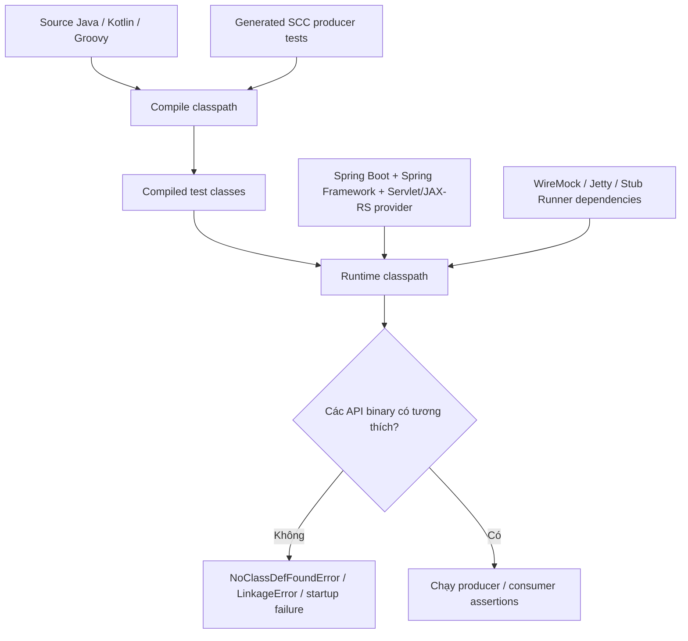
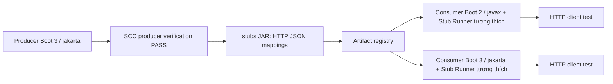
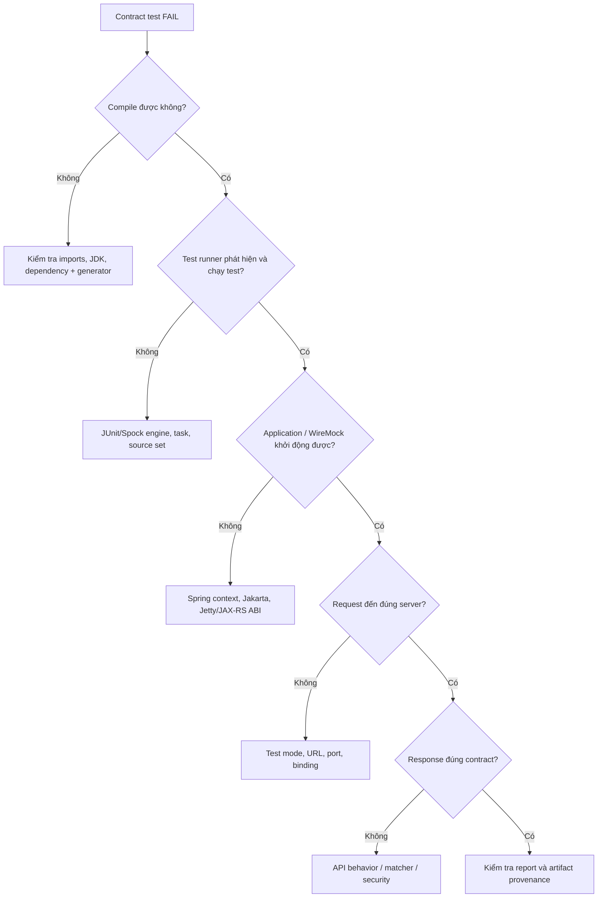
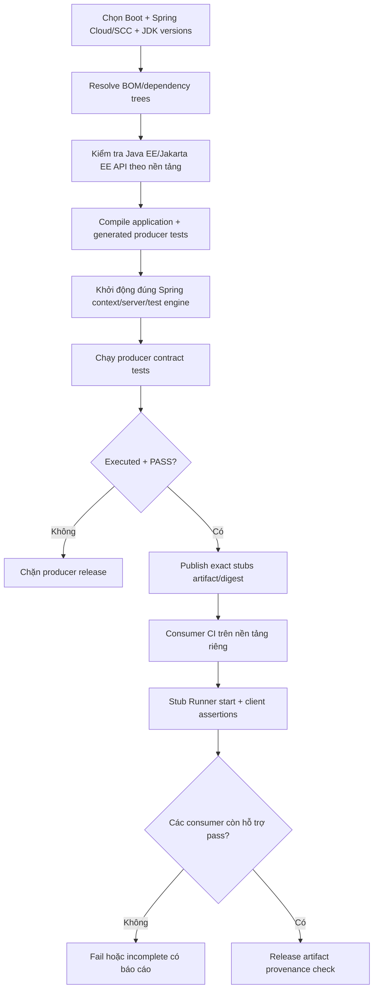

# Kiểm tra chuyển đổi namespace thư viện theo nền tảng đang dùng

## 1. Vì sao namespace lại ảnh hưởng đến Spring Cloud Contract?

**Spring Cloud Contract (SCC)** hỗ trợ kiểm thử hợp đồng giữa **producer** và **consumer**: nhóm mô tả HTTP hoặc thông điệp bằng **Groovy/YAML DSL**, sinh **producer verification tests**, phát hành **stubs artifact**, sử dụng **Stub Runner** ở consumer và đưa hai phía vào **CI** để phát hiện thay đổi API không tương thích.

Khi nâng cấp nền tảng Java/Spring, một contract không đổi nhưng kiểm thử bỗng không compile hoặc không khởi động được. Ví dụ:

```text
Producer trước nâng cấp:
  Spring Boot 2.7 + Spring Framework 5.3
  javax.servlet.http.HttpServletRequest

Producer sau nâng cấp:
  Spring Boot 3.x + Spring Framework 6.x
  jakarta.servlet.http.HttpServletRequest

Trong khi đó:
  Generated tests vẫn import hoặc phụ thuộc thư viện javax.*
  Stub Runner vẫn kéo một HTTP server / Jetty library không tương thích
```

Kết quả có thể là `package javax.servlet does not exist`, `NoClassDefFoundError`, `ClassCastException`, lỗi khởi động test context, hoặc Stub Runner không tải/khởi động được HTTP stubs. **Đây chưa chắc là producer vi phạm hợp đồng**: có thể là **lỗi tương thích binary, namespace, API hoặc dependency version** của bộ công cụ kiểm thử.

Mục tiêu của bài:

1. Hiểu ranh giới chuyển đổi **Java EE `javax.*` → Jakarta EE `jakarta.*`** và những package **không được đổi**.
2. Chọn Spring Boot, Spring Framework, Spring Cloud/SCC, JDK, WireMock, JAX-RS, JMS và test libraries **theo tổ hợp tương thích**.
3. Kiểm tra source imports, dependency tree, generated test code, runtime classpath và stubs JAR.
4. Chẩn đoán lỗi **compile, class loading, test engine, server startup và consumer runtime** mà không làm hỏng contract DSL.
5. Thiết kế quy trình nâng cấp và CI compatibility matrix có thể tái lập.

**Nguyên tắc trung tâm:** Namespace của **thư viện nền tảng** phải phù hợp với **runtime và API mà code thực sự dùng**. Không tự đổi tên mọi package chứa `javax`, không tự thay version ngoài BOM, và không sửa contract HTTP chỉ để chữa lỗi Java linkage.

## 2. Java EE sang Jakarta EE: đổi tên package không đồng nghĩa đổi toàn Java

Trong các thế hệ Jakarta EE mới, nhiều API từng nằm dưới `javax` được chuyển sang `jakarta`. Ví dụ:

| Lĩnh vực | API cũ (Java EE) | API mới (Jakarta EE) | Kiểm tra thêm |
| --- | --- | --- | --- |
| Servlet | `javax.servlet.http.HttpServletRequest` | `jakarta.servlet.http.HttpServletRequest` | Servlet container, filter, test mocks |
| Validation | `javax.validation.constraints.NotNull` | `jakarta.validation.constraints.NotNull` | Validator provider, Spring binding |
| Persistence | `javax.persistence.Entity` | `jakarta.persistence.Entity` | JPA provider/Hibernate, entity scanning |
| Annotation lifecycle | `javax.annotation.PostConstruct` | `jakarta.annotation.PostConstruct` | Bean lifecycle, transitive dependencies |
| JAX-RS | `javax.ws.rs.Path` | `jakarta.ws.rs.Path` | Jersey/CXF phiên bản tương thích |
| JMS | `javax.jms.Message` | `jakarta.jms.Message` | JMS provider/client và integration |
| WebSocket | `javax.websocket.Session` | `jakarta.websocket.Session` | Server/client runtime |
| Transactions | `javax.transaction.Transactional` | `jakarta.transaction.Transactional` | Phân biệt với Spring transaction annotation |

Đây là những **họ API Jakarta EE đã đổi namespace**, không phải chỉ dẫn thay toàn bộ `javax.*` trong một lần. Các package như `javax.crypto`, `javax.net`, `javax.sql`, `javax.naming`, `javax.xml.parsers` và `javax.annotation.processing` thuộc Java SE/JDK và **không được đổi máy móc**.

### Ví dụ cần giữ nguyên

```java
import javax.crypto.Cipher;
import javax.net.ssl.SSLContext;
import javax.sql.DataSource;
import javax.xml.parsers.DocumentBuilderFactory;
import javax.annotation.processing.Generated;
```

Ví dụ chuyển theo Jakarta EE:

```java
// Spring Boot 2 / Spring Framework 5:
import javax.servlet.http.HttpServletRequest;
import javax.validation.constraints.NotNull;
import javax.persistence.Entity;

// Spring Boot 3 / Spring Framework 6:
import jakarta.servlet.http.HttpServletRequest;
import jakarta.validation.constraints.NotNull;
import jakarta.persistence.Entity;
```

Nếu lệnh tìm-và-thay đổi cả `javax.crypto.Cipher` thành `jakarta.crypto.Cipher`, project sẽ không compile vì API tương ứng không tồn tại. **Phải phân loại theo module/specification**, không dựa vào tiền tố chuỗi.

## 3. Phân biệt namespace, Maven coordinates, package và classpath

Một lỗi phổ biến là trộn bốn khái niệm:

| Khái niệm | Ví dụ | Ý nghĩa |
| --- | --- | --- |
| **Java package/import** | `jakarta.servlet.Filter` | Tên kiểu mà source Java biên dịch và bytecode tham chiếu |
| **Maven coordinates** | `jakarta.servlet:jakarta.servlet-api` | Artifact chứa API classes |
| **Runtime classpath** | JAR Servlet, WireMock, Jetty và test libraries | Thứ JVM thật sự nạp khi chạy |
| **Contract DSL** | `request { method GET() }` | Mô tả hành vi HTTP/message, không phải import Servlet API |

Đổi import sang `jakarta.servlet.Filter` nhưng vẫn để một dependency cũ `javax.servlet-api` trên classpath không khiến `jakarta.servlet.Filter` tự xuất hiện. Ngược lại, thêm Jakarta API JAR mà không đổi source import `javax.servlet.Filter` có thể vẫn lỗi compile.

Một thứ nữa cần nhớ: **Maven groupId có thể đổi nhưng Java package không đổi**. Ví dụ các dòng WireMock khác nhau có artifact coordinates khác nhưng nhiều Java API vẫn ở namespace `com.github.tomakehurst.wiremock.*`. Đừng tìm một package `org.wiremock.*` hay `jakarta.wiremock.*` chỉ vì groupId JAR là `org.wiremock`.

### Lỗi liên kết binary không phải chỉ lỗi import

Một thư viện đã compile với `javax.servlet.ServletRequest` không tự trở thành thư viện `jakarta.servlet.ServletRequest` chỉ vì application thêm Jakarta Servlet API. Hai class có **tên nhị phân khác nhau**. Một adapter/filter cần khớp đúng API version của container.



**Chỉ khi kiểm thử chạy đúng môi trường mới có cơ sở đánh giá hợp đồng**. Nếu test chết vì `NoClassDefFoundError` trước khi gửi request, đó là lỗi classpath/runtime, chưa phải bằng chứng endpoint trả sai response.

## 4. Chọn nền tảng theo thế hệ, không trộn các major tùy ý

Một số mốc quan trọng:

| Nền tảng ứng dụng | Spring Framework | Namespace chính của Servlet/JPA/Validation | Tình huống thực tế |
| --- | --- | --- | --- |
| **Spring Boot 2.x** | **Spring Framework 5.x** | `javax.*` cho nhiều Java EE API | Hệ thống legacy, thường Java 8/11/17 tùy bản |
| **Spring Boot 3.x** | **Spring Framework 6.x** | `jakarta.*` cho Jakarta EE APIs | Nâng cấp Java 17+, Spring Security 6, Jakarta Servlet |
| **Spring Boot 4.x** | **Spring Framework 7.x** | `jakarta.*` tiếp tục, kèm API/build changes khác | Thế hệ mới; phải kiểm tra lại toàn bộ toolchain |

**Spring Boot 3 yêu cầu Java 17 trở lên**, không thể chỉ sửa `javax` thành `jakarta` rồi vẫn dùng JDK 11. Với Boot 4, không giả định một build Boot 3 sẽ tương thích chỉ vì cả hai đều sử dụng `jakarta`: các dependency/module/test APIs có thể thay đổi thêm theo release.

### Spring Cloud Contract không được nâng cấp tách rời

Spring Cloud có **release train/BOM** tương thích với các thế hệ Spring Boot. Những ví dụ ghép nền tảng lịch sử:

| Spring Boot | Spring Cloud release train tương ứng (để định hướng) |
| --- | --- |
| 2.7.x | 2021.0.x |
| 3.2.x / 3.3.x | 2023.0.x (theo service release phù hợp) |
| 3.4.x | 2024.0.x |
| 3.5.x | 2025.0.x |
| 4.0.x / 4.1.x | 2025.1.x (tùy service release) |

Bảng dùng để **minh họa quan hệ**, **không phải bảng “tất cả phiên bản đều còn được hỗ trợ”** và không thay thế trang chính thức tại thời điểm triển khai. Release train đã hết OSS support vẫn có thể xuất hiện ở hệ thống legacy; cần kế hoạch nâng cấp và kiểm tra policy hỗ trợ. Đừng suy rằng “SCC 4.x tự chạy với mọi Boot 3.x” hoặc “SCC 5.x tự chạy với mọi Boot 4.x”; phải kiểm tra **version cụ thể trong Spring Cloud BOM**.

Tài liệu theo phiên bản: [Spring Cloud release train / Spring Boot compatibility](https://spring.io/projects/spring-cloud/) và [Spring Boot 3 migration guide](https://github.com/spring-projects/spring-boot/wiki/Spring-Boot-3.0-Migration-Guide).

### Vì sao cần BOM?

Ví dụ một producer dùng Spring Boot starter và Spring Cloud Contract Verifier. BOM giúp phối hợp nhiều dependencies có quan hệ chặt chẽ, nhưng **một dependency override thủ công có thể phá vỡ kết quả dependency management**. Những điểm cần đồng bộ gồm Spring Boot, Spring Framework, Spring Cloud Contract, Rest Assured, JUnit, WireMock/Jetty, JAX-RS implementation và validation provider.

**Không tự ghim phiên bản Servlet API ngoài BOM chỉ vì compiler báo thiếu class**. Cần hiểu runtime/container thực sự đòi API phiên bản nào và tại sao classpath thiếu nó.

## 5. Vùng nào của Spring Cloud Contract bị ảnh hưởng?

Một workflow SCC có các vùng chạy khác nhau:

| Vùng | Chạy gì? | Nơi namespace có thể sai |
| --- | --- | --- |
| **Producer source** | Controller, validation, filters, JAX-RS endpoints, message handlers | Java imports và runtime dependencies |
| **SCC DSL parser/generator** | Groovy/YAML contract → tests/stubs | Plugin/core converter version, test framework API |
| **Generated producer tests** | MockMvc, Rest Assured, WebTestClient, JAX-RS/EXPLICIT tests | Imports, base class, test annotations, HTTP adapter |
| **Producer test runtime** | Spring test context, Servlet container, security filter chain | `javax`/`jakarta`, binary linkage và dependency tree |
| **Stubs JAR** | HTTP mappings, response files, message contracts | Thường là tài nguyên, nhưng schema/feature backend có version |
| **Consumer Stub Runner runtime** | WireMock server, Jetty, message adapter và Spring context | WireMock/Jetty/Servlet, JUnit và Spring Boot generation |
| **Consumer client** | DTO, HTTP client, listener | Chuyển đổi package nếu consumer cũng nâng cấp; response schema vẫn phải giữ |

**Điều đặc biệt của SCC:** producer và consumer **có thể chạy hai phiên bản nền tảng khác nhau**. Ví dụ producer Boot 3 + Jakarta, consumer Boot 2 + Java EE vẫn có thể giao tiếp qua HTTP/JSON nếu protocol ổn định. Nhưng **consumer Stub Runner library phải tương thích với classpath của consumer test JVM**, và stubs JAR phải có mapping được runtime hiểu. Không ép cả hai dịch vụ nâng cấp cùng lúc chỉ vì namespace Java đổi ở một bên.

### HTTP contract khác Java API binary

`GET /api/orders/42`, HTTP `200`, `Content-Type: application/json` và body JSON là **giao diện trên dây (wire contract)**; nó không chứa `javax.servlet` hay `jakarta.servlet`. Một producer đổi import và servlet container nhưng vẫn giữ response có thể duy trì compatibility với consumer cũ. Do đó **dịch namespace Java ≠ bắt buộc version API HTTP**.

## 6. Lập bản kê trước khi sửa bất kỳ import nào

Với một producer chuẩn bị nâng từ Boot 2 lên Boot 3, cần kiểm tra **nhiều lớp** thay vì chỉ tìm `javax.servlet` trong `src/main/java`:

```text
order-service/
  pom.xml / build.gradle
  src/main/java/...                # controllers, services, filters
  src/test/java/...                # test base classes, mocks, extensions
  src/test/resources/contracts/... # Groovy/YAML DSL
  build/ hoặc target/              # generated tests & mappings
  CI: producer verifier, stubs packaging, consumer test pipeline
```

Đây là sơ đồ thư mục **minh họa**, không phải mọi dự án đều dùng cùng đường dẫn. Gradle có thể cấu hình `contractsDslDir` riêng; Maven cũng có thể chọn source root khác. Để biết có lỗi đổi namespace hay không, nên lập bảng:

| Thành phần | Version hiện tại | Version mục tiêu | Có tham chiếu Java EE API? | Phương án |
| --- | --- | --- | --- | --- |
| JDK | 11 | 17+ | JVM/bytecode target | Nâng toolchain trước |
| Spring Boot/Framework | 2.7/5.3 | 3.x/6.x | Servlet, validation, JPA | Dùng BOM phù hợp |
| SCC Verifier & plugin | Theo Spring Cloud cũ | Theo release train mới | Generated tests, mocks | Kiểm tra plugin/test dependency |
| JAX-RS implementation | Jersey 2/CXF 3 | Jakarta-compatible line | `javax.ws.rs` → `jakarta.ws.rs` | Nâng provider và base class |
| WireMock | Line cũ | Line được SCC hỗ trợ | Servlet/Jetty internals | Xem classpath runtime |
| Message broker client | JMS implementation cũ | Jakarta JMS nếu cần | `javax.jms` → `jakarta.jms` | Test listener/serializer |
| Consumer Stub Runner | Theo consumer runtime | Theo consumer runtime mới (nếu nâng) | Server test classpath | Test stub startup |

**Không biến bảng này thành danh sách phiên bản cứng bắt buộc**. Mỗi service có nền tảng riêng; cần xem hệ thống đang chạy Boot nào, test framework nào, plugin nào và loại transport nào.

### Tìm trong đúng phạm vi

Một cách kiểm kê khi có `rg`:

```bash
# Chỉ tìm; KHÔNG thực hiện replace hàng loạt.
rg -n 'javax\.(servlet|validation|persistence|annotation|ws\.rs|jms|websocket)' src
rg -n 'jakarta\.(servlet|validation|persistence|annotation|ws\.rs|jms|websocket)' src
rg -n 'com\.github\.tomakehurst\.wiremock|org\.springframework\.cloud\.contract' src
```

Kiểm tra cả Java, Kotlin, Groovy, test classes, custom extensions, configuration và những generated sources đang được compile. **Không đọc generated source như nguồn để sửa vĩnh viễn**: nếu nó xuất sai import, cần sửa generator/plugin/test-mode/base class hoặc version dependencies rồi generate lại.

### Nhìn cả import “tàng hình”

Code có thể không import `javax.servlet` trực tiếp nhưng một JAR phụ thuộc bên thứ ba lại sử dụng nó. Vì vậy **source scan là cần nhưng chưa đủ**; phải xem transitive dependencies và runtime classpath.

## 7. Chuyển một filter/validator qua hai nền tảng

Một ví dụ thường gặp trong producer contract verification là **filter** xử lý request trước controller. Với Boot 2:

```java
import javax.servlet.FilterChain;
import javax.servlet.ServletException;
import javax.servlet.http.HttpServletRequest;
import javax.servlet.http.HttpServletResponse;
import javax.validation.constraints.NotNull;
```

Với Boot 3:

```java
import jakarta.servlet.FilterChain;
import jakarta.servlet.ServletException;
import jakarta.servlet.http.HttpServletRequest;
import jakarta.servlet.http.HttpServletResponse;
import jakarta.validation.constraints.NotNull;
```

Nếu một custom filter đã compile với `javax.servlet.Filter` mà ứng dụng dùng servlet container Jakarta, việc thêm cả hai API JAR không khiến filter tự được Spring container chấp nhận: **interface signatures khác nhau**, nên cần nâng/sửa implementation và những thư viện phụ thuộc cũ.

### Một đoạn code Boot 3 để kiểm chứng filter thật

```java
import jakarta.servlet.FilterChain;
import jakarta.servlet.ServletException;
import jakarta.servlet.http.HttpServletRequest;
import jakarta.servlet.http.HttpServletResponse;
import org.springframework.web.filter.OncePerRequestFilter;

import java.io.IOException;

public class CorrelationHeaderFilter extends OncePerRequestFilter {
    @Override
    protected void doFilterInternal(
            HttpServletRequest request,
            HttpServletResponse response,
            FilterChain chain) throws ServletException, IOException {
        String trace = request.getHeader("X-Correlation-Id");
        if (trace != null && !trace.isBlank()) {
            response.setHeader("X-Correlation-Id", trace);
        }
        chain.doFilter(request, response);
    }
}
```

Đây là **logic filter minh họa**, không bao gồm bean registration, kiểm tra trace ID hoặc quy tắc bảo mật. Khi test API có contract cho response header, hãy đảm bảo producer verification **thực sự đi qua filter** ở đúng test mode. Nếu dùng `MockMvc` với filters tắt, contract test có thể pass/fail khác HTTP server thật.

### Không đổi các annotation của Spring

`org.springframework.web.bind.annotation.GetMapping`, `@RestController`, `@SpringBootTest`, `@AutoConfigureMockMvc` vẫn thuộc namespace Spring tương ứng; chúng không thành `jakarta.RestController` hay `jakarta.SpringBootTest`. Với validation, phân biệt `jakarta.validation.Valid`/`NotNull` với annotations do Spring cung cấp.

## 8. JAX-RS: đổi `javax.ws.rs` sang `jakarta.ws.rs` phải đi cùng provider

Một producer có thể dùng **Jersey** hoặc **Apache CXF** thay vì Spring MVC. Với JAX-RS cũ:

```java
import javax.ws.rs.GET;
import javax.ws.rs.Path;
import javax.ws.rs.PathParam;
import javax.ws.rs.Produces;
import javax.ws.rs.core.MediaType;

@Path("/api/orders")
public class OrderResource {
    @GET
    @Path("/{id}")
    @Produces(MediaType.APPLICATION_JSON)
    public OrderDto getOrder(@PathParam("id") String id) {
        return new OrderDto(id, "CONFIRMED");
    }
}
```

Trong nền tảng Jakarta-compatible:

```java
import jakarta.ws.rs.GET;
import jakarta.ws.rs.Path;
import jakarta.ws.rs.PathParam;
import jakarta.ws.rs.Produces;
import jakarta.ws.rs.core.MediaType;

@Path("/api/orders")
public class OrderResource {
    @GET
    @Path("/{id}")
    @Produces(MediaType.APPLICATION_JSON)
    public OrderDto getOrder(@PathParam("id") String id) {
        return new OrderDto(id, "CONFIRMED");
    }
}
```

Hai đoạn là **ví dụ về import và annotation**, chưa bao gồm provider registration, constructor/DTO hoặc exception mapper. Nếu ứng dụng dùng Jersey 2 hoặc CXF 3 với `javax.ws.rs`, đổi duy nhất import `OrderResource` sang Jakarta có thể khiến **provider cũ không nhận diện annotation/resource**. Cần nâng implementation tương ứng, ví dụ nhánh **Jersey 3** hoặc **CXF 4+** theo phiên bản phù hợp, rồi kiểm tra servlet/Jakarta API level chi tiết.

**Lưu ý:** Apache CXF 4.0 migration guide mô tả chuyển sang Jakarta EE 9.1 và có các giới hạn tương thích Jakarta EE 10 ở thời điểm phát hành. Vì thế “JAX-RS 3.x” và “Spring Boot 3.x” chưa phải bằng chứng mọi provider/bản Jakarta EE đều chạy được cùng nhau. Hãy kiểm tra **exact dependencies**.

### Test mode không tự chuyển từ MVC sang JAX-RS

Spring Cloud Contract có nhiều cách chạy generated HTTP tests. Nếu producer là JAX-RS mà build vẫn chọn `MockMvc` và base class của Spring MVC, tests có thể trả `404` hoặc khởi động sai context. Cần dùng test mode/adapter được **phiên bản SCC hỗ trợ** và một server/test base class thực sự phục vụ JAX-RS endpoint.

Một phương án phổ biến để giảm khác biệt MVC/JAX-RS là kiểm tra HTTP qua server chạy thật ở port động, kết hợp test base class cấu hình Rest Assured base URI/port. Đây là **chọn môi trường kiểm thử**, không phải mẹo sửa `javax`/`jakarta`.

## 9. Messaging: phân biệt Jakarta JMS API với hợp đồng trên wire

Một message contract có thể viết:

```groovy
import org.springframework.cloud.contract.spec.Contract

Contract.make {
    description 'Order confirmed event'
    label 'order_confirmed'
    input {
        triggeredBy('confirmOrder()')
    }
    outputMessage {
        sentTo('orders.confirmed')
        headers {
            messagingContentType(applicationJson())
        }
        body([
            orderId: 'ord-42',
            status: 'CONFIRMED'
        ])
    }
}
```

Một producer dùng JMS cũ có thể import `javax.jms.Message`; stack Jakarta dùng `jakarta.jms.Message`. **Đổi namespace JMS không tự thay đổi JSON message body, destination hoặc label**. Mặt khác, một message listener/adapter test dùng JMS API không đúng thế hệ sẽ có thể không nhận message hoặc fail trước assertions.

| Thành phần | Điều cần giữ | Điều cần đổi theo nền tảng |
| --- | --- | --- |
| Event contract | Destination, headers, payload, schema | Không đổi chỉ vì Java package đổi |
| JMS listener/producer | Hành vi giao tiếp và ack/retry | `javax.jms`/`jakarta.jms` theo API/runtime |
| Broker client | Kết nối, serializer, protocol | Driver/provider compatible với framework |
| SCC messaging test base | Trigger và capture output | Adapter/test binder/API theo version |
| Consumer Stub Runner | Phát sample message và assert listener | Runtime dependencies tương thích consumer |

**Không áp dụng máy móc chuyển `javax.jms` cho Kafka hoặc AMQP**: những integration có API riêng như `org.apache.kafka.*` hoặc Spring AMQP. Cần kiểm tra **thư viện transport thực tế** trước khi đề xuất namespace change.

## 10. Dependency management: kiểm tra bằng Maven và Gradle

Khi compile báo thiếu `jakarta.servlet`, phản ứng đầu tiên không nên là thêm cả `javax.servlet-api` và `jakarta.servlet-api`. Cần xem dependency tree và BOM.

### Maven — nhìn phụ thuộc đã resolve

```bash
./mvnw -B dependency:tree

# Có thể lọc nhóm liên quan; cách lọc chi tiết tùy plugin version.
./mvnw -B dependency:tree -Dincludes=javax.servlet:javax.servlet-api
./mvnw -B dependency:tree -Dincludes=jakarta.servlet:jakarta.servlet-api
./mvnw -B dependency:tree -Dincludes=org.springframework.cloud:spring-cloud-contract-verifier
```

Với Maven trên Windows, có thể dùng `mvnw.cmd` trong PowerShell/CMD. `dependency:tree` cho biết dependency nào kéo vào `javax.servlet` hoặc `jakarta.servlet`, bản nào được chọn và bản nào bị bỏ do mediation. Đừng chỉ nhìn `pom.xml` trực tiếp, vì test dependencies có thể kéo một JAR cũ.

### Gradle — nhìn compile/test runtime classpath

```bash
./gradlew dependencies --configuration compileClasspath
./gradlew dependencies --configuration testRuntimeClasspath

./gradlew dependencyInsight \
  --dependency javax.servlet \
  --configuration testRuntimeClasspath

./gradlew dependencyInsight \
  --dependency wiremock \
  --configuration testRuntimeClasspath
```

Lệnh là **ví dụ để người học chạy trong project**, không phải kết quả đã chạy trên workspace bài viết. Với multi-module, thêm đường dẫn module, ví dụ `:order-service:dependencies`. Một cấu hình test riêng như `contractTestRuntimeClasspath` có thể tồn tại theo plugin/source set; xác nhận bằng task/configuration thực tế, không đoán.

### Ba nơi phải kiểm tra

1. **Main runtime:** controller/filter/provider thực thi có API phù hợp.
2. **Producer test runtime:** SCC verifier, MockMvc/Rest Assured/JUnit và những dependency chỉ dùng test.
3. **Consumer Stub Runner runtime:** WireMock, Jetty, message integration và test framework trên **classpath consumer**.

Nếu source `main` đã hoàn toàn dùng `jakarta` nhưng `testRuntimeClasspath` vẫn chứa WireMock/Jetty/Servlet library không tương thích, production có thể chạy trong khi **contract tests khởi động thất bại**. Đây là một lỗi tool compatibility, không chứng minh API sai.

## 11. Generated producer tests: đừng sửa file output để chuyển namespace

SCC có thể sinh Java/Groovy tests trong `build/...` hoặc `target/...`. Sau khi nâng cấp Boot, nếu generated test còn import thư viện thuộc thế hệ không tương thích, cần phân biệt:

1. **SCC generator/plugin quá cũ:** sinh source hoặc code pattern không đúng API mới.
2. **Test base class còn cũ:** lớp do dự án viết import `javax.servlet` hoặc dùng adapter không tương thích.
3. **Test dependencies không khớp:** generated imports hợp lệ nhưng thiếu JAR chứa class.
4. **Test mode không đúng runtime:** producer JAX-RS/WebFlux nhưng test được cấu hình cho MockMvc.
5. **JUnit runner không đúng thế hệ:** generated tests dùng JUnit Jupiter nhưng task chỉ chạy JUnit 4 (hoặc ngược lại).

Đừng giả định mọi `package ... does not exist` đều do namespace Java EE. Ví dụ `org.junit.jupiter.api.Test` là package của **JUnit 5**, không phải `jakarta.junit.Test`. `io.restassured.module.mockmvc.RestAssuredMockMvc` cũng **không trở thành `jakarta.restassured...`** khi dùng Boot 3.

### Một test base class Spring MVC (Boot 3) tham khảo

```java
package com.example.orders.contract;

import io.restassured.module.mockmvc.RestAssuredMockMvc;
import org.junit.jupiter.api.BeforeEach;
import org.springframework.beans.factory.annotation.Autowired;
import org.springframework.boot.test.autoconfigure.web.servlet.AutoConfigureMockMvc;
import org.springframework.boot.test.context.SpringBootTest;
import org.springframework.test.web.servlet.MockMvc;

@SpringBootTest
@AutoConfigureMockMvc
public abstract class OrderContractBase {

    @Autowired
    MockMvc mvc;

    @BeforeEach
    void setUp() {
        RestAssuredMockMvc.mockMvc(mvc);
    }
}
```

Base class này minh họa Spring MVC + JUnit 5 + Rest Assured MockMvc ở tổ hợp phiên bản phù hợp. **Không cần import Servlet API trong base class này**, nhưng Spring MVC/filter phía dưới vẫn dùng namespace do Spring Framework và Servlet container quyết định.

Nếu project dùng HTTP server thực, base class có thể cấu hình Rest Assured HTTP và `@LocalServerPort`; nếu dùng WebFlux thì cần test adapter khác. Không sao chép mẫu `MockMvc` vào producer JAX-RS hay non-Servlet rồi kỳ vọng context nhận controller.

### Vị trí phát hiện

| Thời điểm | Lỗi thường thấy | Cần kiểm tra |
| --- | --- | --- |
| Generate | Contract DSL parse/generator error | SCC plugin và DSL syntax/version |
| Compile generated test | `cannot find symbol` / missing package | Imports + testCompileClasspath + base class |
| Test discovery | `0 tests` hoặc `No tests found` | JUnit engine, source sets, task filter |
| Spring context startup | `NoClassDefFoundError`, bean mismatch | Runtime tree, Servlet/JAX-RS implementations |
| HTTP assertion | `404`, `500`, wrong body | Actual request/response và contract semantics |

**Dừng ở đúng tầng lỗi:** nếu generated test không compile, không sửa response contract để chữa; nếu HTTP test đã chạy mà body sai, không lạm dụng việc đổi namespace như một lời giải thích chung.

## 12. JUnit 4, JUnit 5 và Groovy/Spock: namespace khác vấn đề engine

Một cuộc nâng cấp Boot/SCC thường kéo theo thay đổi **test framework**, vốn dễ bị nhầm với lỗi Java EE namespace.

```java
// JUnit 4
import org.junit.Test;
import org.junit.Before;

// JUnit Jupiter (JUnit 5)
import org.junit.jupiter.api.Test;
import org.junit.jupiter.api.BeforeEach;
```

JUnit 5 **không đổi thành `jakarta.junit`**. Tương tự Spock `spock.lang.Specification` không thuộc Jakarta EE. Tuy nhiên generated tests cần runner/test engine đúng và plugin có thể cho chọn `JUNIT`, `JUNIT5` hoặc `SPOCK` theo phiên bản hỗ trợ.

### Ví dụ Gradle JUnit Jupiter

```groovy
plugins {
    id 'java'
}

dependencies {
    testImplementation 'org.springframework.boot:spring-boot-starter-test'
}

tasks.named('test', Test) {
    useJUnitPlatform()
}
```

Đây là cấu hình test **rút gọn**, chưa bao gồm Spring Boot plugin/BOM/SCC Verifier; đối với `contractTest` task riêng, cần cấu hình JUnit Platform trên **task chạy generated contract tests**, không chỉ `test`. Kiểm tra test report để biết có **executed > 0**.

### Nếu generated tests là JUnit 4

Chỉ có JUnit Jupiter engine không đảm bảo chạy các lớp JUnit 4. Có thể cần JUnit Vintage engine nếu dự án quyết định hỗ trợ song song, hoặc chuyển generator/test base sang Jupiter. **Không thêm mọi engine vô điều kiện**: điều đó tăng độ phức tạp và có thể che việc cấu hình sai framework.

### Spock còn có phụ thuộc Groovy

Khi chuyển SCC plugin/test framework, version **Spock/Groovy** và compiler phải tương thích Java, Spring và JUnit Platform. Một `NoClassDefFoundError` cho Groovy/Spock có thể hoàn toàn không liên quan `javax.servlet`, dù xảy ra cùng đợt nâng cấp.

## 13. WireMock 2/3, Jetty và các package dễ bị hiểu nhầm

WireMock thường phục vụ HTTP stub cho SCC. Khi nâng cấp, cần phân biệt **Maven coordinates**, **Java packages**, **server transport**:

| Chủ đề | Ví dụ hệ cũ | Ví dụ hệ mới | Không được suy ra |
| --- | --- | --- | --- |
| WireMock artifact | `com.github.tomakehurst:wiremock-jre8:2.x` | `org.wiremock:wiremock:3.x` | `org.wiremock` không đồng nghĩa Java imports đều đổi |
| Java helper class | `com.github.tomakehurst.wiremock.client.WireMock` | Nhiều API vẫn giữ package tương tự | Không tự đổi thành `jakarta.wiremock.*` |
| WireMock server | Jetty/lib do artifact chọn | Jetty 11 hoặc module Jetty 12 thích hợp | Không giả định mọi server library hỗ trợ một Servlet API |
| SCC WireMock integration | Theo SCC/Boot release train cũ | Theo SCC/Boot release train mới | Không ép WireMock major ngoài phiên bản integration hỗ trợ |

WireMock 3 còn có module `org.wiremock:wiremock-jetty12` dành cho những tình huống cần Jetty 12 theo tài liệu WireMock. **Đây không phải dependency bắt buộc cho mọi SCC project**, và không bảo đảm việc thêm JAR sẽ tự chữa mọi lỗi Jetty. Hãy đối chiếu module SCC WireMock, Boot managed dependencies và khả năng extension/server startup.

### Vì sao `NoClassDefFoundError` xuất hiện tại WireMock startup?

Một test Spring Boot/Jakarta có thể kéo vào một Jetty generation, trong khi WireMock artifact trên test classpath dùng một generation khác. JVM nạp các class trùng hoặc thiếu dependency khi chạy, dẫn đến `NoSuchMethodError`, `ClassNotFoundException` hoặc `LinkageError`. Cần xác định **class cụ thể bị lỗi**, JAR nào cung cấp nó, và dependency nào kéo version đó vào.

**Phương án không nên làm:** thêm cả Jetty 9, 11, 12 và hai bộ javax/jakarta servlet APIs “cho đủ” rồi xem compile pass. Bước này dễ tạo một classpath không thể dự đoán. Phương án đúng là chọn WireMock/SCC/Jetty phù hợp hoặc cô lập WireMock standalone nếu bài toán cho phép.

### Standalone/shaded có thể giúp cô lập, nhưng không phải bảo đảm tuyệt đối

WireMock standalone JAR thường đóng gói và **shade** một phần dependencies để giảm xung đột. Trong dự án phù hợp, chạy WireMock thành một tiến trình/container riêng có thể giúp **tách server classpath khỏi consumer Spring test JVM**. Tuy vậy, vẫn cần kiểm tra stubs JSON schema, extensions và phiên bản API runtime.

Tài liệu kỹ thuật: [WireMock Download and Installation](https://wiremock.org/docs/download-and-installation/), [WireMock with Spring Boot](https://wiremock.org/docs/solutions/spring-boot-integration/), [WireMock with Jetty 12](https://wiremock.org/docs/jetty-12/).

## 14. Stub Runner: phía consumer có thể dùng nền tảng khác producer

Đây là điểm quan trọng cho contract testing:



**Producer Boot 3 và consumer Boot 2 vẫn có thể giao tiếp** nếu API HTTP/message vẫn giữ schema, method, endpoint, headers và encoding phù hợp. Điều cần kiểm tra:

1. Stubs JAR được sinh từ producer revision đã verify và có **version/digest xác định**.
2. Mapping JSON/message contract có các tính năng mà Stub Runner/WireMock **ở consumer runtime** hỗ trợ.
3. SCC Stub Runner dependency/BOM phù hợp **Spring Boot của consumer**, không phải copy tất cả dependencies của producer.
4. Client thật của consumer gọi đúng HTTP stub/destination và có assertion.
5. Nếu custom WireMock transformer hoặc messaging adapter được dùng, runtime consumer có đúng extension/backend.

Một bản Stub Runner library **không nhất thiết** cùng version số với producer JAR; điều quan trọng là nó được hỗ trợ trên **nền tảng consumer** và đọc được stubs artifact do producer publish. Khi artifact dùng những tính năng WireMock mới mà Stub Runner cũ chưa hiểu, cần test compatibility hoặc dùng format/backends đã thỏa thuận.

### Ví dụ consumer test

```java
import org.junit.jupiter.api.Test;
import org.springframework.beans.factory.annotation.Autowired;
import org.springframework.boot.test.context.SpringBootTest;
import org.springframework.cloud.contract.stubrunner.StubRunnerProperties;
import org.springframework.cloud.contract.stubrunner.spring.AutoConfigureStubRunner;

import static org.assertj.core.api.Assertions.assertThat;

@SpringBootTest(properties =
    "clients.orders.base-url=http://localhost:9090")
@AutoConfigureStubRunner(
    ids = "com.example:order-service:2.0.0:stubs:9090",
    stubsMode = StubRunnerProperties.StubsMode.LOCAL
)
class CheckoutContractTest {

    @Autowired
    OrderClient orderClient;

    @Test
    void readsStatusFromStub() {
        OrderDto order = orderClient.findById("42");
        assertThat(order.status()).isEqualTo("CONFIRMED");
    }
}
```

`OrderClient`/`OrderDto` và `clients.orders.base-url` là ví dụ thuộc ứng dụng, **không được SCC sinh sẵn**. Cần JUnit 5, dependency Stub Runner tương thích, stubs JAR 2.0.0 trong Maven local và HTTP client thực sự trỏ port 9090. Với `REMOTE` dùng repository được kiểm soát và credentials read-only. **Không copy version 2.0.0 làm mặc định cho mọi test**; CI nên truyền producer target version từ manifest.

### Khi consumer test fail, kiểm tra đúng vùng

| Triệu chứng | Câu hỏi |
| --- | --- |
| Stub Runner context không khởi động | Dependency Boot/Cloud/WireMock/Jetty có đúng thế hệ? |
| Không resolve stubs artifact | Group/artifact/version/classifier/repository đúng chưa? |
| Stub server chạy nhưng trả 404 | Request matcher, URL, headers, body có khớp? |
| HTTP response hợp lệ nhưng consumer deserialize fail | DTO/JSON shape/strictness của consumer có tương thích không? |
| Chỉ fail khi có WireMock extension | Extension binary/runtime/configurer có tương thích không? |

**Không sửa `request`/`response` DSL chỉ vì consumer Stub Runner bị `NoSuchMethodError` lúc startup**. Sự cố class loading cần được sửa bằng dependency alignment và runtime isolation.

## 15. Namespace trong Spring Cloud Contract DSL có đổi không?

Một HTTP contract Groovy:

```groovy
import org.springframework.cloud.contract.spec.Contract

Contract.make {
    request {
        method GET()
        url '/api/orders/42'
    }
    response {
        status OK()
        headers {
            contentType(applicationJson())
        }
        body([
            orderId: 'ord-42',
            status: 'CONFIRMED'
        ])
    }
}
```

Một YAML contract tương tự:

```yaml
request:
  method: GET
  url: /api/orders/42
response:
  status: 200
  headers:
    Content-Type: application/json
  body:
    orderId: "ord-42"
    status: "CONFIRMED"
```

**Không cần đổi `GET` thành `jakarta.GET` hay thêm `jakarta.servlet` vào HTTP DSL**. Hợp đồng nói về behavior HTTP, không nói về tên Java Servlet class. Nếu contract source có embedded Java code, executable Groovy helpers hoặc custom matchers tham chiếu Java EE classes, **phần code tùy biến đó** có thể cần nâng cấp tương thích; đừng nhầm nó với `request/response` DSL chuẩn.

### Chú ý import trong custom test-base DSL helper

Một helper đã viết `import javax.validation.Validator` hoặc `import javax.ws.rs.core.Response` cần được xem lại vì nó chạy trong môi trường producer test mới. Tương tự, custom WireMock extension có thể cần rebuild với runtime API khác. Nhưng `org.springframework.cloud.contract.spec.Contract` là package SCC, **không phải Java EE package để đổi sang jakarta**.

## 16. Đường đi từ generated producer test tới HTTP server

Nơi dễ lẫn namespace nhất thường **không nằm trong contract source**, mà nằm ở test runtime adapter:

```text
Groovy/YAML contract
    ↓
SCC generator (đúng version)
    ↓
Generated test class
    ↓
JUnit / Rest Assured / MockMvc adapter
    ↓
Spring Test context + Filter chain
    ↓
Servlet API (javax hoặc jakarta) / JAX-RS server / WebFlux
    ↓
Controller hoặc Resource thật
    ↓
HTTP status, headers, body
```

Khi nâng Boot 2 lên Boot 3 mà generated test trả `404`, đừng lập tức kết luận namespace đã đổi sai; có thể controller chưa được scan, URL context path bị đổi, base class dùng `MockMvc` trong khi app là JAX-RS, hoặc security filter trả 401.

### Ba câu hỏi tách nguyên nhân

1. **Test compile và context khởi động được chưa?** Nếu chưa, ưu tiên dependency/namespace/linkage.
2. **Test có gửi HTTP request qua đúng adapter/server không?** Nếu chưa, sửa test mode/base class.
3. **Producer trả response gì so với contract?** Chỉ sau khi chạy được request mới kết luận behavior.

Khi cần kiểm thử JAX-RS/HTTP thật, cách đi qua network port có thể giảm phụ thuộc MockMvc trực tiếp nhưng **không thay thế** việc nâng provider `javax.ws.rs` sang `jakarta.ws.rs` nếu application runtime đã đổi.

## 17. Kiểm tra tên artifact chưa đủ: Jakarta EE 8 là một bẫy lịch sử

Một điểm rất dễ bỏ sót khi đọc Maven/Gradle dependency tree: **Maven groupId bắt đầu bằng `jakarta` không luôn đồng nghĩa các Java classes bên trong sử dụng namespace `jakarta.*`**.

Khi Jakarta EE 8 ra đời, nhiều specification vẫn giữ **Java package `javax.*`** mặc dù dự án/spec được chuyển sang tên Jakarta. **Chuyển đổi namespace hàng loạt bắt đầu ở Jakarta EE 9**, vì thế cần xem **version specification và class files thật**, không chỉ tên group.

Ví dụ minh họa sự khác biệt giữa:

```text
Dependency coordinates có thể mang tên jakarta.*
         |
         +--> API phiên bản Jakarta EE 8: classes vẫn ở javax.*
         |
         +--> API phiên bản Jakarta EE 9+: classes chuyển sang jakarta.*
```

Nếu developer chỉ thấy `jakarta.servlet:jakarta.servlet-api` rồi kết luận chắc chắn chứa `jakarta.servlet.Filter`, có thể gặp sai với **artifact phiên bản cũ**. Ngược lại, một artifact provider Java EE đã bị ghim phiên bản thấp có thể kéo `javax.*` dù dependency management chính của Boot 3 đã chọn Jakarta.

### Xác nhận nội dung JAR khi thực sự cần

```bash
# Ví dụ dùng JDK jar tool với JAR đã được resolve từ build.
jar tf path/to/servlet-api.jar

# Tìm các entry theo package:
# javax/servlet/Filter.class  hoặc  jakarta/servlet/Filter.class
```

Lệnh `jar tf` chỉ đọc danh sách class của artifact, không chứng minh **đó chính là JAR JVM đang load** trong mọi classloader. Với lỗi runtime phức tạp, kiểm tra dependency resolution/class loading diagnostics của JDK/test JVM và nơi origin của class.

### Thêm dependency không giải quyết ABI tự động

Một library `legacy-security-filter.jar` đã compile với `javax.servlet.Filter` có thể vẫn không tương thích với Boot 3, kể cả khi đã có `jakarta.servlet-api`. Cần **bản library đã build cho Jakarta** hoặc thay integration; không dùng một “relocation” của Maven groupId để giả định nó tự biến đổi bytecode.

## 18. Quản lý BOM và plugin version có kiểm soát

Để tránh test dependencies tự trôi khỏi nền tảng, nên để **Spring Boot quản lý Spring/Servlet/Test dependencies** và **Spring Cloud BOM quản lý các module Spring Cloud** theo tổ hợp đã xác nhận.

### Maven — ý tưởng cấu hình dependency management

```xml
<!-- Trích đoạn POM minh họa, không phải POM hoàn chỉnh -->
<properties>
    <java.version>17</java.version>
    <spring-cloud.version>REPLACE_WITH_COMPATIBLE_RELEASE_TRAIN</spring-cloud.version>
</properties>

<dependencyManagement>
    <dependencies>
        <dependency>
            <groupId>org.springframework.cloud</groupId>
            <artifactId>spring-cloud-dependencies</artifactId>
            <version>${spring-cloud.version}</version>
            <type>pom</type>
            <scope>import</scope>
        </dependency>
    </dependencies>
</dependencyManagement>

<dependencies>
    <dependency>
        <groupId>org.springframework.cloud</groupId>
        <artifactId>spring-cloud-starter-contract-verifier</artifactId>
        <scope>test</scope>
    </dependency>
</dependencies>
```

Tổ hợp thật còn cần Spring Boot parent/BOM, Maven compiler/test plugins, SCC Maven plugin với version tương thích, repositories và những dependencies của ứng dụng. Nếu plugin được khai báo độc lập, nó **không tự được version hóa bằng dependencyManagement dành cho dependencies**; hãy kiểm tra plugin version/goal riêng.

### Gradle — ý tưởng chọn test runtime và không ghim Servlet API bừa bãi

```groovy
plugins {
    id 'java'
    id 'org.springframework.boot' version 'REPLACE_WITH_COMPATIBLE_BOOT_VERSION'
    id 'io.spring.dependency-management' version 'REPLACE_WITH_PLUGIN_VERSION'
    id 'org.springframework.cloud.contract' version 'REPLACE_WITH_COMPATIBLE_SCC_VERSION'
}

dependencyManagement {
    imports {
        mavenBom 'org.springframework.cloud:spring-cloud-dependencies:REPLACE_WITH_COMPATIBLE_TRAIN'
    }
}

dependencies {
    testImplementation 'org.springframework.cloud:spring-cloud-starter-contract-verifier'
}
```

Các chuỗi `REPLACE_...` có chủ đích: **không có một bộ số version dùng đúng cho mọi thời điểm**. Với Boot 4 hoặc một nhánh SCC mới, plugin APIs/dependency management có thể khác; phải xem tài liệu đúng branch, không chỉ sửa số major.

### Những điều cần tránh khi quản lý version

- Đặt Spring Boot 3 và một SCC plugin/generator thuộc hệ Boot 2 mà không kiểm tra compatibility.
- Cố tình thêm `javax.servlet:javax.servlet-api` để “chữa” source `jakarta.servlet`.
- Override Spring Framework/Jetty/Rest Assured version ngoài BOM chỉ vì một lỗi import chưa được phân tích.
- Dùng hai phiên bản WireMock khác nhau trên `testRuntimeClasspath` mà không có isolation.
- Bỏ kiểm tra JUnit Platform/test engine, khiến generated tests có mặt nhưng **0 tests executed**.
- Tải dependency từ registry mơ hồ/không tin cậy hoặc thay artifact checksum bằng file tải mới để “được PASS”.

### Verify đúng version đang chạy

Ghi lại một **environment record** cho build:

```yaml
# Manifest do CI tự thu thập; không phải cấu hình SCC mặc định.
javaRuntime: "17"
springBoot: "3.x.y"
springFramework: "6.x.y"
springCloudTrain: "compatible-service-release"
springCloudContract: "4.x.y"
junitEngine: "Jupiter"
httpTestMode: "MockMvc"
wireMockRuntime: "version-resolved-from-dependency-tree"
servletNamespace: "jakarta.servlet"
producerRevision: "P-542"
```

Trường `4.x.y` chỉ là **ví dụ family lịch sử** tương ứng Boot 3; trong CI thật điền exact versions đã resolve, không suy từ family. Tương tự, nếu dùng Boot 4, cần manifest ghi đúng Framework/SCC family và JDK theo supported versions.

## 19. Ma trận chẩn đoán lỗi namespace và công cụ

| Triệu chứng | Vùng nghi vấn | Cách kiểm tra đầu tiên |
| --- | --- | --- |
| `package javax.servlet does not exist` sau nâng Boot 3 | Source import cũ | Kiểm tra file lỗi; chuyển API thuộc Jakarta EE phù hợp |
| `package jakarta.servlet does not exist` | Dependency/compile classpath sai | Xem BOM và `jakarta.servlet-api` đúng version |
| `NoClassDefFoundError: javax/servlet/Filter` | JAR compile với Java EE cũ còn chạy trong Jakarta runtime | Xem transitive test/runtime dependency |
| `NoClassDefFoundError: jakarta/servlet/Servlet` | Servlet API không có/không đúng thế hệ | Xem servlet container/Jetty/Boot dependency alignment |
| `ClassCastException` giữa filter/Servlet API | Binary types thuộc hai namespace | Kiểm tra JAR chứa interface/implementation |
| `NoSuchMethodError` khi khởi động Jetty | API/ABI giữa các Jetty versions xung đột | `dependencyInsight` cho Jetty và WireMock |
| `ClassNotFoundException` trong WireMock startup | WireMock/Jetty/server classpath sai | Xem exact artifact/Java version và stack trace |
| JAX-RS endpoint trả 404 sau migration | Provider không nhận resource hoặc base class/test mode sai | Jersey/CXF version, `@Path`, context path, test server |
| Validation `@NotNull` không chạy | Validator/API không khớp hoặc validation chưa được kích hoạt | `jakarta.validation`, provider và integration |
| Generated test thiếu `org.junit.jupiter` | JUnit Jupiter dependency/engine không khớp | TestCompileClasspath, plugin và `useJUnitPlatform` |
| Generated tests 0 executed | Test source set/runner/filters | Test report, `contractTest` task hoặc Maven test lifecycle |
| Producer test 401/403 thay 200 | Security filter/fixture | Phân biệt auth config với namespace/classpath |
| Consumer Stub Runner không khởi động | Consumer Boot/Cloud/Jetty mismatch | Xem consumer `testRuntimeClasspath`, không chỉ producer |
| WireMock mapping 404 mặc định | Method/path/header/body không match | Xem request journal và exact stub artifact |
| Messaging listener không nhận event | Transport adapter/JMS namespace/binding | `jakarta.jms` vs client provider, destination, headers |
| Producer PASS, consumer FAIL | Contract version/DTO/Stub Runner runtime | Đối chiếu binary/mapping ở hai phía |
| Source không còn `javax.*` nhưng vẫn fail | Transitive JAR hoặc generated test code | Runtime dependency tree và generated classes |

### Phân biệt lỗi tương thích thư viện với lỗi hợp đồng



Không sửa contract matcher để vượt qua một `NoClassDefFoundError`; cũng không thêm JAR `jakarta.*` để che một response body sai khi test đã thực sự chạy.

## 20. Quy trình migration Boot 2 → Boot 3 cho producer đang dùng SCC

Một kế hoạch an toàn gồm những bước có kiểm chứng rõ ràng:

1. **Chốt baseline:** chạy producer verification và consumer Stub Runner trước nâng cấp; lưu contract inventory, test counts và stubs artifact hiện tại.
2. **Lập bảng dependency/tool versions:** Java, Boot, Framework, Spring Cloud/SCC, JUnit/Spock, Rest Assured, WireMock, Jetty, JAX-RS/JMS provider.
3. **Nâng JDK/toolchain trước:** Boot 3 yêu cầu Java 17+; kiểm tra cả IDE, CI runner, compiler target và test JVM.
4. **Chọn Spring Cloud release train đúng Boot mục tiêu:** dùng BOM/plugin versions đã xác minh; tránh tự nâng SCC độc lập.
5. **Phân loại imports `javax.*`:** chỉ đổi Jakarta EE APIs liên quan, giữ Java SE `javax.*` như crypto/sql/net.
6. **Nâng provider/runtime:** JAX-RS, Hibernate/JPA, validation, Servlet container, JMS nếu project thực sự dùng chúng.
7. **Đối chiếu main và test classpaths:** tìm transitive artifacts cũ, WireMock/Jetty và Spring test libraries.
8. **Generate lại SCC producer tests:** không sửa generated files; kiểm tra imports, base class, test mode, JUnit engine.
9. **Chạy producer verification đủ scenario:** bảo đảm test **executed > 0**, so HTTP status/headers/body và message contracts với baseline.
10. **Sinh stubs artifact mới** từ cùng hợp đồng và producer revision đã pass; pin version/digest.
11. **Chạy consumer matrix** với những consumer versions còn được hỗ trợ, kể cả consumer chưa nâng Boot 3.
12. **Chạy integration/security tests** nếu thay đổi filter chain, JAX-RS resource config, validation hoặc broker adapters.
13. **Kiểm tra deploy/rollback:** artifact thật được triển khai có cùng provenance và vẫn tương thích với các consumer còn hỗ trợ.

### Một quyết định migration cần tránh

Giả sử `order-service` đổi Boot 2 → 3 và producer test báo `javax.servlet.Filter` lỗi. Team không nên thay contract response `200` thành `500` để tests pass theo tình trạng hỏng. **Contract nói API phải làm gì, migration toolchain nói test có chạy được không**. Hai thứ phải được sửa độc lập.

### Giữ producer–consumer contract xuyên quá trình nâng cấp

```text
Trước:
  Producer Boot 2 (javax)
  GET /api/orders/42 -> {orderId,status}
  Consumer Boot 2 / Stub Runner legacy

Sau:
  Producer Boot 3 (jakarta)
  GET /api/orders/42 -> {orderId,status}
  Consumer Boot 2 hoặc Boot 3, tuỳ tiến độ riêng

Yêu cầu:
  Producer verification PASS với contract cũ còn hỗ trợ
  Consumer tests PASS với stub đã sinh từ producer mới
```

Nếu HTTP body vẫn giữ nguyên, việc chuyển namespace Java không đòi consumer đổi DTO. Ngược lại, nếu nâng cấp serializer/filter làm response đổi `status` thành `state`, đó là **breaking change độc lập** cần contract review và versioning.

## 21. Bài thực hành A — phân loại imports đúng và sai

### Bối cảnh

Team đang nâng producer `order-service` từ Spring Boot 2.7 lên 3.x. Developer đã chạy replace toàn bộ `javax.` thành `jakarta.`. Sau đó code xuất hiện:

```java
import jakarta.servlet.http.HttpServletRequest;
import jakarta.validation.constraints.NotNull;
import jakarta.persistence.Entity;

import jakarta.crypto.Cipher;
import jakarta.net.ssl.SSLContext;
import jakarta.sql.DataSource;
import jakarta.annotation.processing.Generated;
```

**Nhiệm vụ:** đánh dấu những import hợp lệ trong Boot 3 và những import cần sửa lại.

| Import | Đúng hay sai sau migration? | Cách xử lý |
| --- | --- | --- |
| `jakarta.servlet.http.HttpServletRequest` | Đúng theo Jakarta Servlet | Kiểm tra API/container version |
| `jakarta.validation.constraints.NotNull` | Đúng theo Jakarta Validation | Kiểm tra validation provider |
| `jakarta.persistence.Entity` | Đúng theo Jakarta Persistence | Kiểm tra JPA/Hibernate |
| `jakarta.crypto.Cipher` | **Sai** | Giữ `javax.crypto.Cipher` |
| `jakarta.net.ssl.SSLContext` | **Sai** | Giữ `javax.net.ssl.SSLContext` |
| `jakarta.sql.DataSource` | **Sai** | Giữ `javax.sql.DataSource` |
| `jakarta.annotation.processing.Generated` | **Sai** | Giữ `javax.annotation.processing.Generated` |

**Giải thích:** bốn package cuối là Java SE/JDK, không phải những Jakarta EE APIs chuyển namespace. Nếu dùng IDE/OpenRewrite recipe để migration, vẫn cần kiểm tra diff để tránh thay nhầm những package do code generator hoặc tool khác tạo ra.

### Bài mở rộng: annotation cùng tên nhưng khác ý nghĩa

So sánh:

```java
import jakarta.transaction.Transactional;

// Hoặc dùng Spring abstraction:
import org.springframework.transaction.annotation.Transactional;
```

Không thể đưa cả hai import cùng tên `Transactional` vào một file Java rồi dùng `@Transactional` không phân biệt. Phải chọn loại phù hợp với framework/semantics và test transaction behavior. Chuyển `javax.transaction.Transactional` thành `jakarta.transaction.Transactional` khi dùng Jakarta API **không bắt buộc** phải thay mọi Spring `@Transactional`.

## 22. Bài thực hành B — chữa lỗi producer contract test sau nâng cấp

### Đề bài

Producer đang dùng Spring MVC, Boot 3, JUnit 5 và SCC Verifier. Contract gốc vẫn là:

```groovy
import org.springframework.cloud.contract.spec.Contract

Contract.make {
    description 'Đọc trạng thái đơn hàng'
    request {
        method GET()
        url '/api/orders/42'
    }
    response {
        status OK()
        headers {
            contentType(applicationJson())
        }
        body([
            orderId: 'ord-42',
            status: 'CONFIRMED'
        ])
    }
}
```

Sau migration, CI báo:

```text
error: package javax.servlet.http does not exist
error: cannot find symbol HttpServletRequest

.../src/test/java/.../OldRequestFilter.java
import javax.servlet.http.HttpServletRequest;
```

### Quy trình sửa

1. Xác định `OldRequestFilter` là **test source** do dự án quản lý, không phải contract DSL.
2. So các import `javax.servlet` trong filter với Spring Boot 3 Jakarta Servlet API; đổi sang `jakarta.servlet` nếu đúng API.
3. Xem `testCompileClasspath`/`testRuntimeClasspath`: có dependency cũ kéo Java EE Servlet không?
4. Đảm bảo SCC plugin/Verifier và Rest Assured MockMvc tương thích Boot 3.
5. Generate lại tests; kiểm tra generated Java imports và base class.
6. Chạy đúng task/lifecycle **thực thi** producer contract tests, không chỉ generate source.
7. Đối chiếu report: `GET /api/orders/42` đã chạy và trả `200` với `status=CONFIRMED`.

**Không sửa contract `response` chỉ vì code filter không compile.** Nếu sau khi sửa namespace, response lại thành 401, hãy điều tra filter/security config và test fixture. Nếu response thành 200 nhưng body thiếu `status`, khi ấy mới có lý do xem xét producer compatibility.

### Thêm một lỗi khó hơn

Giả sử filter đã dùng `jakarta.servlet`, nhưng khi chạy test:

```text
java.lang.NoClassDefFoundError: javax/servlet/Filter
    at ... LegacySecurityAdapter ...
```

**Đáp án định hướng:** kiểm tra JAR `LegacySecurityAdapter` đã compile với API `javax.servlet.Filter` và có bản Jakarta-compatible không. Chỉ thêm `javax.servlet-api` có thể làm hết một missing-class đầu tiên nhưng vẫn không khiến adapter phù hợp với Servlet container mới. Cần upgrade/thay adapter hoặc cô lập thành phần không tương thích.

## 23. Bài thực hành C — producer Boot 3, consumer Boot 2 và Stub Runner

### Bối cảnh

`order-service` (producer) đã nâng lên Boot 3.5/Jakarta và phát hành stubs artifact:

```text
com.example:order-service:2.0.0:stubs
```

`checkout-service` vẫn ở Boot 2.7 và đang dùng Stub Runner **phù hợp với Boot 2.7**. HTTP contract:

```yaml
request:
  method: GET
  url: /api/orders/42
response:
  status: 200
  headers:
    Content-Type: application/json
  body:
    orderId: "ord-42"
    status: "CONFIRMED"
```

### Câu hỏi 1 — Consumer có buộc đổi `javax` sang `jakarta` ngay không?

**Không**, nếu consumer vẫn hoạt động trên Boot 2.7 và chỉ gọi producer qua HTTP/JSON. Hai JVM khác nhau không trao đổi Java `HttpServletRequest` object; chúng trao đổi HTTP bytes. Chuyển namespace **bên producer** không buộc consumer phải nâng thư viện ứng dụng cùng lúc.

### Câu hỏi 2 — Dùng Stub Runner phiên bản của producer 2.0.0 được không?

**Không suy vậy từ version producer.** `2.0.0` là version của **artifact order-service**, không phải SCC version. Consumer nên dùng SCC Stub Runner library tương thích **Boot 2.7 của chính consumer**, đồng thời phải xác minh nó đọc được mapping trong stubs artifact 2.0.0. Nếu mapping dùng feature WireMock mới không hỗ trợ ở Stub Runner cũ, cần thay strategy hoặc nâng toolchain consumer có kế hoạch.

### Câu hỏi 3 — Nếu consumer test báo lỗi Jetty class trước request?

Điều tra:

```text
Consumer Boot 2.7 testRuntimeClasspath
    → Spring Cloud Contract Stub Runner tương thích?
    → WireMock artifact version?
    → Jetty dependency family?
    → javax.servlet / jakarta.servlet presence?
    → JUnit engine / test runner?
```

Không sửa response contract `status` hay `Content-Type` khi WireMock chưa khởi động. Có thể chạy Stub Runner/WireMock standalone trong một process/container riêng nếu kiến trúc và version hỗ trợ, nhưng cần kiểm tra API/mapping compatibility.

### Câu hỏi 4 — Kiểm thử phiên bản nào?

Consumer phải tải **exact stub version 2.0.0** nếu mục tiêu là kiểm chứng producer 2.0.0 mới; test xanh với `1.9.0:stubs` chỉ chứng minh client dùng được với stub cũ. Ghi version/digest vào CI và assert client thật có thể deserialize `status`.

### Câu hỏi 5 — Message contract JMS thì sao?

Nếu producer dùng Jakarta JMS và consumer dùng JMS provider cũ, khả năng tương tác phụ thuộc **broker protocol/client libraries và payload**, không tự suy ra từ namespace. Cần chạy integration test với broker/consumer client thật và messaging contract test đúng adapter.

## 24. CI compatibility gates: source, bytecode và contract behavior

Một CI pipeline khi nâng nền tảng có thể đặt các cổng sau:



### Quality gates tối thiểu

| Gate | Điều cần kiểm tra | Báo lỗi khi |
| --- | --- | --- |
| **Compatibility matrix** | Boot/Cloud/SCC/JDK combo thuộc các tổ hợp được hỗ trợ | Version không rõ hoặc trộn major |
| **Classpath/API** | Các Java EE/Jakarta EE classes cần thiết thực sự có mặt | Missing/wrong binary API |
| **Generated test compilation** | Base class/runner và code generator khớp | Missing imports, test source errors |
| **Producer test execution** | Test thật sự chạy, count/required IDs hợp lệ, pass | 0 tests, skipped required, assertion fail |
| **Stubs packaging** | Artifact được tạo từ contract revision đã verify | Mapping thiếu/sai format/version |
| **Consumer Stub Runner** | Runtime phù hợp consumer, nạp đúng stub | Classpath error, stale artifact, startup fail |
| **Consumer behavior** | Client/listener thực chạy và assert kịch bản | Wrong response/deserialization/listener failure |
| **Release provenance** | Executable/image deploy khớp code tested | Artifact mới chưa được verify |

### Ví dụ report CI tự thiết kế

```yaml
# Dữ liệu mẫu; CI phải thu thập version và count thật.
producer:
  service: order-service
  boot: 3.5.x
  springFramework: 6.x
  servletNamespace: jakarta.servlet
  sourceRevision: P-542
  contractTest:
    generated: 8
    executed: 8
    failed: 0
stubs:
  coordinates: "com.example:order-service:2.0.0:stubs"
  sha256: "<computed-by-CI>"
consumer:
  service: checkout-service
  boot: 2.7.x
  servletNamespace: javax.servlet
  stubRunnerCompatibility: PASS
  contractTestsExecuted: 3
  result: PASS
```

Đây là **schema minh họa**, không phải một file mặc định của Spring Cloud Contract. Không ghi `PASS` từ giả định về các version; phải thu từ job thật. Tương tự, nếu consumer chưa chạy với stubs artifact mới, ghi `NOT_RUN`/`INCOMPLETE` chứ không chuyển thành PASS vì producer verification xanh.

### Lưu ý về security sau khi nâng cấp

Spring Security/filter dispatch behavior cũng có thể đổi khi chuyển Boot 2 lên 3. Một producer contract test chỉ dùng MockMvc với security bị tắt không chứng minh JWT, authorization hay gateway đúng. Cần **security integration tests** thích hợp, không nới contract matcher để che response 401/403 bất ngờ.

## 25. Những trường hợp không thấy trong import list

Một dự án có thể không chứa `javax.servlet` trong source nhưng vẫn lỗi runtime. Vì một số tham chiếu nằm trong **bytecode, reflection string, ServiceLoader configuration hoặc file metadata của thư viện**.

### Bytecode của một JAR bên thứ ba

```bash
# Ví dụ JDK tool; thay đường dẫn bằng JAR đã biết từ dependency tree.
jdeps -verbose:class path/to/legacy-adapter.jar

# Chỉ kiểm tra chữ ký/public methods của một lớp đã biết:
javap -classpath path/to/legacy-adapter.jar \
  com.example.legacy.LegacyFilter
```

`jdeps` giúp nhận diện dependencies ở cấp class mà bytecode tham chiếu; `javap` cho biết signatures có thể lộ `javax.servlet` hoặc `jakarta.servlet`. Không công cụ nào bảo đảm phát hiện **mọi reflection/dynamic class loading**; khi không rõ, dùng thêm stack trace, dependency resolution, test chạy thật và tài liệu của thư viện.

### Cấu hình bằng tên class dạng chuỗi

Một codebase có thể tạo đối tượng bằng reflection:

```java
// Minh họa code legacy cần kiểm tra, không phải cấu hình khuyến nghị:
Class.forName("javax.servlet.http.HttpServletRequest");
```

Đổi import trong file khác không làm chuỗi trên tự đổi; cần xem dùng reflection để làm gì và API provider thực tế. Tương tự các registry/custom extensions hoặc class name trong YAML, XML, properties có thể chứa tên class cũ.

### ServiceLoader, container initializer và extension

Một library có thể đăng ký implementation qua `META-INF/services/...` hoặc Spring metadata theo class name/interface. Nếu provider vẫn khai báo service interface thuộc `javax.servlet` mà runtime cần `jakarta.servlet`, chương trình có thể không đăng ký đúng extension. **Đừng sửa tệp ServiceLoader trong JAR thư viện bằng tay** như giải pháp release; nâng dependency hoặc rebuild extension đúng API.

### Java EE 8 `javax` và Jakarta EE 9+ `jakarta` không phải hai tên alias

Đôi khi team đồng thời có hai versions thư viện trong test classpath, một sử dụng `javax` và một dùng `jakarta`. Cả hai có thể tồn tại như **hai kiểu độc lập**, nhưng một object implementation dùng giao diện cũ **không tự ép kiểu** sang giao diện mới. Nếu một adapter hỗ trợ chuyển đổi thực sự, đó phải là một **cơ chế tương thích được thiết kế và kiểm thử**, không phải kết quả mặc định của JVM.

## 26. Checklist kiểm tra chuyển đổi namespace trước khi release

### Nền tảng và dependency

- [ ] Đã ghi đúng JDK chạy build/test và JDK chạy production.
- [ ] Spring Boot, Spring Framework, Spring Cloud release train và SCC plugin/runtime nằm trong **tổ hợp tương thích được tài liệu hóa**.
- [ ] Nếu nâng lên Boot 3, đã đáp ứng yêu cầu Java 17+.
- [ ] Không dùng chuỗi thay thế `javax.` → `jakarta.` trên toàn repository mà thiếu phân loại.
- [ ] Các Java EE APIs như Servlet, Validation, JPA, JAX-RS, JMS đã dùng namespace phù hợp platform.
- [ ] Các Java SE packages như `javax.crypto`, `javax.net`, `javax.sql`, `javax.xml.parsers`, `javax.annotation.processing` được giữ đúng.
- [ ] Đã kiểm tra **artifact versions/classes thật**, không chỉ Maven groupId `jakarta.*`.
- [ ] Đã kiểm tra compile/test/runtime dependency trees, kể cả JAR transitive.
- [ ] Không còn adapter/filter/JAX-RS/JMS provider cũ dùng `javax` nơi runtime đòi `jakarta`.
- [ ] Không override Servlet/Jetty/Framework versions ngoài BOM mà thiếu đánh giá tương thích.
- [ ] Các custom extensions, generated source, reflection strings và ServiceLoader entries đã được kiểm tra khi có liên quan.

### Spring Cloud Contract và generated producer tests

- [ ] Contract Groovy/YAML DSL vẫn mô tả đúng **HTTP/message behavior**, không sửa status/body chỉ để chữa missing class.
- [ ] SCC Maven/Gradle plugin và verifier version phù hợp với producer Boot/platform.
- [ ] Generated producer tests được generate lại từ **đúng contract revision**.
- [ ] Source imports, test base classes và test mode (MockMvc/EXPLICIT/WebTestClient/JAX-RS phù hợp) đã được kiểm tra.
- [ ] JUnit 4/JUnit 5/Spock engine tương ứng với generated tests; test runner thực sự phát hiện tests.
- [ ] Producer HTTP hoặc messaging implementation thực sự được gọi, không chỉ mock response.
- [ ] Test report cho thấy các **required scenarios đã chạy và pass**, không phải 0 tests executed.
- [ ] Khi producer test fail, đã phân biệt lỗi **compile/runtime/toolchain** với lỗi **contract assertion**.
- [ ] JAX-RS resource, Servlet filter, validation/security hoặc JMS adapter có integration tests phù hợp khi runtime đổi.

### Stub Runner và consumer

- [ ] Stubs artifact `group:artifact:version:stubs` được build từ producer code/contract revision đã verify.
- [ ] Consumer Stub Runner dependency tương thích **nền tảng consumer**, không copy nguyên provider's classpath.
- [ ] WireMock/Jetty/test container tương thích trên consumer runtime; không tồn tại conflicting major versions không được kiểm soát.
- [ ] Consumer tải đúng stubs artifact/version/digest, không dùng cache cũ khi đánh giá candidate mới.
- [ ] WireMock mapping/version-specific features có thể được runtime consumer hiểu.
- [ ] HTTP client hoặc message listener thật chạy qua đúng port/destination và assert response/side effects.
- [ ] Nếu producer và consumer ở hai thế hệ Boot khác nhau, đã kiểm tra **wire contract** thực tế thay vì mặc định bắt buộc dùng cùng `javax` hoặc `jakarta`.
- [ ] Những consumer còn được hỗ trợ có test matrix và quy tắc deprecation/rollback rõ ràng.
- [ ] Artifact deploy có revision/digest liên kết với producer verification và stubs đã xuất bản.

### CI và bảo mật

- [ ] CI ghi lại resolved JDK, Boot, Cloud/SCC, WireMock/Jetty versions và source revisions.
- [ ] Dependency caches/artifacts được pin/kiểm tra để tránh tái hiện sai môi trường giữa hai build.
- [ ] Registry credentials được quản lý an toàn, không hard-code vào contract/test logs.
- [ ] Tests bảo mật thực (JWT, role, gateway, Servlet filter) được chạy bổ sung khi nâng framework/security.
- [ ] Build FAIL khi thiếu required contract tests, test engine hoặc artifact; không coi “BUILD SUCCESS” mà không có bằng chứng là PASS.

## 27. Tài liệu đối chiếu theo version và kết luận

Không nên dựa vào một bảng version được sao chép từ dự án khác. Với project thật, hãy dùng **documentation phù hợp dependency/BOM đã khóa**:

- [Spring Boot 3.0 Migration Guide](https://github.com/spring-projects/spring-boot/wiki/Spring-Boot-3.0-Migration-Guide): Java 17, Spring Framework 6, Jakarta EE migration và dependency review.
- [Spring Cloud — Supported release train / Boot compatibility](https://spring.io/projects/spring-cloud/): chọn release train theo Spring Boot và support policy.
- [Spring Cloud Contract Reference](https://docs.spring.io/spring-cloud-contract/reference/): DSL, producer verification, Stub Runner, test framework và build integration.
- [Apache CXF 4 Migration Guide](https://cxf.apache.org/docs/40-migration-guide.html): JAX-RS `javax` → `jakarta`, giới hạn và runtime dependency considerations.
- [WireMock Documentation](https://wiremock.org/docs/): dependency coordinates, WireMock/Jetty runtime và stubs JSON format.
- [WireMock Jetty 12 Integration](https://wiremock.org/docs/jetty-12/): module riêng khi cần chạy với Jetty 12, và các hạn chế cần biết.

Các tài liệu liên kết có thể đổi theo thời điểm; một release train từng phù hợp với Boot cũ có thể đã hết OSS support. **Kiểm tra bản docs khớp major/minor và policy hỗ trợ tại ngày nâng cấp**, không mặc nhiên xem mọi version được liệt kê trong ví dụ là đang được khuyến nghị.

### Bảng ghi nhớ cuối cùng

| Bạn đang đổi gì? | Có đổi namespace không? | Bằng chứng phải có |
| --- | --- | --- |
| `javax.servlet` → `jakarta.servlet` | **Có** khi chuyển sang Jakarta Servlet runtime | Import + Servlet API/container compatible |
| `javax.validation`/`persistence` → `jakarta.*` | **Có** theo Jakarta EE stack | API + provider/Hibernate đúng version |
| `javax.ws.rs` → `jakarta.ws.rs` | **Có** cùng JAX-RS provider mới | Resource và HTTP tests chạy thật |
| `javax.jms` → `jakarta.jms` | **Có** nếu dùng Jakarta JMS API | Client/broker adapter và messaging tests |
| `javax.crypto`/`sql`/`net` | **Không** | Giữ Java SE/JDK packages |
| `org.springframework.cloud.contract.spec.Contract` | **Không đổi sang Jakarta** | SCC plugin/generator tương thích |
| WireMock Maven groupId | Có thể thay theo artifact/version | Xem groupId **và** Java packages/Jetty dependencies |
| JUnit 4 → JUnit Jupiter | Thay test API/engine, **không phải Jakarta** | Generated tests được chạy |
| Producer Boot 2 → 3 nhưng HTTP schema giữ nguyên | Java namespace thay, wire contract có thể giữ | Producer + consumer tests trên đúng artifacts |

**Ghi nhớ:** Một phép chuyển `javax.*` sang `jakarta.*` chỉ đúng khi **đó là Jakarta EE API đã đổi namespace** và **nền tảng đang chạy thực sự sử dụng API mới**. Với Spring Cloud Contract, phải kiểm tra thêm JDK, Boot/Framework, release train, plugin/generator, test base, JUnit engine, JAX-RS/JMS provider, WireMock/Jetty và runtime Stub Runner ở **mỗi phía**. Khi producer đã generate, chạy và pass tests từ hợp đồng nguồn, consumer nạp đúng stubs artifact và vượt qua assertions, nhóm mới có bằng chứng rằng quá trình nâng cấp thư viện **không làm mất những cam kết API được kiểm tra**.
