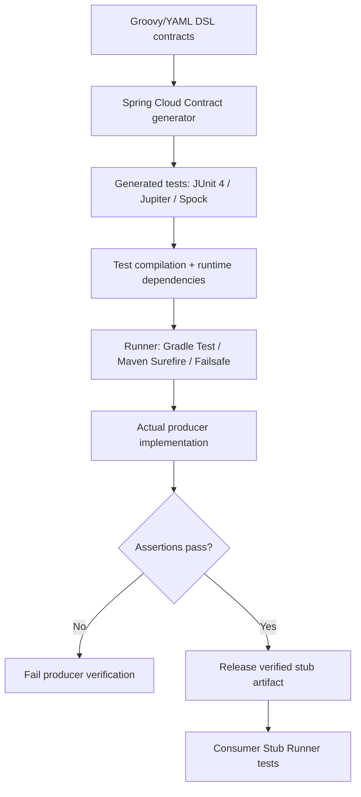
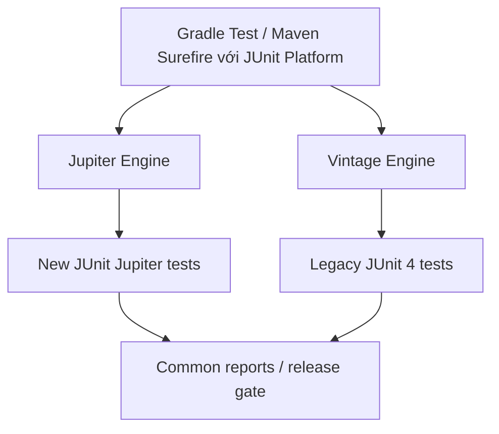
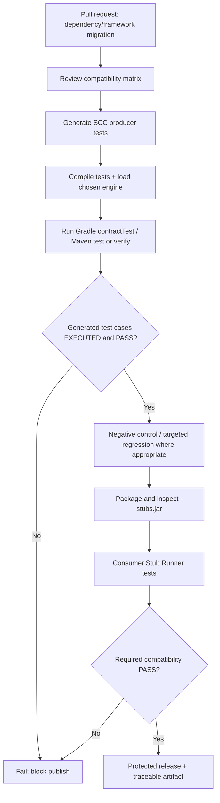

# Chuyển kiểm thử cũ sang JUnit hoặc công cụ mới phù hợp

## 1. Bài toán: contract không đổi nhưng bộ chạy test đã lỗi thời

Giả sử **Payment Service** là producer, còn **Checkout Service** là consumer. Hai dịch vụ cam kết hành vi HTTP và thông điệp qua **Spring Cloud Contract**: các tệp **Groovy/YAML DSL** được plugin xử lý thành producer verification tests, stub mappings hoặc message stubs. Producer phải kiểm chứng implementation thật trước khi phát hành artifact `payment-service-1.2.0-stubs.jar`; consumer dùng **Stub Runner** để chạy các test tích hợp.

Một project cũ có thể còn:

- Generated tests dùng `org.junit.Test` và `@RunWith(SpringRunner.class)` của **JUnit 4**.
- Base class dùng `@Before`, `@Rule`, `@ClassRule` hoặc thư viện MockMvc/Rest Assured đời cũ.
- Bộ contract tests viết bằng **Spock 1.x**, chạy qua JUnit 4 runner.
- Pipeline Maven Surefire/Gradle chỉ hỗ trợ một engine và không tìm thấy classes sinh theo conventions của Spring Cloud Contract.
- Dependencies Spring Boot, Spring Cloud Contract, Groovy, Spock, JUnit Platform, Java toolchain và WireMock đã lệch nhau sau khi nâng một thư viện.

Khi nâng cấp, lỗi có thể xuất hiện theo hai hướng: **không biên dịch được** generated tests hoặc nguy hiểm hơn, **build vẫn xanh nhưng không chạy bất kỳ generated test nào**. Một số nhóm thử sửa trực tiếp mã Java sinh ra, đổi framework mà không cập nhật runner, hoặc xóa matcher để bỏ lỗi. Đó đều là cách khắc phục không bền vững.

Bài thuộc chương **Tương thích công cụ** của module **Spring Cloud Contract**. Chủ đề là **chuyển kiểm thử cũ sang JUnit hoặc công cụ mới phù hợp** mà vẫn giữ ý nghĩa hợp đồng và bảo đảm producer verification thực sự chạy.

Sau bài này, bạn có thể:

1. Phân biệt **hợp đồng DSL**, **generated test framework**, **test runner/engine**, **test base class** và **consumer stub tests**.
2. Chọn giữa **JUnit Jupiter**, giai đoạn chuyển tiếp với **JUnit Vintage**, hoặc **Spock phiên bản tương thích JUnit Platform**.
3. Chuyển base class từ JUnit 4 sang Jupiter mà không mất setup Spring/MockMvc.
4. Cấu hình **Gradle `contractTest`** và **Maven Surefire/Failsafe** để chạy generated tests.
5. Nhận diện vấn đề Java/Spring Boot/Spring Cloud Contract/Groovy/Spock/WireMock tương thích phiên bản.
6. Đánh giá migration bằng test reports, negative control, contract coverage và CI publication gates.

## 2. Năm lớp cần giữ tách biệt



| Lớp | Vai trò | Chuyển JUnit tác động ra sao? |
| --- | --- | --- |
| **Groovy/YAML DSL** | Diễn tả request/response hoặc `input`/`outputMessage` | **Thường giữ nguyên nội dung nghĩa vụ** |
| **Generator / SCC plugin** | Sinh Java/JUnit hoặc Groovy/Spock tests, tạo mappings | Cần cấu hình `testFramework` đúng |
| **Base class và fixture** | Khởi động Spring context, MockMvc, mock, data, message trigger | Có thể cần sửa annotations, hooks, setup |
| **Runner/engine** | Khám phá và chạy test methods | Phải có Jupiter/Vintage/Spock engine phù hợp |
| **Consumer test / Stub Runner** | Kiểm tra HTTP client hoặc message subscriber qua stub | Có thể nâng JUnit độc lập với DSL |

**Đổi test framework không có nghĩa sửa API contract.** Nếu kỳ vọng từ `status: PAID` chuyển thành `PENDING` chỉ để generated test pass, đó là thay đổi nghiệp vụ/API chứ không phải migration framework.

### 2.1. Ba từ rất dễ lẫn: Platform, Jupiter, Vintage

- **JUnit Platform**: hạ tầng khám phá và chạy các `TestEngine`.
- **JUnit Jupiter**: API và engine để viết/chạy kiểm thử theo mô hình JUnit 5, ví dụ `org.junit.jupiter.api.Test`.
- **JUnit Vintage**: engine chạy các kiểm thử JUnit 3/4 tương thích trên JUnit Platform, hữu ích trong giai đoạn chuyển tiếp.

Vì vậy, `useJUnitPlatform()` trong Gradle **không tự biến** annotation `org.junit.Test` của JUnit 4 thành Jupiter. Nếu generated tests còn là JUnit 4, cần một cách chạy JUnit 4 hợp lệ, ví dụ Vintage trên Platform, hoặc **chuyển generator sang JUnit 5 và sinh lại**.

## 3. Kiểm kê trước khi đụng vào cấu hình

Đừng bắt đầu bằng việc đổi ngẫu nhiên versions trong `pom.xml` hoặc `build.gradle`. Hãy ghi nhận:

| Thành phần | Câu hỏi bắt buộc |
| --- | --- |
| Java/JDK | Build đang dùng JDK nào? Toolchain và CI runner có giống local không? |
| Spring Boot/Cloud | Release train nào đang được tổ chức hỗ trợ? |
| Spring Cloud Contract | Maven/Gradle plugin, verifier, Stub Runner và BOM có cùng dòng phiên bản tương thích không? |
| Generated tests | Đang sinh `org.junit.Test`, `org.junit.jupiter.api.Test` hay `spock.lang.Specification`? |
| Base class | Dùng `@RunWith`, `@Before`, Rule, Spring context hoặc Groovy `setup()`? |
| Test mode | `MOCKMVC`, `EXPLICIT`, reactive/WebTestClient hay messaging adapter? |
| Build tool | Gradle `contractTest` hay Maven `test`/`verify`/`Failsafe`? |
| Test engine | Jupiter/Vintage/Spock engine nào hiện diện trên runtime classpath? |
| Tests đã chạy | Report hiện có bao nhiêu generated cases thực thi, skipped, failed? |
| Consumer | Client JUnit 4/Spock có phải nâng cùng lúc với producer không? |

### 3.1. Không đoán version từ tên framework

Một bản Spring Cloud Contract cũ có thể mặc định sinh JUnit 4, trong khi phiên bản plugin khác cho phép cấu hình/mặc định JUnit 5. Tài liệu các bản release cũng có thể mô tả mặc định khác nhau.

**Quy tắc:** Chọn versions theo **bảng tương thích của đúng Spring Boot/Spring Cloud Contract release**, pin BOM/plugin/test libraries rồi **đọc generated source thật**. Không dựa vào câu “bản mới chắc chắn sinh JUnit 5” hoặc lấy giá trị default của một trang tài liệu phiên bản khác.

### 3.2. Thiết lập một baseline có thể so sánh

Trước khi migration:

1. Ghim commit producer, contract source revision và các dependency/plugin versions.
2. Chạy bộ contract verification cũ trong môi trường đang hoạt động.
3. Lưu số lượng generated contract methods, test pass/fail/skipped và thời gian chạy.
4. Lưu danh sách các nhóm consumer, HTTP endpoints và message contracts được kiểm tra.
5. Ghi lại stub artifact GAV/classifier, ví dụ `com.example:payment-service:1.2.0:stubs`.

Sau migration, **số file sinh ra có thể khác** mà vẫn đúng, nhưng mọi nghĩa vụ quan trọng phải còn được xác minh. Đừng chỉ so sánh số file `*.java` vì một class generated có thể chứa nhiều test methods.

## 4. Chọn hướng migration nào?

| Hướng | Phù hợp khi | Ưu điểm | Rủi ro/giới hạn |
| --- | --- | --- | --- |
| **Giữ JUnit 4 tạm thời** | Công cụ mới chưa sẵn sàng | Ít thay đổi tức thời | Tích lũy nợ framework, có thể không hợp JDK/Boot mới |
| **JUnit 4 qua Vintage** | Muốn chạy test cũ trên JUnit Platform khi chuyển dần | Có thể chạy JUnit 4 và Jupiter cùng thời gian | Vintage là cầu nối; cần JUnit 4 runtime phù hợp |
| **Sinh JUnit 5 Jupiter** | Team chủ yếu viết Java/Spring tests và muốn thống nhất | API lifecycle/extension thống nhất, phù hợp test platform hiện đại | Phải cập nhật base class, engines, test tasks và dependencies |
| **Giữ/nâng Spock lên bản Platform** | Team có nhiều specification Groovy, data tables/mocking Spock | Giữ cách viết BDD, chạy cùng JUnit Platform | Cần ghép đúng Spock–Groovy–JDK–Spring versions |
| **Chọn framework khác cho manual tests** | Consumer có nhu cầu đặc thù, ví dụ TestNG/Kotest | Có thể phù hợp codebase hiện tại | Không mặc định là `testFramework` được SCC generator hỗ trợ |

**Với Spring Cloud Contract, không phải mọi framework JVM đều là đích sinh test tích hợp sẵn.** Các lựa chọn được tài liệu plugin đề cập gồm Spock, JUnit 4 (`JUNIT`) và JUnit 5 (`JUNIT5`); TestNG/Kotest có thể dùng cho **tests viết tay** khi có runner thích hợp, nhưng không nên điền tên bất kỳ vào `contracts.testFramework` và mong generator hiểu.

## 5. Lộ trình ít rủi ro: đi từng tầng

```mermaid
flowchart LR
    A["Baseline JUnit 4/Spock cũ"] --> B["Cố định dependency matrix"]
    B --> C["Runner có khả năng chạy framework mục tiêu"]
    C --> D["Port base classes và hooks"]
    D --> E["Đổi testFramework và regenerate"]
    E --> F["Compile + execute generated tests"]
    F --> G["Negative control và consumer tests"]
    G --> H["Publish stub theo release gate"]
    H --> I["Gỡ bridge/dependency cũ khi không còn dùng"]
```



Thứ tự hợp lý:

1. **Inventory** toàn bộ generated tests và test utilities.
2. **Chuẩn hóa engine/runner** trước khi sinh test mới: Maven Surefire/Gradle có thể chạy JUnit Platform chưa?
3. **Di chuyển base class và lifecycle hooks** theo JUnit Jupiter hoặc chuẩn bị Spock tương thích.
4. **Cấu hình generator** sinh framework mới; không sửa trực tiếp files dưới `build/` hoặc `target/`.
5. **Chạy đúng test task** và đối chiếu report.
6. **Negative control:** cố tình làm producer vi phạm một contract, kỳ vọng test fail.
7. **Chạy consumer Stub Runner tests** và kiểm tra stub artifact vẫn mô tả hành vi đúng.
8. **Dọn dependency legacy** sau khi không còn JUnit 4 tests cần Vintage.

Migration không nhất thiết đi cùng một PR lớn. Có thể chuyển từng module/service để hạn chế phạm vi ảnh hưởng, miễn CI không bỏ kiểm chứng trong giai đoạn lai.

## 6. JUnit 4 → Jupiter: thay đổi annotation và lifecycle

| JUnit 4 | JUnit Jupiter | Lưu ý |
| --- | --- | --- |
| `org.junit.Test` | `org.junit.jupiter.api.Test` | Không chỉ đổi import; engine khác |
| `@RunWith(SpringRunner.class)` | `@ExtendWith(SpringExtension.class)` | `@SpringBootTest` cũng thường tích hợp SpringExtension qua meta-annotation; tránh cấu hình trùng không cần thiết |
| `@Before` | `@BeforeEach` | Chạy trước mỗi test method |
| `@After` | `@AfterEach` | Dọn fixture sau mỗi method |
| `@BeforeClass` | `@BeforeAll` | Thường static, trừ khi dùng lifecycle `PER_CLASS` |
| `@AfterClass` | `@AfterAll` | Tương tự `@BeforeAll` |
| `@Ignore` | `@Disabled` | Đừng giữ disable vô thời hạn |
| `@Category` | `@Tag` | Filter/tags ở CI cũng phải chuyển |
| `@Test(expected = X.class)` | `assertThrows(X.class, () -> ...)` | Kiểm tra đúng đoạn code ném exception |
| `@Rule`/`@ClassRule` | Extension model, `@RegisterExtension`, hoặc tiện ích riêng | Không có chuyển đổi 1:1 cho mọi Rule |
| `Assert.assertEquals(...)` | `Assertions.assertEquals(...)` | AssertJ/Hamcrest có thể giữ nếu phù hợp |

**Không tự tìm-thay `@RunWith` → `@ExtendWith` trên toàn codebase**: custom JUnit 4 runners như `Parameterized` và `Suite` đòi đánh giá riêng. JUnit Jupiter có `@ParameterizedTest`, `@MethodSource` và nhiều extension points, nhưng không có phép biến đổi cơ học cho mọi runner.

### 6.1. Ví dụ kiểm thử viết tay trước migration

```java
import org.junit.Before;
import org.junit.Test;
import org.junit.runner.RunWith;
import org.springframework.beans.factory.annotation.Autowired;
import org.springframework.boot.test.context.SpringBootTest;
import org.springframework.test.context.junit4.SpringRunner;
import org.springframework.test.web.servlet.MockMvc;
import org.springframework.boot.test.autoconfigure.web.servlet.AutoConfigureMockMvc;

import static org.junit.Assert.assertEquals;

@RunWith(SpringRunner.class)
@SpringBootTest
@AutoConfigureMockMvc
public class PaymentMappingLegacyTest {
    @Autowired
    private MockMvc mockMvc;

    @Before
    public void prepare() {
        // Chuẩn bị fixture tương thích với trạng thái paymentId=42.
    }

    @Test
    public void mapsPaidState() {
        String actual = "PAID"; // Thay bằng dữ liệu client/producer thật.
        assertEquals("PAID", actual);
    }
}
```

Test trên **chỉ minh họa import và lifecycle**, không phải producer verification hoàn chỉnh: assertion với constant không kiểm tra controller. Trong dự án thực, generated tests phải gọi implementation và kiểm tra response/body đúng theo contract.

### 6.2. Ví dụ sau migration sang Jupiter

```java
import org.junit.jupiter.api.BeforeEach;
import org.junit.jupiter.api.Test;
import org.junit.jupiter.api.extension.ExtendWith;
import org.springframework.beans.factory.annotation.Autowired;
import org.springframework.boot.test.autoconfigure.web.servlet.AutoConfigureMockMvc;
import org.springframework.boot.test.context.SpringBootTest;
import org.springframework.test.context.junit.jupiter.SpringExtension;
import org.springframework.test.web.servlet.MockMvc;

import static org.junit.jupiter.api.Assertions.assertEquals;

@ExtendWith(SpringExtension.class)
@SpringBootTest
@AutoConfigureMockMvc
class PaymentMappingJupiterTest {
    @Autowired
    MockMvc mockMvc;

    @BeforeEach
    void prepare() {
        // Chuẩn bị cùng fixture như bản JUnit 4.
    }

    @Test
    void mapsPaidState() {
        String actual = "PAID"; // Thay bằng lời gọi client/producer thật.
        assertEquals("PAID", actual);
    }
}
```

**Nội dung kiểm tra nghiệp vụ phải giữ nguyên**. Ví dụ này chỉ so sánh cách viết test, không khuyến khích mock lại kết quả để làm migration pass. Khi dùng Spring Boot, `@SpringBootTest` có thể đã mang SpringExtension, nên `@ExtendWith` tường minh là lựa chọn thể hiện rõ intent chứ không luôn bắt buộc.

## 7. Migrating SCC generated tests: sửa nguồn cấu hình, không sửa output

Hợp đồng sau vẫn là đầu vào:

```groovy
import org.springframework.cloud.contract.spec.Contract

Contract.make {
    description 'Thanh toan da hoan tat'
    request {
        method GET()
        url '/api/payments/42'
        headers {
            header('Accept', 'application/json')
        }
    }
    response {
        status OK()
        headers {
            contentType(applicationJson())
        }
        body(paymentId: 42, status: 'PAID')
    }
}
```

Điều cần đổi là **generator target framework**. Ở các cấu hình Spring Cloud Contract được hỗ trợ, `testFramework` thường có các lựa chọn:

```text
JUNIT   -> JUnit 4-style generated tests
JUNIT5  -> JUnit Jupiter-style generated tests
SPOCK   -> Groovy Spock specifications
```

**Tên enum và hỗ trợ thực tế phải đối chiếu đúng phiên bản Spring Cloud Contract đang dùng**. Mặc định của plugin không được giả định là giống nhau giữa các major releases. Giữ các contract body, request matchers, response matchers, consumer/producer values và `outputMessage` nguyên nghĩa trong quá trình đổi framework.

### 7.1. Generated source kỳ vọng có gì?

Sau khi chọn JUnit 5, một phương thức sinh ra thường mang annotation từ `org.junit.jupiter.api`:

```java
// PSEUDOCODE: class/package và method name phụ thuộc DSL path/plugin.
public class Payment extends PaymentContractBase {
    @org.junit.jupiter.api.Test
    void validatesPaymentPaid() {
        // Generated request/assertions của Spring Cloud Contract.
    }
}
```

Khi còn target JUnit 4, annotation có thể là `org.junit.Test`. Khi target Spock, output sẽ là Groovy `Specification`/features thay vì Java/Jupiter.

**Chỉ đọc generated output để xác minh framework**, không sửa bằng tay: build kế tiếp sẽ ghi đè nó. Nếu đổi `testFramework` mà output không đổi, xem plugin version, task inputs, caching và source-set path.

## 8. Chuyển base class của producer mà không mất MockMvc setup

Base class giúp generated tests dùng controller thật, Spring context, authentication fixture, database fixture, message verifier hoặc HTTP client. Migration sai base class có thể làm test fail lúc compile, hoặc tệ hơn là **test pass trên mock/stub thay vì producer thật**.

### 8.1. Khung JUnit 4 base class

```java
import io.restassured.module.mockmvc.RestAssuredMockMvc;
import org.junit.Before;
import org.junit.runner.RunWith;
import org.springframework.beans.factory.annotation.Autowired;
import org.springframework.boot.test.autoconfigure.web.servlet.AutoConfigureMockMvc;
import org.springframework.boot.test.context.SpringBootTest;
import org.springframework.test.context.junit4.SpringRunner;
import org.springframework.test.web.servlet.MockMvc;

@RunWith(SpringRunner.class)
@SpringBootTest
@AutoConfigureMockMvc
public abstract class PaymentContractBase {
    @Autowired
    protected MockMvc mockMvc;

    @Before
    public void setUpContractClient() {
        RestAssuredMockMvc.mockMvc(mockMvc);
    }
}
```

Đây là một **base class mẫu** cho những phiên bản/test modes sinh tests sử dụng Rest Assured MockMvc. Muốn chạy được cần dependency `rest-assured-spring-mock-mvc` phù hợp, Spring Boot test setup và controller thực. **Không dùng mã mẫu này nếu generator đang ở `EXPLICIT` hoặc WebTestClient test mode** mà không điều chỉnh.

### 8.2. Khung Jupiter base class

```java
import io.restassured.module.mockmvc.RestAssuredMockMvc;
import org.junit.jupiter.api.BeforeEach;
import org.springframework.beans.factory.annotation.Autowired;
import org.springframework.boot.test.autoconfigure.web.servlet.AutoConfigureMockMvc;
import org.springframework.boot.test.context.SpringBootTest;
import org.springframework.test.web.servlet.MockMvc;

@SpringBootTest
@AutoConfigureMockMvc
public abstract class PaymentContractBase {
    @Autowired
    protected MockMvc mockMvc;

    @BeforeEach
    void setUpContractClient() {
        RestAssuredMockMvc.mockMvc(mockMvc);
    }
}
```

Trong base class Jupiter, `@SpringBootTest` thường đã kích hoạt SpringExtension qua meta-annotation. Nếu project yêu cầu, có thể thêm `@ExtendWith(SpringExtension.class)` tường minh sau khi kiểm tra phiên bản Spring Test. **Giữ method không phải `private` và bảo đảm generated subclass kế thừa hooks theo quy tắc Jupiter.**

Với unit/slice tests, `@WebMvcTest` cùng `@AutoConfigureMockMvc` hoặc setup MockMvc riêng có thể tiết kiệm thời gian hơn `@SpringBootTest`, **nếu** vẫn kiểm tra được implementation cần bảo vệ; chọn theo test mode, dependencies và security filters.

### 8.3. Migrate Rule, TemporaryFolder và dữ liệu fixture

Đừng mặc định mọi JUnit 4 `@Rule` có một annotation Jupiter thay thế trực tiếp. Ví dụ:

- `TemporaryFolder` có thể chuyển sang `@TempDir`.
- `ExpectedException` thường chuyển sang `assertThrows`.
- Custom `TestRule`/runner cần chuyển sang Jupiter extension hoặc giữ trên Vintage trong giai đoạn quá độ.
- `@BeforeClass` sử dụng state static có thể phải thiết kế lại khi dùng `@BeforeAll`.

Sau khi chuyển hooks, so sánh dữ liệu test quan trọng: `paymentId=42`, status `PAID`, user permissions và transaction state. Đổi lifecycle hook nhưng quên thiết lập fixture có thể khiến assertion fail giả hoặc pass với dữ liệu không đúng.

## 9. Gradle: `contractTest` là task cần quan sát

Spring Cloud Contract Gradle plugin thường tạo source set riêng `contractTest`. Theo tài liệu plugin, DSL contracts được đọc từ:

```text
src/contractTest/resources/contracts/
```

và base class Java/Groovy thường nằm ở:

```text
src/contractTest/java/
src/contractTest/groovy/
```

Trong một số dự án cũ, DSL đặt ở `src/test/resources/contracts` nhưng các bản plugin mới hơn khuyến nghị cấu trúc `contractTest` riêng. **Không di chuyển thư mục nếu chưa kiểm tra sourceSet configuration và Gradle plugin version**.

### 9.1. Fragment Gradle để sinh JUnit 5

```groovy
plugins {
    id 'java'
    id 'org.springframework.cloud.contract' version '<supported-scc-version>'
}

contracts {
    testFramework = 'JUNIT5'
    testMode = 'MOCKMVC'
    contractsDslDir = file('src/contractTest/resources/contracts')
    baseClassForTests = 'com.example.payment.contract.PaymentContractBase'
}

tasks.named('contractTest', Test) {
    useJUnitPlatform()
    testLogging {
        events 'passed', 'skipped', 'failed'
    }
}
```

**Đây là fragment minh họa, không phải `build.gradle` hoàn chỉnh.** Thay `<supported-scc-version>` bằng phiên bản plugin có thật, phù hợp BOM/Spring Boot. Dự án vẫn cần dependency Spring Cloud Contract Verifier, Spring Boot Test và JUnit Jupiter/JUnit Platform runtime **trên classpath của `contractTest`**. Một số release plugin đã tự cấu hình test task; không thêm cấu hình trùng khi không cần.

### 9.2. Vì sao `tasks.named('test')` chưa đủ?

```groovy
tasks.named('test', Test) {
    useJUnitPlatform()
}
```

điều chỉnh task **`test`**, không tự điều chỉnh `contractTest`. Nếu generated JUnit 5 classes nằm trong source set riêng, `contractTest` mới là test runner cần Jupiter engine.

Nếu toàn project đã chuyển JUnit Platform và các task đều tương thích:

```groovy
tasks.withType(Test).configureEach {
    useJUnitPlatform()
}
```

Nhưng **đừng ép mọi task lên Platform khi vẫn còn TestNG/JUnit 4 runner đặc thù** mà chưa có engine/adapter phù hợp. Chuyển từng task giúp nhìn thấy test cases đã mất hoặc bị skip.

### 9.3. Nạp đúng dependencies cho source set

Một Gradle project có thể có `testImplementation` đầy đủ JUnit Jupiter nhưng `contractTest` không nhận được chúng do cấu hình source set:

```groovy
// Chỉ là ví dụ nếu build đã tạo configuration contractTestImplementation.
dependencies {
    contractTestImplementation 'org.springframework.boot:spring-boot-starter-test'
    contractTestImplementation 'org.springframework.cloud:spring-cloud-starter-contract-verifier'
    contractTestRuntimeOnly 'org.junit.platform:junit-platform-launcher'
}
```

Không khai báo versions riêng khi project đã quản lý phiên bản bằng Spring Boot/Cloud BOM tương thích. Kiểm tra dependencies ở đúng **`contractTestCompileClasspath` và `contractTestRuntimeClasspath`**, không chỉ nhìn `testRuntimeClasspath`.

Tùy phiên bản plugin hoặc source-set wiring, project có thể đã nối dependencies giữa `test` và `contractTest`. Nếu vậy, không cần copy mù mọi dependency sang source set mới; kiểm tra dependency graph và chỉ bổ sung phần thiếu.

### 9.4. Lệnh chẩn đoán và chạy đúng task

```bash
./gradlew :payment-service:tasks --all --console=plain
./gradlew :payment-service:check --dry-run
./gradlew :payment-service:contractTest --info --console=plain
```

Ở single-module project, bỏ prefix `:payment-service:`. `--dry-run` chỉ mô phỏng task graph, không chạy test. Nếu `check` không phụ thuộc `contractTest` do custom configuration, cân nhắc nối task sau khi xác minh:

```groovy
tasks.named('check') {
    dependsOn tasks.named('contractTest')
}
```

Theo tài liệu Spring Cloud Contract Gradle, plugin thường tự nối verification với `check`; **không mặc định thêm dependency thủ công khi plugin đã làm**. Mục tiêu là bảo vệ CI, không tạo graph phức tạp vô cớ.

## 10. Maven: kết hợp Spring Cloud Contract plugin với Surefire

Một fragment producer `pom.xml` để chọn generated JUnit 5 tests:

```xml
<plugin>
    <groupId>org.springframework.cloud</groupId>
    <artifactId>spring-cloud-contract-maven-plugin</artifactId>
    <version>${spring-cloud-contract.version}</version>
    <extensions>true</extensions>
    <configuration>
        <testFramework>JUNIT5</testFramework>
        <testMode>MOCKMVC</testMode>
        <baseClassForTests>com.example.payment.contract.PaymentContractBase</baseClassForTests>
    </configuration>
</plugin>
```

Đây chỉ là **fragment**. Project còn cần plugin/dependency management tương thích, test dependencies, base class và source contracts. Với Maven, vị trí DSL thường là `src/test/resources/contracts`, khác với Gradle source set `contractTest` trong nhiều cấu hình hiện hành.

### 10.1. Maven lifecycle phải tới phase chạy tests

```bash
# Goal sinh mã riêng không phải producer verification hoàn chỉnh.
./mvnw -B -ntp spring-cloud-contract:generateTests

# Chạy lifecycle sinh -> test-compile -> Surefire.
./mvnw -B -ntp clean test

# Nếu project dùng cả Failsafe integration tests, chạy tới verify.
./mvnw -B -ntp clean verify
```

`generateTests` tạo Java/Groovy sources; **Surefire/Failsafe mới là runners**. Nếu chỉ gọi goal generator, pipeline có thể xanh nhưng chưa chạy assertion nào.

### 10.2. Maven Surefire và class naming của SCC

Generated class có thể tên `Payment` từ thư mục `contracts/payment/`, chứ không phải `PaymentTest`. Surefire mặc định nhận một số mẫu tên lớp phổ biến:

```text
Test*.java
*Test.java
*Tests.java
*TestCase.java
```

Một class `Payment` không khớp những mẫu này. Có thể cần cấu hình `<includes>` dựa trên **package generated thực tế** (không dựa trên phỏng đoán):

```xml
<plugin>
    <groupId>org.apache.maven.plugins</groupId>
    <artifactId>maven-surefire-plugin</artifactId>
    <version>${maven-surefire-plugin.version}</version>
    <configuration>
        <includes>
            <include>**/Test*.java</include>
            <include>**/*Test.java</include>
            <include>**/*Tests.java</include>
            <include>**/*TestCase.java</include>
            <include>**/org/springframework/cloud/contract/verifier/tests/**/*.java</include>
        </includes>
        <failIfNoTests>true</failIfNoTests>
    </configuration>
</plugin>
```

Giá trị `${maven-surefire-plugin.version}` phải tồn tại; package `org/springframework/cloud/contract/verifier/tests` **chỉ là ví dụ**. Nếu basePackage/package mapping đã thay đổi, cần dùng path thật từ `target/test-classes`.

`failIfNoTests=true` **không phát hiện được riêng tình huống mất generated contract tests** khi module vẫn có unit tests khác. CI nên kiểm tra số generated cases và report names, không chỉ tổng `Tests run > 0`.

### 10.3. Jupiter runtime và Surefire version

Một nhóm test dependencies điển hình trong Maven project đã có BOM:

```xml
<dependencies>
<dependency>
    <groupId>org.springframework.boot</groupId>
    <artifactId>spring-boot-starter-test</artifactId>
    <scope>test</scope>
</dependency>
<dependency>
    <groupId>org.springframework.cloud</groupId>
    <artifactId>spring-cloud-starter-contract-verifier</artifactId>
    <scope>test</scope>
</dependency>
</dependencies>
```

Dependency management cần chọn JUnit Jupiter API/engine, JUnit Platform và Spring Cloud artifacts tương thích. Nếu Surefire là bản quá cũ, nó có thể không chạy Jupiter đúng; chọn phiên bản được BOM/project hỗ trợ.

Ở các bản **Surefire 3.6.0+**, JUnit Platform là hướng thực thi thống nhất; JUnit 4 chạy qua Vintage engine, Jupiter qua Jupiter engine. Với các bản Surefire cũ hơn, provider selection và JUnit integration có thể khác. **Không nâng Surefire một cách tách rời khỏi Java/JUnit Platform/Boot compatibility**.

### 10.4. Nếu dùng Failsafe

Maven **Failsafe** thường dành cho integration tests, với lifecycle `integration-test` và `verify`. Nếu project chuyển producer contract tests thành `*IT` hoặc source path do Failsafe chạy, lệnh `mvn test` có thể không thực thi chúng.

```xml
<!-- Fragment nếu dự án CHỦ ĐÍCH dùng Failsafe. -->
<plugin>
    <groupId>org.apache.maven.plugins</groupId>
    <artifactId>maven-failsafe-plugin</artifactId>
    <version>${maven-failsafe-plugin.version}</version>
    <executions>
        <execution>
            <goals>
                <goal>integration-test</goal>
                <goal>verify</goal>
            </goals>
        </execution>
    </executions>
</plugin>
```

Không để Surefire và Failsafe chạy **cùng một generated class** hai lần ngoài ý định. Cần quyết định rõ framework nào chạy ở phase nào, kiểm tra naming patterns, assertions và test reports tương ứng.

## 11. Cầu nối Vintage: chạy JUnit 4 cũ trong lúc chuyển Jupiter

Một codebase lớn có thể chưa chuyển xong test bases và custom Rules. Với JUnit Platform, có thể dùng **Vintage** để chạy JUnit 4 tests tồn tại song song với Jupiter. Đây là chiến lược tạm thời, không phải chuyển toàn bộ sang JUnit 5 trong một bước.



Ví dụ dependency Maven **khi BOM quản lý versions phù hợp**:

```xml
<dependency>
    <groupId>org.junit.vintage</groupId>
    <artifactId>junit-vintage-engine</artifactId>
    <scope>test</scope>
</dependency>
```

Và runtime Gradle tương ứng trong project có source set `contractTest`:

```groovy
// Cầu nối tạm thời, chỉ cho source set đang chạy JUnit 4 tests.
dependencies {
    contractTestRuntimeOnly 'org.junit.vintage:junit-vintage-engine'
}
```

**Lưu ý:** Với Surefire 3.6.x+, nó có cơ chế tự động chọn engine cho JUnit 4 khi các artifacts phù hợp hiện diện; tuy nhiên, phải **kiểm tra engine thực sự được resolve và reports**. Không nên giả định Vintage được kéo vào đúng classpath ở mọi Maven/Gradle version.

### 11.1. Khi nào gỡ Vintage?

Chỉ gỡ sau khi:

1. Không còn generated tests target JUnit 4 trong những source sets được migrate.
2. Không còn kiểm thử viết tay hoặc JUnit 4 `@RunWith`/`@Rule` cần Vintage.
3. Jupiter/Spock engine vẫn nhận đúng các classes.
4. Test counts và negative control xác nhận không bị mất coverage.

**Gỡ Vintage quá sớm có thể khiến build xanh nhưng bỏ sót legacy tests** nếu CI không kiểm tra cụ thể names/cases.

## 12. Chuyển Spock 1 sang Spock 2: không chỉ nâng dependency

Spock 1.x dùng tích hợp JUnit 4 runner; Spock 2.x chuyển sang **JUnit Platform TestEngine**. Điều này làm migration ảnh hưởng cả runner và Groovy:

- Cần `useJUnitPlatform()` cho Gradle test tasks chạy Spock 2.
- Maven cần Surefire có JUnit Platform support và test engine phù hợp.
- `spock-core` và `spock-spring` phải tương thích nhau.
- **Biến thể Spock phải khớp dòng Groovy** đang được project sử dụng (ví dụ `groovy-4.0` cho Groovy 4.x); không trộn Groovy majors tùy tiện.
- Generated Groovy specifications cần **Groovy compilation** trước khi Surefire/Failsafe/Gradle có thể chạy.

### 12.1. Ví dụ Spock specification cũ

```groovy
import spock.lang.Specification

class PaymentStatusSpec extends Specification {
    def "payment 42 has PAID status"() {
        given:
        String status = 'PAID'

        expect:
        status == 'PAID'
    }
}
```

Ví dụ này chỉ minh họa cú pháp Spock; để kiểm tra hợp đồng phải thay constant bằng code gửi request/kích hoạt producer thật. Với Spring Cloud Contract, nếu chọn `testFramework='SPOCK'`, generator sinh specifications dựa trên DSL, không có lý do chuyển tay từng output sang Java.

### 12.2. Một cấu hình Gradle Spock 2 tham khảo

```groovy
plugins {
    id 'groovy'
    id 'org.springframework.cloud.contract' version '<supported-scc-version>'
}

contracts {
    testFramework = 'SPOCK'
    baseClassForTests = 'com.example.payment.contract.PaymentSpecBase'
}

dependencies {
    // Chọn variants spock-core/spock-spring tương thích Groovy đang dùng.
    contractTestImplementation 'org.spockframework:spock-core:<spock-version>-groovy-<groovy-line>'
    contractTestImplementation 'org.spockframework:spock-spring:<spock-version>-groovy-<groovy-line>'
}

tasks.named('contractTest', Test) {
    useJUnitPlatform()
}
```

Các version trong dấu `<...>` là **placeholders**. Cần kiểm tra tọa độ thật của Spock variant, Groovy compiler, Spring Boot/Spring Cloud dependencies và Gradle version. Đoạn code trên không phải một build hoàn chỉnh và **không đảm bảo mọi Spring Cloud Contract release đều cùng dùng `SPOCK`/cách bố trí source set**.

### 12.3. Spock base class và setup

Spock có `setup()` / `cleanup()` riêng, không phải annotation JUnit `@BeforeEach`. Base specification có thể:

```groovy
import spock.lang.Specification

abstract class PaymentSpecBase extends Specification {
    def setup() {
        // Thiết lập fixture/transport để generated specs gọi Payment Service.
    }
}
```

Nếu project có `@Rule` của JUnit 4 trong Spock 1, không giả định Spock 2 core tiếp tục hỗ trợ. Tùy yêu cầu, dùng `spock-junit4` (nếu tương thích) trong giai đoạn chuyển tiếp hoặc đổi sang extensions của Spock/JUnit Platform.

### 12.4. Khi nào nên chuyển Spock sang Jupiter hoàn toàn?

Cân nhắc nếu nhóm muốn:

- Giảm phụ thuộc Groovy/Spock trong module Java thuần.
- Dùng chung JUnit Jupiter extensions cho base class/security/data setup.
- Giảm complexity cross-version giữa Groovy major, Spring Boot và plugin build.

Nhưng nếu đội ngũ dùng nhiều `where:` data tables, mocks/stubs Spock và specifications được bảo trì tốt, **nâng Spock lên bản Platform phù hợp có thể ít rủi ro hơn viết lại hàng loạt test**. Quyết định dựa trên chi phí và compatibility, không dựa vào khẩu hiệu “framework mới phải là JUnit”.

## 13. Khi Spring Boot/Cloud/JDK thay đổi, đừng chỉ nhìn JUnit

Một migration framework thường diễn ra cùng upgrade Spring Boot/Spring Cloud hoặc Java, tạo ra lỗi không phải của JUnit:

| Thay đổi | Triệu chứng | Phân biệt với lỗi JUnit |
| --- | --- | --- |
| Java toolchain mới | `Unsupported class file major version`, source/target mismatch | Compile/runtime JDK trước engine |
| Spring Boot/Spring Framework major | Bean/context/test annotation không tương thích | Context loading fail sau khi test đã được chạy |
| `javax.*` → `jakarta.*` trong các stack đã chuyển | Import/servlet filter/security type mismatch | Migration API của framework nền |
| Spring Cloud Contract plugin version | Sinh output/test framework khác dự kiến | Kiểm tra plugin/BOM và generated source |
| Rest Assured/MockMvc version | `NoSuchMethodError`, import khác, mock setup lỗi | Dependencies hoặc binding, không phải DSL |
| WireMock dependency/Jetty | Server startup/linkage error | Stub runner/test transport |
| Groovy/Spock variant | `IncompatibleGroovyVersionException`, compile specs fail | Version Groovy major và Spock binary |
| JUnit Platform/Jupiter API vs Engine | Tests compile nhưng `0 tests` hoặc thiếu engine | Discovery/runtime classpath |

**Không đưa ra một ma trận versions cố định cho mọi project.** Chọn đúng dòng Spring Boot/Spring Cloud Contract đang được hỗ trợ, xác nhận Java tối thiểu và phiên bản Gradle/Maven, rồi khóa versions bằng BOM/dependency management/lockfiles trước khi mở rộng migration.

### 13.1. Tránh trộn dependency mới/cũ vô tình

Các dấu hiệu:

- Cùng lúc xuất hiện hai Groovy majors từ Spock và ứng dụng.
- JUnit Jupiter API đã nâng nhưng test engine vẫn cũ hoặc thiếu.
- Spring Cloud Contract plugin phiên bản khác với `spring-cloud-starter-contract-verifier`.
- `junit-vintage-engine` nằm trên test classpath thông thường nhưng **không có trên `contractTest` runtime**.
- Maven Surefire version cũ cố chạy JUnit Jupiter như JUnit 4.
- Testbase còn RestAssured class từ phiên bản cũ trong khi generator dùng package mới.

Để sửa, xem **resolved dependency graph** của task/module thực sự chạy contract tests, không chỉ các khai báo trực tiếp trong POM/Gradle.

## 14. Test mode không giống test framework

Trong Spring Cloud Contract, `testFramework` nói **test code được sinh theo JUnit/Spock**; `testMode` nói **cách generated test tương tác với producer**.

| Cấu hình | Câu hỏi |
| --- | --- |
| `testFramework=JUNIT5` | Sinh test methods theo JUnit Jupiter? |
| `testMode=MOCKMVC` | Dùng MockMvc-style HTTP setup để kiểm tra producer? |
| `testMode=EXPLICIT` | Có dùng client HTTP đến một server/port đã được khởi động? |
| Reactive/WebTestClient mode (khi plugin hỗ trợ) | Generator kiểm tra reactive stack thế nào? |
| Messaging verification | Base trigger, message verifier/adapter và binder/broker được nối đúng chưa? |

Đổi từ JUnit 4 sang Jupiter **không bắt buộc** đổi từ MockMvc sang HTTP thật. Ngược lại, nếu đồng thời chuyển test mode, hãy coi đó là **một thay đổi riêng** vì setup, headers, security filters, ports và fixture timing có thể khác.

### 14.1. HTTP MockMvc và EXPLICIT khác nhau

- MockMvc có thể kiểm tra controller, Spring MVC mapping, validation và filters trong một test context phù hợp, không cần mở network port.
- EXPLICIT đòi test server thực sự đang chạy và generated tests trỏ đúng host/port. Nếu chưa khởi động application hoặc base class chỉ set MockMvc, test có thể lỗi connection.

Không giải quyết lỗi `Connection refused` bằng cách chuyển toàn bộ tests sang `@Disabled`. Cần kiểm tra **testMode hiện tại**, setup server và cách generator tạo request.

### 14.2. Messaging khi đổi framework

Contract messaging minh họa:

```groovy
import org.springframework.cloud.contract.spec.Contract

Contract.make {
    label 'payment_completed'
    input {
        triggeredBy('completePaymentAndPublish()')
    }
    outputMessage {
        sentTo('payments.completed')
        body(
            eventType: 'PaymentCompleted',
            eventId: 'evt-payment-42',
            paymentId: 42
        )
        headers {
            header('eventType', 'PaymentCompleted')
        }
    }
}
```

Nếu base class JUnit 4 đã cung cấp `completePaymentAndPublish()`, base Jupiter hoặc Spock mới vẫn phải:

1. Triển khai phương thức trigger đúng tên/chữ ký mà generated test cần.
2. Kích hoạt **publisher thật** thay vì chỉ gửi một message mock qua Stub Runner.
3. Có `MessageVerifier`/adapter/binder hoặc cơ chế giám sát message tương thích.
4. Đồng bộ fixture và thời gian chờ message bất đồng bộ.

Chuyển framework mà quên hook message trigger sẽ dẫn tới compile/runtime failure; tắt messaging tests để build xanh làm mất nghĩa vụ producer.

## 15. Consumer Stub Runner tests có thể nâng riêng

Consumer có thể đang dùng JUnit 4:

```java
import org.junit.Test;
import org.junit.runner.RunWith;
import org.springframework.boot.test.context.SpringBootTest;
import org.springframework.cloud.contract.stubrunner.spring.AutoConfigureStubRunner;
import org.springframework.cloud.contract.stubrunner.spring.StubRunnerProperties;
import org.springframework.test.context.junit4.SpringRunner;

@RunWith(SpringRunner.class)
@SpringBootTest
@AutoConfigureStubRunner(
    ids = "com.example:payment-service:1.2.0:stubs:8091",
    stubsMode = StubRunnerProperties.StubsMode.LOCAL
)
public class CheckoutClientLegacyTest {
    @Test
    public void readsPaidPayment() {
        // Gọi PaymentClient thật đến WireMock và assert kết quả.
    }
}
```

Sau khi chuyển sang Jupiter:

```java
import org.junit.jupiter.api.Test;
import org.springframework.boot.test.context.SpringBootTest;
import org.springframework.cloud.contract.stubrunner.spring.AutoConfigureStubRunner;
import org.springframework.cloud.contract.stubrunner.spring.StubRunnerProperties;

@SpringBootTest
@AutoConfigureStubRunner(
    ids = "com.example:payment-service:1.2.0:stubs:8091",
    stubsMode = StubRunnerProperties.StubsMode.LOCAL
)
class CheckoutClientJupiterTest {
    @Test
    void readsPaidPayment() {
        // Gọi PaymentClient thật đến http://localhost:8091.
        // Assert status=PAID trong DTO/business behavior.
    }
}
```

Hai đoạn trên là **test skeletons**: phần thân chưa có lời gọi/assertion thực, nên không được coi là bằng chứng test pass. Trong project thật, phải cấu hình base URL của `PaymentClient` trỏ tới stub server, bổ sung dependencies Stub Runner/test engine và viết assertions trên kết quả.

**Quan trọng:** `@AutoConfigureStubRunner` không nhất thiết đổi chỉ vì chuyển từ JUnit 4 sang Jupiter, nhưng Spring Boot Test/JUnit Platform, application context và test annotation discovery phải tương thích.

### 15.1. Stub artifact không phụ thuộc trực tiếp vào JUnit của consumer

`payment-service-1.2.0-stubs.jar` chứa mappings/metadata của behavior đã được producer đóng gói, **không phải JUnit test suite của Checkout**. Checkout nâng JUnit 4 → Jupiter có thể vẫn dùng cùng stub version nếu API contract không đổi.

Ngược lại, việc producer đổi JUnit 4 → Jupiter không tự thay nội dung HTTP mapping nếu Groovy/YAML contract giữ nguyên và generator sản xuất cùng behavior. Tuy nhiên, cần xác minh artifact vẫn chứa mappings đúng sau upgrade plugin; một thay đổi version của SCC/WireMock có thể tác động layout/runtime.

## 16. Tránh “giả thành công” trong migration

Một pipeline có thể có đủ logs:

```text
> Task :payment-service:generateContractTests
> Task :payment-service:test
BUILD SUCCESSFUL
```

nhưng **không có `contractTest`** trong task graph. Hoặc Maven `surefire:test` có `Tests run: 30` từ unit tests, còn generated `Payment` class không được nhận diện do naming pattern.

### 16.1. Chuỗi chứng minh

```text
1. Source contract tồn tại
2. Generated Jupiter/Spock test được tạo
3. Generated test compile thành class
4. Gradle contractTest hoặc Surefire/Failsafe discover class
5. Test case EXECUTE, không bị skipped
6. Assertion kiểm tra producer implementation thật
7. Report ghi được kết quả và CI gate chặn fail
```

Nếu thiếu một mắt xích, không thể khẳng định migration giữ được producer verification.

### 16.2. Đọc trạng thái Gradle chính xác

| Trạng thái | Ý nghĩa thực tế | Cần kiểm tra |
| --- | --- | --- |
| `NO-SOURCE` | Không có input/source phù hợp cho task | Contract path, generated classes, source set |
| `SKIPPED` | Bị condition/flag/disabled | `onlyIf`, `enabled=false`, `-x` |
| `UP-TO-DATE` | Inputs/outputs không đổi theo Gradle | Có đúng sources/versions trong cache key không? |
| `FROM-CACHE` | Task output được restore từ build cache | Cache provenance/inputs và reports |
| Task không xuất hiện | Không thuộc graph được gọi | Dùng `--dry-run`, kiểm tra `check` wiring |
| `0 tests` | Runner chạy nhưng không discover cases | Engine, includes, classpath, tags |

`UP-TO-DATE` hoặc `FROM-CACHE` **không tự là lỗi**. Khi debug hoặc muốn negative control có bằng chứng trực tiếp, có thể dùng `--rerun-tasks --no-build-cache` trên đúng task thay vì xóa mọi cache không cần thiết.

### 16.3. Test reports quan trọng hơn tổng build status

Đường dẫn thường gặp:

```text
Gradle:
  build/test-results/contractTest/
  build/reports/tests/contractTest/

Maven:
  target/surefire-reports/
  target/failsafe-reports/
```

Một ví dụ XML report:

```xml
<testsuite name="com.example.PaymentContract"
           tests="2" failures="1" errors="0" skipped="0">
    <testcase name="shouldReturnPaid" classname="com.example.PaymentContract">
        <failure message="Expected PAID but was PENDING"/>
    </testcase>
    <testcase name="shouldReturn404" classname="com.example.PaymentContract"/>
</testsuite>
```

Report ví dụ này chỉ minh họa số liệu. Một CI gate tốt nên xác nhận **nhóm generated contract cases cần thiết xuất hiện**, không chỉ `tests>0` của toàn ứng dụng.

## 17. Negative control: kiểm tra migration có thật sự bảo vệ API

Một phép thử đáng làm trên nhánh thử nghiệm không publish:

1. Chạy producer contract verification trên controller trả `PAID` đúng contract → **PASS**.
2. Cố tình sửa implementation/fixture để `GET /api/payments/42` trả `PENDING`.
3. Chạy `contractTest` hoặc Maven verification với runner/engine mới.
4. Yêu cầu generated assertion **FAIL**, test report nêu đúng trường `status`.
5. Hoàn nguyên thay đổi thử nghiệm.
6. Xác nhận pipeline release sẽ **không publish stub artifact** nếu step 4 FAIL.

Nếu bước 4 vẫn xanh, các nguyên nhân có thể:

- Test runner không chọn generated class.
- Test bị disabled/skipped.
- Base class gọi WireMock/stub hoặc một controller khác thay vì producer implementation.
- Fixture không thực sự đi qua nhánh code vừa sửa.
- Matcher bị nới quá rộng (`status` không còn được assert cụ thể).
- CI đang chạy code/contract revision khác với nhánh thử.

**Negative control không thay thế toàn bộ QA**, nhưng giúp nhận ra “test xanh giả” sau khi thay engine/framework.

## 18. Ma trận compatibility trước và sau migration

| Cặp cần kiểm tra | Test/việc cần làm | Bằng chứng |
| --- | --- | --- |
| DSL hiện tại × JUnit 4 cũ | Chạy baseline producer verification | Legacy test report |
| DSL hiện tại × Jupiter mới | Sinh lại và chạy đúng task/goal | Jupiter test report |
| DSL hiện tại × Spock 2 mới (nếu chọn) | Compile Groovy và chạy Spock engine | Spec report |
| Producer code mới × contract cũ | Bảo đảm không phá nghĩa vụ được chấp nhận | Contract verification results |
| Consumer cũ × stub artifact hiện tại | Tránh thay đổi client behavior ngoài ý định | Stub Runner consumer test |
| Consumer Jupiter mới × cùng stub artifact | Xác nhận migration test framework độc lập với API | Consumer assertions |
| Stub artifacts cũ/mới | So mapping behavior quan trọng | JAR inspection/consumer test |
| CI local/container | Cùng versions/engines/Java toolchain | Build environment metadata |

**Đừng dùng số lượng class mới bằng số class cũ làm tiêu chí duy nhất.** Generator có thể gom nhiều methods vào cùng một class. So sánh **nghĩa vụ được bảo vệ, số methods chạy và kết quả assertions**.

### 18.1. Ma trận phiên bản dùng để truy vết

Một báo cáo nội bộ nên lưu:

```text
Producer commit          = <actual commit SHA>
Contracts revision       = <actual Git/Maven revision>
Spring Boot              = <resolved version>
Spring Cloud Contract    = <resolved plugin + verifier version>
Build tool               = <Maven/Gradle version>
Java                     = <toolchain/runtime version>
Generated framework      = JUNIT5 / SPOCK
JUnit Platform engines   = <resolved Jupiter/Vintage/Spock>
Test runner              = contractTest / Surefire / Failsafe
Generated test count     = <executed count>
Stub artifact            = com.example:payment-service:1.2.0:stubs
Consumer test result     = <linked report>
```

Các placeholder trên phải được hệ thống CI điền từ giá trị **đã resolve thật**, không điền theo giả định hoặc tự đặt `PASS` nếu task không chạy.

## 19. CI: chuyển framework mà không mở đường phát hành stub chưa verify



### 19.1. Gradle CI gợi ý

```bash
# Nếu ở module producer trong multi-project build:
./gradlew :payment-service:check --info --console=plain
./gradlew :payment-service:contractTest --info --console=plain

# Chỉ sau khi verification đạt và kiểm tra đúng version:
./gradlew :payment-service:verifierStubsJar
```

Nếu `check` đã phụ thuộc `contractTest`, gọi trực tiếp cả hai là thừa đối với pipeline tối ưu nhưng có thể giúp debug. Khi thiết kế CI cuối cùng, chọn một graph rõ ràng và đảm bảo **contract tests thực thi hoặc có cache outputs hợp lệ** và báo cáo được kiểm tra.

### 19.2. Maven CI gợi ý

```bash
# Chạy trên đúng producer module và dependencies cần thiết.
./mvnw -B -ntp -pl payment-service -am clean verify

# Publish trong job đã được bảo vệ, trên đúng commit đã verify.
# Cấu hình credentials và deploy theo chính sách artifact repository.
```

Không để `-DskipTests`, `-Dmaven.test.skip=true`, `-Dtest=SomeUnitTest` hoặc Gradle `-x contractTest` trong release path. Nếu một bước vẫn cần lọc tests vì hiệu năng, phải bảo vệ generated contract suite ở bước gate riêng.

### 19.3. Cổng chống test count bằng 0

Hãy kiểm tra:

- Có ít nhất những generated test cases kỳ vọng cho **mỗi nhóm contract active**.
- Không có test bị skip hàng loạt sau khi đổi engine.
- JUnit 4 cases còn dùng Vintage xuất hiện trong reports khi vẫn phải hỗ trợ.
- Spock specs xuất hiện sau khi nâng Spock/JUnit Platform.
- Mỗi test thực sự gọi producer implementation, không gọi stub server.
- Stub artifact phát hành được liên kết với **producer commit và kết quả verification**.

Một test report chỉ có unit tests thông thường không đủ chứng minh contract verification. Những checks này có thể được triển khai bằng test XML parsing trong CI theo project policy, nhưng **không có một lệnh Spring Cloud Contract duy nhất tự bảo đảm toàn bộ**.

## 20. Troubleshooting sau migration

| Triệu chứng | Nguyên nhân thường gặp | Điều tra / cách sửa |
| --- | --- | --- |
| Sinh Java test vẫn import `org.junit.Test` | `testFramework` chưa đổi, plugin version hoặc cache cũ | Đối chiếu extension/POM effective config và regenerate |
| Generated Jupiter tests compile nhưng `0 tests` | Thiếu Jupiter engine, Gradle task không dùng Platform, Surefire không nhận class | Xem runtime classpath/test runner includes |
| Gradle `test` xanh, không thấy generated tests | SCC dùng source set/task `contractTest` riêng | Chạy `contractTest` và xem `check` graph |
| Maven `Tests run: 0` với class `Payment` | Surefire mặc định không match naming | Xem package thực, thêm include phù hợp |
| `NoClassDefFoundError` JUnit/Vintage | Engine/API/runtime versions lệch | Dùng BOM, xem resolved classpath |
| `NoSuchMethodError` trong Spring test | Spring Boot/Framework/SCC versions không tương thích | Align dependency release train |
| `Unsupported class file major version` | JDK/compiler/runtime lệch | Xem toolchain/Gradle/Maven runtime |
| Spock specs compile fail | Groovy variant không khớp Spock/Java | Dùng đúng Spock–Groovy artifacts |
| Spock 2 specifications không chạy | Task/Surefire chưa dùng JUnit Platform | Kích hoạt Platform và Spock engine |
| Base class báo thiếu `@Before`/Rule | Còn hook JUnit 4 trong Jupiter | Di chuyển hooks/extensions có chủ đích |
| Tests chạy nhưng MockMvc `null` | Base setup/annotations không đúng context | Xem SpringExtension, injection và test mode |
| `Connection refused` | `EXPLICIT` nhưng server/port chưa được khởi động | Kiểm tra test mode và HTTP base URL |
| Messaging test không nhận output | Trigger/MessageVerifier/binder chưa nối | Kiểm tra method thật, destination và adapter |
| Consumer test pass, producer verification không chạy | Stub Runner thay thế nhầm producer tests | Bổ sung producer gate |
| `FROM-CACHE` dù đổi plugin/version | Input tracking/cache issue cần điều tra | Xem cache key, chạy `--rerun-tasks` khi debug |
| `Unknown test engine` hoặc có engine xung đột | Duplicated/mismatched engine jars | Kiểm tra resolved dependencies, bỏ bản thừa |
| JUnit 4 tests biến mất khi gỡ Vintage | Chưa migrate hết JUnit 4 suites | Khôi phục bridge, theo dõi và chuyển nốt |
| Stub JAR mất mappings sau upgrade | Generator/packaging/repository layout thay đổi | Inspect artifact, test Stub Runner với đúng version |

### 20.1. Quy trình điều tra theo tầng

1. **Source DSL**: đúng contract file và plugin source path?
2. **Generator**: `JUNIT` hay `JUNIT5`/`SPOCK` đang sinh?
3. **Compile**: generated class có trên task's test output?
4. **Discover**: runner/engine nhận class theo tên/package/tags?
5. **Execute**: XML report có case tương ứng và không bị skip?
6. **Assert**: test có gọi implementation thật và kiểm tra behavior đã cam kết?
7. **Package**: `-stubs.jar` đúng mappings/metadata?
8. **Consume**: Stub Runner và client thật dùng đúng artifact/version?

Nếu số 3 không đạt, không nên mất thời gian sửa JUnit `@Tag`. Nếu số 5 đã đạt nhưng số 6 không đạt, vấn đề nằm ở **test base/setup**, không phải engine discovery.

## 21. Bài thực hành: nâng Payment Service từ JUnit 4 sang Jupiter

**Bối cảnh:** Payment Service dùng Spring Cloud Contract Groovy DSL:

```text
src/contractTest/resources/contracts/payment/
  shouldGetPaidPayment.groovy
  shouldReturnNotFound.yml
```

Hợp đồng `shouldGetPaidPayment.groovy`:

```groovy
import org.springframework.cloud.contract.spec.Contract

Contract.make {
    request {
        method GET()
        url '/api/payments/42'
    }
    response {
        status OK()
        headers {
            contentType(applicationJson())
        }
        body(paymentId: 42, status: 'PAID')
    }
}
```

Hợp đồng `shouldReturnNotFound.yml`:

```yaml
description: Payment khong ton tai
request:
  method: GET
  url: /api/payments/999
response:
  status: 404
  headers:
    Content-Type: application/json
  body:
    code: PAYMENT_NOT_FOUND
```

Nhóm thấy:

```text
Generated source:
  build/generated-test-sources/contractTest/java/.../Payment.java

Gradle command:
  ./gradlew test

Result:
  BUILD SUCCESSFUL, contractTest report không tồn tại
```

### 21.1. Yêu cầu

1. Vì sao `./gradlew test` chưa chứng minh `Payment` generated test đã chạy?
2. Viết `contracts { ... }` để chọn `JUNIT5` và một base class đúng.
3. Cấu hình `contractTest` để dùng JUnit Platform.
4. Chuyển `PaymentContractBase` từ `@RunWith`/`@Before` sang Jupiter.
5. Khi còn manual tests JUnit 4, bạn chọn Vintage tạm thời hay chuyển hết ngay? Vì sao?
6. Chọn lệnh Gradle để xem task graph, chạy test và đọc reports.
7. Thực hiện negative control về `status: PENDING` (trong môi trường thử nghiệm) và nêu kết quả phải có.
8. Thiết kế một release gate ngăn publish stub khi generated tests không được chạy.
9. Nếu thay Gradle bằng Maven, bạn sẽ kiểm tra thêm phần nào ở Surefire/Failsafe?
10. Nếu project dùng Spock 1, cần quan tâm thêm yếu tố gì khi nâng Spock 2?

### 21.2. Gợi ý câu trả lời

| Câu | Đáp án chính |
| --- | --- |
| 1 | `test` thường không phải task `contractTest` riêng của SCC |
| 2 | Chọn `testFramework='JUNIT5'`, `baseClassForTests` trỏ đúng Java base |
| 3 | `tasks.named('contractTest', Test) { useJUnitPlatform() }` nếu plugin chưa cấu hình |
| 4 | Dùng `@BeforeEach`, Spring Test integration; giữ MockMvc/fixture đúng |
| 5 | Vintage giúp chuyển dần; gỡ khi legacy tests không còn |
| 6 | `tasks --all`, `check --dry-run`, `contractTest --info`, test reports |
| 7 | Generated assertion **phải fail** trên response trái hợp đồng |
| 8 | Verify generated cases executed + passed trước khi package/publish |
| 9 | Surefire includes, test class naming, Jupiter engine, `test` vs `verify` |
| 10 | Spock 2 chạy trên JUnit Platform và cần đúng variant Groovy, Groovy compilation |

### 21.3. Thử một lỗi âm tính thứ hai

Sau khi chuyển generator sang `JUNIT5`, cố tình bỏ Jupiter engine khỏi `contractTest` runtime classpath trong một nhánh thử nghiệm. Kết quả mong đợi: **test discovery/execution không thể đạt gate** hoặc build fail rõ ràng, chứ không được cho release thành công với `0 generated tests`.

Tương tự, nếu bỏ Vintage khi còn JUnit 4 classes, CI cần phát hiện chúng không còn xuất hiện trong reports. Đừng chỉ dựa vào `BUILD SUCCESSFUL`.

## 22. Checklist trước khi merge migration framework

- Đã ghim Spring Boot, Spring Cloud Contract plugin/BOM, Java, Gradle/Maven và test framework versions theo ma trận tương thích?
- Đã phân biệt **hợp đồng Groovy/YAML** với **framework được generator chọn**?
- Generated source thực sự dùng Jupiter/Spock theo `testFramework` mong muốn, không còn Java JUnit 4 ngoài ý định?
- Base classes đã đổi `@RunWith`, `@Before`, `@Rule` đúng sang Jupiter/extensions hoặc Spock equivalents?
- Các fixture, authentication setup, MockMvc/test mode và messaging triggers vẫn đi qua producer implementation thật?
- Với Gradle, `contractTest` có `useJUnitPlatform()` và runtime test engine/classpath đúng?
- Với Maven, đã kiểm tra source roots, Surefire/Failsafe versions, naming patterns và phase `test`/`verify`?
- Nếu còn JUnit 4 tests, Vintage đã được cấu hình và **test report có cases** của chúng?
- Nếu dùng Spock 2, Spock–Groovy variant, compiler và JUnit Platform đã tương thích?
- Đã tránh trộn Spring Boot/Cloud/SCC versions, Groovy majors và Rest Assured dependencies không tương thích?
- Không có `skipTests`, `maven.test.skip`, `-x contractTest`, filters hoặc disabled tests ngoài ý định?
- Reports có đủ generated contract test cases đã **thực thi**, không chỉ unit tests khác?
- Negative control chứng minh một thay đổi producer sai sẽ khiến generated test **FAIL**?
- Stub artifact mới vẫn chứa đúng HTTP mappings/message metadata và có version/provenance xác định?
- Consumer Stub Runner tests vẫn pass với client/subscriber thật, không dùng stub thay thế producer verification?
- CI chặn publication khi generated tests không chạy, fail hoặc không truy vết được commit/contract revision?
- Đã có kế hoạch dọn Vintage/dependencies legacy và rollback/roll-forward nếu test infrastructure mới gặp lỗi?

**Tài liệu chính thức để đối chiếu theo phiên bản đang dùng:**

- [Spring Cloud Contract — Gradle Project](https://docs.spring.io/spring-cloud-contract/reference/gradle-project.html) — `testFramework`, `contractTest`, source sets.
- [Spring Cloud Contract — Maven Project](https://docs.spring.io/spring-cloud-contract/reference/maven-project.html) — Maven plugin, generated tests, base classes.
- [Spring Cloud Contract — Maven generateTests goal](https://docs.spring.io/spring-cloud-contract/docs/current/spring-cloud-contract-maven-plugin/generateTests-mojo.html) — các tham số plugin theo release.
- [JUnit — Migration from JUnit 4](https://docs.junit.org/5.14.2/migrating-from-junit4) — annotations, Rules và Jupiter.
- [Maven Surefire — Using JUnit Platform](https://maven.apache.org/surefire/maven-surefire-plugin/examples/junit-platform.html) — engines và Maven runner.
- [Maven Surefire — Test Inclusion/Exclusion](https://maven.apache.org/surefire/maven-surefire-plugin/examples/inclusion-exclusion.html) — class naming.
- [Spock — Reference Documentation](https://spockframework.org/spock/docs/current/) — JUnit Platform, Groovy compatibility và migration.
- [Gradle — Testing in Java & JVM Projects](https://docs.gradle.org/current/userguide/java_testing.html) — `Test` task, filters, reports và runtime classpath.

**Ghi nhớ:** **Đổi từ JUnit 4 sang Jupiter hoặc nâng Spock không bắt đầu bằng sửa DSL**, mà bắt đầu từ **phiên bản công cụ, generator target, base class, source set và test runner**. Giữ nguyên các nghĩa vụ HTTP/message trong Groovy/YAML; sinh lại tests theo framework mục tiêu; kiểm tra chúng được **biên dịch, khám phá, thực thi và assert trên producer thật**. Dùng Vintage làm cầu nối khi cần, nhưng phải có kế hoạch gỡ. Sau cùng, consumer Stub Runner tests và CI release gate phải chứng minh artifact mới thật sự được tạo từ một producer build đã xác minh, không chỉ từ một lệnh generate thành công.
