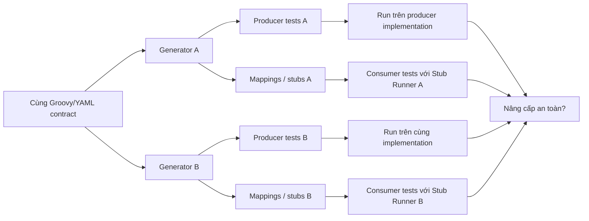
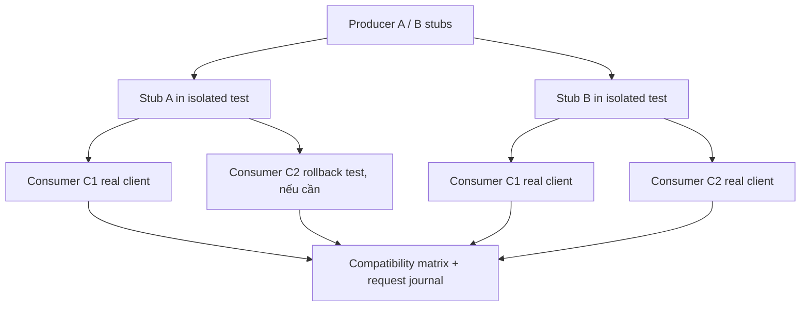
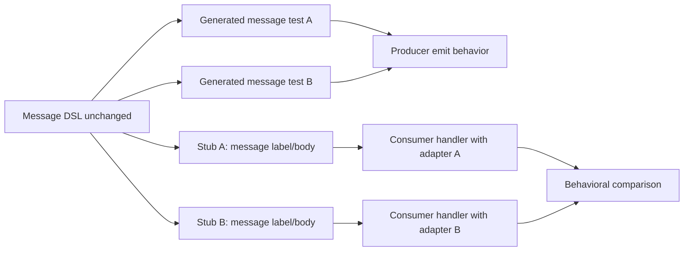
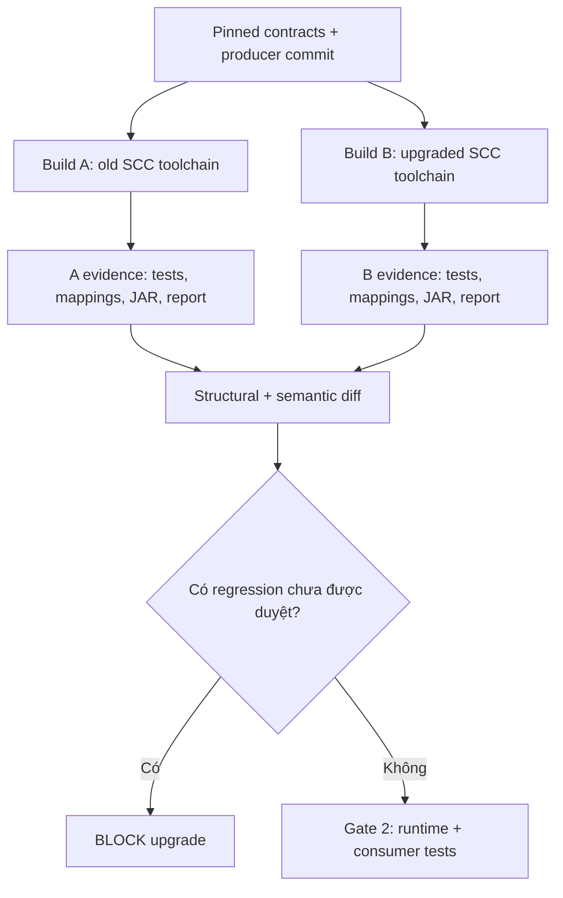
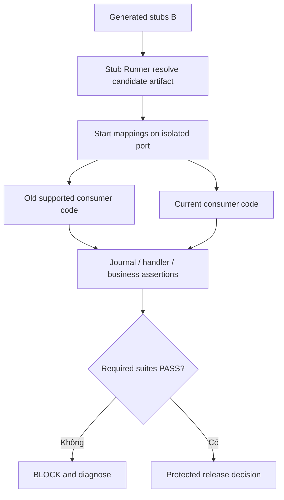

# Đối chiếu generated test và stub trước và sau nâng cấp

## 1. Vì sao phải so sánh *đầu ra* khi nâng cấp Spring Cloud Contract?

Trong mô-đun **SPRING_CLOUD_CONTRACT**, producer và consumer thỏa thuận hành vi HTTP hoặc thông điệp bằng **Groovy/YAML DSL**. **Spring Cloud Contract (SCC)** sử dụng hợp đồng đó để:

1. **Sinh producer verification tests** và chạy chúng trên implementation của producer.
2. **Chuyển hợp đồng thành stub mappings**, thường cho WireMock khi kiểm thử HTTP.
3. **Đóng gói stub artifact** với classifier như `stubs` để consumer sử dụng qua Stub Runner.
4. **Tích hợp Maven/Gradle và CI** để phát hiện thay đổi API không tương thích trước khi phát hành.

Khi nâng cấp SCC, Spring Boot, Java, Maven/Gradle, JUnit, Groovy, WireMock hoặc plugin liên quan, **chính bộ công cụ diễn giải hợp đồng** có thể thay đổi. Source YAML/Groovy trông không khác, nhưng generated Java/Groovy test và stub JSON có thể khác:

- Tên package/lớp test, imports, test annotations hoặc code generated khác.
- Framework chạy test đổi từ JUnit 4 sang JUnit 5, hoặc test mode đổi từ MockMvc sang WebTestClient/EXPLICIT.
- Assertion của generated test trở nên chặt hơn hoặc lỏng hơn.
- WireMock mapping thay đổi `url`/`urlPath`, query/header matcher hoặc JSON body matching.
- Stub JAR bị thiếu contract, đổi layout `META-INF`, classifier hoặc cách attach/publication.
- Artifact vẫn tồn tại nhưng Stub Runner version mới không nạp đúng mapping, hoặc consumer test bị skip.

Vì vậy, câu hỏi không chỉ là **“build sau nâng cấp có xanh không?”** mà phải là:

> **Với cùng bộ contracts và cùng producer behavior cần được bảo vệ, generated tests sau nâng cấp có giữ nguyên các assertions quan trọng và stub mới có mô phỏng cùng một giao diện consumer quan sát được hay không?**

Chủ đề thuộc chương **Tương thích công cụ**. Bài tập trung vào **đối chiếu generated test và stub trước/sau nâng cấp**, thay vì chỉ đổi một số version trong POM rồi chạy build một lần.

### 1.1. Mục tiêu học tập

Sau bài học, bạn có thể:

1. Phân biệt **DSL source**, **generated producer test**, **WireMock mappings** và **stub JAR**.
2. Tạo hai baseline A/B có thể truy vết với **cùng tập hợp contracts**.
3. So sánh code sinh ra theo **ngữ nghĩa kiểm tra** thay vì đếm dòng diff.
4. Chuẩn hóa các thành phần generated metadata không ảnh hưởng behavior mà không xóa nhầm matchers quan trọng.
5. Chạy producer verification cho cả hai bộ đầu ra và phát hiện trường hợp **0 tests/skip**.
6. Kiểm tra stub JAR, classifier, paths, consumer-specific mappings và khả năng resolve bằng Stub Runner.
7. Phân biệt **thay đổi định dạng vô hại**, **thay đổi kỹ thuật cần migrate** và **thay đổi behavior phá hợp đồng**.
8. Thiết kế test matrix, CI gates, release và rollback cho đợt nâng cấp công cụ.
9. Chẩn đoán các lỗi thường gặp: JUnit engine, base class, WireMock version, dependency graph, stale build cache và artifact layout.

**Giới hạn:** Bài dùng các ví dụ minh họa, **không khẳng định chúng là kết quả thực tế của một cặp phiên bản SCC cụ thể**. Việc nâng cấp trên một dự án thật phải chọn phiên bản tương thích và chạy các lệnh đối chiếu trên chính codebase đó.

## 2. “Không đổi contract” vẫn có thể đổi hành vi kiểm thử

Giả sử contract được commit trong Git:

```yaml
name: payment_captured
request:
  method: GET
  urlPath: /api/payments/PAY-42
  headers:
    Accept: application/json
response:
  status: 200
  headers:
    Content-Type: application/json
  body:
    paymentId: "PAY-42"
    state: CAPTURED
    amount: 150000
    currency: VND
```

Với một producer `payment-service`, hai phiên bản SCC generator cùng đọc contract này.

**Trước nâng cấp (A):**

```text
Contract source
  ├── generated producer test A
  ├── generated WireMock mapping A
  └── payment-service-X-stubs.jar A
```

**Sau nâng cấp (B):**

```text
Cùng contract source
  ├── generated producer test B
  ├── generated WireMock mapping B
  └── payment-service-X-stubs.jar B
```

Nếu B đổi `urlPath` thành `urlPattern` quá rộng hoặc bỏ check `state=CAPTURED`, consumer test có thể **xanh dù request/response không còn được kiểm tra chặt**. Nếu B chỉ đổi thứ tự imports hoặc một generated UUID, semantics có thể không đổi.

### 2.1. Hai chiều bảo vệ vẫn cần giữ



**Generated producer tests** hỏi “implementation producer có trả đúng theo contract không?”. **Stub Runner consumer tests** hỏi “consumer code có xử lý giao diện mô phỏng này đúng không?”. Đầu ra A/B cần được so sánh ở **cả hai nhánh**.

### 2.2. Một build PASS vẫn có thể mất bảo vệ

Ví dụ:

- A có 12 tests, B chỉ sinh 8 tests do sai đường dẫn contracts hoặc `ignoredFiles`.
- B sinh 12 tests nhưng Surefire/Gradle không chạy vì JUnit engine không tương thích.
- B chỉ sinh stub JAR, không sinh producer verification.
- B sinh mappings cho `GET /api/payments` nhưng bỏ matcher `Authorization`.
- Consumer test B nạp stub A từ `~/.m2` do cache.
- Producer test B PASS trên code mới, nhưng bạn đã đồng thời đổi implementation nên không thể quy thay đổi cho generator.

**Kết luận:** Không suy từ exit code `0` hoặc chữ `BUILD SUCCESS` rằng semantics của toàn bộ bộ contracts được bảo toàn.

## 3. Những thành phần cần “đóng băng” để so sánh công bằng

Khi tạo baseline A và candidate B, phải biết **cái gì thay đổi**. Một bảng inventory có thể gồm:

| Thành phần | Baseline A | Candidate B | Có nên giữ nguyên khi so generator? |
|---|---|---|---|
| Git commit contracts | `c0ffee1` | `c0ffee1` | **Có** |
| DSL files và test data | SHA/checksum A | Cùng checksums | **Có** |
| Producer implementation commit | `beef123` | `beef123` | **Có**, nếu khả thi |
| SCC plugin/Verifier | `OLD_SCC_VERSION` | `NEW_SCC_VERSION` | **Không** — biến đang đánh giá |
| Spring Boot/Spring Cloud BOM | Đã ghi | Đã ghi | Giữ nếu supported; nếu phải đổi, ghi rõ |
| JDK/Gradle/Maven | Đã ghi | Đã ghi | Giữ nếu có thể; nếu không, ghi là biến phụ |
| JUnit/Spock/Groovy/WireMock | Resolved versions | Resolved versions | Ghi lại, có thể thay vì transitive dependencies |
| `testFramework` và `testMode` | JUNIT5/MOCKMVC | JUNIT5/MOCKMVC | Cố giữ để so trực tiếp |
| `baseClassForTests` | Cùng class | Cùng class nếu compile | **Có**, hoặc ghi rõ migration |
| Plugin contract filters | `includedFiles`/`ignoredFiles` | Cùng config | **Có** |
| Stub classifier/repository | `stubs`, kho X | `stubs`, kho X | Giữ khi đo parity |

Các commit/checksums ở bảng là **ví dụ**. Đừng giả định hai version SCC hỗ trợ cùng một phiên bản Spring Boot hay JDK. Khi nâng cấp lớn **buộc** đổi Spring Boot/JDK/test framework, hãy tách hai loại bằng chứng:

1. **Generated output diff** trên cùng source contracts và cùng policy.
2. **Integration behavior diff** trên runtime stack được hỗ trợ của từng phiên bản.

### 3.1. Không trộn nâng cấp công cụ với sửa hợp đồng nghiệp vụ

Một PR vừa đổi SCC version, vừa xóa `payment_not_found.yml`, vừa đổi HTTP status từ `404` sang `200` sẽ tạo diff rất khó quy trách nhiệm. Cách tốt hơn:

- Chuẩn bị một commit chứa contracts đã được review.
- Chạy baseline A để lưu outputs/reports.
- Chạy candidate B trên **cùng inputs**.
- Chỉ sau khi đánh giá compatibility mới tách PR sửa business contracts nếu cần.

Nếu phải sửa DSL vì cú pháp cũ không còn được hỗ trợ, ghi rõ **migration transformation**, tạo đối chiếu từng contract trước/sau và kiểm tra behavioral equivalence; không âm thầm xem DSL đã sửa là “cùng đầu vào”.

### 3.2. Chuẩn bị môi trường sạch

Incremental build và caches có thể giữ output cũ hoặc làm test không được sinh lại. Với SCC Maven plugin, một số goals có **incrementalContractTests**, **incrementalContractStubs** và **incrementalContractStubsJar**. Với Gradle, task up-to-date và build cache cũng ảnh hưởng thời điểm tạo output.

**Một baseline có giá trị nên được chạy trong build directory sạch và có lưu log source-version đầy đủ**:

```bash
# Trên từng isolated checkout đã chọn version:
./mvnw clean verify

# Hoặc với Gradle producer đã cấu hình SCC:
./gradlew clean contractTest verifierStubsJar
```

Các lệnh ở đây là **lệnh mẫu người học thực hiện**, không phải lệnh đã chạy khi biên soạn bài. Đường output và task bindings cần đối chiếu theo SCC/Gradle version; `clean` không tự làm local Maven repo `~/.m2` biến mất.

### 3.3. Hai lần chạy trong cùng thư mục là một bẫy

Nếu build A xuất `target/stubs`, rồi đổi version plugin và chạy `generateTests` B nhưng không clean, bạn có thể vô tình so:

```text
tests B + mappings A + JAR A
```

Đó là một baseline **pha trộn**. Chọn hai checkout hoặc hai CI workspaces riêng, cleanup output, giữ snapshots ngoài build directory **của từng chạy**. Không ghi đè kết quả A bằng B trước khi thu evidence.

## 4. Chuỗi artifacts cần thu cho mỗi phiên bản

Nên lưu các đầu ra sau:

| Artifact quan sát | Maven producer điển hình | Gradle producer điển hình | Mục đích |
|---|---|---|---|
| Source contracts | `src/test/resources/contracts` | `src/contractTest/resources/contracts` | Đối chiếu đầu vào |
| Generated test sources | `target/generated-test-sources/contracts` | `build/generated-test-sources/contractTest/...` | So code/annotations/assertions |
| Generated test resources | `target/generated-test-resources/contracts` | `build/generated-test-resources/contractTest` | So fixtures, resources |
| Generated stub mappings | `target/stubs` | `build/stubs` | So WireMock JSON/DSL |
| Stub JAR | `target/*-stubs.jar` | Task `verifierStubsJar` | So classifier, entries, behavior |
| Test reports | `target/surefire-reports` (hoặc Failsafe) | `build/test-results/contractTest` | Đếm test thật đã chạy |
| Build resolved deps | Maven `dependency:tree`/effective POM | Gradle dependencies/tasks | Biết runtime library versions |
| Publication metadata | POM, checksums, CI run | Maven publication/checksums | Xác minh consumer resolve đúng |

**Đây là conventions tham khảo, không phải đường dẫn cố định qua mọi SCC releases.** Ví dụ SCC plugin có thể cấu hình `generatedTestSourcesDir`, `stubsDirectory`, `contractsDslDir` hoặc tùy chỉnh source sets.

Nếu output directory bị đổi khi nâng cấp, **đừng ghi “B không có test” trước khi xác minh path mới**. Đồng thời không tự tạo path giả trong CI chỉ để vượt kiểm tra; phải xác định task/goal thực sự sinh output.

### 4.1. Stub JAR có hai vai trò trong đối chiếu

Một JAR có thể chứa:

```text
META-INF/
  com.acme.billing/
    payment-service/
      <artifact-version>/
        contracts/
          payments/payment-captured.yml
        mappings/
          ...payment-captured.json
```

Đường dẫn này là **layout SCC thông dụng**, có thể khác khi project đã custom. Bạn cần so:

- Có đúng folder `META-INF/<group>/<artifact>/<version>/...` không?
- Số lượng hợp đồng/mappings bằng nhau không?
- `classifier=stubs` được attach hoặc publish đúng không?
- Response body files (`__files`) có được đưa vào JAR không?
- Stub Runner version sẽ dùng có nhận layout này không?

**So ZIP/JAR binary hash thôi không đủ** vì timestamp, entry order, compression hoặc generated IDs có thể khác dù behavior giống. Tuy nhiên, **checksum đúng của artifact được công bố** vẫn rất quan trọng để truy vết nguồn và ngăn bản bị thay sau release.

## 5. Ví dụ contract để đối chiếu cả producer test lẫn stub

Dùng ví dụ HTTP `GET /api/payments/{id}` nhưng cố ý có **query/header**, để sau nâng cấp có nhiều tiêu chí quan sát.

```yaml
name: find_captured_payment
description: "Consumer tra cứu thanh toán đã capture"
request:
  method: GET
  urlPath: /api/payments/PAY-42
  queryParameters:
    includeDetails: "true"
  headers:
    Accept: application/json
    X-Client-Id: checkout-demo
response:
  status: 200
  headers:
    Content-Type: application/json
  body:
    paymentId: "PAY-42"
    state: CAPTURED
    amount: 150000
    currency: VND
```

### 5.1. Bất biến của hành vi cần bảo vệ

Một build sau nâng cấp **không được làm yếu các điểm sau** nếu contract không đổi:

1. HTTP method phải là `GET`.
2. Path phải là `/api/payments/PAY-42`.
3. Query param `includeDetails=true` phải được kiểm tra.
4. Request phải có `Accept=application/json` và `X-Client-Id=checkout-demo` theo contract.
5. Producer phải trả status `200`.
6. Response `Content-Type` phải là JSON theo điều kiện đã thỏa thuận.
7. Body phải có `paymentId`, `state=CAPTURED`, `amount=150000` và `currency=VND` đúng kiểu/giá trị.

Nếu generated Java khác style nhưng vẫn kiểm tra các bất biến này, thay đổi có thể **vô hại**. Nếu stub B không còn kiểm tra query param hoặc generated test B không assert `state`, đó là **nghi vấn regression nghiêm trọng**.

### 5.2. Một output test dạng minh họa

SCC có thể sinh JUnit 5 test dùng Rest Assured MockMvc:

```java
// Pseudocode minh họa cấu trúc assertion, không phải
// generated Java byte-for-byte của một SCC release.
@Test
void validate_find_captured_payment() {
    var response = given()
        .header("Accept", "application/json")
        .header("X-Client-Id", "checkout-demo")
        .queryParam("includeDetails", "true")
        .when()
        .get("/api/payments/PAY-42");

    then(response)
        .statusCode(200)
        .header("Content-Type", containsString("application/json"))
        .body("paymentId", equalTo("PAY-42"))
        .body("state", equalTo("CAPTURED"))
        .body("amount", equalTo(150000))
        .body("currency", equalTo("VND"));
}
```

Mục đích là **đọc được ý nghĩa** của một generated test. API helper `then(response)` chỉ là **pseudocode**, không được coi là đoạn class hoàn chỉnh có thể compile và càng không phải lời khẳng định SCC sẽ sinh đúng biểu thức trên.

### 5.3. Một output WireMock mapping dạng minh họa

```json
{
  "request": {
    "method": "GET",
    "urlPath": "/api/payments/PAY-42",
    "queryParameters": {
      "includeDetails": {"equalTo": "true"}
    },
    "headers": {
      "Accept": {"equalTo": "application/json"},
      "X-Client-Id": {"equalTo": "checkout-demo"}
    }
  },
  "response": {
    "status": 200,
    "headers": {
      "Content-Type": "application/json"
    },
    "jsonBody": {
      "paymentId": "PAY-42",
      "state": "CAPTURED",
      "amount": 150000,
      "currency": "VND"
    }
  }
}
```

Đây là **WireMock JSON minh họa**, không cam kết plugin sinh ra `jsonBody`/`body` hoặc thứ tự fields giống hệt. Điều cần so là **method/path/query/headers/response semantics**.

## 6. Lập “hợp đồng đối chiếu” trước khi chạy diff

Một bảng **bất biến** cho mỗi contract giúp đánh giá diff mà không bị phân tâm bởi format:

| ID | Thuộc tính | Kỳ vọng phải giữ | Nếu thay đổi |
|---|---|---|---|
| HTTP-01 | Request method | GET | BLOCK hoặc giải thích breaking change |
| HTTP-02 | Request path | `/api/payments/PAY-42` | BLOCK nếu không có approved API migration |
| HTTP-03 | Query `includeDetails` | Equal `true` | BLOCK nếu bị bỏ/đổi |
| HTTP-04 | Header `X-Client-Id` | Equal `checkout-demo` | BLOCK nếu bị bỏ mà không có phê duyệt |
| HTTP-05 | Response status | 200 | BLOCK nếu đổi |
| HTTP-06 | Response content type | JSON | Xem exact vs semantic matching |
| HTTP-07 | Body `state` | String `CAPTURED` | BLOCK nếu mất/đổi |
| HTTP-08 | Body `amount` | Number `150000` | BLOCK nếu đổi type/semantics |
| HTTP-09 | Body `currency` | String `VND` | BLOCK nếu mất/đổi |
| TEST-01 | Generated tests | Có test cho mọi active contract, thực sự chạy | BLOCK nếu 0 hoặc bị thiếu |
| STUB-01 | JAR mappings | Consumer vẫn nạp được hợp đồng | BLOCK nếu thiếu mapping |
| STUB-02 | Artifact classifier | `stubs` theo release policy | BLOCK nếu consumer không resolve |

Bảng là **mẫu review**, chưa phải kết quả kiểm thử. Có thể mở rộng cho messaging: destination, headers, label, body matchers, trigger method, serializer và consumer handler behavior.

Nếu *yêu cầu nghiệp vụ* đổi cùng đợt, ghi rõ những ô được phép đổi với owner xác nhận; **không âm thầm coi một assertion bị bỏ là thay đổi vô hại của generator**.


## 7. Quy trình đối chiếu A/B thực tế

Nên làm việc trên **hai isolated workspaces hoặc hai CI jobs**, không build chồng trong một thư mục. Ví dụ:

```text
compare-scc/
  baseline-A/
    source/              # cùng contract revision
    evidence/
      toolchain.txt
      generated-tests/
      generated-test-resources/
      mappings/
      stubs-extracted/
      manifest.txt
      producer-test-report/
  candidate-B/
    source/              # cùng contract revision
    evidence/
      toolchain.txt
      generated-tests/
      generated-test-resources/
      mappings/
      stubs-extracted/
      manifest.txt
      producer-test-report/
  review/
    generated-tests.diff
    mappings.diff
    jar-entry-list.diff
    semantic-diff.md
    release-decision.md
```

Đây là **cấu trúc làm việc minh họa người học có thể tạo riêng**, không phải thư mục mà worker này được phép ghi trong repository. STEP 4 hiện tại chỉ tạo đúng tệp bài học Markdown.

### 7.1. Bước chuẩn bị: định danh đầu vào

Trước khi chạy:

- Chọn **cùng commit** có Groovy/YAML contracts và producer code.
- Ghi SHA của DSL files, test fixtures và `baseClassForTests`.
- Chốt danh sách contracts thuộc phạm vi, kể cả những file `ignored` hoặc `inProgress`.
- Ghi lại `testFramework`, `testMode`, `contractsDirectory`/`contractsDslDir`, `baseClassMappings`, `includedFiles` và `excludedFiles`.
- Chốt artifact groupId, artifactId và classifier `stubs`.
- Ghi JDK, Maven/Gradle wrapper version, OS, locale/timezone nếu ảnh hưởng generated outputs.

Nếu hai versions SCC bắt buộc dùng hai runtime Spring Boot khác nhau, **phải ghi biến đó vào báo cáo** và không gọi toàn bộ diff là “do SCC generator”.

### 7.2. Bước A: chạy baseline ở môi trường sạch

Trong isolated checkout A, giữ đúng SCC/plugin/dependency versions cũ:

```bash
# Maven producer: sinh tests, stubs và chạy tới verify.
./mvnw clean verify

# Gradle producer: dùng tasks mà dự án đã cấu hình.
./gradlew clean contractTest verifierStubsJar
```

Sau khi hoàn tất, **copy evidence của A ra nơi lưu kết quả**, không xóa source contract. Chụp:

- Output generated sources và resources.
- WireMock mappings trong output folder.
- Stub JAR/classifier và danh sách JAR entries.
- Test report số test đã chạy, passed/failed/skipped.
- Log resolved dependency/tool versions và invocation command.
- Manifest các contract IDs được xử lý.

**Đừng chạy tiếp B rồi mới tìm output A**: `clean` hoặc task cache có thể xóa/thay đầu ra A.

### 7.3. Bước B: chạy candidate trên cùng đầu vào

Ở checkout B, chỉ đổi **các phiên bản và cấu hình build tối thiểu cần cho toolchain mới**, ghi lại mọi khác biệt bắt buộc:

```bash
# Maven candidate: wrapper và build model đã khóa theo branch B.
./mvnw clean verify

# Gradle candidate: wrapper, plugins, dependencies theo branch B.
./gradlew clean contractTest verifierStubsJar
```

Thu **cùng một bộ bằng chứng**. Nếu candidate B không compile hoặc không tạo JAR, ghi `BLOCKED_BY_TOOL_COMPATIBILITY` — **không** thay thế bằng artifact A để báo success.

### 7.4. Bước C: so sánh hai lớp diff

**Diff cơ học**:

- Số file/lớp/phương thức tests.
- Generated Java/Groovy source diff.
- Mappings JSON diff.
- Stub JAR entries/digest.
- Test reports và build logs.

**Diff ngữ nghĩa**:

- Test B còn chạy những assertions bảo vệ contract không?
- Stub B nhận những request nào, có nới/làm chặt matcher không?
- Stub B trả status/headers/body/triggers giống A trong các tình huống quan trọng không?
- Consumer code thật có tương thích với B không?
- Mọi thay đổi behavior có được owner phê duyệt không?

**Quy tắc:** Diff cơ học là **dấu hiệu để điều tra**, không tự quyết định PASS/FAIL. Diff ngữ nghĩa và kiểm thử thực tế mới quyết định tương thích.

### 7.5. Bước D: quyết định phát hành

Chỉ publish new toolchain output sau khi:

1. Producer generated tests B thực sự chạy và PASS.
2. Test coverage không giảm ngoài phạm vi đã phê duyệt.
3. Stub mappings B giữ các semantics đã cam kết.
4. Stub Runner nạp được JAR B.
5. Consumer regression suites chạy trên đúng JAR B.
6. Có cách rollback cả plugin/toolchain và artifact version nếu xảy ra lỗi.

Không dùng một artifact release GAV đã được công bố để “thử” publish gói B với bytes khác; release artifact nên **bất biến**.

## 8. Maven: biết mỗi goal tạo ra gì để không so nhầm

Theo tài liệu Maven plugin Spring Cloud Contract, các goals có nhiệm vụ:

| Goal | Ý nghĩa khi nâng cấp | Đầu ra cần kiểm |
|---|---|---|
| `generateTests` | Sinh producer tests từ DSL | Test sources, imports, assertions, test framework |
| `convert` | Chuyển contracts sang WireMock stub mappings | Mapping JSON và contract-related resources |
| `generateStubs` | Tạo stub JAR từ mappings đã convert | Attached JAR classifier `stubs`, JAR entries |
| Maven `test`/`verify` | Chạy producer generated tests qua test runner | Actual executed count, failures, skip |
| Maven `install` | Cài artifacts vào local repo | Có đủ main JAR và stubs JAR không |
| Maven `deploy` | Publish artifacts lên remote repo | GAV/classifier/source correctness |

Tài liệu plugin nêu `generateTests` gắn mặc định với phase `generate-test-sources` và `generateStubs` có binding `package`, cần `convert` chạy trước. **Nhưng execution plan có thể khác tùy cấu hình và release**; khi so A/B phải xem log goal executions thực tế thay vì suy từ danh sách task theo kinh nghiệm.

### 8.1. Trích đoạn Maven POM chủ đích pin phiên bản

```xml
<properties>
    <!-- Điền một phiên bản SCC tương thích với Spring Boot/Cloud
         của branch A hoặc B. Đừng dùng "latest" mơ hồ. -->
    <spring-cloud-contract.version>REPLACE_WITH_PINNED_VERSION</spring-cloud-contract.version>
</properties>

<build>
    <plugins>
        <plugin>
            <groupId>org.springframework.cloud</groupId>
            <artifactId>spring-cloud-contract-maven-plugin</artifactId>
            <version>${spring-cloud-contract.version}</version>
            <extensions>true</extensions>
            <executions>
                <execution>
                    <goals>
                        <goal>convert</goal>
                        <goal>generateStubs</goal>
                        <goal>generateTests</goal>
                    </goals>
                </execution>
            </executions>
            <configuration>
                <testFramework>JUNIT5</testFramework>
                <testMode>MOCKMVC</testMode>
                <baseClassForTests>
                    com.acme.payment.contract.ContractTestBase
                </baseClassForTests>
            </configuration>
        </plugin>
    </plugins>
</build>
```

Đây là **đoạn POM cấu hình**, không phải POM hoàn chỉnh; cần Spring Cloud BOM/Verifier test dependency, Surefire/JUnit setup, và chính implementation producer trong project thật.

### 8.2. Ghi effective dependency version, không chỉ POM source

Khi đổi SCC plugin, các thư viện như Groovy, Rest Assured, JUnit, Jackson hoặc WireMock có thể được resolve theo BOM/dependency graph khác nhau:

```bash
./mvnw help:effective-pom
./mvnw dependency:tree
```

Các lệnh này có thể xuất dữ liệu lớn; chạy ở CI và **lưu artifact/log đã được redaction** nếu cần. Đừng ghi tokens/repository credentials vào output.

Nếu dependencies thay đổi, hãy kiểm tra vì sao. Không chủ động ép một version WireMock không tương thích với SCC mới chỉ vì muốn generated JSON giống hệt A.

### 8.3. Không chạy goal đơn lẻ rồi xem như đã có release-ready stubs

```bash
./mvnw spring-cloud-contract:generateTests
./mvnw spring-cloud-contract:generateStubs
```

Chạy riêng các goals không tự bảo đảm `convert` đã tạo mappings, generated tests đã compile/run, hoặc attached JAR đã được publish đúng. Đối với so sánh phát hành, ưu tiên **full lifecycle** với execution plan rõ ràng.

### 8.4. Khi nâng cấp có plugin execution thay đổi

Nếu A đã khai báo thủ công `<goals>` còn B dùng mặc định plugin, có nguy cơ **chạy goal hai lần hoặc thiếu goal**. Trong A/B report, ghi:

- Log `generateTests` chạy bao nhiêu lần?
- `convert` chạy trước `generateStubs`?
- Files cũ có bị để lại trong `target`?
- Build có compile generated source directory không?
- Stub JAR được attach với classifier thực tế nào?

Không kết luận B “thay đổi contract” khi nguyên nhân là plugin goal không được bind vào lifecycle.

## 9. Gradle: so generated sources, task graph và publication

Với Spring Cloud Contract Gradle plugin, các tasks thường gặp:

| Task | Vai trò |
|---|---|
| `generateContractTests` | Sinh producer tests |
| `contractTest` | Compile/chạy generated producer tests |
| `generateClientStubs` | Sinh stub mappings cho consumer |
| `verifierStubsJar` | Đóng gói stubs trong JAR |
| `check` | Có thể tích hợp `contractTest` theo plugin/build config |
| `publish`/`publishToMavenLocal` | Công bố/cài Maven publication nếu đã khai báo |

Các task names và graph cần **đối chiếu ở Gradle plugin version đang dùng**, không viết lệnh dựa vào tên cũ của một plugin release khác.

### 9.1. Cấu hình Gradle minh họa

```groovy
plugins {
    id 'java'
    id 'org.springframework.cloud.contract' version 'REPLACE_WITH_PINNED_VERSION'
    id 'maven-publish'
}

contracts {
    testFramework = 'JUNIT5'
    testMode = 'MockMvc'
    baseClassForTests =
        'com.acme.payment.contract.ContractTestBase'
}

publishing {
    publications {
        mavenJava(MavenPublication) {
            from components.java
            artifact tasks.named('verifierStubsJar')
        }
    }
}
```

Đây là **trích đoạn cấu hình**, đòi hỏi dependency management Spring Cloud/Verifier và application project phù hợp. Với Gradle plugin release cũ, cú pháp property/task hoặc cách cấu hình Gradle khác; hãy kiểm tra tài liệu của **version thực tế**, không copy nguyên khối qua mọi dòng phát hành.

Đặc biệt, tài liệu SCC ghi nhận **từ 3.0.0, publication stubs nội bộ bị deprecated và mặc định không còn bật**: cần khai báo `verifierStubsJar` trong publication của chính dự án khi xuất bản lên Maven repository. Nếu sau nâng cấp chỉ có main JAR mà không có `-stubs.jar`, đây có thể là **publication regression**, không phải contract DSL bị hỏng.

### 9.2. Chạy tasks và xem outputs

```bash
# Đầu ra từ cùng source contracts đã được khóa:
./gradlew clean generateContractTests generateClientStubs verifierStubsJar

# Sau đó chạy producer verification thật:
./gradlew contractTest
```

Lệnh generation riêng cho phép quan sát output, nhưng **chỉ producer test report sau `contractTest`** mới xác minh implementation. Trong release CI, cần giữ test execution là bước bắt buộc trước publication.

### 9.3. Cẩn trọng với Gradle cache và source sets

Nếu B báo `UP-TO-DATE` hoặc `FROM-CACHE`, có thể task không thực sự regenerate dưới những điều kiện bạn mong đợi. `clean` giảm nguy cơ output cũ, nhưng **remote build cache và dependency cache có thể vẫn ảnh hưởng**.

Khi cần diagnostic, có thể chạy có chủ đích:

```bash
./gradlew clean contractTest verifierStubsJar --rerun-tasks
```

Chỉ dùng `--rerun-tasks` ở job so sánh/debug, không nhất thiết áp dụng cho toàn bộ CI lâu dài. Nếu tests/report khác A/B, kiểm tra source set `contractTest` và test runtime classpath, không chỉ các nguồn dưới `src/test`.

### 9.4. Kiểm tra publication bằng consumer-like resolution

Sau khi A/B xây stub JAR, consumer test phải thử tải JAR mới đúng classifier/version. `verifierStubsJar` thành công **không đồng nghĩa `publish` sẽ include artifact này**; đối chiếu publication metadata và actual repository listing.

**Không publish B đè lên released GAV A**. Hãy dùng kho staging hoặc version candidate riêng, lưu cả internal JAR paths được tạo từ artifact version tương ứng và xét equivalence theo behavior.

## 10. So sánh generated producer tests: đọc điều gì?

Generated test files có thể khác hàng trăm dòng dù cùng logic. Hãy kiểm tra theo **ba lớp**.

### 10.1. Lớp test discovery và framework

| Thành phần | Đặt câu hỏi |
|---|---|
| Package/class/method names | Test runner có tìm được test không? |
| `@Test` annotation | JUnit 4 hay JUnit 5, có engine phù hợp không? |
| Base class | `ContractTestBase` có compile, fixture, setup đúng không? |
| `@BeforeEach`/`@Before` | Setup còn chạy theo test framework mới không? |
| Source directory/source set | Test sources có được compile/execute không? |
| Test mode | MockMvc/WebTestClient/EXPLICIT có đúng producer architecture không? |
| Imports/libraries | Rest Assured, JSONPath, Hamcrest có đúng versions không? |
| Skip/ignored/in-progress | Có hợp đồng nào không còn được verify không? |

Một generated test có nội dung đẹp nhưng `@Test` bị runner bỏ qua **không có giá trị bảo vệ**. Đừng chỉ diff source text; hãy đọc test report của cả A và B.

### 10.2. Lớp request mà generated test gửi tới producer

Kiểm tra:

- Method đúng (GET/POST/…).
- URL path, query params và body.
- Headers, cookies và form params cần thiết.
- Variable/regex phía producer vs consumer được áp dụng đúng.
- Test data setup/fixtures có được gọi trước khi gửi request?
- HTTP client test mode có đúng server context, basePath, context-path và port?

Ví dụ source A dùng `GET /api/payments/PAY-42?includeDetails=true` còn B mất `includeDetails` — **đó không phải cosmetic diff**, dù B vẫn PASS với endpoint permissive.

### 10.3. Lớp response assertions

Kiểm tra:

- HTTP status và headers.
- JSONPath/regex matchers và type constraints.
- Null/absent/empty semantics.
- Number vs string, boolean vs string, array order/size.
- Error body/code và optional fields.
- Các trường hợp 4xx/5xx, messaging header/destination.

Nếu A assert `body("amount", equalTo(150000))` nhưng B chỉ assert `body("$", notNullValue())`, B **làm yếu bảo vệ**. Nếu B chuyển syntax kiểm tra nhưng cùng điều kiện, có thể tương thích.

### 10.4. Một ví dụ diff chỉ thay hình thức

**A:**

```java
assertThat(response.statusCode()).isEqualTo(200);
assertThat(json.get("state").asText()).isEqualTo("CAPTURED");
```

**B:**

```java
assertEquals(200, response.statusCode());
assertEquals("CAPTURED", json.get("state").asText());
```

Hai đoạn code là **ví dụ minh họa về hai cách viết assertion**, không phải output đã quan sát của hai SCC releases. Nếu chúng kiểm tra cùng response path/type/expected value trong cùng test setup, diff có thể là **format/API assertion framework migration**.

### 10.5. Ví dụ diff làm yếu hợp đồng

**A:**

```java
assertEquals("CAPTURED", json.get("state").asText());
```

**B:**

```java
assertNotNull(json.get("state"));
```

B cho phép `PENDING` hoặc `FAILED`, dù source contract vẫn cam kết `CAPTURED`. Đây là regression ngữ nghĩa; **không auto-approve chỉ vì build vẫn PASS**.

### 10.6. Test framework migrations có thể đòi sửa base class

Khi nâng cấp JUnit 4 → JUnit 5:

- `@Before`/`@Rule`/`@RunWith` không tự tương đương `@BeforeEach`/extensions.
- Cần đúng JUnit engine/test runner cho generated tests.
- Test base có thể cần đổi imports/annotations/fixture lifecycle.
- Generated `@Test` có thể giữ ý nghĩa nhưng base class không setup đúng context.
- Nếu toolchain mới thay package namespaces, xử lý theo release notes thay vì cố ép jar cũ vào classpath.

Ví dụ tài liệu SCC 5.0.0 nêu **không còn hỗ trợ `javax.inject` cho injection các thành phần được SCC tự cấu hình** và khuyến nghị dùng `@Autowired`. Đây là **ví dụ một thay đổi tương thích công cụ có căn cứ tài liệu**, không phải lời khẳng định mọi upgrade đều yêu cầu sửa injection.

**Tài liệu chính thức:** [Spring Cloud Contract reference — thông báo thay đổi 5.0.0](https://docs.spring.io/spring-cloud-contract/reference/). Khi nâng cấp phiên bản khác, đọc release notes/compatibility matrix tương ứng.


## 11. So sánh WireMock mappings: giữ đúng request/response semantics

Khác với generated Java test, WireMock mappings là **đầu vào thực tế Stub Runner dùng để trả HTTP response** cho consumer. Trong đợt nâng cấp, nên kiểm tra từng mapping theo **contract identity**, không so file JSON chỉ dựa vào tên generated file hoặc UUID.

### 11.1. Những thuộc tính không được tự bỏ khỏi so sánh

| Thành phần | Ý nghĩa với consumer | Rủi ro nếu bỏ qua |
|---|---|---|
| `request.method` | GET vs POST | Request sai method vẫn được phục vụ |
| `request.url`/`urlPath`/`urlPattern` | Path và quy tắc so khớp | Route bị mở rộng hoặc mất query matching |
| `queryParameters` | Filter/pagination/version | Client gửi query sai nhưng test xanh |
| `headers` | Accept, Content-Type, tenant, auth | Sai version/content negotiation vẫn match |
| `bodyPatterns` | JSONPath, regex, equality | Request body sai được chấp nhận |
| `cookies`, `formParameters` | Session/form contracts | Bỏ mất điều kiện |
| `priority` | Mapping nào thắng khi overlap | Trả response sai dù request có mapping |
| `response.status` | HTTP success/error | Thay hành vi consumer |
| `response.headers` | Content-Type, caching, location | Client decode/routing sai |
| `response.body`/`jsonBody`/`bodyFileName` | Payload/fixture | Dữ liệu bị thay hoặc mất |
| `response.transformers`/`fixedDelayMilliseconds` | Response templating, latency mô phỏng | Behavior test/resilience có thể đổi |
| `metadata` có ý nghĩa với custom extensions | Truy vết/processor | Custom WireMock extension có thể đổi behavior |

Một vài field có thể là **generated metadata** (ví dụ `id`/`uuid`), còn những field ở bảng có thể quyết định request match và response thực tế. Chỉ chuẩn hóa các field đã xác minh là **không ảnh hưởng semantics**.

### 11.2. Diff không quan trọng về mặt ngữ nghĩa

Ví dụ, hai mapping chỉ khác thứ tự object keys:

**Mapping A:**

```json
{
  "request": {"method": "GET", "urlPath": "/api/payments/PAY-42"},
  "response": {"status": 200, "body": "{\"state\":\"CAPTURED\"}"}
}
```

**Mapping B:**

```json
{
  "response": {"body": "{\"state\":\"CAPTURED\"}", "status": 200},
  "request": {"urlPath": "/api/payments/PAY-42", "method": "GET"}
}
```

JSON object key order không mang nghĩa trong WireMock. Đây là **ví dụ cosmetic diff** nếu không có custom code xử lý thứ tự text.

### 11.3. Diff rất quan trọng: `url` trở thành `urlPath`

**A:**

```json
{
  "request": {
    "method": "GET",
    "url": "/api/payments/PAY-42?includeDetails=true"
  },
  "response": {"status": 200}
}
```

**B:**

```json
{
  "request": {
    "method": "GET",
    "urlPath": "/api/payments/PAY-42"
  },
  "response": {"status": 200}
}
```

B **không còn ràng buộc `includeDetails=true`**. Request `GET /api/payments/PAY-42` không query giờ có thể match, làm consumer test xanh giả.

Nếu B có thêm `queryParameters.includeDetails.equalTo=true` đúng nghĩa, thì việc chuyển từ full URL sang path + query matchers **có thể** tương đương hoặc thậm chí linh hoạt hơn theo yêu cầu, nhưng phải kiểm tra **thứ tự query, encoding, duplicate parameters và extra parameters** theo API.

### 11.4. Diff quan trọng: matcher response bị làm yếu

Giả sử source contract yêu cầu:

```text
state = CAPTURED
amount = 150000 (number)
```

A tạo response body đúng các fields. B vô tình sinh body:

```json
{"state": "CAPTURED", "amount": "150000"}
```

B trả `amount` **string** thay vì number; consumer DTO dùng numeric mapping có thể lỗi dù UI chỉ hiển thị `150000` giống nhau. So semantic JSON types, không chỉ chuỗi hiển thị.

### 11.5. Diff quan trọng: regex hoặc header condition bị thay

**A:**

```json
{
  "headers": {
    "X-Client-Id": {"equalTo": "checkout-demo"}
  }
}
```

**B:**

```json
{
  "headers": {
    "X-Client-Id": {"matches": ".*"}
  }
}
```

B cho phép nhiều client IDs không thuộc contract. Đây là một **relaxation** cần được điều tra, nhất là với authorization/tenant/security-related headers.

### 11.6. Diff khi mapping cùng request nhưng priority thay đổi

Hai mappings có điều kiện chồng lấn có thể trả response khác nhau. WireMock ưu tiên mapping có **priority số nhỏ hơn** nếu đã khai báo. Nếu sau nâng cấp generated priority hoặc cách chọn mapping thay đổi, consumer có thể nhận `PENDING` thay `CAPTURED`.

Vì vậy, với những request có nhiều mappings gần nhau, hãy kiểm tra:

- Mapping IDs/names và request conditions.
- `priority` hoặc registration order nếu priority không khai báo.
- Response thực sự được chọn bởi WireMock runtime mới.
- Các case exact path vs regex chung.
- Các case có header/query phân biệt.

**Không bỏ priority khỏi semantic diff chỉ vì nó “không xuất hiện trong DSL gốc”** nếu có extension/metadata/default behavior đang ảnh hưởng runtime.

## 12. Chuẩn hóa JSON diff: làm được gì và không nên làm gì?

Bước chuẩn hóa giúp **giảm nhiễu** do format/metadata ngẫu nhiên.

### 12.1. Mẫu lệnh `jq` nếu môi trường có cài

Giả sử bạn đã chọn đúng **một cặp mapping của cùng một contract**:

```bash
# Chỉ bỏ ID metadata nếu xác minh không có tham chiếu.
jq -S 'del(.id, .uuid)' baseline-mapping.json > baseline.normalized.json
jq -S 'del(.id, .uuid)' candidate-mapping.json > candidate.normalized.json

diff -u baseline.normalized.json candidate.normalized.json
```

`jq -S` sắp xếp các **object keys** khi in ra, giúp so sánh bất kể thứ tự keys. Đừng tự động sort **arrays**: với một số response JSON, thứ tự phần tử **có ý nghĩa**.

**Cảnh báo:** Ngay cả `id`/`uuid` ở root mapping cũng có thể quan trọng khi các test/extension tham chiếu mapping ID. Nếu có scenario/stateful mapping hoặc custom extension gắn ID, phải xem chính sách trước khi bỏ qua. Chỉ dùng normalized diff để **hỗ trợ review**, không thay source raw và thông tin artifact provenance.

### 12.2. Không chuẩn hóa các field sau chỉ vì gây diff

Không tự xóa/sửa:

```text
.request.method
.request.url
.request.urlPath
.request.urlPattern
.request.queryParameters
.request.headers
.request.bodyPatterns
.priority
.response.status
.response.headers
.response.body
.response.jsonBody
.response.bodyFileName
.response.transformers
.response.fixedDelayMilliseconds
```

Các trường này có thể làm khác điều kiện match/response. Khi cần đổi do chính sách mới, phải có **review ngữ nghĩa và test chứng minh**.

### 12.3. So sánh `body` chuỗi và `jsonBody` object

Một generator có thể biểu diễn JSON response như:

```json
{"response":{"body":"{\"state\":\"CAPTURED\",\"amount\":150000}"}}
```

Generator khác có thể dùng:

```json
{"response":{"jsonBody":{"state":"CAPTURED","amount":150000}}}
```

**Không thể kết luận tương đương chỉ bằng mắt**:

- Kiểm tra HTTP `Content-Type` và bytes consumer thực sự nhận.
- JSON whitespace/object key order có thể không quan trọng với client JSON, nhưng **raw string/signature clients** có thể phụ thuộc bytes.
- Kiểm tra số, null, missing vs empty fields và escaped Unicode.
- Đảm bảo WireMock runtime đang dùng hiểu cả hai biểu đạt.
- Dùng consumer tests để chứng minh parser và behavior không đổi.

Nếu API cam kết **raw body exact bytes** (ví dụ ký số), thì khác whitespace/encoding vẫn có thể là breaking change.

### 12.4. So diff theo identity, không theo generated UUID

Một mapping có thể được tạo với tên file thay đổi và UUID mới. Hãy lập bảng:

| Identity logic | Mapping A | Mapping B | Verdict |
|---|---|---|---|
| `payment_captured` | `uuid-a12.json` | `uuid-b98.json` | So semantics |
| `payment_not_found` | `uuid-a13.json` | `uuid-b99.json` | So semantics |
| `payment_pending` | Có | Không có | **BLOCK/Investigate** |

Nếu nhiều mapping có cùng request pattern, cần dùng **contract ID, response body và source path** để ghép đúng cặp. Không tự ghép mapping theo index/sort thứ tự file.

### 12.5. Raw ZIP diff và checksum vẫn có chỗ đứng

**Raw byte diff:** tốt để biết artifact thực sự có đổi hay không.

**Normalized semantic diff:** tốt để biết behavior/matchers có đổi không.

**Checksum/provenance:** tốt để biết consumer test đang tải **đúng artifact cụ thể**.

Ba góc nhìn khác nhau; đừng dùng một chỉ số thay cả ba.

## 13. Đối chiếu stub JAR: entry list, cấu trúc và classifier

Một bài A/B thường gặp lỗi “tests sinh ra nhưng consumer không tìm thấy stubs” vì publish layout/attached artifact thay đổi.

### 13.1. Kiểm tra entry list

Với JDK có lệnh `jar`, trong **workspace so sánh riêng**:

```bash
jar tf payment-service-A-stubs.jar > jar-A.entries.txt
jar tf payment-service-B-stubs.jar > jar-B.entries.txt
```

Nếu đường folder chứa artifact version khác, phải ghi rõ version thay đổi theo release; **không bỏ qua khác version không kiểm soát**. Đối chiếu:

- Có `META-INF/<group>/<artifact>/<version>/contracts`?
- Có `META-INF/<group>/<artifact>/<version>/mappings`?
- Có body files referenced bởi `response.bodyFileName`?
- Có thiếu contract hoặc mapping nào?
- Có classifier `stubs` đúng trong Maven publication?
- Có ZIP entries trùng tên/đường dẫn collision không?

**Không chỉ đếm entries tổng.** Nhiều JAR vẫn có cùng số files nhưng mapping quan trọng bị đổi nội dung.

### 13.2. Không nhầm metadata của JAR với behavior

ZIP timestamps, compression ratio hoặc thứ tự entries có thể thay đổi khi Java/Gradle/Maven plugin nâng cấp. Điều này làm SHA-256 khác nhưng **không nhất thiết** làm consumer HTTP behavior khác.

Ngược lại, chỉ đổi **một matcher trong một JSON mapping** cũng có thể làm consumer test pass/fail khác. So cả **raw identity và semantic contents**.

### 13.3. Phân biệt source file và attached artifact

SCC source YAML có thể còn trong repository nhưng **không được đóng vào JAR** nếu cấu hình `copyContracts`, `contractsDirectory` hoặc `generateStubs` thay đổi. Một Maven/Gradle build thành công vẫn không chứng minh consumer có mappings.

Đặc biệt với Gradle, `verifierStubsJar` phải được đưa vào Maven publication. Chỉ thấy file dưới `build/libs` chưa chứng minh remote repository có artifact classifier `stubs`.

### 13.4. Tránh ghi đè release GAV trong thử nghiệm

Giả sử bản A và B đều dùng:

```text
com.acme.billing:payment-service:1.4.2:stubs
```

**Không publish B vào release repository đè A** để thử behavior. Chọn:

- Isolated local Maven repositories cho A/B.
- Staging repository tách biệt.
- Version candidate/rc khác nhau, nếu quy ước build cho phép.
- Artifact store của CI có checksum và nguồn tin cậy.

Nếu đổi artifact version trong lúc so, phải phân biệt **thay đổi layout path do version đổi** với **thay đổi generated behavior**; lưu manifest mapping giữa A/B.

## 14. Kiểm tra behavior bằng Stub Runner, không chỉ đọc JSON

Một kết luận “hai mappings tương đương” cần có **runtime verification** với consumer use cases. Có thể chạy:

- Consumer `C1` với stub A.
- Cùng consumer `C1` với stub B.
- Consumer `C2` hiện tại với stub B.
- Nếu cần rollback, `C2` với stub A.



### 14.1. Cấu hình `REMOTE` pin artifact version

```java
@SpringBootTest
@AutoConfigureStubRunner(
    ids = "com.acme.billing:payment-service:1.5.0-rc.1:stubs",
    stubsMode = StubRunnerProperties.StubsMode.REMOTE,
    repositoryRoot =
        "https://repo.example.org/repository/maven-staging/",
    failOnNoStubs = true
)
class PaymentConsumerCompatibilityTest {
    // Test phải dùng CheckoutService/PaymentHttpClient thực.
}
```

Đây là **cấu hình minh họa của consumer test**, cần JUnit, SCC Stub Runner dependencies, application test configuration. `rc.1` chỉ là **version candidate ví dụ**, không phải artifact đã tồn tại.

Không giả định `@AutoConfigureStubRunner` tự thay URL trong mọi HTTP clients: cần dùng `@StubRunnerPort`/`StubFinder` hoặc Spring Cloud discovery integration phù hợp để client **gọi đúng port stub**.

### 14.2. Chạy request journal/near misses

Khi consumer test với B:

- Xác minh Stub Runner nạp đúng artifact **B**, không phải `A` cache.
- Xác minh port/URL thực tế của WireMock.
- Gọi **production HTTP client** của consumer.
- Kiểm tra journal `/__admin/requests`: request expected và `wasMatched=true`.
- Với HTTP `404`, phân biệt **contract-defined 404** với WireMock unmatched 404.
- Kiểm tra success, error, auth, query và dynamic data paths mà consumer phụ thuộc.

**Một consumer test chỉ assert status 200** nhưng không gọi client thật không đủ làm bằng chứng tương thích.

### 14.3. Negative controls sau nâng cấp

Để phát hiện mapping bị nới:

| Control | A phải phản ứng | B phải phản ứng |
|---|---|---|
| Bỏ `includeDetails` | Mismatch hoặc error theo contract | **Cùng chính sách**, không đột nhiên 200 |
| Đổi `GET` thành `POST` | Không match | Không match |
| Gửi sai `X-Client-Id` | Không match/contract error | Không match/contract error |
| Đổi `Accept` | Theo điều kiện contract | Không bất ngờ cho phép sai media type |
| Body `state=PENDING` khi kỳ vọng CAPTURED | Consumer không coi là success | Consumer vẫn phát hiện sai |
| Gọi path không tồn tại | Stub unmatched 404 | Stub unmatched 404 |

Có thể có thay đổi chủ đích và được duyệt, nhưng **đừng tự gọi nó là tool-only upgrade**. Negative controls phải chạy trong **test isolation**, không chỉnh artifact release đã phát hành.

## 15. Test mode có thể khiến generated test “thay đổi” theo kiến trúc

SCC hỗ trợ nhiều cách kiểm thử producer HTTP. Khi nâng cấp, cần giữ hoặc chủ động thay mode theo kiến trúc:

| Mode | Đối tượng test | Lưu ý khi nâng cấp |
|---|---|---|
| `MOCKMVC` | Spring MVC qua MockMvc | Base class, RestAssuredMockMvc setup, controller context |
| `WEBTESTCLIENT` | WebFlux/reactive HTTP test | Reactive test context, WebTestClient bindings |
| `EXPLICIT` | HTTP thật tới producer test server | Host/port, base URI, TLS/auth, startup/teardown |
| `JAXRSCLIENT` | JAX-RS test client (khi version hỗ trợ) | JAX-RS dependencies và transport |

**Không suy rằng một test mới dùng EXPLICIT sẽ có Java code giống test cũ dùng MOCKMVC**. Đó là thay đổi **test transport**, không chỉ đổi SCC generator. Vẫn cần kiểm tra contract assertions và side effects.

### 15.1. Phân biệt test mode với test framework

- **Test mode**: dùng MockMvc, WebTestClient, HTTP explicit hoặc JAX-RS.
- **Test framework**: dùng JUnit 5, JUnit 4, Spock (tùy SCC release).

Ví dụ B đổi JUnit 4 → JUnit 5 **không tự buộc** đổi MockMvc → WebTestClient. Hai chiều cấu hình phải kiểm riêng.

### 15.2. Fixture/base class có thể khiến A PASS, B FAIL

Ví dụ trước đây base class gọi `RestAssuredMockMvc.standaloneSetup(controller)` trong `@Before`; sau nâng cấp test runner JUnit 5 không thực thi annotation JUnit 4 tương ứng. Generated tests B báo `NullPointerException` hoặc setup chưa chạy.

**Nguyên nhân:** lifecycle base class không tương thích, chưa chắc DSL contract hỏng.

**Khắc phục:** migrate setup sang `@BeforeEach` hoặc extension phù hợp; kiểm tra context/fixture; chạy cùng producer verification sau sửa. Ghi thay đổi base class là **migration phụ thuộc công cụ**, không đánh dấu mọi output diff đều tương đương khi chưa test.

## 16. Nâng cấp WireMock: kiểm tra parser và runtime stubs

Ngay cả khi mapping JSON A và B rất giống nhau, version WireMock được Stub Runner nạp có thể khác. Vì vậy cần đánh giá:

- Mapping JSON schema/attributes còn được parser hỗ trợ không?
- Có custom `response-template`/transformers/extension không?
- Regexp, JSONPath, XPath, multipart body matchers còn cùng semantics không?
- Response body files và classpath resolution có hoạt động không?
- WireMock request journal, priority và scenario state machine còn như kỳ vọng không?
- Nếu Java test phụ thuộc WireMock client APIs, imports/packages có tương thích không?

**Không ép thư viện WireMock cũ vào classpath của SCC mới** chỉ để hết diff mà chưa kiểm tra BOM/các transitive dependencies. Một test pass với wrong runtime library cũng không chứng minh release stack mới phù hợp.

### 16.1. Ma trận gói stub và runtime Stub Runner

Không chỉ so **ai tạo stub**, mà còn phải kiểm tra **ai đọc và thực thi stub**. Nếu consumer đang dùng Stub Runner runtime cũ, một JAR B sinh bởi SCC mới có thể gặp vấn đề phân giải hoặc xử lý mappings dù cùng consumer logic.

| Stub JAR | Runtime Stub Runner | Cần chạy khi nào? |
|---|---|---|
| A | A | Baseline hiện hành |
| A | B | Kiểm tra runtime mới còn đọc được stubs cũ |
| B | B | Mục tiêu chính của nâng cấp |
| B | A | Bắt buộc nếu còn consumer toolchain cũ phải đọc JAR B |

Đánh dấu ô không hỗ trợ là **UNSUPPORTED có lý do**, không tự cho PASS. Với mỗi ô thực thi, lưu resolved GAV/classifier và source repository, số mappings được đăng ký, request journal hoặc message handler result, lỗi classpath/JSON parsing và test report. Đừng trộn cả hai Stub Runner runtimes trong cùng classpath để cố chạy ma trận này; nên dùng isolated jobs hoặc profiles với dependency sets đã khóa.

### 16.2. Test với custom stub transformations

Nếu contracts có metadata WireMock như:

```yaml
metadata:
  wiremock:
    response:
      fixedDelayMilliseconds: 150
      transformers:
        - response-template
```

cần đối chiếu cách generator merge metadata và cách WireMock runtime thực thi. Đây là **mẫu cấu trúc metadata cần kiểm thử theo phiên bản SCC đang dùng**, không đảm bảo mọi field nested được custom processor hỗ trợ như trong ví dụ.

Không normalize bỏ `fixedDelayMilliseconds`/`transformers` chỉ vì bài test HTTP status vẫn PASS: consumer resilience tests hoặc response templating có thể phụ thuộc chúng.

### 16.3. Nhiều mappings có thể match một request

Khi mapping exact và regex cùng bắt `/api/payments/PAY-42`, WireMock priority/registration order quyết định response. Generated tests producer không nhất thiết bắt được **xung đột giữa các stubs**; consumer runtime test B phải xác minh **mapping thực sự được dùng**.

**Nhất là với mô hình stubs-per-consumer**, mapping được lọc theo `consumerName`; cần so **registered mappings của đúng consumer**, không chỉ mọi file trong JAR.


## 17. Với messaging, so generated tests và stub không thể chỉ dựa vào WireMock

SCC cũng hỗ trợ contract cho **message producer/consumer**. Khi công cụ được nâng cấp, các thành phần cần so là:

- Hợp đồng `input.triggeredBy` hoặc `input.messageFrom`.
- `outputMessage.sentTo`, `label`, headers, body và matchers.
- Generated producer message verification tests.
- Cấu hình `@AutoConfigureMessageVerifier` hoặc message-specific test support.
- Stub Runner/messaging adapter mà consumer test dùng.
- Message handler **thật** của consumer, bao gồm deserialization và business side effect.

### 17.1. Ví dụ YAML message contract

```yaml
description: "Thanh toán đã capture"
label: payment_captured
input:
  triggeredBy: emitPaymentCaptured()
outputMessage:
  sentTo: payments.events
  headers:
    eventType: PAYMENT_CAPTURED
    contentType: application/json
  body:
    paymentId: "PAY-42"
    amount: 150000
    currency: VND
```

Trong hai baseline A/B, cần kiểm tra:

| Điểm so | A | B | Rủi ro |
|---|---|---|---|
| `triggeredBy` | `emitPaymentCaptured()` | Cùng method | Mất trigger hoặc gọi sai fixture |
| `label` | `payment_captured` | Cùng label | Consumer test không trigger được message |
| `sentTo` | `payments.events` | Cùng destination | Sai route/topic |
| `eventType` | `PAYMENT_CAPTURED` | Cùng | Consumer bỏ qua event |
| `amount` | Number 150000 | Number 150000 | Đổi number → string |
| `currency` | VND | VND | Thiếu/ngữ nghĩa đổi |
| Generated producer test | Có và chạy | Có và chạy | Mất verify |
| Consumer handler test | Nhận message A | Nhận message B | Adapter/binder incompatibility |

Một message contract có thể dùng `@AutoConfigureMessageVerifier` và message verification support của Spring Cloud Contract ở base class producer, nhưng **thiết lập chính xác phụ thuộc framework/binder/broker**. Không giả định cùng một generated test sẽ phù hợp cả Kafka, Spring Cloud Stream và Spring Integration khi nâng cấp stack.

### 17.2. Sơ đồ migration messaging



**Request journal HTTP của WireMock không chứng minh Kafka/RabbitMQ message đã đến handler**. Cần assertions về message receipt/ack/handler outcome theo test adapter; nếu đợt nâng cấp ảnh hưởng partition, retry, DLQ, retention, schema registry hoặc replay, thêm **broker integration tests** riêng.

### 17.3. Trường hợp thay đổi serializer

Ví dụ A gửi:

```json
{"paymentId":"PAY-42","amount":150000}
```

B gửi:

```json
{"paymentId":"PAY-42","amount":"150000"}
```

Consumer Java `BigDecimal`/`long` hoặc schema registry có thể xử lý khác. Không kết luận tương đương chỉ vì phần string hiển thị giống số.

**Ngoài JSON:** Avro/Protobuf schema IDs, field tags, defaults và compatibility mode có semantics riêng. SCC message contract là một phần của bằng chứng, không thay schema compatibility checks chuyên biệt.

## 18. Phân loại các diff A/B trước khi quyết định

Một nhóm nên gắn nhãn từng khác biệt để tránh hai thái cực “mọi diff đều nguy hiểm” hoặc “đổi plugin thì mọi diff đều bình thường”.

| Nhãn | Ví dụ | Cách quyết định |
|---|---|---|
| **COSMETIC** | Import order, whitespace, JSON object key order | Cho qua nếu semantics/test run giữ nguyên |
| **GENERATED_METADATA** | Mapping `uuid`/timestamp khác | Có thể chuẩn hóa sau khi kiểm tra không bị tham chiếu |
| **TEST_FRAMEWORK_MIGRATION** | JUnit 4 → JUnit 5 | Kiểm tra engine, base class, test counts và assertions |
| **TEST_MODE_MIGRATION** | MOCKMVC → WEBTESTCLIENT/EXPLICIT | Chạy verification trong context mới, kiểm tra transport |
| **MATCHER_STRICTER** | B bắt buộc header trước đây optional | Cần xác nhận với consumer/producer, có thể là breaking |
| **MATCHER_WEAKER** | B bỏ query/header condition | BLOCK nếu không được phê duyệt |
| **RESPONSE_CHANGED** | Status/body/type/header khác | BLOCK nếu không có approved contract change |
| **MAPPING_MISSING** | B thiếu `payment_not_found` | BLOCK |
| **TEST_MISSING** | B thiếu generated test hoặc chạy 0 tests | BLOCK |
| **PUBLISHING_CHANGED** | `verifierStubsJar` không còn attach vào publication | BLOCK hoặc sửa build |
| **ARTIFACT_LAYOUT_CHANGED** | Metadata path/classifier không được resolver nhận | Test resolution và migrate có kế hoạch |
| **RUNTIME_DIFFERENCE** | WireMock/parser/serializer khác | Behavioral test; ghi explicit compatibility policy |

### 18.1. “Stricter” không đồng nghĩa luôn tốt hơn

Nếu B đòi `Accept: application/json` trong khi consumer cũ hợp lệ gửi `*/*`, một matcher chặt hơn **có thể phá consumer** dù generator tests producer vẫn xanh. Ngược lại, nếu contract vốn đã yêu cầu JSON exact, stricter matcher có thể sửa việc A đã quá lỏng.

Vì vậy, **source contract và cam kết thực tế của consumer** là tiêu chuẩn — không phải mặc định chọn mapping chặt nhất hoặc lỏng nhất.

### 18.2. Chênh lệch test count cần giải thích từng contract

Giả sử A có 14 generated test methods, B có 12. Đừng chỉ ghi “giảm 2 tests do upgrade”; hãy xác định:

- Những contract IDs nào không còn phương thức test?
- Chúng có bị `ignored`/`inProgress`/`excludedFiles` không?
- Có đổi cách gộp multiple contracts vào một test class không?
- Test runner B có tìm được các methods mới không?
- Generated tests B có assertions tương đương không?

Tương tự, B sinh **16 methods thay vì 14** chưa chắc tốt hơn: có thể generator tạo duplicate tests từ cùng DSL, hoặc thêm tests nhưng bỏ matcher quan trọng.

## 19. CI so sánh trước/sau nâng cấp: hai cổng rõ ràng

### 19.1. Gate 1 — Generation parity



**Gate 1** nên kiểm tra:

1. Contract inputs A/B như nhau (hoặc migration diff được duyệt).
2. Generated tests có đầy đủ expectations.
3. Test runner chạy đủ tests, không skip bất thường.
4. WireMock mappings giữ request/response semantics.
5. Stub JAR có layout/classifier và required entries.
6. Những diff còn lại có reviewer verdict.

### 19.2. Gate 2 — Behavioral compatibility



**Gate 2** nên kiểm tra:

- Consumer tests chạy với **JAR B thực sự được resolve**.
- HTTP client thật gọi **Stub Runner URL**, không producer staging.
- Request journal có matched events và error responses đúng.
- Các consumer versions còn được hỗ trợ không bị breaking changes.
- Nếu messaging, handler nhận/giải mã message đúng và broker-related risks được kiểm riêng.

### 19.3. Mẫu bảng kết quả release gate

| Bài kiểm tra | A | B | Nhận định | Quyết định |
|---|---|---|---|---|
| DSL source checksum | `abc...` | `abc...` | Inputs trùng | PASS |
| Generated tests | 14 | 14 | Đủ test IDs | PASS sau kiểm tra |
| Executed producer tests | 14 | 14 | Không skip | PASS |
| WireMock mappings | 14 | 14 | Có 2 JSON format diffs | REVIEW |
| HTTP invariant table | 14/14 | 14/14 | Giữ behavior | PASS |
| Stub JAR classifier | `stubs` | `stubs` | Không đổi | PASS |
| Consumer C1 / stub B | N/A | PASS | Bảo vệ C1 | PASS |
| Consumer C2 / stub B | N/A | PASS | Bảo vệ C2 | PASS |
| Unapproved changes | 0 | 0 | Không có | PASS |

Các số và PASS là **dữ liệu giả định minh họa cách báo cáo**, không phải kiểm chứng thực tế. Trường `REVIEW` cần có quyết định trước khi release.

### 19.4. CI artifacts có giá trị tái lập

```text
scc-upgrade-report/
  input-checksums.txt
  toolchain-A.txt
  toolchain-B.txt
  contract-ids-A.txt
  contract-ids-B.txt
  generated-test-manifest-A.txt
  generated-test-manifest-B.txt
  producer-test-report-A/
  producer-test-report-B/
  mappings-normalized-diff.txt
  jar-entry-diff.txt
  artifact-sha256-A.txt
  artifact-sha256-B.txt
  consumer-matrix-results.txt
  reviewed-exceptions.md
```

**Không đăng tải thông tin nhạy cảm** trong source contract, mappings, headers, CI logs và reports. Kiểm tra secret scanning/redaction trước khi lưu kết quả dài hạn.

### 19.5. Tránh cache làm mất ý nghĩa A/B

- Cả A và B phải có **clean workspace**.
- Nếu dùng Gradle remote build cache, verify rằng cache keys bao gồm plugin/dependency versions; dùng rerun khi cần chẩn đoán.
- Với Maven, kiểm tra incremental generation options và output stale.
- Phân biệt local Maven repo `~/.m2` của A và B nếu artifact GAV giống nhau nhưng bytes khác.
- Không cho Stub Runner B fallback nạp A từ classpath/local cache.
- Ghi version và checksum thực sự được resolve.

**Không dùng `-DskipTests` hoặc `-Dmaven.test.skip=true` ở producer release gate**, và không coi một JAR tồn tại là đủ bằng chứng producer đã verify.

## 20. Troubleshooting: các lỗi thường bị gán nhầm cho contract

| Triệu chứng khi nâng cấp | Nguyên nhân có thể | Cách kiểm tra |
|---|---|---|
| Không thấy generated tests B | Source path/goal binding đổi, cache, contract filters | Task logs, generated dir, contract IDs |
| B có tests nhưng báo `0 tests` | JUnit engine/Spock runner/source set sai | Surefire/Gradle test reports |
| Generated tests B không compile | JUnit API, imports, javax/jakarta, base class | Compiler errors, release notes |
| Generated tests B fail setup | `@Before` vs `@BeforeEach`/test context | Base fixture lifecycle |
| Producer tests PASS nhưng stub JAR không có | `generateStubs`/`verifierStubsJar`/publication thiếu | Task graph, JAR entries |
| `generateStubs` Maven fail khi chạy riêng | `convert` chưa chạy | Maven lifecycle/plugin goals |
| B JAR có nhưng Stub Runner báo no stubs | Classifier/layout/repository/consumerName sai | JAR entries, resolver logs |
| Consumer B nhận default 404 | Mapping không khớp path/query/header | WireMock journal/unmatched/near misses |
| Consumer B nhận mapping không mong muốn | Regex rộng/priority/registration | Mapping ID/response details |
| Consumer B deserialize lỗi | Body type/header/serializer đổi | Semantic JSON diff và DTO tests |
| A/B JAR SHA khác nhưng behavior có vẻ giống | ZIP timestamp/ordering/UUID thay đổi | Extract mappings, semantic comparison |
| A/B JSON diff hàng trăm dòng | JSON object formatting/order | Canonical object-key diff |
| B mất một assertion nhưng tests vẫn xanh | Generator/config regression | Invariant checklist/mutation tests |
| Test B chỉ xanh khi chạy sau A | Stale cache/output/fixture | Clean isolated B run |
| B compile với Gradle nhưng không publish stubs | `verifierStubsJar` chưa attach publication | Inspect publication/repository |
| `REMOTE` test lấy bản sai | Version `+`/SNAPSHOT/mirror/cache | Pin GAV, resolved version, digest |
| Messaging test B không nhận event | Label, binder, message adapter/destination khác | Stub registration/handler receipt |
| Test WebFlux fail sau đổi mode | WebTestClient/reactive context chưa setup | Base class/testMode/deps |
| Maven parallel build flaky | Non-thread-safe goal/output/shared state | Test sequential, plugin docs |
| Release job có artifact nhưng test report trống | Skip flags hoặc test discovery | CI gate test count |
| `inProgress` contracts làm build fail | Policy `failOnInProgress` | Kiểm tra contract status, không tắt vô cớ |
| `ignored` contracts bị mất khỏi expected set | Ignore filters/metadata | Duyệt contract manifests và support policy |

### 20.1. Chẩn đoán theo thứ tự nguyên nhân

**A. Input:** cùng YAML/Groovy contracts và fixtures không?

**B. Generation:** có đủ generated tests, mappings và stub files không?

**C. Test execution:** tests B được runner nhận và thực thi hay không?

**D. Behavior:** request/response matchers có giữ ý nghĩa không?

**E. Distribution:** JAR B có được attach và Stub Runner B tải đúng bản không?

**F. Consumer:** test code thật có tiếp tục tương thích không?

Nếu lỗi ở A, chưa so semantics; nếu lỗi ở D, chưa được publish; nếu lỗi ở E, đừng sửa DTO để chữa thiếu JAR.

## 21. Một bài thực hành hoàn chỉnh: nâng cấp SCC cho payment-service

### 21.1. Đề bài

Một dự án `payment-service` có các active contracts:

```text
contracts/
  payments/payment-captured.yml
  payments/payment-pending.yml
  payments/payment-not-found.yml
  events/payment-captured-message.yml
```

Consumer gồm:

- `checkout-service 2.8.0` đang dùng response `payment_captured` và `payment_not_found`.
- `reporting-service 1.9.0` dùng `amount`/`currency`.
- `notification-service 4.2.0` dùng message `PAYMENT_CAPTURED`.

Nhóm muốn nâng cấp SCC/Gradle hoặc Maven plugin nhưng **không đổi nghiệp vụ**.

Baseline A là toolchain đã phát hành. Candidate B là toolchain mới. Khi chạy B, nhóm phát hiện:

1. Generated Java khác imports và JUnit annotations.
2. Mapping `payment_captured` đổi thứ tự object keys.
3. Một mapping B không còn `queryParameters.includeDetails`.
4. B stub JAR chứa 3 mappings HTTP, trong khi bộ đầu vào có 4 contract files (3 HTTP và 1 messaging), nhưng một báo cáo máy móc cảnh báo thiếu 1 mapping.
5. Consumer test `checkout C1` chạy với `+` và vẫn PASS.
6. Message stub B dùng `amount` là string thay vì number.
7. Maven/Gradle cho `BUILD SUCCESS` nhưng generated producer tests report là `0 tests`.

### 21.2. Nhiệm vụ

1. Chốt danh sách biến được phép khác giữa A và B; ghi contract/producer source commit.
2. Thiết kế hai isolated build workspaces và evidences cần lưu.
3. Viết commands Maven hoặc Gradle để regenerate và run producer tests trên từng baseline.
4. Ghi cách trích xuất generated tests, mappings, JAR entry list và test reports.
5. Xây bảng invariant cho HTTP `payment_captured` và messaging `PAYMENT_CAPTURED`.
6. Phân loại bảy diff ở đề bài thành cosmetic, runtime migration, regression hoặc thiếu bằng chứng.
7. Đề xuất `jq -S` canonical diff **không xóa** request/query/headers/response fields.
8. Giải thích vì sao `0 tests` phải BLOCK dù build SUCCESS.
9. Thiết kế consumer test với Stub Runner pin **candidate B artifact version** và xác minh HTTP request journal.
10. Nếu candidate không publish `-stubs.jar`, tìm lỗi ở Maven `generateStubs` hoặc Gradle `verifierStubsJar`/publication.
11. Nếu JAR SHA khác, giải thích vì sao chưa thể kết luận behavior khác.
12. Với message `amount` đổi number thành string, đề xuất test consumer handler/serializer.
13. Thiết kế negative control để kiểm tra header/query matcher của B có bị làm lỏng.
14. Viết một release decision report gồm PASS/FAIL/REVIEW và reviewer owner.
15. Đề xuất kế hoạch rollback nếu SCC B được merge nhưng consumer CI mới lỗi.

### 21.3. Gợi ý phân loại bảy sự kiện

| Sự kiện | Phân loại đề xuất | Lý do |
|---|---|---|
| Imports/JUnit annotations đổi | **TEST_FRAMEWORK_MIGRATION** | Cần xem engine/base class và tests chạy |
| JSON object key order đổi | **COSMETIC** | Không làm đổi semantics của JSON object |
| `includeDetails` matcher biến mất | **MATCHER_WEAKER** | Cho request sai đi qua, cần BLOCK |
| Ba HTTP mappings từ bốn contract files | **MISCOUNT / REVIEW**, chưa đủ kết luận thiếu | Contract messaging không nhất thiết sinh WireMock HTTP mapping; đối chiếu manifest theo loại contract, label và output tương ứng |
| Consumer dùng `+` nhưng PASS | **INSUFFICIENT_EVIDENCE** | Không biết resolved B hay A |
| Message `amount` thành string | **RESPONSE_CHANGED** | Schema/serializer break có thể xảy ra |
| `0 tests` mà build SUCCESS | **TEST_MISSING** | Không có producer verification thực thi |

### 21.4. Bài tập phản chứng

Trong test workspace độc lập, cố tình:

- Đổi producer response `state` từ `CAPTURED` thành `PENDING`.
- Bỏ `X-Client-Id` trong HTTP client test.
- Bỏ query `includeDetails`.
- Đổi amount number thành string ở message fixture.
- Dùng artifact version không tồn tại.

Một bộ test tốt phải **thất bại hoặc báo unsupported đúng nguyên nhân** khi vi phạm contract. **Không thực hiện mutation trên repository release hoặc production environment**.

## 22. Checklist nâng cấp trước khi merge/publish

- [ ] Đã xác định đúng version SCC cũ và mới; không dùng `latest` không kiểm soát.
- [ ] Đã đọc compatibility matrix/release notes theo Spring Boot, Cloud, Java, JUnit, Gradle/Maven.
- [ ] A/B cùng contract revision và producer commit, hoặc ghi rõ mọi thay đổi bắt buộc.
- [ ] `testFramework`/`testMode` và base class được khóa hoặc migration được giải trình.
- [ ] Build chạy trong workspaces sạch, không dùng output stale.
- [ ] Generated source path/task/goal execution thực tế được xác minh.
- [ ] Có danh sách **từng contract ID** đầu vào và đầu ra.
- [ ] Generated producer tests có đủ status/body/header/query assertions.
- [ ] JUnit/Spock runner thực sự chạy tests; không có `0 tests`.
- [ ] `ignored`/`inProgress`/`excludedFiles` không làm mất coverage ngoài chủ đích.
- [ ] Generated test code A/B được review cả framework lẫn logic.
- [ ] WireMock mappings A/B được so semantic, không chỉ raw file diff.
- [ ] Không normalize bỏ `queryParameters`, `headers`, `bodyPatterns`, `priority` hoặc response.
- [ ] JSON object order/UUID differences được phân loại riêng nếu không có semantic impact.
- [ ] Đã kiểm tra các mappings chồng lấn và selected stub mapping.
- [ ] Stub JAR có đủ `META-INF` entries, mappings, contracts và body files.
- [ ] Maven `convert` → `generateStubs`; Gradle `verifierStubsJar`/publication được kiểm tra.
- [ ] Classifier `stubs` và artifact GAV/repository resolver đúng.
- [ ] Candidate B không ghi đè một artifact release GAV đã công bố.
- [ ] Stub Runner nạp đúng B artifact và consumer test dùng client thật.
- [ ] Request journal/handler tests chứng minh HTTP/message behavior.
- [ ] Mỗi consumer version còn hỗ trợ được kiểm thử theo release policy.
- [ ] Negative controls cho method/path/query/header/body cho kết quả đúng.
- [ ] Messaging destination/label/header/body types được kiểm tra nếu có.
- [ ] CI có reports A/B, artifact checksums, output manifests, reviewer verdict.
- [ ] Mọi behavior diff chưa được phê duyệt đều BLOCK release.
- [ ] Có release/rollback plan cho toolchain và artifact candidate.

## 23. Ghi nhớ và tài liệu tham khảo

**Đối chiếu generated test và stub trước/sau nâng cấp** là kiểm tra **tính liên tục của bằng chứng hợp đồng**, không phải cố làm cho mọi file sinh ra byte-for-byte giống nhau.

- **Generated tests A/B:** so test discovery, setup, request và response assertions; phải thực sự chạy trên producer.
- **Generated mappings A/B:** so method/path/query/header/body conditions, priorities và response semantics; không bỏ qua field quan trọng để giảm diff.
- **Stub JAR A/B:** so layout, contracts/mappings, classifier, publication và resolved artifact; ZIP hash khác có thể chỉ do metadata.
- **Stub Runner + consumer:** chạy đúng JAR candidate với HTTP/message client thật, xác minh request matched và business outcome.
- **CI:** tạo hai baseline sạch, ghi nguồn contract/toolchain, phân loại diffs, chặn coverage loss hoặc behavior regression, bảo vệ artifact release bất biến.

### Tài liệu chính thức

- [Spring Cloud Contract — Reference Documentation và release notes](https://docs.spring.io/spring-cloud-contract/reference/).
- [Spring Cloud Contract — Maven Project](https://docs.spring.io/spring-cloud-contract/reference/maven-project.html).
- [Spring Cloud Contract — Gradle Project: tasks, output directories, verifierStubsJar](https://docs.spring.io/spring-cloud-contract/reference/gradle-project.html).
- [Spring Cloud Contract Maven Plugin — Goals (convert, generateTests, generateStubs)](https://docs.spring.io/spring-cloud-contract/docs/current/spring-cloud-contract-maven-plugin/plugin-info.html).
- [Spring Cloud Contract Maven Plugin — generateTests goal](https://docs.spring.io/spring-cloud-contract/docs/current/spring-cloud-contract-maven-plugin/generateTests-mojo.html).
- [Spring Cloud Contract Maven Plugin — generateStubs goal](https://docs.spring.io/spring-cloud-contract/docs/current/spring-cloud-contract-maven-plugin/generateStubs-mojo.html).
- [Spring Cloud Contract — Stub Runner Core](https://docs.spring.io/spring-cloud-contract/reference/project-features-stubrunner/stub-runner-core.html).
- [Spring Cloud Contract — WireMock Customization](https://docs.spring.io/spring-cloud-contract/reference/customization/wiremock-customization.html).
- [Spring Cloud Contract — Contract DSL](https://docs.spring.io/spring-cloud-contract/reference/project-features-contract.html).
- [WireMock — Request Matching](https://wiremock.org/docs/request-matching/).
- [WireMock — Verifying Requests, Journal, Near Misses](https://wiremock.org/docs/verifying/).
- [Gradle — Maven Publish Plugin](https://docs.gradle.org/current/userguide/publishing_maven.html).
- [Apache Maven — Build Lifecycle](https://maven.apache.org/guides/introduction/introduction-to-the-lifecycle.html).

**Kết luận:** Nâng cấp công cụ có thể làm thay đổi generated code và JSON mà **không** đổi contract semantics; cũng có thể làm mất một matcher/test quan trọng trong khi `BUILD SUCCESS`. Chỉ chấp thuận nâng cấp khi có **đối chiếu ngữ nghĩa, producer tests thật, stub resolution đúng và consumer behavior tests đạt**.


