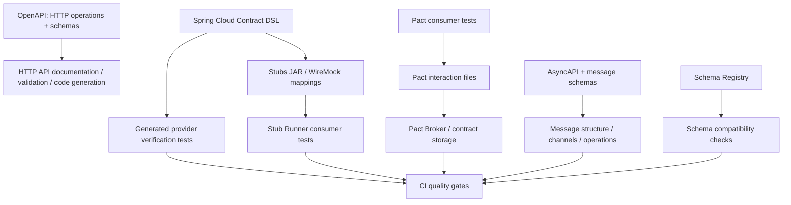
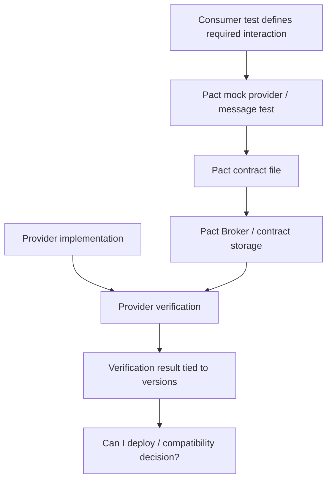
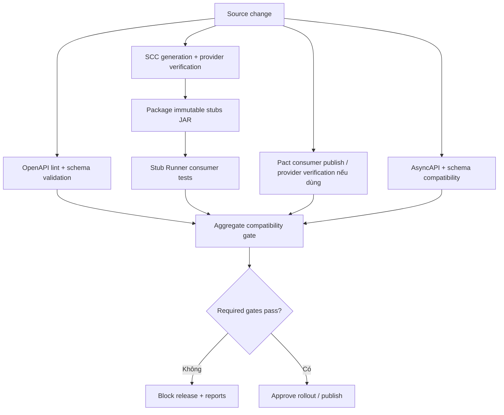

# Giới hạn tích hợp với OpenAPI, Pact và các công cụ hợp đồng khác

Trong một hệ thống microservices, cùng một giao diện có thể được mô tả ở nhiều nơi: **OpenAPI** cho HTTP API, **Spring Cloud Contract (SCC)** cho provider verification và stubs, **Pact** cho consumer-driven contract testing, **AsyncAPI** cho giao tiếp event-driven, hoặc **schema registry** để quản lý cấu trúc message. Các công cụ này giải quyết những phần việc liên quan nhưng không đồng nghĩa với nhau. Chuyển một file từ công cụ này sang công cụ khác không tự động giữ nguyên mọi quy tắc, ngữ nghĩa nghiệp vụ và bằng chứng kiểm thử.

SCC cho phép producer định nghĩa hành vi HTTP hoặc thông điệp bằng **Groovy/YAML DSL**, sinh **provider verification tests**, đóng gói **stubs JAR** và giúp consumer kiểm thử bằng **Stub Runner**. OpenAPI tập trung mô tả bề mặt HTTP, operation, parameters, schemas và security schemes. Pact tập trung ghi nhận những tương tác mà consumer cần và xác minh provider đáp ứng các tương tác đó. AsyncAPI và schema registry giải quyết những khía cạnh khác của event/message interface.

Bài thuộc chương **Tương thích công cụ**, với chủ đề **Giới hạn tích hợp với OpenAPI, Pact và các công cụ hợp đồng khác**. Mục tiêu là hiểu **điểm giao nhau, phần không thể chuyển đổi trực tiếp, rủi ro có nhiều nguồn sự thật và cách phối hợp chúng trong CI**. Ví dụ xuyên suốt dùng `order-producer` cung cấp `GET /api/orders/{id}` và event `OrderCreated` cho `checkout-consumer`.

**Nguyên tắc quan trọng:** không chọn công cụ theo tên gọi “contract” rồi kỳ vọng nó thay thế toàn bộ công cụ còn lại. Hãy xác định từng công cụ đang bảo vệ **schema, interaction, provider behavior, consumer compatibility hay vận hành message transport**.

## 1. Bức tranh tổng quan: các công cụ bảo vệ những lớp khác nhau



Sơ đồ cho thấy **các luồng có thể cùng tham gia một pipeline**, nhưng không phải mọi mũi tên đều là tính năng tích hợp tự động có sẵn trong SCC. CI orchestration, converter hoặc adapter có thể cần cấu hình riêng.

| Công cụ | Trọng tâm | Đầu ra/bằng chứng tiêu biểu | Không tự chứng minh |
| --- | --- | --- | --- |
| Spring Cloud Contract | Contract cases cho producer/consumer, provider tests và stubs | Generated tests, stubs JAR, Stub Runner results | Mọi API schema, mọi consumer expectation hoặc vận hành production |
| OpenAPI | Mô tả HTTP API, operations, parameters, request/response schemas | OpenAPI document, generated docs/client/server code, lint/validation results | Provider implementation thực thi mọi business rule hoặc consumer xử lý interaction thực tế |
| Pact | Consumer-driven interactions và provider verification | Pact files, verification results, Broker compatibility records | Toàn bộ schema/API chưa được consumer sử dụng hoặc mọi hành vi vận hành |
| AsyncAPI | Mô tả message-driven API: channels, operations, messages và bindings | AsyncAPI document, generated docs/code, validation | Broker delivery guarantees hoặc business side effects |
| JSON Schema / Avro / Protobuf | Cấu trúc và quy tắc dữ liệu | Schema artifacts, validation/compatibility results | HTTP method/status, consumer workflow hoặc message delivery |
| WireMock độc lập | HTTP request/response simulation | JSON mappings, request journal | Producer implementation đúng nếu không có provider verification |
| Postman collections | Ví dụ và kiểm thử API theo request/response | Collections, test results | Contract ownership và compatibility matrix đầy đủ giữa versions |

**Không có một công cụ duy nhất tự bao phủ tất cả các hàng trên.** Lựa chọn hợp lý là ghép công cụ theo ranh giới cần bảo vệ và tránh lặp cùng một quy tắc ở nhiều nơi mà không có cơ chế đồng bộ.

## 2. Spring Cloud Contract: nguồn hợp đồng có thể thực thi cho provider và consumer

Một HTTP contract Groovy:

```groovy
import org.springframework.cloud.contract.spec.Contract

Contract.make {
    description 'Đọc đơn hàng theo ID'

    request {
        method GET()
        url '/api/orders/1001'
        headers {
            header('Accept', 'application/json')
        }
    }

    response {
        status OK()
        headers {
            contentType(applicationJson())
        }
        body(
            id: 1001,
            status: 'CREATED',
            currency: 'VND'
        )
    }
}
```

Contract YAML tương đương:

```yaml
description: "Đọc đơn hàng theo ID"
request:
  method: GET
  url: /api/orders/1001
  headers:
    Accept: application/json
response:
  status: 200
  headers:
    Content-Type: application/json
  body:
    id: 1001
    status: CREATED
    currency: VND
```

Trong luồng producer-side phổ biến:

1. Producer team sở hữu hoặc review contract.
2. SCC đọc Groovy/YAML và sinh provider verification tests.
3. Producer chạy tests với implementation/test context thật.
4. SCC đóng gói stubs, thường dưới classifier `stubs`.
5. Consumer dùng Stub Runner để lấy stubs và gọi client/listener của mình.

### 2.1. SCC có cả DSL và runtime behavior

Contract có thể diễn tả request/response cụ thể, header, body, matcher và message interaction theo khả năng của phiên bản SCC đang dùng. Base test class có thể chuẩn bị producer test context; custom matcher/helper có thể bổ sung kiểm tra; WireMock mappings phục vụ consumer HTTP tests.

Điểm mạnh của SCC là **nối cùng một contract source với provider verification và stub artifact**. Tuy nhiên, một contract case không tự là mô tả đầy đủ của mọi operation/schema trong toàn bộ API. Muốn tài liệu API tổng thể, OpenAPI thường phù hợp hơn.

### 2.2. Một stub không phải server implementation

Stub Runner/WireMock mô phỏng những tương tác đã khai báo. Nó không tự chạy controller, database, gateway, authorization server, broker hoặc network policy của producer. Provider verification và các integration/security tests khác vẫn cần thiết.

## 3. OpenAPI: mô tả bề mặt HTTP, không phải bản sao của SCC DSL

OpenAPI mô tả API HTTP theo các khái niệm như:

- Paths và operations: `GET`, `POST`, `PUT`, `DELETE`.
- Parameters: path, query, header, cookie.
- Request body và response content.
- Schema của JSON/XML/form data.
- Status codes, headers và media types.
- Security schemes và security requirements.
- Tags, descriptions, examples, servers và metadata.

Ví dụ OpenAPI 3.x rút gọn:

```yaml
openapi: 3.1.0
info:
  title: Order API
  version: 1.0.0
paths:
  /api/orders/{id}:
    get:
      operationId: getOrder
      parameters:
        - name: id
          in: path
          required: true
          schema:
            type: integer
        - name: Accept
          in: header
          required: false
          schema:
            type: string
      responses:
        "200":
          description: Order found
          content:
            application/json:
              schema:
                type: object
                required: [id, status, currency]
                properties:
                  id:
                    type: integer
                  status:
                    type: string
                    enum: [CREATED, PAID, CANCELLED]
                  currency:
                    type: string
        "404":
          description: Order not found
```

Đây là ví dụ tài liệu API, không phải SCC YAML DSL. OpenAPI operation mô tả **một lớp thông tin rộng hơn một contract fixture**: schema có thể áp dụng cho nhiều ID và nhiều response instances. Ngược lại, một SCC contract có thể mô tả một case cụ thể và tạo ra provider test cùng stub mapping.

### 3.1. Khác nhau về mục tiêu

| Câu hỏi | OpenAPI | Spring Cloud Contract |
| --- | --- | --- |
| API có endpoint nào? | Rất phù hợp | Có thể thể hiện các contract cases, nhưng không thay tài liệu toàn diện |
| Request/response schema là gì? | Rất phù hợp | Có body/matcher cho các trường hợp được khai báo |
| Producer có thực thi case cụ thể đúng không? | Cần validator/test tooling bổ sung | Generated provider verification tests là luồng cốt lõi |
| Consumer có xử lý được response mẫu không? | Có thể dùng generated client/validator; cần test phù hợp | Stub Runner hỗ trợ consumer test với stubs |
| Business rule nhiều bước/stateful? | Không phải trọng tâm của schema operation | Có thể mô tả các contract cases; state phức tạp vẫn cần integration test |
| Stubs JAR để consumer CI tải? | Không phải đầu ra mặc định của OpenAPI | Là đầu ra phổ biến của SCC |

**OpenAPI document hợp lệ không đồng nghĩa producer implementation đã được kiểm chứng.** Một file mô tả `201` có thể đúng cú pháp nhưng controller vẫn trả `200` hoặc bỏ header `Location`.

### 3.2. OpenAPI security scheme không phải xác thực token thực

OpenAPI có thể mô tả bearer authentication:

```yaml
components:
  securitySchemes:
    bearerAuth:
      type: http
      scheme: bearer
      bearerFormat: JWT
security:
  - bearerAuth: []
```

Điều đó mô tả cách client cần gửi credential theo API specification. Nó không kiểm tra chữ ký JWT, issuer, audience, expiry, scope hoặc quyền sở hữu đơn hàng của producer. Những phần đó cần security integration tests và cấu hình runtime tương ứng.

## 4. Vì sao không thể chuyển đổi OpenAPI ↔ SCC một cách đầy đủ?

Có thể xây converter hoặc dùng tooling tích hợp cho một **tập con** các đặc tả, nhưng không nên giả định phép chuyển đổi tổng quát là lossless.

### 4.1. OpenAPI → SCC: thông tin có thể bị mất

Một OpenAPI document có thể chứa hàng trăm operations, schema composition, references, callbacks, webhooks, security requirements, examples và vendor extensions. Một SCC contract thường biểu diễn một hoặc một số **interaction cases** cụ thể.

| Thông tin OpenAPI | Có thể ánh xạ sang SCC? | Giới hạn |
| --- | --- | --- |
| HTTP method/path | Thường có | Path templating và parameterization cần xử lý |
| Header/query parameter | Có thể | Required/optional, style/explode, serialization cần giữ đúng |
| Request/response example | Thường có | Example chỉ là một fixture, không bao phủ toàn schema |
| JSON object schema | Một phần | Composition, recursion, discriminator và dialect có thể khó chuyển |
| Required fields | Có thể với matcher/test phù hợp | Cần kiểm tra generated assertion và missing/null semantics |
| Regex/pattern | Một phần | Regex dialect/flags và converter semantics có thể khác |
| Numeric range/format | Một phần | Format như date-time/decimal cần kiểm tra runtime behavior |
| Multiple responses/statuses | Có thể tạo nhiều contracts | Cần chọn request condition phân biệt, tránh mapping overlap |
| Security schemes | Không chuyển thành xác minh auth đầy đủ | Header matcher không xác minh token/permission |
| Callbacks/webhooks | Cần thiết kế riêng | Không phải luồng request-response thông thường |
| Links/operation relationships | Không tự thành workflow test | Cần integration/consumer workflow |
| Vendor extensions | Chỉ khi converter custom hiểu | Có thể mất hoàn toàn nếu bỏ qua |

### 4.2. SCC → OpenAPI: cũng mất ngữ nghĩa

Một SCC DSL có thể chứa:

- Một case cụ thể với body mẫu và dynamic matcher.
- Custom command/helper được gọi trong generated provider test.
- Base test class hoặc setup producer-specific.
- Trigger method cho message contract.
- Message destination/headers/body.
- Cấu hình build, packaging và stub generation.
- Những quy tắc test không phải schema công khai.

OpenAPI không có khái niệm trực tiếp tương đương **generated provider test kế thừa base class**, **Stub Runner** hay **WireMock scenario state**. Có thể chuyển một phần method/path/schema/status thành OpenAPI, nhưng không thể biến toàn bộ test setup thành API description mà vẫn giữ nguyên ý nghĩa.

### 4.3. Schema hợp lệ không đồng nghĩa behavior tương thích

Giả sử OpenAPI cho phép:

```json
{
  "id": 1001,
  "status": "CREATED",
  "currency": "VND"
}
```

Nhưng consumer cần thêm điều kiện: khi `status` là `CANCELLED`, trường `cancelReason` phải xuất hiện. Nếu schema tổng quát chỉ mô tả `status` là string và không thể hiện conditional rule, OpenAPI validation có thể pass trong khi business behavior không đáp ứng kỳ vọng. Có thể mô tả thêm schema constraints hoặc oneOf/conditional schemas tùy spec, nhưng **provider/consumer interaction tests vẫn cần kiểm tra đúng các trường hợp nghiệp vụ quan trọng**.

## 5. Pact: consumer-driven contract testing khác với producer-owned SCC workflow

Pact tập trung vào **những tương tác mà consumer thực sự cần**. Consumer viết tests với mock provider hoặc message provider; quá trình test tạo Pact contract file ghi nhận interactions. Provider sau đó chạy provider verification để xác nhận mình đáp ứng những interactions ấy. Pact Broker có thể lưu phiên bản Pact, provider verification results và hỗ trợ truy vấn compatibility giữa consumer/provider versions.

Luồng khái quát:



Đây là mô hình consumer-driven đặc trưng của Pact. SCC trong cách dùng phổ biến lại bắt đầu từ contract source do producer quản lý, sinh provider tests và stubs để consumer dùng. **Cả hai có thể kiểm thử provider/consumer, nhưng ownership, artifacts và workflow không giống nhau.**

### 5.1. Khác nhau về nguồn sự thật

| Khía cạnh | SCC phổ biến | Pact phổ biến |
| --- | --- | --- |
| Ai nêu interaction? | Producer contract mô tả behavior được cung cấp | Consumer test mô tả behavior consumer phụ thuộc |
| Artifact chính | Contract source, generated provider tests, stubs JAR | Pact interaction files |
| Provider verification | Generated từ SCC contracts | Chạy verifier trên Pact files |
| Consumer test | Stub Runner tải stubs | Pact mock provider/message provider |
| Phân phối | Maven/Gradle artifact repositories thường gặp | Pact Broker hoặc cơ chế lưu trữ Pact |
| Compatibility matrix | Có thể tổ chức qua artifact/CI orchestration | Broker cung cấp workflow/version-aware compatibility features |
| Phạm vi | HTTP và messaging theo SCC support/configuration | HTTP và async message theo ngôn ngữ/runtime support của Pact |

Các mô tả này nói về **workflow thường gặp**, không phải giới hạn tuyệt đối. SCC có thể được tổ chức theo consumer ownership; Pact có thể kết hợp provider-side tooling khác. Hãy xác minh phiên bản và plugin/runtime cụ thể của dự án.

### 5.2. Pact file không phải stubs JAR

Một Pact file ghi interactions mà consumer đã kiểm tra. Stubs JAR của SCC đóng gói mappings/resources để Stub Runner khởi chạy stub server hoặc message stubs. Hai artifact có thể chứa thông tin tương tự ở một số trường hợp HTTP, nhưng **không cùng format, lifecycle hay semantics**.

Không đưa Pact JSON vào Maven repository rồi kỳ vọng Stub Runner tự hiểu; cũng không đưa stubs JAR vào Pact Broker và kỳ vọng Pact verifier dùng trực tiếp như Pact file.

## 6. So sánh một interaction dưới ba góc nhìn

Yêu cầu: `checkout-consumer` gọi `GET /api/orders/1001`, gửi `Accept: application/json` và đọc `id`, `status`, `currency`.

### 6.1. OpenAPI mô tả operation/schema

```yaml
paths:
  /api/orders/{id}:
    get:
      operationId: getOrder
      parameters:
        - name: id
          in: path
          required: true
          schema:
            type: integer
      responses:
        "200":
          description: Order response
          content:
            application/json:
              schema:
                type: object
                required: [id, status, currency]
                properties:
                  id:
                    type: integer
                  status:
                    type: string
                  currency:
                    type: string
```

### 6.2. SCC mô tả một provider/consumer test case

```groovy
import org.springframework.cloud.contract.spec.Contract

Contract.make {
    description 'GET order 1001'
    request {
        method GET()
        url '/api/orders/1001'
        headers {
            header('Accept', 'application/json')
        }
    }
    response {
        status OK()
        headers {
            contentType(applicationJson())
        }
        body(
            id: 1001,
            status: 'CREATED',
            currency: 'VND'
        )
    }
}
```

### 6.3. Pact mô tả interaction consumer cần

Một consumer Pact test sẽ khai báo **provider state**, request method/path/headers và expected response; Pact mock provider phục vụ response đó trong consumer test rồi ghi interaction vào Pact file.

Mã khái niệm:

```text
given provider state "order 1001 exists"
upon receiving "a request for order 1001" from checkout-consumer
with:
  method = GET
  path = /api/orders/1001
  Accept = application/json
will respond with:
  status = 200
  Content-Type = application/json
  body.id = 1001
  body.status = CREATED
  body.currency = VND
```

Đây là **pseudocode mô tả ý nghĩa interaction**, không phải cú pháp Pact DSL cụ thể cho một ngôn ngữ. Pact có DSL/API riêng theo Java, JVM, JavaScript, .NET, Go và các ecosystem khác.

### 6.4. Điểm chung và điểm khác

Cả ba có thể cùng biểu diễn một request/response mẫu. Nhưng:

- OpenAPI mô tả operation/schema có phạm vi rộng.
- SCC có thể dùng case này để sinh provider verification test và stub mapping.
- Pact ghi nhận interaction consumer cần và xác minh provider đáp ứng interaction đó.

**Một ví dụ giống nhau không biến ba artifact thành một artifact.** Cần xem ai sở hữu, ai cập nhật và tool nào thực thi từng file.

## 7. Khi nào SCC và OpenAPI nên cùng tồn tại?

Một tổ chức có thể chọn:

- **OpenAPI là tài liệu public/API design source:** mô tả toàn bộ operations, parameters, schemas và security schemes.
- **SCC là executable provider contract suite:** kiểm tra những cases quan trọng với implementation producer và tạo stubs cho consumer CI.

Đây là cách phối hợp có ích nếu hai artifact có **trách nhiệm riêng và được đồng bộ có kiểm soát**.

### 7.1. Phân chia trách nhiệm mẫu

| Nội dung | Nguồn chủ trì | Công cụ xác minh |
| --- | --- | --- |
| Public endpoint list và mô tả operation | OpenAPI | Linter, OpenAPI validator |
| Request/response schema tổng quát | OpenAPI/schema | Schema validation, code generation tests |
| Một số provider behavior quan trọng | SCC contract | Generated provider tests |
| Consumer client behavior với stub | SCC stubs | Stub Runner consumer tests |
| JWT signature/permission thật | Security configuration/code | Security integration tests |
| p95 latency/availability | SLO documents | Load/observability tests |
| Message payload compatibility | AsyncAPI/schema registry tùy kiến trúc | Schema compatibility + message integration |
| Event retry/DLQ/ordering | Broker/consumer operational policy | Broker integration tests |

### 7.2. Không nên duy trì hai nguồn sự thật cho cùng một field mà không có quy tắc

Nếu `currency` là string trong OpenAPI nhưng SCC contract dùng number, cần có một quyết định rõ:

1. OpenAPI hay SCC là nguồn có thẩm quyền cho schema field?
2. Có converter/sync validation nào phát hiện drift?
3. Ai chịu trách nhiệm cập nhật cả hai khi đổi field?
4. Nếu một tài liệu được cập nhật còn tài liệu kia chưa cập nhật, CI có chặn merge không?

Không có câu trả lời, hai file dễ **cùng hợp lệ về cú pháp nhưng mâu thuẫn về API**.

## 8. Khi nào Pact và SCC nên cùng tồn tại?

Có thể có lý do hợp lệ để tổ chức dùng cả hai:

- Một số service dùng SCC theo producer-owned workflow.
- Một nhóm khác cần Pact Broker để kiểm soát compatibility matrix theo consumer/provider version.
- Một hệ thống cũ đã có Pact interactions, còn producer mới phát hành SCC stubs cho consumer tests.
- Tổ chức dùng SCC cho message contracts nhưng có consumer stack/SDK đã chuẩn hóa Pact.

Tuy nhiên, cần tránh **cùng một interaction được quản lý độc lập ở hai nơi mà không có owner**.

### 8.1. Chiến lược phối hợp có thể áp dụng

| Chiến lược | Mô tả | Điều kiện |
| --- | --- | --- |
| SCC primary, Pact cho boundary khác | Chọn SCC cho nhóm services đã dùng SCC; Pact cho nhóm consumer-driven độc lập | Ownership và phạm vi tách rõ |
| Pact primary, SCC cho provider stubs khác | Pact quản lý interactions; SCC chỉ dùng ở những consumer/producer chưa migrate | Không để hai bộ tests tranh quyền quyết định cùng một API |
| Coexistence trong giai đoạn migration | Chạy cả hai suites trên một số interactions quan trọng | Có ngày kết thúc, mapping giữa IDs/versions và drift gate |
| Converter một chiều | Sinh một artifact phụ từ canonical source | Chỉ hỗ trợ subset, report phần không chuyển được |
| Hai nguồn độc lập có review | Mỗi công cụ quản lý một tập interaction riêng | Cần phân vùng endpoint/consumer và ownership |

### 8.2. Không giả định có converter SCC ↔ Pact hoàn chỉnh

Có thể có thư viện hoặc tooling riêng cho một số phiên bản/ngôn ngữ, nhưng không nên mặc định SCC contract DSL có thể export thành Pact files hoặc Pact files có thể import thành Groovy/YAML contract mà giữ nguyên:

- Provider state setup.
- Dynamic matchers và matching rules.
- Header/body matching semantics.
- Message metadata và trigger behavior.
- Test helper/custom assertions.
- Versioning và ownership.
- Stubs JAR packaging/Stub Runner behavior.
- Pact Broker deployment compatibility metadata.

Nếu dự án viết converter, phải công bố **subset được hỗ trợ, phần bị bỏ qua và cảnh báo lossiness**. Không để converter báo success chỉ vì JSON/YAML parse được.

## 9. Pact Broker và Maven artifact repository giải quyết hai việc khác nhau

SCC stubs thường được lưu trong Maven/Gradle-compatible repository, ví dụ:

```text
com.example:order-producer:2.4.0:jar:stubs
```

Pact Broker lưu Pact contracts và verification results, thường liên kết consumer/provider versions và build metadata.

| Câu hỏi | Maven/Gradle artifact repository | Pact Broker |
| --- | --- | --- |
| Tải stubs JAR theo GAV/classifier | Có | Không phải chức năng cốt lõi |
| Lưu Pact interactions | Không phải format/lifecycle cốt lõi | Có |
| Lưu provider verification result theo Pact | Không tự động | Có workflow hỗ trợ |
| Compatibility matrix consumer/provider versions | Cần CI/metadata orchestration | Có khả năng hỗ trợ theo Broker features |
| No-redeploy / immutable artifact | Theo repository policy | Theo chính sách lưu trữ/versioning Pact |
| Stub Runner resolve stubs | Có thể dùng repository này | Không thay thế trực tiếp |

**Không thay một repository bằng repository còn lại chỉ vì cả hai đều lưu “contract artifact”.** Cần kiểm tra loại dữ liệu và hành động mà consumer/provider CI cần.

## 10. AsyncAPI: mô tả message API, không thay message delivery tests

AsyncAPI mô tả giao diện event/message-driven, chẳng hạn channels, operations, messages, headers, payload schemas và bindings theo giao thức được hỗ trợ.

Ví dụ AsyncAPI rút gọn:

```yaml
asyncapi: 3.0.0
info:
  title: Order Events
  version: 1.0.0
channels:
  ordersCreated:
    address: orders.created
    messages:
      orderCreated:
        $ref: '#/components/messages/OrderCreated'
operations:
  receiveOrderCreated:
    action: receive
    channel:
      $ref: '#/channels/ordersCreated'
    messages:
      - $ref: '#/channels/ordersCreated/messages/orderCreated'
components:
  messages:
    OrderCreated:
      name: OrderCreated
      contentType: application/json
      payload:
        type: object
        required: [eventId, eventType, schemaVersion, orderId]
        properties:
          eventId:
            type: string
          eventType:
            type: string
          schemaVersion:
            type: integer
          orderId:
            type: string
```

Ví dụ minh họa cấu trúc AsyncAPI 3.x; chi tiết references/operations/bindings phải tuân theo đúng version specification mà dự án sử dụng.

### 10.1. SCC message contract có mục tiêu khác

SCC message contract có thể mô tả một event producer phát ra khi trigger được gọi, với label, destination, headers và body. Provider verification kiểm tra producer phát message theo contract; Stub Runner/StubTrigger giúp consumer thử listener theo message fixture.

Ví dụ Groovy:

```groovy
import org.springframework.cloud.contract.spec.Contract

Contract.make {
    description 'Phát OrderCreated v1'
    label 'order_created_v1'

    input {
        triggeredBy('publishOrderCreated()')
    }

    outputMessage {
        sentTo('orders.created')
        headers {
            messagingContentType(applicationJson())
        }
        body(
            eventId: 'EVT-1001',
            eventType: 'OrderCreated',
            schemaVersion: 1,
            orderId: 'ORD-1001'
        )
    }
}
```

### 10.2. Giới hạn chuyển đổi AsyncAPI ↔ SCC

| Thành phần | AsyncAPI | SCC message contract |
| --- | --- | --- |
| Channel/destination | Mô tả channel/address | Có thể mô tả destination trong message contract |
| Message payload schema | Mô tả payload structure | Có body fixture và matchers cho case |
| Message headers | Có message headers | Có thể mô tả headers theo contract DSL |
| Operation send/receive | Mô tả giao tiếp | Contract có trigger/output hoặc input tùy scenario |
| Protocol binding | Có mô hình binding | Không phải mọi binding đều có biểu diễn trực tiếp tương đương |
| Broker ack/retry/DLQ | Không tự thực thi | Không tự được chứng minh bởi message stub |
| Provider trigger/setup | Không phải code test setup | Có thể dùng trigger method/base test |
| Consumer side effects | Không tự kiểm tra | Consumer listener test phải assert riêng |

AsyncAPI document hợp lệ không chứng minh consumer commit offset đúng, message không bị duplicate hay DLQ hoạt động. SCC message stub pass cũng không chứng minh mọi protocol binding trong AsyncAPI đã được triển khai đúng.

## 11. Schema Registry: tương thích cấu trúc không đồng nghĩa tương thích nghiệp vụ

Một schema registry (ví dụ cho Avro, Protobuf hoặc JSON Schema) giúp quản lý schema versions và kiểm tra compatibility theo policy như backward, forward hoặc full compatibility, tùy registry/format/configuration.

Ví dụ một event schema:

```json
{
  "type": "object",
  "required": [
    "eventId",
    "eventType",
    "schemaVersion",
    "orderId"
  ],
  "properties": {
    "eventId": {"type": "string"},
    "eventType": {"type": "string"},
    "schemaVersion": {"type": "integer"},
    "orderId": {"type": "string"},
    "campaignId": {"type": ["string", "null"]}
  }
}
```

Đây là JSON Schema minh họa, không phải Avro hoặc Protobuf schema. Schema registry compatibility check có thể phát hiện thay đổi cấu trúc bị policy cấm, nhưng **không biết mọi consumer sử dụng field theo ý nghĩa nghiệp vụ nào**.

### 11.1. Ví dụ schema pass nhưng business behavior sai

- `totalMinor` vẫn là integer nhưng producer đổi cách tính từ VND minor units sang đơn vị major units.
- `status` vẫn là string nhưng producer dùng `CANCELLED` trước khi consumer hỗ trợ.
- `eventId` vẫn là string nhưng mỗi retry tạo ID mới, làm consumer không deduplicate.
- `campaignId` vẫn optional nhưng producer đổi ý nghĩa từ campaign ID sang promotion label.

Schema type có thể không đổi, nhưng semantics đã thay đổi. Cần contract cases, consumer tests và domain decision để phát hiện.

### 11.2. Ví dụ business test pass nhưng schema evolution có rủi ro

Một SCC message contract chỉ có fixture `schemaVersion=1` và `orderId`. Producer thêm field required mới. Provider verification trên một fixture có thể pass nếu test data được cập nhật, nhưng consumer cũ có thể không parse được message mới.

Cần chạy **schema compatibility gate** và các consumer tests trên candidate schema/message, không chỉ provider test của producer.

## 12. JSON Schema và OpenAPI Schema không luôn thay thế nhau

OpenAPI 3.0 có Schema Object với tập khả năng và quy tắc riêng; OpenAPI 3.1 cập nhật mô hình Schema Object dựa trên JSON Schema vocabularies/dialect. Dù gần nhau hơn, **không nên giả định mọi JSON Schema file có thể chèn vào mọi OpenAPI version mà không điều chỉnh**.

Khi tích hợp schema validator vào SCC:

- Xác định dialect/version của schema.
- Kiểm tra `$ref` resolution và base URI.
- Kiểm tra `nullable`/null semantics theo version.
- Kiểm tra `format` có chỉ là annotation hay được validator enforce.
- Kiểm tra `oneOf`/`anyOf`/`allOf`, discriminator và recursive refs.
- Kiểm tra date/time/number serialization.
- Xác định validator chạy ở provider, consumer hay cả hai.

**Schema validation bổ sung cho contract interaction tests**. Nó không thay provider verification hoặc Stub Runner consumer behavior tests.

## 13. WireMock: định dạng stub chung không làm các contract tools tương đương

SCC HTTP stubs thường dựa trên WireMock mappings. WireMock độc lập cũng có thể được nhóm viết JSON mappings thủ công.

Ví dụ mapping:

```json
{
  "request": {
    "method": "GET",
    "urlPath": "/api/orders/1001",
    "headers": {
      "Accept": {
        "contains": "application/json"
      }
    }
  },
  "response": {
    "status": 200,
    "headers": {
      "Content-Type": "application/json"
    },
    "jsonBody": {
      "id": 1001,
      "status": "CREATED",
      "currency": "VND"
    }
  }
}
```

Một mapping JSON có thể chạy trong WireMock standalone. Nhưng nếu mapping không đi qua SCC generation/provider verification, **không có bằng chứng producer implementation đã được kiểm tra bằng chính mapping đó**.

### 13.1. SCC-generated mapping và mapping viết tay

| Khía cạnh | SCC-generated | WireMock viết tay |
| --- | --- | --- |
| Nguồn | Groovy/YAML contract | JSON/Java mapping |
| Provider verification liên kết | Có trong workflow SCC được cấu hình | Không tự có |
| Consumer HTTP simulation | WireMock mapping qua stubs | WireMock trực tiếp |
| Ownership | Thường producer contract repository | Repo test/consumer/platform tùy team |
| Custom behavior | Matcher/configuration/extensions SCC/WireMock | Toàn bộ khả năng WireMock theo version |
| Rủi ro drift | DSL và generated output có thể lệch nếu không kiểm tra | Mapping và producer implementation dễ tách rời |

Có thể dùng WireMock để mock external dependencies không thuộc producer mà không cần SCC. Nhưng với service boundary cần contract verification, hãy giữ **nguồn mapping và provider evidence** có thể truy vết.

### 13.2. Pact mock server cũng không phải WireMock mapping

Pact mock provider được điều khiển bởi Pact interaction và matching rules của Pact. Dù cả Pact và WireMock đều có thể nhận HTTP request và trả response, không thể mặc định import một mapping JSON từ bên này sang bên kia rồi giữ nguyên matching semantics, provider state hoặc lifecycle.

## 14. Công cụ kiểm thử API khác: Postman, Dredd, Schemathesis và code generators

Một hệ sinh thái có thể dùng các công cụ bổ trợ:

- **Postman/Newman:** lưu collection request và chạy kiểm tra response theo kịch bản.
- **OpenAPI validators/fuzzers:** kiểm tra response/request có tuân schema hoặc sinh biến thể request.
- **Code generators:** sinh API client/server interfaces từ OpenAPI.
- **Mock server generators:** phục vụ response examples/schema.
- **Consumer integration tests:** gọi service qua HTTP thật trong test environment.
- **WireMock/Testcontainers:** mô phỏng dependency hoặc dựng hạ tầng kiểm thử.

Các công cụ này không tự trở thành nguồn contract chung. Một Postman collection có thể chứa ví dụ login, create order và cancel order nhưng chưa chắc biểu diễn ownership/versioning/compatibility giống Pact hoặc SCC.

### 14.1. Fuzz/schema tests bổ sung gì?

OpenAPI-based fuzzing có thể thử nhiều input ranh giới dựa trên schema. Nó giúp phát hiện parser/validation bugs, nhưng không biết tất cả business rules hoặc consumer expectations nếu không có assertions bổ sung.

SCC contract cases có thể bảo vệ những tương tác quan trọng đã thống nhất, nhưng không tự sinh vô hạn request variants từ toàn bộ schema. Kết hợp hai cách có thể hữu ích: **schema fuzzing cho độ rộng input, contract tests cho behavior cụ thể**.

### 14.2. Code generation không phải verification

Sinh Java client từ OpenAPI không chứng minh client dùng đúng auth, retry, idempotency hoặc xử lý mọi error status. Sinh server interface cũng không chứng minh implementation đáp ứng schema. Cần compile, validation, provider tests và consumer tests thích hợp.

## 15. gRPC và giao thức không phải HTTP JSON

SCC tập trung vào HTTP và messaging theo các integration được hỗ trợ. Nếu service dùng **gRPC/Protocol Buffers**, các đặc tính như service/method descriptors, protobuf field numbers, streaming, deadlines, status codes và metadata không thể ánh xạ nguyên vẹn thành một HTTP JSON contract đơn giản.

Có thể sử dụng:

- `.proto` files làm schema/API source.
- Descriptor/reflection tooling để kiểm tra service shape.
- Protobuf compatibility checks.
- gRPC integration tests với test server/client.
- Specialized consumer-driven contract tools nếu hệ sinh thái hỗ trợ.

**Không biến một gRPC method thành `POST /rpc` trong SCC rồi tuyên bố đã kiểm tra toàn bộ gRPC semantics.** Nếu có gateway chuyển gRPC sang HTTP/JSON, test gateway contract và gRPC backend contract là hai ranh giới khác nhau.

## 16. Những ngữ nghĩa khó chuyển đổi: matcher, dynamic values và provider states

Một lý do chính khiến converter không lossless là **matching semantics**.

| Khái niệm | SCC | OpenAPI | Pact |
| --- | --- | --- | --- |
| Concrete example | Request/response body fixture | `example`/`examples` | Interaction body |
| Pattern/regex matcher | Có matcher theo DSL/version | Schema `pattern` cho string | Matching rules theo Pact implementation |
| Optional field | Body/matcher/schema behavior | `required`/schema rules | Consumer interaction/matching rules |
| Dynamic response value | Producer/consumer-side matcher hoặc helper tùy DSL | Schema mô tả shape, không sinh runtime value | Provider states/generators tùy implementation |
| Provider state/setup | Base class/trigger/configuration | Không phải khái niệm chính | Provider states là phần quan trọng |
| Custom assertion | Helper/command trong generated tests | Không nằm trong API document | Có thể dùng provider/consumer test code |
| Stateful scenario | Có thể cấu hình qua WireMock/custom test setup | Không mô tả runtime sequence đầy đủ | Interactions/provider states có workflow riêng |

### 16.1. Ví dụ matcher không tương đương

SCC có thể dùng regex cho mã đơn:

```groovy
bodyMatchers {
    jsonPath('$.id', byRegex('^ORD-[0-9]{4}$'))
}
```

OpenAPI schema có thể dùng:

```yaml
id:
  type: string
  pattern: '^ORD-[0-9]{4}$'
```

Hai biểu diễn có thể cùng ý định về format, nhưng phải kiểm tra:

- JSONPath có tồn tại và xử lý null/missing ra sao?
- Regex engine/flags có cùng semantics?
- Pattern chỉ áp dụng ở provider test hay cả stub request matching?
- Schema validator có thực sự enforce `pattern`?
- Consumer/Pact matching có xử lý field optional tương tự không?

**Cùng một regex text chưa chắc tạo cùng kết quả trên mọi toolchain.**

### 16.2. Provider state không phải response example

Pact provider state thường chuẩn bị dữ liệu hoặc điều kiện phía provider trước khi verify interaction. OpenAPI example chỉ là ví dụ dữ liệu; SCC base test/trigger có thể setup producer test fixture. Không chuyển provider state thành một JSON example rồi nghĩ test đã chuẩn bị database/identity/session tương ứng.

## 17. Error semantics: status code giống nhau chưa đủ

Một response `404` có thể mang các nghĩa:

- Resource không tồn tại.
- Resource tồn tại nhưng người gọi không được phép biết.
- Stub request không match mapping.
- Gateway không tìm thấy route.
- Consumer đang gọi nhầm host/port.

OpenAPI có thể mô tả các response status và error schemas; SCC có thể tạo contract cases và provider tests; Pact có thể ghi interaction mà consumer yêu cầu. Nhưng **ý nghĩa nghiệp vụ và security policy cần được các nhóm thống nhất**.

Ví dụ OpenAPI response:

```yaml
responses:
  "404":
    description: Order not found
    content:
      application/json:
        schema:
          type: object
          required: [code]
          properties:
            code:
              type: string
              enum: [ORDER_NOT_FOUND]
```

SCC contract cho case tương ứng có thể:

```groovy
Contract.make {
    request {
        method GET()
        url '/api/orders/9999'
    }
    response {
        status NOT_FOUND()
        headers {
            contentType(applicationJson())
        }
        body(
            code: 'ORDER_NOT_FOUND'
        )
    }
}
```

Hai artifact có thể mô tả cùng error shape, nhưng provider verification vẫn phải chứng minh implementation trả error đúng trong điều kiện fixture. Consumer tests cần assert nhánh xử lý lỗi. WireMock unmatched 404 không được xem là bằng chứng tương đương.

## 18. Contract ownership: tránh nhiều nguồn sự thật không ai chịu trách nhiệm

Khi cùng một endpoint xuất hiện trong OpenAPI, SCC và Pact, cần một bảng ownership:

| Tài sản | Owner | Quy trình thay đổi |
| --- | --- | --- |
| OpenAPI document | API/producer team hoặc API governance | Review schema/operations và publish docs |
| SCC contract source | Producer team hoặc contract owner đã chỉ định | Provider verification và stubs publication |
| Pact consumer contract | Consumer team tạo; provider team verify | Publish Pact, verify và ghi version result |
| AsyncAPI document | Event/API owner | Review channels/messages/bindings |
| Schema Registry schema | Data/event owner | Register schema và compatibility gate |
| Shared mapping/converter | Platform/tooling team | Versioning, compatibility tests, release notes |

### 18.1. Mỗi quy tắc nên có một nguồn chủ trì

Ví dụ `Order.status`:

- OpenAPI định nghĩa type và enum được công bố.
- SCC có cases cho `CREATED`, `PAID` và error behavior.
- Pact ghi interactions mà checkout consumer cần.
- Consumer code có fallback cho enum chưa biết nếu policy yêu cầu.

Đó có thể là bốn tài sản hợp lệ, nhưng phải có **một nơi quyết định semantics chuẩn** và cơ chế phát hiện drift. Nếu mỗi repo tự thay enum theo nhu cầu riêng, các file không còn mô tả cùng API.

### 18.2. Không biến tài liệu public thành bộ kiểm thử duy nhất

OpenAPI rất hữu ích làm API source, nhưng nếu CI chỉ lint OpenAPI mà không chạy provider verification/consumer tests, implementation vẫn có thể lệch. Ngược lại, chỉ có SCC contracts mà không có tài liệu operations/schema đầy đủ có thể khiến external consumers khó khám phá API.

Chọn công cụ theo người dùng và mục tiêu của tài sản.

## 19. Chiến lược đồng bộ: generate, validate hoặc review thủ công

Có ba kiểu phối hợp:

### 19.1. Một nguồn sinh artifact phụ

Ví dụ OpenAPI là canonical schema, sau đó pipeline sinh client/docs và tạo một số SCC contracts từ danh sách examples đã chọn. Converter phải:

- Chỉ nhận subset được hỗ trợ.
- Báo field/construct không thể chuyển.
- Giữ data types, required/null semantics, headers và response status.
- Tạo output deterministic.
- Có fixtures kiểm thử converter.
- Không tự publish khi gặp construct bị bỏ qua.

### 19.2. Hai nguồn riêng nhưng có drift validation

OpenAPI và SCC được viết riêng; CI đọc cả hai và so một subset quan trọng: path, method, status, media type, schema field names/types. Khi lệch, CI yêu cầu review. Đây là **drift detection**, không phải full semantic equivalence.

### 19.3. Review mapping thủ công

Khi có provider states, custom matcher, extension hoặc message triggers phức tạp, một phần semantics có thể không thể biểu diễn ở tool khác. Ghi rõ phần nào được chia sẻ, phần nào được xác minh riêng và ai chịu trách nhiệm.

**Không dùng “file sinh tự động” làm lý do bỏ review.** Converter có thể tạo output hợp lệ về cú pháp nhưng bỏ mất security, dynamic matcher hoặc business semantics.

## 20. Một ma trận tích hợp trong CI/CD

Pipeline có thể chạy nhiều quality gates:



Một gate mẫu:

| Gate | Điều kiện đạt | Điều kiện fail |
| --- | --- | --- |
| OpenAPI lint | Spec parse và rule governance pass | Invalid refs, missing required metadata |
| OpenAPI schema validation | Request/response examples hợp schema | Type/required/response mismatch |
| SCC generation | Contracts được discover và generate | Parse error hoặc zero contracts bất thường |
| SCC provider verification | Generated tests thực sự run/pass | Assertion fail, tests skipped |
| Stubs packaging | JAR classifier/version và mapping đúng | Thiếu mappings hoặc artifact stale |
| Stub Runner consumer tests | Consumer client thật pass với candidate | Request/response mismatch |
| Pact verification (nếu dùng) | Required Pact interactions verified | Provider verification fail hoặc result thiếu |
| AsyncAPI/schema gate | Schema/bindings và compatibility policy pass | Breaking schema change |
| Release gate | Tất cả gates bắt buộc có kết quả | Missing/failed/incomplete evidence |

### 20.1. Không cộng các kết quả thành một tỷ lệ pass

Nếu 9/10 consumer tests pass nhưng một consumer bắt buộc fail, release có thể phải block. Compatibility decision phụ thuộc **required consumer list và policy**, không phải phần trăm xanh chung.

### 20.2. Giữ artifact identity trong mọi report

Với SCC, consumer report nên ghi:

- Producer commit và contract revision.
- GAV/type/classifier của stubs JAR.
- Repository/source và resolved version.
- SHA-256 của artifact thực tải.
- Stub Runner mode và runtime version.
- Consumer commit và test report.

Với Pact, giữ consumer/provider versions và Pact verification result theo workflow Broker. Với OpenAPI, giữ spec revision/digest đã validate. Với schema registry, giữ schema ID/version và compatibility result.

Không gắn một consumer pass vào candidate khác chỉ vì cả hai có cùng tên service.

## 21. Những anti-pattern tích hợp thường gặp

| Anti-pattern | Vì sao nguy hiểm | Cách khắc phục |
| --- | --- | --- |
| Tự động chuyển toàn bộ OpenAPI thành SCC rồi không review | Converter có thể mất semantics | Chỉ chuyển subset, báo loss và kiểm thử output |
| Duy trì OpenAPI và SCC độc lập không owner | Schema drift | Canonical source/ownership và drift gate |
| Coi Pact file là stubs JAR | Artifact/lifecycle khác nhau | Dùng tool tương ứng hoặc adapter có kiểm chứng |
| Cùng interaction được viết độc lập trong Pact và SCC | Duplicate source of truth | Chia scope hoặc migration window |
| OpenAPI lint pass là đủ | Chưa xác minh implementation | Provider verification và consumer tests |
| Pact Broker publish nghĩa API đã đúng | Pact file có thể chứa assumption sai hoặc provider chưa verify | Kiểm tra verification result và consumer ownership |
| Schema Registry compatibility pass là đủ | Không kiểm tra business semantics/delivery | Contract/message integration tests |
| WireMock mapping viết tay nhưng không provider test | Stub có thể lệch implementation | Nối mapping với provider verification hoặc xác định external mock |
| Dùng example như toàn bộ schema | Không bao phủ values/optional/errors | Schema validation và matcher cases |
| Chỉ test happy path | Bỏ qua lỗi/security/compatibility | Negative interactions và error contracts |
| Gộp HTTP và broker semantics | Dùng sai công cụ | Thêm broker/DB integration tests |
| Consumer test dùng `latest` | Không tái lập | Pin version và digest |

## 22. Quy trình chọn công cụ cho một API mới

Trước khi tạo file, trả lời:

1. Giao diện là HTTP request/response, message/event hay RPC?
2. Cần **mô tả toàn API** cho developer/external users hay chỉ kiểm tra interaction cụ thể?
3. Producer team hay consumer team chịu trách nhiệm đề xuất interaction?
4. Cần provider verification, consumer stub testing hay cả hai?
5. Có nhiều consumer cần compatibility matrix theo version không?
6. Có schema registry hoặc AsyncAPI đã là canonical source không?
7. Có custom matcher/stateful behavior không?
8. Công cụ hiện tại hỗ trợ ngôn ngữ/build/runtime của service không?
9. Ai sở hữu converter/drift checks nếu có?
10. Release gate cần evidence gì?

### 22.1. Decision guide

| Nhu cầu chính | Lựa chọn thường phù hợp |
| --- | --- |
| Public HTTP API docs/schema | OpenAPI |
| Producer-owned HTTP/message contracts, provider tests và stubs | Spring Cloud Contract |
| Consumer-driven interactions và version compatibility workflow | Pact |
| Message channels/operations/schema documentation | AsyncAPI |
| Schema evolution cho Avro/Protobuf/JSON Schema | Schema Registry + compatibility policy |
| Stateful HTTP dependency simulation | WireMock hoặc SCC stubs với cấu hình phù hợp |
| Broker delivery, ordering, retry, DLQ | Broker integration tests |
| RPC/gRPC method/schema compatibility | Protobuf/gRPC-specific tooling |

Có thể chọn **nhiều hơn một công cụ** nếu mỗi công cụ có vai trò rõ và CI kết nối được bằng chứng.

## 23. Migration từ một công cụ sang công cụ khác

Không nên migrate toàn bộ service chỉ bằng một script chuyển file.

Một quy trình từng bước:

1. **Inventory:** liệt kê OpenAPI/Pact/SCC/AsyncAPI/schema artifacts đang tồn tại.
2. **Ownership:** xác định team và source of truth cho từng interface.
3. **Coverage:** liệt kê interactions hiện được test, required consumers và error paths.
4. **Gap analysis:** đối chiếu constructs có thể chuyển và phần không thể chuyển.
5. **Pilot:** chọn một endpoint/event ít rủi ro nhưng có đủ matcher/error cases.
6. **Dual-run có thời hạn:** chạy old và new tool trên cùng candidate, so behavior.
7. **Drift gate:** chặn nếu hai nguồn lệch ở những quy tắc canonical.
8. **Consumer rollout:** cập nhật consumers theo compatibility matrix.
9. **Deprecation:** thông báo thời điểm dừng artifact/tool cũ.
10. **Cleanup:** chỉ xóa nguồn cũ sau khi required consumers và release workflow đã chuyển.

### 23.1. Không bỏ provider verification trong giai đoạn migration

Nếu nhóm chuyển từ SCC sang Pact, cần quyết định ai xác minh provider behavior sau khi generated SCC tests không còn chạy. Nếu chuyển từ Pact sang SCC, cần bảo đảm consumer-driven requirements vẫn được thu thập và không bị mất khi producer sở hữu contract source.

Migration thành công là **bảo toàn coverage và ownership**, không phải chỉ chuyển file sang format mới.

### 23.2. Có thể giữ hai công cụ vĩnh viễn không?

Có thể, nếu scope rõ: OpenAPI cho documentation, SCC cho provider/consumer stubs, Pact cho một boundary consumer-driven khác, AsyncAPI/schema registry cho events. Nhưng nếu hai công cụ định nghĩa cùng một response field độc lập, cần quy trình đồng bộ. **Coexistence có chủ đích khác với duplication không kiểm soát.**

## 24. Bài tập: xây một ma trận tương thích cho order service

Chuẩn bị một producer `order-producer`, consumer `checkout-consumer` và một API/event đơn giản. Thực hành:

1. Viết OpenAPI document cho `GET /api/orders/{id}`, schema response và các status 200/404.
2. Viết một SCC Groovy contract cho `GET /api/orders/1001`.
3. Sinh provider verification tests và xác nhận producer implementation thực thi đúng.
4. Đóng gói stubs JAR và chạy consumer bằng Stub Runner với client thật.
5. Viết một Pact consumer interaction cho cùng endpoint trong một project/branch thử nghiệm.
6. Chạy Pact provider verification theo toolchain Pact của dự án.
7. So sánh OpenAPI example, SCC fixture và Pact interaction: method/path/header/body/status nào giống nhau?
8. Thêm `campaignId` optional vào OpenAPI nhưng chưa cập nhật SCC/Pact; tạo drift check để phát hiện.
9. Đổi `currency` từ string sang number trong một artifact; xem gate nào phát hiện mâu thuẫn.
10. Thêm `403` cho tenant không có quyền; xác định schema, SCC case và consumer interaction cần cập nhật.
11. Viết AsyncAPI document cho `OrderCreated` event.
12. Viết SCC message contract có label `order_created_v1`.
13. Xác định schema registry compatibility policy nếu event dùng Avro/Protobuf/JSON Schema.
14. Thử đổi `schemaVersion` hoặc xóa field required; ghi nhận schema gate và message consumer tests.
15. Viết một converter nhỏ cho subset method/path/status/body example nếu cần; trả báo cáo rõ phần bị bỏ qua.
16. Thêm test cho converter với nested object, arrays, null/absent và regex.
17. Thử đưa Pact JSON vào Stub Runner hoặc stubs JAR vào Pact verifier trong một môi trường disposable; ghi rõ vì sao artifact không tương thích trực tiếp.
18. Tạo CI pipeline có OpenAPI validation, SCC provider verification, Stub Runner consumer tests và Pact verification nếu dùng.
19. Lưu commit/version/digest cho từng artifact.
20. Viết ownership matrix: ai sửa OpenAPI, SCC contract, Pact file, AsyncAPI và schema registry?
21. Đặt release gate chặn khi một required consumer hoặc schema compatibility gate fail.
22. Viết migration plan nếu team muốn bỏ một trong các công cụ.

### 24.1. Bảng tự đánh giá

| Năng lực | Bằng chứng đạt |
| --- | --- |
| Phân biệt mục tiêu | Nêu được SCC, OpenAPI, Pact và AsyncAPI giải quyết phần nào |
| OpenAPI | Đọc operation/schema/security mà không nhầm với runtime verification |
| SCC | Hiểu generated provider tests, stubs JAR và Stub Runner |
| Pact | Giải thích consumer interactions, provider verification và Broker workflow |
| Chuyển đổi | Chỉ ra constructs mất ngữ nghĩa khi convert |
| Schema Registry | Phân biệt structural compatibility và business behavior |
| WireMock | Không nhầm mapping simulation với provider correctness |
| Messaging | Phân biệt AsyncAPI/schema với broker delivery semantics |
| Ownership | Có canonical source và người chịu trách nhiệm |
| CI | Có gates riêng và giữ artifact identity |
| Migration | Có pilot, dual-run, compatibility window và deprecation |

## 25. Kết luận: tích hợp công cụ bằng ranh giới và bằng chứng

**Spring Cloud Contract, OpenAPI, Pact, AsyncAPI và schema registries có thể bổ trợ nhau, nhưng không phải những định dạng thay thế trực tiếp.**

- **OpenAPI** mô tả HTTP API và schema ở mức tổng thể.
- **Spring Cloud Contract** nối contract cases với generated provider tests, stubs JAR và Stub Runner.
- **Pact** ghi nhận interactions mà consumer cần và hỗ trợ provider verification/version compatibility workflow.
- **AsyncAPI** mô tả message-driven interface.
- **Schema Registry** quản lý schema versions và compatibility policy.
- **WireMock** mô phỏng HTTP requests/responses; nó không tự xác minh producer implementation.

Khi kết hợp chúng, hãy giữ năm nguyên tắc:

1. **Một nguồn chủ trì cho mỗi quy tắc:** tránh nhiều file cùng quyết định một field mà không có drift gate.
2. **Không kỳ vọng converter lossless:** liệt kê subset hỗ trợ, semantics bị bỏ qua và cảnh báo.
3. **Kiểm thử đúng tầng:** schema validation, provider verification, consumer interaction, security và broker integration có mục tiêu khác nhau.
4. **Giữ ownership và version:** biết team nào cập nhật artifact và consumer đang kiểm tra phiên bản nào.
5. **Release theo evidence:** không coi một tài liệu parse được hoặc một stub trả 200 là bằng chứng đầy đủ về compatibility.

Khi phân định rõ trách nhiệm, nhóm có thể dùng **OpenAPI để mô tả**, **SCC để kiểm chứng producer và phân phối stubs**, **Pact để bảo vệ consumer-driven interactions** và các công cụ message/schema cho đúng phạm vi. Điều quan trọng là giữ cho mọi kết quả CI cùng nói về **một giao diện, một revision và một quyết định tương thích có thể truy vết**.
