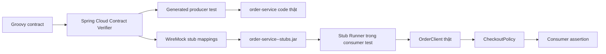
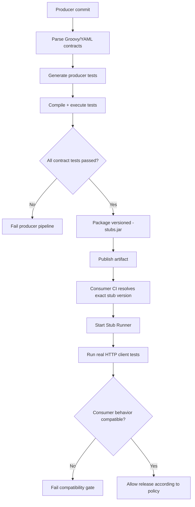
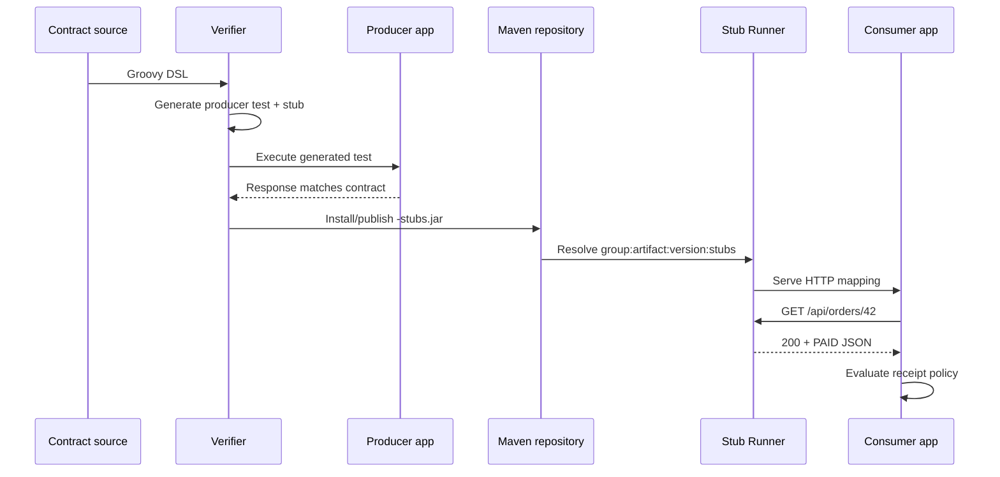

# Xây dựng producer HTTP và consumer với hợp đồng đầu tiên

## 1. Mục tiêu dự án

Trong bài thực hành tổng hợp này, bạn sẽ xây dựng hai ứng dụng Spring Boot độc lập để kiểm thử hợp đồng HTTP bằng **Spring Cloud Contract**:

- **`order-service` — producer:** cung cấp API đọc đơn hàng, định nghĩa hợp đồng bằng Groovy DSL, dùng Verifier sinh kiểm thử và phát hành stub artifact.
- **`checkout-service` — consumer:** dùng HTTP client thực tế để gọi order API, tải stub bằng **Stub Runner**, rồi kiểm tra hành vi nghiệp vụ dựa trên response.

Khi hoàn thành, bạn có thể chạy toàn bộ luồng:



**Kết quả cần chứng minh:** producer thật đáp ứng contract đã khai báo, stub được đóng gói từ contract đã xác minh, và consumer dùng chính HTTP client của mình để kiểm tra hành vi khi nhận response từ stub.

### 1.1. Sản phẩm bàn giao

| Sản phẩm | Nơi tạo | Tiêu chí hoàn thành |
|---|---|---|
| Producer REST API | `order-service` | `GET /api/orders/42` trả JSON đúng |
| Contract source | Producer test resources | Groovy DSL mô tả request/response |
| Producer base test | Producer test source | Fixture được tạo trước generated test |
| Generated producer test | Maven build output | Test được sinh, biên dịch, thực thi và đạt |
| Stub artifact | Maven local repository | `order-service:<version>:stubs` có mapping |
| Consumer HTTP client | `checkout-service` | Gọi API qua base URL cấu hình |
| Consumer contract test | Consumer test source | Stub Runner khởi động stub, client thật đọc response |
| Consumer business assertion | Consumer test | Order `PAID` cho phép xuất biên lai |

## 2. Kiến thức và công cụ cần có

Bạn nên biết:

- Java và Maven cơ bản.
- Spring Boot REST controller, dependency injection và JUnit 5.
- JSON request/response, HTTP status và headers.
- Cách đọc log build và test report.

Môi trường thực hành:

| Thành phần | Vai trò |
|---|---|
| JDK tương thích với Spring Boot đã chọn | Biên dịch/chạy hai ứng dụng |
| Maven Wrapper hoặc Maven cài sẵn | Build producer và consumer |
| Spring Boot | Tạo HTTP API và consumer client |
| Spring Cloud Contract Verifier | Sinh producer contract tests và stub |
| Spring Cloud Contract Stub Runner | Nạp stub artifact trong consumer test |
| JUnit 5 + AssertJ | Kiểm tra kết quả |
| Maven local repository | Trao stub artifact giữa hai project trên cùng máy |

**Phiên bản:** chọn một bộ Spring Boot và Spring Cloud Release Train tương thích, sau đó dùng cùng phiên bản Spring Cloud Contract cho plugin Verifier và Stub Runner. Các phiên bản plugin/dependency phải được quản lý nhất quán qua BOM hoặc properties của dự án. Không ghép ngẫu nhiên một plugin 4.x với starter thuộc release line khác.

Các ví dụ dưới đây dùng Maven và Java hiện đại. Những placeholder phiên bản phải được thay bằng bộ version đã được nhóm dự án xác nhận tương thích; không có một con số version duy nhất đúng cho mọi Spring Boot release.

## 3. Thiết kế hai project

Tạo một thư mục workspace:

```text
spring-cloud-contract-lab/
├── order-service/
│   ├── pom.xml
│   └── src/
│       ├── main/java/com/example/orders/
│       │   ├── OrderApplication.java
│       │   ├── OrderController.java
│       │   ├── OrderStore.java
│       │   ├── OrderService.java
│       │   └── OrderResponse.java
│       └── test/
│           ├── java/com/example/orders/contract/
│           │   └── OrderContractBase.java
│           └── resources/contracts/
│               └── order/
│                   └── get-paid-order.groovy
└── checkout-service/
    ├── pom.xml
    └── src/
        ├── main/java/com/example/checkout/
        │   ├── OrderClient.java
        │   ├── OrderResponse.java
        │   └── CheckoutPolicy.java
        └── test/java/com/example/checkout/
            └── CheckoutContractTest.java
```

Hai project có thể dùng **hai repository riêng** trong thực tế. Bài lab đặt cạnh nhau để dễ thực hành; producer được cài stub vào Maven local repository trước khi consumer chạy.

### 3.1. Luồng làm việc

1. Khai báo contract trong producer.
2. Viết base test để chuẩn bị trạng thái order `42`.
3. Chạy Maven để Verifier sinh và thực thi producer tests.
4. Cài artifact `-stubs.jar` vào local repository.
5. Consumer khai báo đúng tọa độ stub và khởi động Stub Runner.
6. Consumer client gọi runtime port của stub.
7. Kiểm tra DTO và business decision.

## 4. Tạo producer `order-service`

### 4.1. Tạo Maven project và cấu hình dependencies

File `order-service/pom.xml` là ví dụ cấu hình tối thiểu. Thay các placeholder bằng version phù hợp với Spring Boot/Spring Cloud Release Train của môi trường:

```xml
<project xmlns="http://maven.apache.org/POM/4.0.0"
         xmlns:xsi="http://www.w3.org/2001/XMLSchema-instance"
         xsi:schemaLocation="http://maven.apache.org/POM/4.0.0
         https://maven.apache.org/xsd/maven-4.0.0.xsd">
    <modelVersion>4.0.0</modelVersion>

    <groupId>com.example</groupId>
    <artifactId>order-service</artifactId>
    <version>1.0.0-SNAPSHOT</version>
    <name>order-service</name>

    <properties>
        <java.version>17</java.version>
        <spring-boot.version>REPLACE_WITH_COMPATIBLE_VERSION</spring-boot.version>
        <spring-cloud.version>REPLACE_WITH_COMPATIBLE_RELEASE_TRAIN</spring-cloud.version>
        <spring-cloud-contract.version>
            REPLACE_WITH_COMPATIBLE_CONTRACT_VERSION
        </spring-cloud-contract.version>
    </properties>

    <dependencyManagement>
        <dependencies>
            <dependency>
                <groupId>org.springframework.boot</groupId>
                <artifactId>spring-boot-dependencies</artifactId>
                <version>${spring-boot.version}</version>
                <type>pom</type>
                <scope>import</scope>
            </dependency>
            <dependency>
                <groupId>org.springframework.cloud</groupId>
                <artifactId>spring-cloud-dependencies</artifactId>
                <version>${spring-cloud.version}</version>
                <type>pom</type>
                <scope>import</scope>
            </dependency>
        </dependencies>
    </dependencyManagement>

    <dependencies>
        <dependency>
            <groupId>org.springframework.boot</groupId>
            <artifactId>spring-boot-starter-web</artifactId>
        </dependency>
        <dependency>
            <groupId>org.springframework.boot</groupId>
            <artifactId>spring-boot-starter-test</artifactId>
            <scope>test</scope>
        </dependency>
        <dependency>
            <groupId>org.springframework.cloud</groupId>
            <artifactId>spring-cloud-starter-contract-verifier</artifactId>
            <scope>test</scope>
        </dependency>
    </dependencies>

    <build>
        <plugins>
            <plugin>
                <groupId>org.apache.maven.plugins</groupId>
                <artifactId>maven-compiler-plugin</artifactId>
                <version>REPLACE_WITH_COMPATIBLE_MAVEN_COMPILER_PLUGIN_VERSION</version>
                <configuration>
                    <release>${java.version}</release>
                </configuration>
            </plugin>
            <plugin>
                <groupId>org.apache.maven.plugins</groupId>
                <artifactId>maven-surefire-plugin</artifactId>
                <version>REPLACE_WITH_JUNIT5_COMPATIBLE_SUREFIRE_VERSION</version>
            </plugin>
            <plugin>
                <groupId>org.springframework.boot</groupId>
                <artifactId>spring-boot-maven-plugin</artifactId>
                <version>${spring-boot.version}</version>
            </plugin>
            <plugin>
                <groupId>org.springframework.cloud</groupId>
                <artifactId>spring-cloud-contract-maven-plugin</artifactId>
                <version>${spring-cloud-contract.version}</version>
                <extensions>true</extensions>
                <configuration>
                    <baseClassForTests>
                        com.example.orders.contract.OrderContractBase
                    </baseClassForTests>
                    <testFramework>JUNIT5</testFramework>
                    <testMode>MockMvc</testMode>
                </configuration>
            </plugin>
        </plugins>
    </build>
</project>
```

**Giải thích:**

- `spring-boot-starter-web` cung cấp Spring MVC và JSON serialization.
- `spring-cloud-starter-contract-verifier` cung cấp thư viện kiểm thử contract ở test scope.
- `spring-cloud-contract-maven-plugin` tìm contract source, sinh test và hỗ trợ tạo stub artifact.
- `baseClassForTests` liên kết generated tests với fixture/setup chung.
- `testFramework` và `testMode` phải dùng giá trị được phiên bản plugin đang chọn hỗ trợ. Nếu plugin không nhận giá trị trên, đối chiếu tài liệu đúng version thay vì tự đổi các enum một cách ngẫu nhiên.

Nếu dự án đã dùng Spring Cloud BOM quản lý phiên bản Contract, tránh khai báo các phiên bản rời rạc làm lệch plugin và runtime dependencies.

POM trên dùng BOM qua `dependencyManagement` thay vì kế thừa Spring Boot parent, vì vậy **Maven plugin versions không tự được quản lý như khi dùng parent**. Hai plugin Compiler/Surefire được khai báo rõ để biên dịch Java 17 và khám phá JUnit 5; thay placeholder bằng version đã được nhóm build xác nhận.

### 4.2. Tạo Spring Boot application

File `OrderApplication.java`:

```java
package com.example.orders;

import org.springframework.boot.SpringApplication;
import org.springframework.boot.autoconfigure.SpringBootApplication;

@SpringBootApplication
public class OrderApplication {
    public static void main(String[] args) {
        SpringApplication.run(OrderApplication.class, args);
    }
}
```

### 4.3. Tạo response DTO

File `OrderResponse.java`:

```java
package com.example.orders;

public record OrderResponse(
    long id,
    String state,
    String currency
) {}
```

Record này biểu diễn response đơn hàng đơn giản. Trong hệ thống thực tế, DTO có thể có nhiều field hơn, nhưng contract chỉ nên khóa những field và semantics được API cam kết.

### 4.4. Tạo store và service

Để bài lab tập trung vào contract, ta dùng một in-memory store thay cho database. Store được seed bằng test fixture trước khi generated test gọi controller.

File `OrderStore.java`:

```java
package com.example.orders;

import java.util.Map;
import java.util.Optional;
import java.util.concurrent.ConcurrentHashMap;
import org.springframework.stereotype.Component;

@Component
public class OrderStore {
    private final Map<Long, OrderResponse> orders =
        new ConcurrentHashMap<>();

    public Optional<OrderResponse> findById(long id) {
        return Optional.ofNullable(orders.get(id));
    }

    public void save(OrderResponse order) {
        orders.put(order.id(), order);
    }

    public void clear() {
        orders.clear();
    }
}
```

File `OrderService.java`:

```java
package com.example.orders;

import java.util.Optional;
import org.springframework.stereotype.Service;

@Service
public class OrderService {
    private final OrderStore store;

    public OrderService(OrderStore store) {
        this.store = store;
    }

    public Optional<OrderResponse> findById(long id) {
        return store.findById(id);
    }
}
```

**Lưu ý:** in-memory store chỉ phù hợp bài lab. Khi chạy nhiều test classes song song hoặc dùng context chung, cần seed/reset state có kiểm soát. Không dùng chung một store mutable giữa các test không được cô lập.

### 4.5. Tạo HTTP controller

File `OrderController.java`:

```java
package com.example.orders;

import org.springframework.http.MediaType;
import org.springframework.http.ResponseEntity;
import org.springframework.web.bind.annotation.GetMapping;
import org.springframework.web.bind.annotation.PathVariable;
import org.springframework.web.bind.annotation.RequestMapping;
import org.springframework.web.bind.annotation.RestController;

@RestController
@RequestMapping(
    path = "/api/orders",
    produces = MediaType.APPLICATION_JSON_VALUE
)
public class OrderController {
    private final OrderService orderService;

    public OrderController(OrderService orderService) {
        this.orderService = orderService;
    }

    @GetMapping("/{id}")
    public ResponseEntity<?> getById(@PathVariable long id) {
        return orderService.findById(id)
            .<ResponseEntity<?>>map(ResponseEntity::ok)
            .orElseGet(() -> ResponseEntity.notFound().build());
    }
}
```

Ở phiên bản đầu, ta chỉ cần nhánh thành công để kiểm tra contract đầu tiên. Nhánh `404` sẽ được bổ sung ở phần mở rộng. API dùng JSON response và path variable kiểu `long`.

## 5. Viết hợp đồng Groovy đầu tiên

Tạo file:

```text
order-service/src/test/resources/contracts/order/get-paid-order.groovy
```

Nội dung:

```groovy
import org.springframework.cloud.contract.spec.Contract

Contract.make {
    description 'Lấy đơn hàng đã thanh toán theo ID'

    request {
        method GET()
        url '/api/orders/42'
        headers {
            header 'Accept', 'application/json'
        }
    }

    response {
        status OK()
        headers {
            contentType(applicationJson())
        }
        body(
            id: 42,
            state: 'PAID',
            currency: 'VND'
        )
    }
}
```

### 5.1. Đọc contract theo từng phần

| Khối | Nội dung | Ý nghĩa |
|---|---|---|
| `description` | Lấy đơn hàng đã thanh toán | Tên dễ hiểu khi review |
| `request.method` | `GET` | Consumer đọc dữ liệu |
| `request.url` | `/api/orders/42` | Đường dẫn cần được producer cung cấp |
| `request.headers` | `Accept: application/json` | Consumer yêu cầu JSON |
| `response.status` | `200 OK` | Request hợp lệ và order tồn tại |
| `response.headers` | `Content-Type: application/json` | Client chọn JSON decoder |
| `response.body` | `id/state/currency` | Dữ liệu consumer được phép phụ thuộc |

Contract này **không** mô tả port của producer, database, class Java hay cách service lưu order. Nó mô tả hành vi quan sát được qua HTTP.

### 5.2. Vì sao dùng ID cố định `42`?

Một giá trị cụ thể làm ví dụ dễ tái lập:

- Producer base test tạo order `42` với state `PAID`.
- Generated test gọi đúng `GET /api/orders/42`.
- Stub Runner tạo mapping tương ứng cho consumer.
- Consumer test gọi cùng path và kiểm tra response.

Nếu sau này API dùng ID động, có thể dùng matcher cho path parameter. Tuy nhiên, bài lab đầu tiên cố định ID để dễ hiểu toàn bộ đường đi trước khi thêm matcher.

## 6. Viết producer base class và fixture

Generated tests cần biết **cách khởi tạo ứng dụng producer** và **trạng thái dữ liệu** trước mỗi contract interaction.

Tạo file:

```text
order-service/src/test/java/com/example/orders/contract/OrderContractBase.java
```

Nội dung:

```java
package com.example.orders.contract;

import com.example.orders.OrderResponse;
import com.example.orders.OrderStore;
import io.restassured.module.mockmvc.RestAssuredMockMvc;
import org.junit.jupiter.api.BeforeEach;
import org.springframework.beans.factory.annotation.Autowired;
import org.springframework.boot.test.context.SpringBootTest;
import org.springframework.boot.test.autoconfigure.web.servlet.AutoConfigureMockMvc;
import org.springframework.web.context.WebApplicationContext;

@SpringBootTest(webEnvironment = SpringBootTest.WebEnvironment.MOCK)
@AutoConfigureMockMvc
public abstract class OrderContractBase {

    @Autowired
    protected WebApplicationContext context;

    @Autowired
    protected OrderStore orderStore;

    @BeforeEach
    public void setUp() {
        orderStore.clear();
        orderStore.save(new OrderResponse(42L, "PAID", "VND"));

        RestAssuredMockMvc.webAppContextSetup(context);
    }
}
```

### 6.1. Base class làm những việc gì?

1. `@SpringBootTest` khởi động Spring application context của producer.
2. `@AutoConfigureMockMvc` chuẩn bị môi trường MockMvc.
3. `OrderStore` được inject để tạo dữ liệu fixture.
4. Trước mỗi generated test, store được làm sạch và order `42` được tạo lại.
5. `RestAssuredMockMvc.webAppContextSetup(context)` kết nối generated HTTP assertions với web application context.

Generated test được cấu hình dùng `baseClassForTests` nên có thể kế thừa setup này. **Tên package/class phải khớp POM** và base class phải nằm trong test source.

### 6.2. Vì sao cần seed trước mỗi test?

Contract yêu cầu `GET /api/orders/42` trả order đã thanh toán. Nếu fixture không tồn tại, controller sẽ trả `404` và generated test thất bại. Đây là lỗi test setup nếu producer có logic đúng nhưng base class không tạo trạng thái yêu cầu.

Seed trước mỗi test giúp kịch bản có thể tái lập. Nếu có nhiều contract scenarios dùng các trạng thái khác nhau, mỗi scenario cần fixture tương ứng; không dựa vào test chạy trước để tạo dữ liệu.

**Lưu ý khi mở rộng:** `OrderStore` là mutable singleton trong Spring context. Nếu bật parallel execution cho generated tests, hai test có thể cùng clear/seed store và gây race. Bài lab ban đầu chạy tuần tự; khi tăng song song, hãy cô lập context/store hoặc quản lý test state phù hợp.

## 7. Chạy producer verification

Tại thư mục `order-service`, chạy:

```bash
mvn clean verify
```

Mục tiêu của bước này:

1. Maven compile code producer.
2. Spring Cloud Contract plugin đọc file Groovy.
3. Verifier sinh test source từ contract.
4. Generated test chạy qua base class và gọi controller thật trong MockMvc.
5. Assertion xác nhận status, header và response body.

### 7.1. Đọc kết quả build

Không chỉ nhìn dòng `BUILD SUCCESS`. Kiểm tra:

- Log cho thấy plugin phát hiện `get-paid-order.groovy`.
- Generated test class được tạo trong thư mục build output của plugin.
- Generated test được biên dịch.
- Surefire report có test tương ứng và trạng thái **executed/passed**.
- Không có generated contract test bị skip hoặc không được discovery.

Vị trí generated source/report có thể khác theo phiên bản plugin và cấu hình Maven. Hãy tìm trong `target/generated-test-sources` và `target/surefire-reports`, hoặc theo đường dẫn plugin ghi trong log.

### 7.2. Khi test thất bại, đọc lỗi theo tầng

| Lỗi | Nguyên nhân thường gặp | Cách xử lý |
|---|---|---|
| Contract không được phát hiện | Sai thư mục hoặc suffix | Kiểm tra `src/test/resources/contracts` và plugin config |
| Không tìm thấy base class | Sai FQN trong POM hoặc package | Sửa `baseClassForTests`/class path |
| HTTP status 404 | Fixture order 42 chưa được seed | Kiểm tra `OrderContractBase` |
| JSON body thiếu field | DTO/serialization hoặc controller trả sai | Kiểm tra response thực |
| Test compile fail | Generated test framework/config lệch | Căn phiên bản plugin, JUnit và dependencies |
| Build xanh nhưng không thấy generated test | Goal/filter/skip config không đúng | Kiểm tra log và Surefire reports |

### 7.3. Thử cố ý làm producer sai

Tạm sửa controller:

```java
// Chỉ dùng để thử nghiệm mutation trong nhánh lab:
return orderService.findById(id)
    .<ResponseEntity<?>>map(order ->
        ResponseEntity.status(202).body(order))
    .orElseGet(() -> ResponseEntity.notFound().build());
```

Chạy lại `mvn clean verify`. Generated contract test phải fail vì contract yêu cầu `200`. Sau khi quan sát failure, **khôi phục controller trả `200 OK`**.

Thử nghiệm này chứng minh producer verification đang chạy trên code thật. Nếu build vẫn xanh, hãy kiểm tra test generated có được thực thi hay không.

## 8. Tạo và kiểm tra stub artifact

Sau khi producer verification đạt, cài artifact vào Maven local repository:

```bash
mvn clean install
```

Trong workflow lab, `install` giúp project consumer trên cùng máy tìm được stub. Plugin Spring Cloud Contract được cấu hình đúng có thể attach artifact classifier `stubs` vào quá trình package/install.

**Đừng giả định** main application JAR và stub JAR là cùng một file. Consumer Stub Runner cần artifact stub theo classifier.

### 8.1. Tọa độ stub

Với POM mẫu:

```text
groupId    = com.example
artifactId = order-service
version    = 1.0.0-SNAPSHOT
classifier = stubs
```

Tọa độ consumer dùng:

```text
com.example:order-service:1.0.0-SNAPSHOT:stubs
```

Tên JAR thường tương tự:

```text
order-service-1.0.0-SNAPSHOT-stubs.jar
```

### 8.2. Kiểm tra nội dung artifact

Nếu artifact được cài trong Maven local repository mặc định trên Unix-like:

```bash
jar tf "$HOME/.m2/repository/com/example/order-service/1.0.0-SNAPSHOT/order-service-1.0.0-SNAPSHOT-stubs.jar"
```

Nếu máy dùng custom `localRepository`, hãy tìm theo đường dẫn cấu hình thực tế. Kiểm tra JAR có mapping liên quan `GET /api/orders/42` và body chứa:

```json
{
  "id": 42,
  "state": "PAID",
  "currency": "VND"
}
```

Cấu trúc thư mục trong JAR phụ thuộc cách plugin đóng gói và phiên bản; **liệt kê nội dung thật** thay vì giả định mapping luôn nằm ở một đường dẫn cố định.

### 8.3. Nếu không thấy classifier `stubs`

Kiểm tra:

1. Plugin version có tương thích với Spring Cloud BOM không.
2. Contract source có được plugin phát hiện không.
3. Producer tests có thực thi và đạt không.
4. Goal/package lifecycle có tạo và attach stubs không.
5. Lệnh `mvn clean install` có chạy ở đúng module producer không.

Không thay dependency consumer sang main application JAR để né lỗi thiếu stub artifact. Cần sửa producer build cho phát hành đúng classifier.

## 9. Tạo consumer `checkout-service`

### 9.1. POM của consumer

File `checkout-service/pom.xml`:

```xml
<project xmlns="http://maven.apache.org/POM/4.0.0"
         xmlns:xsi="http://www.w3.org/2001/XMLSchema-instance"
         xsi:schemaLocation="http://maven.apache.org/POM/4.0.0
         https://maven.apache.org/xsd/maven-4.0.0.xsd">
    <modelVersion>4.0.0</modelVersion>

    <groupId>com.example</groupId>
    <artifactId>checkout-service</artifactId>
    <version>1.0.0-SNAPSHOT</version>

    <properties>
        <java.version>17</java.version>
        <spring-boot.version>REPLACE_WITH_COMPATIBLE_VERSION</spring-boot.version>
        <spring-cloud.version>REPLACE_WITH_COMPATIBLE_RELEASE_TRAIN</spring-cloud.version>
        <spring-cloud-contract.version>
            REPLACE_WITH_COMPATIBLE_CONTRACT_VERSION
        </spring-cloud-contract.version>
    </properties>

    <dependencyManagement>
        <dependencies>
            <dependency>
                <groupId>org.springframework.boot</groupId>
                <artifactId>spring-boot-dependencies</artifactId>
                <version>${spring-boot.version}</version>
                <type>pom</type>
                <scope>import</scope>
            </dependency>
            <dependency>
                <groupId>org.springframework.cloud</groupId>
                <artifactId>spring-cloud-dependencies</artifactId>
                <version>${spring-cloud.version}</version>
                <type>pom</type>
                <scope>import</scope>
            </dependency>
        </dependencies>
    </dependencyManagement>

    <dependencies>
        <dependency>
            <groupId>org.springframework.boot</groupId>
            <artifactId>spring-boot-starter-web</artifactId>
        </dependency>
        <dependency>
            <groupId>org.springframework.boot</groupId>
            <artifactId>spring-boot-starter-test</artifactId>
            <scope>test</scope>
        </dependency>
        <dependency>
            <groupId>org.springframework.cloud</groupId>
            <artifactId>spring-cloud-starter-contract-stub-runner</artifactId>
            <scope>test</scope>
        </dependency>
    </dependencies>
    <build>
        <plugins>
            <plugin>
                <groupId>org.apache.maven.plugins</groupId>
                <artifactId>maven-compiler-plugin</artifactId>
                <version>REPLACE_WITH_COMPATIBLE_MAVEN_COMPILER_PLUGIN_VERSION</version>
                <configuration>
                    <release>${java.version}</release>
                </configuration>
            </plugin>
            <plugin>
                <groupId>org.apache.maven.plugins</groupId>
                <artifactId>maven-surefire-plugin</artifactId>
                <version>REPLACE_WITH_JUNIT5_COMPATIBLE_SUREFIRE_VERSION</version>
            </plugin>
        </plugins>
    </build>
</project>
```

Consumer cần starter Stub Runner ở test scope; không cần plugin Verifier trong project này nếu consumer chỉ tải stub và kiểm thử client. Compiler/Surefire versions phải tương thích JDK và JUnit 5; nếu project kế thừa Spring Boot parent, có thể dùng plugin management của parent và bỏ phần khai báo version lặp lại.

### 9.2. Tạo Spring Boot application

File `CheckoutApplication.java`:

```java
package com.example.checkout;

import org.springframework.boot.SpringApplication;
import org.springframework.boot.autoconfigure.SpringBootApplication;

@SpringBootApplication
public class CheckoutApplication {
    public static void main(String[] args) {
        SpringApplication.run(CheckoutApplication.class, args);
    }
}
```

## 10. Viết HTTP client thật ở consumer

Consumer nên kiểm tra đúng code client dùng trong ứng dụng, không tự viết một client test riêng chỉ để gọi WireMock.

### 10.1. Response DTO

File `OrderResponse.java` trong consumer:

```java
package com.example.checkout;

public record OrderResponse(
    long id,
    String state,
    String currency
) {}
```

DTO của consumer độc lập với DTO của producer. Hai class có thể có package và lifecycle khác nhau; **contract HTTP** là điểm nối giữa chúng.

### 10.2. OrderClient dùng Spring RestClient

File `OrderClient.java`:

```java
package com.example.checkout;

import org.springframework.http.MediaType;
import org.springframework.web.client.RestClient;

public class OrderClient {
    private final RestClient http;

    public OrderClient(RestClient.Builder builder, String baseUrl) {
        this.http = builder
            .baseUrl(baseUrl)
            .build();
    }

    public OrderResponse findById(long id) {
        return http.get()
            .uri("/api/orders/{id}", id)
            .accept(MediaType.APPLICATION_JSON)
            .retrieve()
            .body(OrderResponse.class);
    }
}
```

`RestClient` có trong Spring Framework 6.1 trở lên; nếu phiên bản Spring Boot của bài lab chưa cung cấp API này, chọn HTTP client mà ứng dụng thực tế đang dùng (ví dụ WebClient hoặc RestTemplate) và giữ nguyên nguyên tắc **test qua client production**.

### 10.3. Business policy của checkout

File `CheckoutPolicy.java`:

```java
package com.example.checkout;

public class CheckoutPolicy {
    private final OrderClient orderClient;

    public CheckoutPolicy(OrderClient orderClient) {
        this.orderClient = orderClient;
    }

    public boolean canIssueReceipt(long orderId) {
        OrderResponse order = orderClient.findById(orderId);
        return order.id() == orderId
            && "PAID".equals(order.state());
    }
}
```

Policy này là quy tắc nghiệp vụ minh họa: chỉ cho phép xuất biên lai khi ID khớp và order ở trạng thái `PAID`. Trong hệ thống thật, quyết định có thể cần kiểm tra thêm authorization, currency, payment confirmation hoặc các điều kiện khác.

## 11. Viết consumer contract test với Stub Runner

Tạo:

```text
checkout-service/src/test/java/com/example/checkout/CheckoutContractTest.java
```

Nội dung:

```java
package com.example.checkout;

import org.junit.jupiter.api.Test;
import org.springframework.beans.factory.annotation.Autowired;
import org.springframework.boot.test.context.SpringBootTest;
import org.springframework.cloud.contract.stubrunner.StubRunnerProperties;
import org.springframework.cloud.contract.stubrunner.spring.AutoConfigureStubRunner;
import org.springframework.cloud.contract.stubrunner.spring.StubRunnerPort;
import org.springframework.web.client.RestClient;

import static org.assertj.core.api.Assertions.assertThat;

@SpringBootTest
@AutoConfigureStubRunner(
    ids = "com.example:order-service:1.0.0-SNAPSHOT:stubs",
    stubsMode = StubRunnerProperties.StubsMode.LOCAL
)
class CheckoutContractTest {

    @Autowired
    RestClient.Builder restClientBuilder;

    @StubRunnerPort("order-service")
    int orderStubPort;

    @Test
    void paidOrderAllowsReceipt() {
        String baseUrl = "http://localhost:" + orderStubPort;
        OrderClient client = new OrderClient(restClientBuilder, baseUrl);
        CheckoutPolicy policy = new CheckoutPolicy(client);

        boolean allowed = policy.canIssueReceipt(42L);

        assertThat(allowed).isTrue();
    }
}
```

### 11.1. Annotation Stub Runner làm gì?

| Thành phần | Vai trò |
|---|---|
| `@SpringBootTest` | Tạo Spring context cho consumer test |
| `@AutoConfigureStubRunner` | Khởi động Stub Runner và resolve stub artifact |
| `ids` | Chỉ rõ group, artifact, version và classifier |
| `StubsMode.LOCAL` | Lấy stub từ local Maven repository |
| `@StubRunnerPort("order-service")` | Inject port runtime của stub tương ứng |
| `OrderClient` | Gọi HTTP qua đúng stub port |
| `CheckoutPolicy` | Chạy business behavior thật của consumer |

**Chú ý:** giá trị trong `@StubRunnerPort` là artifact ID `order-service`. Không lấy port producer application hoặc hardcode `8080`; Stub Runner có thể chọn port runtime khác.

### 11.2. Vì sao khởi tạo OrderClient trong test method?

Bài lab truyền URL sau khi Stub Runner đã khởi động và inject port. Như vậy client được tạo với base URL đúng:

```text
http://localhost:<runtime-port-of-order-service-stub>
```

Đây là cách đơn giản để minh họa. Trong ứng dụng thật, client có thể là Spring bean; khi đó cần thiết kế cấu hình test để **đưa dynamic port vào trước lúc bean được tạo**, không tạo client sớm với port mặc định rồi đổi property sau.

### 11.3. Consumer đang kiểm tra điều gì?

1. Stub Runner resolve đúng `com.example:order-service:1.0.0-SNAPSHOT:stubs`.
2. WireMock stub được khởi động.
3. Test nhận runtime port.
4. `OrderClient` gửi `GET /api/orders/42` và header `Accept: application/json`.
5. Response được deserialize thành `OrderResponse`.
6. `CheckoutPolicy` đánh giá `state=PAID`.
7. Assertion xác nhận checkout cho phép xuất biên lai.

Nếu chỉ gọi trực tiếp WireMock và assert status `200`, bạn sẽ bỏ qua HTTP client, DTO mapping và business policy. Bài lab này kiểm tra **đường đi thực tế của consumer**.
## 12. Chạy toàn bộ bài lab từ đầu đến cuối

Giả sử hai thư mục `order-service` và `checkout-service` nằm cạnh nhau và dùng chung Maven local repository.

### 12.1. Bước A — cài producer và stub

Mở terminal tại `order-service`:

```bash
mvn clean install
```

Chỉ chuyển sang consumer khi build producer đạt, generated test cho `get-paid-order` thực thi và pass, và artifact classifier `stubs` đã được cài vào local repository. Nếu plugin không chạy đúng lifecycle, xem log và cấu hình execution; **không** bỏ qua generated tests rồi chỉ package JAR.

### 12.2. Bước B — chạy consumer contract test

Mở terminal tại `checkout-service`:

```bash
mvn test
```

Test khởi tạo Spring context, Stub Runner resolve `com.example:order-service:1.0.0-SNAPSHOT:stubs`, khởi động WireMock, inject runtime port, tạo `OrderClient` với base URL của stub, gọi `GET /api/orders/42` và xác nhận `CheckoutPolicy.canIssueReceipt(42)` trả `true`.

### 12.3. Bằng chứng mong đợi

| Vị trí | Kết quả |
|---|---|
| Producer Maven log | Contract được phát hiện, generated test chạy |
| Producer Surefire report | Generated contract test pass |
| Producer local repository | Có `order-service-1.0.0-SNAPSHOT-stubs.jar` |
| Consumer test log | Stub Runner resolve đúng artifact |
| Consumer test report | `paidOrderAllowsReceipt` pass |

**Build thành công chỉ là một phần bằng chứng.** Hãy kiểm tra report để chắc chắn test contract đã thực sự được chạy, không phải chỉ có unit tests thông thường.

## 13. Thử nghiệm consumer không tương thích

Một mục tiêu của contract testing là phát hiện thay đổi producer có thể phá consumer trước khi deploy.

### 13.1. Thử thay đổi producer

Trong `OrderController`, tạm thay response thành:

```java
// Mutation test: chỉ dùng để kiểm tra generated contract test.
return orderService.findById(id)
    .<ResponseEntity<?>>map(order ->
        ResponseEntity.status(202).body(order))
    .orElseGet(() -> ResponseEntity.notFound().build());
```

Chạy lại `mvn clean verify`. Generated producer test phải fail vì contract yêu cầu `200`. Sau khi quan sát failure, **khôi phục code đúng**.

### 13.2. Thử làm consumer gửi sai path

Trong `OrderClient`, tạm sửa:

```java
.uri("/api/order/{id}", id)
```

thay cho `/api/orders/{id}`. Chạy consumer test bằng `mvn test`. Stub có thể trả unmatched `404` vì request không khớp mapping. Test cần fail khi client không deserialize được response hoặc nhận status không mong đợi. Sau đó **khôi phục đúng path**.

Thí nghiệm này cho thấy consumer đang gửi request qua client thật; nếu test chỉ gọi WireMock trực tiếp với path đúng, lỗi client path có thể không bị phát hiện.

### 13.3. Thử response thêm field

Producer có thể thêm:

```json
{
  "id": 42,
  "state": "PAID",
  "currency": "VND",
  "estimatedDeliveryDate": "2026-12-01"
}
```

DTO C1 hiện chỉ có ba fields. Với Jackson mặc định và cấu hình Boot thông dụng, unknown properties thường được xử lý theo cấu hình của mapper; nhưng không được giả định mọi consumer đều lenient. Nếu consumer bật strict deserialization hoặc schema validator `additionalProperties: false`, test có thể fail. Hãy chạy **client thật** với stub mới và đánh giá compatibility theo chính sách consumer.

## 14. Mở rộng hợp đồng: thêm nhánh HTTP 404

Sau khi happy path hoạt động, mở rộng producer để trả một error body rõ ràng khi order không tồn tại.

### 14.1. Tạo error DTO

File `ApiError.java`:

```java
package com.example.orders;

public record ApiError(String code, String message) {}
```

### 14.2. Cập nhật controller

Thay method `getById` bằng:

```java
@GetMapping("/{id}")
public ResponseEntity<?> getById(@PathVariable long id) {
    return orderService.findById(id)
        .<ResponseEntity<?>>map(ResponseEntity::ok)
        .orElseGet(() -> ResponseEntity
            .status(404)
            .body(new ApiError(
                "ORDER_NOT_FOUND",
                "Order does not exist"
            )));
}
```

Order `42` vẫn tồn tại trong fixture; `9999` không được seed nên sẽ trả `404`.

### 14.3. Thêm contract Groovy cho nhánh lỗi

Tạo file `src/test/resources/contracts/order/get-order-not-found.groovy`:

```groovy
import org.springframework.cloud.contract.spec.Contract

Contract.make {
    description 'Trả ORDER_NOT_FOUND khi order không tồn tại'
    request {
        method GET()
        url '/api/orders/9999'
        headers {
            header 'Accept', 'application/json'
        }
    }
    response {
        status NOT_FOUND()
        headers {
            contentType(applicationJson())
        }
        body(
            code: 'ORDER_NOT_FOUND',
            message: 'Order does not exist'
        )
    }
}
```

### 14.4. Chạy producer tests lại

```bash
mvn clean verify
```

Generated test cho `42` và test cho `9999` đều phải pass. Sau đó cài lại stub artifact:

```bash
mvn clean install
```

Consumer phải được chạy lại với artifact mới. Nếu hai project dùng cùng version SNAPSHOT, hãy chắc chắn Stub Runner resolve đúng JAR vừa install và khởi động **server mới**; không tái sử dụng context đã nạp mappings cũ.

### 14.5. Bổ sung xử lý 404 ở consumer

Tạo exception:

```java
package com.example.checkout;

public class OrderNotFoundException extends RuntimeException {
    public OrderNotFoundException() {
        super("Order does not exist");
    }
}
```

Trong `OrderClient`, ánh xạ HTTP 404:

```java
public OrderResponse findById(long id) {
    return http.get()
        .uri("/api/orders/{id}", id)
        .accept(MediaType.APPLICATION_JSON)
        .retrieve()
        .onStatus(
            status -> status.value() == 404,
            (request, response) -> {
                throw new OrderNotFoundException();
            }
        )
        .body(OrderResponse.class);
}
```

Đoạn code trên minh họa mapping status 404 thành exception của consumer. Trong production, nếu consumer cần phân biệt error codes, hãy đọc và kiểm tra error body thay vì chỉ dựa vào status. Chữ ký callback cần tương thích Spring Framework version đang dùng.

### 14.6. Kiểm tra error mapping

Thêm test trong `CheckoutContractTest`:

```java
@Test
void missingOrderIsMappedToNotFound() {
    String baseUrl = "http://localhost:" + orderStubPort;
    OrderClient client = new OrderClient(restClientBuilder, baseUrl);

    assertThatThrownBy(() -> client.findById(9999L))
        .isInstanceOf(OrderNotFoundException.class);
}
```

Import assertion:

```java
import static org.assertj.core.api.Assertions.assertThatThrownBy;
```

Test này kiểm tra **client error mapping**. Nếu CheckoutPolicy cần trả decision thay vì ném exception, hãy bắt exception ở lớp policy và viết assertion cho kết quả nghiệp vụ đó.
## 15. Dùng Stub Runner REMOTE khi producer và consumer ở repository/CI riêng

Trong bài lab trên, producer `mvn clean install` đưa stub vào local Maven repository. Trong tổ chức có hai repository độc lập, producer thường deploy stub artifact lên kho chung và consumer resolve từ đó.

### 15.1. Luồng producer

```bash
mvn clean deploy
```

Lệnh này cần cấu hình distribution management/credentials cho repository. Chỉ deploy artifact sau khi contract tests đã thực thi và đạt; không publish stub nếu generated tests bị skip hoặc không được phát hiện.

### 15.2. Cấu hình consumer REMOTE

Ví dụ annotation minh họa:

```java
@AutoConfigureStubRunner(
    ids = "com.example:order-service:1.0.0-SNAPSHOT:stubs",
    stubsMode = StubRunnerProperties.StubsMode.REMOTE,
    repositoryRoot = "https://artifacts.example.invalid/repository/snapshots"
)
```

Địa chỉ `artifacts.example.invalid` là placeholder. Cần cấu hình repository thực, credentials an toàn và snapshot policy theo tổ chức. Tên thuộc tính/cách cấu hình repository có thể thay đổi theo version; đối chiếu tài liệu Stub Runner đang dùng.

### 15.3. Không nhầm LOCAL với REMOTE

| Chế độ | Nơi tìm stub | Khi phù hợp |
|---|---|---|
| `LOCAL` | Local Maven repository của môi trường test | Bài lab cùng máy hoặc CI đã cài artifact |
| `REMOTE` | Repository từ xa theo cấu hình downloader | Producer và consumer pipeline tách biệt |

`mvn -U` không tự biến mode LOCAL thành REMOTE. Nếu dùng SNAPSHOT, hãy ghi version/checksum đã resolve và khởi động Stub Runner mới khi artifact thay đổi.

## 16. Tích hợp vào CI/CD

Pipeline nên có hai nhóm gate riêng:



### 16.1. Producer CI gate

- Contract source được phát hiện đúng thư mục.
- Generated test classes được sinh.
- Test source biên dịch.
- Generated tests **thực sự chạy và pass**.
- Không có critical contract bị skipped hoặc biến mất.
- Stub artifact classifier `stubs` được đóng gói và publish sau verification.

### 16.2. Consumer CI gate

- Resolve đúng group/artifact/version/classifier.
- Stub Runner khởi động và có port runtime.
- Client HTTP thật dùng đúng port.
- Assertion kiểm tra response DTO và business decision.
- Có test cho nhánh error quan trọng nếu consumer xử lý nhánh đó.
- Report lưu tọa độ artifact và test evidence.

### 16.3. Không dùng một version mutable làm release evidence duy nhất

Với `1.0.0-SNAPSHOT`, nội dung có thể thay đổi qua các lần deploy. Trong release gate, ưu tiên version candidate hoặc release bất biến; ghi commit, checksum và resolved artifact. Nếu vẫn dùng SNAPSHOT trong development CI, phải biết chính xác build nào đã được consumer kiểm tra.

## 17. Kiểm tra nhanh khi bài lab không chạy

| Triệu chứng | Nguyên nhân có thể | Cách xử lý |
|---|---|---|
| Không có generated tests | Plugin không phát hiện contract hoặc cấu hình sai | Xem source folder và plugin log |
| Generated test trả 404 cho ID 42 | Base class chưa seed fixture | Kiểm tra `OrderContractBase` |
| Generated test không tìm thấy base class | Sai FQN/package | So POM với class |
| `mvn clean install` không có stub JAR | Plugin/package attach chưa đúng | Kiểm tra version, lifecycle, output |
| Consumer báo không resolve stub | Sai tọa độ/version/classifier hoặc artifact chưa install | So `group:artifact:version:stubs` |
| Stub Runner chạy nhưng port không đúng | Client hardcode port | Dùng `@StubRunnerPort` |
| Consumer nhận unmatched 404 | Request path/header không match mapping | Kiểm tra request thật và mapping |
| Consumer test vẫn dùng payload cũ | Stub artifact/context cũ | Xác minh JAR và khởi động Stub Runner mới |
| JSON deserialize fail | DTO/JSON field/type không tương thích | Kiểm tra response và client mapper |
| Build xanh nhưng contract test không chạy | Test filter/skip/plugin binding | Kiểm tra Surefire report |
| LOCAL chạy nhưng REMOTE fail | Repository/credentials/metadata | Kiểm tra remote repositoryRoot và quyền |

### 17.1. Quy trình debug ngắn

1. Producer contract có được plugin phát hiện không?
2. Generated test có được chạy không?
3. Base class có seed đúng fixture không?
4. Stub JAR có đúng response không?
5. Consumer dùng đúng version/classifier không?
6. Stub Runner có active port nào?
7. Client có gọi đúng port/path/header không?
8. Assertion fail ở deserialize, status hay business policy?

Không bắt đầu bằng cách xóa toàn bộ Maven cache. Trước tiên hãy kiểm tra đúng artifact và đúng runtime server.
## 18. Mở rộng bài lab theo nhóm

Sau khi hoàn thành happy path và nhánh 404, có thể chia thành các nhiệm vụ nâng cao:

| Nhóm mở rộng | Nhiệm vụ | Bằng chứng cần có |
|---|---|---|
| Request validation | Thêm `POST /api/orders` và contract `400` cho quantity không hợp lệ | Producer generated test + consumer error handling |
| Path matcher | Thay ID cố định bằng path variable matcher | Test với nhiều ID và kiểu dữ liệu |
| JSON matcher | Dùng matcher cho timestamp hoặc UUID động | Generated assertions và stub giữ sample body |
| API versioning | Thêm response field mới | Consumer cũ chạy với stub mới |
| Messaging | Phát `OrderPaid` bằng message contract | Producer message verification + listener test |
| CI/CD | Publish stub lên repository staging | Consumer resolve đúng artifact version |
| Compatibility | Cố ý đổi `state=PAID` thành `PENDING` | Producer hoặc consumer test fail đúng lý do |
| Observability | Ghi version/checksum của stub trong test report | Có thể truy vết artifact được resolve |

### 18.1. Thêm request validation

Mở rộng API bằng `POST /api/orders`:

```json
{
  "sku": "BOOK-1",
  "quantity": 0
}
```

Nếu producer cam kết trả `400` với `code=INVALID_QUANTITY`, viết một contract riêng có request body rõ và response error rõ. Consumer test phải chạy client thật và xác minh lỗi được ánh xạ đúng. Không chỉ thêm mapping WireMock tự tạo ở consumer vì như vậy không chứng minh producer đáp ứng error contract.

### 18.2. Thêm matcher cho dữ liệu động

Nếu response có `createdAt` hoặc `eventId` được sinh động, hãy chọn matcher theo type/format mà consumer thật cần. Stub cần sample ổn định để consumer deserialize và test business behavior; generated producer test phải xác minh giá trị runtime tuân theo matcher. Không dùng wildcard `.*` cho field business như `state` chỉ để tránh test fail.

### 18.3. Thêm messaging contract

Nếu Order Team phát `OrderPaid`:

```groovy
import org.springframework.cloud.contract.spec.Contract

Contract.make {
    description 'Phát sự kiện OrderPaid sau khi thanh toán'
    label 'order_paid'

    input {
        triggeredBy('publishPaidOrderForContract()')
    }

    outputMessage {
        sentTo('orders.paid')
        headers {
            header('eventType', 'OrderPaid')
        }
        body(
            eventId: 'EVT-42',
            orderId: 42,
            state: 'PAID'
        )
    }
}
```

Producer base test phải có method `publishPaidOrderForContract()` kích hoạt business flow thật. Cần message verifier/test binder/broker adapter phù hợp. Consumer notification phải kiểm tra listener và behavior của nó; **Stub Runner HTTP không tự trở thành Kafka/RabbitMQ**.

## 19. Tổng kết luồng thực hành và nguyên tắc thiết kế

### 19.1. Sơ đồ hai phía



### 19.2. Nguyên tắc cần nhớ

1. **Contract mô tả hành vi quan sát được**, không mô tả implementation nội bộ.
2. **Producer base test tạo đúng state** để generated test chạy trên code thật.
3. **Generated producer tests phải thực sự được thực thi**, không chỉ sinh source.
4. **Stub artifact có classifier `stubs`** và version phải được truy vết.
5. **Consumer dùng HTTP client thật**, không chỉ gọi WireMock trực tiếp.
6. **Runtime port của Stub Runner** phải được inject vào client.
7. **Stub version phải khớp build muốn kiểm tra**, đặc biệt với SNAPSHOT.
8. **Producer verification và consumer compatibility** là hai bằng chứng khác nhau; cần cả hai.
9. Khi mở rộng, thêm nhánh error/message theo dependency thực tế và giữ fixture tái lập.

## 20. Checklist hoàn thành dự án

### Producer

- [ ] Project `order-service` build được với bộ Spring Boot/Spring Cloud tương thích.
- [ ] REST endpoint `GET /api/orders/{id}` hoạt động.
- [ ] Fixture order `42` được tạo trong producer base class.
- [ ] Groovy contract mô tả đúng method/path/header/status/body.
- [ ] Maven plugin trỏ đúng base class và contract source.
- [ ] Generated producer test được sinh, biên dịch, thực thi và pass.
- [ ] Mutation đổi status/body làm generated test fail.
- [ ] Stub JAR classifier `stubs` được tạo và install.
- [ ] Mapping trong JAR chứa response theo contract.

### Consumer

- [ ] Project `checkout-service` có Stub Runner dependency trong test scope.
- [ ] `OrderClient` dùng HTTP client production code.
- [ ] `CheckoutPolicy` kiểm tra state `PAID` trước khi cho xuất biên lai.
- [ ] `@AutoConfigureStubRunner` trỏ đúng group/artifact/version/classifier.
- [ ] `@StubRunnerPort` nhận đúng runtime port.
- [ ] Consumer test gọi client thật qua stub.
- [ ] Assertion kiểm tra business behavior, không chỉ status `200`.
- [ ] Consumer test pass với đúng artifact vừa được producer install.

### Mở rộng và CI

- [ ] Có contract cho nhánh 404 nếu consumer cần xử lý.
- [ ] Có error mapping và consumer assertion tương ứng.
- [ ] Pipeline producer chặn publish khi generated tests fail/skip.
- [ ] Pipeline consumer pin stub version và lưu test report.
- [ ] REMOTE repository/credentials được cấu hình an toàn khi dùng CI riêng.
- [ ] SNAPSHOT/candidate artifact có provenance để tránh test nhầm bản cũ.
- [ ] Không dùng stub mapping tự tạo thay cho producer verification.

### Kết quả cuối

Bạn hoàn thành bài lab khi có thể trình bày và chứng minh:

- Contract source được producer sở hữu và review.
- Verifier sinh test cho producer thật, và test đó phát hiện được thay đổi sai.
- Stub được đóng gói đúng version/classifier.
- Stub Runner nạp artifact ấy và cung cấp cổng runtime.
- Consumer HTTP client thật gọi stub và đưa ra quyết định nghiệp vụ đúng.
- CI có thể tái hiện kết quả bằng tọa độ artifact và test report.

**Ghi nhớ:** Spring Cloud Contract tạo giá trị khi hai phía cùng kiểm chứng một giao kèo có thể truy vết. Producer chứng minh code thực hiện đúng contract; consumer chứng minh client và business logic xử lý đúng response. **Groovy/YAML DSL → generated producer tests → versioned stubs → Stub Runner → consumer behavior tests** là chuỗi thực hành đầu tiên bạn cần nắm vững trước khi mở rộng sang nhiều endpoint, nhiều consumer, messaging và CI/CD.
