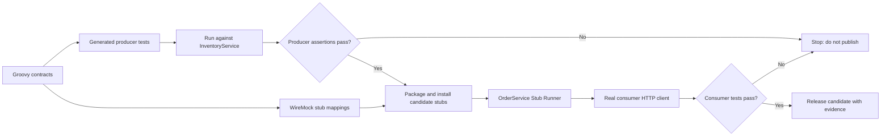

# Sinh test producer, công bố stub và chạy consumer test

Trong bài thực hành này, bạn sẽ xây một luồng **Spring Cloud Contract (SCC)** hoàn chỉnh cho hai dịch vụ nhỏ: `InventoryService` là **producer** cung cấp API giữ hàng, `OrderService` là **consumer** gọi API đó trong quy trình checkout. Bạn sẽ định nghĩa hành vi bằng **Groovy DSL**, để producer sinh và chạy contract tests, đóng gói stub artifact, rồi dùng **Stub Runner** khởi động HTTP stub để kiểm tra mã consumer thật.

Kết quả cần đạt không chỉ là một file `*-stubs.jar` được tạo ra. Bạn phải chứng minh được chuỗi:



Đây là bài tổng hợp của module **SPRING_CLOUD_CONTRACT**: học kiểm thử hợp đồng giữa producer và consumer, định nghĩa HTTP/message behavior bằng Groovy/YAML DSL, sinh test phía cung cấp, phát hành stub, dùng Stub Runner và tích hợp CI để phát hiện thay đổi API không tương thích. Bạn sẽ làm một dự án HTTP trước; cuối bài có phần mở rộng messaging và các thử nghiệm cố ý làm sai để kiểm chứng pipeline.

Sau khi hoàn thành, bạn có thể:

- Tạo hai contract HTTP: thành công `201` và lỗi thiếu hàng `409`.
- Viết producer Spring MVC đáp ứng các contract đó.
- Cấu hình Maven Contract Verifier và base class cho generated JUnit 5 tests.
- Chạy producer verification, đọc test reports và xác nhận số generated tests đã thực thi.
- Đóng gói/cài stubs artifact có version và classifier phù hợp.
- Cấu hình consumer HTTP client trỏ tới đúng Stub Runner port.
- Dùng Stub Runner ở chế độ `LOCAL` để chạy consumer integration tests.
- Chứng minh request phát ra từ **mã consumer thật** đã tới stub.
- Phân biệt lỗi producer contract, lỗi artifact resolution, lỗi port, lỗi request matching và lỗi consumer parsing.
- Thiết kế CI chỉ chấp nhận release khi tất cả gate bắt buộc đã đạt.

## 1. Kịch bản và kiến trúc

`OrderService` cần giữ hàng trước khi xác nhận đơn. Nó gửi `sku` và `quantity` tới `InventoryService`:

| Thành phần | Vai trò | Trách nhiệm |
| --- | --- | --- |
| `InventoryService` | Producer | Xử lý yêu cầu giữ hàng, trả reservation hoặc business error |
| `OrderService` | Consumer | Gọi API giữ hàng và chuyển kết quả thành dữ liệu checkout |
| Contract files | Nguồn thỏa thuận | Mô tả request/response được hai bên chấp nhận |
| Contract Verifier | Producer test generator | Sinh tests từ contracts và chạy trên producer |
| Stubs JAR | Artifact dùng chung | Đóng gói WireMock mappings/contracts |
| Stub Runner | Consumer test infrastructure | Tải stubs và khởi động HTTP stub server |
| CI pipeline | Release gate | Kiểm producer, artifact và consumer trước công bố |

### Hai tình huống nghiệp vụ

**Tình huống 1 — Có hàng**

```http
POST /api/v1/reservations HTTP/1.1
Content-Type: application/json

{"sku":"SKU-001","quantity":2}
```

```http
HTTP/1.1 201 Created
Content-Type: application/json

{"reservationId":"RES-1001","status":"HELD"}
```

**Tình huống 2 — Hết hàng**

```http
POST /api/v1/reservations HTTP/1.1
Content-Type: application/json

{"sku":"SKU-EMPTY","quantity":2}
```

```http
HTTP/1.1 409 Conflict
Content-Type: application/json

{"code":"INSUFFICIENT_STOCK"}
```

Consumer cần biết rõ cả success lẫn business error. Nếu chỉ mô tả `201`, một thay đổi khiến producer trả `500` hoặc `409` sai body có thể không được phát hiện trong phạm vi contract hiện tại.

## 2. Phạm vi kỹ thuật và chuẩn bị

Bài dùng **Java 17+**, Spring Boot 3.x, Spring Cloud Contract thuộc một release train tương thích, Maven và JUnit 5. Các version cụ thể của Spring Boot, Spring Cloud BOM và plugin cần được khóa theo ma trận của dự án. Không trộn tùy ý một version Spring Cloud Contract mới nhất với Spring Boot cũ.

| Công cụ | Dùng để làm gì? |
| --- | --- |
| JDK | Biên dịch và chạy hai services |
| Maven Wrapper hoặc Maven | Build, generate tests, package và cài artifact local |
| Spring Boot Web | Tạo REST API và consumer client |
| Spring Cloud Contract Maven Plugin | Sinh producer tests và stubs |
| JUnit 5 | Chạy generated tests và consumer tests |
| Stub Runner | Resolve stub artifact và khởi động WireMock |
| AssertJ | Viết assertions trong consumer test |

### Kiểm tra môi trường

```bash
java -version
mvn -version
```

Kết quả mong đợi là JDK thuộc version mà dự án hỗ trợ và Maven có thể chạy trên JDK ấy. Nếu repository đã có Maven Wrapper, ưu tiên `./mvnw` trên Linux/macOS hoặc `mvnw.cmd` trên Windows để dùng đúng Maven version của dự án.

### Quy tắc về version

- Dùng **Spring Cloud BOM/release train** tương thích với Spring Boot đang chọn.
- Plugin SCC và starter dependencies nên cùng một dòng version được quản lý thống nhất.
- WireMock thường được kéo theo dependency của SCC; chỉ override khi đã kiểm compatibility.
- Ghi lại JDK, Maven Wrapper, Spring Boot, Spring Cloud và SCC version trong build.
- Không dùng dependency version động hoặc `latest` cho release pipeline cần tái lập.

Ví dụ placeholder trong POM:

```xml
<properties>
    <java.version>17</java.version>
    <spring-cloud-contract.version>PINNED_COMPATIBLE_VERSION</spring-cloud-contract.version>
</properties>
```

`PINNED_COMPATIBLE_VERSION` là chỗ cần thay bằng version thực đã được dự án lựa chọn; không copy nguyên placeholder để build.

## 3. Tạo cấu trúc dự án

Tạo hai Maven projects độc lập để thấy rõ artifact boundary:

```text
spring-cloud-contract-lab/
├── inventory-service/
│   ├── pom.xml
│   └── src/
│       ├── main/java/com/example/inventory/
│       │   ├── InventoryApplication.java
│       │   ├── ReservationController.java
│       │   ├── ReservationService.java
│       │   └── dto/
│       │       ├── ReservationRequest.java
│       │       ├── ReservationResponse.java
│       │       └── ErrorResponse.java
│       └── test/
│           ├── java/com/example/inventory/ContractVerifierBase.java
│           └── resources/contracts/
│               ├── create-reservation-success.groovy
│               └── create-reservation-insufficient-stock.groovy
└── order-service/
    ├── pom.xml
    └── src/
        ├── main/java/com/example/order/
        │   ├── OrderApplication.java
        │   ├── InventoryClientConfiguration.java
        │   ├── InventoryHttpClient.java
        │   ├── OrderCheckoutService.java
        │   └── dto/
        │       ├── ReservationRequest.java
        │       └── ReservationResponse.java
        └── test/java/com/example/order/
            └── OrderServiceInventoryContractTest.java
```

Tên class/package là ví dụ. Nếu dự án dùng multi-module Maven, có thể gom hai services vào một parent reactor; bài này dùng hai thư mục độc lập để làm rõ bước **producer install → consumer resolve**.

### Tạo các thư mục

```bash
mkdir -p inventory-service/src/main/java/com/example/inventory/dto
mkdir -p inventory-service/src/test/java/com/example/inventory
mkdir -p inventory-service/src/test/resources/contracts
mkdir -p order-service/src/main/java/com/example/order/dto
mkdir -p order-service/src/test/java/com/example/order
```

Trên Windows PowerShell, có thể tạo các thư mục bằng `New-Item -ItemType Directory -Force` hoặc dùng IDE. Không cần tạo một repository Git riêng cho từng service trong bài lab; quan trọng là giữ source và artifact version rõ ràng.

## 4. Định nghĩa contract success bằng Groovy DSL

Tạo file:

`inventory-service/src/test/resources/contracts/create-reservation-success.groovy`

```groovy
import org.springframework.cloud.contract.spec.Contract

Contract.make {
    name 'create_reservation_success'
    description '''
        OrderService tạo reservation cho SKU còn hàng.
        Producer trả ID reservation và trạng thái HELD.
    '''

    request {
        method 'POST'
        url '/api/v1/reservations'
        headers {
            contentType(applicationJson())
        }
        body([
            sku: 'SKU-001',
            quantity: 2
        ])
    }

    response {
        status 201
        headers {
            contentType(applicationJson())
        }
        body([
            reservationId: $(consumer('RES-1001'),
                             producer(regex('RES-[0-9]+'))),
            status: 'HELD'
        ])
    }
}
```

### Đọc hợp đồng theo hai phía

- Request body là input consumer gửi. Producer test phải gọi endpoint bằng `SKU-001` và `quantity=2`.
- Response `201` và `status=HELD` là cam kết literal.
- `consumer('RES-1001')` là sample response ổn định mà consumer stub nhận được.
- `producer(regex('RES-[0-9]+'))` cho phép producer tạo ID động, nhưng vẫn kiểm định dạng ID.

Regex này **không chứng minh ID duy nhất hoặc đã lưu vào database**. Nếu nghiệp vụ yêu cầu tính duy nhất, cần integration/domain tests bổ sung.

## 5. Định nghĩa contract lỗi thiếu hàng

Tạo file:

`inventory-service/src/test/resources/contracts/create-reservation-insufficient-stock.groovy`

```groovy
import org.springframework.cloud.contract.spec.Contract

Contract.make {
    name 'create_reservation_insufficient_stock'
    description '''
        Khi SKU hết hàng, producer trả business error 409.
        Consumer không được coi đây là một reservation thành công.
    '''

    request {
        method 'POST'
        url '/api/v1/reservations'
        headers {
            contentType(applicationJson())
        }
        body([
            sku: 'SKU-EMPTY',
            quantity: 2
        ])
    }

    response {
        status 409
        headers {
            contentType(applicationJson())
        }
        body([
            code: 'INSUFFICIENT_STOCK'
        ])
    }
}
```

Ở đây body và status là literal vì đây là một business error cố định. Một contract riêng giúp generated tests kiểm nhánh lỗi và tạo mapping riêng cho consumer. Không viết matcher quá rộng như `regex('.*')` cho `code`, vì khi đó producer có thể trả nhầm mã lỗi mà test vẫn xanh.

### Khi nào cần thêm YAML DSL?

Nếu nhóm muốn một contract YAML, có thể biểu diễn request/response literal tương đương:

```yaml
name: create_reservation_insufficient_stock
request:
  method: POST
  url: /api/v1/reservations
  headers:
    Content-Type: application/json
  body:
    sku: SKU-EMPTY
    quantity: 2
response:
  status: 409
  headers:
    Content-Type: application/json
  body:
    code: INSUFFICIENT_STOCK
```

Không đặt cả Groovy và YAML cùng scenario vào thư mục contracts nếu không chủ ý tạo hai contracts. Với matcher động, dùng cú pháp matcher YAML theo đúng version SCC; không copy biểu thức `$(consumer(...), producer(...))` của Groovy vào YAML.

## 6. Viết producer InventoryService

Tạo DTO request:

`inventory-service/src/main/java/com/example/inventory/dto/ReservationRequest.java`

```java
package com.example.inventory.dto;

public record ReservationRequest(String sku, int quantity) {
}
```

Response DTO:

`ReservationResponse.java`

```java
package com.example.inventory.dto;

public record ReservationResponse(
    String reservationId,
    String status
) {
}
```

Error DTO:

`ErrorResponse.java`

```java
package com.example.inventory.dto;

public record ErrorResponse(String code) {
}
```

### Service

`inventory-service/src/main/java/com/example/inventory/ReservationService.java`

```java
package com.example.inventory;

import com.example.inventory.dto.ReservationResponse;
import java.util.concurrent.atomic.AtomicLong;
import org.springframework.stereotype.Service;

@Service
public class ReservationService {

    private final AtomicLong sequence = new AtomicLong(1000);

    public ReservationResponse reserve(String sku, int quantity) {
        long id = sequence.incrementAndGet();
        String reservationId = "RES-" + id;
        return new ReservationResponse(reservationId, "HELD");
    }
}
```

Trong bài lab, service sinh ID tăng dần để minh họa dữ liệu động. Nó **không phải** hệ thống tồn kho thực: chưa khóa số lượng, chưa lưu database, chưa xử lý idempotency và chưa bảo đảm tính duy nhất giữa nhiều instance. Mục tiêu là kiểm producer HTTP contract.

### Controller

`inventory-service/src/main/java/com/example/inventory/ReservationController.java`

```java
package com.example.inventory;

import com.example.inventory.dto.ErrorResponse;
import com.example.inventory.dto.ReservationRequest;
import com.example.inventory.dto.ReservationResponse;
import org.springframework.http.HttpStatus;
import org.springframework.http.ResponseEntity;
import org.springframework.web.bind.annotation.*;

@RestController
@RequestMapping("/api/v1/reservations")
public class ReservationController {

    private final ReservationService reservationService;

    public ReservationController(ReservationService reservationService) {
        this.reservationService = reservationService;
    }

    @PostMapping
    public ResponseEntity<?> create(
            @RequestBody ReservationRequest request) {

        if (request.quantity() <= 0) {
            return ResponseEntity.badRequest()
                .body(new ErrorResponse("INVALID_QUANTITY"));
        }

        if ("SKU-EMPTY".equals(request.sku())) {
            return ResponseEntity.status(HttpStatus.CONFLICT)
                .body(new ErrorResponse("INSUFFICIENT_STOCK"));
        }

        ReservationResponse response =
            reservationService.reserve(request.sku(), request.quantity());

        return ResponseEntity.status(HttpStatus.CREATED).body(response);
    }
}
```

Controller có ba nhánh: quantity không hợp lệ trả `400`, SKU hết hàng trả `409`, còn lại trả `201`. Hai contracts hiện tại kiểm success và insufficient stock. Nhánh `400` chưa nằm trong contract; nếu đó là behavior producer cam kết cho consumer, hãy thêm contract và consumer test riêng.

### Application entry point

`InventoryApplication.java`

```java
package com.example.inventory;

import org.springframework.boot.SpringApplication;
import org.springframework.boot.autoconfigure.SpringBootApplication;

@SpringBootApplication
public class InventoryApplication {
    public static void main(String[] args) {
        SpringApplication.run(InventoryApplication.class, args);
    }
}
```

## 7. Tạo producer test base class

Contract Verifier sinh producer tests từ Groovy contracts. Base class cung cấp Spring application context và cách gửi HTTP request vào controller. Với Spring MVC, ta dùng `MockMvc`:

`inventory-service/src/test/java/com/example/inventory/ContractVerifierBase.java`

```java
package com.example.inventory;

import io.restassured.module.mockmvc.RestAssuredMockMvc;
import org.junit.jupiter.api.BeforeEach;
import org.springframework.beans.factory.annotation.Autowired;
import org.springframework.boot.test.context.SpringBootTest;
import org.springframework.web.context.WebApplicationContext;

@SpringBootTest
public abstract class ContractVerifierBase {

    @Autowired
    WebApplicationContext context;

    @BeforeEach
    void setUp() {
        RestAssuredMockMvc.webAppContextSetup(context);
    }
}
```

Base class này dùng **application context của InventoryService**, nên generated tests đi qua controller, request mapping, Jackson serialization và service bean của producer. Không thay controller bằng mock luôn trả fixture, vì như vậy generated tests không còn xác minh implementation thật.

Nếu dự án dùng WebFlux, chọn test mode/base class phù hợp; không dùng MockMvc cho reactive controller chỉ vì ví dụ này dùng Spring MVC.

## 8. Cấu hình Maven cho producer

POM tối thiểu cần:

- Spring Boot Web để chạy REST API.
- Spring Cloud Contract Verifier ở test scope.
- Maven plugin SCC để đọc contracts, sinh tests và stub artifact.
- JUnit 5/test engine tương thích.

Mảnh `dependencies`:

```xml
<dependencies>
    <dependency>
        <groupId>org.springframework.boot</groupId>
        <artifactId>spring-boot-starter-web</artifactId>
    </dependency>

    <dependency>
        <groupId>org.springframework.cloud</groupId>
        <artifactId>spring-cloud-starter-contract-verifier</artifactId>
        <scope>test</scope>
    </dependency>

    <dependency>
        <groupId>org.springframework.boot</groupId>
        <artifactId>spring-boot-starter-test</artifactId>
        <scope>test</scope>
    </dependency>
</dependencies>
```

Plugin Maven:

```xml
<build>
    <plugins>
        <plugin>
            <groupId>org.springframework.cloud</groupId>
            <artifactId>spring-cloud-contract-maven-plugin</artifactId>
            <version>${spring-cloud-contract.version}</version>
            <extensions>true</extensions>
            <configuration>
                <testFramework>JUNIT5</testFramework>
                <testMode>MOCKMVC</testMode>
                <baseClassForTests>
                    com.example.inventory.ContractVerifierBase
                </baseClassForTests>
                <contractsDirectory>
                    ${project.basedir}/src/test/resources/contracts
                </contractsDirectory>
            </configuration>
        </plugin>
    </plugins>
</build>
```

Đây là **mảnh POM**. Project thực cần parent/dependency management quản lý Spring Boot và Spring Cloud versions. `contractsDirectory` chỉ rõ nơi lưu contracts; nếu dùng default location của plugin thì có thể bỏ cấu hình này. Xác nhận parameter name theo đúng Maven plugin version đang chọn.

### POM có version được quản lý

Trong project thật, import Spring Cloud BOM phù hợp với Spring Boot:

```xml
<dependencyManagement>
    <dependencies>
        <dependency>
            <groupId>org.springframework.cloud</groupId>
            <artifactId>spring-cloud-dependencies</artifactId>
            <version>PINNED_COMPATIBLE_RELEASE_TRAIN</version>
            <type>pom</type>
            <scope>import</scope>
        </dependency>
    </dependencies>
</dependencyManagement>
```

`PINNED_COMPATIBLE_RELEASE_TRAIN` là placeholder. Dùng bảng compatibility chính thức của Spring Cloud để chọn release train, sau đó kiểm SCC plugin/starter resolve đúng version. Không đoán version dựa vào ngày phát hành hoặc lấy ngẫu nhiên từ ví dụ trên mạng.

### Gợi ý thông tin artifact

Đảm bảo producer có tọa độ nhất quán, ví dụ:

```xml
<groupId>com.example</groupId>
<artifactId>inventory-service</artifactId>
<version>1.0.0-SNAPSHOT</version>
<packaging>jar</packaging>
```

Consumer sẽ resolve đúng group, artifact, version và classifier của stubs JAR. Nếu đổi version producer, phải cập nhật version mà consumer dùng hoặc dùng một release candidate có version riêng.

## 9. Sinh và chạy generated producer tests

Từ thư mục root lab:

```bash
cd inventory-service
mvn -B -ntp clean verify
```

`verify` đi qua các lifecycle phases trước đó, bao gồm compile/test/package theo cấu hình Maven. Spring Cloud Contract plugin sinh test source; Surefire/Failsafe hoặc test runner được cấu hình thực thi chúng.

### Kết quả cần quan sát

- Contract files được plugin phát hiện.
- Generated test sources xuất hiện trong thư mục build được plugin cấu hình.
- Test sources biên dịch thành công.
- Có test reports của đúng lần build.
- Generated tests chạy và pass trên producer application context.
- Không có `0 tests` hoặc skipped ngoài chủ đích.

Tên thư mục generated source có thể khác theo plugin version/configuration. Hãy đọc Maven log và build output của dự án thay vì phụ thuộc vào một đường dẫn hardcode.

### Đọc test reports

Maven Surefire thường ghi báo cáo dưới `target/surefire-reports`; Failsafe dùng `target/failsafe-reports` nếu dự án cấu hình integration tests ở đó.

```powershell
Get-ChildItem target/surefire-reports
```

Trên Linux/macOS:

```bash
find target/surefire-reports -maxdepth 1 -type f
```

Một báo cáo mong đợi có số tests thực thi lớn hơn 0, không fail và không skipped ngoài policy. **Không kết luận thành công chỉ từ dòng `BUILD SUCCESS`**: plugin có thể chưa tìm được contract hoặc test task bị skip.

### Producer phải fail nếu implementation vi phạm

Thử thay tạm response thành:

```java
return ResponseEntity.ok(response);
```

Trong khi contract yêu cầu `201`. Chạy lại `mvn clean verify`. Generated success test phải fail ở status assertion. Sau phép thử, khôi phục `HttpStatus.CREATED` và chạy lại.

Đây là **negative control**: nó chứng minh contract test có khả năng bắt regression, không chỉ tồn tại trên filesystem.

## 10. Đóng gói và cài stubs JAR vào Maven local

Sau khi producer verification pass, Maven plugin tạo stub mappings và có thể đóng gói thành artifact classifier `stubs`. Với lab, cài artifact vào local repository để consumer Stub Runner resolve:

```bash
mvn -B -ntp clean install
```

Lệnh này chạy lại build lifecycle và cài producer artifact cùng các attached artifacts được cấu hình. Sau đó kiểm thư mục `target`:

```powershell
Get-ChildItem target/*stubs*.jar
```

Trên Linux/macOS:

```bash
find target -maxdepth 1 -name '*stubs*.jar'
```

Tên file có thể là dạng:

```text
inventory-service-1.0.0-SNAPSHOT-stubs.jar
```

Đây là tên ví dụ. Xác nhận classifier thực tế trong plugin config/build output. Không đổi tên JAR thủ công để làm consumer resolve được; hãy sửa tọa độ/version/classifier đúng.

### Kiểm nội dung JAR

```bash
jar tf target/inventory-service-1.0.0-SNAPSHOT-stubs.jar
```

Tìm các mapping tương ứng hai contracts success và insufficient-stock. Layout chính xác phụ thuộc SCC version và cấu hình packaging; thường có thư mục mappings, có thể kèm contracts và body files.

Nếu mapping dùng body file, kiểm file đó cũng nằm trong JAR. JAR có tồn tại nhưng thiếu mapping hoặc body file không chứng minh artifact dùng được.

### Ghi checksum cho candidate

```powershell
Get-FileHash target/inventory-service-1.0.0-SNAPSHOT-stubs.jar -Algorithm SHA256
```

Hoặc:

```bash
sha256sum target/inventory-service-1.0.0-SNAPSHOT-stubs.jar
```

Lưu checksum vào log/artifact metadata của CI để đối chiếu khi consumer test và release. Với bài lab, local Maven repository là đủ; production cần repository bất biến và provenance.

## 11. Tạo consumer OrderService

Consumer cần starter Stub Runner ở test scope:

```xml
<dependencies>
    <dependency>
        <groupId>org.springframework.boot</groupId>
        <artifactId>spring-boot-starter-web</artifactId>
    </dependency>

    <dependency>
        <groupId>org.springframework.cloud</groupId>
        <artifactId>spring-cloud-starter-contract-stub-runner</artifactId>
        <scope>test</scope>
    </dependency>

    <dependency>
        <groupId>org.springframework.boot</groupId>
        <artifactId>spring-boot-starter-test</artifactId>
        <scope>test</scope>
    </dependency>
</dependencies>
```

Consumer không cần plugin Contract Verifier nếu chỉ tải stub để kiểm client. Plugin/starter Verifier thuộc producer side; Stub Runner thuộc consumer test side. Một dự án có thể vừa là producer vừa là consumer, khi đó có thể cần cả hai.

Consumer POM phải dùng cùng Spring Cloud release train/SCC compatibility với producer trong bài lab. Nếu dùng BOM, import BOM trong dependency management; không tự thêm một WireMock version không tương thích.

### Application entry point

`order-service/src/main/java/com/example/order/OrderApplication.java`

```java
package com.example.order;

import org.springframework.boot.SpringApplication;
import org.springframework.boot.autoconfigure.SpringBootApplication;

@SpringBootApplication
public class OrderApplication {
    public static void main(String[] args) {
        SpringApplication.run(OrderApplication.class, args);
    }
}
```

### DTO phía consumer

Consumer chỉ cần các field mà nó sử dụng:

`ReservationRequest.java`

```java
package com.example.order.dto;

public record ReservationRequest(String sku, int quantity) {
}
```

`ReservationResponse.java`

```java
package com.example.order.dto;

public record ReservationResponse(
    String reservationId,
    String status
) {
}
```

Không cần copy toàn bộ domain model của producer sang consumer. Hai service có thể có DTO riêng, miễn dữ liệu wire format được thỏa thuận qua contract.

## 12. Cấu hình HTTP client đọc base URL từ property

Tạo cấu hình:

`order-service/src/main/java/com/example/order/InventoryClientConfiguration.java`

```java
package com.example.order;

import org.springframework.beans.factory.annotation.Value;
import org.springframework.context.annotation.Bean;
import org.springframework.context.annotation.Configuration;
import org.springframework.web.client.RestClient;

@Configuration
public class InventoryClientConfiguration {

    @Bean
    RestClient inventoryRestClient(
            @Value("${inventory.base-url}") String baseUrl) {
        return RestClient.builder()
            .baseUrl(baseUrl)
            .build();
    }
}
```

`inventory.base-url` là property do ứng dụng OrderService định nghĩa. Nó **không tự được Stub Runner thay đổi**. Test phải cấp giá trị này trước khi Spring tạo bean.

Ví dụ cấu hình production mặc định:

`order-service/src/main/resources/application.yml`

```yaml
inventory:
  base-url: http://inventory-service:8080
```

Địa chỉ trên là tên service trong một môi trường triển khai minh họa. Trong consumer contract test, sẽ override thành `http://127.0.0.1:8090` để trỏ đến Stub Runner.

### Viết InventoryHttpClient

`order-service/src/main/java/com/example/order/InventoryHttpClient.java`

```java
package com.example.order;

import com.example.order.dto.ReservationRequest;
import com.example.order.dto.ReservationResponse;
import org.springframework.http.MediaType;
import org.springframework.stereotype.Component;
import org.springframework.web.client.RestClient;

@Component
public class InventoryHttpClient {

    private final RestClient restClient;

    public InventoryHttpClient(RestClient inventoryRestClient) {
        this.restClient = inventoryRestClient;
    }

    public ReservationResponse reserve(String sku, int quantity) {
        ReservationRequest request =
            new ReservationRequest(sku, quantity);

        return restClient.post()
            .uri("/api/v1/reservations")
            .contentType(MediaType.APPLICATION_JSON)
            .body(request)
            .retrieve()
            .body(ReservationResponse.class);
    }
}
```

`RestClient` được giới thiệu trong Spring Framework 6.1. Nếu dự án dùng Spring Framework cũ, có thể thay bằng `RestTemplate` hoặc `WebClient` nhưng phải giữ nguyên ý tưởng **client đọc base URL từ config**.

### Tạo service consumer

`order-service/src/main/java/com/example/order/OrderCheckoutService.java`

```java
package com.example.order;

import com.example.order.dto.ReservationResponse;
import org.springframework.stereotype.Service;

@Service
public class OrderCheckoutService {

    private final InventoryHttpClient inventoryClient;

    public OrderCheckoutService(InventoryHttpClient inventoryClient) {
        this.inventoryClient = inventoryClient;
    }

    public ReservationResponse prepareReservation(
            String sku,
            int quantity) {
        return inventoryClient.reserve(sku, quantity);
    }
}
```

Đây là business facade tối giản để test đi qua **service → HTTP client → stub**. Không gọi WireMock trực tiếp trong test method thay cho `InventoryHttpClient`.

## 13. Cấu hình Stub Runner trong consumer test

Với bài lab, chọn **cổng tĩnh `8090`** để property có sẵn trước khi Spring tạo `RestClient` bean. Tạo:

`order-service/src/test/java/com/example/order/OrderServiceInventoryContractTest.java`

```java
package com.example.order;

import static org.assertj.core.api.Assertions.assertThat;
import static org.assertj.core.api.Assertions.assertThatThrownBy;

import com.example.order.dto.ReservationResponse;
import org.junit.jupiter.api.Test;
import org.springframework.beans.factory.annotation.Autowired;
import org.springframework.boot.test.context.SpringBootTest;
import org.springframework.cloud.contract.stubrunner.spring.AutoConfigureStubRunner;
import org.springframework.cloud.contract.stubrunner.spring.StubRunnerProperties;
import org.springframework.web.client.HttpClientErrorException;

@SpringBootTest(properties = {
    "inventory.base-url=http://127.0.0.1:8090"
})
@AutoConfigureStubRunner(
    ids = "com.example:inventory-service:1.0.0-SNAPSHOT:stubs:8090",
    stubsMode = StubRunnerProperties.StubsMode.LOCAL
)
class OrderServiceInventoryContractTest {

    @Autowired
    OrderCheckoutService checkoutService;

    @Test
    void shouldCreateReservationFromInventoryStub() {
        ReservationResponse response =
            checkoutService.prepareReservation("SKU-001", 2);

        assertThat(response.reservationId()).matches("RES-[0-9]+");
        assertThat(response.status()).isEqualTo("HELD");
    }

    @Test
    void shouldReceiveConflictWhenStockIsInsufficient() {
        assertThatThrownBy(() ->
            checkoutService.prepareReservation("SKU-EMPTY", 2)
        ).isInstanceOf(HttpClientErrorException.Conflict.class);
    }
}
```

### Giải thích cấu hình

- `ids` chỉ định producer artifact theo dạng `groupId:artifactId:version:classifier:port` trong ví dụ.
- `1.0.0-SNAPSHOT` phải khớp version đã được cài bằng `mvn install` ở producer.
- `stubs` là classifier của stub JAR.
- `8090` là cổng WireMock stub server.
- `stubsMode=LOCAL` yêu cầu Stub Runner tìm artifact trong Maven local repository.
- `inventory.base-url` được override trước khi application context tạo HTTP client bean.

**Cổng `8090` trong `ids` và base URL phải khớp.** Nếu đổi một bên mà quên bên kia, test có thể gặp `Connection refused` hoặc gọi nhầm service.

### Điều test chứng minh

Success test gọi `OrderCheckoutService`, sau đó `InventoryHttpClient` gửi HTTP request tới WireMock. Response được deserialize thành `ReservationResponse`. Error test xác nhận HTTP `409` trở thành `HttpClientErrorException.Conflict` theo behavior mặc định của `RestClient.retrieve()`.

Test này chưa kiểm cách OrderService chuyển business error thành API response cho một caller khác. Nếu đó là trách nhiệm của consumer, thêm test riêng cho error translation.

### Vì sao không chỉ dùng curl?

`curl` tới `127.0.0.1:8090` chỉ chứng minh server stub có thể trả response. Nó không chứng minh:

- `InventoryHttpClient` đọc đúng property.
- `OrderCheckoutService` dùng đúng bean client.
- DTO của consumer deserialize đúng.
- Request body/header do client thật gửi khớp contract.
- Consumer xử lý lỗi theo đúng cách.

Do đó bài lab phải chạy test qua service/client thật.

## 14. Chạy consumer tests sau khi cài producer stubs

Thứ tự local:

```bash
cd inventory-service
mvn -B -ntp clean install

cd ../order-service
mvn -B -ntp clean verify
```

Trong PowerShell, có thể chạy hai lệnh ở hai thư mục terminal riêng; không dùng cú pháp `&&` nếu shell là Windows PowerShell 5.1.

### Nếu Stub Runner báo không tìm thấy stub

Kiểm theo thứ tự:

1. Producer đã chạy `mvn clean install` thành công chưa?
2. File stubs JAR có được tạo và install không?
3. Consumer `groupId`/`artifactId`/`version`/`classifier` có khớp không?
4. Consumer có dùng `StubsMode.LOCAL` không?
5. Maven local repository có đúng nơi mà consumer build đang sử dụng không?
6. Có profile/settings.xml đổi local repository path không?

Đừng thêm dependency chính producer JAR vào consumer chỉ để chữa lỗi tìm stub. Stub Runner cần **stub artifact/classifier** đúng.

## 15. Kiểm tra mappings và port trước khi chạy consumer

Khi Stub Runner khởi động, log thường cho biết stub được resolve và HTTP server đã start. Hãy xác nhận cổng `8090` đã bind thành công.

Trong một terminal cùng host:

```bash
curl -v http://127.0.0.1:8090/__admin/mappings
```

Nếu endpoint admin trả danh sách mappings, kiểm có mapping success và insufficient-stock. WireMock Admin API chỉ dùng trong test-local; không mở cổng này cho mạng bên ngoài.

Thử request trực tiếp:

```bash
curl -i \
  -H "Content-Type: application/json" \
  -d '{"sku":"SKU-001","quantity":2}' \
  http://127.0.0.1:8090/api/v1/reservations
```

Response dự kiến là `201` với sample ID `RES-1001` và `status=HELD`. Thử nhánh lỗi:

```bash
curl -i \
  -H "Content-Type: application/json" \
  -d '{"sku":"SKU-EMPTY","quantity":2}' \
  http://127.0.0.1:8090/api/v1/reservations
```

Response dự kiến là `409` với `code=INSUFFICIENT_STOCK`. Nếu curl không match, kiểm request method, path, Content-Type, JSON body và mappings đã nạp.

**Lưu ý:** direct curl là bước chẩn đoán bổ sung. Consumer test vẫn phải gọi mã `OrderService` thật và kiểm kết quả.

## 16. Chứng minh request thật đã tới WireMock

Consumer test ở phần trước đã gọi service/client thật. Để tăng độ tin cậy, bạn có thể kiểm request journal của đúng WireMock server.

Trong một test dùng cổng tĩnh `8090`, ý tưởng là:

```java
// Ví dụ minh họa với WireMock client tương thích dependency của dự án.
import static com.github.tomakehurst.wiremock.client.WireMock.*;

@BeforeEach
void resetWireMockJournal() {
    configureFor("127.0.0.1", 8090);
    resetAllRequests();
}

@Test
void consumerMustSendPostToInventoryStub() {
    ReservationResponse response =
        checkoutService.prepareReservation("SKU-001", 2);

    assertThat(response.status()).isEqualTo("HELD");

    verify(1, postRequestedFor(
            urlPathEqualTo("/api/v1/reservations"))
        .withHeader("Content-Type", containing("application/json"))
        .withRequestBody(
            matchingJsonPath("$.sku", equalTo("SKU-001"))));
}
```

`com.github.tomakehurst.wiremock.client.WireMock` là package thường gặp ở WireMock 2; WireMock 3 dùng package khác trong một số artifact/API. Hãy dùng package của WireMock version được SCC/Stub Runner resolve, không override dependency chỉ để khớp ví dụ.

Nếu không muốn đưa WireMock client API vào test source, có thể xem `GET /__admin/requests` sau khi test chạy. Dù dùng cách nào, điều cần chứng minh là **request được phát ra từ `OrderCheckoutService` đã tới đúng stub instance**.

### Tránh kiểm sai server

Khi có nhiều Stub Runner servers, `configureFor` phải trỏ đúng host/port của Inventory stub. Một request được ghi nhận ở Pricing stub không chứng minh Inventory client route đúng. Static WireMock client còn dùng global state; nếu chạy tests song song, hãy cô lập server/port hoặc dùng admin client instance riêng.

### Negative control cho consumer

Trên một nhánh thử:

1. Đổi `inventory.base-url` thành `http://127.0.0.1:8080` khi không có server ở đó.
2. Chạy lại test consumer.
3. Test phải fail do không kết nối được hoặc request journal ở `8090` không có request.
4. Khôi phục `8090`.

Nếu test vẫn pass khi Stub Runner không nhận request, có thể code đang dùng mock, cache, hardcoded response hoặc fallback. Kiểm lại test boundary trước khi kết luận consumer đã được contract-test.

## 17. Cổng động: khi nào nên dùng?

Cổng cố định giúp bài lab dễ hiểu và property có sẵn trước khi Spring tạo client bean. Trong CI có nhiều suites chạy song song, cổng cố định có thể bị chiếm. Khi đó Stub Runner có thể cấp cổng động; các bản SCC hỗ trợ annotation `@StubRunnerPort` để test nhận port của một stub.

Ví dụ chỉ nhận port:

```java
@SpringBootTest
@AutoConfigureStubRunner(
    ids = "com.example:inventory-service:1.0.0-SNAPSHOT:stubs",
    stubsMode = StubRunnerProperties.StubsMode.LOCAL
)
class InventoryStubPortTest {

    @StubRunnerPort("inventory-service")
    int inventoryStubPort;

    @Test
    void stubPortIsAvailable() {
        assertThat(inventoryStubPort).isBetween(1, 65535);
    }
}
```

Ví dụ này **chỉ chứng minh có port được cấp**, chưa chứng minh HTTP client của consumer đã dùng port đó.

### Bẫy lifecycle

Nếu `RestClient` được tạo trong Spring context với `inventory.base-url` từ trước, sau đó test mới nhận `@StubRunnerPort` vào field, thì:

- Field `inventoryStubPort` có giá trị.
- Bean `RestClient` cũ không tự đổi base URL.
- Đặt `System.setProperty` trong `@BeforeEach` cũng không tự tạo lại bean.

Với ứng dụng cần kiểm wiring của Spring-managed client, bài lab dùng cổng tĩnh. Nếu bắt buộc dùng dynamic port, phải thiết kế infrastructure khởi động stub **trước khi** context/client bean được tạo và đăng ký property đúng lifecycle. `@DynamicPropertySource` chỉ hữu ích khi port đã sẵn sàng ở thời điểm Spring resolve supplier; nó không tự đợi một test field `@StubRunnerPort` được inject sau đó.

## 18. Chẩn đoán lỗi theo từng tầng

| Triệu chứng | Nguyên nhân có thể | Cách kiểm |
| --- | --- | --- |
| Stub Runner không tìm thấy artifact | Chưa install, sai version/classifier hoặc local repo khác | Kiểm producer `mvn install`, POM consumer và Maven settings |
| Stub Runner không bind port | Port bị chiếm, server startup lỗi | Đọc log bind/startup và kiểm tiến trình đang nghe |
| `Connection refused` ở `8080` | Client vẫn dùng default URL | In resolved `inventory.base-url` và actual request URI |
| `Connection refused` ở `8090` | Stub không listen hoặc sai network namespace | Kiểm Stub Runner logs, Admin API và host/container |
| HTTP `404` từ WireMock | Request tới đúng server nhưng không match mapping | Kiểm method/path/header/body và Admin mappings |
| Consumer nhận response không mong đợi | Artifact cũ hoặc mapping khác được chọn | Kiểm resolved version, mapping priority và request journal |
| Consumer test pass dù stub tắt | Mock/cache/fallback/hardcoded result | Kiểm journal count và thực hiện negative control |
| `@StubRunnerPort` đúng nhưng client gọi port cũ | Client bean tạo trước khi port được truyền | Kiểm Spring lifecycle và nơi build HTTP client |
| Test fail khi chạy song song | Cổng cố định bị tranh hoặc static WireMock client state | Cô lập test, dùng port động có lifecycle phù hợp |
| Local pass, CI fail | Profile, Maven repo, host/network khác nhau | So resolved artifact, property, proxy và container namespace |

### Quy trình 8 bước

1. **Artifact:** Stub Runner đã resolve đúng `groupId:artifactId:version:classifier` chưa?
2. **Server:** WireMock đã start và bind thành công chưa?
3. **Port:** Port thực tế là bao nhiêu?
4. **Network:** Consumer process có thể truy cập host/port đó không?
5. **Property:** HTTP client đã nhận đúng base URL trước khi tạo bean chưa?
6. **Request:** Request journal có ghi request từ consumer không?
7. **Mapping:** Method/path/headers/body có match mapping mong đợi không?
8. **Consumer behavior:** DTO, status và business logic có xử lý response đúng không?

Đừng chỉnh matcher khi lỗi xảy ra trước TCP connection. Đừng đổi port khi request đã tới đúng WireMock nhưng body không match. Chẩn đoán đúng tầng sẽ tránh làm yếu contract.

## 19. Kiểm tra thứ tự chạy local từ đầu đến cuối

Sau khi source hai service hoàn chỉnh:

```text
1. Build InventoryService
2. Run producer generated contract tests
3. Package and install inventory-service stubs JAR
4. Confirm stub JAR coordinates and mappings
5. Build OrderService
6. Start Stub Runner from LOCAL artifact
7. Call InventoryHttpClient through OrderCheckoutService
8. Assert 201 success and 409 business error
9. Verify request reached expected WireMock port
10. Save test reports and candidate checksum
```

### Lệnh tổng hợp

Chạy từ root lab:

```bash
cd inventory-service
mvn -B -ntp clean install

cd ../order-service
mvn -B -ntp clean verify
```

Nếu một bước fail, **dừng tại đó và xử lý trước khi sang bước sau**. Không chạy consumer với một stub JAR cũ trong Maven local rồi báo rằng producer build hiện tại đã được xác minh.

### Bằng chứng nên lưu

| Bằng chứng | Nội dung |
| --- | --- |
| Producer commit | Git SHA của InventoryService |
| Contract revision | Commit/phiên bản của Groovy/YAML contracts |
| Producer test report | Executed, failed, skipped và test suite |
| Producer artifact | Coordinates của producer JAR |
| Stub artifact | Coordinates, classifier và SHA-256 |
| Consumer test report | Test suite đã gọi consumer code thật |
| Stub port/URL | Port Stub Runner và base URL được resolve |
| Request evidence | Request journal/verify result nếu được bật |

Đây là bằng chứng để người khác tái lập và điều tra khi contract thay đổi. Chỉ ghi `BUILD SUCCESS` là chưa đủ.

## 20. Tích hợp producer và consumer vào CI

Trong lab, hai projects nằm trong cùng workspace và dùng chung Maven local repository. Một job CI tuần tự có thể:

1. Checkout đúng commit.
2. Build/verify/install InventoryService và stub candidate.
3. Chạy OrderService tests với `StubsMode.LOCAL`.
4. Lưu test reports, candidate JAR và checksum.

Ví dụ GitHub Actions:

```yaml
name: Spring Cloud Contract lab

on:
  pull_request:
  push:
    branches: [main]

permissions:
  contents: read

jobs:
  contract-integration:
    runs-on: ubuntu-latest
    steps:
      - uses: actions/checkout@v4

      - uses: actions/setup-java@v4
        with:
          distribution: temurin
          java-version: '17'
          cache: maven

      - name: Verify producer and install candidate stubs
        working-directory: inventory-service
        run: mvn -B -ntp clean install

      - name: Verify consumer with local Stub Runner
        working-directory: order-service
        run: mvn -B -ntp clean verify

      - name: Upload candidate stub artifact
        if: success()
        uses: actions/upload-artifact@v4
        with:
          name: inventory-service-stubs-candidate
          path: inventory-service/target/*-stubs.jar
          if-no-files-found: error

      - name: Retain producer and consumer test reports
        if: always()
        uses: actions/upload-artifact@v4
        with:
          name: contract-test-reports
          path: |
            inventory-service/target/surefire-reports/
            inventory-service/target/failsafe-reports/
            order-service/target/surefire-reports/
            order-service/target/failsafe-reports/
          if-no-files-found: warn
```

Workflow trên là ví dụ cho **một job trên một runner**. Maven local repository được dùng chung giữa hai bước nên consumer resolve được stub đã install. Nếu tách producer và consumer thành hai jobs trên hai runners, Maven local repository không tự chia sẻ; phải dùng artifact handoff hoặc staging repository và cài candidate vào local repository của consumer job.

### Vì sao chỉ upload candidate sau consumer tests?

Candidate JAR có thể được tạo trước, nhưng việc upload trong bước `if: success()` phía trên chỉ xảy ra khi toàn bộ các bước trước trong job thành công. Đây là **CI artifact nội bộ**, chưa phải publication chính thức vào Maven release repository.

Bước giữ test reports dùng `if: always()` để điều tra cả khi build fail. Điều đó không cấp quyền publish stub lỗi; candidate release chỉ upload khi job thành công.

### Cổng kiểm số lượng tests

Workflow thực tế nên có thêm script/report gate để xác nhận:

- Contract sources được phát hiện.
- Generated producer tests được tạo.
- Số tests thực thi lớn hơn 0 và phù hợp với tập contracts.
- Failures/errors bằng 0.
- Skipped tests không vượt policy.
- Consumer compatibility suite đã chạy và pass.

Không dùng một file report cũ trong workspace làm bằng chứng. Clean build, report của đúng run và test suite identity phải được đối chiếu.

## 21. Candidate stub và release chính thức

Một candidate stub được tạo từ producer build có thể dùng trong CI để kiểm consumer. Nhưng **công bố release chính thức** cần thêm điều kiện:

| Giai đoạn | Artifact | Ai sử dụng? |
| --- | --- | --- |
| Producer build | Candidate JAR trong workspace | Producer pipeline |
| Consumer integration | Cùng candidate JAR/digest | Consumer test job |
| Release approval | Candidate đã qua gates | Người/quy trình release |
| Official repository | Version bất biến được promote | Consumer builds và môi trường sau đó |

Không publish stable stub ngay sau producer tests nếu policy yêu cầu consumer compatibility trước release. Ngược lại, không yêu cầu consumer tải stable release khi stable chỉ được publish sau consumer test; hãy dùng **candidate handoff** hoặc staging repository.

### Hai cách triển khai

**Cách A — cùng runner/workspace**

- Producer chạy `mvn clean install`.
- Consumer chạy `mvn clean verify` với `StubsMode.LOCAL`.
- Sau khi tất cả gates pass, release job có thể promote artifact candidate đã được lưu.

**Cách B — tách jobs/repositories**

- Producer tạo candidate và upload workflow artifact hoặc staging artifact.
- Consumer job tải đúng candidate, xác minh checksum rồi cài vào local repository hoặc resolve từ staging.
- Consumer test chạy trên đúng version/digest.
- Release job promote **chính bytes đã kiểm**, không build lại một candidate khác rồi giữ nguyên bằng chứng cũ.

Nếu release job chạy `mvn deploy` và build lại, phải coi đó là một build mới: hoặc chạy lại toàn bộ gates cần thiết trên build ấy, hoặc sử dụng cơ chế repository promotion bảo đảm nội dung không đổi.

### Tọa độ version

Ví dụ candidate:

```text
com.example:inventory-service:1.0.0-SNAPSHOT:stubs
```

Ví dụ release:

```text
com.example:inventory-service:1.0.0:stubs
```

Đây là ví dụ. Repository release nên bất biến, không overwrite `1.0.0` bằng bytes khác. Nếu contract hoặc producer behavior thay đổi, tạo version mới theo chính sách versioning.

## 22. Kiểm soát compatibility: producer pass chưa đủ

Khi `InventoryService` thay đổi, cần hiểu test nào đang cung cấp bằng chứng:

| Kiểm thử | Phát hiện được | Không tự chứng minh |
| --- | --- | --- |
| Producer generated tests | Producer đáp ứng các requests/response assertions trong contracts | Mọi consumer thực tế đều parse được response |
| Consumer Stub Runner tests | Consumer code xử lý stub sample và gửi request đúng | Producer runtime thật đang deploy đúng version |
| Producer + consumer CI | Hai phía đáp ứng các cases đã kiểm | Security, load, concurrency hoặc mọi version pair |
| Integration/E2E | Những đường đi thực được chạy trong môi trường đó | Mọi môi trường và mọi thời điểm đều tương thích |

Ví dụ producer thêm field `riskScore` vào response. Contract cũ vẫn có thể pass nếu assertions không cấm field thêm, nhưng consumer strict deserializer có thể fail. Hãy thêm test consumer cũ với response mới nếu backward compatibility của consumer là yêu cầu.

### Ma trận phiên bản

Nếu tổ chức hỗ trợ:

| Consumer | Producer 1.0.0 | Producer 1.1.0 candidate |
| --- | --- | --- |
| OrderService 2.4 | Baseline cần xác nhận | Kiểm backward compatibility |
| OrderService 2.5 | Kiểm nếu consumer deploy trước | Cặp mục tiêu |

Không đánh dấu một ô `PASS` nếu chưa chạy suite tương ứng. Chọn những cặp thực sự có thể cùng tồn tại trong rolling upgrade; ghi rõ cặp chưa kiểm.

## 23. Thực hành thay đổi contract và quan sát pipeline

Một dự án contract-driven phải phản ứng khi producer behavior hoặc contract thay đổi. Hãy thực hiện các thí nghiệm sau trên branch lab.

### Thí nghiệm 1 — Producer trả sai HTTP status

Tạm đổi controller:

```java
return ResponseEntity.ok(response);
```

Contract success yêu cầu `201`. Kết quả mong đợi:

- Generated producer test fail.
- Maven `verify` trả exit code khác 0.
- Stubs JAR không được coi là verified release candidate.
- CI không chạy bước publication chính thức.

Khôi phục `ResponseEntity.status(HttpStatus.CREATED)`.

### Thí nghiệm 2 — Producer trả sai business error

Đổi error code:

```java
return ResponseEntity.status(HttpStatus.CONFLICT)
    .body(new ErrorResponse("OUT_OF_STOCK"));
```

Contract yêu cầu `INSUFFICIENT_STOCK`. Generated error test phải fail ở body assertion. Khôi phục code đúng.

### Thí nghiệm 3 — Consumer gửi sai port

Đổi test property:

```text
inventory.base-url=http://127.0.0.1:8080
```

Trong khi Stub Runner bind `8090`. Kết quả mong đợi là connection failure hoặc route evidence không có request tại stub. Khôi phục `8090`; không sửa contract matcher để bỏ qua.

### Thí nghiệm 4 — Consumer gửi sai body type

Thay request quantity thành JSON string:

```json
{"sku":"SKU-001","quantity":"2"}
```

Contract mẫu dùng JSON number `2`. Nếu matcher được sinh theo type/equality, request có thể không match. Kiểm WireMock request journal và response mặc định; không chỉ nhìn một status code.

### Thí nghiệm 5 — Consumer test không gọi HTTP client thật

Tạm mock `InventoryHttpClient` hoặc trả hardcoded `ReservationResponse` từ service. Business assertion có thể xanh, nhưng request journal của stub sẽ không có request. Bổ sung verify để test route phát hiện điều đó.

### Thí nghiệm 6 — Stub version cũ

Build candidate `1.0.1-SNAPSHOT` nhưng giữ consumer test trỏ `1.0.0-SNAPSHOT`. Quan sát Stub Runner resolve artifact nào và response mapping khác nhau ra sao. Sau đó pin version chính xác và lưu checksum.

## 24. Các bài kiểm tra mở rộng

Sau khi happy/error paths hoạt động, mở rộng theo nhu cầu:

| Mở rộng | Bài test cần thêm |
| --- | --- |
| Quantity bằng 0/âm | Producer contract `400` và consumer validation/error handling |
| Thiếu `sku` | Request validation và error response |
| Header correlation ID | Request matcher + consumer client header propagation |
| Authorization | Contract header/status phù hợp và security integration |
| Idempotency key | Producer state/integration test và consumer retry test |
| Response có `expiresAt` | Matcher timestamp + consumer deserialization |
| Producer thêm enum mới | Test consumer tolerant/strict behavior |
| Hai consumer dùng API khác nhau | Contracts theo consumer và `stubsPerConsumer` khi phù hợp |
| Reservation confirmed event | Messaging contract và message verifier adapter |
| Retry/DLQ | Broker integration test, duplicate handling và consumer side effect |
| Stub phản hồi chậm | WireMock delay metadata và consumer timeout behavior |
| Nhiều producer stubs | Mỗi client có base URL/port riêng và request journal riêng |

### Mở rộng messaging contract

Nếu InventoryService phát event khi reservation được xác nhận, có thể định nghĩa một contract Groovy:

```groovy
import org.springframework.cloud.contract.spec.Contract

Contract.make {
    name 'reservation_confirmed_event'
    label 'reservation_confirmed'

    input {
        triggeredBy('publishReservationConfirmed()')
    }

    outputMessage {
        sentTo('reservationEvents')
        body([
            reservationId: 'RES-1001',
            status: 'CONFIRMED'
        ])
        headers {
            messagingContentType(applicationJson())
            header('eventType', 'reservation.confirmed')
        }
    }
}
```

`publishReservationConfirmed()` phải được implement trong producer test base class và destination `reservationEvents` phải được adapter messaging giải nghĩa. Đây là phần mở rộng; nó **không tự tạo Kafka topic/RabbitMQ binding** hoặc chứng minh broker production đã nhận event. Cần adapter và broker integration tests tương ứng.

## 25. Cách tổ chức contracts khi có nhiều consumers

Giả sử InventoryService có OrderService và FulfillmentService. Nếu mỗi consumer cần một tập HTTP mappings riêng, có thể tổ chức:

```text
contracts/
└── inventory-service/
    ├── order-service/
    │   ├── create-reservation-success.groovy
    │   └── create-reservation-insufficient-stock.groovy
    └── fulfillment-service/
        └── get-reservation.groovy
```

Khi cấu hình `stubsPerConsumer` và `consumerName`, Stub Runner có thể lọc mapping theo consumer folder phù hợp với layout và plugin version. Hãy kiểm nội dung JAR và mappings active; nếu folder name không khớp consumerName, stub server có thể start nhưng không nạp mapping mong muốn.

Không cần tách contract theo consumer nếu hai consumer thực sự chia sẻ cùng behavior và ownership policy cho phép. Tránh copy một contract giống nhau vào nhiều folder rồi để các bản drift.

## 26. Bảo mật và dữ liệu test

Contract source và stub artifact là một phần của chuỗi cung ứng phần mềm:

- Groovy DSL có thể được evaluate; review như mã nguồn.
- Không commit token, password, private key hoặc dữ liệu khách hàng thật trong contracts.
- Dùng dữ liệu giả ổn định như `SKU-001`, `RES-1001`.
- Pin version của plugin, dependency và stub artifact.
- Không để PR không tin cậy chạy với credentials publish.
- Không mở WireMock Admin API ra mạng công khai.
- Không publish stable stub khi generated tests không chạy hoặc có kết quả `UNKNOWN`.
- Lưu producer commit, contract revision, test reports và checksum.

### Vì sao test pass không chứng minh artifact an toàn?

Contract tests kiểm behavior được mô tả. Chúng không tự xác minh nguồn gốc Groovy extension, dependency supply chain, quyền của CI runner hoặc tính bất biến của repository. Cần review, sandbox, least privilege và provenance song song với functional tests.

## 27. Checklist hoàn thành project

### Producer

- [ ] InventoryService khởi động được bằng Spring Boot.
- [ ] Endpoint `POST /api/v1/reservations` xử lý request đúng.
- [ ] Nhánh thành công trả `201`, JSON có `reservationId` và `status=HELD`.
- [ ] Nhánh thiếu hàng trả `409` và `code=INSUFFICIENT_STOCK`.
- [ ] Groovy contracts nằm trong đúng thư mục plugin đọc.
- [ ] `ContractVerifierBase` khởi tạo đúng Spring MVC context.
- [ ] Maven SCC plugin được cấu hình với version tương thích và JUnit 5.
- [ ] Generated producer tests được sinh, compile và **thực thi**.
- [ ] Test reports có số executed lớn hơn 0, không fail/skip ngoài policy.
- [ ] Negative control đổi status/body làm generated test fail.
- [ ] Stub JAR được đóng gói/cài với tọa độ và classifier mong đợi.
- [ ] Mapping success/error có trong JAR; body files (nếu có) không bị thiếu.
- [ ] Candidate checksum được lưu.

### Consumer

- [ ] OrderService có `InventoryHttpClient` dùng base URL từ property.
- [ ] `OrderCheckoutService` gọi client thật.
- [ ] Consumer test có dependency Stub Runner ở test scope.
- [ ] `ids` trỏ đúng producer coordinates, version, classifier và port.
- [ ] `StubsMode.LOCAL` resolve artifact producer đã install.
- [ ] `inventory.base-url` trỏ đúng Stub Runner port **trước khi bean được tạo**.
- [ ] Test success nhận `201/HELD` và reservation ID hợp lệ.
- [ ] Test insufficient stock nhận `409`.
- [ ] Có bằng chứng request từ consumer đã tới đúng WireMock instance.
- [ ] Negative control sai port làm test route fail.
- [ ] Không có mock/cache/fallback khiến test xanh khi client không gọi stub.

### CI và release

- [ ] Producer gate chạy trước consumer gate.
- [ ] Consumer dùng đúng candidate stub artifact, không resolve `latest`.
- [ ] Mọi required suites được thực thi, không chỉ build báo xanh.
- [ ] Test reports và artifact candidate được lưu.
- [ ] Job release chỉ chạy sau tất cả required gates.
- [ ] Publish credentials không có trong untrusted PR job.
- [ ] Artifact release không bị overwrite.
- [ ] Release record gắn producer SHA, contract revision, test results và stub checksum.

## 28. Bảng lỗi và hướng khắc phục

| Lỗi | Nguyên nhân thường gặp | Cách xử lý |
| --- | --- | --- |
| Maven không tìm thấy SCC plugin | Version/property hoặc repository sai | Kiểm BOM, plugin version và Maven settings |
| Groovy contract không parse | DSL syntax/import/matcher không phù hợp version | Đọc generation error và đối chiếu DSL reference |
| Không có generated tests | Sai contracts directory hoặc plugin không được kích hoạt | Kiểm cấu hình plugin và log discovery |
| Generated tests compile fail | Base class thiếu dependency/method hoặc sai test framework | Kiểm classpath, JUnit version và base class |
| Producer test trả 404 | Sai controller mapping hoặc setup MockMvc | Kiểm request path/context và application context |
| Producer status test fail | Implementation không trả status trong contract | Sửa producer hoặc review thay đổi contract |
| Không tạo stubs JAR | Generation/packaging plugin lỗi hoặc bị bỏ qua | Đọc Maven lifecycle output và classifier config |
| Consumer không tìm thấy stub | Chưa install, sai coordinates hoặc mode | Kiểm LOCAL repo và classifier `stubs` |
| Consumer connection refused | Client base URL không trùng port | Kiểm property và Stub Runner startup log |
| Consumer nhận WireMock 404 | Request không match mapping | Kiểm method/path/headers/body và mappings |
| Consumer test pass nhưng journal rỗng | Mock/cache/fallback hoặc gọi sai server | Gọi client thật, kiểm journal đúng instance |
| Cổng đã được sử dụng | Test song song dùng cùng port | Cô lập jobs hoặc thiết kế dynamic port |
| Local pass, CI fail | Local repo/profile/network khác | Ghi resolved coordinates, properties, host và proxy |
| Test report có 0 tests | Generated source không được discover hoặc task bị skip | Fail gate khi thiếu test execution |
| Stub mapping cũ | Consumer resolve version khác candidate | Pin version và so checksum |

## 29. Deliverables cần nộp

Một project hoàn thành nên có các deliverables:

| Deliverable | Nội dung tối thiểu |
| --- | --- |
| Producer source | Controller, service và DTO |
| Contracts | Groovy success và insufficient-stock |
| Producer test setup | Base class + Maven plugin config |
| Producer test evidence | Generated test report và log build |
| Stub artifact | JAR classifier `stubs` và checksum |
| Consumer source | HTTP client + service sử dụng client |
| Consumer tests | Stub Runner LOCAL, success và error scenarios |
| Routing evidence | Stub port, base URL và request journal/verify |
| CI workflow | Producer gate → consumer gate → candidate retention |
| Release record | Commit, contract revision, test counts, artifact coordinates/digest |

### Mẫu release record

```yaml
producer:
  artifact: com.example:inventory-service:1.0.0-SNAPSHOT
  gitCommit: REPLACE_WITH_PRODUCER_SHA
contracts:
  revision: REPLACE_WITH_CONTRACT_SHA
verification:
  generatedTests: 2
  executedTests: 2
  failed: 0
  skipped: 0
consumer:
  artifact: com.example:order-service
  stubMode: LOCAL
  stubCoordinates: com.example:inventory-service:1.0.0-SNAPSHOT:stubs
  testsExecuted: 2
  failed: 0
stub:
  sha256: REPLACE_WITH_ACTUAL_SHA256
  candidateOnly: true
decision: VERIFIED_IN_SCOPE
```

Đây là **manifest minh họa**, không phải schema Spring Cloud Contract. Số lượng tests sẽ thay đổi theo generator và cấu hình; chỉ ghi số thật từ reports. `candidateOnly: true` cho biết artifact đã được kiểm trong lab/CI nhưng chưa phải stable release công khai.

## 30. Tiêu chí đánh giá

| Tiêu chí | Đạt | Chưa đạt |
| --- | --- | --- |
| Contract design | Có success và business error, matcher đúng ý nghĩa | Chỉ có happy path hoặc matcher quá rộng |
| Producer verification | Generated tests chạy trên application context thật | Chỉ sinh file hoặc mock implementation |
| Stub packaging | Đúng artifact/version/classifier, mapping đầy đủ | JAR rỗng, thiếu mapping hoặc sai version |
| Consumer wiring | Client thật gọi đúng Stub Runner port | Chỉ curl trực tiếp hoặc dùng mock |
| Consumer behavior | Kiểm success và business error | Chỉ assert HTTP server started |
| CI | Producer/consumer gates có dependency rõ và fail-closed | Publish khi tests skip/không chạy |
| Traceability | Lưu SHA, contract revision, reports và checksum | Chỉ có dòng BUILD SUCCESS |
| Troubleshooting | Phân biệt artifact, port, network và mapping | Chữa mọi lỗi bằng cách sửa matcher |

Gợi ý tự đánh giá: một người khác cần có thể clone project, chạy lại các lệnh, nhìn reports và hiểu vì sao producer/consumer được coi là tương thích trong **phạm vi hai scenarios đã kiểm**.

## 31. Bài tập nâng cao

Sau khi hoàn thành bài lab cơ bản, mở rộng theo các nhiệm vụ sau:

1. Thêm contract `400 INVALID_QUANTITY` và consumer test tương ứng.
2. Thêm `Location` header trong response success; consumer kiểm URL reservation nếu sử dụng.
3. Thêm correlation ID request header và bảo đảm client truyền header.
4. Thêm `expiresAt` dạng timestamp và matcher phù hợp.
5. Viết một consumer test cho enum chưa biết để quyết định strict hay tolerant deserialization.
6. Tạo hai consumers có mappings riêng và thử `stubsPerConsumer`/`consumerName`.
7. Chuyển producer sang WebFlux và chọn test mode/base class phù hợp.
8. Thay consumer RestClient bằng WebClient; đảm bảo publisher được subscribe và request journal được kiểm sau completion.
9. Thêm Testcontainers DB để kiểm transaction/state mà HTTP contract đơn lẻ không chứng minh.
10. Thêm messaging contract `reservation.confirmed` với adapter phù hợp.
11. Bổ sung broker integration test cho routing, duplicate delivery và retry.
12. Dùng cổng động cho Stub Runner và thiết kế cơ chế truyền URL vào client **trước khi bean tạo**; ghi rõ lifecycle.
13. Chạy producer và consumer jobs tách biệt, handoff candidate JAR bằng CI artifact và xác minh digest.
14. Tạo compatibility matrix cho OrderService versions cũ/mới với InventoryService candidate.
15. Thiết kế release promotion không build lại artifact sau consumer tests.
16. Thực hiện negative control khiến producer generated test fail và xác minh publication bị chặn.
17. Thực hiện negative control khiến consumer không gọi stub và xác minh journal gate fail.

## 32. Câu hỏi tự kiểm tra

1. Vì sao producer generated test pass không chứng minh consumer code deserialize được mọi response?
2. `consumer('RES-1001')` và `producer(regex(...))` có ý nghĩa gì ở hai phía?
3. Vì sao phải có contract riêng cho `409 INSUFFICIENT_STOCK`?
4. Vì sao cần cài producer stubs JAR trước khi consumer dùng `StubsMode.LOCAL`?
5. `@AutoConfigureStubRunner` với `ids` cố định port giải quyết vấn đề gì?
6. Nếu WireMock đang nghe `8090` nhưng client dùng `8080`, lỗi xuất hiện ở lớp nào?
7. Vì sao test gọi WireMock bằng curl chưa chứng minh `OrderService` dùng HTTP client đúng?
8. Khi nào cần kiểm WireMock request journal?
9. Vì sao `@StubRunnerPort` nhận dynamic port chưa chắc cập nhật một `RestClient` đã tạo?
10. Vì sao `BUILD SUCCESS` không đủ nếu generated tests bằng 0?
11. Vì sao consumer CI cần dùng đúng candidate stub version/digest?
12. Vì sao publish release stable nên xảy ra sau tất cả mandatory gates?
13. Khi nào cần integration/E2E test ngoài contract verification?
14. Nếu một producer thêm field response, consumer strict deserializer có thể gặp vấn đề gì?
15. Nếu artifact release cùng coordinates có thể bị overwrite, bằng chứng test trước đó bị ảnh hưởng thế nào?

## Tài liệu tham khảo

- [Spring Cloud Contract — Reference](https://docs.spring.io/spring-cloud-contract/reference/): tổng quan Contract Verifier, Groovy/YAML DSL, Stub Runner và CI.
- [Spring Cloud Contract — Maven Project](https://docs.spring.io/spring-cloud-contract/reference/maven-project.html): cấu hình Maven plugin, generated tests và stub artifacts.
- [Spring Cloud Contract — HTTP Contracts](https://docs.spring.io/spring-cloud-contract/reference/project-features-contract/http.html): HTTP request/response DSL và matchers.
- [Spring Cloud Contract — Stub Runner](https://docs.spring.io/spring-cloud-contract/reference/project-features-stubrunner.html): consumer-side stub resolution và WireMock server.
- [Spring Cloud Contract — Stub Runner Core](https://docs.spring.io/spring-cloud-contract/reference/project-features-stubrunner/stub-runner-core.html): CLASSPATH/LOCAL/REMOTE và cấu hình stub.
- [Spring Cloud Contract — Messaging](https://docs.spring.io/spring-cloud-contract/reference/project-features-messaging.html): messaging contracts và verifier adapters.
- [Spring Boot — Testing](https://docs.spring.io/spring-boot/reference/testing/index.html): Spring application context và test configuration.
- [Spring Framework — REST Clients](https://docs.spring.io/spring-framework/reference/integration/rest-clients.html): RestClient và RestTemplate.
- [WireMock — Request Matching](https://wiremock.org/docs/request-matching/): kiểm request method, URL, headers và body.
- [WireMock — Verifying Requests](https://wiremock.org/docs/verifying/): request journal và verify calls.
- [Maven — Introduction to the Build Lifecycle](https://maven.apache.org/guides/introduction/introduction-to-the-lifecycle.html): test, verify, install và deploy.
- [GitHub Actions — Workflow Syntax](https://docs.github.com/en/actions/reference/workflows-and-actions/workflow-syntax): job dependencies, conditions và artifact workflow.
