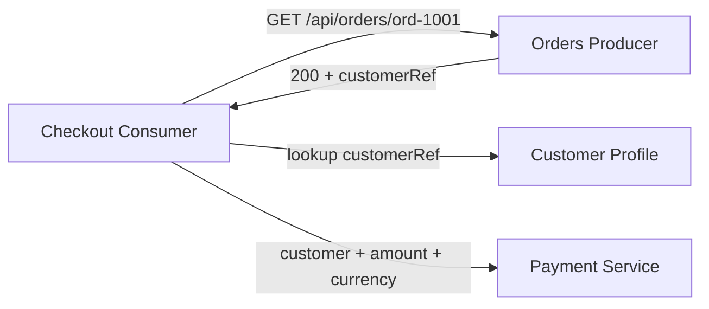
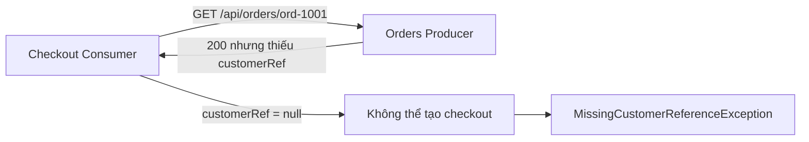
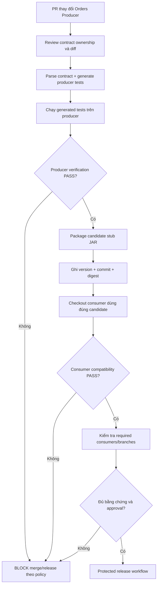

# Phát hiện thay đổi phá vỡ khi xóa trường consumer đang dùng

## 1. Mục tiêu dự án thực hành

Trong **Spring Cloud Contract** (module `SPRING_CLOUD_CONTRACT`), producer và consumer thống nhất hành vi HTTP hoặc thông điệp bằng **Groovy/YAML DSL**. Contract Verifier sinh kiểm thử phía producer; producer đóng gói stub theo phiên bản; consumer dùng **Stub Runner** để kiểm tra client và handler của chính mình. CI kết hợp các bước này để phát hiện thay đổi API không tương thích trước khi phát hành.

Trong dự án này, bạn sẽ dựng một tình huống rất thường gặp:

- **Orders Producer** cung cấp `GET /api/orders/{orderId}`.
- **Checkout Consumer** đọc trường `customerRef` để tìm thông tin khách hàng và chuẩn bị thanh toán.
- Producer muốn xóa `customerRef` vì cho rằng consumer không còn cần trường này.
- Producer có thể vẫn build thành công, nhưng Checkout sẽ hỏng khi nhận response mới.

Bạn sẽ chứng minh lỗi bằng **hai lớp kiểm tra độc lập**:

1. **Producer verification:** contract do Checkout đề xuất yêu cầu `customerRef`. Nếu implementation xóa trường mà contract vẫn được giữ, generated producer test thất bại.
2. **Consumer compatibility:** Checkout chạy code client thật với candidate stub được tạo từ phiên bản mới. Khi candidate không còn `customerRef`, test nghiệp vụ của Checkout thất bại.

Hai lớp kiểm tra bảo vệ hai phía. Nếu producer đồng thời sửa contract để bỏ `customerRef`, producer test mới có thể xanh vì kỳ vọng đã bị thay đổi. Consumer test độc lập vẫn phát hiện sự không tương thích. Vì vậy **contract ownership và review của consumer** cũng là một phần của dự án.

### Kết quả cần đạt

Hoàn thành bài thực hành khi bạn có thể:

- Dựng producer và consumer với các version stub xác định.
- Viết contract Groovy mô tả response có `customerRef`.
- Sinh và chạy producer verification tests trên implementation thật.
- Chạy Checkout test qua Stub Runner với stub baseline và nhận kết quả PASS.
- Xóa trường `customerRef` trong producer và tái hiện lỗi.
- Phân biệt producer test fail với consumer test fail.
- Tạo candidate stub mới và chứng minh consumer không tương thích.
- Chọn cách sửa: giữ trường trong giai đoạn chuyển tiếp, migration có thời hạn hoặc version hóa API.
- Thiết lập CI chặn release khi required consumer còn FAIL hoặc NOT_TESTED.

## 2. Bối cảnh nghiệp vụ và hợp đồng ban đầu

### 2.1. API ban đầu

Orders Producer trả về:

```http
GET /api/orders/ord-1001
Accept: application/json

HTTP/1.1 200 OK
Content-Type: application/json

{
  "id": "ord-1001",
  "status": "CREATED",
  "customerRef": "cust-1001",
  "totalAmount": 125000,
  "currency": "VND"
}
```

Checkout dùng:

| Field | Kiểu | Mục đích |
| --- | --- | --- |
| `id` | String | Nhận diện đơn hàng |
| `status` | String/enum | Xác định trạng thái đơn |
| `customerRef` | String | Tìm customer profile và kiểm tra điều kiện thanh toán |
| `totalAmount` | Number | Tính số tiền thanh toán |
| `currency` | String | Chọn currency cho payment request |

Trong phạm vi bài tập, `customerRef` là **trường bắt buộc** với Checkout. Việc xóa trường này làm Checkout không thể xác định khách hàng cần được xử lý cho đơn hàng.

### 2.2. Luồng hệ thống



Nếu producer xóa `customerRef`:



Đây là **breaking change** vì một consumer đang được hỗ trợ phụ thuộc vào field bị xóa. Producer có thể xem field đó là không còn cần thiết ở góc nhìn nội bộ, nhưng chỉ consumer owner mới xác nhận được việc phụ thuộc đã kết thúc.

## 3. Kiến trúc bài lab và thư mục dự án

Để mô phỏng hai nhóm độc lập, hãy dùng hai Maven projects hoặc hai repositories:

```text
contract-breaking-field-lab/
  orders-producer/
    pom.xml
    src/main/java/com/example/orders/
      OrderController.java
      OrderService.java
      OrderResponse.java
    src/test/java/com/example/orders/contract/
      OrdersContractBase.java
      OrdersContractFixtures.java
    src/test/resources/contracts/checkout/
      checkout_get_order.groovy

  checkout-consumer/
    pom.xml
    src/main/java/com/example/checkout/
      OrdersClient.java
      OrderResponse.java
      CheckoutService.java
      CheckoutView.java
    src/test/java/com/example/checkout/
      CheckoutCustomerReferenceContractTest.java
```

Trong một tổ chức thực tế:

- Contract có thể được consumer đề xuất trong repository producer qua PR, để producer sinh verification tests.
- Consumer giữ integration/compatibility tests của riêng mình.
- Producer candidate JAR được chuyển sang consumer CI qua artifact store hoặc Maven candidate repository.

**Quyền sở hữu quan trọng:** Checkout là owner của kỳ vọng `customerRef`. Producer không được âm thầm sửa hoặc xóa contract do consumer quản lý để làm xanh build. Thay đổi kỳ vọng phải có consumer owner review.

### 3.1. Các phiên bản dùng trong bài

| Artifact | Version | Vai trò |
| --- | --- | --- |
| Orders Producer baseline | `1.4.2` | Có `customerRef` |
| Orders Producer candidate | `1.5.0-pr123` | Bản thử nghiệm đã xóa field |
| Checkout Consumer | `2.3.0` | Vẫn cần `customerRef` |
| Stub classifier | `stubs` | Mapping và contracts được đóng gói |

Đây là **version giả định của bài thực hành**, không phải version Spring Cloud Contract hay Spring Boot. Chọn Spring Boot, Spring Cloud release train và Contract plugin theo ma trận tương thích của dự án; quản lý version qua BOM hoặc version catalog. Không sao chép các version minh họa thành cấu hình production.

### 3.2. Điều kiện trước khi bắt đầu

- JDK và Maven Wrapper phù hợp với Spring Boot/Cloud đã chọn.
- Orders Producer có Spring MVC và test dependencies.
- Producer dùng Spring Cloud Contract Maven plugin.
- Checkout Consumer có HTTP client và Spring Cloud Contract Stub Runner ở test scope.
- Maven local repository hoặc candidate repository có thể cung cấp stub cho consumer.
- Test fixtures dùng dữ liệu tổng hợp, không lấy customer data thật.
- CI có thể chạy `clean verify` và lưu test reports.

## 4. Bước 1 — Xác định hành vi và dependency của consumer

Trước khi viết contract, hãy đọc consumer behavior và ghi rõ trường nào được sử dụng.

### 4.1. Bảng dependency

| Consumer behavior | Dữ liệu cần từ Orders API | Nếu field bị thiếu |
| --- | --- | --- |
| Tải thông tin đơn | `id` | Không xác định được order |
| Kiểm tra trạng thái | `status` | Không biết đơn có thể thanh toán |
| Tìm customer | `customerRef` | Không thể tra hồ sơ khách hàng |
| Tính tiền | `totalAmount` | Không thể tính payment |
| Chọn currency | `currency` | Không thể tạo giao dịch đúng currency |

Ghi nhận này là đầu vào của contract review. Không cần copy toàn bộ response production; chỉ giữ các field thực sự tạo thành giao diện mà consumer phụ thuộc.

### 4.2. Consumer-owned expectation

Checkout yêu cầu:

```text
For GET /api/orders/ord-1001:
  - HTTP status is 200
  - Content-Type is application/json
  - id is ord-1001
  - status is CREATED
  - customerRef is cust-1001
  - totalAmount is a JSON number
  - currency is VND
```

Nếu một field bắt buộc bị xóa, consumer phải có test cho thấy hành vi bị ảnh hưởng. **Đừng chỉ ghi dependency trong tài liệu**; hãy đưa nó vào executable contract hoặc assertion trong consumer test.

## 5. Bước 2 — Viết contract Groovy do Checkout đề xuất

Tạo file:

`orders-producer/src/test/resources/contracts/checkout/checkout_get_order.groovy`

```groovy
import org.springframework.cloud.contract.spec.Contract

Contract.make {
    name 'checkout_get_order'
    description 'Checkout cần customerRef để xác định khách hàng của đơn'

    request {
        method GET()
        urlPath '/api/orders/ord-1001'
        headers {
            header 'Accept': 'application/json'
        }
    }

    response {
        status 200
        headers {
            contentType(applicationJson())
        }
        body([
            id         : 'ord-1001',
            status     : 'CREATED',
            customerRef: 'cust-1001',
            totalAmount: 125000,
            currency   : 'VND'
        ])
    }
}
```

### 5.1. Vì sao contract phải nêu rõ `customerRef`?

Generated producer test cần kiểm tra response thật có:

- Field `customerRef`.
- Giá trị hoặc matcher phù hợp với fixture.
- Kiểu dữ liệu string theo schema đã thống nhất.

Nếu producer xóa field, assertion do contract sinh ra sẽ phát hiện response thiếu dữ liệu. Việc chỉ kiểm tra HTTP status `200` sẽ không bắt được breaking change này.

### 5.2. YAML DSL tương đương

Nếu dự án dùng YAML DSL, contract tương đương có thể là:

```yaml
name: checkout_get_order
description: Checkout cần customerRef để xác định khách hàng của đơn
request:
  method: GET
  urlPath: /api/orders/ord-1001
  headers:
    Accept: application/json
response:
  status: 200
  headers:
    Content-Type: application/json
  body:
    id: ord-1001
    status: CREATED
    customerRef: cust-1001
    totalAmount: 125000
    currency: VND
```

Chọn **một** biểu diễn cho kịch bản trong producer build. Không thêm đồng thời hai file Groovy/YAML trùng request chỉ để minh họa cả hai cú pháp.

### 5.3. Những gì contract chưa khẳng định

Contract trên chỉ mô tả một nhánh cụ thể. Nó chưa chứng minh:

- Mọi order đều có customer profile hợp lệ.
- Checkout được phép thanh toán mọi trạng thái.
- Customer Profile service luôn sẵn sàng.
- Authentication/authorization production đúng.
- Database hoặc broker production hoạt động.

Những hành vi ngoài phạm vi phải được test ở lớp thích hợp. Không mở rộng contract thành bản sao toàn bộ implementation.

## 6. Bước 3 — Cấu hình producer verification

### 6.1. Dependencies và Maven plugin

Trong `orders-producer/pom.xml`, producer cần test dependencies và plugin tương thích:

```xml
<dependencies>
  <dependency>
    <groupId>org.springframework.boot</groupId>
    <artifactId>spring-boot-starter-test</artifactId>
    <scope>test</scope>
  </dependency>
  <dependency>
    <groupId>org.springframework.cloud</groupId>
    <artifactId>spring-cloud-starter-contract-verifier</artifactId>
    <scope>test</scope>
  </dependency>
</dependencies>

<build>
  <plugins>
    <plugin>
      <groupId>org.springframework.cloud</groupId>
      <artifactId>spring-cloud-contract-maven-plugin</artifactId>
      <version>${spring-cloud-contract.version}</version>
      <extensions>true</extensions>
      <configuration>
        <testFramework>JUNIT5</testFramework>
        <testMode>MOCKMVC</testMode>
        <baseClassForTests>
          com.example.orders.contract.OrdersContractBase
        </baseClassForTests>
        <failOnNoContracts>true</failOnNoContracts>
        <failOnInProgress>true</failOnInProgress>
      </configuration>
    </plugin>
  </plugins>
</build>
```

`spring-cloud-contract.version` cần được quản lý trong parent POM/version catalog theo release train đã chọn. Đoạn trên là **POM fragment**, không phải toàn bộ project; producer cần các dependency và compiler/test runner tương ứng.

### 6.2. Producer base test

Tạo:

`orders-producer/src/test/java/com/example/orders/contract/OrdersContractBase.java`

```java
package com.example.orders.contract;

import io.restassured.module.mockmvc.RestAssuredMockMvc;
import org.junit.jupiter.api.BeforeEach;
import org.springframework.beans.factory.annotation.Autowired;
import org.springframework.boot.test.autoconfigure.web.servlet.AutoConfigureMockMvc;
import org.springframework.boot.test.context.SpringBootTest;
import org.springframework.test.web.servlet.MockMvc;

@SpringBootTest
@AutoConfigureMockMvc
public abstract class OrdersContractBase {

    @Autowired
    private MockMvc mockMvc;

    @Autowired
    private OrdersContractFixtures fixtures;

    @BeforeEach
    protected void prepareContractData() {
        fixtures.reset();
        fixtures.createOrder(
            "ord-1001",
            "CREATED",
            "cust-1001",
            125000L,
            "VND"
        );
        RestAssuredMockMvc.mockMvc(mockMvc);
    }
}
```

`OrdersContractFixtures` là helper **do bài lab tự hiện thực**, không phải API của Spring Cloud Contract. Nó phải tạo dữ liệu trong test database hoặc repository mà controller/service thật sử dụng. Không mock sẵn response của controller rồi coi đó là bằng chứng implementation đã hỗ trợ field.

### 6.3. Dữ liệu fixture

Một fixture có thể có interface:

```java
package com.example.orders.contract;

public interface OrdersContractFixtures {
    void reset();

    void createOrder(
        String orderId,
        String status,
        String customerRef,
        long totalAmount,
        String currency
    );
}
```

Implementation có thể dùng test database, repository hoặc test container tùy project. Các điều kiện bắt buộc:

- Mỗi test bắt đầu từ trạng thái xác định.
- `ord-1001` tồn tại và có `customerRef=cust-1001`.
- Test không phụ thuộc thứ tự chạy.
- Không dùng dữ liệu khách hàng production.
- Generated test gọi controller/service thật ở boundary đã chọn.

### 6.4. Generated producer test phải kiểm tra gì?

Khi chạy generator, test được tạo từ `checkout_get_order.groovy`. Test đó phải:

1. Gửi `GET /api/orders/ord-1001` tới MockMvc.
2. Kiểm tra response status `200`.
3. Kiểm tra response body có `id`, `status`, `customerRef`, `totalAmount` và `currency` theo contract.
4. Thất bại nếu `customerRef` bị bỏ khỏi JSON.

Không cần tự viết một test giống hệt generated test chỉ để tăng số lượng. Hãy kiểm tra generated source và report để chắc chắn **test do contract sinh ra thực sự chạy**.

## 7. Bước 4 — Tạo producer API baseline

Response DTO ban đầu:

```java
package com.example.orders;

import java.math.BigDecimal;

public record OrderResponse(
    String id,
    String status,
    String customerRef,
    BigDecimal totalAmount,
    String currency
) {}
```

Controller minh họa:

```java
package com.example.orders;

import org.springframework.web.bind.annotation.GetMapping;
import org.springframework.web.bind.annotation.PathVariable;
import org.springframework.web.bind.annotation.RequestMapping;
import org.springframework.web.bind.annotation.RestController;

@RestController
@RequestMapping("/api/orders")
public class OrderController {

    private final OrderService orderService;

    public OrderController(OrderService orderService) {
        this.orderService = orderService;
    }

    @GetMapping("/{orderId}")
    public OrderResponse getOrder(@PathVariable String orderId) {
        return orderService.getOrder(orderId);
    }
}
```

`OrderService` là service nghiệp vụ của producer. Bài lab không bắt buộc một persistence implementation cụ thể; điều quan trọng là test fixture phải đưa dữ liệu qua đúng service/controller để JSON response được serialize bởi ứng dụng thật.

### 7.1. Baseline response

Khi gọi:

```bash
curl -i -H "Accept: application/json" \
  http://localhost:8080/api/orders/ord-1001
```

response phải có:

```json
{
  "id": "ord-1001",
  "status": "CREATED",
  "customerRef": "cust-1001",
  "totalAmount": 125000,
  "currency": "VND"
}
```

Đây là dữ liệu giả của bài thực hành. Trong ứng dụng thật, giá trị có thể được serialize khác về định dạng số tùy cấu hình; contract cần phản ánh chính xác JSON type mà consumer dùng.

## 8. Bước 5 — Chạy baseline producer verification

Tại thư mục `orders-producer`:

```bash
./mvnw -B -ntp clean verify
```

Lệnh cần:

- Phát hiện contract trong đúng contracts root.
- Sinh generated producer test.
- Compile generated test.
- Thực thi test qua Surefire/test runner.
- Convert HTTP contract thành WireMock mapping.
- Tạo stub artifact theo plugin configuration.

### 8.1. Đọc bằng chứng

| Bằng chứng | Kỳ vọng baseline |
| --- | --- |
| Contract discovery | Tìm thấy `checkout_get_order` |
| Generated test | Có test cho response của `GET` |
| Test report | Test chạy và PASS |
| Assertion `customerRef` | Giá trị `cust-1001` được xác minh |
| Stub mapping | Có mapping cho request path |
| Stub JAR | Có contract và mapping đúng version |

**Đừng chỉ nhìn dòng `BUILD SUCCESS`.** Nếu generated test không được Surefire discover hoặc bị skip, build xanh không chứng minh producer đáp ứng contract.

### 8.2. Maven lifecycle cần nhớ

Các mốc chính trong Maven default lifecycle khi plugin đã được bind:

```text
generate-test-sources
  -> Contract Verifier generateTests

process-test-resources
  -> convert contracts thành HTTP mappings

test-compile
  -> compile generated producer tests

test
  -> Surefire thực thi generated tests

package
  -> generateStubs và package classifier stubs

verify
  -> các quality gates/integration tests được cấu hình

install / deploy
  -> chỉ sau khi các gate bắt buộc đạt
```

`convert` xảy ra trước `test`; `generateStubs` gắn với `package`. Việc sinh source hoặc mapping **không thay thế** việc test thực thi.

## 9. Bước 6 — Dựng Checkout Consumer dùng field

Checkout khai báo DTO:

```java
package com.example.checkout;

import java.math.BigDecimal;

public record OrderResponse(
    String id,
    String status,
    String customerRef,
    BigDecimal totalAmount,
    String currency
) {}
```

### 9.1. HTTP client

```java
package com.example.checkout;

import org.springframework.beans.factory.annotation.Value;
import org.springframework.stereotype.Component;
import org.springframework.web.client.RestTemplate;

@Component
public class OrdersClient {

    private final RestTemplate restTemplate;
    private final String baseUrl;

    public OrdersClient(
        RestTemplate restTemplate,
        @Value("${orders.base-url}") String baseUrl
    ) {
        this.restTemplate = restTemplate;
        this.baseUrl = baseUrl;
    }

    public OrderResponse getOrder(String orderId) {
        return restTemplate.getForObject(
            baseUrl + "/api/orders/{orderId}",
            OrderResponse.class,
            orderId
        );
    }
}
```

Để constructor injection ở trên hoạt động, Checkout cần cung cấp một `RestTemplate` bean. Ví dụ cấu hình:

```java
package com.example.checkout;

import org.springframework.boot.web.client.RestTemplateBuilder;
import org.springframework.context.annotation.Bean;
import org.springframework.context.annotation.Configuration;
import org.springframework.web.client.RestTemplate;

@Configuration
public class CheckoutHttpClientConfiguration {

    @Bean
    RestTemplate ordersRestTemplate(RestTemplateBuilder builder) {
        return builder.build();
    }
}
```

RestTemplate được dùng ở đây để minh họa client HTTP đồng bộ; dự án thực tế có thể dùng `RestClient`, `WebClient` hoặc HTTP client khác. Khi đổi client, consumer test vẫn phải đi qua **client thật của ứng dụng**.

### 9.2. Consumer service dùng `customerRef`

```java
package com.example.checkout;

import org.springframework.stereotype.Service;

@Service
public class CheckoutService {

    private final OrdersClient ordersClient;
    private final CustomerDirectory customerDirectory;

    public CheckoutService(
        OrdersClient ordersClient,
        CustomerDirectory customerDirectory
    ) {
        this.ordersClient = ordersClient;
        this.customerDirectory = customerDirectory;
    }

    public CheckoutView prepare(String orderId) {
        OrderResponse order = ordersClient.getOrder(orderId);

        if (order.customerRef() == null || order.customerRef().isBlank()) {
            throw new MissingCustomerReferenceException(order.id());
        }

        CustomerSummary customer =
            customerDirectory.find(order.customerRef());

        return new CheckoutView(
            order.id(),
            order.status(),
            customer.customerRef(),
            order.totalAmount(),
            order.currency()
        );
    }
}
```

`CustomerDirectory` và `CustomerSummary` là API nội bộ giả định của Checkout. Chúng có thể dùng test double trong bài consumer test để cô lập dependency Customer Profile; **Orders HTTP client vẫn phải thật** để kiểm tra response từ stub.

Ví dụ kiểu dữ liệu nội bộ:

```java
package com.example.checkout;

public interface CustomerDirectory {
    CustomerSummary find(String customerRef);
}

public record CustomerSummary(String customerRef) {}

public record CheckoutView(
    String orderId,
    String status,
    String customerRef,
    java.math.BigDecimal totalAmount,
    String currency
) {}
```

Exception:

```java
package com.example.checkout;

public class MissingCustomerReferenceException
    extends RuntimeException {

    public MissingCustomerReferenceException(String orderId) {
        super("Order has no customer reference: " + orderId);
    }
}
```

### 9.3. Consumer test với baseline stub

```java
package com.example.checkout;

import org.junit.jupiter.api.Test;
import org.springframework.beans.factory.annotation.Autowired;
import org.springframework.boot.test.context.SpringBootTest;
import org.springframework.context.annotation.Bean;
import org.springframework.context.annotation.Import;
import org.springframework.boot.test.context.TestConfiguration;
import org.springframework.cloud.contract.stubrunner.StubRunnerProperties;
import org.springframework.cloud.contract.stubrunner.spring.AutoConfigureStubRunner;
import org.springframework.context.annotation.Primary;

import static org.assertj.core.api.Assertions.assertThat;

@SpringBootTest(properties = {
    "orders.base-url=http://localhost:8090"
})
@Import(CheckoutCustomerReferenceContractTest.CheckoutTestConfiguration.class)
@AutoConfigureStubRunner(
    ids = "com.example:orders-producer:1.4.2:stubs:8090",
    stubsMode = StubRunnerProperties.StubsMode.LOCAL
)
class CheckoutCustomerReferenceContractTest {

    @Autowired
    private CheckoutService checkoutService;

    @Test
    void preparesCheckoutUsingCustomerReference() {
        CheckoutView result = checkoutService.prepare("ord-1001");

        assertThat(result.orderId()).isEqualTo("ord-1001");
        assertThat(result.customerRef()).isEqualTo("cust-1001");
        assertThat(result.totalAmount()).isEqualByComparingTo("125000");
        assertThat(result.currency()).isEqualTo("VND");
    }

    @TestConfiguration
    static class CheckoutTestConfiguration {

        @Bean
        @Primary
        CustomerDirectory testCustomerDirectory() {
            return customerRef -> new CustomerSummary(customerRef);
        }
    }
}
```

`CheckoutView`, `CustomerDirectory` và `CustomerSummary` là kiểu do consumer project tự định nghĩa. Test configuration cung cấp customer giả cho `cust-1001`. Không mock `OrdersClient` vì mục tiêu của bài là xác minh response của Orders stub đi qua HTTP client thật.

### 9.4. Consumer dependency

Consumer cần Stub Runner trong test scope, với version được quản lý theo Spring Cloud BOM:

```xml
<dependency>
  <groupId>org.springframework.cloud</groupId>
  <artifactId>spring-cloud-starter-contract-stub-runner</artifactId>
  <scope>test</scope>
</dependency>
```

Tên artifact và cấu hình annotation phải khớp release train/plugin version của project. Không trộn các major versions tùy tiện.

### 9.5. Chạy baseline consumer

Trước hết cài stub baseline vào Maven local repository bằng producer:

```bash
# Trong orders-producer, sau khi clean verify đã PASS:
./mvnw -B -ntp install
```

Sau đó chạy consumer:

```bash
# Trong checkout-consumer, cùng Maven local repository:
./mvnw -B -ntp clean verify
```

Kết quả mong đợi:

```text
Orders producer 1.4.2 generated contract tests: PASS
Orders stub 1.4.2: RESOLVED
Checkout HTTP client test: PASS
customerRef: cust-1001
```

Nếu producer và consumer chạy ở hai CI jobs hoặc repositories khác nhau, không giả định chúng chia sẻ `~/.m2`. Hãy truyền **chính stub JAR đã được xác minh** qua CI artifact hoặc candidate repository, xác nhận checksum rồi dùng đúng version.

## 10. Bước 7 — Tái hiện breaking change: xóa `customerRef`

Tạo branch producer:

`feature/remove-customer-ref`

### 10.1. Thay đổi implementation

Producer sửa DTO thành:

```java
package com.example.orders;

import java.math.BigDecimal;

// PHIÊN BẢN CANDIDATE: đã xóa customerRef.
public record OrderResponse(
    String id,
    String status,
    BigDecimal totalAmount,
    String currency
) {}
```

Controller/service giờ serialize response:

```json
{
  "id": "ord-1001",
  "status": "CREATED",
  "totalAmount": 125000,
  "currency": "VND"
}
```

### 10.2. Điều gì xảy ra nếu giữ contract do Checkout sở hữu?

Chạy:

```bash
./mvnw -B -ntp clean verify
```

Generated producer test vẫn mong đợi:

```json
{
  "customerRef": "cust-1001"
}
```

Producer trả JSON không có field này. **Producer verification phải FAIL** ở assertion body/JSON path tương ứng.

Đây là kết quả đúng: implementation không còn đáp ứng một hành vi consumer đã thỏa thuận. Không sửa generated test thủ công để làm xanh.

### 10.3. Đọc lỗi và xác định nguyên nhân

Thông điệp thực tế phụ thuộc phiên bản generated test framework, nhưng thường cho biết:

- Request đã được gửi thành công.
- HTTP status có thể vẫn là `200`.
- JSON response thiếu hoặc không khớp `customerRef`.
- Assertion do Contract Verifier sinh ra thất bại.

Đừng nhầm lỗi này với:

- Contract không được phát hiện.
- Fixture không có order.
- MockMvc không khởi tạo.
- Test runner không chạy generated tests.

Phải đọc response thực tế và test report để xác nhận đây là **thiếu field trong API**.

### 10.4. Nếu producer sửa cả contract để xóa field thì sao?

Giả sử producer thay contract thành:

```groovy
response {
    status 200
    headers {
        contentType(applicationJson())
    }
    body([
        id         : 'ord-1001',
        status     : 'CREATED',
        totalAmount: 125000,
        currency   : 'VND'
    ])
}
```

Producer generated tests lúc này có thể **PASS** vì contract mới không còn yêu cầu `customerRef`. Nhưng đây không chứng minh thay đổi tương thích. Nếu Checkout consumer-owned contract bị xóa hoặc sửa mà không có Checkout owner review, quy trình quản trị contract đã bị phá vỡ.

Tiếp tục build candidate stub và chạy **consumer test độc lập** ở bước tiếp theo. Test Checkout vẫn cần `customerRef` nên phải phát hiện lỗi.

## 11. Bước 8 — Dùng candidate stub mới để kiểm tra consumer

Để kiểm tra tình huống producer đã cập nhật contract cùng implementation:

1. Giữ lại bản consumer expectation trong Checkout repository.
2. Producer tạo candidate version riêng, ví dụ `1.5.0-pr123`.
3. Producer verification chạy theo contract đã được producer/consumer owners chấp thuận.
4. Build và đóng gói candidate stub.
5. Checkout test dùng **đúng candidate version** thay cho baseline `1.4.2`.

### 11.1. Candidate version

Ví dụ producer version:

```xml
<version>1.5.0-pr123</version>
```

Consumer test đổi Stub Runner ID:

```java
@AutoConfigureStubRunner(
    ids = "com.example:orders-producer:1.5.0-pr123:stubs:8090",
    stubsMode = StubRunnerProperties.StubsMode.LOCAL
)
```

Version `1.5.0-pr123` là candidate giả định, phải khớp chính xác version producer build và install/publish. Không dùng `LATEST` hoặc version động cho release gate.

### 11.2. Cài candidate stub

Trong producer candidate sau khi các producer checks đã đạt:

```bash
./mvnw -B -ntp clean install
```

Trong Checkout consumer, cùng runner/local Maven repository:

```bash
./mvnw -B -ntp clean verify
```

Nếu consumer chạy trên một runner khác, chuyển candidate JAR bằng CI artifact hoặc candidate repository và kiểm tra digest. Không copy một JAR cũ có cùng tên vào cache rồi coi đó là candidate vừa build.

### 11.3. Kết quả mong đợi khi stub thiếu `customerRef`

Orders stub trả:

```json
{
  "id": "ord-1001",
  "status": "CREATED",
  "totalAmount": 125000,
  "currency": "VND"
}
```

Checkout HTTP client deserialize thành DTO với `customerRef` bằng `null` (trong cấu hình Jackson/record thông thường nếu field không có). Checkout service phát hiện thiếu customer reference và ném:

```text
MissingCustomerReferenceException:
Order has no customer reference: ord-1001
```

Consumer compatibility test **FAIL**. Đây là bằng chứng độc lập rằng candidate producer không còn đáp ứng consumer hiện tại.

### 11.4. Hai lớp bảo vệ trong cùng tình huống

| Tình huống | Producer generated test | Checkout candidate test |
| --- | --- | --- |
| Chỉ xóa field trong implementation, giữ contract | **FAIL** | Có thể chưa cần chạy vì producer gate đã fail |
| Xóa field trong implementation và contract producer | Có thể PASS theo contract mới | **FAIL** với candidate stub |
| Giữ field và behavior như baseline | PASS | PASS |
| Consumer đã migrate, không còn dùng field | Phụ thuộc contract mới được owners chấp thuận | PASS sau khi cập nhật test/client |

**Không dùng producer test đơn lẻ để chứng minh backward compatibility.** Producer test xác minh producer theo contract được chạy; consumer test xác minh consumer thật với candidate stub.

## 12. Bước 9 — Đọc failure để biết consumer đang phụ thuộc gì

### 12.1. Lỗi xảy ra ở tầng HTTP client hay business logic?

Trong ví dụ này:

- WireMock trả HTTP `200`.
- JSON deserialize thành công.
- Field `customerRef` nhận `null`.
- Checkout service kiểm tra field và phát exception.

Do đó lỗi nằm ở **business contract/response schema**, không phải network hay port.

Nếu DTO dùng annotation/constructor validation nghiêm ngặt, lỗi có thể xuất hiện ngay ở bước deserialize. Kết quả vẫn là consumer không chấp nhận candidate response.

### 12.2. Consumer test sai có thể bỏ lọt breaking change

Test yếu:

```java
// Không đủ: chỉ xác nhận API có trả response.
OrderResponse order = ordersClient.getOrder("ord-1001");
assertThat(order).isNotNull();
```

Test này vẫn PASS nếu `customerRef` biến mất và Jackson gán `null`.

Test tốt:

```java
OrderResponse order = ordersClient.getOrder("ord-1001");

assertThat(order.customerRef()).isEqualTo("cust-1001");
```

Hoặc test đi qua business service:

```java
CheckoutView result = checkoutService.prepare("ord-1001");

assertThat(result.customerRef()).isEqualTo("cust-1001");
```

Test thứ hai còn chứng minh Checkout sử dụng dữ liệu đúng trong luồng nghiệp vụ. Có thể giữ cả hai nếu mỗi test bảo vệ một boundary khác nhau, nhưng không cần nhân đôi assertion vô nghĩa.

### 12.3. Không nhầm WireMock no-match với API error

Nếu test chỉ assert `404`, WireMock có thể trả `404` vì không có mapping. Với bài này, response thiếu field nhưng vẫn có thể match `200`. Hãy kiểm tra:

- Stub Runner đã nạp đúng artifact version.
- Request URL đúng.
- Response body thực tế.
- Business assertion trên `customerRef`.
- Test report gắn với candidate version.

## 13. Bước 10 — Chọn cách sửa breaking change

Producer muốn loại bỏ `customerRef`. Consumer vẫn cần nó. Có ba lựa chọn phổ biến.

### 13.1. Phương án A: giữ field và bổ sung field mới

Producer giữ `customerRef` trong giai đoạn chuyển tiếp và thêm field mới nếu API cần tên/semantics mới:

```json
{
  "id": "ord-1001",
  "status": "CREATED",
  "customerRef": "cust-1001",
  "customerReference": "cust-1001",
  "totalAmount": 125000,
  "currency": "VND"
}
```

Kế hoạch:

1. Producer thêm field mới, giữ field cũ.
2. Contract được cập nhật với sự đồng ý của consumer owners.
3. Producer generated tests kiểm tra cả field cũ và field mới trong giai đoạn chuyển tiếp.
4. Consumer mới migrate sang field mới.
5. Consumer cũ/LTS được kiểm tra và triển khai.
6. Theo dõi việc sử dụng field cũ qua telemetry phù hợp.
7. Chỉ đề xuất xóa field cũ khi không còn consumer được hỗ trợ phụ thuộc.

**Lưu ý:** thêm field mới cũng có thể phá consumer dùng strict schema hoặc fail-on-unknown-properties. Candidate stub và consumer tests vẫn cần chạy trước release.

### 13.2. Phương án B: version hóa API

Nếu semantics thay đổi không thể tương thích, có thể tạo endpoint version mới:

```text
V1:
GET /api/v1/orders/ord-1001
  -> customerRef vẫn được cung cấp

V2:
GET /api/v2/orders/ord-1001
  -> schema mới, không còn customerRef
```

Hoặc dùng versioning bằng media type/header nếu đó là chính sách API của tổ chức. Không tạo version chỉ bằng cách đổi URL trong tài liệu mà chưa có routing và rollout thật.

Kế hoạch:

- Giữ V1 cho consumer còn hỗ trợ.
- Consumer owner quyết định thời điểm chuyển V2.
- Contract V1/V2 có tests riêng.
- Producer theo dõi migration và thông báo deprecation.
- Xóa V1 chỉ sau support window và approval.

### 13.3. Phương án C: thay đổi consumer trước rồi mới xóa field

Nếu customer reference có thể lấy từ nguồn khác:

1. Checkout thiết kế và kiểm thử nguồn thay thế.
2. Consumer phát hành phiên bản không còn phụ thuộc `customerRef`.
3. Producer kiểm kê tất cả consumer còn hỗ trợ.
4. Producer đánh dấu field deprecated và đo usage.
5. Chỉ xóa field sau khi các consumer bắt buộc đã migrate.

Đây là thay đổi phối hợp nhiều nhóm; **không xóa field chỉ vì một consumer mới đã bỏ dùng**.

### 13.4. So sánh quyết định

| Phương án | Ưu điểm | Chi phí/rủi ro |
| --- | --- | --- |
| Giữ field + thêm field mới | Thường tương thích hơn, rollout từ từ | Response lớn hơn; strict consumer cần test |
| Version hóa API | Schema mới rõ ràng, consumer chọn thời điểm | Phải duy trì nhiều phiên bản |
| Migrate consumer trước | Có thể loại bỏ field sạch khi hết dependency | Cần inventory, phối hợp rollout và telemetry |

Không có phương án nào tự động đúng cho mọi API. Producer/API owner và consumer owners cần thống nhất semantics, thời gian hỗ trợ và rollback.

## 14. Bước 11 — Thiết kế CI để không bỏ lọt việc xóa field

Pipeline phải chạy các bước theo đúng thứ tự và chuyển **cùng candidate artifact** qua producer và consumer jobs.

### 14.1. Sơ đồ pipeline



### 14.2. Producer CI gate

Ví dụ lệnh:

```bash
./mvnw -B -ntp clean verify
```

Producer gate phải kiểm tra:

- Contract consumer-owned được phát hiện.
- Không có `inProgress` hoặc `ignored` trái chính sách.
- Generated producer tests compile và thực sự chạy.
- Assertion `customerRef` đạt.
- Không có test bị skip để che lỗi.
- HTTP mappings và stub JAR được tạo.
- Artifact version/classifier khớp candidate.

### 14.3. Consumer CI gate

Consumer test phải:

- Resolve đúng `com.example:orders-producer:1.5.0-pr123:stubs`.
- Dùng Stub Runner ở test scope.
- Gọi Orders API qua client thật.
- Assert `customerRef` hoặc behavior phụ thuộc nó.
- Lưu report gắn với producer candidate commit/version.
- Không dùng baseline stub cũ do cache.

### 14.4. Pseudocode CI giữa hai repositories

```text
Producer PR job:
  checkout exact producer commit
  validate contract ownership/review
  ./mvnw clean verify
  confirm generated tests executed
  package candidate -stubs.jar
  compute SHA-256
  upload exact JAR + provenance metadata

Checkout compatibility job:
  checkout supported Checkout revision
  download exact candidate JAR
  verify checksum
  install into isolated Maven local repository
  configure Stub Runner with exact candidate GAV/classifier
  run Checkout compatibility tests
  report PASS/FAIL against producer commit

Release job:
  require producer verification PASS
  require all required consumer results PASS or approved waiver
  require security/provenance checks
  publish immutable release artifact
```

Đây là **mô hình pipeline**, không phải script copy chạy ngay. Cần cấu hình artifact transfer, checksum, test report parsing và quyền repository theo CI platform.

### 14.5. Không dùng version động

Sai:

```text
com.example:orders-producer:latest:stubs
```

Đúng cho candidate test:

```text
com.example:orders-producer:1.5.0-pr123:stubs
```

Version động có thể resolve sang một artifact khác giữa hai lần chạy. Khi đó kết quả PASS không còn chứng minh candidate đang được review.

## 15. Bước 12 — Phân biệt các kết quả để ra quyết định

| Producer tests | Consumer tests | Ý nghĩa | Quyết định |
| --- | --- | --- | --- |
| PASS | PASS | Candidate đáp ứng producer contract và consumer đã chạy | Có thể xét release |
| FAIL | Chưa chạy | Producer không đáp ứng contract đã chấp thuận | BLOCK |
| PASS | FAIL | Producer contract có thể hợp lệ nhưng consumer không tương thích candidate | BLOCK hoặc migration |
| PASS | NOT_TESTED | Chưa đủ bằng chứng cho consumer bắt buộc | BLOCK theo policy |
| SKIPPED | PASS | Consumer có thể chạy stub, nhưng producer chưa được verify | BLOCK |
| PASS | PASS với stub baseline cũ | Không chứng minh candidate mới tương thích | Chạy lại với exact candidate |

**Không lấy một trạng thái xanh tổng hợp** thay cho kết quả từng gate. Đặc biệt, `NOT_TESTED` không phải `PASS`.

### 15.1. Nếu producer test PASS nhưng consumer FAIL

Điều đó có thể xảy ra khi:

- Producer contract đã bị thay đổi, làm mất assertion `customerRef`.
- Consumer vẫn giữ DTO/logic phụ thuộc field.
- Candidate stub mới không còn field.
- Consumer có strict schema/deserializer.

Đây là một breaking change thật cần được owner giải quyết. Không xóa consumer assertion để làm pipeline xanh nếu dependency nghiệp vụ chưa được loại bỏ.

### 15.2. Nếu producer test FAIL nhưng consumer test PASS

Có thể consumer test đang dùng **stub baseline cũ**, hoặc producer verification đang chạy contract mới. Kiểm tra version, commit và digest trước khi kết luận. Hai jobs phải gắn cùng producer candidate.

## 16. Các lỗi thực hành thường gặp

| Triệu chứng | Nguyên nhân | Cách xử lý |
| --- | --- | --- |
| Producer build xanh dù field đã xóa | Contract không được phát hiện, test bị skip hoặc contract đã bị sửa | Kiểm tra contracts root, generated test report và owner review |
| Generated test không compile | JUnit/base class/dependency mismatch | Kiểm tra plugin config và test framework |
| Producer test fail ở field khác | Fixture hoặc schema thay đổi ngoài dự kiến | Đọc response và assertion cụ thể |
| Checkout test vẫn PASS sau khi xóa field | Consumer test mock OrdersClient hoặc chỉ assert response tồn tại | Dùng HTTP client thật và assert customerRef |
| Checkout resolve stub cũ | Maven local cache hoặc ID sai | Clean/isolate local repository, pin candidate GAV |
| Stub Runner không tải được JAR | Artifact chưa install/publish hoặc classifier sai | Kiểm tra GAV và repository |
| HTTP 404 không rõ lý do | WireMock no-match hoặc business error | Assert body code và kiểm tra mapping |
| JSON parse lỗi | Content-Type/JSON type/deserializer | Xem response thực tế và DTO |
| Test phụ thuộc thứ tự | Fixture không reset | Seed/reset trước mỗi test |
| Producer PASS, consumer LTS chưa chạy | Matrix thiếu branch | Ghi NOT_TESTED và block/waiver theo policy |

### 16.1. Kiểm tra candidate thực sự đang được dùng

Khi nghi ngờ cache:

1. Ghi Stub Runner ID trong test report.
2. Xác nhận version và classifier đúng candidate.
3. Xác nhận artifact digest.
4. Dùng Maven local repository cô lập hoặc CI runner sạch.
5. Chạy lại consumer test và lưu log đã loại bỏ thông tin nhạy cảm.

Không xóa toàn bộ cache của đội để sửa một job; hãy tái hiện bằng repository cô lập.

## 17. Bài mở rộng — nhiều consumer cùng dùng một field

Orders Producer còn phục vụ:

| Consumer | Dùng `customerRef` để làm gì? | Trạng thái hỗ trợ |
| --- | --- | --- |
| Checkout | Tìm hồ sơ và tạo payment | `main`, `release/lts` |
| Invoice | Đưa customer reference vào hóa đơn | `main` |
| Analytics | Gom nhóm doanh thu theo customer | `main` |
| Mobile Gateway | Chuyển thông tin đơn tới app | `release/lts` |

Nếu chỉ Checkout đã migrate, producer vẫn chưa được xóa field vì Invoice, Analytics hoặc Mobile Gateway còn dùng.

### 17.1. Compatibility matrix

| Consumer | Branch/version | Candidate không có field | Kết quả minh họa |
| --- | --- | --- | --- |
| Checkout | `main` | Chạy test | FAIL |
| Checkout | `release/lts` | Chạy test | FAIL |
| Invoice | `main` | Chạy test | FAIL |
| Analytics | `main` | Chạy test | NOT_TESTED |
| Mobile Gateway | `release/lts` | Chạy test | FAIL |

Đây là kết quả giả định để thực hành. Release gate phải xem **từng consumer còn được hỗ trợ**. Không lấy việc Checkout main đã migrate làm căn cứ xóa field khỏi tất cả consumers.

### 17.2. Consumer inventory và deprecation

Trước khi xóa field:

- Liệt kê consumer owner và branch còn support.
- Xác định version consumer sẽ chuyển sang schema mới.
- Đánh dấu field deprecated bằng tài liệu/metadata phù hợp.
- Theo dõi usage qua telemetry có bảo vệ dữ liệu.
- Thông báo deadline và migration guide.
- Chạy consumer compatibility tests trước khi bỏ field.
- Chỉ publish breaking version khi đã có quyết định và rollout plan.

## 18. Bài mở rộng — message contract cũng có thể bị breaking

Nếu `customerRef` được dùng trong event `ORDER_CREATED`, xóa field khỏi message body cũng phá consumer.

### 18.1. Messaging contract baseline

```groovy
import org.springframework.cloud.contract.spec.Contract

Contract.make {
    name 'order_created_event'
    label 'order_created'

    input {
        triggeredBy('publishOrderCreated()')
    }

    outputMessage {
        sentTo('orders.events')
        body([
            eventType  : 'ORDER_CREATED',
            orderId    : 'ord-1001',
            customerRef: 'cust-1001',
            totalAmount: 125000,
            currency   : 'VND'
        ])
        headers {
            header('eventType', 'ORDER_CREATED')
            messagingContentType(applicationJson())
        }
    }
}
```

`publishOrderCreated()` là method do producer base test tự hiện thực, phải kích hoạt luồng publish thật. Contract message cần kiểm tra body/header/destination phù hợp.

### 18.2. Consumer handler test

Consumer có thể dùng Stub Runner trigger:

```java
// Snippet minh họa: Stub Runner, message binder và Awaitility đã cấu hình.
readModel.deleteByOrderId("ord-1001");
assertThat(readModel.hasOrder("ord-1001")).isFalse();

assertThat(stubTrigger.trigger("order_created")).isTrue();

await().atMost(Duration.ofSeconds(5)).untilAsserted(() -> {
    var order = readModel.findByOrderId("ord-1001");
    assertThat(order).isPresent();
    assertThat(order.get().customerRef()).isEqualTo("cust-1001");
});
```

`readModel` là API giả định của consumer. Test phải kiểm tra handler thật thay đổi state; không seed sẵn kết quả rồi chỉ assert nó tồn tại.

### 18.3. Không nhầm trigger với delivery guarantee

Message stub giúp consumer kiểm tra payload/handler. Nó không tự chứng minh:

- Exactly-once delivery.
- Ordering giữa các event.
- Retry/dead-letter policy.
- Broker ACL và availability.
- Độ bền message khi broker gặp sự cố.

Những yêu cầu đó cần integration/resilience tests riêng.

## 19. Tiêu chí hoàn thành bài lab

### A. Baseline

- [ ] Checkout-owned contract mô tả `customerRef`.
- [ ] Producer base fixture tạo order `ord-1001` ổn định.
- [ ] Producer generated test PASS trên implementation baseline.
- [ ] Stub `1.4.2` được đóng gói và resolve đúng.
- [ ] Checkout consumer test gọi HTTP client thật.
- [ ] Checkout assertion chứng minh `customerRef=cust-1001` được sử dụng.

### B. Breaking change

- [ ] Producer DTO/response đã xóa `customerRef` trên branch candidate.
- [ ] Nếu giữ contract consumer-owned, producer verification FAIL ở assertion field.
- [ ] Nếu contract producer cũng bị sửa, consumer owner review được yêu cầu.
- [ ] Candidate stub mới không còn `customerRef`.
- [ ] Checkout test chạy với đúng candidate version và FAIL.
- [ ] Failure được phân loại là thiếu dữ liệu hợp đồng, không phải stub cache/no-match.

### C. Sửa và phát hành

- [ ] Chọn phương án giữ field, migrate consumer hoặc version hóa API.
- [ ] Các consumer/branches còn hỗ trợ được kiểm kê.
- [ ] Producer tests PASS với contract đã được owners chấp thuận.
- [ ] Consumer tests PASS với đúng candidate artifact.
- [ ] Candidate có version, commit và checksum.
- [ ] Required consumer không còn FAIL/NOT_TESTED hoặc có waiver hợp lệ.
- [ ] Protected release workflow mới được publish.

## 20. Bài tập tự thực hiện

### 20.1. Thay đổi yêu cầu

Producer muốn đổi:

```json
{
  "id": "ord-1001",
  "status": "CREATED",
  "customerRef": "cust-1001",
  "totalAmount": 125000,
  "currency": "VND"
}
```

thành:

```json
{
  "id": "ord-1001",
  "status": "CREATED",
  "totalAmount": 125000,
  "currency": "VND"
}
```

Checkout đang có một consumer test kiểm tra `customerRef`, nhưng producer muốn sửa contract để bỏ field cùng lúc với DTO.

### 20.2. Nhiệm vụ

1. Giải thích vì sao producer verification có thể PASS sau khi contract bị sửa.
2. Đề xuất cách giữ contract consumer-owned để producer không tự xóa expectation.
3. Tạo candidate stub không có field.
4. Chạy Checkout test trên candidate và lưu failure.
5. Viết một migration plan trong đó producer giữ field cũ thêm một release.
6. Thêm field mới `customerReference` và xác định cách consumer migrate.
7. Thiết kế ma trận Checkout main/LTS, Invoice và Mobile Gateway.
8. Xác định điều kiện xóa field cũ.
9. Thiết kế CI gate ngăn version động và stub cache cũ.
10. Viết release decision khi một consumer LTS chưa được kiểm thử.

### 20.3. Câu hỏi thảo luận

**Câu 1.** Vì sao xóa field vẫn có thể giữ HTTP status `200`?

**Gợi ý:** HTTP status mô tả kết quả request; nó không đảm bảo tất cả field trong JSON body còn nguyên.

**Câu 2.** Vì sao producer generated tests không phải lúc nào cũng bắt được việc xóa field?

**Gợi ý:** Nếu contract được sửa để không còn yêu cầu field, generated test mới sẽ xác minh kỳ vọng mới. Vì vậy cần bảo vệ ownership và chạy consumer compatibility tests độc lập.

**Câu 3.** Vì sao consumer test chỉ mock OrdersClient không phát hiện breaking change?

**Gợi ý:** Test không nhận response từ candidate stub, nên không quan sát schema đã bị xóa field.

**Câu 4.** Vì sao phải dùng candidate version riêng?

**Gợi ý:** Để chứng minh đúng artifact từ producer commit đang được review; version động/cache có thể trả stub cũ.

**Câu 5.** Nếu Checkout main PASS nhưng Checkout LTS FAIL thì có publish không?

**Gợi ý:** Nếu LTS còn trong support window và chưa có migration/waiver được phê duyệt, phải block.

## 21. Đáp án định hướng và tiêu chí review

| Câu hỏi | Kết luận |
| --- | --- |
| Producer xóa field, giữ contract | Generated producer test phải FAIL |
| Producer xóa field và sửa contract | Producer test có thể PASS; consumer-owned expectation và consumer test phải bảo vệ |
| Consumer test mock HTTP client | Không đủ để kiểm tra candidate stub |
| Consumer test gọi client thật với baseline | PASS |
| Consumer test gọi client thật với candidate thiếu field | FAIL |
| Stub Runner dùng version động | Không có bằng chứng tái lập |
| Consumer LTS còn FAIL | BLOCK hoặc migration/waiver theo chính sách |
| Producer thêm field mới nhưng giữ field cũ | Thường dễ migration hơn; vẫn phải test strict consumers |

### 21.1. Một quyết định review mẫu

> **REQUEST CHANGES:** `customerRef` đang được Checkout dùng để tìm hồ sơ khách hàng trước khi tạo payment. Producer candidate xóa field nhưng Checkout LTS vẫn thuộc phạm vi hỗ trợ. Đề nghị giữ field trong response trong giai đoạn migration, hoặc cung cấp API version mới. Chạy lại producer verification và Checkout main/LTS tests trên cùng candidate stub trước khi release.

Comment này nêu rõ **consumer dependency, phạm vi ảnh hưởng, hành động và bằng chứng cần có**. Nó giúp producer biết phải sửa gì mà không tranh luận dựa trên giả định.

## 22. Tài liệu tham khảo

- [Spring Cloud Contract — Consumer-Driven Contracts](https://docs.spring.io/spring-cloud-contract/reference/getting-started/cdc.html): luồng consumer đề xuất, producer xác minh hợp đồng.
- [Spring Cloud Contract — Maven Project](https://docs.spring.io/spring-cloud-contract/reference/maven-project.html): cấu hình producer plugin, base class và generated tests.
- [Spring Cloud Contract — HTTP Contracts](https://docs.spring.io/spring-cloud-contract/reference/project-features-contract/http.html): request/response body, headers và matcher.
- [Spring Cloud Contract — Stub Runner Core](https://docs.spring.io/spring-cloud-contract/reference/project-features-stubrunner/stub-runner-core.html): artifact coordinates và consumer test setup.
- [Spring Cloud Contract — Messaging](https://docs.spring.io/spring-cloud-contract/reference/project-features-messaging.html): contract message, trigger, destination và headers.
- [Apache Maven — Introduction to the Build Lifecycle](https://maven.apache.org/guides/introduction/introduction-to-the-lifecycle.html): thứ tự phase `generate-test-sources`, `process-test-resources`, `test`, `package`, `verify`, `install`.

**Ghi nhớ:** một field bị xóa có thể không làm producer compile fail hoặc HTTP status thay đổi, nhưng vẫn phá consumer. Hãy bảo vệ kỳ vọng consumer bằng contract có ownership rõ, chạy generated producer tests trên implementation thật, rồi chạy consumer client/handler thật với **candidate stub đúng version**. Chỉ công bố khi các consumer còn được hỗ trợ đã tương thích hoặc có kế hoạch migration/waiver được phê duyệt; đó là cách biến thay đổi schema thành một quyết định có bằng chứng thay vì một sự cố sau phát hành.
