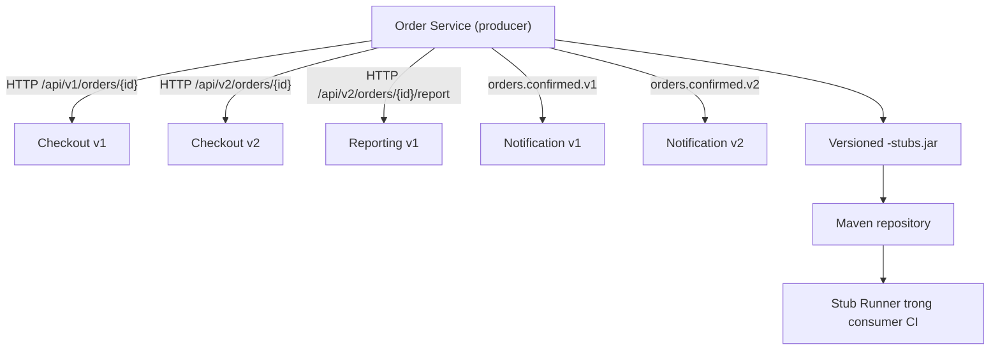
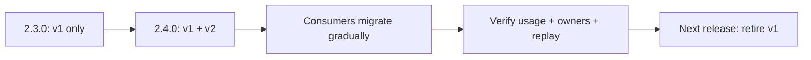
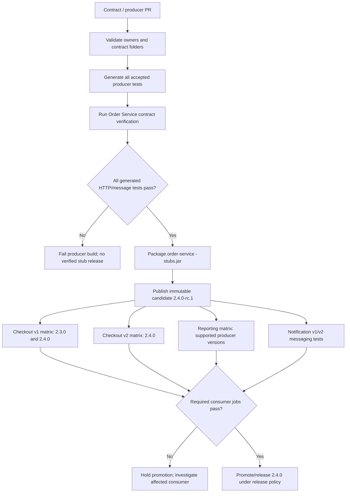

# Thực hành: hỗ trợ đồng thời nhiều consumer và nhiều phiên bản hợp đồng

## 1. Mục tiêu dự án

Trong bài thực hành tổng hợp này, bạn xây dựng một **Order Service** làm producer và ba nhóm consumer: **Checkout**, **Reporting** và **Notification**. Các nhóm không nâng cấp cùng thời điểm. Checkout cũ vẫn cần API v1; Checkout mới muốn dùng API v2; Reporting cần dữ liệu tài chính; Notification có subscriber vẫn đọc event schema v1 trong khi một subscriber mới đã chuyển sang v2.

Bạn sẽ dùng **Spring Cloud Contract** để mô tả hành vi HTTP và message bằng **Groovy/YAML DSL**, sinh producer verification tests, phát hành stub artifact và kiểm thử từng consumer bằng **Stub Runner**. Cuối bài, pipeline CI sẽ chạy ma trận tương thích để phát hiện thay đổi phá vỡ một phiên bản consumer đang được hỗ trợ.

Đây là một dự án thực hành có thể triển khai trong repository nhiều module. Các tên service, version và dữ liệu dưới đây là ví dụ thống nhất xuyên suốt bài; hãy thay bằng tọa độ và phiên bản phù hợp với Spring Boot/Spring Cloud Contract release train của dự án thực tế.

Sau khi hoàn thành, bạn có thể:

1. Tổ chức hợp đồng theo **consumer và phiên bản consumer**.
2. Giữ API v1 và v2 cùng hoạt động trong giai đoạn chuyển tiếp.
3. Phát hai phiên bản event khi các subscriber nâng cấp không đồng bộ.
4. Dùng `stubsPerConsumer` để consumer chỉ nạp mappings thuộc nhóm của mình.
5. Phân biệt API version, consumer version, producer artifact version và contract revision.
6. Chạy producer verification trên tất cả hợp đồng đã chấp nhận.
7. Dùng Stub Runner với version artifact cố định trong consumer CI.
8. Lập kế hoạch expand–migrate–contract, rollback và loại bỏ phiên bản cũ có bằng chứng.

## 2. Kịch bản và kiến trúc

**Producer:** `order-service`

**Consumers:**

- `checkout-service-v1`: ứng dụng Checkout cũ, dùng `GET /api/v1/orders/{id}`.
- `checkout-service-v2`: ứng dụng Checkout mới, dùng `GET /api/v2/orders/{id}`.
- `reporting-service-v1`: lấy dữ liệu báo cáo từ Order Service.
- `notification-service-v1`: subscriber đọc event `OrderConfirmed` schema v1.
- `notification-service-v2`: subscriber mới đọc event schema v2.



Producer giữ các giao diện cũ trong giai đoạn migration. API v1 và v2 được phân biệt bằng **URL path**, event v1 và v2 bằng **destination/schema version**. Nhờ vậy, cùng một request không phải nhận hai response mâu thuẫn tùy theo consumer name.

## 3. Phân biệt bốn loại phiên bản

Đây là điểm quan trọng nhất trước khi bắt đầu:

| Loại version | Ví dụ | Ý nghĩa |
| --- | --- | --- |
| **API/event schema version** | HTTP v1/v2, `schemaVersion: 1/2` | Hình dạng và ngữ nghĩa giao diện mà consumer sử dụng |
| **Consumer application version** | Checkout 1.8.0, Checkout 2.0.0 | Phiên bản ứng dụng consumer đã triển khai |
| **Producer artifact version** | `order-service:2.4.0` | Version của artifact producer và stub JAR được publish |
| **Contract source revision** | Git commit SHA `a1b2c3...` | Revision Groovy/YAML được producer dùng để sinh và verify tests |

**Producer artifact version 2.4.0 không có nghĩa API chỉ còn v2.** Một artifact có thể chứa contract v1 và v2 cùng lúc. Tương tự, consumer app version 2.0.0 không bắt buộc phải dùng API v2 nếu nhóm chưa chuyển đổi.

Trong bài này, ta sử dụng:

- Producer `order-service:2.3.0`: phiên bản trước, hỗ trợ các consumer cũ.
- Producer `order-service:2.4.0`: phiên bản mới, giữ HTTP v1, bổ sung HTTP v2 và event v2.
- Consumer Checkout v1 vẫn chạy trên cả producer 2.3.0 và 2.4.0.
- Consumer Checkout v2 chỉ được triển khai khi producer 2.4.0 đã cung cấp API v2.

## 4. Chuẩn bị repository thực hành

Một cấu trúc Maven multi-module minh họa:

```text
spring-cloud-contract-lab/
  pom.xml
  order-service/
    pom.xml
    src/main/java/com/example/order/
      OrderApplication.java
      OrderController.java
      OrderService.java
    src/test/java/com/example/order/contract/
      OrderContractBase.java
    src/test/resources/contracts/
      checkout-service-v1/
        get_order_v1.groovy
      checkout-service-v2/
        get_order_v2.yml
      reporting-service-v1/
        get_order_report.yml
      notification-service-v1/
        order_confirmed_v1.groovy
      notification-service-v2/
        order_confirmed_v2.groovy
  checkout-service-v1/
    pom.xml
    src/main/java/...
    src/test/java/...
  checkout-service-v2/
    pom.xml
    src/main/java/...
    src/test/java/...
  reporting-service-v1/
    pom.xml
    src/main/java/...
    src/test/java/...
  notification-service-v1/
    pom.xml
    src/main/java/...
    src/test/java/...
  notification-service-v2/
    pom.xml
    src/main/java/...
    src/test/java/...
```

Trong dự án thật, các consumer có thể nằm ở repository độc lập. Cấu trúc multi-module chỉ giúp bài thực hành dễ chạy và theo dõi.

### 4.1. Tại sao tên thư mục consumer phải ổn định?

Khi dùng `stubsPerConsumer=true`, Stub Runner lọc các mappings theo đường dẫn có chứa tên consumer. Vì thế:

- Thư mục `checkout-service-v1/` tương ứng với `consumerName = "checkout-service-v1"`.
- Thư mục `checkout-service-v2/` tương ứng với `consumerName = "checkout-service-v2"`.
- Tên `spring.application.name` mặc định có thể được dùng làm consumer name nếu không override.

Trong bài này, ta cấu hình `consumerName` tường minh để dễ thấy sự tương ứng. Không đặt folder là `checkout-team` nhưng cấu hình consumer name là `checkout-service-v1`.

**Consumer version được biểu diễn bằng tên consumer group riêng.** Nếu chỉ dùng một folder `checkout-service/` cho cả v1 và v2, bật `stubsPerConsumer` sẽ nạp cả hai nhóm contract nằm bên dưới folder đó; nó không tự hiểu bạn muốn chọn một API version cụ thể.

## 5. Định nghĩa hợp đồng HTTP cho Checkout v1

Checkout cũ cần các field:

```json
{
  "orderId": 42,
  "status": "CONFIRMED",
  "customerName": "Lan"
}
```

Tạo file:

```text
order-service/src/test/resources/contracts/checkout-service-v1/get_order_v1.groovy
```

```groovy
import org.springframework.cloud.contract.spec.Contract

Contract.make {
    description 'Checkout v1 doc don hang theo giao dien cu'
    request {
        method GET()
        url '/api/v1/orders/42'
        headers {
            header('Accept', 'application/json')
        }
    }
    response {
        status OK()
        headers {
            contentType(applicationJson())
        }
        body(
            orderId: 42,
            status: 'CONFIRMED',
            customerName: 'Lan'
        )
    }
}
```

Hợp đồng này giữ nguyên field `customerName` vì consumer v1 đang phụ thuộc vào nó. Không đổi field sang `buyerName` trong contract cũ chỉ vì producer đã có model mới.

## 6. Định nghĩa hợp đồng HTTP cho Checkout v2 bằng YAML

Checkout mới cần field `buyerName`, thêm tổng tiền và tiền tệ:

```json
{
  "orderId": 42,
  "status": "CONFIRMED",
  "buyerName": "Lan",
  "totalAmount": 125000,
  "currency": "VND"
}
```

Tạo file:

```text
order-service/src/test/resources/contracts/checkout-service-v2/get_order_v2.yml
```

```yaml
description: Checkout v2 doc don hang theo giao dien moi
request:
  method: GET
  url: /api/v2/orders/42
  headers:
    Accept: application/json
response:
  status: 200
  headers:
    Content-Type: application/json
  body:
    orderId: 42
    status: CONFIRMED
    buyerName: Lan
    totalAmount: 125000
    currency: VND
```

Hai contract khác nhau cả **consumer group** lẫn **API path**. Producer có thể phục vụ hai cấu trúc song song mà không phải đoán consumer nào đang gọi request.

### 6.1. Hợp đồng Reporting độc lập

Reporting cần thông tin quyết toán, không nên tái sử dụng `status` với một nghĩa khác. Tạo:

```text
order-service/src/test/resources/contracts/reporting-service-v1/get_order_report.yml
```

```yaml
description: Reporting doc du lieu tai chinh cua don hang
request:
  method: GET
  url: /api/v2/orders/42/report
  headers:
    Accept: application/json
response:
  status: 200
  headers:
    Content-Type: application/json
  body:
    orderId: 42
    totalAmount: 125000
    currency: VND
    settlementStatus: NOT_SETTLED
```

Ở đây `status` của order và `settlementStatus` của quyết toán là hai khái niệm riêng. Reporting có thể nâng version ứng dụng độc lập với API path; tên `reporting-service-v1` là consumer identity của bài lab, không có nghĩa endpoint bắt buộc là HTTP v1.

## 7. Định nghĩa hợp đồng messaging cho hai thế hệ Notification

### 7.1. Event schema v1

Notification cũ đọc event trên destination:

```text
orders.confirmed.v1
```

Payload:

```json
{
  "eventType": "OrderConfirmed",
  "schemaVersion": 1,
  "eventId": "evt-order-42",
  "orderId": 42,
  "customerName": "Lan"
}
```

Tạo:

```text
order-service/src/test/resources/contracts/notification-service-v1/order_confirmed_v1.groovy
```

```groovy
import org.springframework.cloud.contract.spec.Contract

Contract.make {
    description 'Notification v1 nhan event OrderConfirmed schema 1'
    label 'order_confirmed_v1'

    input {
        triggeredBy('publishOrderConfirmedV1()')
    }

    outputMessage {
        sentTo('orders.confirmed.v1')
        body(
            eventType: 'OrderConfirmed',
            schemaVersion: 1,
            eventId: 'evt-order-42',
            orderId: 42,
            customerName: 'Lan'
        )
        headers {
            header('eventType', 'OrderConfirmed')
        }
    }
}
```

### 7.2. Event schema v2

Notification mới sử dụng:

```text
orders.confirmed.v2
```

Payload:

```json
{
  "eventType": "OrderConfirmed",
  "schemaVersion": 2,
  "eventId": "evt-order-42",
  "orderId": 42,
  "buyer": {
    "id": 7,
    "displayName": "Lan"
  },
  "totalAmount": 125000,
  "currency": "VND"
}
```

Tạo:

```text
order-service/src/test/resources/contracts/notification-service-v2/order_confirmed_v2.groovy
```

```groovy
import org.springframework.cloud.contract.spec.Contract

Contract.make {
    description 'Notification v2 nhan event OrderConfirmed schema 2'
    label 'order_confirmed_v2'

    input {
        triggeredBy('publishOrderConfirmedV2()')
    }

    outputMessage {
        sentTo('orders.confirmed.v2')
        body(
            eventType: 'OrderConfirmed',
            schemaVersion: 2,
            eventId: 'evt-order-42',
            orderId: 42,
            buyer: [
                id: 7,
                displayName: 'Lan'
            ],
            totalAmount: 125000,
            currency: 'VND'
        )
        headers {
            header('eventType', 'OrderConfirmed')
        }
    }
}
```

Hai event có destination riêng để subscriber cũ không nhận payload v2 ngoài dự kiến. Trong thời gian migration, producer có thể dual-publish cả hai event từ cùng một nghiệp vụ xác nhận đơn hàng.

**Lưu ý về message verification:** các phương thức `publishOrderConfirmedV1()` và `publishOrderConfirmedV2()` là trigger của producer test. Base class phải nối chúng với publisher/adapter thật và cấu hình message verifier phù hợp với broker/binder của dự án. Chỉ viết DSL không tự khởi động Kafka/RabbitMQ hay tự publish message.

## 8. Triển khai producer giữ API cũ và mới

Một controller minh họa:

```java
@RestController
public class OrderController {
    private final OrderService orderService;

    public OrderController(OrderService orderService) {
        this.orderService = orderService;
    }

    @GetMapping("/api/v1/orders/{id}")
    public OrderV1Response getV1(@PathVariable long id) {
        return orderService.getV1(id);
    }

    @GetMapping("/api/v2/orders/{id}")
    public OrderV2Response getV2(@PathVariable long id) {
        return orderService.getV2(id);
    }

    @GetMapping("/api/v2/orders/{id}/report")
    public OrderReportResponse getReport(@PathVariable long id) {
        return orderService.getReport(id);
    }
}
```

Đây là skeleton tập trung vào routing; các DTO/service implementation cần được bổ sung. Một response v1 và v2 có thể được ánh xạ từ cùng domain model:

```java
public record OrderV1Response(
    long orderId,
    String status,
    String customerName
) {}

public record OrderV2Response(
    long orderId,
    String status,
    String buyerName,
    long totalAmount,
    String currency
) {}

public record OrderReportResponse(
    long orderId,
    long totalAmount,
    String currency,
    String settlementStatus
) {}
```

Producer không cần lưu hai bản dữ liệu đơn hàng. Nó duy trì một model nghiệp vụ, rồi tạo response tương thích theo version API. Điều quan trọng là **đừng thay đổi ngữ nghĩa field cũ** chỉ để tận dụng DTO mới.

### 8.1. Base class cho HTTP producer tests

Một base class JUnit 5 dùng MockMvc có thể có dạng:

```java
package com.example.order.contract;

import io.restassured.module.mockmvc.RestAssuredMockMvc;
import org.junit.jupiter.api.BeforeEach;
import org.springframework.beans.factory.annotation.Autowired;
import org.springframework.boot.test.autoconfigure.web.servlet.AutoConfigureMockMvc;
import org.springframework.boot.test.context.SpringBootTest;
import org.springframework.cloud.contract.verifier.messaging.boot.AutoConfigureMessageVerifier;
import org.springframework.test.web.servlet.MockMvc;

@SpringBootTest
@AutoConfigureMockMvc
@AutoConfigureMessageVerifier
public abstract class OrderContractBase {
    @Autowired
    protected MockMvc mockMvc;

    @BeforeEach
    protected void setUp() {
        RestAssuredMockMvc.mockMvc(mockMvc);
        // Chuẩn bị fixture orderId=42, customer/buyer Lan,
        // status CONFIRMED, totalAmount=125000, currency VND.
    }

    public void publishOrderConfirmedV1() {
        // Kích hoạt publisher v1 thật trong test context.
    }

    public void publishOrderConfirmedV2() {
        // Kích hoạt publisher v2 thật trong test context.
    }
}
```

Đây là **khung base class**, không phải cấu hình messaging hoàn chỉnh. Project cần dependency Rest Assured MockMvc phù hợp và message verifier/binder thực tế. Nếu dùng `MOCKMVC` cho HTTP, generated tests phải đi qua Spring MVC context; nếu dùng `EXPLICIT`, cần khởi động server và cấu hình port. Các trigger messaging phải gọi publisher thật, không chỉ mock một kết quả để test pass.

## 9. Cấu hình producer Maven để sinh và verify tất cả contract

Trong `order-service/pom.xml`, một plugin fragment:

```xml
<plugin>
    <groupId>org.springframework.cloud</groupId>
    <artifactId>spring-cloud-contract-maven-plugin</artifactId>
    <version>${spring-cloud-contract.version}</version>
    <extensions>true</extensions>
    <configuration>
        <contractsDirectory>
            ${project.basedir}/src/test/resources/contracts
        </contractsDirectory>
        <testFramework>JUNIT5</testFramework>
        <testMode>MOCKMVC</testMode>
        <baseClassForTests>
            com.example.order.contract.OrderContractBase
        </baseClassForTests>
        <failOnNoContracts>true</failOnNoContracts>
    </configuration>
</plugin>
```

Đồng thời quản lý phiên bản Spring Boot/Spring Cloud Contract bằng BOM hoặc dependency management tương thích. Plugin fragment trên giả định toàn bộ HTTP và messaging generated tests có thể dùng chung base class; nếu project cần base classes khác nhau, dùng base class mapping theo package/consumer group hoặc tách cấu hình/module theo thiết kế phù hợp.

### 9.1. Kiểm tra producer verification

Tại root multi-module:

```bash
./mvnw -pl order-service -am clean verify
```

Kết quả mong đợi:

- Plugin đọc được các contract trong năm consumer folders.
- Generated producer tests được biên dịch.
- Generated tests được Surefire thực thi.
- Mỗi HTTP contract kiểm tra đúng endpoint/response.
- Message contracts gọi đúng trigger và xác minh output message.
- Build fail nếu producer không đáp ứng bất kỳ hợp đồng active nào.

Đừng chỉ kiểm tra file generated. Mở Surefire reports và xác nhận có test case từ các nhóm `checkout-service-v1`, `checkout-service-v2`, `reporting-service-v1`, `notification-service-v1` và `notification-service-v2`.

## 10. Đóng gói stub artifact có version

Producer release đầu của bài lab:

```text
groupId    = com.example
artifactId = order-service
version    = 2.4.0
classifier = stubs
```

Coordinates:

```text
com.example:order-service:2.4.0:stubs
```

Sau producer verification, pipeline tạo/publish artifact:

```text
order-service-2.4.0-stubs.jar
```

Artifact này phải chứa các mappings/metadata tương ứng với hợp đồng đã xử lý, bao gồm các consumer folders cần thiết. Có thể kiểm tra JAR bằng:

```bash
jar tf order-service/target/order-service-2.4.0-stubs.jar
```

Đường dẫn phụ thuộc Maven build và classifier configuration. Kiểm tra layout thật thay vì giả định mọi version plugin đều đặt resources ở cùng một thư mục. Không publish stub từ build có generated tests bị skip hoặc không chạy.

## 11. Consumer dùng Stub Runner theo consumer name

Mỗi consumer có dependency test:

```xml
<dependency>
    <groupId>org.springframework.cloud</groupId>
    <artifactId>spring-cloud-starter-contract-stub-runner</artifactId>
    <scope>test</scope>
</dependency>
```

Phiên bản được quản lý theo Spring Cloud dependency management phù hợp.

### 11.1. Checkout v1: chỉ nạp hợp đồng của Checkout v1

```java
import org.junit.jupiter.api.Test;
import org.springframework.beans.factory.annotation.Autowired;
import org.springframework.boot.test.context.SpringBootTest;
import org.springframework.cloud.contract.stubrunner.spring.AutoConfigureStubRunner;
import org.springframework.cloud.contract.stubrunner.spring.StubRunnerProperties;

import static org.junit.jupiter.api.Assertions.assertEquals;

@SpringBootTest(properties = {
    "order.client.base-url=http://localhost:8091"
})
@AutoConfigureStubRunner(
    ids = "com.example:order-service:2.4.0:stubs:8091",
    stubsMode = StubRunnerProperties.StubsMode.LOCAL,
    stubsPerConsumer = true,
    consumerName = "checkout-service-v1"
)
class CheckoutV1OrderClientTest {
    @Autowired
    OrderClient orderClient;

    @Test
    void readsLegacyOrderShape() {
        OrderV1 order = orderClient.getV1(42);
        assertEquals("CONFIRMED", order.status());
        assertEquals("Lan", order.customerName());
    }
}
```

Đây là skeleton cần constructor injection/configuration phù hợp với test context của ứng dụng. `OrderClient` phải thực sự dùng `order.client.base-url` và gọi `http://localhost:8091`. `LOCAL` giả định producer stub artifact đã được cài vào Maven local repository của **cùng môi trường chạy test**.

### 11.2. Checkout v2: nạp group riêng

```java
@SpringBootTest(properties = {
    "order.client.base-url=http://localhost:8092"
})
@AutoConfigureStubRunner(
    ids = "com.example:order-service:2.4.0:stubs:8092",
    stubsMode = StubRunnerProperties.StubsMode.LOCAL,
    stubsPerConsumer = true,
    consumerName = "checkout-service-v2"
)
class CheckoutV2OrderClientTest {
    // Gọi client v2 và assert buyerName, totalAmount, currency.
}
```

Hai test có thể chạy trong hai consumer module/job riêng để tránh xung đột port. Nếu dùng random port, hãy lấy port từ Stub Runner API và cấu hình client bằng giá trị đó; không hard-code `localhost:8091` khi server thực tế chạy cổng khác.

### 11.3. Reporting v1

Reporting đặt:

```text
consumerName = reporting-service-v1
```

và chỉ kiểm tra endpoint báo cáo. Cấu hình consumer:

```java
@SpringBootTest(properties = {
    "report.client.base-url=http://localhost:8093"
})
@AutoConfigureStubRunner(
    ids = "com.example:order-service:2.4.0:stubs:8093",
    stubsMode = StubRunnerProperties.StubsMode.LOCAL,
    stubsPerConsumer = true,
    consumerName = "reporting-service-v1"
)
class ReportingOrderClientTest {
    @Autowired
    ReportingClient reportingClient;

    @Test
    void readsOrderFinancialData() {
        OrderReport report = reportingClient.getOrderReport(42);
        assertEquals(125000, report.totalAmount());
        assertEquals("VND", report.currency());
        assertEquals("NOT_SETTLED", report.settlementStatus());
    }
}
```

Consumer phải cấu hình `ReportingClient` dùng `report.client.base-url`.

Các đoạn test ở trên là khung tích hợp: cần bổ sung application configuration, constructor/field injection phù hợp, DTO và client implementation. Điều quan trọng là **client thật của consumer phải gửi request đến WireMock stub** và assert dữ liệu sau deserialize.

## 12. Chuyển từ LOCAL sang REMOTE trong CI

Ở local, `LOCAL` tiện khi producer đã chạy `install`. Trong CI hoặc container, dùng `REMOTE` để tải artifact từ Nexus/Artifactory:

```yaml
spring:
  application:
    name: checkout-service-v1
  cloud:
    contract:
      stubrunner:
        stubs-mode: REMOTE
        repository-root: "https://repo.example.test/repository/maven-releases/"
        ids:
          - "com.example:order-service:2.4.0:stubs:8091"
        stubs-per-consumer: true
        consumer-name: checkout-service-v1
        username: ${STUB_REPO_READ_USER}
        password: ${STUB_REPO_READ_TOKEN}
```

`STUB_REPO_READ_USER` và `STUB_REPO_READ_TOKEN` là biến môi trường/secret của CI, không phải giá trị cần commit. Consumer chỉ cần quyền đọc artifact. Không dùng publisher/admin credentials.

**Hai cấu hình khác nhau:**

- `repository-root`: nơi Stub Runner tải JAR.
- `order.client.base-url`: địa chỉ HTTP client gửi request tới WireMock.

Nếu chạy trong Docker, `localhost` bên trong container consumer không tự trỏ tới container Stub Runner khác; cần cấu hình network/hostname tương ứng.

### 12.1. Kiểm thử consumer messaging bằng StubTrigger

Với message contracts, Stub Runner có thể đọc contract definitions từ stub JAR và gửi message theo **label**. Consumer test dùng `StubFinder` (interface này kế thừa `StubTrigger`) để kích hoạt message, sau đó xác minh subscriber thật đã xử lý.

Ví dụ dependency test cho Spring Cloud Stream test binder:

```xml
<dependency>
    <groupId>org.springframework.cloud</groupId>
    <artifactId>spring-cloud-stream</artifactId>
    <type>test-jar</type>
    <scope>test</scope>
    <classifier>test-binder</classifier>
</dependency>
```

Chỉ dùng test binder nếu consumer tích hợp với Spring Cloud Stream; với JMS/Kafka/RabbitMQ thật, cấu hình adapter và broker phù hợp. Nếu nhiều messaging integrations cùng có trên classpath, chọn integration cần dùng và tắt những integration không liên quan theo cấu hình Stub Runner.

Ví dụ test cho Notification v1:

```java
import org.junit.jupiter.api.Test;
import org.springframework.beans.factory.annotation.Autowired;
import org.springframework.boot.test.context.SpringBootTest;
import org.springframework.cloud.contract.stubrunner.StubFinder;
import org.springframework.cloud.contract.stubrunner.spring.AutoConfigureStubRunner;
import org.springframework.cloud.contract.stubrunner.spring.StubRunnerProperties;

import static org.junit.jupiter.api.Assertions.assertTrue;

@SpringBootTest
@AutoConfigureStubRunner(
    ids = "com.example:order-service:2.4.0:stubs",
    stubsMode = StubRunnerProperties.StubsMode.LOCAL
)
class NotificationV1MessageTest {
    @Autowired
    StubFinder stubFinder;

    @Autowired
    NotificationHandler notificationHandler;

    @Test
    void handlesOrderConfirmedV1() {
        assertTrue(stubFinder.trigger("order_confirmed_v1"));
        // Với consumer xử lý bất đồng bộ, chờ bằng Awaitility hoặc
        // test-binder output rồi assert eventId/orderId/schemaVersion.
        // Ví dụ: await().untilAsserted(() ->
        //     assertEquals(1, notificationHandler.lastHandledEvent().schemaVersion()));
        // Xác minh handler thật nhận schemaVersion=1 và customerName.
    }
}
```

Notification v2 dùng cùng artifact và trigger label `order_confirmed_v2`. Hai test nên chạy độc lập để chứng minh subscriber v1 và v2 hiểu đúng payload của mình.

Trong bài lab, `stubsPerConsumer` được dùng rõ ràng để chọn **HTTP mappings** theo consumer folder. Messaging consumer test chọn message bằng **label** và destination; không dựa vào `stubsPerConsumer` để giả định rằng mọi messaging integration đều lọc message definitions giống HTTP mappings. Giữ label duy nhất và destination v1/v2 riêng; nếu cần cách ly messaging artifacts chặt hơn, xác minh hành vi của integration/binder đang sử dụng hoặc phát hành artifact tách biệt.

Đây là skeleton: `NotificationHandler` và cách chờ/đọc kết quả phụ thuộc binder, queue và kiến trúc consumer. `StubFinder.trigger(...)` chỉ kích hoạt message stub; assertion vẫn phải chứng minh **handler thật của consumer** đã deserialize và xử lý message. Producer-side generated messaging tests cần `@AutoConfigureMessageVerifier` trên base class và trigger method nối với publisher thật.

**Phân biệt hai lớp:** producer messaging verification kiểm tra Order Service phát đúng event; consumer Stub Runner messaging test kiểm tra Notification xử lý event mẫu đúng. Một lớp không thay thế lớp còn lại.

## 13. Ma trận tương thích nhiều consumer và nhiều producer versions

Ta không chạy mọi consumer với mọi producer version một cách máy móc. Ma trận chỉ gồm các cặp có thể cùng tồn tại trong rollout:

| Consumer release | Consumer name | Giao diện | Producer stub versions cần test | Kết quả kỳ vọng |
| --- | --- | --- | --- | --- |
| Checkout 1.8.x | `checkout-service-v1` | HTTP v1 | 2.3.0, 2.4.0 | PASS cả hai |
| Checkout 2.0.x | `checkout-service-v2` | HTTP v2 | 2.4.0 | PASS |
| Reporting 1.3.x | `reporting-service-v1` | Report API | 2.3.0, 2.4.0 | PASS cả hai |
| Notification 1.7.x | `notification-service-v1` | Event v1 | 2.3.0, 2.4.0 | PASS trong giai đoạn dual-publish |
| Notification 2.0.x | `notification-service-v2` | Event v2 | 2.4.0 | PASS |

Producer stub version 2.3.0 chỉ có thể được dùng nếu artifact đó thật sự chứa các mappings v1 tương ứng. Nếu không còn artifact hoặc version cũ đã hết hỗ trợ, không đưa cặp đó vào ma trận như thể đã kiểm chứng.

### 13.1. Cách chạy một cặp version

Mỗi compatibility job chọn **một producer artifact version cố định**:

```text
CONSUMER_NAME=checkout-service-v1
ORDER_STUB_VERSION=2.4.0
STUBS_MODE=REMOTE
```

Job Checkout v1 có thể chạy lại với `ORDER_STUB_VERSION=2.3.0`. Không dùng version động `+` trong release compatibility gate, vì kết quả sẽ thay đổi theo artifact mới nhất tại thời điểm resolve.

### 13.2. Vì sao không gom mọi version vào một test context?

Chạy hai version producer stub cùng một port hoặc cùng mapping trong một test context có thể gây xung đột. Dễ kiểm soát hơn là tách theo matrix jobs/test contexts, mỗi job ghi lại GAV và consumer name. Nếu cần chạy song song, cấp port khác nhau hoặc dùng port động được client lấy từ Stub Runner.

## 14. Migration: expand → migrate → contract

### Giai đoạn A — Baseline

Producer 2.3.0 hỗ trợ:

- `GET /api/v1/orders/{id}`.
- Event `orders.confirmed.v1`.

Checkout v1, Reporting v1 và Notification v1 chạy ổn định. Ghi nhận producer/consumer versions và contract revision.

### Giai đoạn B — Expand

Producer 2.4.0:

- Tiếp tục hỗ trợ API v1.
- Bổ sung API v2.
- Phát event v1 và v2 trên destination riêng.
- Giữ cả năm nhóm hợp đồng active.

Ở bước này, chưa xóa field hoặc destination cũ.

### Giai đoạn C — Migrate

1. Triển khai Checkout v2 sau khi consumer Stub Runner tests với producer 2.4.0 đạt.
2. Triển khai Notification v2 và xác nhận subscriber xử lý event v2.
3. Giữ Checkout v1 và Notification v1 trong thời gian các instance/consumer cũ còn hoạt động.
4. Chạy lại Reporting với producer 2.4.0 để bảo đảm endpoint báo cáo không bị ảnh hưởng.

### Giai đoạn D — Verify retirement

Chỉ đề xuất ngừng v1 khi:

- Owner xác nhận các consumer đã chuyển hoặc ngừng hỗ trợ.
- API gateway/telemetry không còn request v1 trong khoảng quan sát phù hợp.
- Broker consumer groups/replay policy không còn yêu cầu event v1.
- Partner/mobile support window đã kết thúc nếu có.
- Compatibility matrix và rollback plan đã được cập nhật.

### Giai đoạn E — Contract

Trong release sau, producer có thể loại bỏ route/event v1 sau khi được phê duyệt. Xóa contract v1 khỏi active producer contracts **sau khi** nghĩa vụ đó thực sự được retire; lưu lịch sử và quyết định deprecation theo quy trình của tổ chức.



## 15. Rollback và các tình huống phải xử lý

| Tình huống | Phản ứng |
| --- | --- |
| Checkout v2 lỗi sau deploy | Rollback consumer về bản v1; producer vẫn giữ v1/v2 |
| Notification v2 chưa xử lý đúng schema | Giữ subscriber v1 và tiếp tục publish event v1 |
| Producer 2.4.0 có regression trên v1 | Chặn rollout, dùng producer release đã xác minh; không xóa contract v1 |
| Stub Runner tải sai artifact | Kiểm tra GAV, classifier, resolved version, checksum và repository |
| Consumer test pass nhưng production lỗi | Kiểm tra producer verification, dữ liệu thật, security, broker và deployment config |
| Một contract folder không được nạp | So sánh folder name với `consumerName`/ `spring.application.name` |
| Event v1 bị replay sau khi producer ngừng publish | Giữ khả năng deserialize/handle event lịch sử ở consumer theo retention policy |

**Rollback consumer và rollback producer là hai việc khác nhau.** Khi consumer v2 thất bại, producer 2.4.0 có thể vẫn tương thích consumer v1. Không cần rollback toàn bộ producer nếu lỗi chỉ nằm ở consumer mới và producer đang giữ API cũ.

## 16. CI pipeline cho dự án tổng hợp



### 16.1. Các cổng bắt buộc

**Producer CI**

1. Kiểm tra mọi consumer folder có owner và tên ổn định.
2. Xác nhận generator đọc được hợp đồng HTTP và messaging.
3. Chạy generated tests trên implementation Order Service thật.
4. Xác nhận không có test bị skip hoặc nhóm contract bị bỏ ngoài ý định.
5. Chỉ đóng gói/publish stub sau verification PASS.
6. Gắn artifact với producer commit, contract revision, plugin version và test report.

**Consumer CI**

1. Ghim producer stub version cụ thể.
2. Đặt `consumerName` khớp thư mục contract.
3. Chạy client/subscriber thực qua Stub Runner.
4. Kiểm tra success và error paths quan trọng.
5. Ghi rõ producer GAV, consumer release và kết quả matrix.

**Release CI**

- Không cấp publish credential cho untrusted PR.
- Không ghi đè release artifact đã phát hành.
- Giữ version immutable và có provenance.
- Chỉ promote candidate sau khi các consumer compatibility jobs bắt buộc đạt.

## 17. Các bước thực hành theo thứ tự

Thực hiện trên nhánh lab riêng:

| Bước | Công việc | Bằng chứng hoàn thành |
| --- | --- | --- |
| 1 | Tạo Order Service và ba nhóm consumer | Các module khởi động được |
| 2 | Thêm contract Checkout v1/v2 | Hai producer tests được sinh |
| 3 | Thêm contract Reporting | Producer test xác minh report endpoint |
| 4 | Thêm message contracts Notification v1/v2 | Trigger và output message được kiểm tra |
| 5 | Cấu hình base class và Maven plugin | `mvn verify` chạy đủ producer tests |
| 6 | Package stub artifact 2.4.0 | JAR có mappings/metadata mong đợi |
| 7 | Cài stub local | Checkout v1/v2 tải đúng group |
| 8 | Bật `stubsPerConsumer` | Mỗi consumer chỉ nạp mappings của mình |
| 9 | Chạy remote consumer jobs | CI resolve đúng version và pass |
| 10 | Chạy compatibility matrix | Có report cho từng cặp producer/consumer |
| 11 | Thử phá contract | Producer build fail và chặn publish |
| 12 | Thực hiện migration/rollback tabletop | Có quyết định giữ/xóa v1 dựa trên chứng cứ |

### 17.1. Lệnh chạy tham khảo

Ở root Maven multi-module:

```bash
# Verify producer và các module cần thiết.
./mvnw -pl order-service -am clean verify

# Cài stub artifact vào Maven local cho các consumer test LOCAL.
./mvnw -pl order-service -am install

# Chạy một consumer module.
./mvnw -pl checkout-service-v1 test
./mvnw -pl checkout-service-v2 test
./mvnw -pl reporting-service-v1 test
```

Các lệnh phụ thuộc Maven reactor và cấu hình Stub Runner của project. Nếu consumer module nằm ở repository riêng, chạy wrapper trong repository đó. Với `REMOTE`, producer phải publish candidate vào repository test/staging trước khi consumer job resolve.

### 17.2. Kết quả mong đợi

- Producer verification có test cases thuộc cả HTTP v1/v2, Reporting và messaging v1/v2.
- Một thay đổi làm response v1 mất `customerName` khiến producer verification fail.
- Một thay đổi làm event v1 mất `customerName` khiến message contract verification fail.
- Checkout v1 chỉ nhận mapping trong `checkout-service-v1`.
- Checkout v2 chỉ nhận mapping trong `checkout-service-v2`.
- Checkout v1 chạy được với producer stub 2.3.0 và 2.4.0 nếu cả hai artifacts thực sự giữ contract v1.
- Checkout v2 chỉ chạy với producer stub version có API v2.
- Reporting và Notification có kết quả độc lập, không bị che bởi test của Checkout.

## 18. Bài tập mở rộng

### Bài tập A — Thêm consumer thứ tư

Thêm `partner-portal-v1`, chỉ dùng `GET /api/v1/orders/{id}`.

Yêu cầu:

1. Tạo folder `partner-portal-v1/`.
2. Viết contract Groovy hoặc YAML.
3. Cấu hình `consumerName = "partner-portal-v1"`.
4. Chạy Stub Runner với `stubsPerConsumer=true`.
5. Chứng minh Checkout v1 không nạp mapping của Partner Portal.

### Bài tập B — Nâng consumer v1 trong khi producer đang dual-version

Tạo Checkout 1.9.0, vẫn dùng API v1 nhưng bắt đầu hỗ trợ thêm field tùy chọn.

Yêu cầu:

- Viết contract phản ánh field mà consumer thật sự dựa vào.
- Kiểm tra producer v2.4.0 vẫn đáp ứng consumer 1.8.x.
- Không đổi consumer name nếu đây vẫn là cùng một ứng dụng/contract group và policy không cần tách version; nếu tách folder version riêng, phải cập nhật `consumerName` tương ứng.

### Bài tập C — Event schema v3

Notification v3 cần thêm `traceId` và thay `buyer.displayName` thành `buyer.name`.

Yêu cầu:

- Quyết định có cần destination/event version riêng hay schema compatibility rule cho phép thêm field.
- Giữ subscriber v1/v2 hoạt động trong migration.
- Kiểm tra event replay, idempotency và dual-publish.
- Không thay đổi payload v2 đang được consumer v2 sử dụng nếu chưa có kế hoạch versioning.

### Bài tập D — Phát hiện breaking change bằng negative control

Trong nhánh thử nghiệm:

1. Xóa `customerName` khỏi API v1.
2. Chạy producer verification.
3. Xác nhận build fail.
4. Khôi phục implementation.
5. Xóa contract v1 nhưng **không** cập nhật consumer inventory, rồi xem ownership/CI policy có chặn việc retire không.

Kết quả mong đợi: producer verification bắt được thay đổi behavior; policy review phát hiện việc xóa contract chưa có approval. Một hệ thống tốt phải bảo vệ cả hai lớp.

## 19. Troubleshooting dự án

| Triệu chứng | Nguyên nhân thường gặp | Cách xử lý |
| --- | --- | --- |
| Checkout v1 nhận response v2 | `stubsPerConsumer` tắt hoặc consumer name sai | Kiểm tra folder và `consumerName` |
| Không nạp stub cho Checkout v2 | Folder không chứa đúng consumer name | Kiểm tra JAR layout và cấu hình |
| Producer test không tìm thấy contract | Sai `contractsDirectory` hoặc layout | Kiểm tra source path và generator log |
| Producer build xanh nhưng test v2 không chạy | Test generation/source/runner bị bỏ qua | Kiểm tra Surefire report và generated test count |
| Stub Runner báo không tìm thấy artifact | GAV/classifier/version hoặc repository sai | Kiểm tra `ids`, repository metadata và quyền đọc |
| WireMock trả unmatched 404 | Request không match method/path/header/body | Kiểm tra request journal và mapping |
| HTTP v1 fail sau khi thêm v2 | Producer vô tình đổi behavior cũ | Chạy contract v1 và khôi phục compatibility |
| Notification v1 fail khi thêm v2 | Producer ngừng dual-publish quá sớm hoặc event v1 đổi schema | Kiểm tra destination, publisher và message verifier |
| Consumer v2 fail với producer 2.3.0 | Producer cũ chưa hỗ trợ API/event v2 | Không đưa cặp version này vào matrix nếu không có compatibility promise |
| Cùng một version stub cho kết quả khác nhau | Release artifact bị overwrite hoặc snapshot mutable | Ghim release version, kiểm tra digest/provenance |
| Consumer test gọi nhầm localhost | Stub Runner ở container khác | Dùng hostname/network hoặc port động đúng |
| Consumer job pass nhưng producer contract fail | Chỉ chạy Stub Runner tests | Bổ sung producer verification gate |

### 19.1. Phân biệt ba lỗi 404

1. **Artifact repository 404:** không tìm thấy `order-service-2.4.0-stubs.jar`; kiểm tra Maven coordinates và repository.
2. **WireMock unmatched 404:** JAR đã tải nhưng request không match mapping; kiểm tra method, URL, headers, query và body.
3. **Business 404:** contract chủ đích quy định order không tồn tại; kiểm tra response body `ORDER_NOT_FOUND`.

Không sửa credentials repository khi lỗi thực tế là URL request sai.

## 20. Tiêu chí hoàn thành dự án

Bạn hoàn thành lab khi có thể chứng minh:

- [ ] Producer hỗ trợ đồng thời HTTP API v1 và v2.
- [ ] Producer phát event v1 và v2 theo chính sách dual-publish.
- [ ] Contract source được phân nhóm theo các consumer identities ổn định.
- [ ] Generated producer tests xác minh toàn bộ hợp đồng active.
- [ ] Stub artifact có producer version cố định và chứa mappings/metadata mong đợi.
- [ ] Checkout v1, Checkout v2, Reporting và Notification chạy test độc lập.
- [ ] `stubsPerConsumer` nạp đúng group theo `consumerName`.
- [ ] Consumer CI sử dụng đúng artifact version và quyền đọc tối thiểu.
- [ ] Compatibility matrix chỉ bao gồm các cặp producer/consumer có thể cùng chạy.
- [ ] Producer CI chặn publish khi generated tests không chạy hoặc thất bại.
- [ ] Consumer CI chặn rollout khi client/subscriber không tương thích.
- [ ] Có migration, deprecation và rollback plan cho API/event v1.
- [ ] Không xóa contract cũ chỉ vì đã có v2 hoặc vì consumer ít hoạt động.

## 21. Tài liệu tham khảo

- [Spring Cloud Contract — Reference](https://docs.spring.io/spring-cloud-contract/reference/).
- [Spring Cloud Contract — Stubs Per Consumer](https://docs.spring.io/spring-cloud-contract/reference/project-features-stubrunner/stub-runner-stubs-per-consumer.html).
- [Spring Cloud Contract — Stub Runner Common Properties](https://docs.spring.io/spring-cloud-contract/reference/project-features-stubrunner/stub-runner-common.html).
- [Spring Cloud Contract — Contract DSL](https://docs.spring.io/spring-cloud-contract/reference/project-features-contract.html).
- [Spring Cloud Contract — Messaging](https://docs.spring.io/spring-cloud-contract/reference/project-features-messaging.html).
- [Spring Cloud Contract — Maven Project](https://docs.spring.io/spring-cloud-contract/reference/maven-project.html).

**Kết quả cuối cùng:** nhiều consumer và nhiều phiên bản có thể cùng tồn tại khi mỗi kỳ vọng được định danh, xác minh và phát hành rõ ràng. **Producer verification** bảo vệ toàn bộ tập hợp đồng đã chấp nhận; **Stub Runner** giúp từng consumer kiểm tra đúng nhóm mapping và producer version; **compatibility matrix** xác định các cặp phiên bản thực sự cần hỗ trợ. Chỉ retire API/event cũ khi owner, consumer deployment, telemetry và replay policy cùng xác nhận đã an toàn.
