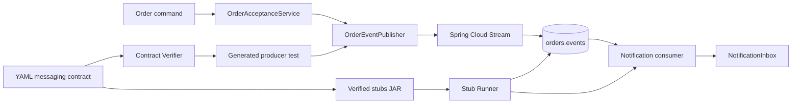
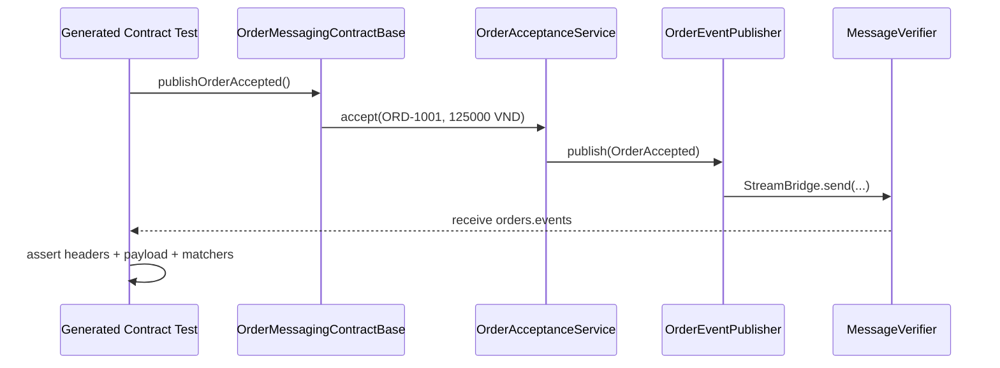
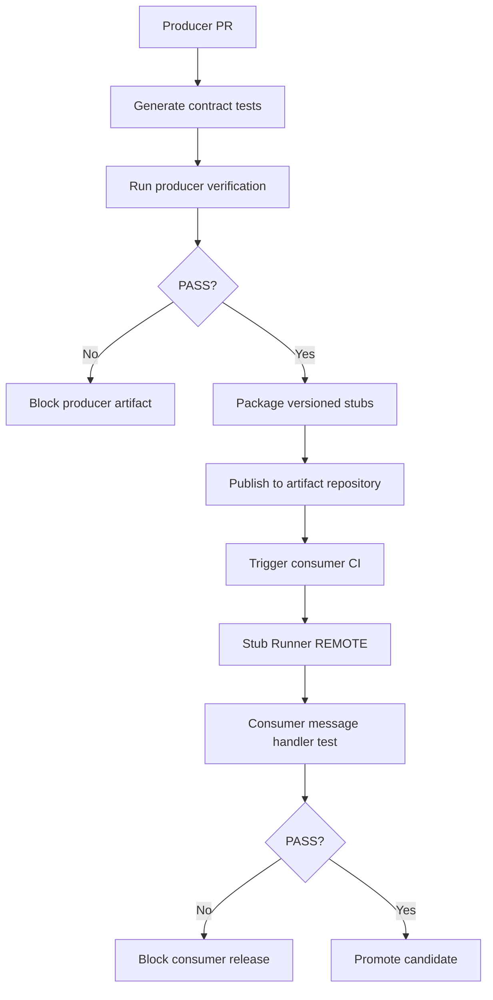
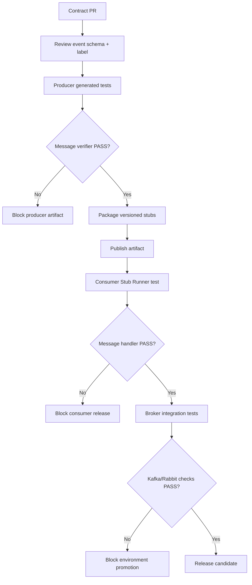

# Xây dựng luồng nhận và phát thông điệp

> **Chương:** Thực hành tổng hợp  
> **Module:** `SPRING_CLOUD_CONTRACT` — học kiểm thử hợp đồng giữa producer và consumer bằng Groovy/YAML DSL cho HTTP hoặc thông điệp; sinh test phía cung cấp, phát hành stub, dùng Stub Runner và tích hợp CI để phát hiện API không tương thích.

## Mục tiêu dự án

Trong bài thực hành này, bạn xây dựng một luồng event-driven gồm hai ứng dụng Spring Boot độc lập:

- **`order-producer`** nhận lệnh chấp nhận đơn hàng, tạo event `OrderAccepted` và phát event lên destination `orders.events`.
- **`notification-consumer`** nhận event, kiểm tra payload và ghi nhận một notification.
- **Spring Cloud Contract Verifier** sinh producer tests từ YAML messaging contract và kiểm tra event mà producer thực sự phát.
- **Stub Runner** tải stubs từ producer artifact, kích hoạt event theo label và đưa event đó vào consumer test.
- **Spring Cloud Stream Test Binder** cung cấp kênh message in-memory để chạy bài kiểm thử mà không cần Kafka broker.

Sau khi hoàn thành, bạn có thể chứng minh được cả hai chiều:

1. Producer phát đúng event đã cam kết.
2. Consumer nhận và xử lý đúng event được mô tả trong contract.

Bạn cũng sẽ phân biệt được contract test với broker integration test, xử lý event trùng, quản lý version/schema và đưa producer verification cùng consumer compatibility test vào CI.

## 1. Kịch bản nghiệp vụ và kiến trúc

Một khách hàng đặt hàng. Khi đơn được chấp nhận, `order-producer` phát một event `OrderAccepted`. `notification-consumer` lắng nghe event để tạo thông báo xác nhận.



Trong lúc chạy contract tests, destination `orders.events` được nối với test binder trong JVM. Khi chạy thật, destination này được map tới Kafka topic hoặc broker mà team chọn.

| Thành phần | Trách nhiệm | Bằng chứng kiểm thử |
| --- | --- | --- |
| `OrderAcceptanceService` | Chấp nhận lệnh đặt hàng và tạo event | Producer test kích hoạt method thật |
| `OrderEventPublisher` | Đóng gói header và gửi event | Verifier nhận được message đúng destination |
| YAML contract | Định nghĩa body, headers, label và trigger | Generated test/stub cùng được tạo từ một nguồn |
| Producer base class | Cung cấp method kích hoạt flow | Generated test gọi được method trigger |
| Spring Cloud Stream Test Binder | Mô phỏng binder trong JVM | Không cần broker để chạy contract test |
| Stub Runner | Tải contract stub và trigger label | Consumer nhận đúng message sample |
| `NotificationInbox` | Ghi nhận kết quả xử lý event | Consumer test xác nhận side effect |

### 1.1. Ranh giới bài thực hành

Ta sẽ dùng **Spring Cloud Contract 5.0.3** theo API/package `org.springframework.cloud.contract` để minh họa một hệ thống đang dùng SCC. Contract YAML, cách đặt `label`, `input.triggeredBy` và `outputMessage` là trọng tâm.

**Lưu ý về vòng đời dự án:** từ năm 2026, Spring Cloud Contract đã chuyển sang dự án kế nhiệm chính thức **Stubborn Contract**, do một trong những tác giả ban đầu tiếp tục duy trì. Stubborn Contract giữ khả năng tương thích với contract và stub SCC, nhưng thay đổi tọa độ Maven, package Java và một số property prefix. Vì vậy:

- Nếu bạn đang bảo trì hệ thống SCC hiện có, bài này giúp bạn hiểu và kiểm thử luồng messaging đang chạy.
- Nếu bắt đầu dự án mới hoặc cần nhịp bảo trì mới, hãy đánh giá Stubborn Contract và migration guide chính thức.
- Không trộn dependency, annotation và property của hai hệ trong cùng một module nếu chưa chủ động migrate.

Phần lab dưới đây giữ cú pháp SCC để bạn hiểu các ứng dụng cũ. Mục migration ở cuối sẽ chỉ ra các điểm cần đổi khi chuyển sang dự án kế nhiệm.

## 2. Quy ước event trước khi viết code

Event là một sự kiện đã xảy ra, không phải một lệnh yêu cầu consumer thực hiện việc gì. `OrderAccepted` có nghĩa đơn hàng đã được chấp nhận.

### 2.1. Event schema

Payload JSON của lab:

```json
{
  "eventId": "b7f3b18b-2d8e-4b44-8f54-0a9d3a2a1001",
  "orderId": "ORD-1001",
  "total": 125000.00,
  "currency": "VND",
  "occurredAt": "2026-11-24T10:15:30Z"
}
```

Headers của message:

| Header | Giá trị ví dụ | Mục đích |
| --- | --- | --- |
| `contentType` | `application/json` | Chỉ định định dạng payload |
| `eventType` | `OrderAccepted` | Phân loại event |
| `schemaVersion` | `1` | Phiên bản schema event |

Các trường trong body:

- `eventId`: UUID duy nhất để consumer nhận diện lần phát event.
- `orderId`: mã đơn hàng nghiệp vụ.
- `total`: tổng tiền dưới dạng JSON number.
- `currency`: mã tiền tệ.
- `occurredAt`: thời điểm event được tạo, theo ISO-8601.

### 2.2. Vì sao event cần eventId và schemaVersion?

Message broker thường cung cấp delivery semantics ít nhất một lần trong nhiều cấu hình. Consumer có thể nhận lại cùng một event sau retry, rebalance hoặc sự cố giữa xử lý và commit offset.

`eventId` hỗ trợ consumer chống xử lý trùng. `schemaVersion` giúp team quản lý tiến hóa payload khi thêm trường hoặc thay đổi quy tắc.

Không dùng `orderId` làm event ID trong mọi trường hợp: một đơn có thể phát nhiều loại event khác nhau, chẳng hạn `OrderAccepted`, `OrderPaid` và `OrderCancelled`. Cần định danh **một event occurrence**, không chỉ định danh aggregate.

### 2.3. Quy tắc tương thích schema

Trong version 1 của lab:

- `eventId`, `orderId`, `total`, `currency` và `occurredAt` là trường bắt buộc.
- `total` phải là JSON number và không âm.
- `currency` dùng mã ba chữ cái theo quy ước nhóm.
- `eventType` và `schemaVersion` nằm trong message headers.
- Consumer có thể bỏ qua trường bổ sung mà nó chưa sử dụng, nếu JSON converter/schema policy được cấu hình tương ứng.

Không đổi tên `orderId` thành `id` hoặc đổi `total` từ number sang string trong một release tương thích mà không có kế hoạch migration. Nếu cần thay đổi không tương thích, hãy phát schema version mới hoặc thiết kế giai đoạn chuyển đổi.

## 3. Chuẩn bị môi trường và phiên bản

Bạn cần:

- JDK phù hợp với Spring Boot đã chọn (bài dùng Java 21).
- Maven 3.9+ hoặc Maven Wrapper.
- IDE hỗ trợ Spring Boot/Maven.
- Kiến thức Java record, Spring Boot, Spring Cloud Stream và JUnit 5.
- Một Maven local repository dùng chung cho hai ứng dụng trong quá trình lab.

**Không lấy phiên bản Spring Boot, Spring Cloud và Spring Cloud Contract từ ba ví dụ rời rạc rồi ghép tùy ý.** Hãy chọn Spring Boot và Spring Cloud release train theo compatibility matrix, sau đó import BOM Spring Cloud Contract riêng nếu phiên bản SCC không còn được release train quản lý.

Một bộ version minh họa cho nhánh SCC 5.x có thể bắt đầu từ:

```xml
<properties>
    <java.version>21</java.version>
    <spring-cloud.version>2025.1.0</spring-cloud.version>
    <spring-cloud-contract.version>5.0.3</spring-cloud-contract.version>
</properties>
```

Đây là **mốc minh họa để đọc cấu hình**, không phải lời khẳng định mọi patch Spring Boot/Cloud trong tương lai đều tương thích. Chọn patch Spring Boot thuộc release train tương ứng và kiểm tra release notes trước khi chạy. Nếu stack của bạn đã ở Spring Cloud 2026.0 / Spring Boot 4.2, hãy đánh giá Stubborn Contract hoặc xác nhận rõ SCC 5.x có hỗ trợ stack đó.

### 3.1. Import BOM ở parent POM

Trong parent POM của hai module:

```xml
<dependencyManagement>
    <dependencies>
        <dependency>
            <groupId>org.springframework.cloud</groupId>
            <artifactId>spring-cloud-dependencies</artifactId>
            <version>${spring-cloud.version}</version>
            <type>pom</type>
            <scope>import</scope>
        </dependency>

        <dependency>
            <groupId>org.springframework.cloud</groupId>
            <artifactId>spring-cloud-contract-dependencies</artifactId>
            <version>${spring-cloud-contract.version}</version>
            <type>pom</type>
            <scope>import</scope>
        </dependency>
    </dependencies>
</dependencyManagement>
```

BOM Spring Cloud quản lý các thư viện trong release train. BOM Contract quản lý các thành phần SCC theo version được chọn. Vì SCC đã tách khỏi Spring Cloud release train trong giai đoạn chuyển giao, **không giả định Cloud BOM tự quản lý SCC 5.x**.

Nếu tổ chức đã dùng parent/BOM nội bộ, hãy kiểm tra `effective-pom` và dependency tree để tránh hai BOM ghi đè lẫn nhau.

### 3.2. Cấu trúc project

Tạo một Maven multi-module project:

```text
order-events-lab/
├── pom.xml
├── order-producer/
│   ├── pom.xml
│   └── src/
│       ├── main/
│       │   ├── java/com/example/orders/
│       │   │   ├── OrderProducerApplication.java
│       │   │   ├── OrderAcceptanceService.java
│       │   │   ├── OrderEventPublisher.java
│       │   │   └── OrderAccepted.java
│       │   └── resources/application.yml
│       └── test/
│           ├── java/com/example/orders/contract/
│           │   └── OrderMessagingContractBase.java
│           └── resources/contracts/orders/
│               └── order_accepted.yml
└── notification-consumer/
    ├── pom.xml
    └── src/
        ├── main/
        │   ├── java/com/example/notifications/
        │   │   ├── NotificationConsumerApplication.java
        │   │   ├── OrderAccepted.java
        │   │   └── NotificationInbox.java
        │   └── resources/application.yml
        └── test/
            └── java/com/example/notifications/
                └── OrderAcceptedStubRunnerTest.java
```

Hai ứng dụng có hai lớp `OrderAccepted` độc lập. Đây là chủ ý: consumer sở hữu model mà nó đọc; nó không cần compile trực tiếp với implementation nội bộ của producer. Contract định nghĩa giao kèo wire format giữa hai bên.

Parent `pom.xml` khai báo hai module:

```xml
<packaging>pom</packaging>

<modules>
    <module>order-producer</module>
    <module>notification-consumer</module>
</modules>
```

## 4. Viết messaging contract

Tạo file:

```text
order-producer/src/test/resources/contracts/orders/order_accepted.yml
```

Nội dung:

```yaml
description: "Order producer publishes an accepted order event"
name: order_accepted
label: order_accepted

input:
  triggeredBy: publishOrderAccepted()

outputMessage:
  sentTo: orders.events
  headers:
    contentType: application/json
    eventType: OrderAccepted
    schemaVersion: 1
  body:
    eventId: b7f3b18b-2d8e-4b44-8f54-0a9d3a2a1001
    orderId: ORD-1001
    total: 125000.00
    currency: VND
    occurredAt: "2026-11-24T10:15:30Z"
  matchers:
    body:
      - path: $.eventId
        type: by_regex
        predefined: uuid
      - path: $.occurredAt
        type: by_regex
        predefined: iso_8601_with_offset
```

### 4.1. Đọc từng phần của contract

| Thành phần | Ý nghĩa |
| --- | --- |
| `name` | Tên contract để đọc generated tests/reports |
| `label` | Tên label mà consumer dùng để kích hoạt message stub |
| `input.triggeredBy` | Method mà generated producer test gọi trên base class |
| `outputMessage.sentTo` | Destination mà producer phải phát message |
| `outputMessage.headers` | Header thuộc message envelope |
| `outputMessage.body` | Payload JSON được cam kết |
| `outputMessage.matchers` | Quy tắc xác minh trường động trong output message |

**Hai khái niệm dễ nhầm:**

- `triggeredBy` là trigger method cho producer-side verification. Generated test gọi method này để làm ứng dụng phát message.
- `label` là tên consumer-side dùng qua `StubTrigger`/`StubFinder` để phát message stub.

Nếu thiếu `label`, producer test có thể vẫn hiểu trigger method nhưng consumer không có tên rõ ràng để kích hoạt event theo scenario.

### 4.2. Vì sao eventId và occurredAt dùng matcher?

Producer tạo UUID và timestamp mới cho mỗi event. Contract không nên bắt implementation luôn phát cùng một UUID hoặc thời điểm mẫu.

Matcher `by_regex` với `predefined: uuid` kiểm tra event ID có đúng định dạng UUID. Matcher `iso_8601_with_offset` kiểm tra thời gian theo ISO-8601 có offset. Những trường có ý nghĩa nghiệp vụ như `orderId`, `total` và `currency` vẫn được so sánh theo giá trị mẫu.

**Không nới tất cả fields bằng regex rộng.** Nếu `total` biến thành chuỗi hoặc số tiền sai, producer verification phải phát hiện.

### 4.3. Vì sao destination phải giống cấu hình binder?

Contract khai báo `sentTo: orders.events`. Producer binding và consumer binding đều phải ánh xạ tới destination này.

```text
Contract sentTo:
  orders.events

Producer output binding:
  ordersAccepted-out-0 -> orders.events

Consumer input binding:
  orderAccepted-in-0 -> orders.events
```

Tên binding nội bộ (`ordersAccepted-out-0` hoặc `orderAccepted-in-0`) có thể khác nhau. **Destination là tên giao tiếp chung** giữa các ứng dụng.

## 5. Xây dựng producer

### 5.1. Maven dependencies

Trong `order-producer/pom.xml`, thêm các dependency cần thiết:

```xml
<dependencies>
    <dependency>
        <groupId>org.springframework.boot</groupId>
        <artifactId>spring-boot-starter</artifactId>
    </dependency>

    <dependency>
        <groupId>org.springframework.cloud</groupId>
        <artifactId>spring-cloud-starter-stream-kafka</artifactId>
    </dependency>

    <dependency>
        <groupId>org.springframework.cloud</groupId>
        <artifactId>spring-cloud-starter-contract-verifier</artifactId>
        <scope>test</scope>
    </dependency>

    <dependency>
        <groupId>org.springframework.cloud</groupId>
        <artifactId>spring-cloud-stream-test-binder</artifactId>
        <scope>test</scope>
    </dependency>

    <dependency>
        <groupId>org.springframework.boot</groupId>
        <artifactId>spring-boot-starter-test</artifactId>
        <scope>test</scope>
    </dependency>
</dependencies>
```

`spring-cloud-starter-stream-kafka` là binder runtime của ứng dụng khi chạy thật. `spring-cloud-stream-test-binder` là binder in-memory trong test. Test binder cho phép kiểm tra producer gửi message mà không cần Kafka đang chạy.

### 5.2. Cấu hình Maven Verifier

Thêm plugin vào `order-producer/pom.xml`:

```xml
<build>
    <plugins>
        <plugin>
            <groupId>org.springframework.cloud</groupId>
            <artifactId>spring-cloud-contract-maven-plugin</artifactId>
            <version>${spring-cloud-contract.version}</version>
            <extensions>true</extensions>
            <configuration>
                <testFramework>JUNIT5</testFramework>
                <baseClassForTests>
                    com.example.orders.contract.OrderMessagingContractBase
                </baseClassForTests>
                <basePackageForTests>
                    com.example.orders.contract.generated
                </basePackageForTests>
                <failOnNoContracts>true</failOnNoContracts>
                <failOnInProgress>true</failOnInProgress>
            </configuration>
        </plugin>
    </plugins>
</build>
```

`baseClassForTests` trỏ tới class chứa setup và trigger method. `testFramework` được đặt rõ là `JUNIT5` để generated tests và base class dùng cùng lifecycle. `failOnNoContracts` ngăn build xanh khi plugin không tìm thấy contract nào.

### 5.3. Producer application

`OrderProducerApplication.java`:

```java
package com.example.orders;

import java.time.Clock;

import org.springframework.boot.SpringApplication;
import org.springframework.boot.autoconfigure.SpringBootApplication;
import org.springframework.context.annotation.Bean;

@SpringBootApplication
public class OrderProducerApplication {

    public static void main(String[] args) {
        SpringApplication.run(OrderProducerApplication.class, args);
    }

    @Bean
    Clock clock() {
        return Clock.systemUTC();
    }
}
```

Dùng `Clock` được inject giúp service dễ kiểm thử thời gian. Ứng dụng thật có thể cấu hình clock theo timezone nghiệp vụ; event nên ghi rõ offset hoặc chuẩn UTC thống nhất.

### 5.4. Event model

`OrderAccepted.java`:

```java
package com.example.orders;

import java.math.BigDecimal;
import java.time.OffsetDateTime;

public record OrderAccepted(
    String eventId,
    String orderId,
    BigDecimal total,
    String currency,
    OffsetDateTime occurredAt
) {}
```

Record này chỉ chứa dữ liệu event. Không đưa entity JPA, password, thông tin thanh toán nhạy cảm hoặc toàn bộ object graph nội bộ vào message.

### 5.5. Publisher dùng StreamBridge

`OrderEventPublisher.java`:

```java
package com.example.orders;

import org.springframework.cloud.stream.function.StreamBridge;
import org.springframework.messaging.Message;
import org.springframework.messaging.support.MessageBuilder;
import org.springframework.stereotype.Component;

@Component
public class OrderEventPublisher {

    private final StreamBridge streamBridge;

    public OrderEventPublisher(StreamBridge streamBridge) {
        this.streamBridge = streamBridge;
    }

    public void publish(OrderAccepted event) {
        Message<OrderAccepted> message =
            MessageBuilder.withPayload(event)
                .setHeader("eventType", "OrderAccepted")
                .setHeader("schemaVersion", 1)
                .build();

        boolean sent = streamBridge.send(
            "ordersAccepted-out-0",
            message
        );

        if (!sent) {
            throw new IllegalStateException(
                "Could not publish OrderAccepted event"
            );
        }
    }
}
```

`StreamBridge` cho phép service gửi message vào output binding được cấu hình. Tên binding `ordersAccepted-out-0` là binding nội bộ; destination được ánh xạ sang `orders.events`.

Content type `application/json` được đặt ở binding configuration. Không cần tự serialize object thành chuỗi JSON trước khi gửi; Spring Cloud Stream converter chịu trách nhiệm chuyển payload theo content type.

### 5.6. Service thực hiện nghiệp vụ và phát event

`OrderAcceptanceService.java`:

```java
package com.example.orders;

import java.math.BigDecimal;
import java.time.Clock;
import java.time.OffsetDateTime;
import java.util.UUID;

import org.springframework.stereotype.Service;

@Service
public class OrderAcceptanceService {

    private final OrderEventPublisher publisher;
    private final Clock clock;

    public OrderAcceptanceService(
            OrderEventPublisher publisher,
            Clock clock) {
        this.publisher = publisher;
        this.clock = clock;
    }

    public OrderAccepted accept(AcceptOrder command) {
        if (command.total() == null
                || command.total().signum() <= 0) {
            throw new IllegalArgumentException(
                "Order total must be positive"
            );
        }

        if (command.orderId() == null
                || command.orderId().isBlank()) {
            throw new IllegalArgumentException(
                "Order ID is required"
            );
        }

        OrderAccepted event = new OrderAccepted(
            UUID.randomUUID().toString(),
            command.orderId(),
            command.total(),
            command.currency(),
            OffsetDateTime.now(clock)
        );

        publisher.publish(event);
        return event;
    }

    public record AcceptOrder(
        String orderId,
        BigDecimal total,
        String currency
    ) {}
}
```

Service tạo event sau khi kiểm tra dữ liệu lệnh. Trong hệ thống có database, transaction boundary và outbox pattern cần được thiết kế để tránh trường hợp DB commit nhưng message publish thất bại (hoặc ngược lại). Contract test trong lab xác minh **message contract**, không tự chứng minh tính nguyên tử của DB và broker.

### 5.7. Cấu hình output binding

`order-producer/src/main/resources/application.yml`:

```yaml
spring:
  cloud:
    stream:
      output-bindings: ordersAccepted-out-0
      bindings:
        ordersAccepted-out-0:
          destination: orders.events
          content-type: application/json
      kafka:
        binder:
          brokers: ${KAFKA_BROKERS:localhost:9092}
```

`output-bindings` khai báo output binding tường minh cho `StreamBridge`. Khi chạy trên Kafka binder, `orders.events` được ánh xạ thành topic tương ứng.

Trong producer contract tests, test binder trên test classpath cung cấp kênh in-memory. Trong môi trường chạy thật, biến `KAFKA_BROKERS` trỏ tới broker được cấp cho ứng dụng. Không commit username/password Kafka vào YAML.

## 6. Base class cho generated producer test

Spring Cloud Contract tạo test từ `input.triggeredBy`. Method được chỉ định phải tồn tại trong base class mà generated test kế thừa.

`OrderMessagingContractBase.java`:

```java
package com.example.orders.contract;

import java.math.BigDecimal;

import com.example.orders.OrderAcceptanceService;
import org.springframework.beans.factory.annotation.Autowired;
import org.springframework.boot.test.context.SpringBootTest;
import org.springframework.cloud.contract.verifier.messaging.boot.AutoConfigureMessageVerifier;

@SpringBootTest(classes = com.example.orders.OrderProducerApplication.class)
@AutoConfigureMessageVerifier
public abstract class OrderMessagingContractBase {

    @Autowired
    private OrderAcceptanceService orderAcceptanceService;

    public void publishOrderAccepted() {
        orderAcceptanceService.accept(
            new OrderAcceptanceService.AcceptOrder(
                "ORD-1001",
                new BigDecimal("125000.00"),
                "VND"
            )
        );
    }
}
```

Các điểm cần nhớ:

- `@AutoConfigureMessageVerifier` cấu hình message verifier cho generated tests.
- `@SpringBootTest` khởi động producer application context.
- `publishOrderAccepted()` là trigger method được contract tham chiếu.
- Base method gọi **service thật** và service gọi **publisher thật**.
- Test binder nhận message ở destination `orders.events` để Verifier so sánh với contract.

Không mock `OrderEventPublisher` hoặc `OrderAcceptanceService` trong base class này. Nếu mock publisher và không thực sự gửi message, test sẽ không còn xác minh luồng phát event.

### 6.1. Đường đi của generated test



Generated test không tự gọi Kafka broker thật trong cấu hình lab. Nó gọi trigger method, sau đó message verifier đọc message từ test binder.

## 7. Chạy producer verification và tạo stub artifact

Từ thư mục gốc multi-module:

```bash
./mvnw -pl order-producer -am clean install
```

Maven chạy contract discovery, generate tests, compile và thực thi generated producer tests. Khi verification thành công, stub JAR được cài vào Maven local repository.

### 7.1. Những gì cần thấy sau build

| Kết quả | Ý nghĩa |
| --- | --- |
| Generated test cho `order_accepted` | Contract được plugin tìm thấy |
| Producer contract test PASS | Service thực sự phát event đúng contract |
| JUnit report có executed test | Generated test đã chạy, không chỉ được sinh |
| Stub JAR classifier `stubs` | Consumer có thể tải contract stub |
| Artifact được cài vào `~/.m2/repository` | Consumer local test có thể resolve stubs |

Tên thư mục generated test/report có thể khác theo Maven plugin version và project config. Hãy kiểm tra JUnit XML và artifact thực tế thay vì giả định chỉ cần thấy `BUILD SUCCESS`.

### 7.2. Nếu producer test fail

Một số lỗi thường gặp:

- **No message received:** trigger method không gọi publisher, output binding sai hoặc test binder chưa được cấu hình.
- **Wrong destination:** `sentTo` khác với binding destination.
- **Header mismatch:** `eventType`, `schemaVersion` hoặc `contentType` thiếu/sai kiểu.
- **Body mismatch:** trường JSON sai tên, sai type hoặc total không đúng.
- **Matcher fail:** event ID/timestamp không theo định dạng đã cam kết.
- **Base class không tìm thấy:** FQN `baseClassForTests` hoặc source root sai.

Đọc generated test để xác định trigger method và destination mà plugin đang dùng. Không nới matcher hoặc đổi contract chỉ để che một lỗi wiring.

## 8. Xây dựng consumer nhận event

Consumer có model riêng, chỉ giữ những field nó cần.

### 8.1. Consumer event model

`notification-consumer/src/main/java/com/example/notifications/OrderAccepted.java`:

```java
package com.example.notifications;

import java.math.BigDecimal;
import java.time.OffsetDateTime;

public record OrderAccepted(
    String eventId,
    String orderId,
    BigDecimal total,
    String currency,
    OffsetDateTime occurredAt
) {}
```

Nếu consumer không cần tất cả fields, model có thể chỉ chứa các field nghiệp vụ cần xử lý. Tuy nhiên, consumer cần thống nhất với contract về kiểu và tên field mà nó sử dụng.

### 8.2. Notification inbox cho lab

`NotificationInbox.java`:

```java
package com.example.notifications;

import java.math.BigDecimal;
import java.time.OffsetDateTime;
import java.util.Optional;
import java.util.concurrent.ConcurrentHashMap;
import java.util.concurrent.ConcurrentMap;
import java.util.concurrent.atomic.AtomicInteger;

import org.springframework.stereotype.Component;

@Component
public class NotificationInbox {

    private final ConcurrentMap<String, Notification> notifications =
        new ConcurrentHashMap<>();
    private final AtomicInteger deliveries = new AtomicInteger();

    public void record(OrderAccepted event) {
        deliveries.incrementAndGet();
        notifications.putIfAbsent(
            event.eventId(),
            new Notification(
                event.eventId(),
                event.orderId(),
                event.total(),
                event.currency(),
                event.occurredAt()
            )
        );
    }

    public Optional<Notification> findByOrderId(String orderId) {
        return notifications.values()
            .stream()
            .filter(item -> item.orderId().equals(orderId))
            .findFirst();
    }

    public int size() {
        return notifications.size();
    }

    public int deliveryCount() {
        return deliveries.get();
    }

    public record Notification(
        String eventId,
        String orderId,
        BigDecimal total,
        String currency,
        OffsetDateTime occurredAt
    ) {}
}
```

`NotificationInbox` là adapter in-memory để bài lab không cần database. Map dùng `eventId` làm khóa và `putIfAbsent` để minh họa xử lý idempotency trong phạm vi một process.

Trong ứng dụng thật, cần lưu processed event ID bằng storage bền vững (ví dụ unique constraint trong database) và thiết kế transaction phù hợp. Map trong bộ nhớ sẽ mất dữ liệu khi restart và không bảo đảm idempotency giữa nhiều instance.

### 8.3. Consumer function

`NotificationConsumerApplication.java`:

```java
package com.example.notifications;

import java.util.function.Consumer;

import org.springframework.boot.SpringApplication;
import org.springframework.boot.autoconfigure.SpringBootApplication;
import org.springframework.context.annotation.Bean;

@SpringBootApplication
public class NotificationConsumerApplication {

    public static void main(String[] args) {
        SpringApplication.run(
            NotificationConsumerApplication.class,
            args
        );
    }

    @Bean
    Consumer<OrderAccepted> orderAccepted(
            NotificationInbox inbox) {
        return inbox::record;
    }
}
```

Spring Cloud Stream phát hiện bean `Consumer<OrderAccepted>` theo functional model. Binding input mặc định có tên `orderAccepted-in-0`.

### 8.4. Cấu hình input binding

`notification-consumer/src/main/resources/application.yml`:

```yaml
spring:
  cloud:
    function:
      definition: orderAccepted
    stream:
      bindings:
        orderAccepted-in-0:
          destination: orders.events
          group: notification-service
          content-type: application/json
      kafka:
        binder:
          brokers: ${KAFKA_BROKERS:localhost:9092}
```

`destination` phải giống `sentTo` của contract và producer output. `group` xác định nhóm consumer; trong Kafka, các instance cùng group chia nhau xử lý partition/message theo semantics của broker.

Không đặt group khác nhau chỉ để "cho test nhận được message". Group là một phần thiết kế phân phối event khi chạy thật.

## 9. Consumer test bằng Stub Runner

### 9.1. Maven dependencies

Trong `notification-consumer/pom.xml`:

```xml
<dependencies>
    <dependency>
        <groupId>org.springframework.boot</groupId>
        <artifactId>spring-boot-starter</artifactId>
    </dependency>

    <dependency>
        <groupId>org.springframework.cloud</groupId>
        <artifactId>spring-cloud-starter-stream-kafka</artifactId>
    </dependency>

    <dependency>
        <groupId>org.springframework.cloud</groupId>
        <artifactId>spring-cloud-starter-contract-stub-runner</artifactId>
        <scope>test</scope>
    </dependency>

    <dependency>
        <groupId>org.springframework.cloud</groupId>
        <artifactId>spring-cloud-stream-test-binder</artifactId>
        <scope>test</scope>
    </dependency>

    <dependency>
        <groupId>org.springframework.boot</groupId>
        <artifactId>spring-boot-starter-test</artifactId>
        <scope>test</scope>
    </dependency>
</dependencies>
```

Stub Runner tải contract stub từ producer artifact. Test binder cung cấp destination in-memory để message được gửi đến function consumer.

### 9.2. Viết consumer compatibility test

`OrderAcceptedStubRunnerTest.java`:

```java
package com.example.notifications;

import java.math.BigDecimal;
import java.time.Duration;

import org.junit.jupiter.api.Test;
import org.springframework.beans.factory.annotation.Autowired;
import org.springframework.boot.test.context.SpringBootTest;
import org.springframework.cloud.contract.stubrunner.StubFinder;
import org.springframework.cloud.contract.stubrunner.spring.AutoConfigureStubRunner;
import org.springframework.cloud.contract.stubrunner.spring.StubRunnerProperties;

import static org.awaitility.Awaitility.await;
import static org.junit.jupiter.api.Assertions.*;

@SpringBootTest
@AutoConfigureStubRunner(
    ids = "com.example:order-producer:1.0.0:stubs",
    stubsMode = StubRunnerProperties.StubsMode.LOCAL
)
class OrderAcceptedStubRunnerTest {

    @Autowired
    StubFinder stubFinder;

    @Autowired
    NotificationInbox inbox;

    @Test
    void receivesAndProcessesOrderAcceptedEvent() {
        assertTrue(
            stubFinder.trigger("order_accepted"),
            "The order_accepted label should be available"
        );

        await()
            .atMost(Duration.ofSeconds(5))
            .untilAsserted(() -> {
                NotificationInbox.Notification notification =
                    inbox.findByOrderId("ORD-1001").orElseThrow();

                assertEquals("ORD-1001", notification.orderId());
                assertEquals(
                    new BigDecimal("125000.00"),
                    notification.total()
                );
                assertEquals("VND", notification.currency());
                assertNotNull(notification.eventId());
                assertNotNull(notification.occurredAt());
            });
    }
}
```

Thay `com.example:order-producer:1.0.0:stubs` bằng tọa độ artifact thực trong `order-producer/pom.xml`. `LOCAL` có nghĩa Stub Runner tìm stubs trong local Maven repository của máy chạy consumer test.

`StubFinder` kế thừa khả năng trigger messaging. Lệnh `trigger("order_accepted")` yêu cầu Stub Runner tìm contract label tương ứng và gửi message đến destination được mô tả trong `outputMessage`.

### 9.3. Tại sao consumer test không gọi trực tiếp publisher?

Consumer không nên phụ thuộc vào class `OrderEventPublisher` của producer. Nó chỉ phụ thuộc vào message contract.

Stub Runner dùng stub artifact của producer để phát message sample. Điều này giữ ranh giới giữa hai ứng dụng: producer sở hữu code phát event, consumer sở hữu code nhận event, contract là thỏa thuận chung.

### 9.4. Kiểm tra idempotency với event trùng

Có thể mở rộng test để trigger cùng label hai lần:

```java
@Test
void ignoresDuplicateEventId() {
    assertTrue(stubFinder.trigger("order_accepted"));
    assertTrue(stubFinder.trigger("order_accepted"));

    await()
        .atMost(Duration.ofSeconds(5))
        .untilAsserted(() -> {
            assertEquals(2, inbox.deliveryCount());
        });
    assertEquals(1, inbox.size());
}
```

Contract sample dùng cùng `eventId` cố định trong stub, do đó hai lần trigger đại diện cho cùng một event occurrence được giao lại. `putIfAbsent` trong `NotificationInbox` chỉ lưu một bản ghi.

Test này chứng minh behavior của adapter in-memory. Trong hệ thống thật, hãy kiểm tra unique constraint/transaction để tránh hai instance cùng ghi nhận một event trùng.

## 10. Chạy toàn bộ luồng lab

Thực hiện từ root project.

### Bước 1 — Verify và install producer

```bash
./mvnw -pl order-producer -am clean install
```

Mong đợi:

- Maven tìm thấy `order_accepted.yml`.
- Contract Verifier sinh producer test.
- Test gọi `publishOrderAccepted()`.
- Service tạo event và publisher gửi lên `orders.events`.
- Message verifier nhận event, kiểm tra header/body/matchers.
- Stub JAR được đóng gói và cài vào local Maven repository.

### Bước 2 — Chạy consumer Stub Runner test

```bash
./mvnw -pl notification-consumer clean test
```

Mong đợi:

1. Spring Boot khởi động consumer context.
2. Stub Runner tìm artifact `com.example:order-producer:1.0.0:stubs` trong local repository.
3. Stub Runner đọc contract và đăng ký label `order_accepted`.
4. Test gọi `stubFinder.trigger("order_accepted")`.
5. Message được gửi tới destination `orders.events` của test binder.
6. `orderAccepted` function nhận event và gọi `NotificationInbox.record`.
7. Awaitility xác nhận notification đã được ghi nhận.

### Bước 3 — Xem test reports

Với Maven, xem reports tại:

```text
order-producer/target/surefire-reports/
notification-consumer/target/surefire-reports/
```

Tên test class và đường dẫn generated có thể thay đổi theo plugin config. Đọc report để xác nhận số test thực sự chạy và không có required test bị skip.

### Bước 4 — Thử làm contract fail có chủ đích

Trong branch thực hành, đổi header producer:

```java
.setHeader("eventType", "OrderAcceptedV2")
```

nhưng giữ contract `eventType: OrderAccepted`. Producer generated test phải FAIL vì header không còn đúng.

Sau khi quan sát failure, khôi phục code. Không thay contract để làm build xanh trừ khi producer và consumer đã đồng thuận thay đổi schema/version.

## 11. Chạy với repository remote trong CI

Ở local, Stub Runner dùng `LOCAL` vì producer đã được `mvn install`. Trong CI, hai ứng dụng thường có pipeline riêng:



Consumer test có thể dùng:

```java
@AutoConfigureStubRunner(
    ids = "com.example:order-producer:1.0.0:stubs",
    stubsMode = StubRunnerProperties.StubsMode.REMOTE,
    repositoryRoot =
        "https://repo.example.org/repository/maven-releases/"
)
```

`repositoryRoot` là URL giả minh họa. Cấu hình credentials qua Maven settings/secret store hoặc property phù hợp; không ghi username/password vào source.

### 11.1. Version artifact và schema version khác nhau

- `1.0.0` trong GAV định danh **producer artifact/stub release**.
- `schemaVersion: 1` định danh **phiên bản event payload**.
- `eventType: OrderAccepted` định danh **loại sự kiện**.

Không dùng một trường duy nhất thay cho cả ba khái niệm. Một producer release `1.2.0` có thể vẫn phát event schema version 1 nếu chỉ sửa bug không thay wire format.

### 11.2. Không dùng SNAPSHOT như bằng chứng release cuối

Trong nhánh phát triển, snapshot stubs có thể hữu ích. Nhưng consumer compatibility gate trước release nên ghi lại GAV và checksum của đúng stub JAR đã kiểm thử. Khi cần tái lập, ưu tiên artifact version bất biến thay vì chỉ ghi base version SNAPSHOT.

## 12. Test binder khác Kafka broker thật

Spring Cloud Stream Test Binder là **in-memory message broker** dựa trên Spring Integration. Nó giúp test function, serialization/conversion cơ bản và luồng publish/receive mà không cần cài Kafka.

Nó không chứng minh:

- Kafka topic đã tồn tại và có đúng partition/replication.
- Broker ACL, SASL/TLS và network policy đúng.
- Consumer group rebalance hoạt động như mong đợi.
- Offset được commit đúng lúc.
- Retry, dead-letter topic và replay thực sự hoạt động với broker.
- Message key/partition ordering đúng trên cluster thật.

### 12.1. Thêm Kafka integration test riêng

Khi cần xác minh broker behavior, tạo test module/profile riêng dùng Kafka binder và embedded Kafka/Testcontainers. Không đưa `spring-cloud-stream-test-binder` vào classpath của test đang muốn kiểm tra binder Kafka thật, vì test binder có thể thay thế binder thật cho các test trong module.

Một test integration riêng có thể kiểm tra:

- Producer gửi event tới topic `orders.events`.
- Consumer group nhận event từ broker.
- Serialization và headers qua Kafka wire format.
- Commit/retry/DLQ theo cấu hình.
- Restart/rebalance không làm mất event theo guarantee đã thiết kế.

**Contract test và broker integration test bổ sung cho nhau.** Không cần chạy Kafka cho mọi contract test, nhưng cũng không dùng test binder làm bằng chứng toàn bộ production broker wiring đúng.

## 13. Xử lý message lỗi, retry và DLQ

Một consumer thực tế có thể gặp lỗi khi payload không hợp lệ hoặc dependency phía sau không sẵn sàng.

| Loại lỗi | Ví dụ | Hướng xử lý |
| --- | --- | --- |
| Invalid event | Thiếu `orderId` hoặc sai kiểu `total` | Reject/quarantine, không retry vô hạn |
| Transient failure | Database timeout | Retry có giới hạn và backoff |
| Duplicate delivery | Cùng `eventId` được gửi lại | Idempotent handling |
| Poison message | Payload luôn làm consumer fail | DLQ, cảnh báo và điều tra |
| Unknown schema | `schemaVersion` mới mà consumer chưa hỗ trợ | Compatibility policy, route/version strategy |

### 13.1. Retry phải có giới hạn

Retry vô hạn có thể giữ partition/queue bị nghẽn và làm các event phía sau chậm xử lý. Với lỗi tạm thời, đặt số lần thử, khoảng backoff và timeout phù hợp. Với lỗi dữ liệu không thể tự sửa, đưa event vào DLQ hoặc quarantine theo policy.

### 13.2. Dead Letter Queue không phải contract của payload thành công

Contract `order_accepted` mô tả event thành công. DLQ là behavior vận hành của consumer/broker, cần integration test riêng. Không thêm trường `error` vào event thành công chỉ để biểu diễn một lần xử lý thất bại.

### 13.3. Idempotency cần được lưu bền vững

Trong lab, `ConcurrentHashMap.putIfAbsent` mô phỏng deduplication theo `eventId`. Trong production, consumer thường cần:

1. Kiểm tra `eventId` đã xử lý trong bảng inbox.
2. Ghi nhận event ID và side effect trong cùng transaction hoặc dùng thiết kế transactional phù hợp.
3. Commit offset/ack sau khi xử lý thành công.
4. Khi nhận lại cùng event, bỏ qua side effect trùng nhưng vẫn hoàn thành acknowledgment.

Không thể giải quyết duplicate delivery chỉ bằng contract matcher.

## 14. Tiến hóa event schema

Giả sử version 2 muốn thêm `shippingMethod`.

```json
{
  "eventId": "b7f3b18b-2d8e-4b44-8f54-0a9d3a2a1001",
  "orderId": "ORD-1001",
  "total": 125000.00,
  "currency": "VND",
  "occurredAt": "2026-11-24T10:15:30Z",
  "shippingMethod": "STANDARD"
}
```

Nếu consumer cũ bỏ qua field chưa biết, thay đổi có thể tương thích. Nhưng nếu consumer cấu hình strict deserialization từ chối unknown fields, message mới có thể làm consumer cũ fail.

Các thay đổi nguy hiểm hơn:

- Xóa `orderId`.
- Đổi `total` từ number sang string.
- Đổi tên `currency`.
- Thay semantics của `occurredAt`.
- Đổi `eventType` nhưng không có giai đoạn chuyển đổi.
- Biến trường optional thành required mà producer cũ không phát.

### 14.1. Quy trình thay đổi an toàn

1. Consumer nêu field/hành vi cần dùng.
2. Producer và consumer thống nhất semantics và versioning.
3. Thêm contract scenario hoặc cập nhật contract sau review.
4. Producer verification chứng minh implementation mới phát đúng payload.
5. Consumer compatibility tests chạy với stub candidate mới.
6. Kiểm thử các consumer còn được hỗ trợ.
7. Chỉ promote sau khi tất cả required consumers PASS.

Nếu thay đổi không tương thích, cân nhắc topic/version mới, event type mới hoặc giai đoạn dual-publish/dual-read. Không sửa trực tiếp event đang được consumer cũ dùng mà không có kế hoạch migration.

## 15. Bổ sung event lỗi OrderRejected

Sau khi luồng thành công hoạt động, có thể mở rộng thêm một event riêng khi đơn bị từ chối:

```yaml
description: "Order producer publishes a rejected order event"
name: order_rejected
label: order_rejected

input:
  triggeredBy: publishOrderRejected()

outputMessage:
  sentTo: orders.events
  headers:
    contentType: application/json
    eventType: OrderRejected
    schemaVersion: 1
  body:
    eventId: 13f8e8b5-5f3b-4e72-9c7d-31d8c8b51002
    orderId: ORD-1002
    code: INVALID_ORDER
    reason: TOTAL_MUST_BE_POSITIVE
    occurredAt: "2026-11-24T10:16:00Z"
  matchers:
    body:
      - path: $.eventId
        type: by_regex
        predefined: uuid
      - path: $.occurredAt
        type: by_regex
        predefined: iso_8601_with_offset
```

Đây là **contract mở rộng** cần implementation và trigger method tương ứng. Nếu bổ sung file này, producer base class phải có `publishOrderRejected()` và service phải có flow phát event thực tế. Consumer cũng cần handler cho `OrderRejected` nếu nó có trách nhiệm xử lý.

Không chỉ thêm YAML để tăng số contract; mỗi scenario phải đại diện cho behavior producer thật sự cam kết.

## 16. Troubleshooting

| Triệu chứng | Nguyên nhân có thể | Cách xử lý |
| --- | --- | --- |
| `No message received` | Trigger method không chạy hoặc publisher không gửi | Đọc generated test, kiểm tra base method và StreamBridge |
| `NoSuchMethodException` cho trigger | Tên method trong `triggeredBy` không khớp | Đồng bộ method signature trong base class |
| Destination không có message | `sentTo` khác destination binding | So contract và `application.yml` hai ứng dụng |
| Producer test fail content type | Binding không đặt JSON content type | Cấu hình `content-type: application/json` |
| Producer test fail custom header | Publisher thiếu `eventType`/`schemaVersion` | Đặt header trong message builder |
| Consumer test không tìm label | Stub artifact cũ hoặc label khác | Kiểm tra GAV/classifier và `labels()` |
| Stub Runner không tải artifact | Producer chưa `install`/`deploy` | Cài local hoặc publish remote trước |
| Consumer function không nhận event | Sai `spring.cloud.function.definition` hoặc binding name | Kiểm tra `orderAccepted-in-0` |
| Payload là byte[] thay vì record | Content type/converter không khớp | Kiểm tra header `contentType` và function signature |
| Consumer test timeout | Function chưa bind hoặc message không tới destination | Kiểm tra destination, test binder và function logs |
| Event bị xử lý hai lần | Consumer không idempotent | Dedupe theo event ID bền vững |
| Kafka test không kết nối | Binder thật vẫn được chọn hoặc broker không chạy | Tách test binder và broker integration tests |
| Test binder xanh nhưng Kafka fail | Khác biệt broker/serializer/partition/ACL | Thêm test với Kafka thật |
| `BUILD SUCCESS` nhưng 0 generated tests | Plugin không tìm contract hoặc test bị skip | Kiểm tra contracts directory, test report, failOnNoContracts |

### 16.1. Kiểm tra generated test

Nếu producer verification không nhận message, mở generated test và tìm:

- Tên method được gọi trước khi receive.
- Destination mà verifier đang đọc.
- Tên contract file.
- Các header/body assertions.

Đối chiếu generated test với `OrderMessagingContractBase` và publisher. Không chỉ nhìn YAML rồi đoán plugin đã sinh đúng test.

### 16.2. Kiểm tra Stub Runner labels

Trong consumer test, có thể đọc danh sách label mà Stub Runner biết:

```java
Map<String, Collection<String>> labels = stubFinder.labels();
assertTrue(
    labels.values().stream()
        .anyMatch(values -> values.contains("order_accepted"))
);
```

Đoạn code này giúp phân biệt **không tìm thấy label** với **label có nhưng consumer không nhận message**. Khi label không có, kiểm tra stub artifact; khi label có, kiểm tra destination/binder/consumer function.

## 17. CI pipeline cho producer và consumer

Một pipeline phù hợp:



### 17.1. Producer pipeline

- Contract source được review.
- `failOnNoContracts` bật.
- Generated test count lớn hơn 0.
- Message verifier xác minh đúng destination, headers và payload.
- Không có required tests bị skip.
- Stub JAR chỉ được publish sau producer verification PASS.
- Artifact có version bất biến và checksum/provenance.

### 17.2. Consumer pipeline

- Consumer chọn đúng producer stub GAV.
- Stub Runner tải được artifact và có label cần dùng.
- Consumer test gọi trigger label.
- Function nhận payload đúng type và thực hiện side effect.
- Event duplicate được xử lý theo policy.
- Test report có executed cases và không skip ngoài chủ đích.

### 17.3. Broker integration pipeline

Chạy một suite riêng để xác minh broker thật: topic/queue, ACL, SASL/TLS, serialization, retry, DLQ, group, partition và offset. Không dùng kết quả test binder thay cho suite này.

### 17.4. Manifest quality gate minh họa

```yaml
producer: order-producer
stubArtifact: com.example:order-producer:1.0.0:stubs

requiredMessages:
  - order_accepted

producerGate:
  generatedTestsRequired: true
  executedTestsMinimum: 1
  failedTests: 0
  skippedRequiredTests: 0

consumerGate:
  stubRunnerMode: LOCAL
  requiredLabels:
    - order_accepted
  requiredConsumerTests: 1
  failedTests: 0
```

Đây là YAML mô tả policy do nhóm tự xây dựng, không phải file cấu hình SCC tự đọc. CI phải đối chiếu GAV/labels với artifact và JUnit reports thực tế; không hard-code `PASS`.

## 18. Migration note: Spring Cloud Contract sang Stubborn Contract

Spring Cloud Contract đã chuyển sang dự án kế nhiệm chính thức Stubborn Contract. Contract YAML của lab giữ nguyên cấu trúc, nhưng các thành phần Java/build có thể cần đổi.

| Thành phần SCC | Hướng chuyển đổi sang Stubborn Contract |
| --- | --- |
| `org.springframework.cloud:spring-cloud-starter-contract-verifier` | `sh.stubborn:stubborn-contract-starter-verifier` |
| `org.springframework.cloud:spring-cloud-starter-contract-stub-runner` | `sh.stubborn:stubborn-contract-starter-stub-runner` |
| `org.springframework.cloud:spring-cloud-contract-maven-plugin` | `sh.stubborn:stubborn-contract-maven-plugin` |
| `org.springframework.cloud.contract.*` | `sh.stubborn.contract.*` |
| `spring.cloud.contract.stubrunner.*` | `stubborn.contract.stubrunner.*` |
| `spring-cloud-contract-dependencies` BOM | `stubborn-contract-dependencies` BOM |

Với messaging, Stubborn Contract cung cấp các building blocks riêng cho Kafka/Rabbit/JMS và integration cho Spring Cloud Stream. Kiểm tra đúng module/backend trong migration guide; không giả định chỉ đổi groupId là mọi test binder dependency cũ tự tương thích.

Migration guide có recipe OpenRewrite để cập nhật Maven/Gradle dependencies, Java imports và property prefixes. Trước khi chạy migration trong project thật, tạo branch riêng, đọc diff, chạy producer verification và consumer Stub Runner tests, rồi mới publish artifact mới.

## 19. Bài tập mở rộng

**Bài 1 — Contract header.** Bỏ header `schemaVersion` khỏi publisher nhưng giữ nguyên contract. Dự đoán producer verifier fail ở đâu và giải thích.

**Bài 2 — Sai destination.** Đổi producer binding destination thành `orders.accepted` nhưng giữ `sentTo: orders.events`. Tại sao message verifier không nhận được event?

**Bài 3 — Consumer group.** Chạy hai instance consumer cùng group `notification-service`. Mỗi instance có nhận tất cả event không? Giải thích quan hệ group/partition.

**Bài 4 — Duplicate delivery.** Gọi `stubFinder.trigger("order_accepted")` hai lần. Vì sao `eventId` trong stub sample cần giữ nguyên để test idempotency?

**Bài 5 — Schema evolution.** Thêm field optional `shippingMethod`. Nêu điều kiện để consumer cũ tiếp tục đọc được payload mới.

**Bài 6 — Event version.** Producer phát `schemaVersion: 2` nhưng consumer chỉ xử lý version 1. Thiết kế cách phát hiện và xử lý tương thích.

**Bài 7 — Broker thật.** Test binder PASS nhưng Kafka Testcontainers fail vì topic chưa tồn tại. Vì sao hai kết quả không mâu thuẫn?

**Bài 8 — DLQ.** Một event có payload thiếu `orderId` luôn khiến consumer fail. Thiết kế retry limit và DLQ policy.

**Bài 9 — Producer base.** Xóa method `publishOrderAccepted()` khỏi base class. Generated test sẽ gặp lỗi gì? Vì sao không phải lỗi contract body?

**Bài 10 — CI.** Thiết kế pipeline producer publish stubs và consumer download REMOTE. Những quality gates nào phải chạy trước khi promote?

### Gợi ý đáp án

1. Generated producer test so header `schemaVersion` và fail vì message không còn chứa giá trị đã cam kết.
2. Verifier chờ destination `orders.events` nhưng publisher gửi tới destination khác; đây là lỗi wiring/binding.
3. Với cùng group và nhiều partition, broker phân phối partition/message giữa các instance; mỗi instance không mặc định nhận toàn bộ event.
4. Cùng label phát cùng event sample, cùng eventId mô phỏng redelivery của một event occurrence.
5. Consumer cũ cần bỏ qua unknown field hoặc schema policy cho phép additive field; kiểm tra converter/ObjectMapper thực tế.
6. Dùng version-aware handler, reject/quarantine version chưa hỗ trợ hoặc triển khai dual-read trước khi producer chuyển hẳn.
7. Test binder không kiểm tra topic/partition/ACL của Kafka thật; integration test mới kiểm tra broker infrastructure.
8. Retry hữu hạn cho lỗi tạm thời; lỗi schema không thể tự sửa cần quarantine/DLQ và alert.
9. Generated test không compile hoặc không resolve được trigger method; sửa base class/contract reference.
10. Producer verification, generated test count, stub artifact/version/checksum, consumer Stub Runner test, broker integration, reports và provenance.

## 20. Checklist hoàn thành dự án

**Producer:**

- [ ] Contract `order_accepted` có label và trigger method?
- [ ] `sentTo` trùng destination output binding?
- [ ] Headers `contentType`, `eventType` và `schemaVersion` đúng?
- [ ] Payload giữ đúng tên field, kiểu và semantics?
- [ ] UUID/timestamp matcher chỉ nới các field thực sự động?
- [ ] Base class có `@AutoConfigureMessageVerifier`?
- [ ] Generated producer test chạy trên service/publisher thật?
- [ ] Stub JAR chỉ publish sau verification PASS?

**Consumer:**

- [ ] Consumer có model/schema độc lập?
- [ ] `orderAccepted-in-0` trỏ tới `orders.events`?
- [ ] Test có `@AutoConfigureStubRunner` và đúng GAV?
- [ ] `StubFinder.trigger` tìm được label?
- [ ] Test binder có trên test classpath?
- [ ] Consumer handler nhận được payload đúng kiểu?
- [ ] Side effect được kiểm tra sau khi event đến?
- [ ] Event duplicate được xử lý theo `eventId`?

**Integration và release:**

- [ ] Test binder được phân biệt với Kafka broker thật?
- [ ] Broker integration tests kiểm tra topic/group/partition/ACL?
- [ ] Retry/DLQ và idempotency có policy rõ?
- [ ] Schema evolution có versioning và consumer compatibility review?
- [ ] CI kiểm tra test count, skipped tests và artifact version?
- [ ] Candidate stub có checksum/provenance?
- [ ] Nếu dùng SCC 5.x, đã có kế hoạch đánh giá Stubborn Contract?

## 21. Tổng kết

Dự án đã xây dựng một luồng message hoàn chỉnh từ producer đến consumer: **OrderAcceptanceService → StreamBridge → orders.events → NotificationInbox**. Spring Cloud Contract mô tả event bằng YAML, generated producer test gọi trigger method để xác minh message thật được phát đúng destination, headers và payload. Stub Runner dùng label `order_accepted` để kích hoạt message sample trong consumer test, còn Spring Cloud Stream Test Binder cung cấp môi trường in-memory để chạy nhanh mà không cần broker.

Kết quả quan trọng không chỉ là producer test và consumer test đều xanh. Hai bên phải dùng **cùng contract artifact đã version**, message có schema rõ ràng, consumer xử lý duplicate theo event ID và CI chặn publish khi producer chưa verify. Test binder xác minh flow ứng dụng ở mức message; Kafka/Rabbit integration tests vẫn cần thiết cho topic, group, partition, offset, security, retry và DLQ.

Khi áp dụng vào dự án thật, thay `NotificationInbox` in-memory bằng storage bền vững, thiết kế outbox/inbox transaction phù hợp, quản lý schema version và kiểm thử broker thật theo rủi ro. Với hệ thống đang dùng Spring Cloud Contract, bài lab là nền tảng để hiểu và bảo trì. Với dự án mới, hãy xem xét Stubborn Contract — dự án kế nhiệm chính thức — và dùng migration guide để giữ lại contract trong khi cập nhật dependencies/packages/configuration.

## Tài liệu tham khảo

- [Spring Cloud Contract — Messaging](https://docs.spring.io/spring-cloud-contract/reference/project-features-messaging.html) — `input.triggeredBy`, `outputMessage`, producer-side messaging test generation, StubTrigger/StubFinder và Spring Cloud Stream integration.
- [Spring Cloud Contract — Maven Project](https://docs.spring.io/spring-cloud-contract/reference/maven-project.html) — BOM, Maven plugin, generated tests, base class và stub artifact.
- [Spring Cloud Contract — YAML Schema](https://docs.spring.io/spring-cloud-contract/reference/yml-schema.html) — cấu trúc YAML messaging contract và output message matchers.
- [Spring Cloud Contract — Dynamic Properties](https://docs.spring.io/spring-cloud-contract/reference/project-features-contract/dsl-dynamic-properties.html) — matcher cho UUID/timestamp và dynamic payload fields.
- [Spring Cloud Stream — Testing](https://docs.spring.io/spring-cloud-stream/reference/spring-cloud-stream.html#testing) — Spring Integration Test Binder, `InputDestination` và `OutputDestination`.
- [Spring Cloud Stream — StreamBridge and Dynamic Destinations](https://docs.spring.io/spring-cloud-stream/reference/spring-cloud-stream/producing-and-consuming-messages.html) — gửi message qua StreamBridge và cấu hình output binding.
- [Spring Cloud Stream — Kafka Binder](https://docs.spring.io/spring-cloud-stream/reference/kafka/kafka-binder/overview.html) — destination/topic, consumer group và Kafka binder configuration.
- [Spring Kafka — Testing Applications](https://docs.spring.io/spring-kafka/reference/testing.html) — embedded broker và cách kiểm tra Kafka integration.
- [Spring Cloud — Release Train Compatibility](https://spring.io/projects/spring-cloud) — quan hệ giữa Spring Boot và Spring Cloud release trains.
- [Spring Cloud Contract Transition Announcement](https://spring.io/blog/2026/07/06/spring-cloud-contract-transition-to-stubbornsh/) — chuyển giao dự án sang Stubborn.
- [Stubborn Contract — Migration from Spring Cloud Contract](https://docs.stubborn.sh/contract/migration/from-spring-cloud-contract.html) — thay tọa độ Maven, package và property prefix.
- [Stubborn Contract — Messaging Contracts](https://docs.stubborn.sh/contract/reference/messaging-contracts.html) — messaging backends, StubTrigger và Spring Cloud Stream successor integration.
