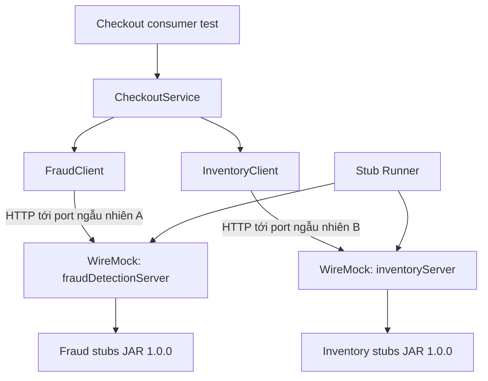
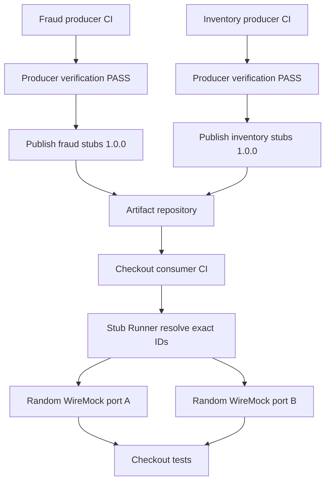

# Chạy nhiều stub bằng cổng ngẫu nhiên

## 1. Bài toán thực hành: một consumer phụ thuộc nhiều producer

Trong hệ thống microservices, một service có thể gọi nhiều service khác trong cùng một luồng nghiệp vụ. Ví dụ **checkout-service** cần kiểm tra gian lận từ **fraud-detection-service**, kiểm tra số lượng hàng từ **inventory-service**, rồi mới xác nhận đơn.

Khi kiểm thử consumer, nếu tự viết một WireMock server với cổng cố định cho từng producer, nhóm thường gặp:

- Cổng đã bị một tiến trình khác chiếm.
- Hai test suites chạy song song cùng muốn dùng `localhost:8080`.
- Một test khởi động stub thứ nhất, test khác khởi động stub thứ hai và vô tình dùng nhầm URL.
- Mỗi lần thêm một dependency lại phải sửa cấu hình cổng, client base URL và CI.
- Test chạy trên máy developer nhưng fail trên CI do cổng khác đã được sử dụng.

**Spring Cloud Contract Stub Runner** giải quyết việc khởi động và quản lý các HTTP stubs từ artifacts do producer phát hành. Nếu bỏ **port** khỏi stub ID, Stub Runner chọn một **cổng ngẫu nhiên** trong phạm vi được cấu hình. Mỗi stub có một WireMock server riêng; consumer lấy đúng URL/cổng bằng **`@StubRunnerPort`**, **`StubFinder`** hoặc property được đăng ký trong Spring Environment.

> **Mục tiêu dự án:** chạy đồng thời ít nhất hai HTTP stubs — Fraud Detection và Inventory — trên những cổng ngẫu nhiên khác nhau; cấu hình client của checkout-service dùng đúng từng cổng; kiểm thử toàn bộ luồng mà không hard-code cổng của stub.

Sau bài này, bạn sẽ có thể:

1. Định nghĩa stub IDs có version/classifier rõ ràng nhưng **không chỉ định port**.
2. Cấu hình khoảng port bằng `minPort` và `maxPort`.
3. Khởi động nhiều WireMock servers trong cùng một consumer test context.
4. Lấy cổng động bằng `@StubRunnerPort` và URL bằng `StubFinder.findStubUrl(...)`.
5. Truyền dynamic base URLs cho các HTTP clients của ứng dụng.
6. Chạy positive/negative scenarios, debug mappings và xử lý lỗi port conflict.
7. Đưa bài kiểm thử vào CI với artifact version bất biến và test isolation.

## 2. Kịch bản và kiến trúc dự án

### Nghiệp vụ

Checkout nhận yêu cầu tạo đơn, sau đó:

1. Gọi `fraud-detection-service` để đánh giá khách hàng.
2. Gọi `inventory-service` để kiểm tra SKU còn hàng.
3. Chỉ trả về trạng thái `APPROVED` nếu gian lận là `CLEAR` và hàng còn đủ.

Trong bài thực hành, hai producer đã publish stubs artifacts:

| Producer | Maven artifact | HTTP endpoint được stub | Response mẫu |
| --- | --- | --- | --- |
| Fraud Detection | `com.example:fraudDetectionServer:1.0.0:stubs` | `GET /api/fraud-check?customerId=cust-42` | `{"customerId":"cust-42","decision":"CLEAR"}` |
| Inventory | `com.example:inventoryServer:1.0.0:stubs` | `GET /api/inventory/SKU-100` | `{"sku":"SKU-100","available":5}` |

Các tọa độ và dữ liệu là **giả định cho bài lab**. Trong dự án thật, dùng groupId, artifactId, version và classifier đã được producer CI publish.

### Sơ đồ luồng



Hai WireMock servers được quản lý trong cùng Stub Runner lifecycle. Chúng có **cổng riêng**; checkout client không cần biết trước các cổng ấy. Trong mỗi test run, Stub Runner chọn port và công bố thông tin để Spring test context sử dụng.

### Cấu trúc module minh họa

```text
contract-multi-stub-lab/
├── fraud-detection-producer/
│   ├── src/main/java/...
│   ├── src/test/java/...
│   └── src/test/resources/contracts/...
├── inventory-producer/
│   ├── src/main/java/...
│   ├── src/test/java/...
│   └── src/test/resources/contracts/...
└── checkout-consumer/
    ├── src/main/java/...
    │   ├── client/FraudClient.java
    │   ├── client/InventoryClient.java
    │   └── service/CheckoutService.java
    └── src/test/
        ├── java/.../CheckoutMultiStubTest.java
        └── resources/
            └── application-contract-test.yml
```

Có thể đặt ba module trong một multi-module build hoặc ba repository độc lập. Điều quan trọng là **producer stubs artifacts đã được sinh và cài vào Maven local repository hoặc publish lên registry** trước khi consumer tests chạy.

## 3. Cơ chế cổng ngẫu nhiên của Stub Runner

### Stub ID có cấu trúc

Stub Runner sử dụng Ivy/Maven coordinates:

```text
groupId:artifactId:version:classifier:port
```

Trong đó:

| Thành phần | Ví dụ | Vai trò |
| --- | --- | --- |
| `groupId` | `com.example` | Namespace của producer |
| `artifactId` | `fraudDetectionServer` | Tên producer artifact |
| `version` | `1.0.0` | Phiên bản stubs cần chạy |
| `classifier` | `stubs` | Chọn stubs JAR |
| `port` | Không khai báo | Stub Runner tự chọn cổng ngẫu nhiên |

Ví dụ:

```text
com.example:fraudDetectionServer:1.0.0:stubs
com.example:inventoryServer:1.0.0:stubs
```

**Điểm quyết định:** hai ID trên có bốn phần; phần `port` được bỏ trống. Khi không chỉ định port, Stub Runner chọn một cổng ngẫu nhiên cho WireMock server tương ứng. Nếu ghi thêm `:9090` ở cuối, bạn đã yêu cầu cổng cố định và không còn thực hành dynamic port nữa.

### Port range

Spring Cloud Contract có các thuộc tính:

| Thuộc tính | Mặc định được tài liệu hóa | Ý nghĩa |
| --- | ---: | --- |
| `minPort` | `10000` | Giới hạn dưới của khoảng cổng |
| `maxPort` | `15000` | Giới hạn trên của khoảng cổng |

Với các phiên bản hiện hành, cấu hình Spring Boot thường dùng prefix `spring.cloud.contract.stubrunner` và tên property dạng kebab-case:

```yaml
spring:
  cloud:
    contract:
      stubrunner:
        min-port: 12000
        max-port: 12100
```

**Cổng ngẫu nhiên ở đây là cổng được chọn trong khoảng**, không phải mặc định yêu cầu hệ điều hành cấp port bằng cách bind `0`. Tên prefix/property có thể khác giữa các nhánh SCC cũ; hãy đối chiếu configuration properties đúng phiên bản dependency đang dùng.

### Một Stub Runner, nhiều WireMock servers

Nếu cấu hình hai artifact, Stub Runner tải và khởi động một HTTP stub server cho từng artifact. Ví dụ:

```text
Stub Runner starts:
  fraudDetectionServer  -> http://localhost:<random-port-A>
  inventoryServer       -> http://localhost:<random-port-B>

Required:
  port-A != port-B
  both ports are reachable by checkout test
  each server serves mappings from its own artifact
```

Port thực tế phải được **tra cứu sau khi Stub Runner khởi động**. Không tính trước bằng cách lấy port đầu tiên rồi cộng 1; không dựa vào thứ tự download hoặc thứ tự khai báo IDs.

## 4. Chuẩn bị hai producer contracts và stubs artifacts

Trong bài lab, producer verification phải chạy trước khi consumer sử dụng stubs. Mỗi producer có hợp đồng riêng.

### 4.1. Fraud Detection contract

Tệp Groovy contract minh họa:

```groovy
import org.springframework.cloud.contract.spec.Contract

Contract.make {
    description 'Kiểm tra rủi ro của khách hàng'

    request {
        method GET()
        url('/api/fraud-check?customerId=cust-42')
        headers {
            accept(applicationJson())
        }
    }

    response {
        status OK()
        headers {
            contentType(applicationJson())
        }
        body([
            customerId: 'cust-42',
            decision: 'CLEAR'
        ])
    }
}
```

Producer verification gọi implementation Fraud Detection và kiểm tra response. Stub được sinh sẽ trả response mẫu cho consumer.

### 4.2. Inventory contract

```groovy
import org.springframework.cloud.contract.spec.Contract

Contract.make {
    description 'Tra cứu số lượng tồn kho của SKU'

    request {
        method GET()
        url('/api/inventory/SKU-100')
        headers {
            accept(applicationJson())
        }
    }

    response {
        status OK()
        headers {
            contentType(applicationJson())
        }
        body([
            sku: 'SKU-100',
            available: 5
        ])
    }
}
```

Contract này bảo vệ endpoint và response của Inventory producer. Bài thực hành dùng một SKU cụ thể để tạo luồng kiểm thử dễ tái lập.

### 4.3. Build và cài stubs vào local repository

Trong từng producer project đã cấu hình Spring Cloud Contract Maven Plugin và producer test base class:

```bash
./mvnw -B clean verify
./mvnw -B install
```

Lệnh minh họa cho producer Maven project. Trong thực tế, `verify` phải chạy generated producer tests; `install` cài artifact đã build vào Maven local repository. Có thể dùng một lifecycle command phù hợp project để tránh build lặp, nhưng **không publish stubs trước khi producer verification pass**.

Kết quả mong đợi:

```text
~/.m2/repository/com/example/fraudDetectionServer/1.0.0/
  fraudDetectionServer-1.0.0-stubs.jar

~/.m2/repository/com/example/inventoryServer/1.0.0/
  inventoryServer-1.0.0-stubs.jar
```

Đường dẫn là ví dụ Maven local repository chuẩn. Nếu project dùng custom repository path, kiểm tra tọa độ thực tế trong artifact repository. Không chỉ dựa vào việc JAR tồn tại: cần biết nó được sinh từ **contract revision và producer build đã verify**.

### 4.4. Khi chạy consumer trong CI

- Dùng `LOCAL` khi các stubs artifacts đã được cài vào Maven local repository trong job/runner.
- Dùng `REMOTE` khi stubs được tải từ Nexus/Artifactory hoặc Maven-compatible repository.
- Dùng `CLASSPATH` nếu fixture/stubs đã được đóng gói vào test classpath và project chủ động quản lý cách đó.

Trong release gate, pin version cụ thể; tránh `+` hoặc `latest` nếu cần kết quả tái lập.

## 5. Cấu hình consumer để chạy hai stubs trên cổng ngẫu nhiên

### 5.1. Dependency Stub Runner

Consumer project cần dependency Stub Runner trong test scope. Ví dụ Maven:

```xml
<dependency>
    <groupId>org.springframework.cloud</groupId>
    <artifactId>spring-cloud-starter-contract-stub-runner</artifactId>
    <scope>test</scope>
</dependency>
```

Version được quản lý bằng **Spring Cloud BOM phù hợp với Spring Boot của consumer**. Không tự chọn một SCC version chỉ vì producer đang dùng version số tương tự.

### 5.2. Tạo application-contract-test.yml

Tạo file `src/test/resources/application-contract-test.yml`:

```yaml
spring:
  cloud:
    contract:
      stubrunner:
        ids:
          - "com.example:fraudDetectionServer:1.0.0:stubs"
          - "com.example:inventoryServer:1.0.0:stubs"
        stubs-mode: LOCAL
        min-port: 12000
        max-port: 12100

clients:
  fraud:
    base-url: "http://localhost:${spring.cloud.contract.stubrunner.runningstubs.fraudDetectionServer.port}"
  inventory:
    base-url: "http://localhost:${spring.cloud.contract.stubrunner.runningstubs.inventoryServer.port}"
```

Đọc cấu hình:

- Có **hai stub IDs**, mỗi ID có group, artifact, version và classifier.
- **Không có phần port** ở cuối ID, vì vậy Stub Runner chọn port động.
- `stubs-mode: LOCAL` yêu cầu artifacts đã có trong local Maven repository.
- `min-port`/`max-port` giới hạn vùng port Stub Runner được phép chọn.
- Hai client base URLs tham chiếu **port do Stub Runner đăng ký trong Spring Environment**.

Tên property dùng để tham chiếu port phải khớp phiên bản SCC đang dùng. Trong các bản mới, prefix cấu hình đầy đủ có thể là `spring.cloud.contract.stubrunner.runningstubs...`; tài liệu/nhánh cũ có thể dùng dạng rút gọn `stubrunner.runningstubs...`. Nếu placeholder không resolve, kiểm tra **configuration properties của đúng version** và dùng `StubFinder`/`@StubRunnerPort` để xác minh giá trị.

### 5.3. Bật Stub Runner trong test context

```java
package com.example.checkout;

import org.springframework.boot.test.context.SpringBootTest;
import org.springframework.cloud.contract.stubrunner.spring.AutoConfigureStubRunner;
import org.springframework.test.context.ActiveProfiles;

@SpringBootTest
@ActiveProfiles("contract-test")
@AutoConfigureStubRunner(
    mappingsOutputFolder = "target/stub-mappings"
)
class CheckoutMultiStubTest {
    // Test cases sẽ được bổ sung ở các mục sau.
}
```

`@AutoConfigureStubRunner` bật Spring integration cho Stub Runner. Danh sách IDs và port range được lấy từ profile `contract-test`. `mappingsOutputFolder` yêu cầu ghi các mappings đã đăng ký ra thư mục để hỗ trợ debug.

Nếu project muốn cấu hình trực tiếp trong annotation, có thể truyền `ids` và `stubsMode` tại đó. **Chỉ chọn một nguồn cấu hình rõ ràng** để tránh test annotation và profile vô tình chỉ định hai tập stubs khác nhau.

### 5.4. Lấy từng port bằng @StubRunnerPort

Stub Runner hỗ trợ inject port theo artifact ID:

```java
import org.springframework.cloud.contract.stubrunner.spring.StubRunnerPort;

@StubRunnerPort("fraudDetectionServer")
int fraudDetectionPort;

@StubRunnerPort("inventoryServer")
int inventoryPort;
```

Các trường trên nhận **port thực tế** của từng WireMock server sau khi Stub Runner khởi động. Có thể dùng groupId cùng artifactId để định danh rõ hơn nếu có artifact IDs trùng nhau.

### 5.5. Lấy URL bằng StubFinder

Ngoài annotation, có thể inject `StubFinder`:

```java
import java.net.URL;

import org.springframework.beans.factory.annotation.Autowired;
import org.springframework.cloud.contract.stubrunner.StubFinder;

@Autowired
StubFinder stubFinder;

URL fraudUrl =
    stubFinder.findStubUrl("com.example", "fraudDetectionServer");

URL inventoryUrl =
    stubFinder.findStubUrl("com.example", "inventoryServer");
```

`findStubUrl(groupId, artifactId)` trả về URL của stub đang chạy hoặc báo lỗi nếu không tìm thấy. Có thể dùng `findStubUrl(ivyNotation)` để tìm bằng tọa độ Ivy/Maven, hoặc `findAllRunningStubs()` để xem toàn bộ stubs đã được đăng ký.

**Chọn một cách tra cứu phù hợp:**

| Cách | Phù hợp khi |
| --- | --- |
| `@StubRunnerPort` | Spring test cần inject port trực tiếp |
| `StubFinder.findStubUrl(...)` | Test cần URL đầy đủ hoặc kiểm tra server đã khởi động |
| `stubrunner.runningstubs.<artifactId>.port` | Cấu hình base URL bằng Spring property placeholder |

Không hard-code `localhost:12000` chỉ vì đã đặt `min-port: 12000`. Min-port là giới hạn dưới, **không phải port được gán cho stub đầu tiên**.

## 6. Xây dựng hai HTTP clients và CheckoutService

Trong ví dụ, checkout consumer dùng hai client độc lập. Các client lấy base URL từ configuration nên test profile có thể thay endpoint thật bằng port ngẫu nhiên.

### 6.1. FraudClient

```java
package com.example.checkout.client;

import org.springframework.beans.factory.annotation.Value;
import org.springframework.boot.web.client.RestTemplateBuilder;
import org.springframework.stereotype.Component;
import org.springframework.web.client.RestTemplate;

@Component
public class FraudClient {

    private final RestTemplate restTemplate;
    private final String baseUrl;

    public FraudClient(
            RestTemplateBuilder builder,
            @Value("${clients.fraud.base-url}") String baseUrl) {
        this.restTemplate = builder.build();
        this.baseUrl = baseUrl;
    }

    public FraudResult check(String customerId) {
        return restTemplate.getForObject(
                baseUrl + "/api/fraud-check?customerId={customerId}",
                FraudResult.class,
                customerId
        );
    }
}
```

DTO:

```java
package com.example.checkout.client;

public record FraudResult(String customerId, String decision) {
}
```

### 6.2. InventoryClient

```java
package com.example.checkout.client;

import org.springframework.beans.factory.annotation.Value;
import org.springframework.boot.web.client.RestTemplateBuilder;
import org.springframework.stereotype.Component;
import org.springframework.web.client.RestTemplate;

@Component
public class InventoryClient {

    private final RestTemplate restTemplate;
    private final String baseUrl;

    public InventoryClient(
            RestTemplateBuilder builder,
            @Value("${clients.inventory.base-url}") String baseUrl) {
        this.restTemplate = builder.build();
        this.baseUrl = baseUrl;
    }

    public InventoryResult findBySku(String sku) {
        return restTemplate.getForObject(
                baseUrl + "/api/inventory/{sku}",
                InventoryResult.class,
                sku
        );
    }
}
```

DTO:

```java
package com.example.checkout.client;

public record InventoryResult(String sku, int available) {
}
```

### 6.3. CheckoutService

```java
package com.example.checkout.service;

import com.example.checkout.client.FraudClient;
import com.example.checkout.client.FraudResult;
import com.example.checkout.client.InventoryClient;
import com.example.checkout.client.InventoryResult;
import org.springframework.stereotype.Service;

@Service
public class CheckoutService {

    private final FraudClient fraudClient;
    private final InventoryClient inventoryClient;

    public CheckoutService(
            FraudClient fraudClient,
            InventoryClient inventoryClient) {
        this.fraudClient = fraudClient;
        this.inventoryClient = inventoryClient;
    }

    public CheckoutResult evaluate(String customerId, String sku) {
        FraudResult fraud = fraudClient.check(customerId);
        InventoryResult inventory = inventoryClient.findBySku(sku);

        if (!"CLEAR".equals(fraud.decision())) {
            return new CheckoutResult("DECLINED", fraud.decision(),
                    inventory.available());
        }

        if (inventory.available() <= 0) {
            return new CheckoutResult("OUT_OF_STOCK", fraud.decision(),
                    inventory.available());
        }

        return new CheckoutResult("APPROVED", fraud.decision(),
                inventory.available());
    }
}
```

Response của CheckoutService:

```java
package com.example.checkout.service;

public record CheckoutResult(
        String status,
        String fraudDecision,
        int available
) {
}
```

Các lớp trên là **mã ứng dụng minh họa**, không phải class do Spring Cloud Contract tạo ra. Ví dụ `RestTemplateBuilder` cần Spring Boot web starter; các `record` minh họa cần Java 16+ (thực tế Spring Boot 3 yêu cầu Java 17+). Nếu dự án dùng `WebClient`, Feign hoặc HTTP interface, giữ nguyên client production của ứng dụng và chỉ thay base URL trong test profile.

### 6.4. Vì sao phải có hai base URLs?

| Client | Base URL trong test | Stub nhận request |
| --- | --- | --- |
| `FraudClient` | `http://localhost:<fraud-port>` | `fraudDetectionServer` |
| `InventoryClient` | `http://localhost:<inventory-port>` | `inventoryServer` |

Nếu cả hai client trỏ về cùng một port, request của Inventory có thể đi vào Fraud WireMock và trả 404 unmatched. **Stub Runner đã chạy cả hai server không tự động cấu hình mọi HTTP client của ứng dụng**; ta phải kết nối client đúng URL hoặc sử dụng Stub Runner Spring Cloud service discovery integration phù hợp.

## 7. Viết consumer integration test cho nhiều stubs

### 7.1. Test khởi động cả hai WireMock servers

```java
package com.example.checkout;

import com.example.checkout.service.CheckoutResult;
import com.example.checkout.service.CheckoutService;
import org.junit.jupiter.api.Test;
import org.springframework.beans.factory.annotation.Autowired;
import org.springframework.boot.test.context.SpringBootTest;
import org.springframework.cloud.contract.stubrunner.StubFinder;
import org.springframework.cloud.contract.stubrunner.spring.StubRunnerPort;
import org.springframework.cloud.contract.stubrunner.spring.AutoConfigureStubRunner;
import org.springframework.test.context.ActiveProfiles;

import static org.assertj.core.api.Assertions.assertThat;

@SpringBootTest
@ActiveProfiles("contract-test")
@AutoConfigureStubRunner(
    mappingsOutputFolder = "target/stub-mappings"
)
class CheckoutMultiStubTest {

    @Autowired
    CheckoutService checkoutService;

    @Autowired
    StubFinder stubFinder;

    @StubRunnerPort("fraudDetectionServer")
    int fraudPort;

    @StubRunnerPort("inventoryServer")
    int inventoryPort;

    @Test
    void startsTwoStubsOnDifferentRandomPorts() throws Exception {
        assertThat(fraudPort).isPositive();
        assertThat(inventoryPort).isPositive();
        assertThat(fraudPort).isNotEqualTo(inventoryPort);

        assertThat(stubFinder.findStubUrl(
                "com.example", "fraudDetectionServer").getPort())
                .isEqualTo(fraudPort);

        assertThat(stubFinder.findStubUrl(
                "com.example", "inventoryServer").getPort())
                .isEqualTo(inventoryPort);
    }

    @Test
    void approvesCheckoutUsingBothProducerStubs() {
        CheckoutResult result =
                checkoutService.evaluate("cust-42", "SKU-100");

        assertThat(result.status()).isEqualTo("APPROVED");
        assertThat(result.fraudDecision()).isEqualTo("CLEAR");
        assertThat(result.available()).isEqualTo(5);
    }
}
```

Đây là ví dụ Java/JUnit 5 với Spring Test. Các imports Stub Runner quan trọng:

- `AutoConfigureStubRunner`: khởi động và quản lý stubs trong test context.
- `StubRunnerPort`: inject port của một artifact cụ thể.
- `StubFinder`: tra cứu URL và danh sách stubs đang chạy.

### 7.2. Điều gì đang được xác minh?

Test đầu tiên xác minh:

1. Fraud Detection stub đã khởi động.
2. Inventory stub đã khởi động.
3. Hai server có port khác nhau.
4. Port được inject bằng annotation trùng với URL mà `StubFinder` tra cứu.

Test thứ hai xác minh **hai HTTP clients của checkout-service cùng gọi đúng stub**:

```text
checkoutService.evaluate("cust-42", "SKU-100")
       |
       +--> FraudClient
       |      GET http://localhost:<fraudPort>/api/fraud-check?customerId=cust-42
       |      <-- 200 {"customerId":"cust-42","decision":"CLEAR"}
       |
       +--> InventoryClient
              GET http://localhost:<inventoryPort>/api/inventory/SKU-100
              <-- 200 {"sku":"SKU-100","available":5}

Expected CheckoutResult:
  status = APPROVED
  fraudDecision = CLEAR
  available = 5
```

Các cổng trong sơ đồ là **giá trị được Stub Runner cấp khi chạy**, không phải những số cần điền vào source code.

### 7.3. Kết quả kỳ vọng

Một lần chạy có thể hiển thị:

```text
fraudDetectionServer -> http://localhost:12034
inventoryServer      -> http://localhost:12087

CheckoutMultiStubTest:
  startsTwoStubsOnDifferentRandomPorts ........ PASSED
  approvesCheckoutUsingBothProducerStubs ...... PASSED

Tests run: 2, Failures: 0, Errors: 0
```

Đây chỉ là **ví dụ minh họa**. Các số port thay đổi giữa những lần chạy; không viết assertion yêu cầu đúng `12034` hoặc `12087`.

### 7.4. Chạy test

Với Maven/Surefire:

```bash
./mvnw -B -Dtest=CheckoutMultiStubTest test
```

Với Gradle:

```bash
./gradlew test --tests 'com.example.checkout.CheckoutMultiStubTest'
```

Tên task và cách lọc test tùy build configuration. Nếu SCC test suite được đặt trong một source set/task riêng, chạy đúng task đó. **Không chỉ chạy bước compile hoặc generate** rồi kết luận nhiều stubs đã khởi động.

## 8. Quan sát cổng động và mappings được nạp

### 8.1. Xem thông tin bằng StubFinder

```java
import org.springframework.cloud.contract.stubrunner.RunningStubs;

RunningStubs runningStubs = stubFinder.findAllRunningStubs();

int fraudPortFromRegistry =
        runningStubs.getPort("fraudDetectionServer");

int inventoryPortFromRegistry =
        runningStubs.getPort("inventoryServer");
```

`RunningStubs` cho phép xem các stubs đã chạy và lấy port theo artifact ID. Khi cần định danh rõ hơn, dùng groupId cùng artifactId hoặc Ivy notation phù hợp.

### 8.2. Xem các property do Stub Runner đăng ký

Stub Runner Spring đăng ký port trong Environment. Ví dụ với các artifact IDs ở bài lab:

```text
spring.cloud.contract.stubrunner.runningstubs.fraudDetectionServer.port
spring.cloud.contract.stubrunner.runningstubs.inventoryServer.port
```

Một số phiên bản còn hỗ trợ dạng group-qualified:

```text
spring.cloud.contract.stubrunner.runningstubs.com.example.fraudDetectionServer.port
spring.cloud.contract.stubrunner.runningstubs.com.example.inventoryServer.port
```

Tên đầy đủ/rút gọn phụ thuộc phiên bản và property binding. Dùng `Environment.getProperty(...)` hoặc `@Value` để kiểm tra khi debug, không tự tạo property key tùy ý.

### 8.3. Xuất mappings ra thư mục

Annotation đã cấu hình:

```java
@AutoConfigureStubRunner(
    mappingsOutputFolder = "target/stub-mappings"
)
```

Stub Runner có thể ghi mappings đã đăng ký ra thư mục theo từng artifact và port. Sau test, kiểm tra:

```text
target/stub-mappings/
  fraudDetectionServer_<actual-port>/
  inventoryServer_<actual-port>/
```

Tên folder chính xác phụ thuộc implementation/version. Mục tiêu là xem **mapping nào thuộc artifact nào** và so với request mà consumer gửi. Đây là cách hữu ích khi một stub trả 404 vì request không match.

### 8.4. Kiểm tra trực tiếp endpoint của từng stub

Trong lúc test đang chạy, có thể gọi URL đã lấy từ `StubFinder`:

```java
URL fraudUrl =
        stubFinder.findStubUrl("com.example", "fraudDetectionServer");

URL inventoryUrl =
        stubFinder.findStubUrl("com.example", "inventoryServer");

// Các URL này có port động của đúng artifact.
```

Nếu muốn smoke-test HTTP trực tiếp, dùng `fraudUrl` để gọi `/api/fraud-check?customerId=cust-42` và `inventoryUrl` để gọi `/api/inventory/SKU-100`. **Không nối hai URL bằng cùng một port hoặc giả định thứ tự Stub Runner cấp port**.

## 9. Cổng ngẫu nhiên so với cổng cố định

Stub Runner hỗ trợ cả hai cách. Nên chọn theo mục đích test:

| Cách | Stub ID | Khi nào phù hợp? | Điểm cần nhớ |
| --- | --- | --- | --- |
| **Random port** | `com.example:fraudDetectionServer:1.0.0:stubs` | Consumer integration tests, nhiều stubs, chạy song song | Lấy port qua `StubRunnerPort`/`StubFinder` |
| **Fixed port** | `com.example:fraudDetectionServer:1.0.0:stubs:9090` | Tool ngoài cần một endpoint ổn định hoặc debug cục bộ | Dễ xung đột nếu cổng bị chiếm |

### Ví dụ fixed port để so sánh

```java
@AutoConfigureStubRunner(
    ids = {
        "com.example:fraudDetectionServer:1.0.0:stubs:9090",
        "com.example:inventoryServer:1.0.0:stubs:9091"
    },
    stubsMode = StubRunnerProperties.StubsMode.LOCAL
)
```

Hai server được yêu cầu bind vào `9090` và `9091`. Nếu một cổng đang được tiến trình khác sử dụng, việc khởi động có thể thất bại. Khi nhiều test classes hoặc CI jobs chạy cùng máy, fixed ports dễ tạo lỗi không ổn định.

### Chuyển lại sang random

```java
@AutoConfigureStubRunner(
    ids = {
        "com.example:fraudDetectionServer:1.0.0:stubs",
        "com.example:inventoryServer:1.0.0:stubs"
    },
    stubsMode = StubRunnerProperties.StubsMode.LOCAL
)
```

Chỉ cần bỏ port ở cuối ID. **Không thay version hoặc classifier trong cùng thay đổi** nếu mục tiêu đang kiểm tra là port allocation; giữ các yếu tố khác ổn định để kết quả dễ đối chiếu.

### Đừng dùng min-port như fixed port

`min-port: 12000` và `max-port: 12100` có nghĩa Stub Runner chọn cổng trong phạm vi đó. Nó **không có nghĩa Fraud luôn dùng 12000 và Inventory luôn dùng 12001**. Thứ tự khởi động có thể thay đổi; port có thể khác giữa các lần chạy.

## 10. Các cách cấp dynamic URL cho HTTP clients

### Cách A — Spring property placeholder

Đây là cách dùng trong bài lab:

```yaml
clients:
  fraud:
    base-url: "http://localhost:${spring.cloud.contract.stubrunner.runningstubs.fraudDetectionServer.port}"
  inventory:
    base-url: "http://localhost:${spring.cloud.contract.stubrunner.runningstubs.inventoryServer.port}"
```

Ưu điểm:

- Ứng dụng tiếp tục dùng **cấu hình base URL** như khi chạy production.
- Test chỉ thay nguồn cấu hình, không cần thay business code.
- Hai client có thể được cấu hình độc lập và rõ ràng.

Điều cần xác minh là property placeholder đã resolve **sau khi Stub Runner đăng ký các server**. Nếu application context báo không tìm thấy placeholder, kiểm tra prefix theo version, profile đang bật và thời điểm khởi tạo bean.

### Cách B — @StubRunnerPort trong test

Nếu test cần gọi trực tiếp stub hoặc tự tạo client:

```java
@StubRunnerPort("fraudDetectionServer")
int fraudPort;

@StubRunnerPort("inventoryServer")
int inventoryPort;

String fraudBaseUrl = "http://localhost:" + fraudPort;
String inventoryBaseUrl = "http://localhost:" + inventoryPort;
```

Ưu điểm là dễ đọc và không cần property placeholder. Tuy nhiên, nếu application đã khởi tạo HTTP clients từ configuration trước khi test method chạy, **không thể chỉ tạo hai chuỗi URL trong test rồi kỳ vọng các bean đã có tự đổi endpoint**. Hãy cấu hình client từ đầu qua test properties hoặc dùng test configuration phù hợp.

### Cách C — StubFinder tìm URL

```java
URL fraudUrl =
        stubFinder.findStubUrl("com.example", "fraudDetectionServer");
URL inventoryUrl =
        stubFinder.findStubUrl("com.example", "inventoryServer");

String fraudBaseUrl = fraudUrl.toString();
String inventoryBaseUrl = inventoryUrl.toString();
```

Phù hợp khi cần URL đầy đủ, hoặc khi test phải xử lý scheme/port theo runtime. Nếu một stub dùng HTTPS thông qua `HttpServerStubConfigurer`, `URL` còn cho biết scheme; đừng tự ghép `http://localhost` khi cấu hình server thực tế là HTTPS.

### Cách D — Spring Cloud service discovery integration

Nếu consumer dùng Feign, load-balanced RestTemplate/WebClient hoặc DiscoveryClient, Stub Runner có thể tích hợp Spring Cloud để **đăng ký các stubs như những service instances**. Khi dùng cơ chế này, consumer có thể gọi service ID thay vì tự ghép port. Cần cấu hình mapping artifact ID ↔ service ID nếu tên khác, và kiểm tra behavior discovery theo phiên bản Spring Cloud.

**Không bật service discovery integration chỉ để lấy một cổng.** Với bài lab đơn giản, property placeholder hoặc `StubRunnerPort` dễ hiểu và ít thành phần hơn.

## 11. Chạy song song và quản lý port range

### 11.1. Hai loại song song khác nhau

| Tình huống | Rủi ro | Cách xử lý |
| --- | --- | --- |
| Hai stubs trong **cùng một Stub Runner context** | Hai server cần hai cổng riêng | Không đặt fixed port trùng nhau; để random |
| Nhiều test methods dùng **cùng Spring context** | Có thể chia sẻ server/mappings và state | Tránh reset/mutate mapping toàn cục giữa test |
| Nhiều Spring contexts trong cùng JVM | Mỗi context có thể khởi động lại các stubs | Dùng random ports, quản lý context cache/lifecycle |
| Nhiều Maven/Gradle test JVM trên cùng host | Các JVM chọn port từ cùng range | Mở rộng range hoặc tách network namespace/worker |
| Nhiều CI workers trên cùng host | Có thể cạnh tranh cổng nếu range chật | Dùng container/worker isolation và range thích hợp |

### 11.2. Tính toán phạm vi port

Nếu một consumer test context cần 8 HTTP stubs, port range chỉ có 5 cổng chắc chắn không đủ. Khi thiết kế:

1. Ước lượng số WireMock servers chạy đồng thời trong một JVM.
2. Tính cả các test contexts/worker có thể cùng chạy trên một host.
3. Đặt `min-port`/`max-port` đủ rộng cho số server dự kiến.
4. Kiểm tra firewall, container port exposure và policy của CI runner.
5. Giữ port mapping nội bộ trong test; không cần publish ra host network nếu consumer chạy cùng container/network namespace.

Khoảng port rộng hơn giảm nguy cơ cạn cổng nhưng **không phải cơ chế điều phối toàn cục giữa nhiều tiến trình**. Nếu CI có nhiều worker trên cùng host, mỗi worker có thể được cấu hình range riêng hoặc chạy trong container/network namespace độc lập.

### 11.3. Tránh chia sẻ mutable state

Random port giải quyết **xung đột listener**, không tự giải quyết race condition ở WireMock mappings/scenarios. Nếu test A reset mappings hoặc thay scenario của server đang được test B sử dụng, kết quả vẫn có thể flake.

- Ưu tiên stubs read-only và một Stub Runner context theo suite.
- Nếu cần thay mappings/scenarios, dùng server/context riêng cho test cần mutation.
- Không chạy test methods song song nếu chúng phụ thuộc cùng một scenario state mutable mà không có isolation.
- Dọn context/port sau suite; không để server chạy nền ngoài lifecycle.

### 11.4. Khi nào nên dùng một context cho toàn suite?

Nếu 30 test methods cùng dùng hai stubs bất biến, một Spring context có thể tiết kiệm thời gian startup và tải artifact. Nếu các tests cần các version/mappings khác nhau, hãy tách context hoặc test profiles theo nhóm. **Không cố nhồi mọi producer versions vào cùng artifact ID/port để tiết kiệm vài giây**, vì sẽ làm khó xác định stub nào đang trả response.

## 12. Chạy trên CI và chuyển từ LOCAL sang REMOTE

### 12.1. Luồng producer → artifact repository → consumer



Trong CI thật:

1. Producer pipeline chạy generated contract tests và chỉ publish stubs sau khi pass.
2. Consumer pipeline nhận **version cụ thể** của từng producer stubs artifact.
3. Stub Runner tải hai artifacts từ registry, khởi động hai WireMock servers trên port động.
4. Checkout tests lấy dynamic ports và gọi đúng từng producer stub.
5. CI lưu test reports và artifact identities để có thể tái lập lỗi.

### 12.2. Cấu hình REMOTE

Nếu artifacts đã được publish lên Maven-compatible registry, chuyển profile sang:

```yaml
spring:
  cloud:
    contract:
      stubrunner:
        ids:
          - "com.example:fraudDetectionServer:1.0.0:stubs"
          - "com.example:inventoryServer:1.0.0:stubs"
        stubs-mode: REMOTE
        repository-root: "https://repo.example.org/maven-releases"
        min-port: 12000
        max-port: 12100
```

Registry cần credentials read-only được cung cấp qua CI secret store/Maven settings theo cấu hình dự án. **Không ghi username/password vào contract hoặc file YAML được commit**.

Giữ port omitted trong IDs khi chuyển LOCAL → REMOTE. Nguồn tải artifact thay đổi; cách cấp port vẫn là random.

### 12.3. Pin version và classifier

Một ID như `com.example:fraudDetectionServer:1.0.0:stubs` xác định rõ artifact. Tránh:

```text
com.example:fraudDetectionServer
```

trong release gate nếu không có policy version resolution rõ ràng: khi bỏ version, Stub Runner có thể dùng `+`/latest theo cấu hình. Test hôm nay và ngày mai có thể nạp stubs khác nhau.

**Bài lab chỉ bỏ port, không bỏ version.** Đây là cách tách biệt hai mục tiêu: phiên bản stub được cố định để tái lập; cổng được cấp động để tránh xung đột.

### 12.4. Ví dụ lệnh chạy consumer test

Nếu profile được bật bằng annotation `@ActiveProfiles("contract-test")`, chạy:

```bash
./mvnw -B -Dtest=CheckoutMultiStubTest test
```

Nếu profile được kích hoạt qua JVM property:

```bash
./mvnw -B -Dspring.profiles.active=contract-test -Dtest=CheckoutMultiStubTest test
```

Không cần dùng cả hai cách cùng lúc. Chọn một cơ chế profile thống nhất trong dự án.

### 12.5. Những gì cần lưu trong CI report

| Trường | Ví dụ |
| --- | --- |
| Producer 1 | `com.example:fraudDetectionServer:1.0.0:stubs` |
| Producer 2 | `com.example:inventoryServer:1.0.0:stubs` |
| Stub Runner mode | `REMOTE` |
| Port range | `12000–12100` |
| Fraud port thực tế | Giá trị lấy từ `@StubRunnerPort` |
| Inventory port thực tế | Giá trị lấy từ `@StubRunnerPort` |
| Consumer revision | Commit SHA của checkout-service |
| Test results | Executed / failed / skipped |
| Artifact digest | SHA-256 hoặc provenance theo registry |

Port là thông tin runtime hữu ích để debug, nhưng **không nên coi port là artifact identity**. Khi tái lập test, dùng producer version/digest và consumer revision; port có thể được cấp khác ở lần chạy sau.

## 13. Chẩn đoán lỗi thường gặp khi chạy nhiều stubs

| Triệu chứng | Nguyên nhân có thể | Cách kiểm tra |
| --- | --- | --- |
| `StubNotFoundException` | Sai groupId/artifactId/version/classifier hoặc artifact chưa publish | So exact coordinates với registry/local repository |
| `Connection refused` ở Fraud client | Placeholder/port sai hoặc stub chưa khởi động | So `@StubRunnerPort` với `StubFinder.findStubUrl` |
| `Connection refused` ở Inventory client | Inventory base URL đang dùng nhầm fraud port | Kiểm tra từng property/client độc lập |
| Fraud request trả 404 | Method/path/query/header/body không match mapping Fraud | Xem mapping artifact Fraud và actual request |
| Inventory request trả 404 | URL hoặc SKU không khớp mapping Inventory | Xem mapping Inventory và request journal |
| Hai clients đều nhận cùng response | Cả hai base URLs trỏ nhầm cùng một server | Log URL/port của từng client trong test |
| Fixed port already in use | Cổng bị tiến trình khác chiếm | Bỏ port khỏi ID hoặc chọn range riêng |
| Không tìm thấy placeholder port | Property prefix sai hoặc chưa bật profile | Xem Environment/configprops đúng SCC version |
| Port ngoài range mong đợi | Min/max property chưa được bind | Kiểm tra property name và active profile |
| Không có mappings output | Annotation/output path không được nạp hoặc không có quyền ghi | Kiểm tra `mappingsOutputFolder`, filesystem và test report |
| Test chạy local nhưng fail CI | Stubs chưa publish, credentials/repository sai, range bị chặn | Kiểm tra registry access và CI port policy |
| Test flake khi chạy song song | Mutable mapping/scenario dùng chung hoặc range quá hẹp | Tách context/state, mở rộng range, kiểm soát parallelism |
| Consumer test pass với stub cũ | Dùng version không pin hoặc cache cũ | Xác minh exact artifact version/digest |
| Stub Runner khởi động nhưng consumer không gọi stub | Client vẫn dùng production base URL | Kiểm tra effective client configuration |

### 13.1. 404 do unmatched mapping

Khi WireMock trả 404, phân biệt:

- **404 unmatched:** request không khớp bất kỳ mapping nào của stub server.
- **404 nghiệp vụ:** contract chủ động mô tả tài nguyên không tồn tại.

Không chỉ assert `status == 404` nếu test cần chứng minh business error. Với bài lab, các request hợp lệ phải trả 200. Nếu nhận 404, xem **server nào đã nhận request**, method/path/query và mapping thuộc artifact nào.

### 13.2. Debug base URL mà không lộ secrets

Trong profile test, có thể log:

```text
fraud.base-url=http://localhost:<port-A>
inventory.base-url=http://localhost:<port-B>
```

Chỉ log host/port và artifact IDs; không log credentials registry, Authorization headers hoặc dữ liệu nhạy cảm. Không ghi port cố định vào test report như một expectation.

### 13.3. Kiểm tra mappings

Đọc các file đã dump trong `target/stub-mappings` để xác nhận:

1. Fraud artifact có mapping `GET /api/fraud-check`.
2. Inventory artifact có mapping `GET /api/inventory/SKU-100`.
3. Response body thuộc đúng producer.
4. Không có mapping bị đặt nhầm artifact hoặc trùng request mâu thuẫn.

Nếu mapping đúng nhưng client vẫn nhận 404, lấy actual URL từ client và so với URL/port của server. **Đừng sửa contract nguồn trước khi biết request đã đến đúng stub hay chưa.**

## 14. Các biến thể mở rộng của dự án

### 14.1. Thêm một producer thứ ba

Giả sử checkout còn gọi `tax-service`. Thêm một stub ID:

```yaml
spring:
  cloud:
    contract:
      stubrunner:
        ids:
          - "com.example:fraudDetectionServer:1.0.0:stubs"
          - "com.example:inventoryServer:1.0.0:stubs"
          - "com.example:taxServer:1.0.0:stubs"
```

Không khai báo port cho `taxServer`. Inject:

```java
@StubRunnerPort("taxServer")
int taxPort;
```

Sau đó thêm `TaxClient` và base URL tương ứng. **Không lấy port của Fraud hoặc Inventory để dùng cho Tax**; mỗi artifact có server và port riêng.

### 14.2. Hai artifacts có cùng artifactId

Trong hệ thống có thể có hai groupIds khác nhau nhưng cùng artifactId. Khi đó:

- Dùng `@StubRunnerPort("groupId:artifactId")` để định danh rõ.
- Dùng `StubFinder.findStubUrl(groupId, artifactId)` hoặc Ivy notation đầy đủ.
- Tránh tra cứu chỉ bằng artifactId nếu có thể có kết quả mơ hồ.

Nếu chạy hai version khác nhau của **cùng một artifact**, hãy định danh bằng notation có cả version/classifier theo API mà phiên bản SCC hỗ trợ. Kiểm tra `findStubUrl(...)` trả đúng URL của version cần test; không dựa vào thứ tự trong danh sách IDs.

### 14.3. Tích hợp service discovery

Với consumer dùng Spring Cloud LoadBalancer/Feign, có thể cấu hình Stub Runner Spring Cloud để service discovery trả về các stub instances. Luồng sẽ là:

```text
CheckoutService
    -> FraudClient gọi service ID "fraudDetectionServer"
    -> Stub Runner discovery integration chọn WireMock fraud port

CheckoutService
    -> InventoryClient gọi service ID "inventoryServer"
    -> Stub Runner discovery integration chọn WireMock inventory port
```

Khi dùng cách này, không nhất thiết cần khai báo base URL bằng localhost trong test profile. Tuy nhiên phải kiểm tra:

1. Consumer đang dùng đúng client/load-balancer tích hợp với Spring Cloud.
2. Stub Runner Cloud integration được bật theo version.
3. Artifact ID được ánh xạ đúng service ID nếu tên khác.
4. Test không gọi Eureka/Consul/Config Server thật ngoài ý muốn.
5. Kết quả discovery thực sự trỏ tới stubs đã khởi động.

Đây là **phần mở rộng**, không bắt buộc để hoàn thành bài lab. Với HTTP clients cấu hình URL tĩnh, dùng dynamic property/port injection sẽ dễ theo dõi hơn.

### 14.4. HTTPS cho một stub

Nếu một producer yêu cầu HTTPS trong contract test, Stub Runner cho phép tùy chỉnh WireMock server bằng `HttpServerStubConfigurer` ở những phiên bản hỗ trợ. Khi đó URL có thể có scheme `https` và một port HTTPS riêng. **Không giả định port HTTP và HTTPS giống nhau**; dùng URL/cấu hình thực tế của stub và trust material test phù hợp.

Không đổi tất cả stubs sang HTTPS chỉ để thử cổng ngẫu nhiên. Hãy giữ mục tiêu của bài là hai HTTP stubs trước, sau đó mới thêm TLS như một bài nâng cao.

### 14.5. Messaging stubs không phải WireMock servers

Stub Runner còn hỗ trợ messaging routes/trigger theo adapter. Các route này **không được tra cứu bằng HTTP random port như WireMock** trong ví dụ. Nếu thêm Kafka, AMQP hoặc Spring Integration:

- Cấu hình transport adapter đúng.
- Dùng `StubTrigger`/message verifier phù hợp để trigger hoặc nhận message.
- Kiểm tra destination, label, headers và payload.
- Quản lý broker/test binder lifecycle riêng.

Không dùng `@StubRunnerPort` để suy ra địa chỉ Kafka broker hay queue. Port của WireMock HTTP server và port của message broker là hai khái niệm khác nhau.

## 15. Bài thực hành có hướng dẫn: hoàn thiện checkout multi-stub

### Nhiệm vụ A — Chuẩn bị artifacts

1. Tạo hoặc sử dụng hai producer projects Fraud Detection và Inventory.
2. Định nghĩa hai Groovy contracts ở mục 4.
3. Cấu hình Contract Verifier cho từng producer.
4. Viết test base class để generated tests gọi đúng implementation.
5. Chạy producer verification và xác nhận test reports có scenarios đã thực thi.
6. Sinh stubs artifacts và cài vào Maven local hoặc publish lên registry.
7. Xác nhận exact coordinates là `com.example:fraudDetectionServer:1.0.0:stubs` và `com.example:inventoryServer:1.0.0:stubs`.

**Kết quả cần đạt:** có hai stubs artifacts đúng version, được tạo từ producer contracts đã verify.

### Nhiệm vụ B — Cấu hình Stub Runner

1. Thêm `spring-cloud-starter-contract-stub-runner` vào test scope của checkout consumer.
2. Tạo `application-contract-test.yml`.
3. Khai báo hai stub IDs **không có port**.
4. Chọn `LOCAL` để chạy lab offline.
5. Đặt `min-port: 12000` và `max-port: 12100`.
6. Khai báo hai client base URLs tham chiếu port properties.
7. Bật `@AutoConfigureStubRunner` trong test context.

**Kết quả cần đạt:** Stub Runner tải được hai artifacts và khởi động hai WireMock servers.

### Nhiệm vụ C — Kết nối clients

1. Tạo `FraudClient` dùng `clients.fraud.base-url`.
2. Tạo `InventoryClient` dùng `clients.inventory.base-url`.
3. Tạo `CheckoutService` gọi cả hai client.
4. Giữ các base URLs tách biệt.
5. Không ghi cổng cụ thể vào Java source hoặc profile.

**Kết quả cần đạt:** hai clients có thể gọi đúng producer stub của mình trong cùng một test.

### Nhiệm vụ D — Viết assertions

1. Dùng `@StubRunnerPort` inject cả hai ports.
2. Dùng `StubFinder` lấy URL theo groupId/artifactId.
3. Assert hai ports lớn hơn 0 và khác nhau.
4. Assert port inject trùng port trong URL tìm được.
5. Gọi `checkoutService.evaluate("cust-42", "SKU-100")`.
6. Assert `APPROVED`, `CLEAR` và available `5`.

**Kết quả cần đạt:** test chứng minh cả hai stubs đang chạy và business flow đã gọi cả hai.

### Nhiệm vụ E — Chạy lại nhiều lần

1. Chạy test ít nhất ba lần.
2. Ghi lại hai port mỗi lần.
3. Xác nhận test không phụ thuộc một số port cụ thể.
4. Nếu hai port trùng nhau hoặc server không khởi động, xem range và log Stub Runner.
5. Chạy hai test suites đồng thời trên cùng môi trường test sandbox nếu CI có hỗ trợ.

**Kết quả cần đạt:** test vẫn pass dù port thay đổi; không có fixed port hard-coded.

### Nhiệm vụ F — Chuyển sang REMOTE

1. Publish hai stubs artifacts lên Maven-compatible registry.
2. Đổi `stubs-mode` thành `REMOTE`.
3. Cấu hình `repository-root`.
4. Cấp credentials read-only qua secret store.
5. Giữ nguyên stub IDs và không thêm port.
6. Chạy consumer test và xác minh artifact version/digest.

**Kết quả cần đạt:** consumer tải cùng artifacts từ registry và vẫn cấp random ports.

## 16. Thử lỗi có chủ đích để chứng minh bài lab hoạt động

| Thay đổi thử nghiệm | Kết quả kỳ vọng | Điều được chứng minh |
| --- | --- | --- |
| Thêm `:9090` vào Fraud ID | Fraud dùng fixed port | Port segment cuối có ý nghĩa |
| Bỏ port ở cả hai IDs | Hai WireMock servers nhận random ports | Cấu hình dynamic port hoạt động |
| Đặt cùng fixed port cho hai IDs | Một server không khởi động được hoặc bị xung đột | Không dùng cùng port cho nhiều listeners |
| Xóa Fraud stubs JAR khỏi local repo | Stub Runner báo không tìm thấy artifact | Version/classifier/repository phải đúng |
| Đổi Fraud client base URL sang Inventory port | Request Fraud đi nhầm mapping và fail | Hai client phải dùng đúng URL riêng |
| Đổi path Inventory thành `/api/inventory/item` | Stub không match và thường trả 404 unmatched | Contract mapping bảo vệ path |
| Dùng `inventoryServer` trong `@StubRunnerPort` nhưng artifactId sai | Không tìm được port đúng | Annotation phải định danh artifact thật |
| Giảm range còn một port nhưng cần hai stubs | Không đủ port để khởi động cả hai server | Port range phải đủ rộng |
| Đổi `LOCAL` thành `REMOTE` nhưng thiếu repository | Không resolve được artifacts | Chế độ tải cần cấu hình nguồn |
| Dùng version `+` thay version pin | Có thể tải artifact khác khi repository cập nhật | Version pin giúp test tái lập |
| Chỉ compile test mà không chạy | Không có bằng chứng Stub Runner startup | Phải thực thi integration test |
| Cả hai base URLs trỏ về port Fraud | Inventory request fail hoặc nhận sai mapping | Cấu hình client không tự động được Stub Runner sửa |

### Phân tích một failure mẫu

Log:

```text
GET http://localhost:12034/api/inventory/SKU-100
404 Not Found
```

Giả sử `12034` là port của `fraudDetectionServer`. Nguyên nhân không phải Inventory producer trả 404; request đã đi vào **Fraud WireMock**. Cách sửa:

1. Lấy port Inventory bằng `@StubRunnerPort("inventoryServer")` hoặc `StubFinder`.
2. Kiểm tra `clients.inventory.base-url`.
3. Chạy lại test và log URL đã resolve.
4. Không sửa Inventory contract path nếu client đang gửi request tới nhầm server.

## 17. Checklist hoàn thành dự án

### Producer artifacts

- [ ] Fraud Detection có contract HTTP cho `GET /api/fraud-check`.
- [ ] Inventory có contract HTTP cho `GET /api/inventory/SKU-100`.
- [ ] Producer verification tests đã thực sự chạy và pass.
- [ ] Stubs artifacts được sinh từ contract revision đã kiểm chứng.
- [ ] Artifact coordinates/version/classifier được xác định rõ.
- [ ] Local repository hoặc remote registry chứa đúng artifacts.

### Stub Runner

- [ ] Consumer có dependency Stub Runner trong test scope.
- [ ] Cả hai stub IDs đều không khai báo port.
- [ ] Version của cả hai stubs được pin cụ thể.
- [ ] `stubs-mode` phù hợp với nguồn artifacts.
- [ ] `min-port`/`max-port` đủ rộng cho số HTTP stubs chạy đồng thời.
- [ ] `@AutoConfigureStubRunner` khởi động các stubs.
- [ ] `@StubRunnerPort` hoặc `StubFinder` tra cứu được đúng từng server.
- [ ] Hai server có cổng khác nhau trong cùng test context.
- [ ] Không hard-code các cổng được cấp vào production code.

### Consumer integration

- [ ] FraudClient dùng Fraud base URL.
- [ ] InventoryClient dùng Inventory base URL.
- [ ] CheckoutService gọi được cả hai clients.
- [ ] Response được deserialize vào DTO đúng.
- [ ] Test xác minh kết quả `APPROVED`.
- [ ] Có ít nhất một positive test và một negative test khi mở rộng bài lab.
- [ ] WireMock unmatched 404 không bị nhầm với business 404.
- [ ] Test được thực thi trên CI, không chỉ compile.

### Parallelism và CI

- [ ] Port range không quá hẹp.
- [ ] Không có fixed port trùng trong test suites.
- [ ] Các tests không reset/mutate cùng mappings/scenarios một cách cạnh tranh.
- [ ] Artifact version/digest được ghi vào CI report.
- [ ] Registry credentials là read-only và được quản lý an toàn.
- [ ] Test context/Stub Runner lifecycle được đóng sau suite.
- [ ] Nếu chạy trong container, client và stub dùng đúng network address/port.

## 18. Tài liệu tham khảo và kết luận

Đối chiếu tài liệu Spring Cloud Contract theo **đúng phiên bản** đang dùng:

- [Stub Runner — Common Properties](https://docs.spring.io/spring-cloud-contract/reference/project-features-stubrunner/stub-runner-common.html): định dạng stub IDs, port ngẫu nhiên, min/max port và cách tải artifacts.
- [Stub Runner — JUnit Rule and JUnit 5 Extension / Spring integration](https://docs.spring.io/spring-cloud-contract/reference/project-features-stubrunner/stub-runner-junit.html): `StubFinder`, `@StubRunnerPort`, environment properties, mappings output folder và nhiều WireMock servers.
- [Spring Cloud Contract — Reference](https://docs.spring.io/spring-cloud-contract/reference/): producer verification, stubs generation, Stub Runner và messaging integration.
- [Spring Cloud Contract — Configuration Properties](https://docs.spring.io/spring-cloud-contract/reference/configprops.html): tên property và giá trị mặc định theo phiên bản.

### Ghi nhớ

Khi chạy nhiều producer stubs cùng lúc, **đừng chọn trước một danh sách cổng rồi gắn cứng vào test**. Hãy khai báo từng artifact với version/classifier rõ ràng, bỏ port khỏi stub ID để Stub Runner cấp cổng ngẫu nhiên, sau đó lấy từng cổng bằng `@StubRunnerPort` hoặc URL bằng `StubFinder`. Mỗi HTTP client phải được cấu hình với đúng URL của producer tương ứng.

**Cổng ngẫu nhiên giải quyết xung đột listener; contract và assertions vẫn quyết định tính đúng đắn của giao tiếp.** Producer verification phải pass trước khi phát hành stubs; consumer tests phải nạp đúng artifacts, gọi đúng từng server và xác nhận kết quả nghiệp vụ. Khi làm được các bước đó, một consumer phụ thuộc nhiều producer có thể chạy integration tests nhanh, cô lập và ổn định trong cả local development lẫn CI.
