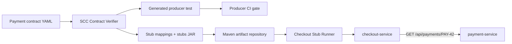
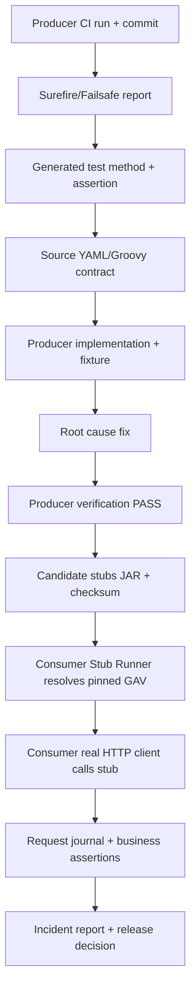

# Điều tra một lỗi từ kết quả CI về hợp đồng nguồn

## 1. Mục tiêu dự án thực hành

Dự án mô phỏng một sự cố trong hệ thống dùng **Spring Cloud Contract (SCC)**. Producer cung cấp HTTP API, khai báo hành vi bằng **Groovy/YAML DSL**, sinh kiểm thử xác minh phía producer, phát hành stub artifact; consumer dùng **Stub Runner** để kiểm thử HTTP client và logic nghiệp vụ. CI chạy các bước đó để phát hiện thay đổi không tương thích trước khi release.

Tình huống bắt đầu bằng một thông báo quen thuộc:

```text
BUILD FAILURE

PaymentContractVerifierTest
  validate_payment_captured

Expected:
  $.state == "CAPTURED"

Actual:
  $.state == "PENDING"

Tests run: 8, Failures: 1, Errors: 0, Skipped: 0
```

Nhiệm vụ của bạn là **đi từ kết quả CI ngược về đúng hợp đồng nguồn**, xác định nguyên nhân, chọn đúng nơi cần sửa, chạy lại producer verification, tạo stub candidate và chứng minh consumer vẫn tương thích.

Quy trình điều tra có bằng chứng:

1. Đọc build/run metadata và test report để xác định **job, module, test, assertion bị lỗi**.
2. Tìm generated test và xác định **contract ID/source contract** liên quan.
3. Đọc YAML/Groovy DSL để hiểu kỳ vọng producer đã cam kết.
4. Đối chiếu implementation, fixture và môi trường test với hợp đồng.
5. Phân loại lỗi: implementation, contract source, test fixture, generator/toolchain, hoặc CI wiring.
6. Sửa **nguồn có trách nhiệm**, regenerate và chạy lại producer verification.
7. Đóng gói stub candidate, kiểm tra mappings và chạy consumer test bằng Stub Runner.
8. Lưu incident report đủ để reviewer tái lập kết luận.

Đây là bài thực hành tổng hợp trong module **SPRING_CLOUD_CONTRACT**: học cách định nghĩa hành vi HTTP/message, sinh test phía cung cấp, phát hành stub, dùng Stub Runner và đưa kiểm thử hợp đồng vào CI.

### Kết quả cần đạt

Sau khi hoàn thành, bạn có thể:

- Truy từ một test failure trong CI đến file contract DSL có liên quan.
- Phân biệt **generated test** với **source test** và **source contract**.
- Đọc assertion để hiểu producer đang vi phạm điều khoản nào.
- Không sửa generated test để làm build xanh.
- Phân biệt implementation bug với contract expectation đã lỗi thời.
- Kiểm tra test fixture/base class và toolchain khi kết quả không khớp.
- Chạy producer verification và xác minh số lượng tests thực thi.
- Kiểm tra stub JAR có mapping tương ứng với contract.
- Chạy consumer tests với **artifact version được pin**.
- Viết báo cáo nguyên nhân gốc, bằng chứng và quyết định release.

> **Quy tắc điều tra:** Một dòng `BUILD FAILURE` chỉ là điểm bắt đầu. Chỉ kết luận sau khi nối được **CI result → generated test → source contract → producer behavior → consumer evidence**.

## 2. Kịch bản hệ thống: Payment và Checkout

Ta có hai dịch vụ:

- **payment-service** là producer, cung cấp endpoint tra cứu trạng thái thanh toán.
- **checkout-service** là consumer, gọi endpoint đó để quyết định đơn hàng có thể hoàn tất hay phải chờ.



**Hành vi đã thống nhất:**

- Thanh toán đã capture trả `200` với `state=CAPTURED`.
- Thanh toán đang chờ trả `200` với `state=PENDING`.
- Thanh toán không tồn tại trả `404` với error code `PAYMENT_NOT_FOUND`.
- Checkout chỉ chấp nhận thanh toán có đúng ID và trạng thái `CAPTURED`.

Trong sự cố này, contract source vẫn yêu cầu `CAPTURED` nhưng producer đang trả `PENDING` cho `PAY-42`. Chúng ta sẽ kiểm tra xem đây là lỗi code, dữ liệu test hay một thay đổi nghiệp vụ chưa được thống nhất.

### 2.1. Phạm vi của project lab

| Thành phần | Vai trò trong bài |
|---|---|
| Groovy/YAML contract | Nguồn định nghĩa HTTP behavior |
| Contract Verifier | Sinh producer tests từ contract |
| Producer implementation | Controller/service trả response thật |
| Producer test base class | Khởi tạo test context và fixture |
| Generated test report | Bằng chứng assertion nào fail |
| WireMock stub mapping | Behavior consumer sẽ mô phỏng |
| Stub JAR | Artifact được consumer tải |
| Stub Runner | Khởi chạy stub server cho consumer |
| Consumer HTTP client | Gửi request đến stub server |
| CI pipeline | Lưu log, report, artifact và quyết định gate |

Bài dùng **Maven-style paths** làm ví dụ chính; cuối bài có ghi chú Gradle. Tên task, thư mục generated và cách cấu hình có thể thay đổi theo phiên bản plugin hoặc project custom. Khi làm trên repository thật, ưu tiên build log và effective configuration của chính project.

## 3. Chuẩn bị project và nhận diện đầu vào

Giả sử producer Maven có cấu trúc:

```text
payment-service/
  pom.xml
  src/
    main/
      java/
        com/acme/payment/
          PaymentController.java
          PaymentService.java
          PaymentResponse.java
    test/
      java/
        com/acme/payment/contract/
          ContractTestBase.java
      resources/
        contracts/
          payment-captured.yml
          payment-pending.yml
          payment-not-found.yml
  target/
    generated-test-sources/
      contracts/
    generated-test-resources/
      contracts/
    stubs/
    surefire-reports/
    payment-service-1.5.1-SNAPSHOT-stubs.jar
```

Đây là **layout tham khảo**. Maven SCC plugin thường lấy contracts từ `src/test/resources/contracts`, tạo generated test sources/resources và stub output dưới `target`, nhưng các directory có thể được cấu hình khác.

Consumer có cấu trúc:

```text
checkout-service/
  pom.xml
  src/
    main/java/com/acme/checkout/
      PaymentHttpClient.java
      CheckoutService.java
    test/java/com/acme/checkout/
      CheckoutPaymentContractTest.java
    test/resources/
      application-contract.yml
```

### 3.1. Đầu vào phải được ghi nhận trước khi sửa

Trước khi mở source, lưu các thông tin từ CI:

| Dữ liệu | Ví dụ minh họa | Vì sao cần |
|---|---|---|
| CI run/build ID | `payment-service #1842` | Truy lại log/report đúng lần chạy |
| Commit | `a1b2c3d` | Xác định source revision |
| Branch/tag | `feature/payment-state` | Hiểu pipeline và mức tin cậy |
| Producer module | `payment-service` | Không nhầm module |
| Toolchain | SCC/Maven/JDK versions | Phát hiện khác biệt môi trường |
| Failing test | `validate_payment_captured` | Tìm generated test |
| Test report | Surefire XML/HTML | Assertion, expected/actual, stack |
| Contract inventory | IDs/paths được generator xử lý | Truy ngược source DSL |
| Artifact candidate | GAV/classifier nếu đã tạo | Biết stub version đang được dùng |

Các giá trị ở bảng là giả định để thực hành. Khi điều tra thật, **không đoán commit hoặc artifact version từ tên branch**; lấy chúng từ CI run và publication metadata.

### 3.2. Không bắt đầu bằng cách sửa file có vẻ liên quan

Một test tên `PaymentContractVerifierTest` có thể được sinh từ nhiều contract files. Một file generated Java có thể chứa nhiều test methods hoặc tên method đã được generator chuẩn hóa. Vì vậy:

- Đừng mặc định tên generated class là tên source YAML.
- Đừng tìm và sửa generated Java trong `target`.
- Đừng đổi response YAML chỉ vì assertion báo `expected CAPTURED`.
- Đừng xóa hoặc skip test để unblock CI.
- Trước tiên hãy ghi lại **đường dẫn test report, method name, failing assertion và build commit**.

## 4. Tái hiện kết quả CI và phân loại lỗi ban đầu

Kết quả giả định từ CI:

```text
[INFO] --- maven-surefire-plugin:test ---
[ERROR] Tests run: 8, Failures: 1, Errors: 0, Skipped: 0

[ERROR] validate_payment_captured
  PaymentContractVerifierTest

org.opentest4j.AssertionFailedError:
Expected: CAPTURED
Actual:   PENDING

at PaymentContractVerifierTest.validate_payment_captured(...)
```

Đọc thông tin này theo từng phần:

1. **Tests run = 8:** test runner đã chạy 8 tests, không phải `0 tests`.
2. **Failures = 1:** một assertion không đạt; đây không phải lỗi compile hoặc test discovery.
3. **Errors = 0:** theo report này, không có exception setup/infra được phân loại là error.
4. **Skipped = 0:** không có test bị skip trong nhóm report.
5. **Expected/Actual:** generated verification mong response chứa `CAPTURED`, nhưng response thực nhận `PENDING`.
6. **Method name:** `validate_payment_captured` là dấu vết để tìm test method và contract tương ứng.

### 4.1. Chọn nhánh điều tra theo loại failure

| Kết quả CI | Nhánh đầu tiên |
|---|---|
| `Tests run: 0` | Test discovery, source set, JUnit engine, skip flags |
| `Compilation failure` | Generated source, imports, base class, dependency versions |
| `Errors > 0` do connection refused | Test server, port, application context, fixture |
| `Failures > 0` do expected/actual | Đối chiếu assertion với contract và implementation |
| `No stubs found` | Artifact GAV/classifier/repository/mode |
| `WireMock 404` | Request mismatch, mapping chưa nạp hoặc wrong URL |
| Build không tìm thấy contract | DSL source path, filters, plugin execution |
| JAR không được tạo/attach | `convert`, `generateStubs`, publication configuration |

Sự cố đang xét thuộc nhánh **assertion failure**. Chúng ta cần đi từ test method về contract, rồi mới đánh giá producer code.

## 5. Đọc test report trước khi mở generated source

Với Maven Surefire, kết quả thường ở:

```text
target/surefire-reports/
  TEST-com.acme.payment.contract.PaymentContractVerifierTest.xml
  com.acme.payment.contract.PaymentContractVerifierTest.txt
```

Tên file phụ thuộc package/class naming của project và plugin. Có thể có thêm Failsafe reports nếu test chạy ở integration-test/verify phase.

### 5.1. Những trường cần lấy từ report

Ví dụ rút gọn XML:

```xml
<testsuite
    name="com.acme.payment.contract.PaymentContractVerifierTest"
    tests="8"
    errors="0"
    skipped="0"
    failures="1">
  <testcase
      classname="com.acme.payment.contract.PaymentContractVerifierTest"
      name="validate_payment_captured">
    <failure
        message="expected CAPTURED but was PENDING"
        type="org.opentest4j.AssertionFailedError">
      ...
    </failure>
  </testcase>
</testsuite>
```

Từ report, tạo một **failure record**:

```text
CI run:           payment-service #1842
Commit:           a1b2c3d
Test class:       PaymentContractVerifierTest
Test method:      validate_payment_captured
Failure type:     AssertionFailedError
Expected value:   CAPTURED
Actual value:     PENDING
Tests executed:   8
Failures:         1
Errors:           0
Skipped:          0
```

Không cần copy toàn bộ log hàng nghìn dòng vào ticket. Giữ **đường dẫn report và đoạn assertion có liên quan**, kèm build ID để reviewer mở đúng artifact.

### 5.2. Xác nhận test có thật sự chạy

Đối chiếu ba nguồn:

- Summary ở cuối Maven/Gradle test task.
- Test report XML/HTML.
- Danh sách generated test methods.

Nếu build log nói `BUILD SUCCESS` nhưng report `tests=0`, chưa có bằng chứng producer contract được verify. Nếu report nói 8 tests và 1 failure, ta có một test thực sự đã chạy và có assertion thất bại.

## 6. Truy từ test method về generated source

Trong Maven project, generated test sources thường nằm dưới:

```text
target/generated-test-sources/contracts/
```

Tìm method `validate_payment_captured` hoặc tên class ghi trong report. Ví dụ generated source **minh họa**:

```java
@Test
public void validate_payment_captured() throws Exception {
    given()
        .header("Accept", "application/json")
        .get("/api/payments/PAY-42")
    .then()
        .statusCode(200)
        .body("paymentId", equalTo("PAY-42"))
        .body("state", equalTo("CAPTURED"))
        .body("amount", equalTo(150000))
        .body("currency", equalTo("VND"));
}
```

Đoạn trên chỉ mô tả **ý nghĩa của generated assertions**, không phải cam kết mọi SCC release sẽ sinh đúng class, helper, annotation hoặc API chain này. Generated test có thể dùng RestAssuredMockMvc, WebTestClient, JUnit 4/5 hoặc test mode khác tùy cấu hình.

### 6.1. Đọc assertion như một bản tóm tắt contract

Trong ví dụ:

| Assertion | Điều khoản được kiểm tra |
|---|---|
| `.get("/api/payments/PAY-42")` | HTTP method/path |
| `.statusCode(200)` | HTTP status |
| `paymentId == PAY-42` | Response identity |
| `state == CAPTURED` | Trạng thái thanh toán |
| `amount == 150000` | Giá trị và kiểu dữ liệu |
| `currency == VND` | Đơn vị tiền |

**Assertion fail ở `state` không tự chứng minh source contract sai.** Nó chỉ chứng minh producer response không thỏa expected value mà test được sinh ra đang kiểm tra.

### 6.2. Generated test có thể không chứa source path trực tiếp

Không phải mọi phiên bản SCC đều thêm comment chỉ rõ đường dẫn YAML/Groovy hoặc line number vào generated test. Truy nguồn bằng cách kết hợp:

1. Test method name/contract name (nếu generator giữ tên).
2. Source contract inventory của build.
3. Generated test assertion cụ thể.
4. Generated stub mapping request/response tương ứng.
5. Build log của goal/task convert/generate.
6. Contract revision và commit của CI run.

Nếu nhiều contract có cùng endpoint hoặc test method names gần nhau, so cả **request matchers và response body**, không chỉ tên `payment_captured`.

### 6.3. Không chỉnh generated source

Generated source thuộc output của build. Sửa trực tiếp `target/generated-test-sources/contracts/...` có ba vấn đề:

- Lần `clean` tiếp theo sẽ xóa thay đổi.
- Lần generate sau có thể ghi đè.
- Source contract vẫn chứa expectation cũ, nên CI lần sau lại tạo assertion cũ.

**Mọi thay đổi lâu dài phải quay về source contract, producer implementation, base class/fixture hoặc build configuration có trách nhiệm.**
## 7. Truy tiếp về source contract YAML

Giả sử source contract nằm ở:

```text
src/test/resources/contracts/payment-captured.yml
```

Nội dung:

```yaml
name: payment_captured
description: "Tra cứu thanh toán PAY-42 đã capture"
request:
  method: GET
  urlPath: /api/payments/PAY-42
  headers:
    Accept: application/json
response:
  status: 200
  headers:
    Content-Type: application/json
  body:
    paymentId: "PAY-42"
    state: CAPTURED
    amount: 150000
    currency: VND
```

Đọc file theo bốn nhóm:

| Nhóm | Source contract yêu cầu |
|---|---|
| Request | GET /api/payments/PAY-42 |
| Request headers | Accept: application/json |
| Response status/headers | 200, Content-Type: application/json |
| Response body | paymentId=PAY-42, state=CAPTURED, amount=150000, currency=VND |

Trong trường hợp này, source DSL **nói rõ** thanh toán đã capture. Generated test assertion state=CAPTURED là phù hợp với source contract.

### 7.1. Xác minh đúng contract, không chỉ cùng tên

Nếu project có:

```text
contracts/
  checkout-service/payment-captured.yml
  reporting-service/payment-captured.yml
  payment-captured.yml
```

thì có thể có nhiều contract cùng tên hoặc cùng endpoint cho consumer khác nhau. Cần kiểm tra:

- name trong DSL.
- Consumer folder/stubsPerConsumer nếu bật.
- Request path và headers.
- Response fields/values.
- Contract inventory của đúng build.
- Mapping generated tương ứng.

Không lấy một file có tên gần giống rồi kết luận đã tìm đúng nguồn. **Request + response assertion** là dấu vân tay đáng tin hơn tên file đơn lẻ.

### 7.2. Nếu source dùng Groovy DSL

Một contract Groovy có thể biểu diễn cùng hành vi:

```groovy
import org.springframework.cloud.contract.spec.Contract

Contract.make {
    name('payment_captured')
    description('Tra cứu thanh toán PAY-42 đã capture')
    request {
        method GET()
        urlPath('/api/payments/PAY-42')
        headers {
            header('Accept', 'application/json')
        }
    }
    response {
        status OK()
        headers {
            contentType(applicationJson())
        }
        body(
            paymentId: 'PAY-42',
            state: 'CAPTURED',
            amount: 150000,
            currency: 'VND'
        )
    }
}
```

Đây là ví dụ Groovy DSL minh họa. **Không tạo thêm YAML và Groovy trùng nhau trong project chỉ để “chắc chắn”**; dùng một nguồn canonical hoặc có quy tắc tổ chức rõ, tránh sinh duplicate mappings/tests.

### 7.3. Kiểm tra matcher và kiểu dữ liệu

Một số sai khác nhìn nhỏ nhưng làm thay đổi contract:

- amount: 150000 là number; "150000" là string.
- state: CAPTURED là giá trị string theo YAML scalar; nếu cần tránh ambiguity, có thể quote.
- Field bị thiếu khác với field có giá trị null.
- url và urlPath có cách xử lý query khác nhau.
- Exact equality matcher khác regex/matcher động.
- Request header được khai báo khác với response header.

Đối chiếu **cả DSL lẫn generated assertion** để phát hiện trường hợp generator/toolchain không diễn giải như dự kiến.

## 8. Đọc stub mapping để nối contract với consumer

Producer verification test là một đầu ra; consumer stub là đầu ra khác. Một mapping WireMock được sinh từ contract có thể có dạng minh họa:

```json
{
  "request": {
    "method": "GET",
    "urlPath": "/api/payments/PAY-42",
    "headers": {
      "Accept": {
        "equalTo": "application/json"
      }
    }
  },
  "response": {
    "status": 200,
    "headers": {
      "Content-Type": "application/json"
    },
    "jsonBody": {
      "paymentId": "PAY-42",
      "state": "CAPTURED",
      "amount": 150000,
      "currency": "VND"
    }
  }
}
```

JSON trên **mô tả ý nghĩa** của mapping; output thực tế có thể khác về body/jsonBody, metadata, file references, IDs và thứ tự keys tùy SCC/WireMock version.

### 8.1. Mapping giúp xác minh điều gì?

- Stub có đúng method/path/header không?
- Response status có phải 200 không?
- Response body có đúng state=CAPTURED không?
- Amount có đúng kiểu number không?
- Mapping có được đưa vào stub JAR không?
- Consumer Stub Runner có nạp mapping này không?

### 8.2. Ba hiện tượng cần phân biệt

| Quan sát | Ý nghĩa |
|---|---|
| Generated test fail, mapping vẫn đúng contract | Producer implementation hoặc test fixture có thể sai |
| Generated test PASS, mapping thiếu/khác behavior | Cần điều tra generator, plugin goals, stub packaging |
| Mapping đúng nhưng consumer test fail | Consumer client/request/DTO hoặc Stub Runner runtime có thể sai |

**Không dùng stub mapping để thay cho producer verification.** Stub phản hồi theo DSL; nó không gọi producer implementation. Producer verification mới kiểm tra API thật của producer trong test context.

## 9. Đối chiếu producer implementation

Giả sử controller:

```java
@RestController
@RequestMapping("/api/payments")
public class PaymentController {

    private final PaymentService paymentService;

    public PaymentController(PaymentService paymentService) {
        this.paymentService = paymentService;
    }

    @GetMapping("/{paymentId}")
    public PaymentResponse getPayment(
            @PathVariable String paymentId) {
        return paymentService.findPayment(paymentId);
    }
}
```

Controller route khớp contract: GET /api/payments/{paymentId}. Vì assertion fail ở state, hãy đi vào PaymentService và response mapping.

Ví dụ implementation đang có lỗi:

```java
@Service
public class PaymentService {

    public PaymentResponse findPayment(String paymentId) {
        Payment payment = repository.findById(paymentId)
            .orElseThrow(PaymentNotFoundException::new);

        // BUG: trạng thái đã capture bị ánh xạ nhầm thành PENDING.
        String state = payment.status() == PaymentStatus.CAPTURED
            ? "PENDING"
            : payment.status().name();

        return new PaymentResponse(
            payment.id(),
            state,
            payment.amount(),
            payment.currency()
        );
    }
}
```

Trong ví dụ, lỗi nằm ở mapping domain status → API response. Với dữ liệu thanh toán đã capture, code trả PENDING, đúng với Actual trong CI.

### 9.1. So sánh ba lớp giá trị

| Lớp | Giá trị của PAY-42 |
|---|---|
| Contract source | CAPTURED |
| Generated test expected | CAPTURED |
| Producer implementation actual | PENDING |

Ba giá trị này cho thấy **source contract và generated test nhất quán**, implementation không đáp ứng contract.

Tuy vậy, vẫn phải kiểm tra fixture ở mục 10 trước khi kết luận cuối cùng: nếu database test seed PAY-42 là PENDING, implementation có thể đang phản ánh dữ liệu đầu vào chứ không sai mapping.

### 9.2. Không suy ra bug chỉ từ tên trạng thái

PAY-42 có thể là một fixture khác nhau giữa các tests. Hãy xác minh:

- Fixture có ID PAY-42 không?
- Fixture status là CAPTURED hay PENDING?
- Test base class có nạp fixture đúng profile?
- Repository có trả record khác do shared database/state leak?
- Mapping code có biến đổi enum đúng không?
- Có timezone/event processing khiến trạng thái chưa capture tại thời điểm test?

**Expected/Actual chỉ xác định khác biệt; root cause cần bằng chứng về input và code path.**

## 10. Kiểm tra test fixture và ContractTestBase

Một producer generated test thường dùng base class để chuẩn bị application context, MockMvc/WebTestClient hoặc HTTP test server và dữ liệu. Ví dụ minh họa:

```java
@SpringBootTest
@AutoConfigureMockMvc
public abstract class ContractTestBase {

    @Autowired
    PaymentRepository repository;

    @BeforeEach
    void setUp() {
        repository.deleteAll();
        repository.save(new Payment(
            "PAY-42",
            PaymentStatus.CAPTURED,
            150000,
            "VND"
        ));
    }
}
```

Đây là một cách setup giả định; constructor/entity/repository thực tế tùy project. Generated tests có thể dùng base class với test mode khác và lifecycle khác.

### 10.1. Những lỗi fixture thường gặp

| Lỗi | Biểu hiện |
|---|---|
| Seed sai trạng thái | PAY-42 là PENDING thay vì CAPTURED |
| Fixture không được chạy | Repository rỗng hoặc dữ liệu từ test trước |
| Setup annotation sai JUnit version | BeforeEach/Before không chạy |
| Test dùng profile khác | Kết nối database hoặc config không như mong đợi |
| Shared database giữa tests | State leak, thứ tự test ảnh hưởng |
| Time-dependent state | Payment thay đổi status bởi scheduled job |
| Mock service trả response khác | Controller không đi qua implementation thật |
| Base class bị đổi nhưng generated test vẫn compile | Setup behavior bị mất dù test runner chạy |

### 10.2. Phân biệt fixture bug với implementation bug

Chạy một kiểm tra tập trung trong producer test context:

```java
@Test
void fixtureForCapturedPaymentHasExpectedState() {
    Payment payment = repository.findById("PAY-42").orElseThrow();

    assertEquals(PaymentStatus.CAPTURED, payment.status());
}
```

Đây là **diagnostic test minh họa**, không phải test được SCC tự sinh. Nếu assertion fixture fail, sửa fixture/setup. Nếu fixture đúng mà API response sai, tiếp tục kiểm tra service/controller mapping.

Không thêm test này như một cách né generated test. Nó chỉ giúp chứng minh **đầu vào test có đúng như kịch bản**.

### 10.3. Kiểm tra source fixture và data builder

Nếu project dùng Sql, Testcontainers, data builder, repository mocks hoặc profile riêng, hãy truy vết setup thực tế. Không giả định BeforeEach là nơi duy nhất tạo dữ liệu.

Với JUnit 4/5 migration, annotation lifecycle có thể thay đổi. Nếu fixture setup không chạy do runner mismatch, failure có thể đến từ toolchain/test base chứ không phải contract hay service logic.

## 11. Phân loại root cause trước khi sửa

Dùng bảng quyết định:

| Bằng chứng | Phân loại | Hành động |
|---|---|---|
| Contract và generated assertion cùng kỳ vọng CAPTURED; fixture đúng; implementation trả PENDING | **Producer implementation bug** | Sửa service/controller mapping |
| Contract kỳ vọng CAPTURED nhưng nghiệp vụ mới đã thống nhất PENDING | **Contract source stale** | Review thay đổi với consumer, sửa DSL có phê duyệt |
| Fixture PAY-42 thực tế là PENDING trong test | **Test data/setup bug** | Sửa fixture/base class |
| Generated assertion không tương ứng DSL | **Generator/toolchain/config issue** | Kiểm tra SCC version, plugin config, generated outputs |
| Tests không chạy hoặc chạy nhầm module | **CI wiring/test discovery issue** | Sửa lifecycle, source set, runner |
| Stub JAR thiếu mapping dù generated test có | **Stub generation/publication issue** | Kiểm tra convert/generateStubs/package |
| Producer test PASS nhưng consumer test dùng stub cũ | **Artifact resolution/cache issue** | Pin version, xác minh resolved GAV/checksum |
| Consumer request không match mapping | **Consumer request/config issue** | Kiểm tra method/path/query/header/base URL |

### 11.1. Quyết định trong kịch bản chính

Trong dữ liệu thực hành:

- Source contract yêu cầu CAPTURED.
- Generated test assertion yêu cầu CAPTURED.
- Fixture PAY-42 được seed CAPTURED.
- Service mapping trả PENDING.

Vậy root cause là **producer implementation bug**.

**Không sửa source contract thành PENDING** nếu product/API owner chưa thay đổi cam kết nghiệp vụ. Làm vậy sẽ khiến producer test xanh bằng cách hạ thấp hợp đồng mà consumer đang dựa vào.

### 11.2. Khi nào phải sửa contract thay vì code?

Nếu owner xác nhận nghiệp vụ thay đổi: chẳng hạn API mới chủ đích trả PENDING trong một giai đoạn settlement, thì contract cũ có thể đã lỗi thời. Khi đó:

1. Xác định consumer nào phụ thuộc CAPTURED.
2. Thảo luận behavior mới với owners của producer và consumer.
3. Thiết kế version/migration hoặc backward-compatible response nếu cần.
4. Cập nhật source DSL và consumer expectations có review.
5. Chạy producer verification và consumer Stub Runner tests trên candidate.
6. Ghi quyết định breaking/compatible change trong PR/release.

Đó là **thay đổi hợp đồng có chủ đích**, không phải sửa test failure cho qua CI.

## 12. Sửa đúng nguồn: khắc phục producer implementation

Với root cause đã chứng minh, sửa mapping trạng thái:

```java
@Service
public class PaymentService {

    public PaymentResponse findPayment(String paymentId) {
        Payment payment = repository.findById(paymentId)
            .orElseThrow(PaymentNotFoundException::new);

        String state = payment.status().name();

        return new PaymentResponse(
            payment.id(),
            state,
            payment.amount(),
            payment.currency()
        );
    }
}
```

Hoặc dùng mapper/domain enum mapping tập trung nếu API response không dùng cùng tên enum. Ví dụ trên chỉ đúng khi các enum values domain và API đã thống nhất; nếu không, tạo mapping tường minh cho từng trạng thái.

### 12.1. Kiểm tra không làm hỏng trạng thái khác

Không chỉ chạy contract payment_captured. Producer còn có contract:

- payment_pending: trạng thái PENDING vẫn trả PENDING.
- payment_not_found: ID không tồn tại trả 404 và PAYMENT_NOT_FOUND.
- Các trạng thái khác (nếu có): FAILED, REFUNDED, CANCELLED phải giữ đúng mapping.

Một sửa đổi dùng payment.status().name() có thể sửa CAPTURED nhưng gây lỗi nếu domain enum và API vocabulary khác nhau. Chạy **toàn bộ producer verification suite**, không chỉ test method vừa fail.

### 12.2. Thêm unit test cho domain mapping nếu phù hợp

Generated contract tests bảo vệ API boundary. Unit test có thể bảo vệ mapping logic ở service:

```java
@Test
void capturedPaymentIsExposedAsCaptured() {
    Payment payment = new Payment(
        "PAY-42",
        PaymentStatus.CAPTURED,
        150000,
        "VND"
    );

    when(repository.findById("PAY-42"))
        .thenReturn(Optional.of(payment));

    PaymentResponse response = service.findPayment("PAY-42");

    assertEquals("CAPTURED", response.state());
}
```

Đây là ví dụ unit test dùng mock repository. Nó **bổ sung** generated producer verification, không thay thế HTTP contract test.

### 12.3. Không sửa generated test hoặc stub mapping trực tiếp

Không thực hiện các cách sau:

- Đổi assertion trong generated-test-sources từ CAPTURED thành PENDING.
- Sửa JSON mapping trong target/stubs để trả CAPTURED trong khi source DSL hoặc producer vẫn sai.
- Xóa contract khỏi source directory.
- Thêm Disabled, ignored hoặc skip test để build xanh.
- Publish lại cùng release GAV với bytes khác.

Sau khi sửa source code/DSL hợp lệ, để plugin **generate lại outputs từ source**. Stub JAR phải đến từ build có thể truy vết.

## 13. Chạy lại producer verification

### 13.1. Maven producer

Trong producer checkout đã sửa:

```bash
./mvnw clean verify
```

Lệnh đầy đủ thường chạy lifecycle cần thiết để compile, generate, execute tests và package theo plugin configuration. Hãy xác minh build thực tế có chạy các SCC goals và Surefire/Failsafe tasks dự kiến.

Khi cần quan sát chi tiết, có thể dùng:

```bash
./mvnw -DskipTests=false clean verify
```

Không dùng skipTests, maven.test.skip=true hoặc profile vô hiệu hóa Contract Verifier trong release gate.

### 13.2. Gradle producer

Với project dùng SCC Gradle plugin, các task thường gặp tùy phiên bản gồm:

```bash
./gradlew clean contractTest
```

Hoặc nếu project yêu cầu generate/đóng gói stub tách riêng:

```bash
./gradlew generateContractTests generateClientStubs verifierStubsJar
```

Tên task và dependency graph cần được xác minh bằng:

```bash
./gradlew tasks --all
```

Không mặc định task names giống nhau ở mọi SCC Gradle plugin version. verifierStubsJar đóng gói stubs; **nó không thay cho việc chạy producer verification tests**. Publication phải attach stub JAR theo cấu hình Maven Publish của project.

### 13.3. Đọc kết quả sau sửa

Kết quả kỳ vọng của bài lab:

```text
Tests run: 8, Failures: 0, Errors: 0, Skipped: 0
BUILD SUCCESS
```

Đây là **kết quả mục tiêu giả định**, không phải build đã được chạy trong lúc viết bài. Khi thực hành, ghi số test thực tế, số skipped và report path.

Nếu build PASS nhưng tests=0, chưa hoàn thành. Nếu 8 tests chạy nhưng một test bị skip, kiểm tra vì sao. Nếu một contract không được generate, so contract inventory trước/sau.

### 13.4. Xác minh generated outputs được tạo lại

Sau clean verify, kiểm tra:

- Generated test sources chứa test tương ứng payment_captured.
- Generated test assertions vẫn yêu cầu CAPTURED.
- Test report có method tương ứng và PASS.
- Stub mapping vẫn trả CAPTURED.
- Stub JAR có classifier stubs và mapping tương ứng.
- Build log thể hiện goal/task generation đã chạy.

Không dùng file output cũ từ build trước làm bằng chứng cho lần build mới.

## 14. Kiểm tra stub candidate trước khi chuyển sang consumer

Giả sử producer build candidate version:

```text
com.acme.billing:payment-service:1.5.1-SNAPSHOT:stubs
```

Đây là tọa độ minh họa. Trong project thật, version/classifier được quyết định bởi Maven/Gradle publication configuration.

### 14.1. Kiểm tra nội dung JAR

Có thể xem entries bằng JDK:

```bash
jar tf target/payment-service-1.5.1-SNAPSHOT-stubs.jar
```

Tìm:

- Contract/mapping tương ứng payment_captured.
- Response body chứa state=CAPTURED.
- Các mapping payment_pending và payment_not_found.
- Đúng đường dẫn META-INF theo groupId/artifactId/version.
- Các body files được mapping tham chiếu, nếu có.

Không sửa trực tiếp JAR để đổi response. Nếu mapping sai, truy ngược DSL hoặc cấu hình generator.

### 14.2. Kiểm tra mapping được sinh

Mapping minh họa phải giữ:

```text
request:
  method = GET
  urlPath = /api/payments/PAY-42

response:
  status = 200
  body.state = CAPTURED
```

Đối chiếu mapping generated với source contract. Nếu source đúng nhưng mapping khác, dừng ở đây để điều tra plugin/version/configuration trước khi publish.

### 14.3. Không publish candidate đè lên release

Dùng snapshot hoặc release-candidate version và repository staging phù hợp. Không publish bytes khác lên một release GAV đã công bố. Ghi producer commit, contract revision, verification report, artifact GAV/classifier và checksum để consumer CI có thể truy vết.

## 15. Consumer: kiểm tra stub candidate bằng Stub Runner

Producer verification PASS chứng minh implementation producer đáp ứng source contract trong test context. Consumer vẫn cần được kiểm tra với **stub artifact vừa tạo**, vì consumer có thể sai ở URL, header, JSON mapping hoặc cách xử lý response.

### 15.1. Consumer HTTP client

Ví dụ production class của checkout:

```java
@Component
public class PaymentHttpClient {

    private final RestClient client;

    public PaymentHttpClient(
            RestClient.Builder builder,
            @Value("${payment.api.base-url}") String baseUrl) {
        this.client = builder.baseUrl(baseUrl).build();
    }

    public PaymentResponse getPayment(String paymentId) {
        return client.get()
            .uri("/api/payments/{id}", paymentId)
            .accept(MediaType.APPLICATION_JSON)
            .retrieve()
            .body(PaymentResponse.class);
    }
}
```

### 15.2. Consumer use case

```java
@Service
public class CheckoutService {

    private final PaymentHttpClient payments;

    public CheckoutService(PaymentHttpClient payments) {
        this.payments = payments;
    }

    public CheckoutDecision evaluate(String paymentId) {
        PaymentResponse payment = payments.getPayment(paymentId);

        if (payment != null
                && paymentId.equals(payment.paymentId())
                && "CAPTURED".equals(payment.state())) {
            return new CheckoutDecision(true, "READY");
        }

        return new CheckoutDecision(false, "PAYMENT_PENDING");
    }

    public record CheckoutDecision(boolean accepted, String reason) {}
}
```

Đây là code minh họa cho consumer. Ứng dụng thật có thể xử lý 404/timeout/auth errors bằng exception mapping và retry policy riêng; không nên biến mọi lỗi HTTP thành trạng thái PENDING.

### 15.3. Cài candidate vào local Maven repository

Nếu Stub Runner dùng LOCAL mode, producer cần cài artifacts vào local Maven repository:

```bash
./mvnw clean install
```

Lệnh này chạy lifecycle đến install theo cấu hình project. Xác minh có cả main artifact và stub classifier. Nếu CI tách producer/consumer thành jobs khác nhau, local Maven repository không tự chia sẻ; hãy truyền JAR/POM qua artifact store hoặc dùng repository staging.

### 15.4. Pin version trong consumer test

Ví dụ consumer dùng version candidate cụ thể:

```java
@SpringBootTest(
    properties = {
        "payment.api.base-url=http://localhost:18081"
    }
)
@AutoConfigureStubRunner(
    ids = "com.acme.billing:payment-service:1.5.1-SNAPSHOT:stubs:18081",
    stubsMode = StubRunnerProperties.StubsMode.LOCAL,
    failOnNoStubs = true
)
class CheckoutPaymentContractTest {

    @Autowired
    CheckoutService checkoutService;

    @Test
    void capturedPaymentAllowsCheckout() {
        var result = checkoutService.evaluate("PAY-42");

        assertTrue(result.accepted());
        assertEquals("READY", result.reason());
    }
}
```

Đây là **cấu hình minh họa**: cần SCC Stub Runner dependency, Spring Boot test setup, production beans và stub artifact có mặt trong local Maven repository. ID dùng cú pháp groupId:artifactId:version:classifier:port; hãy xác minh annotation attributes và property names theo SCC version của dự án.

Port cố định dễ hiểu trong project lab nhưng có thể xung đột khi CI chạy song song. Với pipeline song song, dùng port động qua Stub Runner và bảo đảm client base URL được inject sau khi port sẵn sàng; không đọc field test quá sớm trong Spring context lifecycle.

### 15.5. Assert request journal để chứng minh client đã gọi stub

Nếu muốn kiểm tra mạnh hơn, test có thể reset WireMock request journal **trước** khi gọi checkout, rồi đọc journal sau khi gọi. Ví dụ minh họa cho port cố định:

```java
@Test
void checkoutCallsTheStubbedPaymentEndpoint() {
    RestClient admin = RestClient.create("http://localhost:18081");

    admin.delete()
        .uri("/__admin/requests")
        .retrieve()
        .toBodilessEntity();

    var result = checkoutService.evaluate("PAY-42");

    assertTrue(result.accepted());
    assertEquals("READY", result.reason());

    JsonNode journal = admin.get()
        .uri("/__admin/requests")
        .retrieve()
        .body(JsonNode.class);

    assertNotNull(journal);
    boolean matched = StreamSupport.stream(
        journal.path("requests").spliterator(), false
    ).anyMatch(event ->
        event.path("wasMatched").asBoolean(false)
        && "GET".equals(
            event.path("request").path("method").asText())
        && "/api/payments/PAY-42".equals(
            event.path("request").path("url").asText())
    );

    assertTrue(matched);
}
```

Đoạn code cần Jackson JsonNode, StreamSupport và imports tương ứng. WireMock request journal có thể bị tắt trong một số cấu hình; cần bật trong test profile. Nếu tests dùng chung server và chạy song song, không reset journal toàn cục giữa các ca test.

### 15.6. Kiểm tra ba outcome

Consumer suite nên kiểm tra tối thiểu:

| Input | Stub response | Kết quả checkout |
|---|---|---|
| PAY-42 | 200, CAPTURED | READY |
| PAY-17 | 200, PENDING | PAYMENT_PENDING |
| PAY-404 | 404, PAYMENT_NOT_FOUND | PAYMENT_NOT_FOUND hoặc exception đã quy định |

Đừng chỉ test happy path. Consumer phải có hành vi rõ khi producer trả lỗi hoặc trạng thái chưa hoàn tất.

## 16. Kết nối toàn bộ bằng chứng từ CI đến consumer

Sau khi producer sửa xong và consumer test đạt, tạo một evidence chain:



### 16.1. Mỗi mũi tên cần một bằng chứng

| Liên kết | Bằng chứng |
|---|---|
| CI → report | Run ID, commit, report artifact path |
| Report → generated test | Test class, method, assertion, stack |
| Generated test → DSL | Contract name, request/response matchers, source inventory |
| DSL → implementation | Expected behavior và endpoint/service code path |
| Implementation → fixture | Test data/setup thực tế, profile, base class |
| Fix → verification | Diff source và producer test report sau sửa |
| Verification → stub JAR | Build metadata, classifier, mapping entries, checksum |
| Stub JAR → Stub Runner | Resolved GAV, mode, repository, running port |
| Stub Runner → consumer | Client base URL, request journal, matched mapping |
| Consumer → decision | Consumer test report, compatibility result, reviewer approval |

Không có một mũi tên nào được thay bằng câu “đã chạy build và xanh”. Mỗi bước phải có artifact/log hoặc code reference đủ để người khác kiểm tra.

### 16.2. Mẫu evidence record

```text
INCIDENT: SCC-1842
Producer: payment-service
Consumer: checkout-service

CI:
  run: payment-service #1842
  commit: a1b2c3d
  result: FAILED
  test: PaymentContractVerifierTest.validate_payment_captured

SOURCE:
  contract: src/test/resources/contracts/payment-captured.yml
  expected: HTTP 200, state CAPTURED
  generated assertion: state == CAPTURED

ROOT CAUSE:
  fixture: PAY-42 seeded as CAPTURED
  implementation: CAPTURED mapped to PENDING
  classification: producer implementation bug

FIX:
  source file: PaymentService.java
  change: correct status mapping

VERIFICATION:
  producer tests: 8 executed, 0 failures, 0 errors, 0 skipped
  stub artifact: com.acme.billing:payment-service:1.5.1-SNAPSHOT:stubs
  mapping: payment_captured present

CONSUMER:
  Stub Runner mode: LOCAL
  resolved GAV: exact candidate above
  request: GET /api/payments/PAY-42
  mapping matched: true
  outcome: READY
```

Đây là **mẫu báo cáo với kết quả mục tiêu giả định**, không phải log đã được thực thi. Khi làm thật, thay mọi giá trị minh họa bằng run IDs, commits, artifact coordinates và test results có thể mở lại.

## 17. Các nhánh điều tra khác: không phải mọi CI failure đều là implementation bug

Project chính giải quyết lỗi response CAPTURED/PENDING. Tuy nhiên, khi nhận một CI incident khác, phải biết chọn nhánh.

### 17.1. Contract source đã lỗi thời

Dấu hiệu:

- Generated test khớp chính xác source DSL.
- Producer implementation trả behavior mới đã được API owner phê duyệt.
- Consumer owners cũng đã thống nhất thay đổi hoặc có migration plan.

Hành động:

1. Không sửa generated test.
2. Cập nhật source contract có review.
3. Cập nhật consumer expectations/versions nếu cần.
4. Chạy producer verification.
5. Tạo stub candidate mới.
6. Chạy consumer matrix trên artifact candidate.
7. Ghi rõ behavior change và compatibility impact.

### 17.2. Fixture hoặc base class sai

Dấu hiệu:

- Source DSL và generated assertion hợp lý.
- Producer code đúng với domain input.
- Test data không đúng kịch bản hoặc setup không chạy.

Hành động:

- Kiểm tra profile/database/Testcontainers/data builder.
- Kiểm tra lifecycle JUnit và base class.
- Làm test setup deterministic, độc lập giữa các test.
- Chạy lại toàn bộ generated tests.
- Không sửa contract để phù hợp với dữ liệu test bị seed sai.

### 17.3. Generator/toolchain không tương thích

Dấu hiệu:

- Generated assertion không tương ứng DSL.
- Test source không compile hoặc JUnit engine không nhận test.
- Task/goal không sinh đủ tests/mappings.
- Cùng input nhưng output thay đổi sau nâng cấp SCC/plugin/WireMock.

Hành động:

- Ghi SCC, Spring Boot/Cloud, JDK, Maven/Gradle, JUnit và WireMock resolved versions.
- So generated outputs và build logs trước/sau.
- Xác nhận task/goal, contract filters và output directories.
- Chạy clean isolated build.
- Đối chiếu release notes/compatibility matrix.
- Chỉ nâng cấp sau khi producer và consumer regression suites đạt.

### 17.4. Stub artifact hoặc Stub Runner sai

Dấu hiệu:

- Producer verification PASS nhưng consumer báo no stubs.
- Consumer nhận mapping cũ dù producer vừa publish candidate.
- GAV/classifier/version hoặc repository root sai.
- JAR thiếu mapping dù source contract có.

Hành động:

- Kiểm tra stub JAR entries và classifier.
- Kiểm tra publication/attach.
- Pin version, không dùng dấu cộng trong release gate.
- Xác minh repository và resolved artifact.
- Không fallback sang local cache hoặc production endpoint để làm test xanh.

### 17.5. Consumer request không khớp stub

Dấu hiệu:

- Stub Runner khởi chạy, mapping được nạp.
- Request journal có request nhưng unmatched.
- Path/query/header/method/body khác mapping.

Hành động:

- Lấy actual request từ journal.
- So method, path, query, headers, body.
- Kiểm tra base URL/port, service discovery và proxy.
- Sửa client hoặc contract matcher theo semantics đã thống nhất.
- Assert mapping matched và business outcome.

## 18. Thiết kế CI pipeline để lỗi có thể truy ngược

Một pipeline producer tối thiểu nên chạy theo thứ tự:

```text
Checkout source
  ↓
Resolve pinned toolchain/dependencies
  ↓
Generate Contract Verifier tests
  ↓
Compile generated tests
  ↓
Run producer verification
  ↓
Generate/convert stub mappings
  ↓
Package stubs JAR
  ↓
Inspect artifact metadata / classifier
  ↓
Publish candidate to staging
  ↓
Consumer CI resolves exact candidate GAV
  ↓
Stub Runner + consumer tests
  ↓
Release decision
```

### 18.1. Không publish trước khi producer verification đạt

Một stub JAR có thể được sinh từ DSL ngay cả khi producer implementation chưa đáp ứng contract. Vì vậy:

- Tách generation/packaging khỏi **verification result** trong báo cáo.
- Chỉ gắn nhãn verified/release-ready khi producer tests thực sự PASS.
- Nếu publish stub để consumer phát triển song song trước khi producer hoàn tất, đánh dấu rõ trạng thái chưa verified theo quy ước nội bộ.
- Không để consumer CI PASS trở thành bằng chứng thay cho producer verification.

### 18.2. CI cần lưu report và artifacts

| Artifact | Producer job | Consumer job |
|---|---|---|
| Source commit/contract revision | Bắt buộc | Ghi producer revision được dùng |
| Generated test report | Bắt buộc | Không thay thế bằng consumer report |
| Generated mappings/stub JAR | Bắt buộc | Ghi resolved GAV |
| Checksum/provenance | Khi policy yêu cầu | Đối chiếu artifact tải về |
| Consumer test report | Không áp dụng | Bắt buộc |
| Request journal/matched evidence | Diagnostic khi cần | Hữu ích cho lỗi matching |
| CI run IDs | Bắt buộc | Bắt buộc |

### 18.3. Fail closed khi thiếu bằng chứng

Release gate phải chặn nếu:

- Generated tests không được tạo hoặc chạy 0 tests.
- Test report thiếu hoặc bị skip ngoài dự kiến.
- Stub JAR thiếu classifier/mappings cần thiết.
- Consumer test resolve sai version hoặc không tải được stub.
- Request không đến stub server/mapping không match.
- Test vẫn xanh khi Stub Runner không khởi chạy.
- Artifact được publish từ commit khác với commit đã verify.

Không dùng || true, skip flags hoặc fallback endpoint để che lỗi pipeline.

## 19. Bài tập mở rộng

### 19.1. Bài tập A — Lỗi ở source contract hay implementation?

CI báo:

```text
Expected: HTTP 200
Actual:   HTTP 202
Contract: payment-captured.yml
```

Hãy xác định:

1. Contract source yêu cầu status nào?
2. Producer API owner đã thay đổi semantics sang asynchronous acceptance chưa?
3. Consumer có hiểu 202 và polling flow không?
4. Đây là bug implementation hay contract migration?
5. Cần test/approval nào trước khi đổi contract?

### 19.2. Bài tập B — Test report 0 tests

CI hiển thị:

```text
BUILD SUCCESS
Tests run: 0
```

Hãy lập danh sách kiểm tra:

- SCC goal/task có chạy không?
- Generated source directory có đúng không?
- Surefire/Gradle Test có include generated source set không?
- JUnit engine có tương thích không?
- Có skip property/profile không?
- Test report có nằm ở Failsafe thay vì Surefire không?
- Có generated tests nhưng không được compile/execute không?

Kết luận đúng là **chưa có bằng chứng verification**, không phải contract đã pass.

### 19.3. Bài tập C — Producer PASS, consumer fail

Producer verification đã PASS. Consumer Stub Runner test báo WireMock 404.

Kiểm tra:

- Artifact GAV/classifier/version.
- Stub Runner mode và repository.
- Mapping có trong JAR và đã đăng ký không.
- Client có gọi đúng stub port không.
- Method/path/query/header/body thực tế.
- 404 là default unmatched hay response contract-defined.
- Consumer test có mock HTTP client không.

### 19.4. Bài tập D — Cùng tên contract, nhiều consumer

Có hai contracts:

```text
contracts/checkout-service/payment-captured.yml
contracts/reporting-service/payment-captured.yml
```

Chúng cùng endpoint nhưng khác response fields. Hãy giải thích:

- Vì sao tên file không đủ để truy nguồn.
- Vai trò của consumer folder và stubsPerConsumer.
- Cần kiểm tra consumerName nào trong Stub Runner.
- Mapping nào được đóng gói và đăng ký cho từng consumer.
- Cách ghi contract identity trong CI report.

## 20. Deliverables và tiêu chí hoàn thành project

Khi hoàn thành bài lab, tạo các bằng chứng sau trong **workspace/project thực hành của bạn** (không phải các file lesson):

| Deliverable | Nội dung |
|---|---|
| Failure record | CI run, commit, test class/method, expected/actual |
| Contract trace | Generated test → source YAML/Groovy path |
| Root cause note | Implementation/contract/fixture/toolchain/CI classification |
| Fix diff | Thay đổi ở đúng source file |
| Producer verification report | Tests executed, failures/errors/skipped |
| Stub artifact manifest | GAV, classifier, repository, checksum nếu có |
| Mapping evidence | Contract mapping có trong candidate stub |
| Consumer test report | Stub Runner resolved version và result |
| Request evidence | Method/path/mapping matched nếu HTTP |
| Incident report | Root cause, corrective action, residual risks, release decision |

### 20.1. Rubric tự đánh giá

| Tiêu chí | Đạt khi |
|---|---|
| Truy lỗi từ CI | Tìm đúng test report và assertion |
| Truy về source contract | Chứng minh được file DSL tương ứng bằng request/response semantics |
| Phân loại root cause | Có bằng chứng cho implementation/fixture/contract/toolchain |
| Sửa đúng nguồn | Không sửa generated output hoặc xóa test |
| Producer verification | Tất cả tests cần thiết thực sự chạy và PASS |
| Stub artifact | Đúng GAV/classifier, mapping đầy đủ |
| Consumer verification | Stub Runner tải đúng candidate và client thật được kiểm tra |
| CI evidence | Có run IDs, reports, artifacts, commit và decision |
| Kết luận | Phân biệt lỗi đã sửa với phần chưa kiểm chứng |

### 20.2. Incident report mẫu

```markdown
# Incident SCC-1842 — payment-captured verification failure

## Impact
Producer CI chặn candidate payment-service; consumer chưa được phép dùng artifact này làm release proof.

## Evidence
- CI run/commit: <link và SHA>
- Failing test: <class.method>
- Source contract: <path + revision>
- Expected/actual: <giá trị>
- Fixture state: <giá trị>
- Producer source path: <controller/service>

## Root cause
<Implementation bug / stale contract / fixture / toolchain / CI wiring>

## Corrective action
<File và thay đổi đã review>

## Verification
- Producer tests: <executed/pass/fail/skip>
- Stub GAV/classifier: <coordinates>
- Mapping inspection: <result>
- Consumer Stub Runner: <resolved version>
- Consumer tests: <result>
- Request matched evidence: <result>

## Release decision
<Blocked / Candidate approved / Released by authorized owner>

## Follow-up
<Monitoring, rollback, contract review hoặc CI improvement>
```

Các giá trị trong dấu ngoặc nhọn là placeholder. Không ghi thông tin bí mật, token, payload khách hàng hoặc dữ liệu production nhạy cảm vào incident report.

## 21. Checklist điều tra từ CI về source contract

- [ ] Ghi CI run ID, commit, branch, module và toolchain versions.
- [ ] Xác định đúng Surefire/Failsafe/Gradle test report.
- [ ] Đọc số tests run, failures, errors, skipped; không chỉ đọc BUILD SUCCESS/FAILURE.
- [ ] Xác định generated test class, method và assertion fail.
- [ ] Tìm đúng source contract bằng name, request matcher, response và contract inventory.
- [ ] Đọc source YAML/Groovy, không sửa generated source.
- [ ] Đối chiếu HTTP method/path/query/headers/status/body hoặc message destination/headers/body.
- [ ] Kiểm tra producer controller/service/serializer và response mapping.
- [ ] Kiểm tra test fixture, database state, profile, base class và lifecycle.
- [ ] Phân loại implementation, contract, fixture, generator/toolchain, artifact hoặc CI wiring.
- [ ] Có owner approval nếu behavior contract thực sự cần thay đổi.
- [ ] Sửa đúng source file và review diff.
- [ ] Chạy clean producer verification, không skip generated tests.
- [ ] Xác nhận số tests thực thi, failures/errors/skipped và report path.
- [ ] Xác minh generated test/mapping được tạo lại từ source.
- [ ] Kiểm tra stub JAR entries, classifier, GAV và provenance.
- [ ] Không ghi đè release artifact đã công bố.
- [ ] Consumer Stub Runner dùng đúng version đã pin.
- [ ] Consumer test gọi production HTTP/message client thật.
- [ ] Request journal/mapping hoặc message handler evidence được kiểm tra.
- [ ] Assert success và error paths mà consumer phụ thuộc.
- [ ] Lưu producer/consumer CI reports và incident decision.
- [ ] Chỉ release khi các gate bắt buộc đạt và owner có thẩm quyền chấp thuận.

## 22. Ghi nhớ và tài liệu tham khảo

Điều tra một lỗi từ kết quả CI về hợp đồng nguồn là quá trình **lần theo bằng chứng**, không phải đoán file rồi chỉnh cho build xanh.

1. **CI report** cho biết test nào fail, assertion nào sai và build nào tạo ra kết quả.
2. **Generated test** cho thấy SCC đã biến DSL thành điều kiện kiểm tra nào.
3. **Source contract** là nơi xác định producer đã cam kết behavior gì.
4. **Producer implementation và fixture** cho biết response thực tế đến từ code hay test data.
5. **Producer verification** chứng minh implementation đáp ứng contract trong test context.
6. **Stub artifact và Stub Runner** chuyển behavior đã khai báo sang consumer test.
7. **Consumer tests** chứng minh client và logic consumer xử lý stub behavior như mong đợi.

Trong sự cố chính của bài, contract, generated assertion và fixture đều yêu cầu CAPTURED; implementation lại trả PENDING. Vì vậy phải sửa producer mapping, regenerate, chạy producer suite, kiểm tra stub candidate và chạy consumer tests.

### Tài liệu chính thức

- [Spring Cloud Contract — Reference Documentation](https://docs.spring.io/spring-cloud-contract/reference/).
- [Spring Cloud Contract — Contract DSL](https://docs.spring.io/spring-cloud-contract/reference/project-features-contract.html).
- [Spring Cloud Contract — Maven Project](https://docs.spring.io/spring-cloud-contract/reference/maven-project.html).
- [Spring Cloud Contract — Gradle Project](https://docs.spring.io/spring-cloud-contract/reference/gradle-project.html).
- [Spring Cloud Contract — Stub Runner Core](https://docs.spring.io/spring-cloud-contract/reference/project-features-stubrunner/stub-runner-core.html).
- [Spring Cloud Contract — Stub Runner JUnit and Spring](https://docs.spring.io/spring-cloud-contract/reference/project-features-stubrunner/stub-runner-junit.html).
- [Spring Cloud Contract — Fail On No Stubs](https://docs.spring.io/spring-cloud-contract/reference/project-features-stubrunner/stub-runner-fail-on-no-stubs.html).
- [Spring Cloud Contract — Stubs Per Consumer](https://docs.spring.io/spring-cloud-contract/reference/project-features-stubrunner/stub-runner-stubs-per-consumer.html).
- [WireMock — Request Matching](https://wiremock.org/docs/request-matching/).
- [WireMock — Verifying Requests and Request Journal](https://wiremock.org/docs/verifying/).
- [Apache Maven — Introduction to the Build Lifecycle](https://maven.apache.org/guides/introduction/introduction-to-the-lifecycle.html).
- [Gradle — Testing in Java & JVM projects](https://docs.gradle.org/current/userguide/java_testing.html).

**Lưu ý phạm vi:** Nội dung và kết quả build trong bài là kịch bản thực hành. Hoàn thành project trong repository thật cần chạy toolchain của chính dự án, lưu test reports/artifacts và được review theo CI/release policy. Các ví dụ không thay thế compatibility matrix hoặc tài liệu của SCC version đang dùng.

