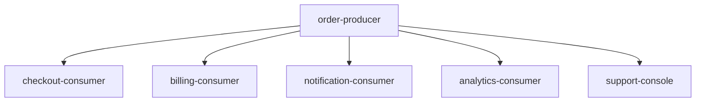
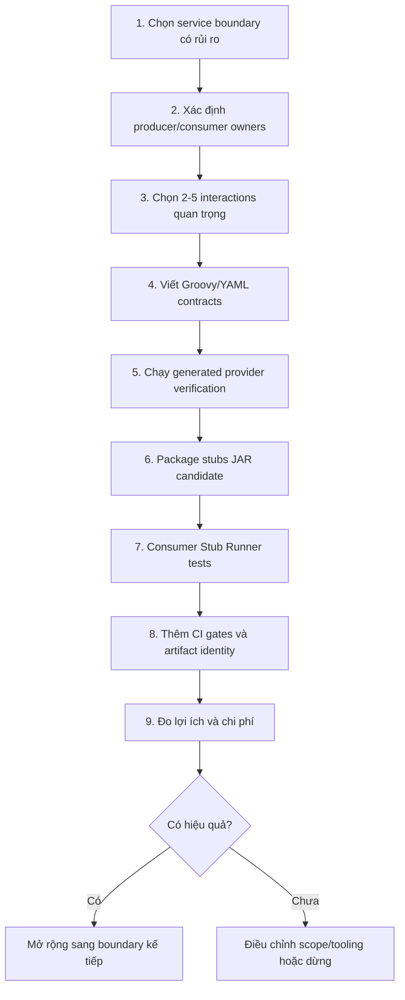

# Khi nên áp dụng Spring Cloud Contract

**Spring Cloud Contract (SCC)** phù hợp khi producer và consumer có thể thay đổi hoặc triển khai độc lập, ranh giới giao tiếp quan trọng, và lỗi không tương thích API thường chỉ được phát hiện muộn. SCC cho phép producer mô tả hành vi HTTP hoặc thông điệp bằng **Groovy/YAML DSL**, sinh **provider verification tests**, đóng gói **stubs** và giúp consumer kiểm tra client/listener của mình qua **Stub Runner**.

Tuy nhiên, không phải mọi endpoint, mọi ứng dụng Spring hay mọi bài kiểm thử đều cần SCC. Nếu một ứng dụng chỉ có một consumer, các nhóm phát hành cùng nhau và integration tests hiện tại đã đủ nhanh, rõ ràng, thì thêm contract source, stubs publication và CI gates có thể tạo chi phí lớn hơn lợi ích. Nếu mục tiêu chủ yếu là công bố toàn bộ API cho developer, **OpenAPI** thường phù hợp hơn; nếu consumer là bên định nghĩa chính xác interactions mà họ cần, **Pact** có thể là lựa chọn tự nhiên hơn.

Bài thuộc chương **Lựa chọn chiến lược**, với chủ đề **Khi nên áp dụng Spring Cloud Contract**. Bài giúp đánh giá kiến trúc, ownership, tần suất thay đổi, số lượng consumer, khả năng tự động hóa, chi phí duy trì và những trường hợp nên chọn giải pháp khác. Ví dụ xuyên suốt là **order-producer** cung cấp **GET /api/orders/{id}** và event **OrderCreated** cho **checkout-consumer**, **billing-consumer** và các service liên quan.

**Quyết định đúng không phải là áp dụng SCC ở mọi nơi. Đó là chọn những service boundary mà lợi ích của provider verification và consumer stubs đủ lớn để bù chi phí vận hành.**

## 1. Câu hỏi đầu tiên: vấn đề nào cần được giải quyết?

Trước khi thêm plugin hoặc viết contract, hãy mô tả vấn đề hiện tại bằng một tình huống cụ thể.

Ví dụ:

- Producer đổi response field từ **amountMinor** thành **amount** mà không biết consumer cũ vẫn đọc field trước.
- Một consumer triển khai sớm hơn producer và cần kiểm thử client với response dự kiến.
- Producer đổi HTTP status hoặc header nhưng chỉ phát hiện sau khi deploy sang môi trường tích hợp.
- Event **OrderCreated** thay đổi kiểu dữ liệu, khiến listener của một consumer không deserialize được.
- Một nhóm phát hành stubs nhưng không có bằng chứng implementation producer thực sự đáp ứng nội dung stub.
- Các team cần biết **producer version nào đã được consumer version nào kiểm thử** trước khi release.

Nếu vấn đề là **“chúng tôi không có tài liệu endpoint”**, bắt đầu bằng API documentation như OpenAPI có thể hợp lý hơn. Nếu vấn đề là **“service không hoạt động khi database ngừng”**, cần integration/resilience tests. SCC không tự giải quyết mọi loại lỗi trên.

### 1.1. Một contract test nên bảo vệ điều gì?

SCC phù hợp với câu hỏi:

> Với một request hoặc message thuộc giao diện đã thống nhất, producer có cung cấp response/message mà consumer có thể sử dụng theo các điều kiện đã cam kết không?

Ví dụ cho HTTP:

```http
GET /api/orders/1001 HTTP/1.1
Accept: application/json
```

Producer trả:

```http
HTTP/1.1 200 OK
Content-Type: application/json

{"id":1001,"status":"CREATED","currency":"VND"}
```

Contract có thể bảo vệ method, path, header, status, body và matcher đã khai báo. Nó không tự chứng minh mọi request khác đều hợp lệ, database sẵn sàng, endpoint có p95 latency tốt hoặc authorization server vận hành đúng.

### 1.2. Đừng bắt đầu bằng câu hỏi “có dùng Spring không?”

Spring Boot/Spring Cloud là dấu hiệu thuận lợi về mặt tích hợp, nhưng **chưa đủ để biện minh cho SCC**. Hãy bắt đầu từ ranh giới service, mức độ độc lập khi triển khai, hậu quả khi API lệch và khả năng duy trì contract.

## 2. Những dấu hiệu cho thấy SCC đáng được cân nhắc

SCC thường có giá trị khi nhiều điều kiện sau cùng xuất hiện:

1. Producer và consumer là các service/module có thể thay đổi hoặc triển khai độc lập.
2. Một producer phục vụ nhiều consumer, hoặc consumer phụ thuộc vào nhiều producer.
3. API/message schema thay đổi thường xuyên và các thay đổi nhỏ dễ làm hỏng client.
4. Lỗi tương thích chỉ được phát hiện ở integration environment hoặc sau deploy.
5. Producer team có thể sở hữu contract source và chạy provider verification.
6. Consumer team có thể chạy Stub Runner tests trong CI.
7. Có nơi lưu trữ và phân phối stubs với version rõ ràng.
8. Nhóm muốn kiểm tra compatibility trước khi release, không chờ end-to-end environment.
9. Các interactions cần bảo vệ có thể mô tả bằng HTTP/message contract cases.
10. Chi phí điều phối giữa các nhóm hiện lớn hơn chi phí duy trì contract.

**Không cần mọi điều kiện đều đúng**, nhưng nếu thiếu ownership, CI hoặc artifact distribution thì lợi ích của SCC sẽ giảm mạnh.

### 2.1. Tín hiệu từ tổ chức

SCC có thể đặc biệt hữu ích khi:

- Producer và consumer do **hai team khác nhau** sở hữu.
- Team deploy theo lịch khác nhau.
- Release train có nhiều service.
- Một API được sử dụng bởi nhiều consumer có tốc độ nâng cấp khác nhau.
- Nhóm cần biết thay đổi nào là breaking change trước khi hợp nhất hoặc phát hành.
- Mỗi team có pipeline riêng và không thể chạy toàn bộ hệ thống cho mỗi pull request.

Ngược lại, nếu các nhóm luôn sửa và deploy tất cả service cùng lúc, một integration suite nhanh và đáng tin có thể đã đủ.

## 3. Quyết định theo ranh giới giao tiếp, không theo toàn bộ ứng dụng

Một ứng dụng có thể có hàng chục endpoint nhưng chỉ một số endpoint nằm trên **ranh giới có rủi ro tương thích cao**.

Ví dụ order-producer có:

| Giao diện | Consumer | Rủi ro thay đổi | Có nên ưu tiên SCC? |
| --- | --- | --- | --- |
| GET /api/orders/{id} | Checkout, Billing, Support | Cao nếu response thay đổi | Có thể |
| POST /internal/rebuild-cache | Chỉ một job cùng release | Thấp | Chưa cần |
| Health endpoint /actuator/health | Platform monitoring | Có quy ước riêng | Có thể dùng health checks/monitoring |
| OrderCreated event | Billing, Notification, Analytics | Cao nếu payload/destination thay đổi | Có thể |
| Private method trong cùng class | Không có consumer qua network | Không phải service boundary | Không dùng SCC |

SCC không phải công cụ thay unit tests cho private methods hoặc kiểm tra mọi nhánh nội bộ. Hãy chọn **những tương tác mà một team khác thực sự phụ thuộc**.

### 3.1. Bắt đầu từ một tập contract nhỏ

Một producer có thể chỉ cần 3–5 contract cases quan trọng:

- Happy path cho endpoint cốt lõi.
- Một hoặc hai error cases mà consumer phải xử lý.
- Một case liên quan đến header/query quan trọng.
- Message event quan trọng nhất nếu có.

Không cần chuyển toàn bộ endpoint catalogue thành contract suite ngay ngày đầu.

## 4. Lợi ích chính: kiểm tra sớm mà không cần khởi động toàn bộ hệ thống

Giả sử checkout consumer cần đọc đơn hàng. Nếu chỉ kiểm tra với producer thật trong end-to-end environment, pipeline có thể phải khởi động:

```text
checkout-consumer
order-producer
identity-service
database
message broker
gateway
configuration service
```

Một consumer contract test với Stub Runner có thể chỉ cần:

```text
checkout-consumer test context
order-producer stubs JAR
Stub Runner / WireMock
test fixtures
```

Điều này giúp kiểm tra client và response handling sớm hơn, thường nhanh và cô lập hơn so với dựng toàn bộ environment.

**Nhưng stub không thay thế integration test** cho authentication server, gateway, database, broker hoặc network. Nó chỉ giảm phạm vi cần dựng cho những assertions thuộc giao diện đã mô tả.

### 4.1. Giá trị khi producer thay đổi

Nếu producer bỏ field currency:

- Provider verification có thể fail khi implementation không còn đáp ứng contract.
- Consumer tests có thể cho thấy consumer đang phụ thuộc field đó.
- CI có thể chặn candidate trước khi phát hành.

Nếu contract chưa mô tả field currency hoặc consumer tests không đọc nó, SCC không thể tự suy ra sự phụ thuộc chưa được ghi nhận.

## 5. Lợi ích khi một producer có nhiều consumer

Một producer có nhiều consumer là tình huống SCC thường đáng cân nhắc.



Producer thay đổi response/event có thể ảnh hưởng các nhóm khác nhau. Với stubs được version hóa:

1. Producer cập nhật contract.
2. Provider verification chạy trên implementation.
3. Stubs JAR candidate được tạo và phát hành vào repository phù hợp.
4. Các consumer CI resolve đúng candidate.
5. Mỗi consumer chạy client/listener tests của mình.
6. Release gate tổng hợp các consumer bắt buộc.

### 5.1. Nhiều consumer không tự động có nghĩa phải dùng SCC

Nếu producer có 20 consumer nhưng không ai duy trì test, không ai chịu trách nhiệm cập nhật contract và không có pipeline kiểm tra stubs, số lượng consumer lớn chỉ làm **chi phí phối hợp lớn hơn**.

SCC có giá trị khi tổ chức biến phụ thuộc đó thành **một quy trình kiểm thử có ownership và kết quả có thể truy vết**.

## 6. Lợi ích khi producer và consumer triển khai độc lập

Một tín hiệu mạnh là producer và consumer có thể được phát hành ở các thời điểm khác nhau.

Ví dụ:

- Checkout deploy thứ Hai.
- Producer order deploy thứ Tư.
- Billing chỉ nâng client vào cuối tuần.
- Notification vẫn chạy version cũ thêm vài tuần.

Khi đó, producer cần biết những consumer version nào vẫn phải được hỗ trợ. Consumer cũng cần kiểm tra code mới với candidate stubs trước khi producer deploy.

SCC hỗ trợ kiểm tra các contract cases và phân phối stub artifact, nhưng **quản lý compatibility window, danh sách consumer bắt buộc và release approval vẫn là trách nhiệm CI/tổ chức**.

### 6.1. Khi tất cả deploy cùng nhau

Nếu hệ thống là một modular monolith hoặc một ứng dụng được release như một khối, các module thường được build và test cùng nhau. SCC có thể tạo thêm ceremony mà không mang lại lợi ích rõ ràng.

Tuy nhiên, nếu một module có boundary được deploy độc lập hoặc có consumer ngoài tổ chức, cần đánh giá lại theo boundary ấy.

## 7. HTTP API: khi nào SCC phù hợp?

SCC phù hợp với HTTP interactions mà producer và consumer cần thống nhất:

- Method và path.
- Query parameters.
- Request headers.
- Request body.
- Response status và headers.
- Response body.
- Matcher cho giá trị động hoặc định dạng.
- Error responses mà consumer cần xử lý.

Ví dụ Groovy contract:

```groovy
import org.springframework.cloud.contract.spec.Contract

Contract.make {
    description 'Checkout đọc đơn hàng 1001'

    request {
        method GET()
        url '/api/orders/1001'
        headers {
            header('Accept', 'application/json')
        }
    }

    response {
        status OK()
        headers {
            contentType(applicationJson())
        }
        body(
            id: 1001,
            status: 'CREATED',
            currency: 'VND'
        )
    }
}
```

YAML DSL tương đương:

```yaml
description: "Checkout đọc đơn hàng 1001"
request:
  method: GET
  url: /api/orders/1001
  headers:
    Accept: application/json
response:
  status: 200
  headers:
    Content-Type: application/json
  body:
    id: 1001
    status: CREATED
    currency: VND
```

Trong thực tế, chọn một DSL cho cùng scenario để tránh sinh mapping trùng lặp ngoài ý muốn.

### 7.1. HTTP contract phù hợp khi nào?

- Consumer cần kiểm tra serialization/deserialization.
- Header/query/path có quy tắc quan trọng.
- Status/error mapping ảnh hưởng đến business flow.
- Producer muốn kiểm tra implementation đáp ứng behavior đã thỏa thuận.
- Consumer cần test mà không phụ thuộc producer đang chạy.

### 7.2. HTTP contract không giải quyết toàn bộ HTTP stack

SCC không tự kiểm chứng:

- TLS certificate trust hoặc mTLS handshake.
- JWT signature, issuer, audience và token expiry.
- Gateway routing, rate limiting hoặc WAF.
- Database transaction và concurrency.
- Latency, throughput và availability.
- Browser cookie/SameSite behavior.

Những nội dung này cần security, transport, integration hoặc performance tests phù hợp.

## 8. Messaging: khi nào SCC phù hợp?

Nếu service giao tiếp bằng message/event, SCC có thể mô tả một số message contracts theo integration và binder mà dự án hỗ trợ.

Ví dụ order-producer phát event:

```groovy
import org.springframework.cloud.contract.spec.Contract

Contract.make {
    description 'Phát OrderCreated v1'
    label 'order_created_v1'

    input {
        triggeredBy('publishOrderCreated()')
    }

    outputMessage {
        sentTo('orders.created')
        headers {
            messagingContentType(applicationJson())
        }
        body(
            eventId: 'EVT-1001',
            eventType: 'OrderCreated',
            schemaVersion: 1,
            orderId: 'ORD-1001'
        )
    }
}
```

Contract này có thể giúp kiểm tra producer phát payload/headers/destination theo scenario đã mô tả và giúp consumer kiểm thử listener với message fixture qua cơ chế Stub Runner/trigger tương ứng.

### 8.1. Message contract phù hợp với

- Event schema có consumer phụ thuộc.
- Destination/channel và message headers quan trọng.
- Producer cần xác minh payload được phát ra.
- Consumer cần kiểm tra deserialize và xử lý event.
- Các nhóm deploy độc lập và cần phát hiện schema drift sớm.

### 8.2. Message contract không tự chứng minh delivery semantics

Một message stub pass không tự chứng minh:

- Kafka offset commit đúng.
- RabbitMQ ack/nack hoặc redelivery đúng.
- Partition ordering.
- Dead-letter queue.
- Retry/backoff của broker.
- Outbox transaction.
- Duplicate delivery và idempotency.
- Exactly-once business effect.

Nếu những semantics đó quan trọng, cần broker integration tests và test hạ tầng phù hợp. Đừng đưa mọi yêu cầu vận hành broker vào một message contract fixture.

## 9. Khi nào không nên áp dụng SCC?

Có những trường hợp SCC không phải lựa chọn tốt đầu tiên.

| Tình huống | Vì sao SCC có thể không đáng |
| --- | --- |
| Private method hoặc class nội bộ | Không có service boundary giữa producer/consumer |
| Monolith deploy cùng một artifact | Compile/unit/integration tests thường đủ đơn giản |
| API chỉ có một consumer, thay đổi hiếm | Chi phí duy trì contract có thể vượt lợi ích |
| Prototype ngắn hạn | Interface chưa ổn định, contract dễ bị sửa liên tục |
| Không có owner contract | File dễ lỗi thời hoặc không ai review |
| CI không chạy provider/consumer tests | Có stubs nhưng không có bằng chứng tương thích |
| Không có nơi phân phối artifact | Consumer khó lấy đúng stubs version |
| Chỉ cần API documentation | OpenAPI phù hợp hơn |
| Cần consumer-driven compatibility matrix làm trọng tâm | Pact có thể phù hợp hơn |
| Giao thức không nằm trong integration được hỗ trợ | Cần công cụ chuyên biệt hoặc adapter đã được kiểm chứng |
| Chỉ cần test database/query | Repository/integration tests phù hợp hơn |
| Yêu cầu chính là end-to-end workflow | Cần E2E tests; SCC chỉ bổ trợ boundary |

### 9.1. Không dùng SCC để thay unit tests

Unit tests thường nhanh hơn và kiểm tra logic nội bộ chính xác hơn. Contract tests không nên trở thành bộ test cho mọi nhánh business logic.

Ví dụ tính thuế, rounding, discount eligibility hoặc phân bổ tồn kho thường cần unit/domain tests. SCC chỉ cần kiểm tra những kết quả giao tiếp mà consumer phụ thuộc.

### 9.2. Không dùng SCC để thay E2E tests

Một hệ thống có thể pass provider verification và Stub Runner tests nhưng vẫn lỗi do:

- DNS/service discovery.
- Gateway route.
- Credentials/secret configuration.
- Broker permissions.
- Database schema mismatch.
- Network policy.
- Deployment configuration.

Hãy giữ một số E2E smoke tests cho các luồng quan trọng.

## 10. So sánh SCC với OpenAPI, Pact và schema tooling

| Nhu cầu | SCC | OpenAPI | Pact | Schema Registry/AsyncAPI |
| --- | --- | --- | --- | --- |
| Mô tả toàn bộ HTTP API | Không phải trọng tâm chính | Rất phù hợp | Không phải mục tiêu chính | Không phù hợp cho HTTP API tổng thể |
| Producer verification từ contract source | Luồng cốt lõi | Cần tooling/test bổ sung | Có provider verification theo Pact interactions | Schema compatibility không thay provider behavior test |
| Consumer test với stub | Stub Runner | Có mock/server tooling khác | Pact mock provider | Cần message/schema test phù hợp |
| Consumer-driven interaction | Có thể tổ chức nhưng không phải workflow mặc định | Không phải trọng tâm | Rất phù hợp | Không phải trọng tâm |
| Message schema/channel docs | Một số message contract cases | Không phải mục tiêu chính | Có message contract support theo implementation | Rất phù hợp |
| Schema evolution compatibility | Cần bổ sung schema tooling | Có schema mô tả | Matching rules/interactions | Rất phù hợp theo policy |
| Broker delivery semantics | Không tự chứng minh | Không tự chứng minh | Không tự chứng minh | Không tự thực thi delivery |

### 10.1. Chọn OpenAPI khi mục tiêu là documentation và schema

OpenAPI thường phù hợp nếu nhóm cần:

- Công bố API cho external developers.
- Sinh client/server interfaces.
- Mô tả toàn bộ operations.
- Kiểm tra request/response schema.
- Tạo API portal và tài liệu.

OpenAPI document hợp lệ không tự chứng minh producer implementation đáp ứng mọi behavior hoặc consumer xử lý mọi error. Có thể kết hợp OpenAPI với SCC khi hai công cụ có trách nhiệm rõ.

### 10.2. Chọn Pact khi consumer định nghĩa interactions

Pact thường phù hợp khi:

- Consumer team muốn ghi lại đúng interactions mà client cần.
- Có nhiều consumer và cần compatibility workflow theo consumer/provider versions.
- Tổ chức dùng Pact Broker để lưu contracts và verification results.
- Consumer-driven ownership là mô hình phù hợp với team topology.

SCC có workflow producer-owned phổ biến: contract source tạo provider tests và stubs. Hai công cụ có thể bổ trợ nhưng không nên tạo hai nguồn sự thật độc lập cho cùng một interaction mà không có owner.

### 10.3. Chọn schema tooling khi vấn đề là schema evolution

Nếu trọng tâm là Avro/Protobuf/JSON Schema versions, backward/forward compatibility hoặc schema ID, schema registry có thể phù hợp hơn. SCC message contracts vẫn có thể bổ sung test behavior của producer/consumer, nhưng schema compatibility không thay delivery/integration tests.

## 11. Bảng quyết định nhanh theo mục tiêu

| Câu hỏi | Nếu câu trả lời là “có” | Hướng ưu tiên |
| --- | --- | --- |
| Producer và consumer deploy độc lập? | Có nguy cơ lệch version | Cân nhắc SCC/Pact |
| Producer có nhiều consumer quan trọng? | Cần kiểm tra nhiều phụ thuộc | Cân nhắc SCC + CI matrix |
| Producer muốn tự quản lý provider behavior và phát hành stubs? | Producer-owned workflow | SCC phù hợp |
| Consumer muốn chủ động định nghĩa tối thiểu interactions cần? | Consumer-driven workflow | Cân nhắc Pact |
| Cần tài liệu public cho toàn API? | Cần schema/docs | OpenAPI |
| Cần kiểm tra schema event compatibility? | Cần schema version policy | Schema Registry/AsyncAPI |
| Cần xác minh broker retry/DLQ/ordering? | Cần runtime semantics | Broker integration tests |
| Không có CI ownership/artifact repo? | Chưa đủ nền tảng vận hành | Chuẩn hóa quy trình trước |

**Bảng này là hướng dẫn chọn công cụ, không phải luật cứng.** Một hệ thống có thể dùng nhiều công cụ nếu ranh giới và ownership rõ.

## 12. Mức độ trưởng thành cần có trước khi áp dụng

SCC không đòi hỏi tổ chức phải có một platform team lớn, nhưng cần tối thiểu:

| Năng lực | Mức cần có |
| --- | --- |
| Producer ownership | Biết team nào chịu trách nhiệm contract |
| Consumer ownership | Biết consumer nào cần chạy compatibility tests |
| Build pipeline | Có thể generate và execute provider tests |
| Artifact repository | Có thể publish/resolve stubs version hóa |
| CI consumer | Có thể chạy Stub Runner hoặc test stub phù hợp |
| Versioning | Không dùng version động cho release gate |
| Test data | Có fixture ổn định, không phụ thuộc production data |
| Failure ownership | Biết ai xử lý khi provider/consumer test fail |

### 12.1. Nếu chưa có artifact repository thì sao?

Có thể bắt đầu bằng CI artifact upload/download trong cùng workflow để thử nghiệm. Nhưng nếu producer và consumer có pipeline độc lập, cần cơ chế phân phối candidate có version/identity rõ, ví dụ Maven-compatible repository hoặc artifact store được quản lý.

Không nên dựa vào một thư mục local trên runner hoặc một cache dùng chung không có provenance.

### 12.2. Nếu consumer không dùng JVM?

Consumer không nhất thiết phải dùng cùng ngôn ngữ với producer để hiểu HTTP API, nhưng **Stub Runner là integration JVM phổ biến**. Với consumer không JVM, có thể tải/giải nén stubs artifact và chạy WireMock hoặc tooling tương thích theo quy trình riêng, nhưng cần kiểm chứng cách phân phối/mapping và không giả định annotation Java dùng được trực tiếp.

Nếu đa số consumers dùng runtime khác và muốn consumer-driven workflow thống nhất, cần so sánh chi phí tích hợp SCC với Pact hoặc mock tooling khác.

## 13. Đánh giá chi phí và lợi ích

Áp dụng SCC tạo thêm những việc cần duy trì:

- Viết và review contract.
- Cập nhật fixtures/matchers khi API đổi.
- Quản lý generated provider tests và base classes.
- Publish, version hóa và lưu trữ stubs.
- Cấu hình Stub Runner cho consumer.
- Debug mapping mismatch.
- Duy trì plugin/dependency compatibility.
- Bảo vệ test data và artifact credentials.
- Quản lý danh sách required consumers và release gates.

Đổi lại, tổ chức có thể giảm:

- Lỗi tương thích chỉ phát hiện sau deploy.
- Thời gian dựng full integration environment cho mỗi thay đổi.
- Việc phối hợp thủ công giữa producer và consumer.
- Thời gian điều tra vì thiếu bằng chứng request/response.
- Rủi ro phát hành candidate chưa được consumer kiểm tra.

### 13.1. Đánh giá theo tần suất và hậu quả

| Tần suất thay đổi | Hậu quả khi lệch API | Đánh giá ban đầu |
| --- | --- | --- |
| Thấp | Thấp | Có thể chưa cần SCC |
| Cao | Thấp | Chọn một số interactions quan trọng |
| Thấp | Cao | Cân nhắc contract cho boundary critical |
| Cao | Cao | SCC/Pact và CI compatibility gates đáng đầu tư |

Không chỉ đếm số lần deploy. Một API ít thay đổi nhưng phục vụ thanh toán, tồn kho hoặc identity có thể có rủi ro cao; một endpoint nội bộ thay đổi thường xuyên nhưng chỉ dùng trong cùng release có thể không cần contract độc lập.

## 14. Một cách chấm điểm sơ bộ để ưu tiên pilot

Để thảo luận trong nhóm, có thể chấm từng service boundary từ 0 đến 2:

| Tiêu chí | 0 điểm | 1 điểm | 2 điểm |
| --- | --- | --- | --- |
| Deploy independence | Cùng release | Đôi khi độc lập | Thường độc lập |
| Consumer count | Một consumer | Vài consumer | Nhiều consumer quan trọng |
| Change frequency | Hiếm | Thỉnh thoảng | Thường xuyên |
| Failure impact | Thấp | Trung bình | Cao |
| CI readiness | Chưa có | Một phần | Provider và consumer CI sẵn sàng |
| Artifact distribution | Không có | Có thủ công | Có repository/versioning |
| Ownership | Không rõ | Có owner một phía | Producer và consumer owners rõ |

Tổng điểm tối đa là 14. Đây là **heuristic nội bộ để sắp xếp thứ tự pilot**, không phải công thức chính thức của Spring Cloud Contract.

- **0–4:** thường nên giải quyết unit/integration/docs và ownership trước.
- **5–9:** pilot một vài interactions quan trọng.
- **10–14:** có thể phù hợp để đầu tư workflow contract đầy đủ.

### 14.1. Không để điểm số thay quyết định kỹ thuật

Một service có điểm cao nhưng giao thức không được SCC hỗ trợ tốt có thể cần công cụ khác. Một service điểm thấp nhưng xử lý tiền hoặc quyền truy cập nhạy cảm có thể vẫn cần một contract case cụ thể. Điểm số chỉ giúp nhóm **đưa các giả định ra thảo luận**.

## 15. Worked example: order service có ba consumer

Giả sử hệ thống:

```text
order-producer
  ├── checkout-consumer
  ├── billing-consumer
  └── notification-consumer
```

### 15.1. Hiện trạng

- Checkout cần đọc trạng thái và currency của đơn.
- Billing cần amount và trạng thái đã thanh toán.
- Notification nhận OrderCreated event.
- Ba consumer deploy độc lập.
- Producer thay response/event schema vài lần mỗi tháng.
- Integration environment khởi động mất nhiều phút.
- Lỗi field mismatch thường chỉ phát hiện khi một consumer deploy.

Đây là tình huống **đáng pilot SCC**, vì có nhiều ranh giới, consumer ownership và chi phí phát hiện lỗi muộn.

### 15.2. Chọn interactions ban đầu

| Boundary | Contract case ban đầu | Consumer test |
| --- | --- | --- |
| Checkout → Order | GET order 1001 trả 200 JSON | Parse DTO và xử lý status |
| Billing → Order | GET paid order trả amount/currency | Tính toán invoice input |
| Order → Notification | Phát OrderCreated v1 | Listener deserialize và tạo notification command |

Không cần đưa mọi endpoint quản trị hoặc health check vào pilot.

### 15.3. Kết quả kỳ vọng

- Provider verification fail nếu implementation producer đổi behavior trái contract.
- Stubs JAR candidate được tạo từ đúng source revision.
- Checkout/Billing chạy Stub Runner tests trên candidate.
- Notification chạy message contract test với label/destination đúng.
- CI tổng hợp required consumers trước khi release.

SCC không tự quyết định consumer nào bắt buộc phải pass. Danh sách đó cần được team và release policy quản lý.

## 16. Khi nào chỉ dùng integration tests là đủ?

Một nhóm nhỏ có thể chọn integration tests thay vì SCC khi:

- Chỉ có một producer/consumer trong cùng repository.
- Hai phần luôn build/deploy cùng nhau.
- Test environment khởi động nhanh.
- Các test hiện tại xác minh đủ behavior và không flaky.
- Không cần phát hành stubs cho consumer độc lập.
- Chi phí duy trì contract source, artifact và compatibility gates không tương xứng.

Ví dụ một ứng dụng Spring Boot có controller gọi service và repository, tất cả nằm trong một deployment unit. Unit tests, MockMvc tests và database integration tests có thể bảo vệ đủ các lớp.

### 16.1. Dấu hiệu integration tests đã quá nặng

Nếu mỗi thay đổi nhỏ phải dựng hàng chục service và nhiều team chờ một environment chung, contract tests có thể giảm phạm vi cho những boundary quan trọng. Tuy vậy, cần đo thời gian thực và tỷ lệ lỗi flaky trước khi quyết định.

## 17. Khi nào nên chọn Pact thay vì SCC?

Pact có thể phù hợp hơn khi tổ chức muốn **consumer định nghĩa những interactions mà họ thực sự sử dụng** và có workflow quản lý provider/consumer versions qua Pact Broker.

Ví dụ:

- Một platform API phục vụ nhiều consumer do các team độc lập sở hữu.
- Consumer muốn công bố yêu cầu trước khi producer triển khai.
- Compatibility decision cần biết các consumer versions nào đã được provider verification.
- Tổ chức đã có Pact tooling và kinh nghiệm vận hành.

SCC có thể phù hợp hơn khi producer muốn sở hữu contract cases, chạy generated provider verification tests và phân phối stubs qua artifact repository.

### 17.1. Không cần biến lựa chọn thành cuộc chiến công cụ

Hai công cụ có thể cùng tồn tại nếu mỗi boundary có ownership rõ. Nhưng không nên bắt một interaction phải được viết hai lần độc lập chỉ vì hai nhóm thích công cụ khác nhau. Hãy so sánh:

- Ai là người tạo contract?
- Ai review thay đổi?
- Provider verification chạy ở đâu?
- Consumer dùng mock/stub thế nào?
- Artifact nào được version hóa?
- CI quyết định compatibility ra sao?

## 18. Khi nào nên dùng OpenAPI cùng SCC?

Nếu API cần tài liệu public hoặc client generation, OpenAPI vẫn hữu ích ngay cả khi SCC được dùng cho provider verification và consumer stubs.

Một cách phân vai:

| Tài sản | Mục đích |
| --- | --- |
| OpenAPI | Mô tả operations, schemas, examples và security schemes |
| SCC contracts | Chọn các interaction cases quan trọng và sinh provider tests/stubs |
| Security tests | Xác minh JWT, permissions, sessions |
| Integration tests | Xác minh gateway/database/broker/network |
| Consumer tests | Kiểm tra client thật với candidate stubs |

Cần một quy tắc để tránh drift: field nào được mô tả ở cả OpenAPI và SCC thì ai là source of truth, CI so sánh subset nào và ai chịu trách nhiệm cập nhật.

**OpenAPI lint pass không thay provider verification; SCC pass cũng không thay tài liệu API tổng thể.**

## 19. Những ranh giới không nên đưa vào SCC như công cụ duy nhất

| Ranh giới/vấn đề | Kiểm thử nên dùng |
| --- | --- |
| Logic nội bộ trong class | Unit/domain tests |
| Controller và validation trong một app | MVC/Web integration tests |
| Database query/transaction | Repository/database integration tests |
| JWT signature và role policy | Spring Security integration tests |
| TLS/mTLS handshake | HTTPS client/server tests |
| Broker ack/nack, DLQ, ordering | Broker integration tests |
| Gateway routing/rate limiting | Gateway integration tests |
| Performance/throughput | Load/performance tests |
| End-to-end business journey | E2E tests |
| Public API documentation | OpenAPI |
| Event schema compatibility | Schema Registry/AsyncAPI tùy kiến trúc |

SCC có thể bổ sung một số test ở các boundary này, nhưng **không nên được xem là bằng chứng duy nhất**.

## 20. Điều kiện để áp dụng thành công

Một chương trình SCC nên có những quy ước tối thiểu:

### 20.1. Ownership

- Producer owner duy trì contract source và generated provider verification.
- Consumer owner duy trì tests cho client/listener của mình.
- Platform/build owner duy trì plugin, artifact repository và CI templates nếu dùng chung.
- API governance owner quyết định versioning và deprecation policy nếu tổ chức cần.

### 20.2. Versioning và artifact

- Stubs JAR có version cụ thể.
- Release artifact không bị overwrite cùng tọa độ.
- Consumer pin candidate version.
- CI ghi GAV/classifier và nguồn artifact.
- Khi cần tái lập, ghi checksum/provenance.

### 20.3. Chất lượng test

- Generated provider tests phải thực sự được chạy.
- Không coi zero tests hoặc toàn bộ skipped là pass.
- Consumer tests phải gọi client/listener thật.
- Có positive và negative cases quan trọng.
- Mapping unmatched 404 không bị nhầm với error contract 404.
- Test fixtures không chứa secrets/PII thật.

### 20.4. Release policy

- Xác định consumer nào là required gate.
- Thiếu kết quả bắt buộc là INCOMPLETE, không tự coi là PASS.
- Có quy trình xử lý breaking changes.
- Có compatibility window và deprecation plan khi cần.

## 21. Lộ trình áp dụng từng bước

Không cần triển khai contract testing cho toàn bộ hệ thống trong một lần.



### 21.1. Giai đoạn 1: pilot

Chọn một producer có hai hoặc ba consumer quan trọng. Tránh chọn API quá phức tạp nhất ngay từ đầu, nhưng phải đủ đại diện cho HTTP/message cases thực tế.

### 21.2. Giai đoạn 2: nối hai đầu producer và consumer

- Producer commit contract.
- Generated provider tests chạy trong pipeline.
- Stubs JAR được tạo và lưu.
- Consumer resolve đúng artifact.
- Consumer tests gọi client/listener thật.
- Failure có owner xử lý.

### 21.3. Giai đoạn 3: đánh giá

Đo:

- Số lỗi compatibility phát hiện trước deploy.
- Thời gian chạy contract pipeline.
- Số lần contract phải cập nhật.
- Số test flaky hoặc false positives.
- Thời gian debug khi mapping mismatch.
- Chi phí hỗ trợ cho từng consumer.
- Tỷ lệ candidate có đủ evidence trước release.

Chỉ mở rộng khi pilot cho thấy **giảm rủi ro hoặc giảm chi phí phối hợp có thể quan sát được**.

## 22. Chọn scope hợp lý: contract quan trọng, không phải mọi chi tiết

Một contract tốt nên mô tả **behavior consumer phụ thuộc**, với mức chi tiết vừa đủ.

Ví dụ consumer cần:

- id là number.
- status là một trong các trạng thái đã thỏa thuận.
- currency là string.
- Khi không tìm thấy đơn, producer trả error schema đã cam kết.

Consumer có thể không cần kiểm tra mọi internal field hoặc mọi header phục vụ logging.

### 22.1. Contract quá rộng

Nếu producer contract mô tả toàn bộ implementation details, bất kỳ refactor nội bộ nào cũng có thể buộc cập nhật contract. Điều đó làm contract trở nên giòn và nhóm bắt đầu bỏ qua các test.

### 22.2. Contract quá hẹp

Nếu contract chỉ kiểm tra method/path và status 200, consumer có thể nhận body sai schema mà test vẫn pass.

**Hãy mô tả những điều consumer cần và producer cam kết, không khóa những chi tiết nội bộ không có ý nghĩa giao tiếp.**

## 23. Các anti-pattern khi áp dụng SCC

| Anti-pattern | Hậu quả | Cách xử lý |
| --- | --- | --- |
| Áp dụng SCC cho mọi endpoint ngay lập tức | Nhiều contract ít giá trị, chi phí review cao | Bắt đầu với boundary rủi ro cao |
| Không có consumer owner | Stub tests không phản ánh client thật | Giao trách nhiệm theo service |
| Chỉ generate, không chạy provider tests | Không có bằng chứng implementation đúng | Gate trên execution reports |
| Consumer không dùng candidate mới | Test xanh với artifact cũ | Pin version và verify artifact identity |
| Dùng stub thay mọi integration tests | Bỏ sót gateway/database/broker | Giữ integration/E2E phù hợp |
| Contract quá cứng | Mọi thay đổi harmless đều gây fail | Dùng matcher theo semantics |
| Contract quá lỏng | Breaking change lọt qua | Thêm assertions và negative cases |
| Không có version/deprecation policy | Consumer cũ bị phá bất ngờ | Compatibility window và rollout |
| Duplicate contract trong nhiều công cụ | Drift và tranh chấp ownership | Canonical source và drift checks |
| Dùng SCC vì “đang dùng Spring” | Công cụ không giải quyết vấn đề thực | Bắt đầu từ risk/boundary |

### 23.1. Dấu hiệu cần xem lại quyết định

Nếu sau vài tháng:

- Contract tests không phát hiện vấn đề nào vì chỉ assert status.
- Consumer teams không chạy Stub Runner.
- Stubs JAR không ai tải.
- Mỗi thay đổi đều phải sửa nhiều file trùng lặp.
- Pipeline chậm hơn integration tests cũ.
- Không ai biết ai phải xử lý khi contract fail.

thì chương trình cần **điều chỉnh scope, ownership hoặc cân nhắc công cụ khác**. Không nên tiếp tục chỉ vì đã đầu tư ban đầu.

## 24. Bài thực hành: quyết định có áp dụng SCC cho order service hay không

Chuẩn bị ba tình huống:

**Tình huống A:** order-producer phục vụ Checkout, Billing và Notification; các service deploy độc lập, API thay đổi thường xuyên, CI có Maven và artifact repository.

**Tình huống B:** Một ứng dụng Spring Boot duy nhất, controller gọi service và repository trong cùng deployment; chỉ có một team và release cùng lúc.

**Tình huống C:** Một public HTTP API được nhiều external developers sử dụng; yêu cầu chính là documentation, client generation và schema governance.

Thực hiện:

1. Vẽ service boundaries của từng tình huống.
2. Xác định producer owner và consumer owners.
3. Ghi tần suất thay đổi API và hậu quả khi lệch.
4. Xác định pipeline hiện tại có thể chạy provider verification không.
5. Kiểm tra có thể publish và resolve stubs theo version không.
6. Chọn 2–5 interactions quan trọng cho tình huống A.
7. Viết một Groovy contract cho GET /api/orders/1001.
8. Sinh provider test và xác minh test thực sự chạy.
9. Tạo stubs JAR và pin candidate version.
10. Chạy consumer test qua Stub Runner với OrderClient thật.
11. Thử đổi currency từ string thành number và quan sát gate.
12. Thử xóa field status và xác định consumer nào bị ảnh hưởng.
13. Xác định một message contract cho OrderCreated.
14. Nêu những delivery semantics cần broker integration tests riêng.
15. Với tình huống B, so sánh chi phí SCC với unit/MVC/integration tests.
16. Với tình huống C, so sánh OpenAPI với SCC và nêu vai trò của từng công cụ.
17. Đánh giá Pact nếu consumer ownership là trọng tâm.
18. Chấm điểm sơ bộ theo bảng phần 14.
19. Đề xuất pilot, metrics và điều kiện dừng.
20. Viết quyết định kỹ thuật: áp dụng, áp dụng có giới hạn, hoặc chưa áp dụng SCC.

### 24.1. Mẫu ghi quyết định

```text
Service boundary:
Producer owner:
Consumer owners:
Deployment independence:
Consumer count:
API/message change frequency:
Impact of incompatibility:

Current test coverage:
Provider verification readiness:
Consumer CI readiness:
Stub artifact distribution:
Versioning/deprecation policy:

Selected tool:
  [ ] Spring Cloud Contract
  [ ] OpenAPI
  [ ] Pact
  [ ] AsyncAPI / Schema Registry
  [ ] Integration tests only
  [ ] Combination with explicit ownership

Pilot interactions:
Required consumer gates:
Expected benefits:
Operating costs:
Risks / limitations:
Success metrics:
Review date:
Decision owner:
```

### 24.2. Tiêu chí đánh giá pilot

| Tiêu chí | Kết quả mong muốn |
| --- | --- |
| Provider verification | Test generated thực sự chạy và phát hiện implementation lệch |
| Consumer verification | Client/listener thật dùng đúng candidate stubs |
| Artifact traceability | GAV/classifier/version và digest rõ |
| CI integration | Required consumers được kiểm tra trước release |
| Feedback time | Lỗi boundary được phát hiện sớm hơn |
| Ownership | Biết ai sửa contract và ai xử lý failure |
| Maintenance cost | Thời gian cập nhật hợp lý so với lợi ích |
| Scope | Chỉ bảo vệ các interactions quan trọng |

## 25. Kết luận: áp dụng SCC khi nó giải quyết một rủi ro giao tiếp có thật

**Spring Cloud Contract đáng áp dụng khi producer và consumer có thể thay đổi độc lập, ranh giới giao tiếp quan trọng, lỗi tương thích khó phát hiện sớm và tổ chức có thể duy trì provider verification cùng consumer stub tests.** Giá trị rõ nhất thường xuất hiện ở các microservices có nhiều consumer, nhiều lịch release và CI cần kiểm tra candidate trước khi triển khai.

Không nên áp dụng chỉ vì service dùng Spring hoặc vì contract testing đang là xu hướng. Với code nội bộ, monolith deploy cùng nhau, API chỉ cần documentation, hoặc tổ chức chưa có ownership/CI/artifact workflow, hãy chọn giải pháp đơn giản hơn hoặc chuẩn hóa nền tảng trước.

Khi ra quyết định, giữ năm nguyên tắc:

1. **Bắt đầu từ boundary và rủi ro:** chọn những interactions mà lỗi tương thích có hậu quả thực.
2. **Có owner hai phía:** producer duy trì contract/provider tests, consumer duy trì client/listener tests.
3. **Giữ đúng phạm vi:** SCC không thay unit, security, broker, integration, performance hoặc E2E tests.
4. **Có artifact và CI đáng tin:** consumer phải kiểm tra đúng stubs version, không dùng cache hoặc version động mơ hồ.
5. **Đo trước khi mở rộng:** pilot phải cho thấy giảm rủi ro hoặc chi phí phối hợp đủ để biện minh cho công sức duy trì.

SCC là một lựa chọn kiến trúc và quy trình kiểm thử, không phải checkbox của một dự án Spring. **Hãy áp dụng ở nơi provider verification và consumer stubs tạo ra bằng chứng tương thích có giá trị; mở rộng chỉ khi lợi ích thực tế lớn hơn chi phí vận hành.**
