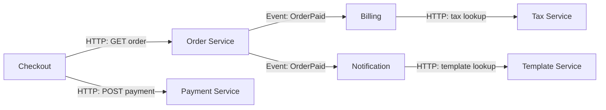
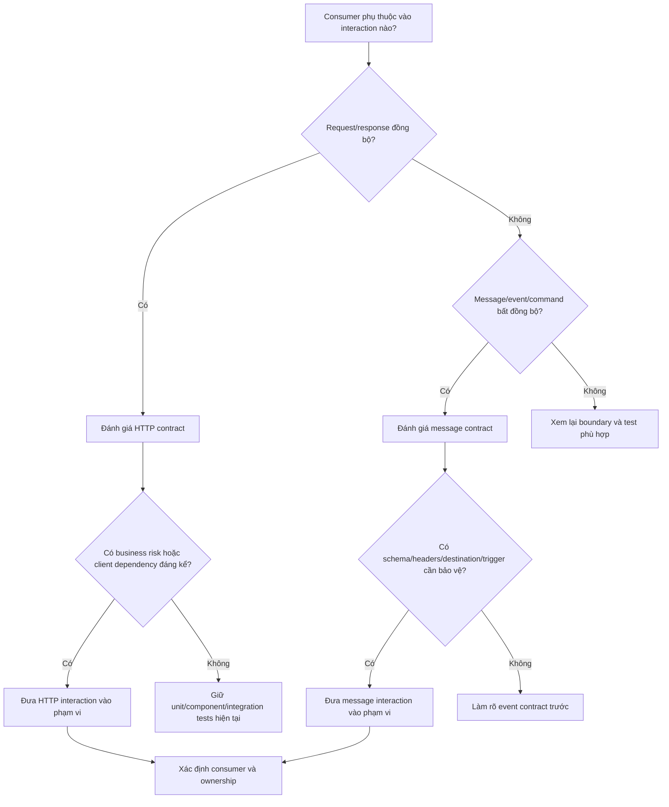
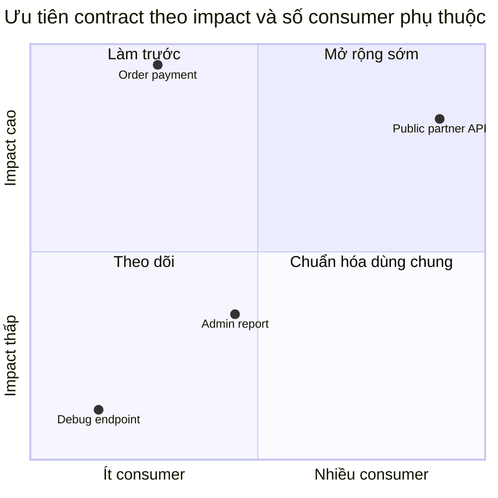
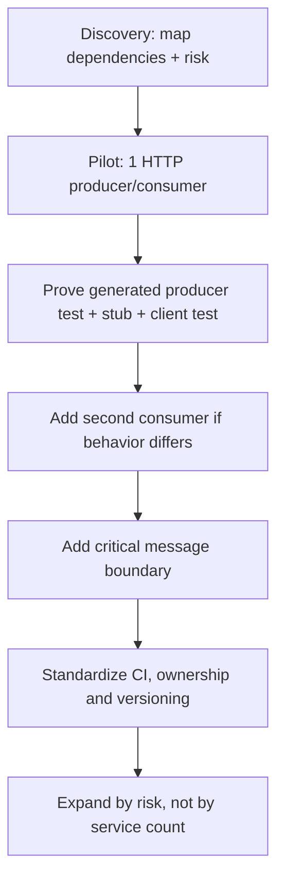
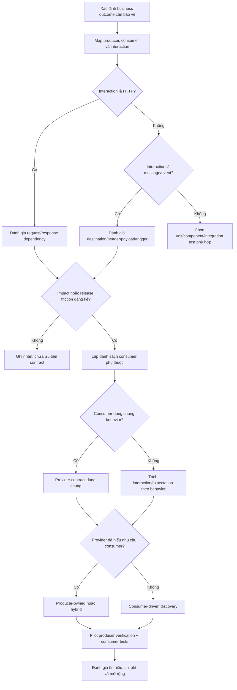

# Chọn phạm vi HTTP, messaging và số consumer cần hỗ trợ

## 1. Vì sao phải chọn phạm vi trước khi viết contract?

Trong **Spring Cloud Contract**, producer và consumer thống nhất những hành vi mà một service phải cung cấp qua HTTP hoặc thông điệp. Groovy DSL/YAML DSL mô tả request, response, message và các điều kiện matching; **Contract Verifier** sinh kiểm thử phía producer, còn **Stub Runner** cung cấp stub để consumer kiểm thử mà không phải khởi động mọi service thật.

Khi bắt đầu áp dụng contract testing, câu hỏi thường không phải “có nên viết contract hay không?” mà là:

- Nên bắt đầu từ **HTTP API**, **messaging**, hay cả hai?
- Có bao nhiêu consumer cần được đưa vào phạm vi ban đầu?
- Contract do producer sở hữu hay consumer đề xuất?
- Có cần một contract cho mỗi consumer, hay nhiều consumer có thể dùng chung một contract?
- Nên kiểm tra endpoint/message nào trước để giảm rủi ro mà không tạo quá nhiều test khó bảo trì?

Chọn phạm vi quá rộng ngay từ đầu làm build chậm, tăng số fixture, tăng công sức đồng bộ version và khiến team khó phân biệt contract có giá trị với contract chỉ lặp lại implementation. Chọn quá hẹp lại có thể bỏ sót giao diện quan trọng: ví dụ HTTP API đã được kiểm tra nhưng sự kiện `OrderPaid` vẫn thay đổi âm thầm, khiến billing hoặc notification hỏng sau deploy.

Bài học này cung cấp một **khung lựa chọn chiến lược** dựa trên giao thức, mức độ phụ thuộc của consumer, rủi ro thay đổi, quyền sở hữu contract và chi phí vận hành. Mục tiêu là xác định một phạm vi nhỏ nhưng có giá trị, sau đó mở rộng có chủ đích.

## 2. Kết quả cần đạt

Sau bài học, bạn có thể:

1. Phân biệt khi nào contract HTTP, messaging hoặc cả hai bảo vệ đúng ranh giới cần kiểm thử.
2. Đánh giá số lượng và mức độ quan trọng của consumer thay vì chỉ đếm service.
3. Chọn producer-owned hoặc consumer-driven contract theo cách các nhóm phối hợp.
4. Xác định interaction nào nên có contract và interaction nào có thể để ở integration/unit tests.
5. Chọn granularity phù hợp: theo endpoint, business interaction, message type hoặc consumer journey.
6. Thiết kế rollout theo giai đoạn, có CI gate và versioning rõ.
7. Nhận biết dấu hiệu phạm vi đang quá rộng, quá hẹp hoặc bị over-specification.

Một quyết định tốt phải trả lời được ba câu hỏi: **đang bảo vệ điều gì, ai phụ thuộc vào điều đó, và bằng chứng nào cho thấy thay đổi không tương thích sẽ bị phát hiện?**

## 3. Tách ba trục quyết định

Không nên gộp “HTTP hay messaging” và “bao nhiêu consumer” thành một lựa chọn duy nhất. Chúng là các trục độc lập:

| Trục | Câu hỏi | Các lựa chọn điển hình |
|---|---|---|
| **Giao thức** | Consumer giao tiếp bằng cách nào? | HTTP, message/event, hoặc cả hai |
| **Mô hình ownership** | Ai xác định nhu cầu tương thích? | Producer-owned, consumer-driven, hoặc kết hợp |
| **Phạm vi consumer** | Ai cần được bảo vệ trong đợt đầu? | Một consumer đại diện, nhóm consumer quan trọng, hoặc toàn bộ consumer |
| **Độ sâu** | Kiểm tra mức nào? | Critical interaction, error paths, schema/matchers, workflow |
| **Vận hành** | Chạy và phân phối contract ra sao? | Cùng repository, contract repository, Maven artifact, CI pipeline |

Ví dụ, một service có thể:

- Cung cấp HTTP API cho ba consumer.
- Phát event qua Kafka cho hai consumer khác.
- Dùng producer-owned contracts cho API công khai.
- Dùng consumer-driven contracts cho một API nội bộ có yêu cầu riêng.
- Chỉ đưa checkout consumer vào giai đoạn đầu vì đây là luồng doanh thu quan trọng.

Đây không phải mâu thuẫn. Một hệ thống có thể dùng **nhiều chiến lược theo từng boundary**, miễn là ownership, nguồn contract và quy trình verification được ghi rõ.

## 4. Bắt đầu từ business risk, không bắt đầu từ danh sách endpoint

Danh sách endpoint hoặc topic cho biết hệ thống có gì; nó không cho biết thay đổi nào gây thiệt hại lớn nhất.

Hãy bắt đầu từ business outcome:

- Checkout có thể hoàn tất thanh toán không?
- Billing có ghi nhận đúng số tiền sau khi nhận event không?
- Notification có gửi đúng thông báo khi đơn hàng được thanh toán không?
- Một đối tác có thể tiếp tục gọi API đã tích hợp không?
- Consumer có xử lý được retry hoặc message trùng không?

Sau đó lần ngược về interactions tạo ra outcome ấy.

### 4.1. Ví dụ: một hành trình có nhiều boundary



Nếu mục tiêu là tránh lỗi trong checkout, có thể ưu tiên:

1. HTTP contract giữa Checkout và Order cho việc đọc trạng thái đơn hàng.
2. HTTP contract giữa Checkout và Payment cho kết quả khởi tạo thanh toán.
3. Message contract giữa Order và Billing cho event `OrderPaid` nếu billing phụ thuộc event đó.

Không cần tự động đưa Tax, Template và mọi endpoint của chúng vào đợt đầu. Chỉ mở rộng khi có business risk hoặc dependency cần bảo vệ.

### 4.2. Lập bản đồ dependency

Tạo một bảng ngắn trước khi chọn:

| Producer | Consumer | Interaction | Giao thức | Business outcome |
|---|---|---|---|---|
| Order | Checkout | Đọc order state | HTTP | Cho phép tiếp tục checkout |
| Payment | Checkout | Tạo payment intent | HTTP | Hoàn tất thanh toán |
| Order | Billing | OrderPaid | Messaging | Ghi nhận khoản phải thu |
| Order | Notification | OrderPaid | Messaging | Gửi xác nhận cho khách |

Một consumer có thể gọi nhiều endpoint hoặc subscribe nhiều message types. Một endpoint có thể phục vụ nhiều consumer. **Đếm service không đủ để quyết định số contract**; cần nhận diện interactions và dependency cụ thể.

## 5. Quyết định HTTP: khi nào nên đưa vào phạm vi?

HTTP contract thường phù hợp khi consumer gửi request và phụ thuộc vào response đồng bộ.

Các dấu hiệu nên ưu tiên:

- Consumer cần status code, header hoặc body cụ thể để quyết định bước tiếp theo.
- API có nhiều consumer độc lập hoặc release cadence khác producer.
- Thay đổi path, query, request field, response field hoặc error semantics có thể làm client hỏng.
- Client có logic mapping status/error, deserialize JSON hoặc retry theo header.
- API là boundary với mobile app, đối tác hoặc hệ thống ngoài tổ chức.

### 5.1. Những gì contract HTTP nên bảo vệ

| Thành phần | Câu hỏi cần trả lời | Ví dụ |
|---|---|---|
| Method/path | Consumer gọi đúng operation? | `GET /api/orders/42` |
| Query parameters | Filter/pagination có đúng? | `?state=PAID&limit=20` |
| Request headers | Có header cần thiết? | `Accept`, tenant hoặc version header |
| Request body | Producer chấp nhận payload consumer gửi? | `POST` với `sku`, `quantity` |
| Status | Success/error có đúng semantics? | `200`, `201`, `400`, `404`, `409` |
| Response headers | Client cần metadata gì? | `Content-Type`, `Location`, `ETag` |
| Response body | Field/type nào consumer phụ thuộc? | `id`, `state`, `currency` |
| Matchers | Dữ liệu động có tuân thủ type/format? | UUID, timestamp |

Không cần khóa mọi header hoặc mọi field. Chỉ mô tả điều kiện có ý nghĩa với consumer và cam kết của producer. Nếu consumer chỉ cần `state`, không nhất thiết buộc contract khóa một `traceId` ngẫu nhiên.

### 5.2. Chọn HTTP interaction theo business dependency

Ví dụ Checkout chỉ cần:

```text
GET /api/orders/42
Response:
  200
  state = PAID
```

Consumer không phụ thuộc vào thứ tự JSON keys, database ID nội bộ hay header tracing. Contract nên giữ những phần cần thiết để client hiểu response và đưa ra quyết định.

Nếu consumer dùng `Location` từ response `201` để tiếp tục truy vấn resource, header đó là dependency và cần được mô tả. Nếu client phân biệt `404 ORDER_NOT_FOUND` với `404 CUSTOMER_NOT_FOUND`, body/error code là một phần contract.

### 5.3. Khi nào chưa cần HTTP contract?

- Consumer và producer là hai module trong cùng một ứng dụng, không có boundary độc lập đáng kể; unit/component tests có thể đủ.
- Endpoint chỉ dùng bởi một test harness nội bộ và không có consumer behavior cần bảo vệ.
- Interaction thay đổi liên tục, chưa có API owner hoặc semantics ổn định; cần làm rõ API trước.
- Integration test hiện tại đã bao phủ boundary tốt, chi phí contract setup chưa tạo thêm tín hiệu hữu ích.

Đây không phải lý do cấm contract. Hãy so sánh chi phí duy trì với rủi ro thay đổi không được phát hiện.

## 6. Quyết định messaging: khi nào cần message contract?

Messaging phù hợp khi producer gửi message/event và consumer xử lý bất đồng bộ. Không có request HTTP đồng bộ ở mỗi lần xử lý; điều quan trọng là **message được gửi đến đâu, có headers/payload gì và consumer phản ứng ra sao**.

Các dấu hiệu nên ưu tiên:

- Producer và consumer được deploy độc lập.
- Nhiều consumer subscribe cùng event.
- Payload hoặc headers quyết định routing, deserialization hoặc business logic.
- Thay đổi event schema có thể làm consumer không parse được hoặc hiểu sai dữ liệu.
- Retry, duplicate, ordering, idempotency hoặc correlation là yêu cầu quan trọng.
- Event là một cam kết liên nhóm hoặc liên hệ thống.

### 6.1. Những gì cần xác định trong message contract

| Thành phần | Câu hỏi | Ví dụ |
|---|---|---|
| Direction | Producer gửi hay nhận message? | Output event `OrderPaid` |
| Destination | Message đến đâu? | `orders.paid` |
| Headers | Consumer dùng metadata nào? | `eventType`, correlation ID |
| Payload | Field/type nào có ý nghĩa? | `orderId`, `state`, `currency` |
| Trigger/input | Điều kiện nào tạo ra message? | Payment success |
| Serialization | Wire format là gì? | JSON, Avro hoặc Protobuf |
| Delivery behavior | Consumer cần xử lý retry/duplicate? | Idempotency key |
| Ordering/key | Có phụ thuộc partition/key không? | `orderId` làm message key |

Spring Cloud Contract hỗ trợ message contracts, nhưng một contract payload đơn lẻ **không tự chứng minh** broker guarantee, exactly-once delivery, retry policy hay toàn bộ consumer group behavior. Những đặc tính vận hành ấy cần test/infrastructure phù hợp.

### 6.2. Ví dụ event OrderPaid

```groovy
import org.springframework.cloud.contract.spec.Contract

Contract.make {
    description 'OrderPaid được phát sau thanh toán'
    label 'order_paid'

    input {
        triggeredBy('publishPaidOrderForContract()')
    }

    outputMessage {
        sentTo('orders.paid')
        headers {
            header('eventType', 'OrderPaid')
        }
        body(
            eventId: 'EVT-42',
            orderId: 42,
            state: 'PAID',
            currency: 'VND'
        )
    }
}
```

`triggeredBy(...)` cần tương ứng với method trong producer base test để kích hoạt flow phát message. Destination, header và body phải khớp adapter/message verifier được dự án cấu hình. Đoạn DSL là ví dụ định hướng; binder, broker và serialization cần được chọn theo runtime thực tế.

### 6.3. Những gì không nên giả định từ một message contract

- Message được gửi đúng một lần.
- Consumer xử lý thành công trong thời gian giới hạn.
- Broker giữ ordering cho mọi key.
- Retry không tạo side effect trùng.
- Consumer đã commit offset sau khi xử lý.
- Mọi consumer đều dùng cùng schema evolution policy.

Nếu các đặc tính này quan trọng, bổ sung integration tests cho broker/adapter và consumer behavior. Contract kiểm tra **ranh giới message đã thỏa thuận**, không thay thế kiểm thử độ tin cậy của hệ thống phân tán.

## 7. HTTP, messaging hay cả hai?

Chọn giao thức theo **interaction thực tế**, không theo xu hướng kiến trúc.

| Tình huống | Phạm vi phù hợp | Lý do |
|---|---|---|
| Checkout gọi Order và cần response ngay | HTTP contract | Đồng bộ, status/body quyết định flow |
| Order phát event cho Billing sau khi thanh toán | Message contract | Consumer nhận sự kiện bất đồng bộ |
| Producer nhận command qua queue rồi phát event | Message contract cho input/output | Cần kiểm tra message direction và trigger |
| Mobile app gọi REST API | HTTP contract | Client release khác server |
| Một service vừa có REST API vừa phát event | Cả hai, theo boundary | Hai giao thức có semantics khác nhau |
| Chỉ gọi database trực tiếp giữa hai module | Có thể chưa cần SCC contract | Không phải HTTP/message boundary |

### 7.1. Ma trận quyết định nhanh



Nếu một workflow đi qua HTTP rồi phát event, đừng chọn một giao thức để đại diện cho cả workflow. Hãy bảo vệ **cả hai boundary** nếu cả hai đều là cam kết độc lập có thể thay đổi.

## 8. Mô hình hỗn hợp: API và event không thay thế nhau

Ví dụ:

- Checkout gọi `POST /payments` và cần biết payment intent được tạo hay bị từ chối.
- Payment service phát `PaymentCaptured` sau khi giao dịch được xác nhận.
- Billing subscribe event để ghi nhận doanh thu.

HTTP contract bảo vệ **request/response tạo payment intent**. Message contract bảo vệ **event được phát và nội dung consumer nhận**. Hai contract có thể liên quan đến cùng một nghiệp vụ nhưng không phải hai bản sao.

### 8.1. Đặt contract theo từng boundary

| Boundary | Producer | Consumer | Contract bảo vệ |
|---|---|---|---|
| HTTP create payment | Payment | Checkout | Request, status, payment intent response |
| Event captured | Payment | Billing | Destination, headers, payload |
| Event captured | Payment | Analytics | Các field analytics thực sự dùng |

Nếu Billing và Analytics cùng subscribe `PaymentCaptured` nhưng phụ thuộc vào các field khác nhau, có thể dùng chung một producer event contract ở cấp provider và bổ sung consumer-specific verification cho từng dependency. Không cần nhân bản toàn bộ event definition chỉ vì có hai subscriber.
## 9. Chọn số consumer: không phải lúc nào cũng cần tất cả ngay từ đầu

Số consumer ảnh hưởng đến chi phí coordination và verification. Nhưng **số lượng đơn thuần không quyết định giá trị**: một consumer có thể xử lý giao dịch quan trọng hơn mười consumer ít dùng.

Hãy đánh giá mỗi consumer theo:

- **Business criticality:** khi consumer hỏng, ảnh hưởng đến doanh thu, khách hàng hoặc nghĩa vụ vận hành ở mức nào?
- **Release independence:** consumer có thể deploy trước/sau producer không?
- **Change sensitivity:** consumer phụ thuộc vào bao nhiêu field, status, header, destination hoặc message semantics?
- **Ownership:** có team riêng và người chịu trách nhiệm cập nhật contract không?
- **Operational reach:** consumer là nội bộ, đối tác, mobile app hay hệ thống khó nâng cấp?
- **Failure detectability:** lỗi hiện có được integration tests hoặc production monitoring phát hiện đủ sớm không?

### 9.1. Chấm điểm ưu tiên consumer

Có thể dùng thang điểm nội bộ từ 1 đến 5:

| Tiêu chí | 1 điểm | 3 điểm | 5 điểm |
|---|---|---|---|
| Business impact | Thấp | Ảnh hưởng một workflow | Ảnh hưởng thanh toán/đơn hàng/đối tác |
| Release independence | Deploy cùng producer | Đôi lúc lệch lịch | Hoàn toàn độc lập |
| Change sensitivity | Ít phụ thuộc | Phụ thuộc một số field | Phụ thuộc nhiều semantics/error paths |
| Upgrade difficulty | Cùng team, dễ nâng | Phải phối hợp | Đối tác/mobile/legacy khó nâng |
| Current test gap | Đã được kiểm tra tốt | Còn một số lỗ hổng | Hầu như không có compatibility test |

Điểm chỉ là **công cụ sắp thứ tự thảo luận**, không phải công thức xác suất hoặc tiêu chuẩn bắt buộc. Có thể ưu tiên consumer có điểm tổng cao, nhưng luôn xem xét một rủi ro nghiêm trọng riêng lẻ ngay cả khi tổng điểm thấp.

### 9.2. Ma trận lựa chọn theo số consumer

| Quy mô consumer | Cách bắt đầu | Cách mở rộng |
|---|---|---|
| **1 consumer** | Chọn interaction quan trọng nhất, thống nhất owner và test client thật | Thêm error paths hoặc message boundary khi có rủi ro |
| **2–3 consumer** | Bắt đầu với consumer quan trọng nhất và một consumer có behavior khác biệt | Xem consumer còn lại có dùng chung contract hay cần expectation riêng |
| **4–10 consumer** | Lập dependency inventory; chọn nhóm đại diện theo business behavior/release cadence | Chuẩn hóa artifact/version, consumer CI và ownership |
| **Nhiều consumer/đối tác** | Chọn contract provider-level ổn định, kiểm tra consumer critical, có chính sách versioning | Mở rộng verification theo nhóm, không nhân bản tất cả kịch bản cho mọi client |

Các khoảng số này chỉ để gợi ý cách tổ chức. Một API công khai có hai consumer bên ngoài có thể cần kiểm soát chặt hơn một API nội bộ có mười consumer cùng release train.

## 10. Một contract cho mỗi consumer hay một contract dùng chung?

**Không tạo một bản sao contract cho mỗi consumer theo mặc định.** Nếu các consumer thực sự phụ thuộc cùng một request/response behavior, có thể dùng chung một provider contract và cùng một stub artifact. Khi expectation khác nhau, tạo interactions/contract riêng cho các behavior khác nhau, có owner rõ ràng.

### 10.1. Khi nên dùng chung contract

- Các consumer gọi cùng operation và gửi request có semantics giống nhau.
- Các field/status/headers được kiểm tra là cam kết chung của producer.
- Một thay đổi ở provider phải được tất cả consumer nhìn thấy như cùng một thay đổi.
- Không cần sample response hoặc matcher riêng theo client.

Ví dụ Checkout, Admin và Support đều gọi `GET /api/orders/{id}` và cần `id`, `state`, `currency`. Một contract provider-level có thể mô tả response chung; mỗi consumer vẫn có thể viết test riêng cho business behavior của mình.

### 10.2. Khi nên có contract interaction riêng

- Consumer gửi payload khác nhau theo workflow hoặc quyền hạn.
- Một client cần status/error semantics khác do endpoint/operation khác.
- Một consumer phụ thuộc vào header, query hoặc message metadata mà consumer khác không dùng.
- Có versioned API hoặc behavior được phân biệt rõ theo protocol/version.
- Consumer-specific expectation được xác nhận là một cam kết producer cần hỗ trợ.

Ví dụ:

| Consumer | Interaction | Khác biệt có ý nghĩa |
|---|---|---|
| Checkout | `GET /api/orders/42` | Cần `state` để quyết định thanh toán |
| Admin | `GET /api/orders/42?include=history` | Cần thêm lịch sử |
| Partner | `GET /partner/v1/orders/42` | Có versioning và error format riêng |

Không ép ba behavior này vào một contract khổng lồ chỉ vì cùng đọc dữ liệu Order.

### 10.3. Consumer-specific tests không nhất thiết tạo consumer-specific stub

Một stub provider-level có thể dùng chung, trong khi:

- Checkout test `PAID` cho phép xuất biên lai.
- Admin test đọc lịch sử và hiển thị đúng thứ tự.
- Partner test mapping `404` sang error schema đã cam kết.

Mỗi consumer test tập trung vào **behavior của chính consumer**. Stub cung cấp response đã được producer contract xác minh. Nếu cần response sample khác, hãy tạo interaction/stub mapping riêng có request predicate rõ; tránh để nhiều mappings cùng khớp một request mà trả kết quả không xác định.

## 11. Chọn mô hình ownership: producer-owned hay consumer-driven?

Số consumer và ownership liên quan nhưng không đồng nhất. Có nhiều consumer không tự động có nghĩa phải dùng consumer-driven contracts; một API provider-owned tốt có thể phục vụ nhiều clients nếu semantics đủ chung.

### 11.1. Producer-owned contract

Producer team định nghĩa API/event behavior mà họ cam kết cung cấp, viết Groovy/YAML contracts và chịu trách nhiệm:

1. Review thay đổi contract.
2. Sinh producer tests bằng Verifier.
3. Chạy generated tests trên implementation.
4. Đóng gói và publish stub artifact.
5. Thông báo version/release và deprecation policy.

Phù hợp khi:

- Producer sở hữu một API chuẩn có nhiều consumer.
- API được thiết kế theo domain/provider contract ổn định.
- Các consumer cần behavior chung.
- Một team chịu trách nhiệm rõ ràng về schema/compatibility.

**Rủi ro:** producer có thể mô tả API theo góc nhìn của mình mà bỏ qua dependency thực tế của consumer. Hãy bổ sung consumer review, usage inventory và consumer tests.

### 11.2. Consumer-driven contract

Consumer team mô tả request và response/message mà ứng dụng thực sự cần; producer xác minh rằng implementation đáp ứng những expectation đó.

Phù hợp khi:

- Consumer có dependency đặc thù và khó nâng cấp.
- Producer không biết đầy đủ cách các clients đang sử dụng API.
- Có nhiều nhóm phát triển độc lập và cần feedback rõ từ phía consumer.
- Thay đổi nhỏ về status/error/header có thể phá client hiện hữu.

**Rủi ro:** nhiều consumer có thể đưa ra expectations trùng lặp hoặc quá chi tiết. Nếu producer phải thỏa mãn mọi chi tiết không cần thiết, contract suite trở thành gánh nặng và cản trở refactor.

### 11.3. Kết hợp hai mô hình

Một cách tổ chức thường thực tế:

- Producer-owned contract mô tả **public capability** và behavior chuẩn.
- Consumer-driven interactions bổ sung những dependency thật sự đặc thù.
- Producer CI chạy tất cả contracts đã được chấp thuận.
- Consumer CI dùng stub phù hợp để kiểm tra client behavior.
- API owner xem xét conflicts và loại bỏ expectations không còn được sử dụng.

### 11.4. Ma trận ownership

| Điều kiện | Producer-owned | Consumer-driven | Kết hợp |
|---|---|---|---|
| Một provider API chuẩn | **Rất phù hợp** | Có thể không cần | Phù hợp |
| Nhiều consumer độc lập | Phù hợp nếu behavior chung | Phù hợp khi dependency khác nhau | **Thường hữu ích** |
| Consumer legacy khó nâng | Cần consumer review kỹ | **Rất phù hợp** | Phù hợp |
| Producer chưa biết client usage | Cần discovery trước | **Giúp khám phá dependency** | Phù hợp |
| Rất nhiều consumer trùng expectations | **Dễ quản lý hơn** | Dễ lặp | Phù hợp nếu normalize |
| API công khai/đối tác | Provider contract là nền | Consumer contracts bổ sung | **Thường hợp lý** |

Không cần chọn một mô hình cho toàn bộ công ty. Chọn theo **boundary, mức độ độc lập và cách các team phối hợp**.
## 12. Chọn contract theo interaction, không theo controller class

Một controller có thể chứa nhiều operations, nhưng không phải operation nào cũng có cùng business risk. Một message topic có thể chứa nhiều event types; một event type có thể có nhiều business scenarios.

Hãy xác định **interaction unit** là một hành vi có thể được consumer gọi/nhận và có expectation rõ.

Ví dụ Order API:

| Interaction | Consumer dependency | Ưu tiên gợi ý |
|---|---|---|
| Lấy order đã thanh toán | Checkout cần state | Cao |
| Lấy order không tồn tại | Checkout cần xử lý `ORDER_NOT_FOUND` | Cao nếu có error handling |
| Lọc order theo trạng thái | Admin cần pagination/filter | Theo tần suất và tác động |
| Endpoint nội bộ chỉ phục vụ debug | Không có consumer business | Thấp |

Ví dụ event:

| Message interaction | Dependency | Ưu tiên gợi ý |
|---|---|---|
| `OrderPaid` | Billing ghi nhận doanh thu | Cao |
| `OrderPaid` | Notification gửi xác nhận | Cao nếu là cam kết gửi thông báo |
| `OrderViewed` | Analytics thống kê | Theo tác động của dữ liệu và khả năng mất event |
| Debug event | Không có consumer nghiệp vụ | Thấp |

### 12.1. Không viết contract cho mọi method

Contract testing nên bảo vệ **giao diện giữa process/team**, không thay thế toàn bộ unit tests. Các quy tắc tính thuế nội bộ, thuật toán sắp xếp trong service hoặc cách truy vấn repository thường phù hợp với unit/integration tests. Chỉ đưa chúng vào contract nếu chúng làm thay đổi behavior quan sát được mà consumer phụ thuộc.

## 13. Chọn granularity: đủ nhỏ để hiểu, đủ lớn để có ý nghĩa

Một contract quá nhỏ có thể kiểm tra từng field rời rạc mà không bảo vệ business scenario. Một contract quá lớn lại khóa nhiều hành vi không liên quan và khó chẩn đoán.

### 13.1. Các mức granularity

| Mức | Ví dụ | Ưu điểm | Rủi ro |
|---|---|---|---|
| Field/schema | `state` là enum | Dễ phát hiện type/schema change | Không bảo vệ request/response flow |
| HTTP interaction | `GET /orders/{id}` | Rõ request/response | Có thể thiếu error paths |
| Business scenario | Order paid / not found | Gắn với dependency thực | Cần fixture rõ |
| Message interaction | `OrderPaid` được phát | Bảo vệ event boundary | Không bao phủ broker reliability |
| End-to-end journey | Checkout → Payment → Order → Billing | Cho thấy toàn workflow | Dễ biến thành integration test lớn, khó cô lập |

### 13.2. Quy tắc chọn mức

- Chọn **HTTP interaction** khi request/response là boundary cần bảo vệ.
- Chọn **business scenario** khi cùng endpoint có nhiều outcome quan trọng.
- Chọn **message interaction** khi payload/destination/header là cam kết độc lập.
- Dùng end-to-end tests cho một số workflow trọng yếu, không nhân bản toàn bộ dependency graph bằng contract.

## 14. Độ sâu của contract: success, error và dynamic values

Không phải interaction nào cũng cần tất cả status code hoặc mọi tổ hợp dữ liệu. Chọn nhánh dựa trên behavior mà consumer thật sự xử lý.

### 14.1. Chọn success paths

Hầu hết consumer có ít nhất một success scenario. Bắt đầu từ path mang business value chính:

- Order `PAID` để Checkout tiếp tục.
- Payment intent được tạo để client nhận redirect/action.
- Event `OrderPaid` để Billing ghi nhận doanh thu.

### 14.2. Chọn error paths

Thêm error contract khi consumer có behavior riêng:

- `400 INVALID_QUANTITY`: hiển thị lỗi validation.
- `404 ORDER_NOT_FOUND`: kết thúc workflow hoặc báo người dùng.
- `409 ORDER_ALREADY_PAID`: tránh xử lý thanh toán lặp.
- `429`/`503`: retry hoặc backoff theo policy.

Không cần tạo contract cho mọi lỗi kỹ thuật có thể xảy ra nếu consumer không có behavior cần bảo vệ. Nhưng nếu consumer dựa vào error code/status để phân nhánh, phải mô tả chính xác.

### 14.3. Dynamic values và matchers

Dùng matcher cho dữ liệu thực sự biến động như UUID hoặc timestamp; giữ sample response có thể dùng được trong stub. Không thay business field `state`, `currency` hoặc `error.code` bằng wildcard quá rộng chỉ để producer test dễ pass.

### 14.4. Message variants

Nếu event có nhiều variants, hãy xác định:

- Event type/version nào là public.
- Field nào bắt buộc với mọi consumer.
- Field nào optional và cách consumer xử lý khi thiếu.
- Consumer có phân biệt schema version hoặc event type không.
- Các biến thể có thể dùng một contract family hay cần interaction riêng.

Đừng coi một sample payload duy nhất là đại diện cho mọi event variant nếu semantics khác nhau.

## 15. Xếp hạng interaction theo rủi ro

Khi danh sách endpoint/topic dài, hãy xếp hạng **interaction**, không chỉ xếp hạng service. Một cách đơn giản là đánh giá năm yếu tố:

1. **Impact:** nếu interaction sai, hậu quả business là gì?
2. **Likelihood:** contract/schema thường xuyên thay đổi hay đã ổn định?
3. **Consumer exposure:** bao nhiêu consumer và bao nhiêu workflow phụ thuộc?
4. **Upgrade friction:** consumer có thể nâng cùng lúc hay phải hỗ trợ nhiều version?
5. **Detection gap:** test hiện tại có phát hiện lỗi trước deploy không?

Có thể dùng ma trận định tính:

| Mức ưu tiên | Dấu hiệu | Phạm vi đề xuất |
|---|---|---|
| **P0 — Critical** | Thanh toán, xác nhận đơn, compliance, partner API; lỗi gây mất giao dịch | HTTP/message contract cho success và critical error paths; producer + consumer verification |
| **P1 — High** | Workflow vận hành quan trọng, nhiều consumer độc lập | Contract cho interaction có dependency rõ; kiểm tra consumer đại diện và khác biệt |
| **P2 — Medium** | Tính năng hỗ trợ, ít rủi ro hoặc đã có integration coverage | Bổ sung khi thay đổi thường xuyên hoặc có failure evidence |
| **P3 — Low** | Debug/admin nội bộ ít dùng, không có business dependency rõ | Unit/component tests hoặc theo dõi; chưa cần ưu tiên contract |

Mức ưu tiên cần được review khi business context thay đổi. Một endpoint ít dùng hôm nay có thể trở thành partner integration quan trọng vào quý sau.

### 15.1. Ma trận risk × consumer exposure



Sơ đồ chỉ minh họa cách thảo luận, không phải số liệu của một hệ thống thực. **Impact cao với một consumer duy nhất vẫn có thể là P0**; không được trì hoãn chỉ vì số consumer thấp.

## 16. Chọn phạm vi rollout theo giai đoạn

Thay vì đưa tất cả service vào cùng một release, hãy chia theo độ trưởng thành và giá trị feedback.

### 16.1. Giai đoạn 0 — discovery

- Lập dependency map producer/consumer.
- Hỏi consumer team họ thực sự đọc field/status/header/message nào.
- Xác định API/event owner và người review contract.
- Đánh giá test hiện có và failure mode đã từng xảy ra.
- Chọn một interaction có rủi ro rõ và có thể tạo fixture ổn định.

**Đầu ra:** một bảng dependency và một interaction được chọn để pilot.

### 16.2. Giai đoạn 1 — pilot một HTTP boundary

Chọn một producer và một consumer có phối hợp tốt:

1. Viết một contract HTTP cho happy path quan trọng.
2. Sinh producer test bằng Verifier.
3. Chạy test trên implementation.
4. Publish stub artifact.
5. Consumer dùng Stub Runner và HTTP client thật.
6. Cố ý thay đổi status/body để chứng minh test bắt được regression.

Mục tiêu là chứng minh **toàn bộ workflow** trước khi mở rộng số contract.

### 16.3. Giai đoạn 2 — thêm consumer khác biệt

Chọn consumer thứ hai nếu nó có:

- Release cadence khác.
- Request shape hoặc error handling khác.
- Legacy constraints.
- Business dependency chưa được consumer đầu tiên đại diện.

Nếu consumer thứ hai dùng đúng behavior đã có, dùng chung contract/stub và viết test behavior riêng ở consumer. Không sao chép contract chỉ để tăng số file.

### 16.4. Giai đoạn 3 — đưa messaging vào phạm vi

Chọn event quan trọng có consumer độc lập:

- Xác định destination, headers, payload và trigger.
- Dùng message verifier/binder phù hợp.
- Sinh producer message test.
- Kiểm tra consumer listener với message stub hoặc test adapter.
- Bổ sung broker integration test nếu cần kiểm tra retry, duplicate, ordering hoặc offset.

Không chuyển toàn bộ topic vào contract testing chỉ vì pilot HTTP thành công. Ưu tiên event có tác động rõ.

### 16.5. Giai đoạn 4 — chuẩn hóa vận hành

- Chuẩn hóa contract naming, ownership và review.
- Version hóa stub artifacts và pin dependency trong CI.
- Xác nhận generated tests không bị skip.
- Lưu producer/consumer reports và resolved artifact coordinates.
- Có quy trình deprecate interaction không còn dùng.
- Theo dõi chi phí build và thời gian sửa contract.

### 16.6. Roadmap minh họa



## 17. Đặt phạm vi producer và consumer verification

Một chiến lược tốt xác định rõ **ai xác minh điều gì**:

| Kiểm thử | Bên chạy | Điều cần chứng minh |
|---|---|---|
| Generated producer contract test | Producer CI | Implementation đáp ứng request/message và response/output contract |
| Stub packaging check | Producer CI | Artifact có mapping/message stub đúng và version truy vết được |
| Consumer stub test | Consumer CI | Client/listener thật xử lý đúng interaction đã mô tả |
| Broker/transport integration test | Integration environment | Adapter, routing, serialization, delivery behavior phù hợp |
| End-to-end test | System/release CI | Một số business journey xuyên nhiều boundary hoạt động |

Không nên bắt consumer CI khởi động toàn bộ producer stack chỉ để kiểm tra contract; đó là một mục tiêu khác và có chi phí khác. Cũng không nên chỉ chạy consumer stub tests mà bỏ producer verification, vì stub có thể đúng nhưng implementation thật của producer sai.

## 18. Chọn cách phân phối contract và stub

Phạm vi consumer càng rộng thì cách phân phối artifact càng quan trọng.

### 18.1. Cùng repository hoặc cùng build

Phù hợp khi:

- Pilot có ít module.
- Producer và consumer được build trong cùng workspace.
- Team muốn feedback nhanh và có thể chia sẻ artifact build.

Lưu ý: vẫn phải có dependency rõ giữa producer generated stubs và consumer tests. Không để consumer đọc trực tiếp file generated output mà không qua một artifact/contract interface được quản lý.

### 18.2. Maven artifact repository

Phù hợp khi:

- Producer và consumer có repository/CI độc lập.
- Nhiều consumer cần cùng một stub.
- Cần versioning, retention và traceability.

Consumer khai báo group/artifact/version/classifier `stubs`; Stub Runner resolve artifact theo mode và repository config. Với SNAPSHOT mutable, phải lưu resolved version/checksum và tránh test release dựa trên artifact không xác định.

### 18.3. Contract repository hoặc shared contract source

Có thể dùng repository riêng để quản lý contracts do consumer đề xuất hoặc provider sở hữu. Cần xác định:

- Ai được merge contract?
- Producer build lấy revision nào?
- Contract đã được verify bởi producer version nào?
- Consumer nào còn dùng interaction?
- Cách deprecate/xóa contract cũ?

Không dùng một nhánh mutable làm nguồn cho release mà không pin commit/revision.
## 19. Ba tình huống mẫu và cách ra quyết định

### 19.1. Tình huống A — một producer, một consumer quan trọng

**Bối cảnh:** Checkout là consumer duy nhất của Order API trong giai đoạn hiện tại. Checkout cần trạng thái `PAID` để xuất biên lai; Order được deploy độc lập và đôi khi thay đổi response.

**Lựa chọn:**

- Bắt đầu bằng HTTP contract cho `GET /api/orders/{id}`.
- Producer-owned contract là đủ nếu Checkout và Order cùng review semantics.
- Chạy generated producer test và một consumer Stub Runner test.
- Thêm error interaction `404 ORDER_NOT_FOUND` nếu Checkout có xử lý nhánh này.
- Chưa cần đưa mọi endpoint Admin vào phạm vi.

**Vì sao:** business impact cao và dependency rõ; số consumer thấp không làm giảm giá trị của contract.

### 19.2. Tình huống B — một event, nhiều consumer độc lập

**Bối cảnh:** Order phát `OrderPaid`; Billing, Notification và Analytics subscribe event. Ba consumer có release cadence riêng.

**Lựa chọn:**

- Tạo message contract provider-level cho destination, headers và payload chung.
- Liệt kê field mà từng consumer thực sự sử dụng.
- Giữ `eventId`, `orderId`, `state` và các field business được cam kết.
- Consumer tests kiểm tra behavior riêng của Billing, Notification và Analytics.
- Bổ sung broker integration tests cho retry/idempotency nếu đây là cam kết vận hành.

**Vì sao:** một event có nhiều subscribers làm tăng exposure; một provider contract chung giúp tránh định nghĩa payload mâu thuẫn, còn consumer tests riêng chứng minh từng subscriber xử lý đúng.

### 19.3. Tình huống C — nhiều HTTP consumer với nhu cầu khác nhau

**Bối cảnh:** Order API phục vụ Checkout, Admin, Support và một partner. Checkout chỉ cần state; Admin cần history; Partner dùng API version riêng và error schema riêng.

**Lựa chọn:**

- Giữ contract provider-level cho API chung mà nhiều consumer sử dụng.
- Tạo interaction riêng cho query/history và partner versioned API.
- Chạy consumer tests cho Checkout và Partner trước vì khác biệt behavior và upgrade friction.
- Không nhân bản toàn bộ response contract cho Support nếu nó dùng đúng behavior đã được bảo vệ.
- Lập deprecation/version policy cho Partner API.

**Vì sao:** số consumer lớn không có nghĩa mỗi consumer cần một bản sao của mọi contract. Cần chia theo behavior thực sự khác nhau.

### 19.4. Tình huống D — HTTP request rồi message event

**Bối cảnh:** Checkout gọi Payment để tạo intent. Khi thanh toán thành công, Payment phát `PaymentCaptured`; Billing và Notification xử lý event.

**Lựa chọn:**

- HTTP contract cho create payment intent.
- Message contract cho event PaymentCaptured.
- Consumer contract tests cho Checkout HTTP client và Billing/Notification listeners.
- Một số end-to-end tests kiểm tra workflow thanh toán hoàn chỉnh.

**Vì sao:** hai giao thức bảo vệ hai boundary khác nhau trong cùng một business flow.

## 20. Mô hình quyết định tổng hợp

Dùng bảng sau trong buổi design review:

| Câu hỏi | Nếu Có | Nếu Không |
|---|---|---|
| Consumer gửi request đồng bộ và dựa vào response? | Đánh giá HTTP contract | Chuyển sang câu hỏi message |
| Consumer nhận message/event từ producer? | Đánh giá message contract | Xem lại boundary |
| Thay đổi có business impact hoặc upgrade friction đáng kể? | Đưa interaction vào shortlist | Có thể để ở test hiện tại |
| Nhiều consumer dùng chung behavior? | Provider-level contract có thể dùng chung | Xem interaction riêng |
| Consumer có dependency đặc thù chưa được provider mô tả? | Bổ sung consumer-driven expectation đã review | Producer-owned có thể đủ |
| Message delivery semantics cần đảm bảo? | Bổ sung broker integration tests | Contract payload có thể đủ cho schema behavior |
| Có thể tạo fixture và test tái lập? | Pilot ngay | Làm rõ state/trigger trước |

### 20.1. Decision tree hoàn chỉnh


## 21. Anti-pattern khi chọn phạm vi

| Anti-pattern | Hậu quả | Cách sửa |
|---|---|---|
| Contract mọi endpoint ngay từ ngày đầu | Build chậm, nhiều fixtures, ít tín hiệu | Bắt đầu từ critical interactions |
| Chỉ contract HTTP vì team quen REST | Message schema thay đổi âm thầm | Map cả event/topic và chọn event rủi ro cao |
| Contract mọi message chỉ vì có broker | Quá tải test, khó hiểu ownership | Chọn event consumer phụ thuộc thực |
| Một file/contract cho mỗi consumer dù behavior giống nhau | Trùng lặp, drift | Dùng provider contract chung, test consumer riêng |
| Một contract khổng lồ cho cả workflow | Khó chẩn đoán và thay đổi | Chia theo boundary/interaction |
| Khóa mọi JSON field và header | Over-specification, cản refactor | Chỉ khóa dependency và public promises |
| Dùng wildcard cho business field | Test yếu, breaking change lọt qua | Exact values hoặc matcher có ngữ nghĩa |
| Chỉ kiểm tra stub ở consumer | Producer code có thể sai dù stub đúng | Chạy generated producer tests |
| Chỉ kiểm tra producer tests | Consumer client có thể deserialize/handle sai | Chạy client/listener thật với stub |
| Dùng một E2E test thay toàn bộ contract | Chậm, flaky, khó quy lỗi | Contract ở boundary + ít E2E cho journey quan trọng |
| Chọn consumer đại diện chỉ theo số lượng | Bỏ sót legacy/partner khác biệt | Chọn theo behavior và release friction |
| Không có owner/deprecation policy | Contract cũ tồn tại vô hạn | Gắn owner, consumer usage và lifecycle |
| Publish SNAPSHOT mutable làm release evidence | Kết quả không tái lập | Pin candidate/version/checksum |
| Dùng contract để chứng minh exactly-once | Sai phạm vi bằng chứng | Bổ sung broker/transport integration tests |

## 22. Quản trị ownership và vòng đời contract

Khi số consumer tăng, chiến lược cần một operating model rõ.

### 22.1. Vai trò đề xuất

| Vai trò | Trách nhiệm |
|---|---|
| Producer/API owner | Định nghĩa public behavior, review contract và versioning |
| Consumer owner | Xác nhận dependency thật và duy trì consumer tests |
| Contract reviewer | Kiểm tra matcher, scope, semantics và compatibility |
| Platform/build owner | Hỗ trợ Verifier, Stub Runner, repository và CI |
| Domain architect | Giải quyết conflict giữa consumers và quyết định deprecation |

Một người có thể đảm nhận nhiều vai trò trong team nhỏ. Điều quan trọng là **mỗi contract có người chịu trách nhiệm**, không phải có đủ chức danh.

### 22.2. Metadata tối thiểu để quản lý

Mỗi interaction nên truy vết được:

- Contract ID và mô tả business.
- Producer owner.
- Consumer/team sử dụng.
- Protocol và destination/endpoint.
- Source revision và artifact version.
- Ngày tạo/cập nhật và trạng thái lifecycle.
- Error/compatibility notes.
- Link tới producer và consumer CI evidence theo quy trình nội bộ.

Không cần nhúng toàn bộ metadata vào Groovy DSL nếu team có manifest/catalog riêng. Nhưng thông tin phải có nơi tra cứu và cập nhật.

### 22.3. Deprecation và removal

Trước khi xóa một interaction:

1. Xác định consumer nào còn sử dụng.
2. Kiểm tra code, CI references và runtime/usage evidence.
3. Thông báo thời gian deprecation và phương án migration.
4. Chạy consumer compatibility tests với phiên bản thay thế.
5. Chỉ remove sau khi owner của consumer liên quan xác nhận.

Contract không còn dùng nên được dọn có chủ đích; giữ mãi contract chết làm chậm review và khiến team hiểu nhầm đó vẫn là cam kết hiện hành.

## 23. Đo hiệu quả của phạm vi đã chọn

Đừng đánh giá thành công chỉ bằng số lượng contract files. Hãy đo xem contract có phát hiện lỗi đúng nơi và chi phí vận hành có chấp nhận được không.

| Chỉ số | Điều nó cho biết | Cách diễn giải |
|---|---|---|
| Critical interactions covered | Mức bảo vệ dependency quan trọng | Đo theo inventory đã review, không theo mọi endpoint |
| Generated producer tests executed | Verifier thật sự tham gia CI | Kiểm tra report, không chỉ source count |
| Consumer tests using stubs | Clients quan trọng có kiểm tra behavior | Chia theo consumer/team |
| Breaking changes caught before release | Tín hiệu giá trị của contract | Ghi nhận case và impact |
| False-positive/maintenance rate | Contract có quá chặt hoặc thiếu ownership? | Review matcher/fixture |
| Build duration | Chi phí feedback | Theo dõi trend và parallelization |
| Time to update contract | Chi phí phối hợp | Xác định ownership bottleneck |
| Stale/unused contracts | Phạm vi có phình to? | Dọn theo lifecycle |

Một tỷ lệ coverage cao nhưng không có critical consumer tests có thể tạo cảm giác an toàn giả. Ngược lại, một pilot nhỏ phát hiện được breaking change trước deploy là bằng chứng tốt để mở rộng.

## 24. Bài tập: chọn phạm vi cho hệ thống Commerce

### 24.1. Bối cảnh

Một hệ thống Commerce có:

- Order Service cung cấp REST API cho Checkout, Admin và Partner.
- Order Service phát event `OrderPaid` cho Billing, Notification và Analytics.
- Payment Service cung cấp HTTP API cho Checkout và phát event `PaymentCaptured`.
- Partner chỉ nâng cấp theo chu kỳ tháng.
- Billing xử lý doanh thu; nếu event bị hiểu sai, đối soát có thể sai.
- Admin dùng API nội bộ và có integration tests hiện tại.

### 24.2. Nhiệm vụ

1. Lập bảng producer/consumer/interaction/protocol/business impact.
2. Chọn ba interactions ưu tiên đầu tiên và giải thích vì sao.
3. Quyết định HTTP, messaging hay cả hai cho từng interaction.
4. Chọn consumer cần đưa vào pilot và consumer có thể dùng chung provider contract.
5. Chọn producer-owned, consumer-driven hoặc hybrid.
6. Xác định success/error paths và message fields cần bảo vệ.
7. Đề xuất giai đoạn rollout và CI gates.
8. Nêu một anti-pattern có thể xảy ra nếu đưa toàn bộ hệ thống vào phạm vi ngay.

### 24.3. Gợi ý một phương án

| Ưu tiên | Interaction | Consumer | Protocol | Lý do |
|---|---|---|---|---|
| 1 | Payment create intent | Checkout | HTTP | Ảnh hưởng trực tiếp luồng thanh toán |
| 2 | `OrderPaid` | Billing | Messaging | Ảnh hưởng doanh thu/đối soát |
| 3 | Partner order lookup | Partner | HTTP | Consumer khó nâng cấp, release độc lập |

Có thể dùng producer-owned contract cho behavior Order/Payment chuẩn, đồng thời lấy consumer-driven input từ Partner vì họ có upgrade cadence riêng. Notification/Analytics được đưa vào giai đoạn tiếp theo nếu field dependencies của chúng khác hoặc có risk cần bảo vệ.

Đây chỉ là **một phương án mẫu**. Nếu checkout flow đang là rủi ro lớn nhất hoặc Partner API có contract versioning tốt sẵn, thứ tự có thể thay đổi. Học viên cần giải thích quyết định dựa trên impact và dependency evidence.

### 24.4. Tiêu chí đánh giá bài tập

- Phân biệt đúng HTTP và message boundary.
- Không đánh đồng số service với số contract.
- Chọn consumer theo impact, release independence và upgrade friction.
- Tránh sao chép contract cho các consumer có behavior giống nhau.
- Có producer verification và consumer behavior tests.
- Nhận biết giới hạn message contract đối với broker delivery guarantees.
- Có ownership, versioning và CI evidence rõ.

## 25. Checklist quyết định phạm vi

### Discovery và risk

- [ ] Đã xác định business outcome cần bảo vệ.
- [ ] Đã lập dependency map producer/consumer theo interaction.
- [ ] Đã phân biệt HTTP request/response với message/event boundary.
- [ ] Đã đánh giá business impact, release independence và upgrade friction.
- [ ] Đã chọn interactions có rủi ro cao nhất cho pilot.

### Consumer và ownership

- [ ] Đã biết consumer/team nào thật sự phụ thuộc vào interaction.
- [ ] Đã quyết định behavior nào có thể dùng chung provider contract.
- [ ] Consumer-specific expectations chỉ được tách khi behavior/dependency khác.
- [ ] Đã chọn producer-owned, consumer-driven hoặc hybrid có lý do.
- [ ] Có owner và reviewer cho mỗi contract.

### Contract scope

- [ ] HTTP contract bảo vệ method/path/query/headers/status/body cần thiết.
- [ ] Message contract xác định direction/destination/headers/payload/trigger.
- [ ] Success và critical error paths phản ánh behavior consumer thực sự xử lý.
- [ ] Dynamic matchers giữ đúng type/format và không làm yếu business assertion.
- [ ] Không khóa metadata/field không phải dependency nếu không có lý do.
- [ ] Không dùng SCC contract thay cho broker reliability hoặc toàn bộ E2E tests.

### Rollout và vận hành

- [ ] Pilot chứng minh generated producer tests thực thi trên code thật.
- [ ] Stub artifact có version/classifier và provenance rõ.
- [ ] Consumer tests chạy client/listener thật với Stub Runner.
- [ ] CI kiểm tra cả producer verification và consumer compatibility.
- [ ] Version/SNAPSHOT policy hỗ trợ build tái lập.
- [ ] Có deprecation/removal process và consumer inventory.
- [ ] Có metrics về critical coverage, build duration, maintenance và regressions caught.

**Ghi nhớ:** Chọn phạm vi Spring Cloud Contract theo **giao thức của từng interaction, business risk và tập consumer thực sự phụ thuộc**. Bắt đầu từ boundary quan trọng nhất, dùng chung contract khi behavior chung, tách expectation khi dependency khác, và bổ sung HTTP/messaging theo nhu cầu thực. **Một phạm vi nhỏ có ownership rõ, producer verification chạy thật và consumer tests có giá trị sẽ tốt hơn một kho contract lớn nhưng không ai duy trì.**
